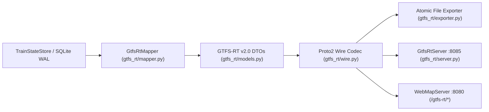

# Hellenic Railways (railway.gov.gr) Live Train Tracker Architecture

Detailed architectural analysis and reverse engineering specification of the Hellenic Railways (`railway.gov.gr/train-tracker`) digital monitoring platform, real-time Server-Sent Events (SSE) telemetry feed, HEPOS spatial positioning pipeline, and Python client integration.

---

## 1. Executive Summary & System Overview

The `railway.gov.gr/train-tracker` platform is the official live train tracking and railway network surveillance system operated by the Hellenic Railways Organisation (ΟΣΕ) and the Greek Ministry of Infrastructure and Transport. The platform provides real-time train positioning, travel progress, scheduled versus actual timetables, train delays, and infrastructure GIS visualization across the Greek national rail network.

```text
+-----------------------------------------------------------------------------------+
|                           System Overview Topology                                |
+-----------------------------------------------------------------------------------+

 [Locomotives on Tracks]
   |
   |-- Dual Multi-band GNSS (Galileo + GPS)
   |-- HEPOS Ground Network Differential Corrections (RTK/DGNSS via NTRIP)
   |-- On-board Telemetry Ingestion Unit (OTU)
   v
 [Satellite / Cellular Backhaul]
   |
   |-- Primary: Starlink Low-Latency Satellite Uplink
   |-- Secondary: 4G/5G Cellular Failover
   v
 [National Control Hub - Acharnes Railway Center (SKA)]
   |
   |-- Telemetry Ingestion & Parsing Engine
   |-- GIS Map Matcher & Track Snapper (HEPOS -> OSE Spatial Graph)
   |-- Delay Calculation & Timetable Synchronizer
   v
 [Public Cloud & Edge Distribution (railway.gov.gr)]
   |
   +---> SSE Broker: /api/train-stream (Real-Time Positions & Delays)
   +---> REST Gateway: /api/public/* (Schedules, Stations, GIS Layers)
           |
           +-----------------------------------+
           |                                   |
           v                                   v
   [Official Web Frontend]             [External Python Client]
   (Next.js + Mapbox GL JS)            (../train_tracker.py)
```

---

## 2. HEPOS Positioning & Telemetry Pipeline

### 2.1 The Role of HEPOS
The platform officially integrates the **Hellenic Positioning System (HEPOS)**, operated by the Hellenic Cadastre (*Ελληνικό Κτηματολόγιο*), comprising a network of 98 permanent GNSS reference stations distributed throughout the Greek territory.

* **Centimeter-Level Track Discrimination:** Conventional single-frequency GPS suffers from 3–5 meter horizontal error, which fails to distinguish which specific track a train is traversing along double-track corridors (e.g. Athens–Thessaloniki) or multi-track rail yards.
* **Galileo & RTK Integration:** Dual multi-frequency GNSS receivers mounted on locomotives receive European Galileo (E1/E5) and GPS signals combined with HEPOS Network RTK / DGNSS differential corrections. This yields sub-decimeter positioning accuracy.
* **Track Snapping:** The backend telemetry pipeline maps the corrected coordinates against OSE's spatial vector network, yielding exact chainage distance (`chainage_m`), track segment ID (`railwayId`), and along-track linear distance (`alongTrackDistance`).

### 2.2 Telemetry Ingestion Flow

```text
+-------------------------------------------------------------------------------+
|                      HEPOS & Track Snapping Signal Flow                       |
+-------------------------------------------------------------------------------+

  +-----------------------+           +-----------------------+
  |  Galileo/GPS Satellites|          | HEPOS GNSS Reference  |
  |  (E1/E5, L1/L2 Signals)|          | Network (98 Stations) |
  +-----------------------+           +-----------------------+
              \                                   /
               \                                 / RTK / DGNSS Corrections
                v                               v  (NTRIP / Sat Data)
             +-------------------------------------+
             |  Locomotive Dual GNSS Transceiver   |
             |  Centimeter-Level Position Solution |
             +-------------------------------------+
                                |
                                | High-frequency telemetry packet
                                | (Speed, Azimuth, Altitude, Raw WGS84)
                                v
             +-------------------------------------+
             | Telemetry Backhaul: Starlink Uplink |
             | (Backup: Terrestrial 4G/5G LTE)     |
             +-------------------------------------+
                                |
                                v
             +-------------------------------------+
             | SKA Central Telemetry Server (ΟΣΕ)  |
             +-------------------------------------+
                                |
                                v
             +-------------------------------------+
             |   OSE GIS Track-Snapping Engine     |
             |                                     |
             | - Maps WGS84 point to track vector  |
             | - Computes chainage_m & railwayId   |
             | - Computes alongTrackDistance (m)   |
             | - Determines trackHeading & course  |
             +-------------------------------------+
                                |
                                v
             +-------------------------------------+
             | railway.gov.gr Distribution Broker  |
             | SSE Push: /api/train-stream         |
             +-------------------------------------+
```

### 2.3 Interface Boundary: Real-Time Endpoint vs. HEPOS

A key architectural distinction is that the public real-time endpoint (`/api/train-stream`) does **not** communicate directly with HEPOS during client connections. 

The architecture strictly decouples client telemetry distribution from positioning acquisition:

1. **No Direct Runtime Endpoint Communication:** The real-time endpoint (`https://railway.gov.gr/api/train-stream`) does not query or interface with the HEPOS network during client streaming sessions. It operates purely as an edge Server-Sent Events (SSE) distribution broker.
2. **Upstream Edge Acquisition:** Individual locomotives communicate with the HEPOS network via cellular or satellite data connections using standard NTRIP (Networked Transport of RTCM via Internet Protocol). The on-board dual-band GNSS transceiver receives Network RTK/DGNSS differential corrections directly from the 98-station HEPOS network to resolve its position to sub-decimeter accuracy locally.
3. **Telemetry Backhaul & Central Processing:** Locomotives upload telemetry packets (corrected WGS84 latitude/longitude, altitude, speed, course, timestamp) via Starlink satellite uplink (with 4G/5G failover) to the central Acharnes Railway Center (SKA) servers. The SKA GIS engine matches the coordinates against OSE's spatial vector network, computing `chainage_m`, `railwayId`, `alongTrackDistance`, and `trackHeading`.
4. **Downstream Telemetry Delivery:** The SKA core system pushes the consolidated, track-snapped train states to the cloud-hosted SSE broker at `railway.gov.gr`. Clients listening to `/api/train-stream` receive payloads with HEPOS-derived accuracy without imposing runtime overhead or availability dependencies on the HEPOS reference network.

---

## 3. Network & Communication Architecture

The backend exposes two primary communication interfaces: Server-Sent Events (SSE) for continuous live train state, and REST HTTP endpoints for schedules, stations, and GIS infrastructure.

### 3.1 Real-Time Streaming: Server-Sent Events (SSE)

* **URL:** `GET https://railway.gov.gr/api/train-stream`
* **Transport:** HTTP/1.1 or HTTP/2 persistent streaming connection.
* **Headers:**
  ```http
  GET /api/train-stream HTTP/1.1
  Host: railway.gov.gr
  Accept: text/event-stream
  Referer: https://railway.gov.gr/train-tracker
  User-Agent: Mozilla/5.0 ...
  ```

> [!NOTE]
> **HEPOS Decoupling:** The `/api/train-stream` SSE broker distributes pre-processed, track-snapped coordinates derived upstream from HEPOS RTK corrections. It does not initiate queries or connections to HEPOS during client streaming sessions (see [Section 2.3](#23-interface-boundary-real-time-endpoint-vs-hepos)).

#### Multiplexed SSE Event Types

```text
+-------------------------------------------------------------------------------+
|                     SSE Event Multiplexing Pipeline                           |
+-------------------------------------------------------------------------------+

 [HTTP SSE Connection: /api/train-stream]
   |
   |-- event: trainPositionsUx  ===> Smoothed, track-snapped real-time train batch
   |-- event: trainPositions    ===> Raw sensor telemetry batch
   |-- event: delayUpdates      ===> Live delay change notifications
   |-- event: trainHistory      ===> Breadcrumb path history for active trains
   |-- event: scheduleCards     ===> Scheduled train cards & timetable sync
   |-- event: error             ===> Stream state warnings
```

1. **`trainPositionsUx`**: The primary event used by the map and user interface. Contains an array of trains with smoothed positions, track heading, route assignment, and UX delay buffers (typically 10-second smoothing).
2. **`trainPositions`**: Direct telemetry feed containing raw sensor positions prior to UX interpolation.
3. **`delayUpdates`**: Delta updates reporting active train delays in minutes:
   ```json
   {"delays": [{"trainNumber": "1597", "delay": 4}]}
   ```
4. **`trainHistory`**: Trajectory history for playback and tracking breadcrumbs.
5. **`scheduleCards`**: Timetable representations ("ghosts") for trains scheduled to depart shortly.

---

### 3.2 REST API Endpoints

```text
+-------------------------------------------------------------------------------+
|                        REST Service Architecture                              |
+-------------------------------------------------------------------------------+

 railway.gov.gr
   |
   +-- /api/public/schedules/
   |     |-- upcoming                      -> List of today's scheduled runs
   |     +-- {scheduleId}                  -> Full itinerary & stop timings
   |
   +-- /api/public/train-schedules/
   |     +-- by-train-number/{trainNumber} -> Timetable by train number (e.g. 1597)
   |
   +-- /api/public/stations/
   |     +-- {stationId}                   -> Station details & amenities
   |     |-- {stationId}/departures        -> Live departure board (?limit=15)
   |     +-- {stationId}/arrivals          -> Live arrival board (?limit=15)
   |
   +-- /api/public/station-media
   |     +-- ?pathname={path}              -> Station imagery & diagrams
   |
   +-- /api/msd/geo
   |     +-- ?mode=public&types={types}    -> GeoJSON infrastructure features
   |
   +-- /api/public/trains/{trainId}/stream -> Live cab video playlist (HLS)
```

#### Endpoint Specifications

| Endpoint | Method | Key Parameters | Description |
|---|---|---|---|
| `/api/public/schedules/upcoming` | `GET` | None | Returns all passenger train schedules operating today. |
| `/api/public/schedules/{id}` | `GET` | `scheduleId` | Itinerary with scheduled/actual stop times and platform data. |
| `/api/public/train-schedules/by-train-number/{num}` | `GET` | `trainNumber` | Schedule lookup by commercial number (e.g., `1314`, `1597`). |
| `/api/public/stations/{id}` | `GET` | `stationId` | Station name (EL/EN), address, operator, facilities, photos. |
| `/api/public/stations/{id}/departures` | `GET` | `limit` (int) | Upcoming departures with delay status and target stations. |
| `/api/public/stations/{id}/arrivals` | `GET` | `limit` (int) | Upcoming arrivals with origin stations and delays. |
| `/api/msd/geo` | `GET` | `types`, `limit` | GeoJSON features: `station`, `track`, `signal`, `tunnel`, `bridge`. |
| `/api/public/trains/{id}/stream` | `GET` | `trainId` | Returns `{ streamType: "hls", hls: { playlistUrl: "..." } }`. |

---

## 4. Telemetry Data Model

### 4.1 Telemetry Packet Schema

```text
+-------------------------------------------------------------------------------+
|                        TrainPosition Data Structure                           |
+-------------------------------------------------------------------------------+

 TrainPosition
  |-- Identifiers
  |    |-- id                     : String (e.g. "6afc0821f55acaffdcf89c86")
  |    |-- trainNumber            : String (e.g. "2232" or "1597")
  |    |-- locomotiveNumber       : String (e.g. "460103" or "120010")
  |    +-- name                   : String
  |
  |-- Geographic & Motion Telemetry (HEPOS Derived)
  |    |-- lat                    : Float  (e.g. 38.050842, WGS84)
  |    |-- lng                    : Float  (e.g. 23.782449, WGS84)
  |    |-- speed                  : Float  (km/h, e.g. 116.99)
  |    |-- course                 : Float  (degrees, compass azimuth)
  |    |-- trackHeading           : Float  (degrees, track-aligned)
  |    |-- altitude               : Float  (meters above sea level)
  |    +-- headingSource          : String ("track" | "sensor")
  |
  |-- Track Topology & Linear Referencing
  |    |-- corridor               : String (e.g. "PIRAIR", "KIATO", "E85")
  |    |-- chainage_m             : Integer (milestone distance in meters)
  |    |-- railwayId              : String (OSM/OSE railway edge ID)
  |    +-- alongTrackDistance     : Float  (offset along current track segment)
  |
  |-- Operational State & Timetable
  |    |-- serviceType            : String ("Suburban" | "Intercity" | null)
  |    |-- trainType              : String ("passenger" | "freight" | "unassigned")
  |    |-- origin                 : String (e.g. "Άνω Λιόσια")
  |    |-- destination            : String (e.g. "Αεροδρόμιο")
  |    |-- nextStation            : String (e.g. "Νερατζιώτισσα")
  |    |-- delay                  : Integer (minutes)
  |    |-- progress               : Float  (0.0 to 1.0)
  |    |-- distanceToDestination_m: Integer (meters)
  |    +-- timestamp              : String (ISO 8601 UTC)
```

### 4.2 Categorization & Status Mapping Rules

Based on frontend logic in [`reference/chunks/79801.a0cbc95dac2cd2a3.js`](../../reference/chunks/79801.a0cbc95dac2cd2a3.js):

```text
+-------------------------------------------------------------------------------+
|                      Train Categorization Decision Tree                       |
+-------------------------------------------------------------------------------+

                     Is scheduleId / scheduleNumber present?
                                  /          \
                                No            Yes
                               /                \
           [Category: "Εκτός δρομολογίου"]       Does corridor == "PIRAIR"
                   (Out of Service)              or serviceType == "Suburban"?
                                                         /          \
                                                       Yes           No
                                                       /               \
                                          [Category: "Προαστιακός"]    Is trainType == "freight"?
                                                  (Suburban)                   /          \
                                                                             Yes           No
                                                                             /               \
                                                                [Category: "Εμπορικά"]   [Category: "Επιβατικά"]
                                                                        (Freight)         (Intercity/Passenger)
```

* **Motion Status:**
  $$\text{status} = \begin{cases} \text{"Κανονική"} & \text{if } \text{speed} > 5.0\text{ km/h} \\ \text{"Στάση"} & \text{otherwise} \end{cases}$$
* **Badge Styling (Tailwind):**
  * `Επιβατικά` (Intercity): `bg-green-100 text-green-700`
  * `Προαστιακός` (Suburban): `bg-cyan-100 text-cyan-700`
  * `Εμπορικά` (Freight): `bg-blue-100 text-blue-700`
  * `Συντήρησης` (Maintenance): `bg-orange-100 text-orange-700`
  * `Εκτός δρομολογίου` (Out of service): `bg-slate-100 text-slate-700`

---

## 5. Python Application Architecture

The Python client implementation is housed in [`train_tracker.py`](../../train_tracker.py).

```text
+-------------------------------------------------------------------------------+
|                       Python Client Ingestion Pipeline                        |
+-------------------------------------------------------------------------------+

 [RailwayGovClient]
   |
   |-- 1. Stream Listener (stream_train_positions)
   |       |
   |       +---> Open HTTPS connection to /api/train-stream
   |       +---> Maintain line buffer across chunk boundaries
   |       +---> Detect event: trainPositionsUx blocks
   |       +---> Parse JSON payload into List[TrainPosition]
   |       +---> Yield batch to generator consumer
   |       +---> On disconnect: enforce exponential backoff & reconnect
   |
   |-- 2. REST Query Interface
           |
           +---> get_upcoming_schedules()   -> List[Schedule]
           +---> get_schedule_by_id(id)     -> Detailed itinerary
           +---> get_station_departures(id) -> Live departure board
           +---> get_rail_infrastructure()  -> GeoJSON network
```

### 5.1 Real-Time Streaming Sequence Diagram

```text
+-------------------------------------------------------------------------------+
|                     Real-Time Streaming Sequence Diagram                      |
+-------------------------------------------------------------------------------+

 Client Application           RailwayGovClient               railway.gov.gr (SSE)
        |                            |                                |
        | stream_train_positions()   |                                |
        |--------------------------->| GET /api/train-stream          |
        |                            | (Accept: text/event-stream)    |
        |                            |------------------------------->|
        |                            |                                | HTTP 200 OK
        |                            |<-------------------------------| Content-Type: text/event-stream
        |                            |                                |
        |                            | event: trainPositionsUx        |
        |                            | data: {"positions": [...]}     |
        |                            |<-------------------------------|
        |                            |                                |
        |                            | [Parse & validate TrainPosition]
        | yield List[TrainPosition]  |                                |
        |<---------------------------|                                |
        |                            |                                |
        | [Process / Display]        | event: trainPositionsUx        |
        |                            | data: {"positions": [...]}     |
        |                            |<-------------------------------|
        | yield List[TrainPosition]  |                                |
        |<---------------------------|                                |
        |                            |                                |
        |                            | [Network drop / Reset]         |
        |                            |x------------------------------x|
        |                            |                                |
        |                            | [Sleep reconnect_delay]        |
        |                            |                                |
        |                            | GET /api/train-stream          |
        |                            |------------------------------->|
```

---

## 6. Console TUI Map & Presentation Architecture

The presentation layer provides a live, interactive, real-time terminal map dashboard displaying the Hellenic railway network, station nodes, and live train positions directly inside ANSI/VT100 and Curses terminal emulators.

### 6.1 Presentation Architecture & Component Topology

```text
+-------------------------------------------------------------------------------+
|                      TUI Architecture & Threading Model                       |
+-------------------------------------------------------------------------------+

       [Live /api/train-stream]          [Offline MockTelemetryEngine]
                   \                                /
                    \                              /
                     v                            v
               +----------------------------------------+
               |  StreamWorker Thread (daemon=True)     |
               |  - Background SSE ingestion            |
               |  - Exponential backoff & reconnection  |
               +----------------------------------------+
                                   |
                                   v  yield List[TrainPosition]
               +----------------------------------------+
               |      TrainStateStore (Thread-Safe)     |
               |  - trains: Dict[str, TrainRecord]      |
               |  - Historical breadcrumbs (last 15 pts)|
               |  - Active train selection cursor       |
               |  - Auto-follow mode lock               |
               |  - Text search & corridor filters      |
               +----------------------------------------+
                                   |
                   +---------------+---------------+
                   | get_snapshot() (mutex locked) |
                   v                               v
         [Map Canvas Engine]             [Sidebar & Status Panes]
         - WGS84 -> Braille subpixels    - Header: Network metrics
         - Bresenham track rasterizer    - Roster: Sorted train list
         - Station markers & labels      - Inspector: Telemetry card
         - Heading glyphs (▲►▼◄)         - Status bar & input prompt
                   \                               /
                    +--------------+--------------+
                                   |
                                   v
                     [Double-Buffered Curses Loop]
                     - noutrefresh() on subwindows
                     - doupdate() single screen flush
                     - 15-20 FPS frame rate timing
                                   |
                                   v
                         [Terminal stdout]
```

### 6.2 Package Structure (`tui/`)

- [`tui/app.py`](../../tui/app.py): Main Curses application controller, modal event loop (`NORMAL`, `SEARCH`, `HELP`), camera kinematics, and signal handling.
- [`tui/renderer.py`](../../tui/renderer.py): Dynamic multi-pane layout partitioner (`PaneGeometry`), curses color pairs, Braille blitter, and component renderers.
- [`tui/geo.py`](../../tui/geo.py): Geospatial projection engine ([`GeoProjector`](../../tui/geo.py)), aspect-ratio compensation, and sub-pixel [`BrailleCanvas`](../../tui/geo.py).
- [`tui/state.py`](../../tui/state.py): Mutex-synchronized repository ([`TrainStateStore`](../../tui/state.py)) holding train records, breadcrumbs, and filter state.
- [`tui/stream_worker.py`](../../tui/stream_worker.py): Ingestion daemon ([`StreamWorker`](../../tui/stream_worker.py)) decoupling network I/O from UI refresh loops.
- [`tui/mock_engine.py`](../../tui/mock_engine.py): Offline physics simulation engine ([`MockTelemetryEngine`](../../tui/mock_engine.py)) generating synthetic train movements across Greek rail corridors.
- `tui/data/`: Static geographic datasets containing verified station coordinates ([`stations.json`](../../tui/data/stations.json)) and track polylines ([`tracks.json`](../../tui/data/tracks.json)).

### 6.3 Geospatial Projection & Braille Sub-Pixel Canvas

Terminal character cells have an approximate vertical-to-horizontal aspect ratio $R \approx 2.0$. The projection pipeline translates WGS84 geographic coordinates into terminal screen space with aspect-ratio compensation:

$$X = \text{Center}_X + S_x \cdot (\text{lng} - \text{lng}_0) \cdot \cos(\text{lat}_0)$$

$$Y = \text{Center}_Y - \frac{S_x}{R} \cdot (\text{lat} - \text{lat}_0)$$

To render crisp railway vector lines without bulky full-block characters, the engine implements a **Braille Sub-Pixel Canvas** mapping each character cell to a $2 \times 4$ dot matrix (`\u2800` – `\u28FF`), rasterizing track polylines via Bresenham's line algorithm at four times the vertical resolution of standard character cells.

---

## 8. Embedded SQLite Historical Telemetry Persistence Layer

In addition to live terminal monitoring and Curses TUI visualization, `railmon` features an embedded, zero-dependency persistence layer implemented in `storage/` that persists live and synthetic telemetry into an embedded SQLite database (`railway_history.db`).

```mermaid
flowchart TD
    subgraph Ingestion ["Ingestion Sources"]
        LiveSSE["Live SSE (/api/train-stream)"]
        DemoMock["Offline Mock Engine"]
    end

    subgraph MemoryLayer ["Thread-Safe In-Memory Pipeline"]
        Worker["StreamWorker Daemon"]
        Store["TrainStateStore (Curses Snapshot)"]
        Queue["Ingestion FIFO Queue (maxsize=10,000)"]
    end

    subgraph StorageLayer ["Persistence Subsystem (storage/)"]
        Recorder["TelemetryRecorder Daemon (recorder.py)"]
        Filter["DeadbandFilter (filter.py)\n- 15m distance threshold\n- 1 min delay change\n- 60s heartbeat"]
        Batch["Batch Buffer (50 records or 2.0s flush)"]
        DB[("SQLite Database (db.py)\n- PRAGMA journal_mode = WAL\n- PRAGMA synchronous = NORMAL\n- PRAGMA foreign_keys = ON")]
    end

    subgraph QueryLayer ["Historical Query & Analytics (storage/repository.py)"]
        CLIQuery["CLI History Commands (railmon history ...)"]
        GIS["RFC 7946 GeoJSON / CSV Exporter"]
        Ext["External Analytics (Pandas, QGIS)"]
    end

    LiveSSE --> Worker
    DemoMock --> Worker
    Worker -->|Update UI Snapshot| Store
    Worker -->|Enqueue (Non-blocking)| Queue
    Queue --> Recorder
    Recorder --> Filter
    Filter --> Batch
    Batch -->|Atomic Batch Commit| DB
    DB -.->|Concurrent WAL Reads| CLIQuery
    DB -.->|Concurrent WAL Reads| GIS
    DB -.->|Concurrent WAL Reads| Ext
```

### 8.1 Write-Ahead Logging & Concurrency Model
* **Decoupled Producers:** Neither network ingestion (`StreamWorker`) nor Curses rendering performs disk I/O.
* **Asynchronous Ingestion Daemon:** `TelemetryRecorder` runs as a dedicated daemon thread, batching inserts into transactions (`executemany`) to avoid I/O thrashing.
* **Non-Blocking WAL Mode:** `PRAGMA journal_mode = WAL` guarantees that analytical queries never block ongoing ingestion transactions.
* **Deadband Compression:** `DeadbandFilter` evaluates coordinate displacement, speed deltas, and delay changes to eliminate redundant stationary updates, reducing disk footprint by 40–60%.

### 8.2 Historical Storage Architecture & Manual
For full schema DDL, indexing details, and a cookbook of 10+ operational SQL queries, see [`docs/historical-storage-sqlite.md`](./historical-storage-sqlite.md).

---

## 9. Command-Line Interface & Operational Guide

The primary entry point [`train_tracker.py`](../../train_tracker.py) provides a modern CLI interface powered by `argparse`.

### 9.1 CLI Syntax & Options

```text
usage: train_tracker.py [-h] [--tui] [--demo] [--fps FPS]
                        [--reconnect-delay RECONNECT_DELAY] [-v]
                        [--record] [--db DB]
                        [{stream,schedules,record,history}] ...
```

| Argument / Flag | Type | Default | Description |
| :--- | :--- | :--- | :--- |
| `mode` | Positional / Subcommand | `"stream"` | Operational mode: `stream`, `schedules`, `record`, `history`. |
| `--tui` | Flag | `False` | Launch interactive full-screen Curses terminal map dashboard. |
| `--demo` | Flag | `False` | Run offline using synthetic telemetry engine (no live network required). |
| `--record` | Flag | `False` | Concurrently persist incoming telemetry to SQLite during TUI or stream mode. |
| `--db` | String | `"railway_history.db"` | Path to SQLite database file for recording or analytical queries. |
| `--fps` | `float` | `20.0` | Target frame rate for TUI rendering loop ($5.0 - 60.0\text{ FPS}$). |
| `--reconnect-delay`| `float` | `3.0` | Reconnection backoff interval in seconds for live SSE stream interruptions. |
| `-v`, `--version` | Flag | N/A | Display version number and exit. |
| `-h`, `--help` | Flag | N/A | Display usage instructions, options, and examples. |

### 9.2 Execution Examples

```bash
# 1. Live Interactive Terminal Map Dashboard
python3 train_tracker.py --tui

# 2. Interactive Terminal Map with Active Telemetry Persistence ([● REC] badge)
python3 train_tracker.py --tui --record

# 3. Headless Ingestion Daemon (Dedicated recording service)
python3 train_tracker.py record --deadband --db /var/data/railway_history.db

# 4. Plain Text Console Monitor (Live SSE Feed with persistence)
python3 train_tracker.py stream --record

# 5. Offline Interactive Terminal Map Simulator (for demos / testing)
python3 train_tracker.py --tui --demo

# 6. Historical Punctuality & Delay Analysis
python3 train_tracker.py history punctuality

# 7. Export Trajectory as RFC 7946 GeoJSON for QGIS / Kepler.gl
python3 train_tracker.py history export IC52 --format geojson --out ic52.geojson
```

### 9.3 Interactive Keyboard Controls (TUI Mode)

| Key(s) | Mode | Action | Description |
| :--- | :---: | :--- | :--- |
| `q`, `Q` | NORMAL | **Quit** | Cleanly exit dashboard and restore terminal attributes. |
| `h/j/k/l`, Arrows | NORMAL | **Pan Viewport** | Shift map West, South, North, East (breaks follow mode). |
| `+`, `-` | NORMAL | **Zoom In / Out** | Scale viewport magnification ($0.2\times$ to $25.0\times$). |
| `0, 1, 2, 3` | NORMAL | **Corridor Presets** | Jump to `0` Greece, `1` Suburban, `2` PATHE, `3` North. |
| `Tab`, `p` | NORMAL | **Select Train** | Cycle cursor to next / previous train in active roster. |
| `f`, `F` | NORMAL | **Auto-Follow** | Lock / unlock map camera centering on selected train. |
| `c`, `C` | NORMAL | **Clear Filters** | Reset search query, corridor filter, and selection. |
| `/` | NORMAL | **Open Search** | Enter interactive live query filtering in status bar. |
| `Enter` / `Esc` | SEARCH | **Commit / Cancel** | Apply query and return to NORMAL / revert search. |
| `Space` | NORMAL | **Pause / Resume** | Temporarily pause live stream ingestion. |
| `?` | NORMAL | **Help Modal** | Open fullscreen keybindings and symbols overlay. |

---

## 10. Enterprise Observability & Prometheus Exporter Subsystem

The `exporter/` package provides operational metrics export conforming to **Prometheus 0.0.4** and **OpenMetrics 1.0.0** standards, enabling Hellenic Railways network telemetry to be scraped and visualized in Grafana dashboards, VictoriaMetrics, and Alertmanager.

### 10.1 Observability Architecture

```text
+-----------------------------------------------------------------------------------+
|                        Exporter Subsystem Architecture                            |
+-----------------------------------------------------------------------------------+

   [ TrainStateStore ] <----+ (RLock Snapshot < 1ms)
   [ Watchdog Alerts ]      |
   [ SQLite WAL DB   ]      |
                            v
       +-----------------------------------------+
       |   MetricRegistry (exporter/collector.py) |
       |   - TrainTelemetryCollector             |
       |   - WatchdogMetricsCollector            |
       |   - StreamMetricsCollector              |
       |   - StorageMetricsCollector             |
       |   - ProcessMetricsCollector             |
       +-----------------------------------------+
                            |
                            | List[MetricFamily]
                            v
       +-----------------------------------------+
       |   MetricsFormatter (exporter/formatter) |
       |   - format_prometheus_004()             |
       |   - format_openmetrics_100()            |
       +-----------------------------------------+
                            |
            +---------------+---------------+
            |                               |
            v                               v
 +----------------------+       +-----------------------+
 | MetricsServer        |       | WebMapServer          |
 | (railmon metrics)    |       | (railmon serve)       |
 | Port 9100 /metrics   |       | Port 8080 /metrics    |
 +----------------------+       +-----------------------+
            ^                               ^
            | Scrape HTTP GET /metrics      |
            +---------------+---------------+
                            |
                    [ Prometheus Scraper ]
```

### 10.2 Architectural Guarantees
- **Zero External Dependencies:** Built with pure Python standard library (`http.server`, `socketserver`, `threading`, `time`, `sqlite3`, `gzip`, `argparse`).
- **Low Lock Contention:** `TrainTelemetryCollector` and `WatchdogMetricsCollector` read immutable `StateSnapshot` instances, holding state read-locks for $< 1.0\text{ ms}$.
- **Bounded Cardinality:** Train metrics are emitted solely for active journeys and automatically reaped upon trip completion.
- **Content Negotiation:** Transparently negotiates between OpenMetrics 1.0.0 and Prometheus 0.0.4 via HTTP `Accept` header.

---

## 11. GTFS-Realtime (GTFS-RT v2.0) Protocol Buffer Feed Exporter

The [`gtfs_rt/`](../../gtfs_rt/__init__.py) package translates Hellenic Railways live SSE snapshots, offline demo runs, and SQLite historical recordings into standard **GTFS-Realtime v2.0** binary Protocol Buffers (`application/x-protobuf`) and canonical ProtoJSON (`application/json`) using 100% Python standard library primitives.

### 11.1 GTFS-RT Subsystem Architecture



```text
+-----------------------------------------------------------------------------------+
|                    GTFS-REALTIME v2.0 EXPORTER SUBSYSTEM                          |
+-----------------------------------------------------------------------------------+
  [ TrainStateStore / SQLite WAL ] ---> [ GtfsRtMapper (km/h->m/s, min->sec, EET) ]
                                                    |
                                                    v
                                        [ GTFS-RT v2.0 DTOs & Proto2 Wire Codec ]
                                                    |
               +------------------------------------+-------------------------------+
               |                                    |                               |
               v                                    v                               v
  +------------------------+         +---------------------------+     +-----------------------+
  | Atomic File / --watch  |         | GtfsRtServer (:8085)      |     | WebMapServer (:8080)  |
  | feed.pb / --out-dir    |         | /gtfs-rt/*.pb & *.json    |     | /gtfs-rt/*.pb & .json |
  +------------------------+         +---------------------------+     +-----------------------+
```

---

## 12. Implementation References

* **Python Source Code:** [`train_tracker.py`](../../train_tracker.py)
* **TUI Package Entry Point:** [`tui/__init__.py`](../../tui/__init__.py)
* **SQLite Persistence Package:** [`storage/__init__.py`](../../storage/__init__.py)
* **Historical Storage Guide & SQL Cookbook:** [`docs/historical-storage-sqlite.md`](./historical-storage-sqlite.md)
* **Storage Implementation Plans:**
  - [Phase 1: Schema Setup](../plans/storage/storage-phase-1-infrastructure-and-schema.md)
  - [Phase 2: Asynchronous Recorder & Deadband Filter](../plans/storage/storage-phase-2-asynchronous-recorder-and-deadband-filter.md)
  - [Phase 3: Historical Repository & Query Engine](../plans/storage/storage-phase-3-historical-repository-and-query-engine.md)
  - [Phase 4: CLI & System Integration](../plans/storage/storage-phase-4-cli-and-system-integration.md)
  - [Phase 5: Verification, Benchmarking & Documentation](../plans/storage/storage-phase-5-verification-benchmarking-and-documentation.md)
* **Master Storage Plan:** [`docs/sqlite-historical-data-plan.md`](../plans/storage/sqlite-historical-data-plan.md)
* **Master TUI Implementation Plan:** [`docs/tui-map-implementation-plan.md`](../plans/core/tui-map-implementation-plan.md)
* **Architecture Rules:** [`.agents/rules/architecture.md`](../../.agents/rules/architecture.md)
* **Python Language Rules:** [`.agents/rules/python-idioms.md`](../../.agents/rules/python-idioms.md)
* **Testing Guidelines:** [`.agents/rules/testing.md`](../../.agents/rules/testing.md)
* **Path Resolution Policy:** [`.agents/rules/markdown-relative-paths.md`](../../.agents/rules/markdown-relative-paths.md)
