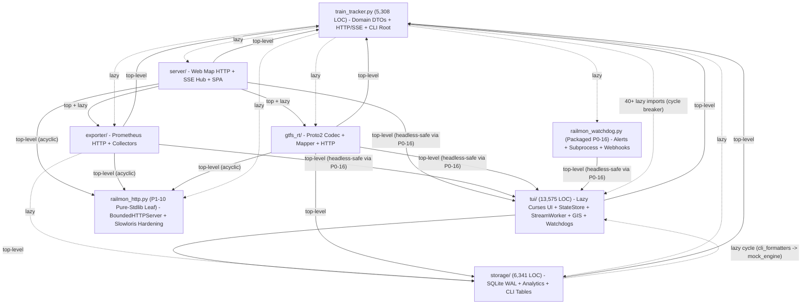
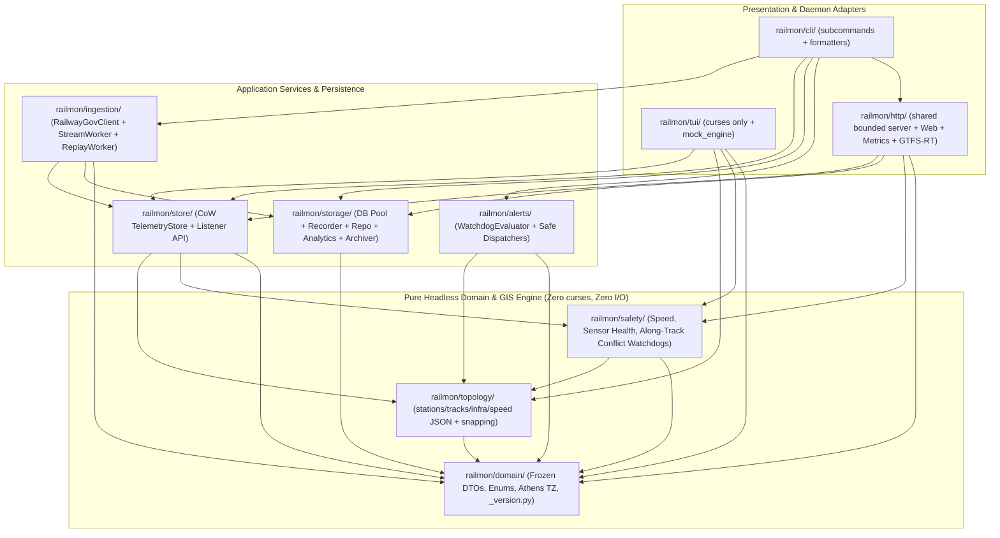

# Senior Software Engineering & Architecture Review: `railmon`

> **Date:** 2026-11-26  
> **Baseline Commit Reviewed:** `531c446` (`master`) — **Last Updated:** post-`9dfa314` (**All 6 P0 blockers resolved**: `P0-1` / `P0-14` `8635eae`, `P0-2` / `P0-15` `dd8a612`, `P0-3` / `P0-16` `d08f493`, `P0-4` / `P0-17` `19764a8`, `P0-5` / `P0-18` `c5e7a57`, `P0-6` / `P0-19` `9dfa314`; **P1-1 / `P1-10` resolved**)  
> **Scope:** Full codebase audit (37 production Python files / 34,651 LOC, 1 storage benchmark script / 379 LOC, 69 test files / 28,994 LOC, 4 GIS JSON datasets, packaging manifests, and static safety tooling)  
> **Prior Baseline:** [`production-readiness-review.md`](./production-readiness-review.md) (2026-11-18, 362 tests, pre-F-6/F-7/F-8/F-9/F-10)  
> **Overall Verdict:** **Strong zero-dependency engineering foundation — all 6 P0 production blockers and P1-1 (Slowloris & HTTP thread/connection exhaustion across all 3 daemons) have been resolved; Phase 1/2 P1 hardening underway.** Rapid feature expansion (F-6 through F-10) outpaced architectural boundaries, static gates, and integration tests, but all six P0 blockers (`P0-1`–`P0-6`) plus `P1-1` (consolidating `WebMapServer`, `MetricsServer`, and `GtfsRtServer` onto the shared pure-stdlib acyclic leaf [`railmon_http.py`](../../railmon_http.py) with bounded connection semaphores, RFC 9112 `503` rejection, monotonic Slowloris header deadlines, live `scrape_timeout_seconds`, and capped `SSEBroadcaster`) have now been remediated with `1,026` passing tests and `0` AST warnings across all 37 production files.

---

## 1. Executive Summary & Empirical Baseline

### Automated Verification Baseline (Current Working Tree, post-`9dfa314` / `P1-10`)

| Verification Gate | Current Result | Key Observation |
|---|---|---|
| Full `unittest` suite (`python -m unittest discover -s tests`) | **PASSED** (`1,026` tests, `0` failures, `0` errors, `4` skipped) | `P0-14` (`8635eae`) fixed `history` `NameError` and 8 `WinError 32` SQLite `tearDown` leaks; `P0-15` (`dd8a612`) added 10 adversarial RCE/XSS/CSP tests; `P0-16` (`d08f493`) added 9 packaging/headless/coexistence tests; `P0-17` (`19764a8`) added 18 safety-watchdog tests (`TC-WDG-01`–`TC-WDG-18`); `P0-18` (`c5e7a57`) added 20 non-mocked SQLite durability/analytics tests (`TC-STO-01`–`TC-STO-20`); `P0-19` (`9dfa314`) added strict OpenMetrics 1.0.0 validator + 18 exporter/read-only DB tests (`TC-OMX-01`–`TC-OMX-18`); `P1-10` added 17 DoS/Slowloris/keep-alive/SSE-cap/CLI/leaf-purity tests (`TC-HTTP-01`–`TC-HTTP-16`, `TC-PKG-19`) |
| Symbol-table undefined-global check (`symtable`) | **PASSED** (`0` undefined globals across all 37 production files) | `2` shipping `NameError` bugs in [`_handle_history_segments_action`](../../train_tracker.py#L3179-L3209) and [`_handle_history_bottlenecks_action`](../../train_tracker.py#L3211-L3239) fixed in `8635eae` (`P0-14`); `0` undefined globals verified across all 37 production files including [`railmon_http.py`](../../railmon_http.py) |
| Default `safety_ast_audit.py --strict` | **FALSE PASS** (`87` files) | Hardcoded target list skips `railmon_watchdog.py`, `railmon_http.py`, `server/`, `exporter/`, and `gtfs_rt/` (`19` production files unaudited by default; tracked in `P1-20`) |
| Full-repo `safety_ast_audit.py --strict` (all 8 packages/modules) | **PASSED** (`37` files, `0` errors, `0` warnings) | `P0-19` (`9dfa314`) resolved the final `PY-MISRA-03` silent `except Exception: pass` warning in [`exporter/collector.py`](../../exporter/collector.py#L623-L656); **all 37 production files** (`train_tracker.py`, `railmon_watchdog.py`, `railmon_http.py`, `storage/`, `tui/`, `server/`, `exporter/`, `gtfs_rt/`) pass with `0` errors / `0` warnings |
| Packaging completeness & headless portability ([`pyproject.toml`](../../pyproject.toml)) | **PASSED** (`d08f493` / `P0-16`, re-verified post-`P1-10`) | [`railmon_watchdog.py`](../../railmon_watchdog.py) and pure-stdlib acyclic leaf [`railmon_http.py`](../../railmon_http.py) registered in `pyproject.toml` and verified inside built wheels; [`.gitattributes`](../../.gitattributes) enforces LF on [`railmon`](../../railmon) & CRLF on [`railmon.bat`](../../railmon.bat); PEP 562 lazy [`tui/__init__.py`](../../tui/__init__.py) + guarded [`tui/theme.py`](../../tui/theme.py) + 14 headless targets verified without `_curses` (`20/20` packaging tests pass, including `TC-PKG-19`) |
| Storage benchmark & hot-backup gate (`benchmark_storage.py`, `sqlite3.backup`) | **PASSED** (`c5e7a57` / `P0-18`) | `19,544 rows/sec` (batch=100, target `>= 5,000`), `98.3%` stationary deadband suppression (`49.2%` footprint reduction), `get_corridor_punctuality` mean `1.91 ms` / `get_train_history` `6.76 ms`; live concurrent WAL hot backup & double-init schema integrity verified `ok` |

### Architectural & Engineering Scorecard

| Dimension | Score | Primary Assessment |
|---|---|---|
| Zero-Dependency Craft & Domain Modeling | **8.5 / 10** | Impressive stdlib-only Proto2 wire codec, OpenMetrics 1.0.0 / Prometheus 0.0.4 serializer, monotonic-deadline bounded HTTP base (`railmon_http.py`), Braille GIS renderer, WAL SQLite setup, and frozen DTOs |
| Architecture & Modularity | **5.5 / 10** | `P0-3` (`d08f493` / `P0-16`) resolved headless `curses` import crashes & `railmon_watchdog.py` packaging, and `P1-1` (`P1-10`) consolidated all 3 HTTP daemons onto the shared pure-stdlib acyclic leaf [`railmon_http.py`](../../railmon_http.py); 5,308-LOC root monolith, `tui/` shadow-core coupling, and `storage <-> tui` cycle remain for Phase 3 |
| Functional Correctness (CLI & Analytics) | **7.5 / 10** | `P0-1` (`8635eae`), `P0-5` (`c5e7a57`), and `P0-6` (`9dfa314`) resolved (`history` crashes, `--from-db --out-dir`, F-9.2 contiguous station-run transit SQL, same-day `end_date` punctuality, and real-SQLite `StorageMetricsCollector` fixed); F-9.1 percentiles (`P1-18`) and mock-only `sensor-health`/`conflicts` (`P1-17`) remain |
| Rail Safety Watchdogs | **7.0 / 10** | `P0-4` (`19764a8` / `P0-17`) resolved all 3 systemic watchdog failures (state-aware eviction restores drop & tunnel alerts up to 1,098s Kallidromo slow transits; specific-first + family-scoped geo-snapping fixes 11/11 fleet corridors & fail-safe single-track; live `TrainRecord.last_updated` + envelope-gated stale preemption); `P1-15` GIS drift (up to 3.2 km) & along-track shared-trunk chainage remain |
| Security & Hardening | **7.0 / 10** | `P0-2` (`dd8a612` / `P0-15`) resolved desktop notification RCE & SPA DOM XSS/CSP; `P1-1` (`P1-10`) eliminated Slowloris, header floods (`431`), unbounded thread/connection exhaustion (`503`), and SSE slot starvation across all 3 HTTP daemons; `Host`/DNS-rebinding validation (`P1-2`), webhook secret/SSRF (`P1-3`), URL path encoding/redirects (`P1-4`), and CSV formula injection (`P1-5`) remain |
| Concurrency & Resource Lifecycle | **5.5 / 10** | `P0-5` (`c5e7a57`) decoupled retention archival, `P0-6` (`9dfa314`) added locked read-only DB caching in `StorageMetricsCollector`, and `P1-1` (`P1-10`) bounded all HTTP worker/rejector threads, keep-alive lifecycles, and SSE subscribers/write timeouts; heavy `get_snapshot()` lock contention (`P1-8`), inverted SSE stale eviction (`P1-9`), HTTP shutdown deadlocks (`P1-10`), and SQLite thread-local 64 MB connection leak (`P1-11`) remain |
| Storage Durability & Query Performance | **7.5 / 10** | `P0-5` (`c5e7a57`) resolved archival TOCTOU & PK-collision data loss, canonicalized UTC ISO-8601 timestamps with index-backed legacy query filters (`EXPLAIN QUERY PLAN` `SEARCH ... USING INDEX`), eliminated tight archival retry storms, and added two-phase post-commit deadband + transient lock retry; `P0-6` (`9dfa314`) added strict URI `read_only=True` mode to `Database`; `P1-11` (`Database` pool leak / `SAVEPOINT` / `umask`) and `P1-18` (Schema V2 / F-9.1 OOM) remain |
| Protocol Compliance (SSE / HTTP / OpenMetrics / GTFS-RT) | **7.0 / 10** | `P0-6` (`9dfa314` / `P0-19`) resolved full OpenMetrics 1.0.0 & Prometheus 0.0.4 compliance, RFC 9110 `q=` negotiation, duplicate label disambiguation, and scrape-wide deduplication; `P1-1` (`P1-10`) added RFC 9112 lingering-close `503`, `431`, and SSE `Connection: close`; WHATWG SSE framing & clean-EOF spin (`P1-14`), HTTP/1.1 `Vary`/ETag/`405`/`HEAD` defects (`P1-6`), and Windows EEST DST drift (`P1-19`) remain |
| Test Suite & Static Gates | **9.0 / 10** | `1,026` passing tests (`P0-14`–`P0-19` + `P1-10`) and `0`-warning full-repo AST audit across all 37 production files; `protoc` golden vectors and expanded default AST gate (`P1-20`) remain |

---

## 2. System Architecture & Structural Debt

### 2.1 Current Dependency Topology (Inverted & Cyclic)

Static import-graph analysis across all 37 production files exposes two structural anti-patterns that directly caused multiple P0/P1 defects in this review (with [`railmon_http.py`](../../railmon_http.py) now extracted in `P1-10` as a clean pure-stdlib acyclic leaf shared by all 3 HTTP daemons):

1. **Dual-Role Root Monolith ([`train_tracker.py`](../../train_tracker.py), 5,308 LOC):** Simultaneously acts as the lowest-level domain/client module (imported at top-level by `storage`, `tui`, `server`, `exporter`, and `gtfs_rt`) **and** the highest-level CLI presentation/composition root (lazily importing all 6 packages inside functions to break circular imports). Refactoring helper functions out of lazy-import scopes directly caused the shipping `NameError` crashes in `history bottlenecks` and `history segments` (remediated in `P0-14`).
2. **`tui/` as a Shadow Core Library (Headless `curses` Crash Fixed in `P0-16`; Structural Split Deferred to Phase 3):** Every headless package (`server`, `exporter`, `gtfs_rt`, `railmon_watchdog`, `storage`) imports domain/state/GIS code from `tui/` (`TrainStateStore`, `StreamWorker`, GIS loaders in `tui/mock_engine.py`, safety watchdogs in `tui/geo.py`). Previously, this crashed every headless daemon without `_curses` via two unconditional `import curses` paths (`tui/__init__.py` eager imports and `tui/state.py -> tui/theme.py`); `P0-16` neutralized both crash paths via PEP 562 lazy exports in [`tui/__init__.py`](../../tui/__init__.py) and guarded `_curses` resolution in [`tui/theme.py`](../../tui/theme.py), while full physical extraction out of `tui/` remains scheduled for Phase 3.

#### A. Current Dependency Graph (ASCII)

```text
  +------------------------------------------------------------------------+
  |                  train_tracker.py (5,308 LOC Monolith)                 |
  |       Domain DTOs + HTTP/SSE Client + CLI Root (40+ lazy imports)      |
  +------------------------------------------------------------------------+
        ^      ^          ^            ^             ^           |
        |      |          |            |             |     (lazy | cycle-breaker)
        |      |          |            |             |           v
  +-----+--+ +-+--------+-+----+ +-----+------+ +----+-------+ +-+-------------+
  |storage/| |  tui/ (Shadow   | |  server/   | | exporter/  | |   gtfs_rt/    |
  |SQLite  | |  Core; lazy     | | WebMap+SPA | | Prometheus | | Proto2 + HTTP |
  |6.3k LOC| |  curses P0-16)  | |            | |            | |               |
  +--------+ +-----------------+ +-----+------+ +----+-------+ +-------+-------+
      |   ^     ^   ^   ^   ^         | |           | |                |
      |   |     |   |   |   +---------+-------------+------------------+
      |   +-----+   |   |   (Headless packages depend on tui/*; 0 curses post-P0-16)
      +---(lazy)----+   |             |             |                  |
                        |             v             v                  v
                  +-----+---------------+   +-----------------------------------+
                  | railmon_watchdog.py |   | railmon_http.py (P1-10 Acyclic    |
                  | (Packaged in P0-16) |   | Pure-Stdlib Leaf; 0 Internal Deps)|
                  +---------------------+   +-----------------------------------+
```

#### B. Current Dependency Graph (Mermaid)



### 2.2 God-Module Concentration & Duplication

| Module | LOC | Key Coupling / SRP Violations |
|---|---:|---|
| [`train_tracker.py`](../../train_tracker.py) | 5,308 | 9 responsibilities (`build_parser` = 880+ lines, 16 CLI commands, HTTP/SSE client, DTOs, media launcher, logging, signals); monkey-patches `TrainStateStore` methods at [`L4305-L4333`](../../train_tracker.py#L4305-L4333) |
| [`tui/renderer.py`](../../tui/renderer.py) | 3,255 | Rendering + station board computation + ETA math + duplicated `Europe/Athens` tz logic (`render_inspector` CC=38) |
| [`tui/geo.py`](../../tui/geo.py) | 3,423 | 5 unrelated domains: Braille canvas, Equirectangular projection, GeoJSON parsing, speed enforcement (with hardcoded curses pair ints `1, 8, 9`), conflict & sensor-health watchdogs |
| [`storage/repository.py`](../../storage/repository.py) | 2,644 | 11 responsibilities: path security, in-memory TUI exports, DVR replay, GTFS bridge, F-9.1/F-9.2 analytics, CSV/GeoJSON export, retention archival |
| [`tui/state.py`](../../tui/state.py) | 2,088 | Conflates headless telemetry state with TUI-only view state (cursor/theme/modals -> 52-field `StateSnapshot`); UI cursor moves invalidate GTFS-RT `ETag`s |
| [`storage/cli_formatters.py`](../../storage/cli_formatters.py) | 1,405 | Hosts non-storage CLI renderers (timetables, departures, conflicts, speed limits) and imports `tui.mock_engine` |
| [`server/`](../../server), [`exporter/`](../../exporter), [`gtfs_rt/server.py`](../../gtfs_rt/server.py) | ~1,610 | Shared concurrency/Slowloris/`handle_error` base extracted to [`railmon_http.py`](../../railmon_http.py) (`P1-10`); CORS, gzip, `Host` validation (`P1-2`), RFC 9110 framing (`P1-6`), and shutdown lifecycle (`P1-10` review item) consolidation remain |

### 2.3 Recommended Target Architecture (Strict Acyclic Layers)

#### A. Target Acyclic Layer Hierarchy (ASCII)

```text
+------------------------------------------------------------------------------+
|                   Layer 4: Presentation & Daemon Adapters                    |
|  railmon/cli/             railmon/tui/                 railmon/http/         |
|  (subcommands+formatters) (curses UI + mock_engine)    (bounded base +       |
|                                                         Web/Metrics/GTFS-RT) |
+------------------------------------------------------------------------------+
                                     |
                                     v
+------------------------------------------------------------------------------+
|                 Layer 3: Application Services & Persistence                  |
|  railmon/ingestion/       railmon/store/    railmon/storage/  railmon/alerts/|
|  (Client+Stream/Replay)   (CoW Store+Bus)   (DB+Rec+Repo+Anl) (Watchdog+Push)|
+------------------------------------------------------------------------------+
                                     |
                                     v
+------------------------------------------------------------------------------+
|         Layer 2: Pure Headless Domain & GIS Engine (Zero curses/I/O)         |
|  railmon/topology/             railmon/safety/               railmon/domain/ |
|  (data/*.json + snapping)      (Speed, Sensor, Conflicts)    (DTOs, TZ, Ver) |
+------------------------------------------------------------------------------+
```

#### B. Target Acyclic Layer Hierarchy (Mermaid)



---

## 3. P0 — Critical Findings (Immediate Fixes Required)

> [!CAUTION]
> Every finding in this section causes a verified production crash, silent data loss, arbitrary code execution / XSS, complete safety-watchdog failure, or hard external-consumer scrape rejection.

### P0-1. Four Shipping CLI Bugs: Guaranteed Crashes & Silent Total Data Loss [RESOLVED]
- **Status:** Resolved in commit `8635eae` | **Plan:** [`../plans/fixes/p0/p0-14-shipping-cli-crashes-and-gtfs-from-db-out-dir-fix-plan.md`](../plans/fixes/p0/p0-14-shipping-cli-crashes-and-gtfs-from-db-out-dir-fix-plan.md)
- **Category:** Functional Bug / Data Loss
- **Locations:**
  - [`train_tracker.py`](../../train_tracker.py#L3179-L3239) (`_handle_history_segments_action`, `_handle_history_bottlenecks_action`) & [`train_tracker.py`](../../train_tracker.py#L3241-L3290) (`run_history_mode`)
  - [`train_tracker.py`](../../train_tracker.py#L4828-L4857) (`_export_db_mode`) -> [`train_tracker.py`](../../train_tracker.py#L4733-L4765) (`_emit_feed_output`)
  - [`gtfs_rt/exporter.py`](../../gtfs_rt/exporter.py#L80-L152) (`export_feed_dir`, `load_db_snapshot`, `export_from_db`)
- **Failure Modes (All Remediated in `8635eae`):**
  1. `railmon history bottlenecks` crashed with `NameError: name 'format_bottlenecks_table' is not defined` -> fixed by importing `format_bottlenecks_table` inside `_handle_history_bottlenecks_action()` with `ensure_ascii=False` JSON output.
  2. `railmon history segments` crashed with `NameError: name 'format_segment_transit_table' is not defined` -> fixed by importing `format_segment_transit_table` inside `_handle_history_segments_action()` with `ensure_ascii=False` JSON output.
  3. `railmon history trips` crashed with `TypeError` (`date` vs `service_date`) -> fixed by passing `service_date=args.date` to `HistoricalRepository.get_active_trips()`.
  4. `railmon export --gtfs-rt --from-db <db> --out-dir <dir>` silently wrote 4 empty feeds -> fixed by extracting and exporting `gtfs_rt.load_db_snapshot()`, forwarding `(positions, schedules)` through `_export_db_mode()` -> `_emit_feed_output()`, failing loud in `export_feed_dir()` when both `snapshot` and `positions` are `None`, and pinning a single bundle timestamp across all 4 files; added CLI/DB export regression tests and closed SQLite handles in `test_bottlenecks.py` and `test_eta_engine.py` `tearDown()`.

### P0-2. Arbitrary Command/Code Execution (RCE) in Desktop Notifications & DOM-Based XSS in Web SPA [RESOLVED]
- **Status:** Resolved in commit `dd8a612` (`P0-15`, `944` tests passing) | **Plan:** [`../plans/fixes/p0/p0-15-desktop-notification-rce-and-web-spa-xss-fix-plan.md`](../plans/fixes/p0/p0-15-desktop-notification-rce-and-web-spa-xss-fix-plan.md)
- **Category:** Security (RCE / XSS)
- **Locations:**
  - [`railmon_watchdog.py`](../../railmon_watchdog.py#L656-L809) (formerly `watchdog.py`; `_sanitize_notification_text`, `dispatch_terminal_bell`, `dispatch_desktop_notification`)
  - [`server/assets.py`](../../server/assets.py#L747-L1694) (`SPA_HTML_TEMPLATE`, `_validate_csp_nonce`, `_serialize_spa_config`, `get_spa_html`)
  - [`server/handler.py`](../../server/handler.py#L25-L42), [`#L135-L148`](../../server/handler.py#L135-L148), [`#L535-L580`](../../server/handler.py#L535-L580); [`server/models.py`](../../server/models.py#L36-L42)
- **Failure Modes (All Remediated in `dd8a612` / `P0-15`):**
  1. **Windows PowerShell RCE (`railmon_watchdog.py`):** Replaced inline PowerShell string interpolation with compile-time constant `_WINDOWS_TOAST_PS_SCRIPT` reading `[string]$env:RAILMON_NOTIFY_TITLE` / `$env:RAILMON_NOTIFY_MSG` from a copied child environment (`os.environ.copy()`), plus `_sanitize_notification_text()` NUL/C0/C1 stripping and length bounds; verified live against PowerShell 5.1 with smart-quote `\u2019` breakout payloads.
  2. **macOS AppleScript RCE (`railmon_watchdog.py`):** Replaced interpolated AppleScript strings with constant `_DARWIN_NOTIFICATION_SCRIPT` (`on run argv`) and `"--"` option terminator before `[safe_title, safe_msg]`.
  3. **Linux `notify-send` option injection & `PY-MISRA-03` (`railmon_watchdog.py`):** Inserted `"--"` before `[safe_title, safe_msg]`, attached `stdin=subprocess.DEVNULL`, narrowed exception catches in `dispatch_desktop_notification()` and `dispatch_terminal_bell()` (`safety_ast_audit.py --strict railmon_watchdog.py server` passes with `0` errors / `0` warnings).
  4. **Web SPA DOM XSS & Missing CSP (`server/assets.py`, `server/handler.py`, `server/models.py`):** Isolated server config in HTML-escaped `<script id="railmonConfig" type="application/json">`, removed all `.innerHTML` writes and all 11 static + dynamic inline `on*` handlers in favor of `createElement`/`createElementNS`/`textContent`, `L.divIcon({html: Element})`, `layer.bindPopup(Element)`, delegated `addEventListener` + `dataset.trainId`, `encodeURIComponent()` URLs, and `rel="noopener noreferrer"`; added per-request 128-bit CSPRNG nonce `Content-Security-Policy` (`Cache-Control: no-store`), `X-Content-Type-Options: nosniff`, `X-Frame-Options: DENY`, and `Referrer-Policy: no-referrer` across HTML and API/error routes (verified with `node --check`, adversarial DOM XSS harness, and live HTTP tests).

### P0-3. Broken Packaging (`watchdog.py` Omitted + PyPI Collision) & Headless `curses` Import Crash [RESOLVED]
- **Status:** Resolved in commit `d08f493` (`P0-16`, `953` tests passing) | **Plan:** [`../plans/fixes/p0/p0-16-packaging-watchdog-namespace-and-headless-curses-fix-plan.md`](../plans/fixes/p0/p0-16-packaging-watchdog-namespace-and-headless-curses-fix-plan.md)
- **Category:** Packaging / Architecture / Portability
- **Locations:**
  - [`pyproject.toml`](../../pyproject.toml#L69-L74), [`#L110`](../../pyproject.toml#L110), [`#L131`](../../pyproject.toml#L131), [`railmon_watchdog.py`](../../railmon_watchdog.py), [`.gitattributes`](../../.gitattributes), [`railmon`](../../railmon), [`railmon.bat`](../../railmon.bat)
  - [`tui/__init__.py`](../../tui/__init__.py#L1-L223), [`tui/state.py`](../../tui/state.py#L38), [`tui/theme.py`](../../tui/theme.py#L13-L35), [`tui/app.py`](../../tui/app.py#L1341-L1357), [`#L1753`](../../tui/app.py#L1753), [`train_tracker.py`](../../train_tracker.py#L2806-L2842), [`#L4013-L4050`](../../train_tracker.py#L4013-L4050)
- **Failure Modes (All Remediated in `d08f493` / `P0-16`):**
  1. **Omitted `watchdog.py` & PyPI Namespace Collision:** Relocated `watchdog.py` to vendor-prefixed [`railmon_watchdog.py`](../../railmon_watchdog.py) (removing root `watchdog.py` with no colliding shim), updated all 5 production import sites ([`train_tracker.py`](../../train_tracker.py#L4013-L4050), [`tui/app.py`](../../tui/app.py#L1341-L1357), [`#L1753`](../../tui/app.py#L1753)) and [`README.md`](../../README.md#L271), and registered `railmon_watchdog` across `py-modules`, `tool.ruff.src`, and `tool.coverage.run.source` in [`pyproject.toml`](../../pyproject.toml). Verified zero PyPI `watchdog` shadowing and 100% module + 4 GIS JSON asset inclusion via real built-wheel inspection (`TC-PKG-13`–`TC-PKG-15b`, `TC-PKG-17`).
  2. **Two-Layer Headless `curses` Import Crash:** Converted [`tui/__init__.py`](../../tui/__init__.py) to PEP 562 lazy `__getattr__` / `__dir__` exports (preserving all 79 `__all__` symbols, 8 lazy submodules, and `TYPE_CHECKING` support) and guarded `import curses` in [`tui/theme.py`](../../tui/theme.py#L13-L35) with platform-exact `_COLOR_*` / `_A_*` resolution and portable integer fallbacks so [`tui/state.py`](../../tui/state.py#L38) and all headless daemons (`server`, `exporter`, `gtfs_rt`, `railmon_watchdog`, `storage.cli_formatters`) import cleanly without `_curses` (verified across 13 headless targets in `_curses`-blocked subprocesses and in a zero-dependency `--no-deps` built-wheel venv outside the repo; full extraction out of `tui/` tracked in Phase 3).
  3. **POSIX Missing-`_curses` Crash & Launcher CRLF Corruption:** Generalized missing-`curses` fallback in [`run_tui_mode()`](../../train_tracker.py#L2806-L2842) across Windows and POSIX platforms (re-raising unrelated `ImportError`s) and added [`.gitattributes`](../../.gitattributes) enforcing LF on [`railmon`](../../railmon) (`i/lf w/lf`) and CRLF on [`railmon.bat`](../../railmon.bat) (`TC-PKG-18`).

### P0-4. Three Systemic Safety-Watchdog Failures (Disabled Drop/Tunnel Alerts, Double-Track Misclassification, Dead Ghost Preemption) [RESOLVED]
- **Status:** Resolved in commit `19764a8` (`P0-17`, `971` tests passing) | **Plan:** [`../plans/fixes/p0/p0-17-safety-watchdog-failures-fix-plan.md`](../plans/fixes/p0/p0-17-safety-watchdog-failures-fix-plan.md)
- **Category:** Safety Watchdog Correctness
- **Locations:**
  - [`tui/state.py`](../../tui/state.py#L175-L179), [`#L589-L614`](../../tui/state.py#L589-L614), [`#L1185-L1250`](../../tui/state.py#L1185-L1250), [`#L1331-L1336`](../../tui/state.py#L1331-L1336) (`DEFAULT_LIVE_STALE_TIMEOUT_SEC = 600.0`, `_compute_record_eviction_ttl`, `prune_stale_trains`) & [`tui/geo.py`](../../tui/geo.py#L1928-L1958) (`compute_tunnel_grace_sec`), [`tui/__init__.py`](../../tui/__init__.py#L36), [`#L141`](../../tui/__init__.py#L141)
  - [`tui/geo.py`](../../tui/geo.py#L1473-L1586) (`_normalize_corridor_key`, `AMBIGUOUS_CORRIDOR_FAMILIES`, `DEFAULT_DOUBLE_TRACK_CORRIDORS`), [`#L1772-L1884`](../../tui/geo.py#L1772-L1884) (`_resolve_speed_corridor_rule`, `evaluate_train_speed`), [`#L2610-L2864`](../../tui/geo.py#L2610-L2864) (`resolve_train_corridor`), [`#L3319-L3331`](../../tui/geo.py#L3319-L3331) (`_is_corridor_single_track`) & [`tui/state.py`](../../tui/state.py#L724-L733), [`#L1362-L1371`](../../tui/state.py#L1362-L1371)
  - [`tui/state.py`](../../tui/state.py#L1031-L1040) (`_recompute_conflicts`) & [`tui/geo.py`](../../tui/geo.py#L2925-L3423) (`_unwrap_train_entry`, `_evaluate_opposing_conflict`, `_evaluate_headway_conflict`, `evaluate_train_conflicts`)
- **Failure Modes (All Remediated in `19764a8` / `P0-17`):**
  1. **Drop & Tunnel Watchdogs Dead by Default:** Extracted shared `compute_tunnel_grace_sec()` (exported lazily via PEP 562 in `tui/__init__.py`), raised `DEFAULT_LIVE_STALE_TIMEOUT_SEC` from `90.0s` to `600.0s`, and implemented state-aware `_compute_record_eviction_ttl()` in `prune_stale_trains()`: open-line trains are retained to `max(600s, drop_threshold + 300s)`, tunnel transits to `min(1800s, max(600s, tunnel_grace + 300s))` (covering passenger `300s`, freight `549s`, and 40 km/h slow-order `1,098s` transits in Kallidromo), and non-alert terminated `STATION_DWELL` trains are evicted promptly at `240.0s` while honoring explicit `max_age_sec` / custom `stale_timeout_sec` overrides (`TC-WDG-01`–`TC-WDG-06`).
  2. **Single-Track Corridors Routed to Double-Track Mainline:** Replaced `_normalize_corridor_key()` with diacritic-folded, ordered specific-first immutable keyword tables (eliminating broad `"thess"`/`"athina"` hijacks and covering live `ATHLIA`/`THESLAR`/`THESFLOR`/`ALEXOR` codes), added cached family-scoped geometric track snapping + shared-trunk route-metadata tie-breaking (`SKA`, `Kilkis`) across both `resolve_train_corridor()` and `evaluate_train_speed()` (with `tracks_data` forwarded from `TrainStateStore`), and changed unknown corridors in `evaluate_train_conflicts()` to fail-safe `is_single = True`. Empirically verified **11/11** `MockTelemetryEngine` fleet trains resolve to their exact physical tracks and speed limits (`TC-WDG-07`–`TC-WDG-12`).
  3. **Stale-Ghost Conflict Preemption Dead Code (+ Latent 20 km Over-Firing Bug):** Updated `TrainStateStore._recompute_conflicts()` to pass `list(self._trains.values())` (`TrainRecord`), added `_unwrap_train_entry()` supporting `TrainRecord`, `(pos, ts)`, and legacy `TrainPosition` + optional `last_updated_by_id` (with `NaN`/`Inf`/`bool` timestamp guards), and split `_evaluate_opposing_conflict()` / `_evaluate_headway_conflict()` so `STALE_OBSTRUCTION` and `STALE_HEADWAY` fire strictly inside the active kinematic conflict envelope (`closing_spd > 5.0` & `dist <= 20 km` opposing; `dist <= 2.5 km` & `is_active_motion` headway) (`TC-WDG-13`–`TC-WDG-18`).

### P0-5. Five Storage Durability, Data-Loss & Analytics Failures [RESOLVED]
- **Status:** Resolved in commit `c5e7a57` (`P0-18`, `991` tests passing) | **Plan:** [`../plans/fixes/p0/p0-18-storage-durability-data-loss-and-analytics-fix-plan.md`](../plans/fixes/p0/p0-18-storage-durability-data-loss-and-analytics-fix-plan.md)
- **Category:** Data Integrity / Analytics Correctness
- **Locations:**
  - [`storage/repository.py`](../../storage/repository.py#L1504-L1825) (`_extract_segment_transition_samples`, `get_segment_transit_times`, `_compute_percentile`)
  - [`storage/repository.py`](../../storage/repository.py#L2264-L2644) (`_collect_archive_payload`, `_write_archive_chunk`, `_delete_archived_ids`, `archive_before`, `_iter_chunks`)
  - [`storage/models.py`](../../storage/models.py#L22-L107), [`#L220-L270`](../../storage/models.py#L220-L270), [`storage/db.py`](../../storage/db.py#L25-L31), [`storage/repository.py`](../../storage/repository.py#L145-L210), [`#L694-L807`](../../storage/repository.py#L694-L807), [`#L992-L1060`](../../storage/repository.py#L992-L1060), [`storage/__init__.py`](../../storage/__init__.py), [`train_tracker.py`](../../train_tracker.py#L3397-L3401)
  - [`storage/recorder.py`](../../storage/recorder.py#L31-L59), [`#L177-L362`](../../storage/recorder.py#L177-L362), [`#L396-L689`](../../storage/recorder.py#L396-L689), [`storage/filter.py`](../../storage/filter.py#L44-L245)
- **Failure Modes (All Remediated in `c5e7a57` / `P0-18`):**
  1. **F-9.2 Segment Transit Engine Measured ~2s Polling Ticks:** Rewrote `_extract_segment_transition_samples()` and `get_segment_transit_times()` with contiguous `next_station` run-island CTEs, trip-gap sessionization (`3600s` gap split when `schedule_id IS NULL`), `[60s..21600s]` transit bounds (discarding 2s trailing flips & GPS bounces without fabricating `60s`), cruise-speed averaging (`> 2.0 km/h`), signed `delay_delta`, and exact `statistics.median` / linear-interpolated `p90` (`TC-STO-01`–`TC-STO-04`).
  2. **`archive_before()` Dual Silent Permanent Data Loss (TOCTOU + PK Collision):** Rewrote `archive_before()` with bounded chunking (`chunk_size=5000`, `IN (...)` batched `<= 500`, cooperative `stop_event`), archive-local `archive_provenance (source_row_id, row_digest)` deduplication while omitting `id` on `INSERT INTO telemetry_history` (fresh archive PKs; zero loss on hot-DB rotation and zero duplicates on crash retry), and strict `DELETE FROM telemetry_history WHERE id IN (...)` eviction of archived IDs only (`TC-STO-05`–`TC-STO-08`).
  3. **Unnormalized ISO-8601 `TEXT` Timestamps & Dropped `end_date`:** Canonicalized all written/returned UTC timestamps to fixed-width 27-char `YYYY-MM-DDTHH:MM:SS.ffffffZ` via Python 3.10+ safe `format_utc_iso()` / `parse_iso_utc_datetime()` / `canonicalize_iso_utc()`, expanded date-only bounds (`normalize_start_bound` / `normalize_end_bound` through `T23:59:59.999999Z`), and applied sargable B-tree index envelopes + `_canon_ts_sql()` across all time-bounded repository queries (`EXPLAIN QUERY PLAN` verified `SEARCH ... USING INDEX` with legacy `'...Z'` compatibility; `TC-STO-09`–`TC-STO-13`).
  4. **Infinite Tight Archival Retry Storm & Hot-Path Stalls:** Switched `TelemetryRecorder` scheduler timers to `time.monotonic()`, updated `_next_archive_mono` unconditionally in `finally` with capped exponential backoff (`60s` → `3600s`), and moved periodic archival onto a single non-overlapping background thread cleanly joined on `stop()` before `checkpoint_wal("TRUNCATE")` (`TC-STO-14`–`TC-STO-16`).
  5. **Unrecoverable Batch Loss + Deadband Poisoning:** Split `DeadbandFilter` into pure intra-batch `evaluate_batch()` (zero pre-commit mutation) + post-commit `commit_batch()`, added bounded transient `SQLITE_BUSY`/`SQLITE_LOCKED` in-flush retries (`write_retry_max_attempts=3`), and retained pending retry batches in `_worker_loop()` (bounded by `max_pending_buffer_size=5000`) while keeping `DeadbandFilter._states` clean on any failure (`TC-STO-17`–`TC-STO-20`).

### P0-6. OpenMetrics 1.0.0 Hard Scrape Failures, Duplicate Label Collisions & Broken `StorageMetricsCollector` [RESOLVED]
- **Status:** Resolved in commit `9dfa314` (`P0-19`, `1,009` tests passing, `0` AST warnings across all 36 production files) | **Plan:** [`../plans/fixes/p0/p0-19-openmetrics-compliance-label-collisions-and-storage-collector-fix-plan.md`](../plans/fixes/p0/p0-19-openmetrics-compliance-label-collisions-and-storage-collector-fix-plan.md)
- **Category:** Prometheus / OpenMetrics Compliance & Correctness
- **Locations:**
  - [`exporter/models.py`](../../exporter/models.py#L10-L165), [`exporter/formatter.py`](../../exporter/formatter.py#L21-L293), [`exporter/__init__.py`](../../exporter/__init__.py#L23-L64)
  - [`exporter/collector.py`](../../exporter/collector.py#L18-L125), [`#L180-L308`](../../exporter/collector.py#L180-L308), [`#L318-L424`](../../exporter/collector.py#L318-L424), [`#L435-L491`](../../exporter/collector.py#L435-L491), [`#L493-L657`](../../exporter/collector.py#L493-L657), [`#L659-L719`](../../exporter/collector.py#L659-L719)
  - [`storage/db.py`](../../storage/db.py#L26-L274)
- **Failure Modes (All Remediated in `9dfa314` / `P0-19`):**
  1. **Real Prometheus Scrapers Reject `/metrics` (28 Violations Across 18 of 27 Families):** Added `RE_UNIT` (`^[a-zA-Z0-9_]+$`), `RESERVED_GAUGE_SUFFIXES`, `MetricType.UNKNOWN`, `canonical_family_base_name()`, and strict unit/suffix/type validation in `exporter/models.py`; canonicalized all 27 collector MetricFamilies to base names without `_total`/`_info` (renaming `GAUGE` `railmon_trains_delayed_total` → `railmon_trains_delayed`), replaced illegal `"km/h"` with `"kmh"`, and stripped all 18 dimensionless/mismatched `# UNIT` declarations (`unit=None`); overhauled `MetricsFormatter` to emit spec-compliant OpenMetrics 1.0.0 and Prometheus 0.0.4 headers/samples (with exact wire sample-name parity), `UNTYPED -> unknown`, escaped `\"` + CRLF normalization in `# HELP`, RFC 9110 case-insensitive `q=` negotiation (handling real Prometheus v2.25+/v3.x headers & `q=0`), negative/NaN counter & `INFO = 1` guards, and monotonic `time.perf_counter()` uptime in `ProcessMetricsCollector` (`TC-OMX-01`–`TC-OMX-07`, `TC-OMX-15`–`TC-OMX-17`).
  2. **Duplicate Label Sets Crash Scrapes:** Added deterministic collision-aware `_build_disambiguated_train_labels()` in `TrainTelemetryCollector` (preserving clean commercial `train_number` on unique single-unit trains while disambiguating coupled consists `2232/460103` & `2232/460108`, unassigned switchers `Unknown/id-c` & `Unknown/id-d`, and same-loco modem handovers `IC52/120-001#sess-old` & `IC52/120-001#sess-new` across `delay`, `speed`, and `max_speed`), finite numeric guards (`_safe_finite_float`, `_compute_peak_speed`), and a scrape-wide `seen_families` + `seen_series` deduplication safety net in `MetricsFormatter` (`TC-OMX-06`, `TC-OMX-08`–`TC-OMX-10`).
  3. **`StorageMetricsCollector` Permanently Dead in Production + Non-Read-Only Open + Final `PY-MISRA-03` Warning:** Added strict `read_only=True` URI mode (`Path.as_uri() + "?mode=ro"`, `PRAGMA query_only = ON`, 4 MB cache, zero WAL write pragmas/`os.umask`/`os.chmod`, explicit write guards) to [`Database`](../../storage/db.py#L50-L274); rewrote `StorageMetricsCollector._fetch_db_stats()` to call `HistoricalRepository.get_database_stats()` over a read-only connection under a thread-safe non-poisoning cache (`_get_or_refresh_db_stats()`) with narrowed exception tuples (eliminating the final full-repo `PY-MISRA-03` warning across all 36 production files); verified with real-SQLite, active-WAL, read-only-file, and live-HTTP integration tests (`TC-OMX-11`–`TC-OMX-14`, `TC-OMX-18`).

---

## 4. P1 — High-Severity Findings

### 4.1 Security, HTTP Daemons & Network DoS

| ID | Issue & Location | Technical Root Cause & Impact | Recommended Remediation |
|---|---|---|---|
| **P1-1** | **Slowloris & Unbounded Thread/Connection Exhaustion Across All 3 HTTP Daemons [RESOLVED]**<br>[`railmon_http.py`](../../railmon_http.py#L73-L634), [`server/daemon.py`](../../server/daemon.py#L22-L115), [`server/handler.py`](../../server/handler.py#L59-L63), [`#L443-L505`](../../server/handler.py#L443-L505), [`server/sse.py`](../../server/sse.py#L17-L95), [`exporter/server.py`](../../exporter/server.py#L26-L30), [`#L95-L155`](../../exporter/server.py#L95-L155), [`#L257-L307`](../../exporter/server.py#L257-L307), [`gtfs_rt/server.py`](../../gtfs_rt/server.py#L78-L82), [`#L302-L355`](../../gtfs_rt/server.py#L302-L355)<br>**Plan:** [`p1-10-slowloris-and-http-connection-exhaustion-fix-plan.md`](../plans/fixes/p1/p1-10-slowloris-and-http-connection-exhaustion-fix-plan.md) | Previously all 3 daemons inherited raw `ThreadingHTTPServer` (unbounded OS threads, `request_queue_size = 5`) with `HTTP/1.1` keep-alive and `timeout = None`, `ExporterConfig.scrape_timeout_seconds` was dead config, and `SSEBroadcaster` had no `max_clients` cap or SSE write timeout. | **Resolved in `P1-10` (`1,026` tests passing, `0` AST warnings across all 37 production files):** Extracted pure-stdlib acyclic leaf [`railmon_http.py`](../../railmon_http.py) (`BoundedHTTPServer` + `BoundedHTTPRequestHandler` + `HttpLimitsConfig` + `_DeadlineSocketReader`) enforcing `BoundedSemaphore(64)` -> RFC 9112 lingering-close `503` (8-slot rejector + zero-blocking flood fallback), monotonic header deadlines (defeating 1-byte Slowloris trickles), 64 KiB header cap (`431`), keep-alive idle (`5s`) & request (`100`) caps, `request_queue_size = 64`, `block_on_close = False`, unified `handle_error()`, live `scrape_timeout_seconds` + overtime `504` on `MetricsServer`, `SSEBroadcaster(max_clients=32)` -> `503` + `prepare_sse_stream()` write timeout on `WebMapServer`, CLI limit flags/validation, and `pyproject.toml` + `TC-HTTP-01`–`TC-HTTP-16` + `TC-PKG-19` coverage. |
| **P1-2** | **Unconditional Wildcard CORS on Exporter & Missing `Host` Validation (DNS Rebinding)**<br>[`exporter/server.py`](../../exporter/server.py#L66-L70), [`server/handler.py`](../../server/handler.py#L581-L589), [`gtfs_rt/server.py`](../../gtfs_rt/server.py#L118-L126) | `MetricsRequestHandler` always sends `Access-Control-Allow-Origin: *` (no `cors_enabled` toggle). None of the 3 daemons validates `Host` headers when bound to `127.0.0.1`, enabling DNS-rebinding cross-origin reads of local daemons. | Add opt-in `cors_enabled: bool = False` to `ExporterConfig`; validate `Host` against loopback allowlist when bound to localhost (`421`/`403` on mismatch). |
| **P1-3** | **Webhook Secret Log Leakage, SSRF, Plaintext Token Exposure & Telegram Markdown Errors**<br>[`railmon_watchdog.py`](../../railmon_watchdog.py#L826-L897) | Line 895 logs raw `url` (persisting Telegram/Discord/Slack secret webhook tokens in `~/.railmon/logs/`). `urlopen()` accepts non-HTTP URI schemes (`file:`, `ftp:`) and link-local targets (`http://169.254.169.254`), sends `Bearer` tokens over cleartext HTTP, follows 3xx redirects, spoofs dialects via substring match (`"api.telegram.org" in url`), and breaks Telegram `"Markdown"` on `_`/`*`/`[`. | Validate `https://` + exact hostname matching; disable redirects; redact URL path/query in logs; escape Markdown (or use HTML mode + `html.escape`); add `RAILMON_WEBHOOK_*` env vars. |
| **P1-4** | **Unencoded URL Path Segments (`InvalidURL` Crash / Path Traversal) & HTTP Redirect SSRF**<br>[`train_tracker.py#L1012`](../../train_tracker.py#L1012), [`#L1083-L1152`](../../train_tracker.py#L1083-L1152), [`#L3626`](../../train_tracker.py#L3626) | `get_schedule_by_train_number("IC 52")` (documented in CLI help!) crashes with uncaught `http.client.InvalidURL`; `get_cab_stream_url` leaves `/` unquoted (`safe='/'`), and its `except urllib.error.HTTPError` 404 handler is dead code (`_get()` always wraps into `RailwayAPIError`); default `urlopen()` follows 3xx redirects off `railway.gov.gr`; `_get()` reads unbounded response bodies; `--url-only` prints unvalidated URLs. | Use `urllib.parse.quote(val.strip(), safe="")`; catch `RailwayAPIError(status_code=404)` in `get_cab_stream_url`; re-validate redirects in custom `HTTPRedirectHandler`; cap REST response size; validate `--url-only` URLs and pass `"--"` to players. |
| **P1-5** | **CSV Formula Injection (CWE-1236) & Unbounded Export OOM**<br>[`storage/repository.py#L494-L567`](../../storage/repository.py#L494-L567), [`#L1957-L2025`](../../storage/repository.py#L1957-L2025) | Upstream string cells starting with `=`, `+`, `-`, `@`, `\t`, `\r` are written raw to CSV (spreadsheet formula execution). `export_csv("telemetry")` calls `get_train_history()` (`fetchall()`) instead of existing `iter_train_history()`. | Prefix dangerous string cells with `'`; stream CSV exports via `iter_train_history()`. |
| **P1-6** | **HTTP/1.1 Protocol & Caching Violations (`304`, `405`, `Vary`, ETag, `HEAD` Bodies)**<br>[`gtfs_rt/server.py#L169-L195`](../../gtfs_rt/server.py#L169-L195), [`#L276-L287`](../../gtfs_rt/server.py#L276-L287), [`server/handler.py#L359-L388`](../../server/handler.py#L359-L388), [`exporter/server.py#L105-L117`](../../exporter/server.py#L105-L117) | Same strong `ETag` shared across plain & gzip bodies without `Vary: Accept, Accept-Encoding`; `304` sends `Content-Length: 0`; `405` on `POST`/`PUT` leaves unread body in keep-alive stream (missing `Connection: close` and `Allow` header); `HEAD` errors write response bodies; `"gzip" in accept` ignores case and `gzip;q=0`; `WebMapServer` CORS omits `If-None-Match`. | Fix RFC 9110 framing (`Vary`, encoding-scoped/weak ETags, no `Content-Length` on `304`, `Allow` + `close_connection = True` on `405`, skip body on `HEAD` errors, proper `q=` parser) in shared HTTP base. |
| **P1-7** | **Memory-Amplification DoS & TOCTOU Read in `gtfs_rt --inspect`**<br>[`gtfs_rt/exporter.py#L147-L156`](../../gtfs_rt/exporter.py#L147-L156), [`gtfs_rt/models.py#L1155-L1166`](../../gtfs_rt/models.py#L1155-L1166) | `os.path.getsize()` check followed by unbounded `fh.read()`; repeated protobuf fields have no element cap (16 MiB crafted `.pb` -> ~3.35M frozen objects -> >1.5 GiB RAM). | Read `fh.read(MAX_INSPECT_BYTES + 1)` and enforce bounded `max_entities` / `max_repeated_items` limits in `from_proto()`. |

### 4.2 Concurrency, Locking & Lifecycle Reliability

| ID | Issue & Location | Technical Root Cause & Impact | Recommended Remediation |
|---|---|---|---|
| **P1-8** | **`TrainStateStore.get_snapshot()` Heavy Mutation Under Coarse `RLock`, Mutable Leakage & Silent Version Drift**<br>[`tui/state.py#L1387-L1529`](../../tui/state.py#L1387-L1529), [`tui/stream_worker.py#L148`](../../tui/stream_worker.py#L148), [`exporter/collector.py#L187`](../../exporter/collector.py#L187), [`#L319`](../../exporter/collector.py#L319), [`#L436`](../../exporter/collector.py#L436) | Every `get_snapshot()` holds `self._lock` to run $O(N \cdot S + N^2)$ sensor-health + conflict recomputation and mutates records **without incrementing `_version`** (serving stale GTFS-RT `ETag`s). Called on **every SSE frame** in `StreamWorker`, 15×/sec in idle `TUIApp`, and **3× per `/metrics` scrape**. `get_train()`/`get_selected_train()` leak live mutable `TrainRecord`s; `StateSnapshot` exposes mutable dicts/deques/`TrainPosition`s. | Publish copy-on-write immutable snapshots updated only on writes + a 1 Hz background maintenance tick (bumping `_version` on transitions); add $O(1)$ `get_connection_status()`; share 1 snapshot per `/metrics` scrape; freeze `TrainPosition` and wrap snapshot dicts in `MappingProxyType`. |
| **P1-9** | **Inverted SSE Stale-Client Eviction & Shutdown Socket Leak**<br>[`server/sse.py#L85-L133`](../../server/sse.py#L85-L133), [`server/handler.py#L439-L487`](../../server/handler.py#L439-L487) | `broadcast()` calls `conn.touch()` on enqueue (even when overflowing), so dead consumers are never evicted while traffic flows; conversely, `_handle_sse_stream()` sends `:ping` without calling `conn.touch()`, so during >60s quiet periods `cleanup_stale_clients()` evicts healthy browsers into permanent silent zombies. On shutdown, `close_connection` remains `False` under HTTP/1.1 without chunked encoding, pinning threads on `rfile.readline()`. | Call `touch()` only in consumer after successful `wfile.flush()`; push close sentinel on unregister/shutdown; set `self.close_connection = True` and `Connection: close` on SSE response. |
| **P1-10** | **Shutdown & Signal-Handler Deadlocks Across All Daemons + Non-Async-Signal-Safe Logging**<br>[`server/daemon.py#L153-L205`](../../server/daemon.py#L153-L205), [`exporter/server.py#L327-L357`](../../exporter/server.py#L327-L357), [`gtfs_rt/server.py#L346-L378`](../../gtfs_rt/server.py#L346-L378), [`train_tracker.py#L208-L214`](../../train_tracker.py#L208-L214) | `server.stop()` unconditionally calls `BaseServer.shutdown()`, which **deadlocks permanently** if called from the foreground signal handler (`start(background=False)`) or before `serve_forever()` starts. In `train_tracker.py:213`, `logger.info()` runs inside `_handle_signal` *before* `event.set()`, risking `RuntimeError: reentrant call` that drops shutdown signals, while PEP 475 restarts blocking `socket.recv()`/`time.sleep(retry_after)`. | Guard `shutdown()` with `_serving_started` + thread identity check; remove duplicate deadlocking signal helpers; keep signal handler strictly `event.set()` (second `SIGINT` escalates); interrupt retry sleeps via `stop_event.wait()`. |
| **P1-11** | **SQLite `Database` Thread-Local 64 MB Connection Leak, `transaction()` Silent Commit, `os.umask()` Race, Broken `file::memory:`, Per-Open Integrity Scan**<br>[`storage/db.py#L50-L319`](../../storage/db.py#L50-L319), [`storage/schema.py#L118-L163`](../../storage/schema.py#L118-L163) | `_open_connections` retains strong references to dead threads' connections (each with 64 MB `cache_size` + WAL locks) forever; `transaction()` silently commits pre-existing outer transactions; `os.umask(0o077)` mutates process-wide umask without locking; `file::memory:` omits `uri=True`; every `Database()` open runs full-DB `PRAGMA integrity_check` + `foreign_key_check` (twice on `record`!). *(Strict `read_only=True` URI mode resolved in `9dfa314` / `P0-19`.)* | Evict dead threads' connections (weakref/pool) + add `_closed` guard; open with `isolation_level=None` + `SAVEPOINT` nesting; pass `uri=path.startswith("file:")`; replace `os.umask` with `os.open(..., 0o600)`; make full integrity check explicit/post-migration; check `wal_checkpoint` busy flag. |
| **P1-12** | **Collector Data Races, Unbounded Conflict Set, & `FeedCache` Version Rollback / Restart ETag Collision**<br>[`exporter/collector.py#L310-L390`](../../exporter/collector.py#L310-L390), [`#L426-L472`](../../exporter/collector.py#L426-L472), [`gtfs_rt/mapper.py#L996-L1040`](../../gtfs_rt/mapper.py#L996-L1040) | `WatchdogMetricsCollector` & `StreamMetricsCollector` mutate shared dicts/sets across scrape threads with no lock, leak `_seen_conflict_ids` forever (and permanently ignore recurring deterministic `alert_id`s), and miss events occurring between scrapes. `FeedCache.get_or_build()` rolls `_active_version` backwards on concurrent build completion, reuses identical `version=1` ETags across daemon restarts, and eagerly serializes ProtoJSON on `.pb` requests. | Move cumulative conflict/reconnect counters into `TrainStateStore`; advance `FeedCache._active_version` strictly monotonically, include content hash/boot nonce in ETag, and lazily serialize JSON on demand. |
| **P1-13** | **`StreamWorker`, `ReplayWorker`, `TelemetryRecorder` & `TUIApp` Multi-Threading Races**<br>[`tui/stream_worker.py#L79-L206`](../../tui/stream_worker.py#L79-L206), [`#L344-L565`](../../tui/stream_worker.py#L344-L565), [`storage/recorder.py#L307-L395`](../../storage/recorder.py#L307-L395), [`tui/app.py#L689-L711`](../../tui/app.py#L689-L711), [`#L1149-L1188`](../../tui/app.py#L1149-L1188) | `StreamWorker` pause/resume overwrite races & clean-EOF tight spin + stale trains unpruned during quiet keepalives; `ReplayWorker` EOF-pause race, SQLite I/O held under `_clock_lock`, and silent worker death on `OperationalError`; `TelemetryRecorder.stop()` ignores `join()` timeout before closing DB & `enqueue_batch()` bypasses `queue_maxsize` by 50–200×; `TUIApp` timetable/cab daemon threads mutate UI/toast state unlocked with ABA overwrite risk. | Add worker state locks and EOF backoff; move SQLite I/O out of `_clock_lock` + catch `OperationalError`; bound queue by item count and verify worker exit before `db.close()`; route `TUIApp` async results via a locked queue with monotonic `request_id`. |

### 4.3 Upstream SSE Reliability, Geospatial/Watchdogs, Analytics & Cross-Platform Correctness

| ID | Issue & Location | Technical Root Cause & Impact | Recommended Remediation |
|---|---|---|---|
| **P1-14** | **SSE Clean-EOF Reconnect Storm, Uncaught `IncompleteRead`, `2 ** attempt` `OverflowError`, Single-Line OOM & WHATWG Framing Violations**<br>[`train_tracker.py#L1364-L1541`](../../train_tracker.py#L1364-L1541) | Clean EOF loops with 0s sleep (100% CPU / IP ban); `http.client.IncompleteRead` / `BadStatusLine` aren't subclasses of `OSError`/`URLError` and crash daemons; `2 ** attempt` raises `OverflowError` at `attempt=1024` (~17h outage); `for raw_line in resp:` buffers unbounded newline-free lines before checking `MAX_SSE_FRAME_BYTES`; multi-line `data:` joined with `""` instead of `"\n"`, `.strip()` breaks whitespace lines, UTF-8 BOM breaks first event. | Apply backoff on clean EOF; catch `http.client.HTTPException`; cap exponent `2 ** min(attempt, 20)`; use bounded `readline(MAX_SSE_FRAME_BYTES + 1)`; implement WHATWG SSE line framing + `Last-Event-ID`. |
| **P1-15** | **GIS Geometry Drift (up to 3.2 km), Chord/Bucket Conflict Blind Spots & Watchdog State-Machine Bugs**<br>[`tui/geo.py#L1907-L2180`](../../tui/geo.py#L1907-L2180), [`#L2596-L2956`](../../tui/geo.py#L2596-L2956), [`tui/state.py#L788-L801`](../../tui/state.py#L788-L801), [`#L951-L969`](../../tui/state.py#L951-L969), [`#L1016-L1041`](../../tui/state.py#L1016-L1041), [`tui/data/speed_limits.json`](../../tui/data/speed_limits.json), [`tui/data/infrastructure.json`](../../tui/data/infrastructure.json) | `TSR-PATHE-SPERCHEIOS` (558–1,061m off track), `northern-strymonas-gorge` (3,238m off), and `tun-othrys` (1,014m off, `max_dist_m=45m`) miss mainline trains; `TERMINAL_STATION_IDS` has nonexistent `"lian"`/`"kth"`; straight-line chord conflicts miss S-curve approaches & shared-trunk trains (`SKA–Inoi`, `Thessaloniki–Kilkis`) while false-alarming Chalkida on double track; sensor freeze flaps every 20s; `WARNING->CRITICAL` shares `alert_id` (no escalation bell) and farthest CRITICAL overwrites nearest; F-10.1 `DelayUpdate` ignores mismatched `train_id` and falls through to `train_number`; `Space` pause prunes all trains after 90s. | Align GIS JSON polylines to `tracks.json` with a CI geometry test; compute along-track chainage separation across shared trunk sections; add `FROZEN` hysteresis; key bell latch on `(alert_id, severity)` and keep nearest alert; enforce strict ID precedence in F-10.1 updates; suspend pruning while `PAUSED`. |
| **P1-16** | **Geospatial Scale Bar (+29.74% Error), Backwards Southbound Mock Arrows, Unclipped Bresenham Freeze & Strict ASCII Crash**<br>[`tui/geo.py#L550-L563`](../../tui/geo.py#L550-L563), [`#L715-L747`](../../tui/geo.py#L715-L747), [`tui/mock_engine.py#L1105-L1136`](../../tui/mock_engine.py#L1105-L1136), [`tui/renderer.py#L1171-L1215`](../../tui/renderer.py#L1171-L1215), [`#L1487-L1766`](../../tui/renderer.py#L1487-L1766) | `get_km_per_cell()` omits $\cos(\phi)$ (+29.74% error: reports `11.57 km` vs `8.92 km` actual); `SimulatedTrain.step()` leaves `track_heading` unflipped for southbound trains (pointing North `▲`); `BrailleCanvas.draw_line()` steps off-screen pixels without clipping + re-snaps up to 225k segments/frame; `safe_addstr()` doesn't catch `UnicodeEncodeError` on ASCII locales (`LANG=C`). | Multiply by `cos_center / cos_phi0` in `get_km_per_cell()`; flip `track_heading` on `direction == -1`; add Liang-Barsky clipping + viewport track-canvas caching + pre-snapped breadcrumbs; handle `UnicodeEncodeError` with transliteration fallback in `safe_addstr()`. |
| **P1-17** | **CLI Operational Bugs: Mock-Only `sensor-health`/`conflicts`, Broken `watch` Loop & Cross-Train Matching**<br>[`train_tracker.py#L3871-L3999`](../../train_tracker.py#L3871-L3999), [`#L4123-L4164`](../../train_tracker.py#L4123-L4164), [`railmon_watchdog.py#L205-L236`](../../railmon_watchdog.py#L205-L236) | `railmon sensor-health` ignores `--demo`, runs `MockTelemetryEngine` with `now == last_updated` (mathematically impossible to detect `FROZEN`/`DROPPED`/`STALE`); `railmon conflicts` always runs fake mock data; `run_watch_mode` assigns `matching_pos` *after* `if not events: continue` (ticker never updates) and never runs `evaluate_timeout()` during stream stalls; `matches_train_number("IC52")` matches `"5"`, `"2"`, `"IC520"`, `"R52"`. | Wire live SSE/DB ingestion into `sensor-health`/`conflicts` unless `--demo` is passed; update `matching_pos` before event guard and decouple `watch` timeout ticks onto a timer/queue; tighten `matches_train_number()` to exact/anchored matches. |
| **P1-18** | **Storage Analytics & Export Integrity: Full Table Scans, F-9.1 Statistical Skew, Duplicate Consist Collisions & RFC 7946 Violations**<br>[`storage/repository.py#L583-L1955`](../../storage/repository.py#L583-L1955), [`storage/filter.py#L127-L245`](../../storage/filter.py#L127-L245), [`train_tracker.py#L3165`](../../train_tracker.py#L3165) | `EXPLAIN QUERY PLAN` confirms full scans on remaining unrefactored queries using `(? IS NULL OR ...)` and `DATE(recorded_at)`; F-9.1 `get_corridor_bottlenecks` pulls **all** raw telemetry rows into Python RAM (OOM + `median_delay > max_delay` mismatch), computes `p90 == max` for `n <= 10`, and deadband 60s heartbeat hides <60s stops; `DeadbandFilter` & `telemetry_history` collapse duplicate consists sharing `train_number`; `export_trip_geojson` emits 1-point `LineString` & mixed 2D/3D coords; `train_tracker.py:3165` reads wrong key `"suppressed_count"` (always `0`). *(Same-day `end_date` & sargable index usage on `get_corridor_punctuality` resolved in `c5e7a57` / `P0-18`.)* | Build dynamic sargable `WHERE` clauses; compute F-9.1 percentiles over `dwell_events` using `statistics.median` / linear p90; key `DeadbandFilter` on `(pos.id, loco)` and add `vehicle_id` in Schema V2; enforce RFC 7946 >=2-point & uniform-dimension GeoJSON with `allow_nan=False`. |
| **P1-19** | **GTFS-RT Conformance & Windows Portability: EEST DST Drift, Midnight `start_date`/`trip_id` Flip, Unguarded `None`/`Inf` Crash, & Windows Atomic Replace Failure**<br>[`gtfs_rt/mapper.py#L81-L89`](../../gtfs_rt/mapper.py#L81-L89), [`#L309-L636`](../../gtfs_rt/mapper.py#L309-L636), [`gtfs_rt/exporter.py#L35-L55`](../../gtfs_rt/exporter.py#L35-L55) | Clean Windows installs lack `tzdata`, silently falling back to fixed `UTC+2` (1 hour off for 7 months/year during EEST `UTC+3`); overnight trains flip `start_date` and fallback `trip_id` at midnight; `delay=None`/`distance=inf`/`chainage=inf` crash entire fleet feed; `write_atomic_bytes()` uses predictable `.tmp.<pid>.<tid>` (CWE-377) and crashes `--watch` on Windows `PermissionError` when readers open `feed.pb`. | Implement zero-dependency EU EET/EEST `tzinfo` fallback (shared across `gtfs_rt`, `tui`, `storage`); derive `start_date` from `scheduledDeparture`; sanitize all numeric fields & isolate per-entity errors; use `tempfile.mkstemp()` + bounded Windows `os.replace()` retry. |
| **P1-20** | **Static Safety AST Gate Excludes 18 Production Files & Has Rule Blind Spots**<br>[`safety_ast_audit.py#L26`](../../.agents/skills/static-safety-analyzer/scripts/safety_ast_audit.py#L26), [`#L341-L643`](../../.agents/skills/static-safety-analyzer/scripts/safety_ast_audit.py#L341-L643) | `DEFAULT_PRODUCTION_TARGETS` skips `railmon_watchdog.py`, `server/`, `exporter/`, `gtfs_rt/`, `scripts/`; `--warn-complexity` defaults to `25` (dead advisory threshold `15`); misses import aliases, `timeout=None`, `except (Exception,): pass`, `ast.Match`, `AsyncFunctionDef`, and disables checks if repo path contains `tests`. *(All 36 production files now pass with `0` errors / `0` warnings after `9dfa314` / `P0-19` resolved the final `PY-MISRA-03` warning in `exporter/collector.py`.)* | Expand `DEFAULT_PRODUCTION_TARGETS` to all packages, lower `--warn-complexity` default to `15`, and close AST blind spots (or run `ruff` + `mypy` + `bandit` in CI). |

---

## 5. P2 — Medium-Severity Debt (Grouped by Subsystem)

### Core CLI, Models & Packaging
- **Subparser flag shadowing** ([`train_tracker.py`](../../train_tracker.py#L1742-L2538)): Concrete defaults on `watch`, `serve`, `metrics`, `export`, `schedule`, `departures`, `cab`, `sensor-health`, and `history` overwrite root flags (`railmon --demo watch IC52` silently runs **live**; `railmon --db custom.db metrics` silently reads `railway_history.db`). Use `default=argparse.SUPPRESS`.
- **`parse_retry_after` RFC 9110 naive HTTP-date bug** ([`train_tracker.py`](../../train_tracker.py#L290-L337)): `asctime` / `-0000` dates yield naive `datetime`, throwing caught `TypeError`; fallback bypasses `max_delay`.
- **Watchdog state machine edge cases** ([`railmon_watchdog.py`](../../railmon_watchdog.py#L180-L649)): `last_delay_alert_time = 0.0` suppresses first alert when `now < 300s`; wall-clock `time.time()` breaks on NTP step; negative delay renders `+-2m`; `TELEMETRY_LOST` fires after `ARRIVAL`; `--notify inf` / `--speed nan` bypass validation; stationary trains emit false `PROXIMITY_ETA`.
- **Resource & lifecycle leaks** ([`train_tracker.py#L110`](../../train_tracker.py#L110), [`#L2929-L2953`](../../train_tracker.py#L2929-L2953), [`#L4437-L4933`](../../train_tracker.py#L4437-L4933)): Headless replay loads full DB into RAM; startup exceptions after `worker.start()` leak threads/DBs; `HTTPError` sockets aren't closed on retry; fire-and-forget `Popen` leaves zombies; `_ensure_secure_log_path` mutates process-wide `os.umask()`.
- **Cross-platform launcher & Python 3.10 compatibility** ([`railmon.bat`](../../railmon.bat), [`requirements-dev.txt`](../../requirements-dev.txt), [`train_tracker.py#L339-L585`](../../train_tracker.py#L339-L585)): ~~Missing `.gitattributes` checks out `railmon` with CRLF~~ *(resolved in `P0-16`)*; `railmon.bat` hits Windows Store `python` stub before `py`; `requirements-dev.txt` misses `ruff`/`bandit`/`flake8-bugbear`; `fromisoformat()` fails in Python 3.10 on 1–2 or >6 fractional digits / lowercase `z`; `bool` accepted as `int`/`float` coordinates (`True` -> `1.0`).

### Storage, Formatters & Benchmarks
- **Path validation & archival hygiene** ([`storage/repository.py#L53-L116`](../../storage/repository.py#L53-L116), [`#L2264-L2644`](../../storage/repository.py#L2264-L2644)): `validate_export_path()` returns uncanonicalized `abs_path`, ignores Windows reserved device names (`CON`, `NUL`, ADS `:`), and `export_csv()` rejects `pathlib.Path`; ~~unchunked `IN (?, ...)` exceeds `SQLITE_MAX_VARIABLE_NUMBER` at scale~~ *(resolved in `c5e7a57` / `P0-18`)*; `archive_before()` now runs passive WAL checkpointing (`c5e7a57`) but still does not reclaim freed hot-DB pages (`incremental_vacuum`), so archiving temporarily *increases* disk usage.
- **`DeadbandFilter` & disk-full circuit breaker** ([`storage/filter.py#L111-L245`](../../storage/filter.py#L111-L245), [`storage/recorder.py#L136-L275`](../../storage/recorder.py#L136-L275)): Flush-time `time.time()` suppresses heartbeats under queue backlog; ~~unclamped `math.sqrt(1 - a)` risks domain error~~ *(resolved in `c5e7a57` / `P0-18`)*; disk check falls back to `"."` when target directory doesn't exist yet and returns silently from `start()` with `session_id=None`.
- **`storage/cli_formatters.py` defects** ([`storage/cli_formatters.py#L45-L1403`](../../storage/cli_formatters.py#L45-L1403)): Unlocked `_STATION_INDEX_CACHE` permanently caches `{}` on error; `format_timetable_time()` doesn't parse documented numeric epochs; `format_station_board_table()` prints UTC instead of Athens time; `format_bottlenecks_table()` prints `+-2.0m`; negative `dwell_seconds` renders as `50s`; `use_color` in `format_segment_transit_table()` is dead code.
- **Misleading storage benchmarks** ([`scripts/benchmark_storage.py#L70-L303`](../../scripts/benchmark_storage.py#L70-L303)): Hardcoded `chunk_size=50` invalidates `batch_size=10`; never verifies `total_records_written == num_records`; measures `wal_size_kb` *after* `stop()` truncated WAL (`0.0 KB`); lacks concurrent read-under-write, F-9.1, and F-9.2 benchmarks; mutable default argument `batch_sizes=[...]`.

### TUI, Rendering & Watchdogs
- **Speed & conflict edge cases** ([`tui/geo.py#L1666-L1728`](../../tui/geo.py#L1666-L1728), [`#L2295-L2578`](../../tui/geo.py#L2295-L2578), [`tui/renderer.py#L2618-L2621`](../../tui/renderer.py#L2618-L2621)): `margin >= 0.0` flags trains driving at *exact* speed limit as `[WARN +0]`; untagged regional branches default to 120 km/h; TSR time windows aren't parsed; `CONVERGING_JUNCTION` & `min_evaluation_speed_kmh` are dead config; `render_inspector()` prints `conflict.train_number_2` even when `train_2` is selected (self-conflict).
- **Curses event loop, input & rendering glitches** ([`tui/app.py#L303-L376`](../../tui/app.py#L303-L376), [`#L647-L893`](../../tui/app.py#L647-L893), [`#L1766-L1901`](../../tui/app.py#L1766-L1901), [`tui/renderer.py#L1398-L2863`](../../tui/renderer.py#L1398-L2863)): Single `getch()` per 66ms frame; `REPORT_MOUSE_POSITION` redraws at 15 FPS on mouse hover; `Esc` in `NORMAL` mode exits (fragile over SSH split escapes); `endwin()` on resize drops `curs_set`/`mousemask`; `curs_set(0)` unguarded; synchronous SQLite/notification I/O on UI thread; lowercase train IDs hide roster watch badge `●`; `DISCONNECTED` displays green `● DEMO MODE`; `ThemeSpec.has_custom_bg` never calls `win.bkgd()`; `GREECE_PRESET` clips 3 real stations (`PYT`, `DIK`, `FLO`); `fit_bounding_box()` lacks zero-span / max-zoom guards.

### Web Server, Exporter & GTFS-RT
- **Broken SPA-to-backend contracts & SSE bridge gaps** ([`server/assets.py#L1392`](../../server/assets.py#L1392), [`#L1508-L1562`](../../server/assets.py#L1508-L1562), [`train_tracker.py#L4240-L4283`](../../train_tracker.py#L4240-L4283), [`server/handler.py#L200`](../../server/handler.py#L200), [`#L489-L519`](../../server/handler.py#L489-L519)): `/api/health` flat schema doesn't match SPA's `data.metrics.*` (footer stuck at `--`); `/cab?train=...` 404s; `_broadcast_positions()` drops train metadata & skips F-10.1 `delayUpdates`/`scheduleCards`; SPA never prunes stale markers on `trainPositionsUx` (client leak); `_build_snapshot_json`/`_handle_conflicts` allow invalid JSON `NaN`/`Infinity`.
- **Exporter cardinality, precision & error disclosure** ([`exporter/formatter.py#L36-L54`](../../exporter/formatter.py#L36-L54), [`exporter/collector.py#L230-L260`](../../exporter/collector.py#L230-L260), [`#L659-L719`](../../exporter/collector.py#L659-L719), [`exporter/server.py#L129-L146`](../../exporter/server.py#L129-L146)): Unbounded per-train/event label cardinality; `Sample.timestamp` silently dropped; `:.6g` loses uptime precision after 11.5 days; ~~wall-clock `time.time()` used for uptime `COUNTER`~~ *(resolved in `9dfa314` / `P0-19` via `time.perf_counter()`)*; raw exception strings leaked in HTTP 500; unsynchronized `registry._collectors` access; `GeoAssetCache.get_asset_raw()` lacks path containment check; `SSEBroadcaster.broadcast_keepalive()` emits malformed `event: \ndata: :ping` and double-counts `frames_sent`.
- **GTFS-RT Proto2 & mapping compliance** ([`gtfs_rt/wire.py#L141-L236`](../../gtfs_rt/wire.py#L141-L236), [`gtfs_rt/models.py#L558-L1161`](../../gtfs_rt/models.py#L558-L1161), [`gtfs_rt/mapper.py#L436-L922`](../../gtfs_rt/mapper.py#L436-L922)): Singular repeated submessages overwrite instead of merging; wire decoder misses upper field-number bound (`2^29 - 1`), `uint32` bounds, and proto2 group skipping; `encode_float()` leaks `OverflowError` > `3.4e38`; `_stops_kinematic()` can emit non-monotonic `dest_time < pred_time` (E022) and `_stops_from_schedule()` ignores recorded actuals; duplicate `pos.id` emits duplicate `FeedEntity.id` (E001); conflict alerts emit non-canonical `route_id`s and ignore `corridor_filter`; test trains (`^T\d+$`) leak into live feeds; `EntitySelector` over-constrains `route_type` + `trip.schedule_relationship`.

---

## 6. P3 — Low-Severity Hygiene & Polish

| Area | Finding & Location |
|---|---|
| CLI validation & UX | Unused `--no-filter-deadband` on `metrics` ([`train_tracker.py#L2409`](../../train_tracker.py#L2409)); `stop_event.wait(1.0)` throttles live plain/watch streams to 1 Hz ([`#L3036`](../../train_tracker.py#L3036), [`#L4151`](../../train_tracker.py#L4151)); `run_history_mode` opens DB with `auto_migrate=True` ([`#L3281`](../../train_tracker.py#L3281)); `is_tty_supported()` omits `stdin.isatty()`; `--interval 0` busy-loops; hardcoded `•` bullets in `--ascii` mode; [`format_watch_ticker`](../../railmon_watchdog.py#L945-L982) border alignment mismatch; `--archive-path` help falsely claims "gzipped JSONL". |
| HTTP & Security Headers | Missing `X-Content-Type-Options: nosniff`, `X-Frame-Options: DENY`, `Referrer-Policy: no-referrer` on `exporter/` and `gtfs_rt/` (`server/` & `rel="noopener noreferrer"` resolved in [`P0-15`](../plans/fixes/p0/p0-15-desktop-notification-rce-and-web-spa-xss-fix-plan.md)); hardcoded `railmon v0.1.0` in SPA ([`server/assets.py#L819`](../../server/assets.py#L819)); unescaped `server_address[0]` in [`exporter/server.py#L199`](../../exporter/server.py#L199); `/api/history/train/<id>` lacks `unquote()` and matches nested slashes; `NaN` bypasses `<= 0.0` config checks. |
| Storage & GTFS-RT Nits | [`storage/__init__.py`](../../storage/__init__.py) omits F-9.1/F-9.2 exports; `LIKE` wildcards (`%`/`_`) unescaped; `scheduled_trips(train_number)` lacks leading index for `ON DELETE CASCADE`; `gtfs_rt` `from_proto()` leaks raw `ValueError` instead of `WireDecodeError` and `_resolve_bearing()` drops due-North `0.0°` `track_heading`. |
| Config & Docs Drift | [`pyproject.toml#L100`](../../pyproject.toml#L100) global `ignore_missing_imports = true` hides broken imports; [`README.md`](../../README.md) omits `server/` and states `380+ tests` (actual: `1,026`); [`.agents/rules/testing.md`](../../.agents/rules/testing.md) lists obsolete test filenames. |

---

## 7. Test Suite & Verification Engineering Assessment

Despite having **1,026 automated tests** (28,994 LOC) with strong end-to-end socket and SQLite integration coverage, five systemic testing weaknesses explained why critical defects shipped to `master` (three now substantially mitigated by `P0-14`–`P0-19` & `P1-10`):

1. **Windows Teardown Leaks Resolved (`8635eae` / `P0-14`), Intermittent HTTP 405 Flake Remains:** [`tests/test_bottlenecks.py`](../../tests/test_bottlenecks.py) and [`tests/test_eta_engine.py`](../../tests/test_eta_engine.py) now close SQLite handles cleanly in `tearDown()` (eliminating the `NameError` and 8 `WinError 32` errors present on `531c446`). However, [`tests/test_gtfs_server.py`](../../tests/test_gtfs_server.py) intermittently hits `ConnectionAbortedError [WinError 10053]` on `POST` `405` due to unread keep-alive request bodies (`P1-6`), and [`tests/test_exporter_server.py`](../../tests/test_exporter_server.py) `TC-SRV-14` can race under heavy CPU load before post-write `record_scrape()` completes.
2. **Contract-Masking Mocks:**
   - ~~[`tests/test_exporter_collector.py`](../../tests/test_exporter_collector.py) mocks `recorder.get_stats()` and `StateSnapshot` with `MagicMock`, completely hiding that `HistoricalRepository.get_stats()` does not exist~~ *(resolved in `9dfa314` / `P0-19`: `TC-OMX-11`–`TC-OMX-18` exercise real SQLite WAL databases, read-only permissions, coupled consists, switchers, and live `MetricsServer` / `WebMapServer` HTTP scrapes)*.
   - ~~[`tests/test_tui_conflict_watchdog_geo.py`](../../tests/test_tui_conflict_watchdog_geo.py) passes mock objects carrying `.last_updated` directly to `evaluate_train_conflicts()`, hiding that `TrainStateStore` passes `TrainPosition` without `.last_updated`~~ *(resolved in `19764a8` / `P0-17`: `TC-WDG-13`/`14`/`17`/`18` exercise unmodified `TrainPosition` via `TrainStateStore`, `Sequence[TrainRecord]`, `(pos, ts)`, and `last_updated_by_id`)*.
   - ~~[`tests/test_eta_engine.py`](../../tests/test_eta_engine.py) seeds only 2 rows per train, hiding that F-9.2 measures ~2s polling intervals on real multi-breadcrumb data~~ *(resolved in `c5e7a57` / `P0-18`: `TC-STO-01`–`TC-STO-04` verify realistic dense 2s/15m runs, null-schedule multi-day/loop runs, signed delay recovery, GPS bounce suppression, and exact median/linear `p90`)*.
   - [`tests/test_watchdog.py`](../../tests/test_watchdog.py) still uses a custom `DummyPosition` for evaluator tests (quote/backslash/smart-quote/flag injection payloads are now tested in `P0-15`, including a live Windows PowerShell regression test).
3. **Self-Referential Protobuf Testing:** [`tests/test_gtfs_models.py`](../../tests/test_gtfs_models.py) still only round-trips its own `to_proto()` -> `from_proto()` without `protoc` / `gtfs-realtime-bindings` golden binary fixtures *(OpenMetrics 1.0.0 grammar & semantic validation gap resolved in [`9dfa314` / `P0-19`](../plans/fixes/p0/p0-19-openmetrics-compliance-label-collisions-and-storage-collector-fix-plan.md) via `validate_openmetrics_100()` in [`tests/test_exporter_formatter.py`](../../tests/test_exporter_formatter.py))*.
4. **Missing High-Risk Matrix Tests:** `--from-db --out-dir` (`P0-14`), built-wheel / `_curses`-absent headless / PyPI `watchdog` coexistence (`P0-16`), sub-second SQLite timestamps / TOCTOU & rotated-DB archival / lock-retry durability (`c5e7a57` / `P0-18`), and strict OpenMetrics 1.0.0 / read-only WAL / duplicate-label scrapes (`9dfa314` / `P0-19`) are now covered, but zero tests exist for EEST summer DST (`UTC+3`) without `tzdata`, overnight midnight trips, or GIS polyline-to-track geometric alignment.
5. **Test Execution Hygiene:** [`tests/test_cli_metrics.py`](../../tests/test_cli_metrics.py) binds hardcoded ports (`9199`, `9197`), leaves HTTP responses unclosed, and (along with [`tests/test_cli_serve.py`](../../tests/test_cli_serve.py)) pre-sets `stop_event` before `start(background=True)` risking `BaseServer.shutdown()` deadlocks; [`tests/test_gtfs_server.py`](../../tests/test_gtfs_server.py) lacks `ProxyHandler({})` isolation.

---

## 8. Genuine Engineering Strengths (Preserve During Refactoring)

1. **True Zero-Dependency Runtime Purity:** Implementing HTTP/SSE serving, Proto2 binary wire encoding, Prometheus/OpenMetrics exposition, Braille 2×4 cartographic rendering, and WAL SQLite persistence purely on the Python 3.10+ stdlib is a rare and valuable operational property.
2. **Correct Native Proto2 Wire Encoding Fundamentals:** [`gtfs_rt/wire.py`](../../gtfs_rt/wire.py) handles 10-byte two's-complement negative `int32`/`int64` varints, IEEE-754 `<f`/`<d` NaN/Inf rejection, and non-recursive iteration cleanly, and [`gtfs_rt/models.py`](../../gtfs_rt/models.py) matches GTFS-RT v2.0 field numbers and enum tags accurately.
3. **Zero Direct SQL Injection Surface:** Every SQL statement across [`storage/`](../../storage) uses parameterized `?` bindings and static allowlists (`_WAL_CHECKPOINT_SQL`, sort orders).
4. **Thoughtful Rail-Domain Modeling:** Consist disambiguation (`VehiclePositions` vs deduplicated `TripUpdates`), F-10.1 ghost-train superseding, Greek diacritic/final-sigma normalization (`casefold()`), deadband baseline-against-last-persisted semantics, and SRI hashes + offline tile fallback in the SPA all reflect strong domain understanding.
5. **Safe Operational Defaults & Isolation Instincts:** Loopback `127.0.0.1` default binds, read-only HTTP method allowlists (`405`), collector fault isolation in `MetricRegistry`, bounded SSE fan-out queues, TTY binary-stdout protection, and real TCP/SQLite integration tests provide an excellent baseline to harden.

---

## 9. Prioritized Remediation Roadmap

### Phase 0 — Immediate Hotfixes (1–2 Days, Unblock `master` & Packaging)
1. ~~Fix shipping CLI crashes: missing imports in `_handle_history_bottlenecks_action` & `_handle_history_segments_action`, `service_date=args.date` in `run_history_mode`, and pass `(positions, schedules)` through `_export_db_mode` -> `_emit_feed_output`~~ **([RESOLVED in `8635eae` / `P0-14`](../plans/fixes/p0/p0-14-shipping-cli-crashes-and-gtfs-from-db-out-dir-fix-plan.md))**; remaining in this item: fix `total_suppressed` key in `run_record_mode`.
2. ~~Fix OpenMetrics 1.0.0 scrape compliance, duplicate train label collisions, `StorageMetricsCollector` (`repo.get_database_stats()` over read-only SQLite), and the final `PY-MISRA-03` warning in `exporter/collector.py`~~ **([RESOLVED in `9dfa314` / `P0-19`](../plans/fixes/p0/p0-19-openmetrics-compliance-label-collisions-and-storage-collector-fix-plan.md))**; ~~`test_bottlenecks.py` / `test_eta_engine.py` `db.close()` in `tearDown()`~~ **(RESOLVED in `8635eae`)**; remaining in this item (`P1-20`): expand `DEFAULT_PRODUCTION_TARGETS` in `safety_ast_audit.py`.
3. ~~Relocate `watchdog.py` to `railmon_watchdog.py` and register in `pyproject.toml`, add `.gitattributes`, switch `tui/__init__.py` to PEP 562 lazy exports, guard `_curses` in `tui/theme.py`, and generalize missing-`_curses` fallback in `run_tui_mode()`~~ **([RESOLVED in `d08f493` / `P0-16`](../plans/fixes/p0/p0-16-packaging-watchdog-namespace-and-headless-curses-fix-plan.md))**.

### Phase 1 — Security & Data Durability Hardening (3–5 Days)
1. ~~Eliminate RCE in `watchdog.py` (`dispatch_desktop_notification` out-of-band args/env) and DOM XSS + missing CSP in `server/assets.py` / `server/handler.py`~~ (**[RESOLVED in `dd8a612` / `P0-15`](../plans/fixes/p0/p0-15-desktop-notification-rce-and-web-spa-xss-fix-plan.md)**); remaining in this item: CSV formula injection in `storage/repository.py`, webhook secret logging/SSRF, and URL path encoding/redirect validation in `RailwayGovClient`.
2. ~~Fix `archive_before()` TOCTOU delete & PK collision, canonicalize all ISO-8601 UTC timestamps to fixed-width microseconds (`YYYY-MM-DDTHH:MM:SS.ffffffZ`) with index-backed legacy compatibility, and fix `TelemetryRecorder` archival retry storm + post-commit deadband state update~~ (**[RESOLVED in `c5e7a57` / `P0-18`](../plans/fixes/p0/p0-18-storage-durability-data-loss-and-analytics-fix-plan.md)**); remaining in this item (`P1-11`): fix `Database` connection leak, `transaction()` `SAVEPOINT` semantics, `uri=True` for `:memory:`, `os.umask()` race, and per-open integrity check *(strict `Database(..., read_only=True)` resolved in `9dfa314` / `P0-19`)*.
3. ~~Rewrite F-9.2 segment transit SQL using contiguous station-run islands~~ (**[RESOLVED in `c5e7a57` / `P0-18`](../plans/fixes/p0/p0-18-storage-durability-data-loss-and-analytics-fix-plan.md)**); remaining in this item (`P1-18`): fix F-9.1 bottleneck population/percentile math, Schema V2 (`recorded_epoch` + `vehicle_id`), and remaining sargable `WHERE` clauses.

### Phase 2 — Safety Watchdogs, Concurrency & Protocol Compliance (1–2 Weeks)
1. ~~Fix all 3 critical safety-watchdog defects: state-aware eviction TTL decoupled from `180s` drop / `300s–1,098s` tunnel grace, specific-first `_normalize_corridor_key()` + family-scoped geometric snapping & fail-safe single-track defaults across conflicts and speed limits, and `TrainRecord.last_updated` handoff + kinematic-envelope-gated stale-ghost demotion~~ **([RESOLVED in `19764a8` / `P0-17`](../plans/fixes/p0/p0-17-safety-watchdog-failures-fix-plan.md))**; remaining in this item (`P1-15`): GIS JSON polyline alignment (with CI geometry tests) and along-track chainage separation on shared trunks.
2. Refactor `TrainStateStore` to copy-on-write immutable snapshots + 1 Hz maintenance tick (fixing `get_snapshot()` lock contention, `StreamWorker` per-frame snapshot call, and `FeedCache` stale ETags).
3. ~~Consolidate `server/`, `exporter/`, and `gtfs_rt/server.py` onto one hardened bounded HTTP base (`railmon_http.py`: connection semaphore + RFC 9112 `503` rejector, monotonic Slowloris header deadline, 64 KiB header cap `431`, socket/keep-alive/SSE write timeouts, `SSEBroadcaster(max_clients)`, live `scrape_timeout_seconds` + overtime `504`)~~ **([RESOLVED in `P1-10`](../plans/fixes/p1/p1-10-slowloris-and-http-connection-exhaustion-fix-plan.md))**; remaining in this item: `Host` validation & opt-in exporter CORS (`P1-2`), RFC 9110 `Vary`/ETag/`405`/`HEAD` (`P1-6`), deadlock-free `stop()`/signals (Review `P1-10`), `SSEBroadcaster` staleness/shutdown sentinel (`P1-9`), SSE clean-EOF backoff/`IncompleteRead`/WHATWG framing (`P1-14`), and EU EET/EEST fallback + overnight `start_date` fix + Windows atomic-replace retry in `gtfs_rt/` (`P1-19`) *(OpenMetrics 1.0.0 formatter/collectors & strict validator resolved in [`9dfa314` / `P0-19`](../plans/fixes/p0/p0-19-openmetrics-compliance-label-collisions-and-storage-collector-fix-plan.md))*.

### Phase 3 — Architectural Decomposition & CI Governance (2–3 Weeks)
1. Decompose `train_tracker.py` (5,308 LOC), `tui/geo.py` (3,423 LOC), `tui/state.py` (2,088 LOC), `storage/repository.py` (2,644 LOC), and `storage/cli_formatters.py` (1,405 LOC) into the acyclic layered `railmon/` package architecture (Section 2.3), relocating [`railmon_http.py`](../../railmon_http.py) into `railmon/http/base.py` and replacing runtime store monkey-patching with an explicit listener interface.
2. Enforce full CI quality gate on every commit (`unittest`/`pytest` on Linux + Windows, `mypy --strict`, `ruff`, `bandit`, full-repo `safety_ast_audit.py --strict`, wheel install smoke test, `protoc` golden GTFS-RT tests, and `promtool` OpenMetrics validation).
