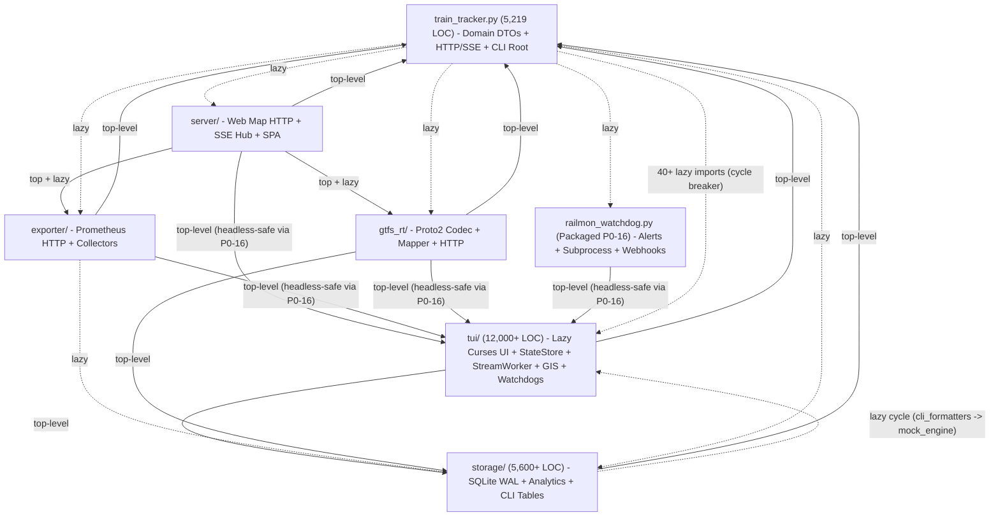
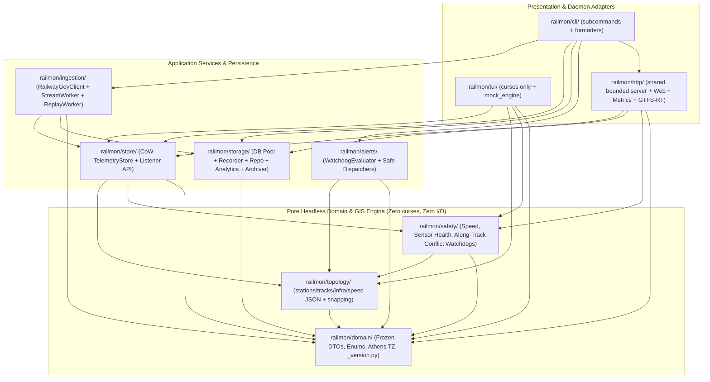

# Senior Software Engineering & Architecture Review: `railmon`

> **Date:** 2026-11-25  
> **Baseline Commit Reviewed:** `531c446` (`master`) — **Last Updated:** post-`dd8a612` (`P0-1` / `P0-14`, `P0-2` / `P0-15` & `P0-3` / `P0-16` resolved)  
> **Scope:** Full codebase audit (37 production Python files / 32,446 LOC, 68 test files / 25,612 LOC, 4 GIS JSON datasets, packaging manifests, benchmarks, and static safety tooling)  
> **Prior Baseline:** [`production-readiness-review.md`](./production-readiness-review.md) (2026-11-18, 362 tests, pre-F-6/F-7/F-8/F-9/F-10)  
> **Overall Verdict:** **Strong zero-dependency engineering foundation, but NOT production-ready for unattended daemon, rail-safety, or external-feed operation.** Rapid feature expansion (F-6 through F-10) outpaced architectural boundaries, static gates, and integration tests. While `P0-1` (shipping CLI crashes and silent `--from-db --out-dir` export loss), `P0-2` (desktop notification RCE and Web SPA DOM XSS / missing CSP), and `P0-3` (broken packaging, PyPI `watchdog` collision, and headless `curses` import crash) have been remediated, **3 P0 blockers remain open** (broken safety watchdogs, storage durability/analytics defects, and OpenMetrics spec violations).

---

## 1. Executive Summary & Empirical Baseline

### Automated Verification Baseline (Current Working Tree, updated from `531c446` / `dd8a612`)

| Verification Gate | Current Result | Key Observation |
|---|---|---|
| Full `unittest` suite (`python -m unittest discover -s tests`) | **PASSED** (`953` tests, `0` failures, `0` errors, `4` skipped) | `P0-14` fixed `history` `NameError` and 8 `WinError 32` SQLite `tearDown` leaks; `P0-15` (`dd8a612`) added 10 adversarial RCE/XSS/CSP tests; `P0-16` added 9 packaging, built-wheel, headless `_curses`-absent, PyPI `watchdog` coexistence, and POSIX fallback tests |
| Symbol-table undefined-global check (`symtable`) | **PASSED** (`0` undefined globals across all production files) | `2` shipping `NameError` bugs in [`_handle_history_segments_action`](../../train_tracker.py#L3179-L3209) and [`_handle_history_bottlenecks_action`](../../train_tracker.py#L3211-L3239) fixed in `8635eae` (`P0-14`) |
| Default `safety_ast_audit.py --strict` | **FALSE PASS** (`86` files) | Hardcoded target list skips `railmon_watchdog.py`, `server/`, `exporter/`, and `gtfs_rt/` (`18` production files unaudited) |
| Full-repo `safety_ast_audit.py --strict` (all 7 packages) | **FAILED** (`1` `PY-MISRA-03` warning remaining) | `railmon_watchdog.py`, `tui/`, and `server/` pass with `0` errors / `0` warnings (`P0-15` & `P0-16`); silent `except Exception: pass` in [`exporter/collector.py`](../../exporter/collector.py#L539) remains |
| Packaging completeness & headless portability ([`pyproject.toml`](../../pyproject.toml)) | **PASSED** (`P0-16`) | `watchdog.py` relocated to [`railmon_watchdog.py`](../../railmon_watchdog.py) and packaged; [`.gitattributes`](../../.gitattributes) enforces LF on [`railmon`](../../railmon) & CRLF on [`railmon.bat`](../../railmon.bat); PEP 562 lazy [`tui/__init__.py`](../../tui/__init__.py) + guarded [`tui/theme.py`](../../tui/theme.py) + cross-platform [`run_tui_mode()`](../../train_tracker.py#L2806-L2842) verified in a real `--no-deps` built-wheel venv |

### Architectural & Engineering Scorecard

| Dimension | Score | Primary Assessment |
|---|---|---|
| Zero-Dependency Craft & Domain Modeling | **8.5 / 10** | Impressive stdlib-only Proto2 wire codec, Braille GIS renderer, WAL SQLite setup, and frozen DTOs |
| Architecture & Modularity | **5.0 / 10** | `P0-3` (`P0-16`) resolved headless `curses` import crashes & `railmon_watchdog.py` packaging; 5,219-LOC root monolith, `tui/` shadow-core coupling, `storage <-> tui` cycle, and 3× duplicated HTTP servers remain for Phase 3 |
| Functional Correctness (CLI & Analytics) | **6.0 / 10** | `P0-1` (`P0-14`) resolved (`history` crashes & `--from-db --out-dir` fixed); broken F-9.2 transit SQL, broken `StorageMetricsCollector`, and mock-only `sensor-health`/`conflicts` remain |
| Rail Safety Watchdogs | **3.5 / 10** | 90s prune kills 180s/300s+ drop/tunnel watchdogs; single-track corridors misclassified as double-track; dead stale-ghost preemption; GIS drift up to 3.2 km |
| Security & Hardening | **6.5 / 10** | `P0-2` (`P0-15`) resolved (desktop notification RCE eliminated; SPA DOM XSS, inline handlers & strict per-request nonce CSP fixed); CSV formula injection, Slowloris/unbounded threads, and webhook secret log leakage remain |
| Concurrency & Resource Lifecycle | **4.5 / 10** | Heavy `get_snapshot()` lock contention + mutation on read, inverted SSE stale eviction, SQLite thread-local 64 MB connection leak, shutdown deadlocks |
| Storage Durability & Query Performance | **5.0 / 10** | Archival TOCTOU + PK-collision data loss, unnormalized ISO timestamps, infinite archive retry loop, systemic full table scans |
| Protocol Compliance (SSE / HTTP / OpenMetrics / GTFS-RT) | **5.5 / 10** | Real Prometheus rejects OpenMetrics output; WHATWG SSE framing & clean-EOF spin; HTTP/1.1 keep-alive & ETag/`Vary` defects; Windows EEST DST drift |
| Test Suite & Static Gates | **7.5 / 10** | `953` passing tests (`P0-14` fixed teardown leaks; `P0-15` added live PowerShell RCE, AppleScript/Linux flag injection, DOM-XSS & CSP nonce tests; `P0-16` added real wheel-archive, headless `_curses`-absent, and PyPI `watchdog` coexistence tests); over-mocked contracts, missing `protoc`/`promtool` golden vectors, and blind AST gate remain |

---

## 2. System Architecture & Structural Debt

### 2.1 Current Dependency Topology (Inverted & Cyclic)

Static import-graph analysis across all 37 production files exposes two structural anti-patterns that directly caused multiple P0/P1 defects in this review:

1. **Dual-Role Root Monolith ([`train_tracker.py`](../../train_tracker.py), 5,219 LOC):** Simultaneously acts as the lowest-level domain/client module (imported at top-level by `storage`, `tui`, `server`, `exporter`, and `gtfs_rt`) **and** the highest-level CLI presentation/composition root (lazily importing all 6 packages inside functions to break circular imports). Refactoring helper functions out of lazy-import scopes directly caused the shipping `NameError` crashes in `history bottlenecks` and `history segments` (remediated in `P0-14`).
2. **`tui/` as a Shadow Core Library (Headless `curses` Crash Fixed in `P0-16`; Structural Split Deferred to Phase 3):** Every headless package (`server`, `exporter`, `gtfs_rt`, `railmon_watchdog`, `storage`) imports domain/state/GIS code from `tui/` (`TrainStateStore`, `StreamWorker`, GIS loaders in `tui/mock_engine.py`, safety watchdogs in `tui/geo.py`). Previously, this crashed every headless daemon without `_curses` via two unconditional `import curses` paths (`tui/__init__.py` eager imports and `tui/state.py -> tui/theme.py`); `P0-16` neutralized both crash paths via PEP 562 lazy exports in [`tui/__init__.py`](../../tui/__init__.py) and guarded `_curses` resolution in [`tui/theme.py`](../../tui/theme.py), while full physical extraction out of `tui/` remains scheduled for Phase 3.

#### A. Current Dependency Graph (ASCII)

```text
  +------------------------------------------------------------------------+
  |                  train_tracker.py (5,219 LOC Monolith)                 |
  |       Domain DTOs + HTTP/SSE Client + CLI Root (40+ lazy imports)      |
  +------------------------------------------------------------------------+
        ^      ^          ^            ^             ^           |
        |      |          |            |             |     (lazy | cycle-breaker)
        |      |          |            |             |           v
  +-----+--+ +-+--------+-+----+ +-----+------+ +----+-------+ +-+-------------+
  |storage/| |  tui/ (Shadow   | |  server/   | | exporter/  | |   gtfs_rt/    |
  |SQLite  | |  Core; lazy     | | WebMap+SPA | | Prometheus | | Proto2 + HTTP |
  |5.6k LOC| |  curses P0-16)  | |            | |            | |               |
  +--------+ +-----------------+ +------------+ +------------+ +---------------+
      |   ^     ^   ^   ^   ^         |    |           |               |
      |   |     |   |   |   +---------+----+-----------+---------------+
      |   +-----+   |   |   (Headless packages depend on tui/*; 0 curses post-P0-16)
      +---(lazy)----+   |
                        |
                  +-----+---------------+
                  | railmon_watchdog.py |
                  | (Packaged in P0-16) |
                  +---------------------+
```

#### B. Current Dependency Graph (Mermaid)



### 2.2 God-Module Concentration & Duplication

| Module | LOC | Key Coupling / SRP Violations |
|---|---:|---|
| [`train_tracker.py`](../../train_tracker.py) | 5,207 | 9 responsibilities (`build_parser` = 849 lines, 16 CLI commands, HTTP/SSE client, DTOs, media launcher, logging, signals); monkey-patches `TrainStateStore` methods at [`L4257-L4285`](../../train_tracker.py#L4257-L4285) |
| [`tui/renderer.py`](../../tui/renderer.py) | 3,255 | Rendering + station board computation + ETA math + duplicated `Europe/Athens` tz logic (`render_inspector` CC=38) |
| [`tui/geo.py`](../../tui/geo.py) | 2,958 | 5 unrelated domains: Braille canvas, Equirectangular projection, GeoJSON parsing, speed enforcement (with hardcoded curses pair ints `1, 8, 9`), conflict & sensor-health watchdogs |
| [`storage/repository.py`](../../storage/repository.py) | 2,270 | 11 responsibilities: path security, in-memory TUI exports, DVR replay, GTFS bridge, F-9.1/F-9.2 analytics, CSV/GeoJSON export, retention archival |
| [`tui/state.py`](../../tui/state.py) | 2,004 | Conflates headless telemetry state with TUI-only view state (cursor/theme/modals -> 52-field `StateSnapshot`); UI cursor moves invalidate GTFS-RT `ETag`s |
| [`storage/cli_formatters.py`](../../storage/cli_formatters.py) | 1,405 | Hosts non-storage CLI renderers (timetables, departures, conflicts, speed limits) and imports `tui.mock_engine` |
| [`server/`](../../server), [`exporter/`](../../exporter), [`gtfs_rt/server.py`](../../gtfs_rt/server.py) | ~1,690 | 3× duplicated `ThreadingHTTPServer` + `BaseHTTPRequestHandler` daemons with concrete CORS, gzip, error-schema, and `handle_error` drift |

### 2.3 Recommended Target Architecture (Strict Acyclic Layers)

#### A. Target Acyclic Layer Hierarchy (ASCII)

```text
+------------------------------------------------------------------------------+
|                   Layer 4: Presentation & Daemon Adapters                    |
|  railmon/cli/             railmon/tui/                 railmon/http/         |
|  (subcommands+formatters) (curses UI + mock_engine)    (bounded base +       |
|                                                         Web/Metrics/GTFS-RT) |
+------------------------------------------------------------------------------+
                                     |
                                     v
+------------------------------------------------------------------------------+
|                 Layer 3: Application Services & Persistence                  |
|  railmon/ingestion/       railmon/store/    railmon/storage/  railmon/alerts/|
|  (Client+Stream/Replay)   (CoW Store+Bus)   (DB+Rec+Repo+Anl) (Watchdog+Push)|
+------------------------------------------------------------------------------+
                                     |
                                     v
+------------------------------------------------------------------------------+
|         Layer 2: Pure Headless Domain & GIS Engine (Zero curses/I/O)         |
|  railmon/topology/             railmon/safety/               railmon/domain/ |
|  (data/*.json + snapping)      (Speed, Sensor, Conflicts)    (DTOs, TZ, Ver) |
+------------------------------------------------------------------------------+
```

#### B. Target Acyclic Layer Hierarchy (Mermaid)



---

## 3. P0 — Critical Findings (Immediate Fixes Required)

> [!CAUTION]
> Every finding in this section causes a verified production crash, silent data loss, arbitrary code execution / XSS, complete safety-watchdog failure, or hard external-consumer scrape rejection.

### P0-1. Four Shipping CLI Bugs: Guaranteed Crashes & Silent Total Data Loss [RESOLVED]
- **Status:** Resolved in commit `8635eae` | **Plan:** [`../plans/fixes/p0/p0-14-shipping-cli-crashes-and-gtfs-from-db-out-dir-fix-plan.md`](../plans/fixes/p0/p0-14-shipping-cli-crashes-and-gtfs-from-db-out-dir-fix-plan.md)
- **Category:** Functional Bug / Data Loss
- **Locations:**
  - [`train_tracker.py`](../../train_tracker.py#L3171-L3231) (`_handle_history_segments_action`, `_handle_history_bottlenecks_action`) & [`train_tracker.py`](../../train_tracker.py#L3233-L3282) (`run_history_mode`)
  - [`train_tracker.py`](../../train_tracker.py#L4816-L4845) (`_export_db_mode`) -> [`train_tracker.py`](../../train_tracker.py#L4721-L4753) (`_emit_feed_output`)
  - [`gtfs_rt/exporter.py`](../../gtfs_rt/exporter.py#L80-L152) (`export_feed_dir`, `load_db_snapshot`, `export_from_db`)
- **Failure Modes (All Remediated in `8635eae`):**
  1. `railmon history bottlenecks` crashed with `NameError: name 'format_bottlenecks_table' is not defined` -> fixed by importing `format_bottlenecks_table` inside `_handle_history_bottlenecks_action()` with `ensure_ascii=False` JSON output.
  2. `railmon history segments` crashed with `NameError: name 'format_segment_transit_table' is not defined` -> fixed by importing `format_segment_transit_table` inside `_handle_history_segments_action()` with `ensure_ascii=False` JSON output.
  3. `railmon history trips` crashed with `TypeError` (`date` vs `service_date`) -> fixed by passing `service_date=args.date` to `HistoricalRepository.get_active_trips()`.
  4. `railmon export --gtfs-rt --from-db <db> --out-dir <dir>` silently wrote 4 empty feeds -> fixed by extracting and exporting `gtfs_rt.load_db_snapshot()`, forwarding `(positions, schedules)` through `_export_db_mode()` -> `_emit_feed_output()`, failing loud in `export_feed_dir()` when both `snapshot` and `positions` are `None`, and pinning a single bundle timestamp across all 4 files; added CLI/DB export regression tests and closed SQLite handles in `test_bottlenecks.py` and `test_eta_engine.py` `tearDown()`.

### P0-2. Arbitrary Command/Code Execution (RCE) in Desktop Notifications & DOM-Based XSS in Web SPA [RESOLVED]
- **Status:** Resolved in commit `dd8a612` (`P0-15`, `944` tests passing) | **Plan:** [`../plans/fixes/p0/p0-15-desktop-notification-rce-and-web-spa-xss-fix-plan.md`](../plans/fixes/p0/p0-15-desktop-notification-rce-and-web-spa-xss-fix-plan.md)
- **Category:** Security (RCE / XSS)
- **Locations:**
  - [`railmon_watchdog.py`](../../railmon_watchdog.py#L656-L809) (formerly `watchdog.py`; `_sanitize_notification_text`, `dispatch_terminal_bell`, `dispatch_desktop_notification`)
  - [`server/assets.py`](../../server/assets.py#L747-L1694) (`SPA_HTML_TEMPLATE`, `_validate_csp_nonce`, `_serialize_spa_config`, `get_spa_html`)
  - [`server/handler.py`](../../server/handler.py#L25-L42), [`#L135-L148`](../../server/handler.py#L135-L148), [`#L535-L580`](../../server/handler.py#L535-L580); [`server/models.py`](../../server/models.py#L36-L42)
- **Failure Modes (All Remediated in `dd8a612` / `P0-15`):**
  1. **Windows PowerShell RCE (`railmon_watchdog.py`):** Replaced inline PowerShell string interpolation with compile-time constant `_WINDOWS_TOAST_PS_SCRIPT` reading `[string]$env:RAILMON_NOTIFY_TITLE` / `$env:RAILMON_NOTIFY_MSG` from a copied child environment (`os.environ.copy()`), plus `_sanitize_notification_text()` NUL/C0/C1 stripping and length bounds; verified live against PowerShell 5.1 with smart-quote `\u2019` breakout payloads.
  2. **macOS AppleScript RCE (`railmon_watchdog.py`):** Replaced interpolated AppleScript strings with constant `_DARWIN_NOTIFICATION_SCRIPT` (`on run argv`) and `"--"` option terminator before `[safe_title, safe_msg]`.
  3. **Linux `notify-send` option injection & `PY-MISRA-03` (`railmon_watchdog.py`):** Inserted `"--"` before `[safe_title, safe_msg]`, attached `stdin=subprocess.DEVNULL`, narrowed exception catches in `dispatch_desktop_notification()` and `dispatch_terminal_bell()` (`safety_ast_audit.py --strict railmon_watchdog.py server` passes with `0` errors / `0` warnings).
  4. **Web SPA DOM XSS & Missing CSP (`server/assets.py`, `server/handler.py`, `server/models.py`):** Isolated server config in HTML-escaped `<script id="railmonConfig" type="application/json">`, removed all `.innerHTML` writes and all 11 static + dynamic inline `on*` handlers in favor of `createElement`/`createElementNS`/`textContent`, `L.divIcon({html: Element})`, `layer.bindPopup(Element)`, delegated `addEventListener` + `dataset.trainId`, `encodeURIComponent()` URLs, and `rel="noopener noreferrer"`; added per-request 128-bit CSPRNG nonce `Content-Security-Policy` (`Cache-Control: no-store`), `X-Content-Type-Options: nosniff`, `X-Frame-Options: DENY`, and `Referrer-Policy: no-referrer` across HTML and API/error routes (verified with `node --check`, adversarial DOM XSS harness, and live HTTP tests).

### P0-3. Broken Packaging (`watchdog.py` Omitted + PyPI Collision) & Headless `curses` Import Crash [RESOLVED]
- **Status:** Resolved (`P0-16`, `953` tests passing) | **Plan:** [`../plans/fixes/p0/p0-16-packaging-watchdog-namespace-and-headless-curses-fix-plan.md`](../plans/fixes/p0/p0-16-packaging-watchdog-namespace-and-headless-curses-fix-plan.md)
- **Category:** Packaging / Architecture / Portability
- **Locations:**
  - [`pyproject.toml`](../../pyproject.toml#L69-L74), [`#L110`](../../pyproject.toml#L110), [`#L131`](../../pyproject.toml#L131), [`railmon_watchdog.py`](../../railmon_watchdog.py), [`.gitattributes`](../../.gitattributes), [`railmon`](../../railmon), [`railmon.bat`](../../railmon.bat)
  - [`tui/__init__.py`](../../tui/__init__.py#L1-L223), [`tui/state.py`](../../tui/state.py#L38), [`tui/theme.py`](../../tui/theme.py#L13-L35), [`tui/app.py`](../../tui/app.py#L1341-L1357), [`#L1753`](../../tui/app.py#L1753), [`train_tracker.py`](../../train_tracker.py#L2806-L2842), [`#L4013-L4050`](../../train_tracker.py#L4013-L4050)
- **Failure Modes (All Remediated in `P0-16`):**
  1. **Omitted `watchdog.py` & PyPI Namespace Collision:** Relocated `watchdog.py` to vendor-prefixed [`railmon_watchdog.py`](../../railmon_watchdog.py) (removing root `watchdog.py` with no colliding shim), updated all 5 production import sites ([`train_tracker.py`](../../train_tracker.py#L4013-L4050), [`tui/app.py`](../../tui/app.py#L1341-L1357), [`#L1753`](../../tui/app.py#L1753)) and [`README.md`](../../README.md#L271), and registered `railmon_watchdog` across `py-modules`, `tool.ruff.src`, and `tool.coverage.run.source` in [`pyproject.toml`](../../pyproject.toml). Verified zero PyPI `watchdog` shadowing and 100% module + 4 GIS JSON asset inclusion via real built-wheel inspection (`TC-PKG-13`–`TC-PKG-15b`, `TC-PKG-17`).
  2. **Two-Layer Headless `curses` Import Crash:** Converted [`tui/__init__.py`](../../tui/__init__.py) to PEP 562 lazy `__getattr__` / `__dir__` exports (preserving all 79 `__all__` symbols, 8 lazy submodules, and `TYPE_CHECKING` support) and guarded `import curses` in [`tui/theme.py`](../../tui/theme.py#L13-L35) with platform-exact `_COLOR_*` / `_A_*` resolution and portable integer fallbacks so [`tui/state.py`](../../tui/state.py#L38) and all headless daemons (`server`, `exporter`, `gtfs_rt`, `railmon_watchdog`, `storage.cli_formatters`) import cleanly without `_curses` (verified across 13 headless targets in `_curses`-blocked subprocesses and in a zero-dependency `--no-deps` built-wheel venv outside the repo; full extraction out of `tui/` tracked in Phase 3).
  3. **POSIX Missing-`_curses` Crash & Launcher CRLF Corruption:** Generalized missing-`curses` fallback in [`run_tui_mode()`](../../train_tracker.py#L2806-L2842) across Windows and POSIX platforms (re-raising unrelated `ImportError`s) and added [`.gitattributes`](../../.gitattributes) enforcing LF on [`railmon`](../../railmon) (`i/lf w/lf`) and CRLF on [`railmon.bat`](../../railmon.bat) (`TC-PKG-18`).

### P0-4. Three Systemic Safety-Watchdog Failures (Disabled Drop/Tunnel Alerts, Double-Track Misclassification, Dead Ghost Preemption)
- **Category:** Safety Watchdog Correctness
- **Locations:**
  - [`tui/state.py`](../../tui/state.py#L167) (`DEFAULT_LIVE_STALE_TIMEOUT_SEC = 90.0`) vs [`tui/geo.py`](../../tui/geo.py#L1765-L1766) (`180s` / `300s`)
  - [`tui/geo.py`](../../tui/geo.py#L1468-L1495) (`_normalize_corridor_key`)
  - [`tui/state.py`](../../tui/state.py#L1003-L1012) (`_recompute_conflicts`) vs [`tui/geo.py`](../../tui/geo.py#L2636-L2641)
- **Failure Modes (All Empirically Verified):**
  1. **Drop & Tunnel Watchdogs Dead by Default:** `TrainStateStore` prunes silent trains at `90s`, **90 seconds before** `SensorHealthState.DROPPED` (`180s`) and **210+ seconds before** `OVERDUE IN TUNNEL` (`300s+`) can ever trigger — trains in Kallidromo (9 km) and Othrys (7 km) tunnels vanish mid-bore.
  2. **Single-Track Corridors Routed to Double-Track Mainline:** `_normalize_corridor_key()` checks `"thess"` before specific regional corridors, mapping `"THESSALY"`, `"thessaloniki_idomeni"`, and `"Thessaloniki - Alexandroupoli"` to double-track `pathe-mainline` (160 km/h) and `"PROASTIAKOS"` (Chalkida branch) to double-track `proastiakos-airport-kiato` (120 km/h). This **silently disables single-track head-on collision detection** and doubles speed limits (80 -> 160 km/h).
  3. **Stale-Ghost Conflict Preemption Is Dead Code:** `_recompute_conflicts()` passes `[rec.position for rec in self._trains.values()]` (`TrainPosition`), which lacks `last_updated` (stored on `TrainRecord`). `t1_ts`/`t2_ts` are always `None` and `is_stale_ghost` is always `False`, letting stale ghost trains trigger false `CRITICAL` collision alarms.
- **Fix:** Set eviction TTL strictly above `max(drop_threshold, max_tunnel_grace) + grace` (e.g., `>= 600s` or state-aware); reorder `_normalize_corridor_key()` specific-first without broad `"thess"` matching + geometric snapping fallback; pass `(position, last_updated)` / `TrainRecord` into `evaluate_train_conflicts()`.

### P0-5. Five Storage Durability, Data-Loss & Analytics Failures
- **Category:** Data Integrity / Analytics Correctness
- **Locations:**
  - [`storage/repository.py`](../../storage/repository.py#L1354-L1449) (`_extract_segment_transition_samples`)
  - [`storage/repository.py`](../../storage/repository.py#L2021-L2270) (`archive_before`)
  - [`storage/models.py`](../../storage/models.py#L13-L15), [`storage/repository.py`](../../storage/repository.py#L127-L132), [`#L657-L718`](../../storage/repository.py#L657-L718), [`#L880-L941`](../../storage/repository.py#L880-L941)
  - [`storage/recorder.py`](../../storage/recorder.py#L138-L166), [`#L318-L328`](../../storage/recorder.py#L318-L328), [`#L361-L489`](../../storage/recorder.py#L361-L489)
- **Failure Modes:**
  1. **F-9.2 Segment Transit Engine Measures ~2s Polling Ticks, Not ~30m Transit Times:** `LAG(next_station)` + `WHERE prev_next != current_next` matches only the single flip row whose `prev_recorded_at` is the prior telemetry tick (~2 seconds earlier), yields `delay_delta = 0.0` (`MIN == MAX` on one row), measures platform departure speed instead of cruise speed, and collapses multi-day/loop trips when `schedule_id IS NULL`. (`test_eta_engine.py` masked this by inserting only 2 rows total per train.)
  2. **`archive_before()` Silent Permanent Data Loss (2×):** (a) TOCTOU delete-by-timestamp (`WHERE recorded_at < ?`) permanently deletes late-arriving rows inserted between read and delete without archiving them; (b) copying hot `AUTOINCREMENT id` via `INSERT OR IGNORE` silently drops 100% of colliding rows after any hot-DB recreation/rotation, then deletes them from the hot DB.
  3. **Unnormalized ISO-8601 `TEXT` Timestamps Break SQLite Range Queries:** ASCII `'+'` (43) < `'.'` (46) < `'Z'` (90). Omitting `.000000` on whole seconds causes `'10:00:00.500000Z' < '10:00:00Z'`, dropping valid sub-second rows in DVR replay (`get_replay_observations`), `--from-db --at` GTFS-RT snapshots, and date-bounded analytics; `get_corridor_punctuality` compares `recorded_at <= 'YYYY-MM-DD'`, excluding the entire `end_date` day.
  4. **Infinite Tight Archival Retry Storm:** `_run_retention_archive()` updates `_last_archive_time` only on success; any archival error triggers an infinite retry storm on every worker loop iteration (~10×/sec) while synchronously stalling live ingestion.
  5. **Unrecoverable Batch Loss + Deadband Poisoning:** `_flush_buffer()` mutates `DeadbandFilter._states` *before* SQLite commits; any transient `database is locked` error drops the entire batch (`buffer.clear()`) while deadband suppresses subsequent telemetry matching the unpersisted transitions.
- **Fix:** Rewrite F-9.2 using contiguous `next_station` run islands; delete archived rows strictly by archived `id`s and do not reuse hot PKs in archive DB; normalize all stored/queried UTC timestamps to fixed-width `YYYY-MM-DDTHH:MM:SS.ffffffZ` (plus numeric `recorded_epoch` in V2); update archive retry timer in `finally` with backoff and chunk archival off the hot ingest path; split `DeadbandFilter` into pure evaluate + post-commit state update and retry transient SQLite lock failures.

### P0-6. OpenMetrics 1.0.0 Hard Scrape Failures, Duplicate Label Collisions & Broken `StorageMetricsCollector`
- **Category:** Prometheus / OpenMetrics Compliance & Correctness
- **Locations:**
  - [`exporter/formatter.py`](../../exporter/formatter.py#L83-L105), [`exporter/collector.py`](../../exporter/collector.py#L79-L147), [`#L221-L250`](../../exporter/collector.py#L221-L250), [`#L343-L393`](../../exporter/collector.py#L343-L393), [`#L525-L534`](../../exporter/collector.py#L525-L534)
- **Failure Modes:**
  1. **Real Prometheus Scrapers Reject `/metrics`:** Prometheus v2.25+ negotiates OpenMetrics 1.0.0 by default, which rejects: (a) illegal `/` in `# UNIT ... km/h`; (b) `# UNIT` values not matching the MetricFamily name suffix (`_alerts`, `_boolean`, `_trains`, `_scrapes`, etc.); (c) `_total` and `_info` retained on `# TYPE`/`# HELP` MetricFamily names; and (d) `GAUGE` metric `railmon_trains_delayed_total` illegally ending in `_total`.
  2. **Duplicate Label Sets Crash Scrapes:** `TrainTelemetryCollector` labels per-train gauges by `train_number` (omitting `pos.id`); whenever coupled consists or multiple `"Unknown"` units exist, identical `(name, labels)` tuples are emitted in the same scrape.
  3. **`StorageMetricsCollector` Permanently Dead in Production:** Line 527 calls nonexistent `repo.get_stats()` instead of `repo.get_database_stats()`; the `AttributeError` is silently swallowed by `except Exception` at line 532, so DB row/session metrics are never exported.
- **Fix:** Store canonical base family names (without `_total`/`_info`) and let `MetricsFormatter` emit spec-compliant family/sample names and valid suffix-matched units; disambiguate duplicate train numbers + guard against duplicate samples; call `repo.get_database_stats()` via a read-only SQLite connection and add a real-SQLite integration test.

---

## 4. P1 — High-Severity Findings

### 4.1 Security, HTTP Daemons & Network DoS

| ID | Issue & Location | Technical Root Cause & Impact | Recommended Remediation |
|---|---|---|---|
| **P1-1** | **Slowloris & Unbounded Thread/Connection Exhaustion Across All 3 HTTP Daemons**<br>[`server/daemon.py`](../../server/daemon.py#L22-L26), [`server/handler.py`](../../server/handler.py#L42), [`exporter/server.py`](../../exporter/server.py#L27), [`gtfs_rt/server.py`](../../gtfs_rt/server.py#L79), [`server/sse.py`](../../server/sse.py#L31-L48) | All 3 inherit `ThreadingHTTPServer` (unbounded OS threads) with `HTTP/1.1` keep-alive and `timeout = None` (infinite blocking read/write). `ExporterConfig.scrape_timeout_seconds` is dead config; `SSEBroadcaster` has no max-client cap. Idle/slow clients permanently pin threads/FDs. | Extract shared bounded HTTP server base (`BoundedSemaphore` connection cap -> `503`, `timeout = 10.0`, SSE write timeout, `max_clients` cap on `SSEBroadcaster`). |
| **P1-2** | **Unconditional Wildcard CORS on Exporter & Missing `Host` Validation (DNS Rebinding)**<br>[`exporter/server.py`](../../exporter/server.py#L66-L70), [`server/handler.py`](../../server/handler.py#L581-L589), [`gtfs_rt/server.py`](../../gtfs_rt/server.py#L118-L126) | `MetricsRequestHandler` always sends `Access-Control-Allow-Origin: *` (no `cors_enabled` toggle). None of the 3 daemons validates `Host` headers when bound to `127.0.0.1`, enabling DNS-rebinding cross-origin reads of local daemons. | Add opt-in `cors_enabled: bool = False` to `ExporterConfig`; validate `Host` against loopback allowlist when bound to localhost (`421`/`403` on mismatch). |
| **P1-3** | **Webhook Secret Log Leakage, SSRF, Plaintext Token Exposure & Telegram Markdown Errors**<br>[`railmon_watchdog.py`](../../railmon_watchdog.py#L826-L897) | Line 895 logs raw `url` (persisting Telegram/Discord/Slack secret webhook tokens in `~/.railmon/logs/`). `urlopen()` accepts non-HTTP URI schemes (`file:`, `ftp:`) and link-local targets (`http://169.254.169.254`), sends `Bearer` tokens over cleartext HTTP, follows 3xx redirects, spoofs dialects via substring match (`"api.telegram.org" in url`), and breaks Telegram `"Markdown"` on `_`/`*`/`[`. | Validate `https://` + exact hostname matching; disable redirects; redact URL path/query in logs; escape Markdown (or use HTML mode + `html.escape`); add `RAILMON_WEBHOOK_*` env vars. |
| **P1-4** | **Unencoded URL Path Segments (`InvalidURL` Crash / Path Traversal) & HTTP Redirect SSRF**<br>[`train_tracker.py#L1012`](../../train_tracker.py#L1012), [`#L1083-L1152`](../../train_tracker.py#L1083-L1152), [`#L3626`](../../train_tracker.py#L3626) | `get_schedule_by_train_number("IC 52")` (documented in CLI help!) crashes with uncaught `http.client.InvalidURL`; `get_cab_stream_url` leaves `/` unquoted (`safe='/'`), and its `except urllib.error.HTTPError` 404 handler is dead code (`_get()` always wraps into `RailwayAPIError`); default `urlopen()` follows 3xx redirects off `railway.gov.gr`; `_get()` reads unbounded response bodies; `--url-only` prints unvalidated URLs. | Use `urllib.parse.quote(val.strip(), safe="")`; catch `RailwayAPIError(status_code=404)` in `get_cab_stream_url`; re-validate redirects in custom `HTTPRedirectHandler`; cap REST response size; validate `--url-only` URLs and pass `"--"` to players. |
| **P1-5** | **CSV Formula Injection (CWE-1236) & Unbounded Export OOM**<br>[`storage/repository.py#L435-L485`](../../storage/repository.py#L435-L485), [`#L1713-L1760`](../../storage/repository.py#L1713-L1760) | Upstream string cells starting with `=`, `+`, `-`, `@`, `\t`, `\r` are written raw to CSV (spreadsheet formula execution). `export_csv("telemetry")` calls `get_train_history()` (`fetchall()`) instead of existing `iter_train_history()`. | Prefix dangerous string cells with `'`; stream CSV exports via `iter_train_history()`. |
| **P1-6** | **HTTP/1.1 Protocol & Caching Violations (`304`, `405`, `Vary`, ETag, `HEAD` Bodies)**<br>[`gtfs_rt/server.py#L169-L195`](../../gtfs_rt/server.py#L169-L195), [`#L276-L287`](../../gtfs_rt/server.py#L276-L287), [`server/handler.py#L359-L388`](../../server/handler.py#L359-L388), [`exporter/server.py#L105-L117`](../../exporter/server.py#L105-L117) | Same strong `ETag` shared across plain & gzip bodies without `Vary: Accept, Accept-Encoding`; `304` sends `Content-Length: 0`; `405` on `POST`/`PUT` leaves unread body in keep-alive stream (missing `Connection: close` and `Allow` header); `HEAD` errors write response bodies; `"gzip" in accept` ignores case and `gzip;q=0`; `WebMapServer` CORS omits `If-None-Match`. | Fix RFC 9110 framing (`Vary`, encoding-scoped/weak ETags, no `Content-Length` on `304`, `Allow` + `close_connection = True` on `405`, skip body on `HEAD` errors, proper `q=` parser) in shared HTTP base. |
| **P1-7** | **Memory-Amplification DoS & TOCTOU Read in `gtfs_rt --inspect`**<br>[`gtfs_rt/exporter.py#L147-L156`](../../gtfs_rt/exporter.py#L147-L156), [`gtfs_rt/models.py#L1155-L1166`](../../gtfs_rt/models.py#L1155-L1166) | `os.path.getsize()` check followed by unbounded `fh.read()`; repeated protobuf fields have no element cap (16 MiB crafted `.pb` -> ~3.35M frozen objects -> >1.5 GiB RAM). | Read `fh.read(MAX_INSPECT_BYTES + 1)` and enforce bounded `max_entities` / `max_repeated_items` limits in `from_proto()`. |

### 4.2 Concurrency, Locking & Lifecycle Reliability

| ID | Issue & Location | Technical Root Cause & Impact | Recommended Remediation |
|---|---|---|---|
| **P1-8** | **`TrainStateStore.get_snapshot()` Heavy Mutation Under Coarse `RLock`, Mutable Leakage & Silent Version Drift**<br>[`tui/state.py#L1387-L1529`](../../tui/state.py#L1387-L1529), [`tui/stream_worker.py#L148`](../../tui/stream_worker.py#L148), [`exporter/collector.py#L77`](../../exporter/collector.py#L77), [`#L219`](../../exporter/collector.py#L219), [`#L341`](../../exporter/collector.py#L341) | Every `get_snapshot()` holds `self._lock` to run $O(N \cdot S + N^2)$ sensor-health + conflict recomputation and mutates records **without incrementing `_version`** (serving stale GTFS-RT `ETag`s). Called on **every SSE frame** in `StreamWorker`, 15×/sec in idle `TUIApp`, and **3× per `/metrics` scrape**. `get_train()`/`get_selected_train()` leak live mutable `TrainRecord`s; `StateSnapshot` exposes mutable dicts/deques/`TrainPosition`s. | Publish copy-on-write immutable snapshots updated only on writes + a 1 Hz background maintenance tick (bumping `_version` on transitions); add $O(1)$ `get_connection_status()`; share 1 snapshot per `/metrics` scrape; freeze `TrainPosition` and wrap snapshot dicts in `MappingProxyType`. |
| **P1-9** | **Inverted SSE Stale-Client Eviction & Shutdown Socket Leak**<br>[`server/sse.py#L85-L133`](../../server/sse.py#L85-L133), [`server/handler.py#L439-L487`](../../server/handler.py#L439-L487) | `broadcast()` calls `conn.touch()` on enqueue (even when overflowing), so dead consumers are never evicted while traffic flows; conversely, `_handle_sse_stream()` sends `:ping` without calling `conn.touch()`, so during >60s quiet periods `cleanup_stale_clients()` evicts healthy browsers into permanent silent zombies. On shutdown, `close_connection` remains `False` under HTTP/1.1 without chunked encoding, pinning threads on `rfile.readline()`. | Call `touch()` only in consumer after successful `wfile.flush()`; push close sentinel on unregister/shutdown; set `self.close_connection = True` and `Connection: close` on SSE response. |
| **P1-10** | **Shutdown & Signal-Handler Deadlocks Across All Daemons + Non-Async-Signal-Safe Logging**<br>[`server/daemon.py#L153-L205`](../../server/daemon.py#L153-L205), [`exporter/server.py#L327-L357`](../../exporter/server.py#L327-L357), [`gtfs_rt/server.py#L346-L378`](../../gtfs_rt/server.py#L346-L378), [`train_tracker.py#L208-L214`](../../train_tracker.py#L208-L214) | `server.stop()` unconditionally calls `BaseServer.shutdown()`, which **deadlocks permanently** if called from the foreground signal handler (`start(background=False)`) or before `serve_forever()` starts. In `train_tracker.py:213`, `logger.info()` runs inside `_handle_signal` *before* `event.set()`, risking `RuntimeError: reentrant call` that drops shutdown signals, while PEP 475 restarts blocking `socket.recv()`/`time.sleep(retry_after)`. | Guard `shutdown()` with `_serving_started` + thread identity check; remove duplicate deadlocking signal helpers; keep signal handler strictly `event.set()` (second `SIGINT` escalates); interrupt retry sleeps via `stop_event.wait()`. |
| **P1-11** | **SQLite `Database` Thread-Local 64 MB Connection Leak, `transaction()` Silent Commit, `os.umask()` Race, Broken `file::memory:`, Per-Open Integrity Scan**<br>[`storage/db.py#L50-L268`](../../storage/db.py#L50-L268), [`storage/schema.py#L118-L163`](../../storage/schema.py#L118-L163) | `_open_connections` retains strong references to dead threads' connections (each with 64 MB `cache_size` + WAL locks) forever; `transaction()` silently commits pre-existing outer transactions; `os.umask(0o077)` mutates process-wide umask without locking; `file::memory:` omits `uri=True`; every `Database()` open runs full-DB `PRAGMA integrity_check` + `foreign_key_check` (twice on `record`!). | Evict dead threads' connections (weakref/pool) + add `_closed` guard; open with `isolation_level=None` + `SAVEPOINT` nesting; pass `uri=path.startswith("file:")`; replace `os.umask` with `os.open(..., 0o600)`; make full integrity check explicit/post-migration; check `wal_checkpoint` busy flag and support `read_only=True`. |
| **P1-12** | **Collector Data Races, Unbounded Conflict Set, & `FeedCache` Version Rollback / Restart ETag Collision**<br>[`exporter/collector.py#L210-L292`](../../exporter/collector.py#L210-L292), [`#L331-L378`](../../exporter/collector.py#L331-L378), [`gtfs_rt/mapper.py#L996-L1040`](../../gtfs_rt/mapper.py#L996-L1040) | `WatchdogMetricsCollector` & `StreamMetricsCollector` mutate shared dicts/sets across scrape threads with no lock, leak `_seen_conflict_ids` forever (and permanently ignore recurring deterministic `alert_id`s), and miss events occurring between scrapes. `FeedCache.get_or_build()` rolls `_active_version` backwards on concurrent build completion, reuses identical `version=1` ETags across daemon restarts, and eagerly serializes ProtoJSON on `.pb` requests. | Move cumulative conflict/reconnect counters into `TrainStateStore`; advance `FeedCache._active_version` strictly monotonically, include content hash/boot nonce in ETag, and lazily serialize JSON on demand. |
| **P1-13** | **`StreamWorker`, `ReplayWorker`, `TelemetryRecorder` & `TUIApp` Multi-Threading Races**<br>[`tui/stream_worker.py#L79-L206`](../../tui/stream_worker.py#L79-L206), [`#L344-L565`](../../tui/stream_worker.py#L344-L565), [`storage/recorder.py#L225-L291`](../../storage/recorder.py#L225-L291), [`tui/app.py#L689-L711`](../../tui/app.py#L689-L711), [`#L1149-L1188`](../../tui/app.py#L1149-L1188) | `StreamWorker` pause/resume overwrite races & clean-EOF tight spin + stale trains unpruned during quiet keepalives; `ReplayWorker` EOF-pause race, SQLite I/O held under `_clock_lock`, and silent worker death on `OperationalError`; `TelemetryRecorder.stop()` ignores `join()` timeout before closing DB & `enqueue_batch()` bypasses `queue_maxsize` by 50–200×; `TUIApp` timetable/cab daemon threads mutate UI/toast state unlocked with ABA overwrite risk. | Add worker state locks and EOF backoff; move SQLite I/O out of `_clock_lock` + catch `OperationalError`; bound queue by item count and verify worker exit before `db.close()`; route `TUIApp` async results via a locked queue with monotonic `request_id`. |

### 4.3 Upstream SSE Reliability, Geospatial/Watchdogs, Analytics & Cross-Platform Correctness

| ID | Issue & Location | Technical Root Cause & Impact | Recommended Remediation |
|---|---|---|---|
| **P1-14** | **SSE Clean-EOF Reconnect Storm, Uncaught `IncompleteRead`, `2 ** attempt` `OverflowError`, Single-Line OOM & WHATWG Framing Violations**<br>[`train_tracker.py#L1364-L1541`](../../train_tracker.py#L1364-L1541) | Clean EOF loops with 0s sleep (100% CPU / IP ban); `http.client.IncompleteRead` / `BadStatusLine` aren't subclasses of `OSError`/`URLError` and crash daemons; `2 ** attempt` raises `OverflowError` at `attempt=1024` (~17h outage); `for raw_line in resp:` buffers unbounded newline-free lines before checking `MAX_SSE_FRAME_BYTES`; multi-line `data:` joined with `""` instead of `"\n"`, `.strip()` breaks whitespace lines, UTF-8 BOM breaks first event. | Apply backoff on clean EOF; catch `http.client.HTTPException`; cap exponent `2 ** min(attempt, 20)`; use bounded `readline(MAX_SSE_FRAME_BYTES + 1)`; implement WHATWG SSE line framing + `Last-Event-ID`. |
| **P1-15** | **GIS Geometry Drift (up to 3.2 km), Chord/Bucket Conflict Blind Spots & Watchdog State-Machine Bugs**<br>[`tui/geo.py#L1907-L2180`](../../tui/geo.py#L1907-L2180), [`#L2596-L2956`](../../tui/geo.py#L2596-L2956), [`tui/state.py#L788-L801`](../../tui/state.py#L788-L801), [`#L951-L969`](../../tui/state.py#L951-L969), [`#L1016-L1041`](../../tui/state.py#L1016-L1041), [`tui/data/speed_limits.json`](../../tui/data/speed_limits.json), [`tui/data/infrastructure.json`](../../tui/data/infrastructure.json) | `TSR-PATHE-SPERCHEIOS` (558–1,061m off track), `northern-strymonas-gorge` (3,238m off), and `tun-othrys` (1,014m off, `max_dist_m=45m`) miss mainline trains; `TERMINAL_STATION_IDS` has nonexistent `"lian"`/`"kth"`; straight-line chord conflicts miss S-curve approaches & shared-trunk trains (`SKA–Inoi`, `Thessaloniki–Kilkis`) while false-alarming Chalkida on double track; sensor freeze flaps every 20s; `WARNING->CRITICAL` shares `alert_id` (no escalation bell) and farthest CRITICAL overwrites nearest; F-10.1 `DelayUpdate` ignores mismatched `train_id` and falls through to `train_number`; `Space` pause prunes all trains after 90s. | Align GIS JSON polylines to `tracks.json` with a CI geometry test; compute along-track chainage separation across shared trunk sections; add `FROZEN` hysteresis; key bell latch on `(alert_id, severity)` and keep nearest alert; enforce strict ID precedence in F-10.1 updates; suspend pruning while `PAUSED`. |
| **P1-16** | **Geospatial Scale Bar (+29.74% Error), Backwards Southbound Mock Arrows, Unclipped Bresenham Freeze & Strict ASCII Crash**<br>[`tui/geo.py#L550-L563`](../../tui/geo.py#L550-L563), [`#L715-L747`](../../tui/geo.py#L715-L747), [`tui/mock_engine.py#L1105-L1136`](../../tui/mock_engine.py#L1105-L1136), [`tui/renderer.py#L1171-L1215`](../../tui/renderer.py#L1171-L1215), [`#L1487-L1766`](../../tui/renderer.py#L1487-L1766) | `get_km_per_cell()` omits $\cos(\phi)$ (+29.74% error: reports `11.57 km` vs `8.92 km` actual); `SimulatedTrain.step()` leaves `track_heading` unflipped for southbound trains (pointing North `▲`); `BrailleCanvas.draw_line()` steps off-screen pixels without clipping + re-snaps up to 225k segments/frame; `safe_addstr()` doesn't catch `UnicodeEncodeError` on ASCII locales (`LANG=C`). | Multiply by `cos_center / cos_phi0` in `get_km_per_cell()`; flip `track_heading` on `direction == -1`; add Liang-Barsky clipping + viewport track-canvas caching + pre-snapped breadcrumbs; handle `UnicodeEncodeError` with transliteration fallback in `safe_addstr()`. |
| **P1-17** | **CLI Operational Bugs: Mock-Only `sensor-health`/`conflicts`, Broken `watch` Loop & Cross-Train Matching**<br>[`train_tracker.py#L3868-L3996`](../../train_tracker.py#L3868-L3996), [`#L4111-L4152`](../../train_tracker.py#L4111-L4152), [`railmon_watchdog.py#L205-L236`](../../railmon_watchdog.py#L205-L236) | `railmon sensor-health` ignores `--demo`, runs `MockTelemetryEngine` with `now == last_updated` (mathematically impossible to detect `FROZEN`/`DROPPED`/`STALE`); `railmon conflicts` always runs fake mock data; `run_watch_mode` assigns `matching_pos` *after* `if not events: continue` (ticker never updates) and never runs `evaluate_timeout()` during stream stalls; `matches_train_number("IC52")` matches `"5"`, `"2"`, `"IC520"`, `"R52"`. | Wire live SSE/DB ingestion into `sensor-health`/`conflicts` unless `--demo` is passed; update `matching_pos` before event guard and decouple `watch` timeout ticks onto a timer/queue; tighten `matches_train_number()` to exact/anchored matches. |
| **P1-18** | **Storage Analytics & Export Integrity: Full Table Scans, F-9.1 Statistical Skew, Duplicate Consist Collisions, RFC 7946 Violations & Broken `get_corridor_punctuality`**<br>[`storage/repository.py#L622-L1711`](../../storage/repository.py#L622-L1711), [`storage/filter.py#L109`](../../storage/filter.py#L109), [`train_tracker.py#L3157`](../../train_tracker.py#L3157) | `EXPLAIN QUERY PLAN` confirms full scans on 6 core queries due to `(? IS NULL OR ...)` and `DATE(recorded_at)`; F-9.1 `get_corridor_bottlenecks` pulls **all** raw telemetry rows into Python RAM (OOM + `median_delay > max_delay` mismatch), computes `p90 == max` for `n <= 10`, and deadband 60s heartbeat hides <60s stops; `DeadbandFilter` & `telemetry_history` collapse duplicate consists sharing `train_number`; `export_trip_geojson` emits 1-point `LineString` & mixed 2D/3D coords; `train_tracker.py:3157` reads wrong key `"suppressed_count"` (always `0`). | Build dynamic sargable `WHERE` clauses; compute F-9.1 percentiles over `dwell_events` using `statistics.median` / linear p90; key `DeadbandFilter` on `(pos.id, loco)` and add `vehicle_id` in Schema V2; enforce RFC 7946 >=2-point & uniform-dimension GeoJSON with `allow_nan=False`. |
| **P1-19** | **GTFS-RT Conformance & Windows Portability: EEST DST Drift, Midnight `start_date`/`trip_id` Flip, Unguarded `None`/`Inf` Crash, & Windows Atomic Replace Failure**<br>[`gtfs_rt/mapper.py#L81-L89`](../../gtfs_rt/mapper.py#L81-L89), [`#L309-L636`](../../gtfs_rt/mapper.py#L309-L636), [`gtfs_rt/exporter.py#L35-L55`](../../gtfs_rt/exporter.py#L35-L55) | Clean Windows installs lack `tzdata`, silently falling back to fixed `UTC+2` (1 hour off for 7 months/year during EEST `UTC+3`); overnight trains flip `start_date` and fallback `trip_id` at midnight; `delay=None`/`distance=inf`/`chainage=inf` crash entire fleet feed; `write_atomic_bytes()` uses predictable `.tmp.<pid>.<tid>` (CWE-377) and crashes `--watch` on Windows `PermissionError` when readers open `feed.pb`. | Implement zero-dependency EU EET/EEST `tzinfo` fallback (shared across `gtfs_rt`, `tui`, `storage`); derive `start_date` from `scheduledDeparture`; sanitize all numeric fields & isolate per-entity errors; use `tempfile.mkstemp()` + bounded Windows `os.replace()` retry. |
| **P1-20** | **Static Safety AST Gate Excludes 18 Production Files & Has Rule Blind Spots**<br>[`safety_ast_audit.py#L26`](../../.agents/skills/static-safety-analyzer/scripts/safety_ast_audit.py#L26), [`#L341-L643`](../../.agents/skills/static-safety-analyzer/scripts/safety_ast_audit.py#L341-L643) | `DEFAULT_PRODUCTION_TARGETS` skips `watchdog.py`, `server/`, `exporter/`, `gtfs_rt/`, `scripts/`; `--warn-complexity` defaults to `25` (dead advisory threshold `15`); misses import aliases, `timeout=None`, `except (Exception,): pass`, `ast.Match`, `AsyncFunctionDef`, and disables checks if repo path contains `tests`. | Expand `DEFAULT_PRODUCTION_TARGETS` to all packages, fix the 3 exposed `PY-MISRA-03` violations, lower `--warn-complexity` default to `15`, and close AST blind spots (or run `ruff` + `mypy` + `bandit` in CI). |

---

## 5. P2 — Medium-Severity Debt (Grouped by Subsystem)

### Core CLI, Models & Packaging
- **Subparser flag shadowing** ([`train_tracker.py`](../../train_tracker.py#L1742-L2538)): Concrete defaults on `watch`, `serve`, `metrics`, `export`, `schedule`, `departures`, `cab`, `sensor-health`, and `history` overwrite root flags (`railmon --demo watch IC52` silently runs **live**; `railmon --db custom.db metrics` silently reads `railway_history.db`). Use `default=argparse.SUPPRESS`.
- **`parse_retry_after` RFC 9110 naive HTTP-date bug** ([`train_tracker.py`](../../train_tracker.py#L290-L337)): `asctime` / `-0000` dates yield naive `datetime`, throwing caught `TypeError`; fallback bypasses `max_delay`.
- **Watchdog state machine edge cases** ([`railmon_watchdog.py`](../../railmon_watchdog.py#L180-L649)): `last_delay_alert_time = 0.0` suppresses first alert when `now < 300s`; wall-clock `time.time()` breaks on NTP step; negative delay renders `+-2m`; `TELEMETRY_LOST` fires after `ARRIVAL`; `--notify inf` / `--speed nan` bypass validation; stationary trains emit false `PROXIMITY_ETA`.
- **Resource & lifecycle leaks** ([`train_tracker.py#L110`](../../train_tracker.py#L110), [`#L2929-L2953`](../../train_tracker.py#L2929-L2953), [`#L4437-L4933`](../../train_tracker.py#L4437-L4933)): Headless replay loads full DB into RAM; startup exceptions after `worker.start()` leak threads/DBs; `HTTPError` sockets aren't closed on retry; fire-and-forget `Popen` leaves zombies; `_ensure_secure_log_path` mutates process-wide `os.umask()`.
- **Cross-platform launcher & Python 3.10 compatibility** ([`railmon.bat`](../../railmon.bat), [`requirements-dev.txt`](../../requirements-dev.txt), [`train_tracker.py#L339-L585`](../../train_tracker.py#L339-L585)): ~~Missing `.gitattributes` checks out `railmon` with CRLF~~ *(resolved in `P0-16`)*; `railmon.bat` hits Windows Store `python` stub before `py`; `requirements-dev.txt` misses `ruff`/`bandit`/`flake8-bugbear`; `fromisoformat()` fails in Python 3.10 on 1–2 or >6 fractional digits / lowercase `z`; `bool` accepted as `int`/`float` coordinates (`True` -> `1.0`).

### Storage, Formatters & Benchmarks
- **Path validation & archival hygiene** ([`storage/repository.py#L35-L125`](../../storage/repository.py#L35-L125), [`#L2021-L2270`](../../storage/repository.py#L2021-L2270)): `validate_export_path()` returns uncanonicalized `abs_path`, ignores Windows reserved device names (`CON`, `NUL`, ADS `:`), and `export_csv()` rejects `pathlib.Path`; unchunked `IN (?, ...)` exceeds `SQLITE_MAX_VARIABLE_NUMBER` at scale; `archive_before()` never reclaims hot-DB pages (`checkpoint_wal` / `incremental_vacuum`), so archiving temporarily *increases* disk usage.
- **`DeadbandFilter` & disk-full circuit breaker** ([`storage/filter.py#L81-L165`](../../storage/filter.py#L81-L165), [`storage/recorder.py#L97-L185`](../../storage/recorder.py#L97-L185)): Flush-time `time.time()` suppresses heartbeats under queue backlog; unclamped `math.sqrt(1 - a)` risks domain error; disk check falls back to `"."` when target directory doesn't exist yet and returns silently from `start()` with `session_id=None`.
- **`storage/cli_formatters.py` defects** ([`storage/cli_formatters.py#L45-L1403`](../../storage/cli_formatters.py#L45-L1403)): Unlocked `_STATION_INDEX_CACHE` permanently caches `{}` on error; `format_timetable_time()` doesn't parse documented numeric epochs; `format_station_board_table()` prints UTC instead of Athens time; `format_bottlenecks_table()` prints `+-2.0m`; negative `dwell_seconds` renders as `50s`; `use_color` in `format_segment_transit_table()` is dead code.
- **Misleading storage benchmarks** ([`scripts/benchmark_storage.py#L70-L303`](../../scripts/benchmark_storage.py#L70-L303)): Hardcoded `chunk_size=50` invalidates `batch_size=10`; never verifies `total_records_written == num_records`; measures `wal_size_kb` *after* `stop()` truncated WAL (`0.0 KB`); lacks concurrent read-under-write, F-9.1, and F-9.2 benchmarks; mutable default argument `batch_sizes=[...]`.

### TUI, Rendering & Watchdogs
- **Speed & conflict edge cases** ([`tui/geo.py#L1666-L1728`](../../tui/geo.py#L1666-L1728), [`#L2295-L2578`](../../tui/geo.py#L2295-L2578), [`tui/renderer.py#L2618-L2621`](../../tui/renderer.py#L2618-L2621)): `margin >= 0.0` flags trains driving at *exact* speed limit as `[WARN +0]`; untagged regional branches default to 120 km/h; TSR time windows aren't parsed; `CONVERGING_JUNCTION` & `min_evaluation_speed_kmh` are dead config; `render_inspector()` prints `conflict.train_number_2` even when `train_2` is selected (self-conflict).
- **Curses event loop, input & rendering glitches** ([`tui/app.py#L303-L376`](../../tui/app.py#L303-L376), [`#L647-L893`](../../tui/app.py#L647-L893), [`#L1766-L1901`](../../tui/app.py#L1766-L1901), [`tui/renderer.py#L1398-L2863`](../../tui/renderer.py#L1398-L2863)): Single `getch()` per 66ms frame; `REPORT_MOUSE_POSITION` redraws at 15 FPS on mouse hover; `Esc` in `NORMAL` mode exits (fragile over SSH split escapes); `endwin()` on resize drops `curs_set`/`mousemask`; `curs_set(0)` unguarded; synchronous SQLite/notification I/O on UI thread; lowercase train IDs hide roster watch badge `●`; `DISCONNECTED` displays green `● DEMO MODE`; `ThemeSpec.has_custom_bg` never calls `win.bkgd()`; `GREECE_PRESET` clips 3 real stations (`PYT`, `DIK`, `FLO`); `fit_bounding_box()` lacks zero-span / max-zoom guards.

### Web Server, Exporter & GTFS-RT
- **Broken SPA-to-backend contracts & SSE bridge gaps** ([`server/assets.py#L1392`](../../server/assets.py#L1392), [`#L1508-L1562`](../../server/assets.py#L1508-L1562), [`train_tracker.py#L4240-L4283`](../../train_tracker.py#L4240-L4283), [`server/handler.py#L200`](../../server/handler.py#L200), [`#L489-L519`](../../server/handler.py#L489-L519)): `/api/health` flat schema doesn't match SPA's `data.metrics.*` (footer stuck at `--`); `/cab?train=...` 404s; `_broadcast_positions()` drops train metadata & skips F-10.1 `delayUpdates`/`scheduleCards`; SPA never prunes stale markers on `trainPositionsUx` (client leak); `_build_snapshot_json`/`_handle_conflicts` allow invalid JSON `NaN`/`Infinity`.
- **Exporter cardinality, precision & error disclosure** ([`exporter/formatter.py#L9-L56`](../../exporter/formatter.py#L9-L56), [`exporter/collector.py#L126-L147`](../../exporter/collector.py#L126-L147), [`#L551-L582`](../../exporter/collector.py#L551-L582), [`exporter/server.py#L129-L146`](../../exporter/server.py#L129-L146)): Unbounded per-train/event label cardinality; `Sample.timestamp` silently dropped; `:.6g` loses uptime precision after 11.5 days; wall-clock `time.time()` used for uptime `COUNTER`; raw exception strings leaked in HTTP 500; unsynchronized `registry._collectors` access; `GeoAssetCache.get_asset_raw()` lacks path containment check; `SSEBroadcaster.broadcast_keepalive()` emits malformed `event: \ndata: :ping` and double-counts `frames_sent`.
- **GTFS-RT Proto2 & mapping compliance** ([`gtfs_rt/wire.py#L141-L236`](../../gtfs_rt/wire.py#L141-L236), [`gtfs_rt/models.py#L558-L1161`](../../gtfs_rt/models.py#L558-L1161), [`gtfs_rt/mapper.py#L436-L922`](../../gtfs_rt/mapper.py#L436-L922)): Singular repeated submessages overwrite instead of merging; wire decoder misses upper field-number bound (`2^29 - 1`), `uint32` bounds, and proto2 group skipping; `encode_float()` leaks `OverflowError` > `3.4e38`; `_stops_kinematic()` can emit non-monotonic `dest_time < pred_time` (E022) and `_stops_from_schedule()` ignores recorded actuals; duplicate `pos.id` emits duplicate `FeedEntity.id` (E001); conflict alerts emit non-canonical `route_id`s and ignore `corridor_filter`; test trains (`^T\d+$`) leak into live feeds; `EntitySelector` over-constrains `route_type` + `trip.schedule_relationship`.

---

## 6. P3 — Low-Severity Hygiene & Polish

| Area | Finding & Location |
|---|---|
| CLI validation & UX | Unused `--no-filter-deadband` on `metrics` ([`train_tracker.py#L2409`](../../train_tracker.py#L2409)); `stop_event.wait(1.0)` throttles live plain/watch streams to 1 Hz ([`#L3036`](../../train_tracker.py#L3036), [`#L4151`](../../train_tracker.py#L4151)); `run_history_mode` opens DB with `auto_migrate=True` ([`#L3281`](../../train_tracker.py#L3281)); `is_tty_supported()` omits `stdin.isatty()`; `--interval 0` busy-loops; hardcoded `•` bullets in `--ascii` mode; [`format_watch_ticker`](../../railmon_watchdog.py#L945-L982) border alignment mismatch; `--archive-path` help falsely claims "gzipped JSONL". |
| HTTP & Security Headers | Missing `X-Content-Type-Options: nosniff`, `X-Frame-Options: DENY`, `Referrer-Policy: no-referrer` on `exporter/` and `gtfs_rt/` (`server/` & `rel="noopener noreferrer"` resolved in [`P0-15`](../plans/fixes/p0/p0-15-desktop-notification-rce-and-web-spa-xss-fix-plan.md)); hardcoded `railmon v0.1.0` in SPA ([`server/assets.py#L819`](../../server/assets.py#L819)); unescaped `server_address[0]` in [`exporter/server.py#L199`](../../exporter/server.py#L199); `/api/history/train/<id>` lacks `unquote()` and matches nested slashes; `NaN` bypasses `<= 0.0` config checks. |
| Storage & GTFS-RT Nits | [`storage/__init__.py`](../../storage/__init__.py) omits F-9.1/F-9.2 exports; `LIKE` wildcards (`%`/`_`) unescaped; `scheduled_trips(train_number)` lacks leading index for `ON DELETE CASCADE`; `gtfs_rt` `from_proto()` leaks raw `ValueError` instead of `WireDecodeError` and `_resolve_bearing()` drops due-North `0.0°` `track_heading`. |
| Config & Docs Drift | [`pyproject.toml#L100`](../../pyproject.toml#L100) global `ignore_missing_imports = true` hides broken imports; [`README.md`](../../README.md) omits `server/` and states `380+ tests` (actual: `953`); [`.agents/rules/testing.md`](../../.agents/rules/testing.md) lists obsolete test filenames. |

---

## 7. Test Suite & Verification Engineering Assessment

Despite having **953 automated tests** (25,612 LOC) with strong end-to-end socket and SQLite integration coverage, five systemic testing weaknesses explain why critical defects shipped to `master`:

1. **Windows Teardown Leaks Resolved (`8635eae` / `P0-14`), Intermittent HTTP 405 Flake Remains:** [`tests/test_bottlenecks.py`](../../tests/test_bottlenecks.py) and [`tests/test_eta_engine.py`](../../tests/test_eta_engine.py) now close SQLite handles cleanly in `tearDown()` (eliminating the `NameError` and 8 `WinError 32` errors present on `531c446`). However, [`tests/test_gtfs_server.py`](../../tests/test_gtfs_server.py) intermittently hits `ConnectionAbortedError [WinError 10053]` on `POST` `405` due to unread keep-alive request bodies (`P1-6`).
2. **Contract-Masking Mocks:**
   - [`tests/test_exporter_collector.py`](../../tests/test_exporter_collector.py) mocks `recorder.get_stats()` and `StateSnapshot` with `MagicMock`, completely hiding that `HistoricalRepository.get_stats()` does not exist.
   - [`tests/test_tui_conflict_watchdog_geo.py`](../../tests/test_tui_conflict_watchdog_geo.py) passes mock objects carrying `.last_updated` directly to `evaluate_train_conflicts()`, hiding that `TrainStateStore` passes `TrainPosition` without `.last_updated`.
   - [`tests/test_eta_engine.py`](../../tests/test_eta_engine.py) seeds only 2 rows per train, hiding that F-9.2 measures ~2s polling intervals on real multi-breadcrumb data.
   - [`tests/test_watchdog.py`](../../tests/test_watchdog.py) still uses a custom `DummyPosition` for evaluator tests (quote/backslash/smart-quote/flag injection payloads are now tested in `P0-15`, including a live Windows PowerShell regression test).
3. **Self-Referential Protobuf Testing:** [`tests/test_gtfs_models.py`](../../tests/test_gtfs_models.py) only round-trips its own `to_proto()` -> `from_proto()` without `protoc` / `gtfs-realtime-bindings` golden binary fixtures or an OpenMetrics grammar validator (`promtool`) for `exporter/`.
4. **Missing High-Risk Matrix Tests:** `--from-db --out-dir` (`P0-14`) and built-wheel / `_curses`-absent headless / PyPI `watchdog` coexistence tests (`P0-16`) are now covered, but zero tests exist for EEST summer DST (`UTC+3`) without `tzdata`, overnight midnight trips, sub-second SQLite timestamps (`.500Z`), or GIS polyline-to-track geometric alignment.
5. **Test Execution Hygiene:** [`tests/test_cli_metrics.py`](../../tests/test_cli_metrics.py) binds hardcoded ports (`9199`, `9197`), leaves HTTP responses unclosed, and (along with [`tests/test_cli_serve.py`](../../tests/test_cli_serve.py)) pre-sets `stop_event` before `start(background=True)` risking `BaseServer.shutdown()` deadlocks; [`tests/test_gtfs_server.py`](../../tests/test_gtfs_server.py) lacks `ProxyHandler({})` isolation.

---

## 8. Genuine Engineering Strengths (Preserve During Refactoring)

1. **True Zero-Dependency Runtime Purity:** Implementing HTTP/SSE serving, Proto2 binary wire encoding, Prometheus/OpenMetrics exposition, Braille 2×4 cartographic rendering, and WAL SQLite persistence purely on the Python 3.10+ stdlib is a rare and valuable operational property.
2. **Correct Native Proto2 Wire Encoding Fundamentals:** [`gtfs_rt/wire.py`](../../gtfs_rt/wire.py) handles 10-byte two's-complement negative `int32`/`int64` varints, IEEE-754 `<f`/`<d` NaN/Inf rejection, and non-recursive iteration cleanly, and [`gtfs_rt/models.py`](../../gtfs_rt/models.py) matches GTFS-RT v2.0 field numbers and enum tags accurately.
3. **Zero Direct SQL Injection Surface:** Every SQL statement across [`storage/`](../../storage) uses parameterized `?` bindings and static allowlists (`_WAL_CHECKPOINT_SQL`, sort orders).
4. **Thoughtful Rail-Domain Modeling:** Consist disambiguation (`VehiclePositions` vs deduplicated `TripUpdates`), F-10.1 ghost-train superseding, Greek diacritic/final-sigma normalization (`casefold()`), deadband baseline-against-last-persisted semantics, and SRI hashes + offline tile fallback in the SPA all reflect strong domain understanding.
5. **Safe Operational Defaults & Isolation Instincts:** Loopback `127.0.0.1` default binds, read-only HTTP method allowlists (`405`), collector fault isolation in `MetricRegistry`, bounded SSE fan-out queues, TTY binary-stdout protection, and real TCP/SQLite integration tests provide an excellent baseline to harden.

---

## 9. Prioritized Remediation Roadmap

### Phase 0 — Immediate Hotfixes (1–2 Days, Unblock `master` & Packaging)
1. ~~Fix shipping CLI crashes: missing imports in `_handle_history_bottlenecks_action` & `_handle_history_segments_action`, `service_date=args.date` in `run_history_mode`, and pass `(positions, schedules)` through `_export_db_mode` -> `_emit_feed_output`~~ **([RESOLVED in `8635eae` / `P0-14`](../plans/fixes/p0/p0-14-shipping-cli-crashes-and-gtfs-from-db-out-dir-fix-plan.md))**; remaining in this item: fix `total_suppressed` key in `run_record_mode`.
2. Fix `StorageMetricsCollector` (`repo.get_database_stats()`), ~~`test_bottlenecks.py` / `test_eta_engine.py` `db.close()` in `tearDown()`~~ **(RESOLVED in `8635eae`)**, and `DEFAULT_PRODUCTION_TARGETS` in `safety_ast_audit.py` (+ remaining `PY-MISRA-03` violations).
3. ~~Relocate `watchdog.py` to `railmon_watchdog.py` and register in `pyproject.toml`, add `.gitattributes`, switch `tui/__init__.py` to PEP 562 lazy exports, guard `_curses` in `tui/theme.py`, and generalize missing-`_curses` fallback in `run_tui_mode()`~~ **([RESOLVED in `P0-16`](../plans/fixes/p0/p0-16-packaging-watchdog-namespace-and-headless-curses-fix-plan.md))**.

### Phase 1 — Security & Data Durability Hardening (3–5 Days)
1. ~~Eliminate RCE in `watchdog.py` (`dispatch_desktop_notification` out-of-band args/env) and DOM XSS + missing CSP in `server/assets.py` / `server/handler.py`~~ (**[RESOLVED in `dd8a612` / `P0-15`](../plans/fixes/p0/p0-15-desktop-notification-rce-and-web-spa-xss-fix-plan.md)**); remaining in this item: CSV formula injection in `storage/repository.py`, webhook secret logging/SSRF, and URL path encoding/redirect validation in `RailwayGovClient`.
2. Fix `archive_before()` TOCTOU delete & PK collision, canonicalize all ISO-8601 UTC timestamps to fixed-width microseconds (`YYYY-MM-DDTHH:MM:SS.ffffffZ`), fix `TelemetryRecorder` archival retry storm + post-commit deadband state update, and fix `Database` connection leak, `transaction()` `SAVEPOINT` semantics, `uri=True`, `os.umask()` race, and per-open integrity check.
3. Rewrite F-9.2 segment transit SQL using contiguous station-run islands and fix F-9.1 bottleneck population/percentile math + sargable `WHERE` clauses.

### Phase 2 — Safety Watchdogs, Concurrency & Protocol Compliance (1–2 Weeks)
1. Fix all 3 critical safety-watchdog defects: decouple `stale_timeout_sec` from 180s/300s+ drop/tunnel thresholds, fix `_normalize_corridor_key()` + GIS JSON polyline alignment (with CI geometry tests), pass `last_updated` into `evaluate_train_conflicts()`, and move to along-track chainage separation on shared trunks.
2. Refactor `TrainStateStore` to copy-on-write immutable snapshots + 1 Hz maintenance tick (fixing `get_snapshot()` lock contention, `StreamWorker` per-frame snapshot call, and `FeedCache` stale ETags).
3. Consolidate `server/`, `exporter/`, and `gtfs_rt/server.py` onto one hardened bounded HTTP base (connection semaphore, socket timeouts, `Host` validation, RFC 9110 `Vary`/ETag/`405`/`HEAD`, deadlock-free `stop()`/signals), fix OpenMetrics 1.0.0 formatter/collectors (verified against `promtool`), fix `SSEBroadcaster` staleness/shutdown, fix SSE clean-EOF backoff/`IncompleteRead`/WHATWG framing, and add EU EET/EEST fallback + overnight `start_date` fix + Windows atomic-replace retry in `gtfs_rt/`.

### Phase 3 — Architectural Decomposition & CI Governance (2–3 Weeks)
1. Decompose `train_tracker.py` (5,207 LOC), `tui/geo.py` (2,958 LOC), `tui/state.py` (2,004 LOC), `storage/repository.py` (2,270 LOC), and `storage/cli_formatters.py` (1,405 LOC) into the acyclic layered `railmon/` package architecture (Section 2.3), replacing runtime store monkey-patching with an explicit listener interface.
2. Enforce full CI quality gate on every commit (`unittest`/`pytest` on Linux + Windows, `mypy --strict`, `ruff`, `bandit`, full-repo `safety_ast_audit.py --strict`, wheel install smoke test, `protoc` golden GTFS-RT tests, and `promtool` OpenMetrics validation).
