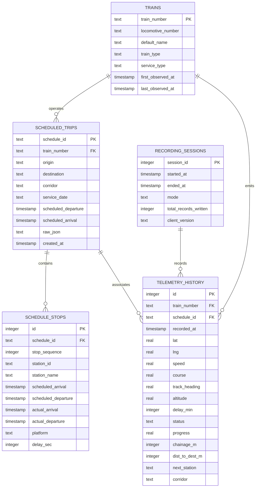

# Historical Telemetry Storage in SQLite: Architecture & Operational Manual

Comprehensive guide to the embedded SQLite persistence layer in `railmon` for recording, indexing, analyzing, and exporting Hellenic Railways (`railway.gov.gr`) real-time train telemetry and scheduled services.

---

## 1. System Architecture & Concurrency Model

The historical storage subsystem in `railmon` persists live and simulated train tracking data to a local SQLite database (`railway_history.db`) with zero external C/Python dependencies, built exclusively on Python 3's built-in `sqlite3` module.

```mermaid
flowchart TD
    subgraph IngestionSources ["Telemetry Ingestion Sources"]
        LiveSSE["Live SSE Network Stream\n(RailwayGovClient)"]
        DemoSim["Synthetic Physics Simulation\n(MockTelemetryEngine)"]
    end

    subgraph MemoryLayer ["Thread-Safe In-Memory Pipeline"]
        StreamWorker["StreamWorker Daemon\n(tui/stream_worker.py)"]
        StateStore["TrainStateStore\n(Live Curses UI Buffer)"]
        Queue["Bounded Ingestion Queue\n(queue.Queue[List[TrainPosition]])"]
    end

    subgraph StorageSubsystem ["Dedicated Storage Engine"]
        Recorder["TelemetryRecorder Daemon\n(storage/recorder.py)"]
        Filter["DeadbandFilter (40-60% Reduction)\n(storage/filter.py)"]
        BatchBuffer["Batch Transaction Buffer\n(e.g., 50 items or 2.0s flush)"]
        SQLiteDB[("SQLite Database\n(WAL Mode Enabled)\nrailway_history.db")]
    end

    subgraph QueryConsumers ["Historical Query & Analytics Layer"]
        CLIHistory["CLI Terminal Analytics\n(railmon history ...)"]
        TUIApp["Curses TUI Indicator & Replay\n(railmon --tui --record)"]
        GISClients["GIS & Analytics Tools\n(QGIS, Kepler.gl, Pandas)"]
    end

    LiveSSE --> StreamWorker
    DemoSim --> StreamWorker
    StreamWorker -->|Update UI Snapshot| StateStore
    StreamWorker -->|Enqueue Batch (Non-blocking)| Queue
    StateStore --> TUIApp

    Queue --> Recorder
    Recorder --> Filter
    Filter --> BatchBuffer
    BatchBuffer -->|Atomic Batch Commit| SQLiteDB

    SQLiteDB -.->|Concurrent Read Transactions| CLIHistory
    SQLiteDB -.->|Concurrent Read Transactions| GISClients
```

### 1.1 Non-Blocking Producer-Consumer Pipeline
* **Decoupled Producers:** Neither network ingestion (`StreamWorker`) nor the Curses UI loop (20–60 FPS) performs disk I/O. When new positions arrive, the worker enqueues batches via non-blocking `put_nowait()`.
* **Single Asynchronous Writer Daemon:** A dedicated background thread (`TelemetryRecorder`) exclusively owns write transactions, batching rows and committing them to disk when either the batch size threshold (e.g. 50 items) is reached or the flush timeout (e.g. 2.0 seconds) elapses.
* **Bounded Buffer Protection:** The queue has a default capacity limit of 10,000 entries. Under severe disk pressure, old records are dropped safely with audit warnings rather than allowing unbounded memory growth.

### 1.2 Write-Ahead Logging (WAL) Concurrency
SQLite's default rollback journal blocks readers during writes. `railmon` configures Write-Ahead Logging on every connection:
* **Readers Never Block Writers:** Complex analytical CLI queries scanning hundreds of thousands of historical rows execute in parallel without delaying ongoing ingestion.
* **Writers Never Block Readers:** Active batch commits append pages sequentially to `railway_history.db-wal` without locking read cursors.
* **Pragmas Configured on Connection:**
  ```sql
  PRAGMA journal_mode = WAL;
  PRAGMA synchronous = NORMAL;
  PRAGMA foreign_keys = ON;
  PRAGMA temp_store = MEMORY;
  PRAGMA cache_size = -64000; -- 64MB memory page cache
  ```

---

## 2. Relational Database Schema & Index Reference

The persistence schema consists of 5 normalized tables organized into metadata registers, daily reference schedules, audit tracking, and time-series telemetry.



### 2.1 Complete DDL Specification

```sql
-- 1. Persistent Vehicle Register
CREATE TABLE IF NOT EXISTS trains (
    train_number TEXT PRIMARY KEY,
    locomotive_number TEXT,
    default_name TEXT,
    train_type TEXT,
    service_type TEXT,
    first_observed_at TIMESTAMP NOT NULL,
    last_observed_at TIMESTAMP NOT NULL
);

-- 2. Daily Scheduled Trips & Services
CREATE TABLE IF NOT EXISTS scheduled_trips (
    schedule_id TEXT PRIMARY KEY,
    train_number TEXT NOT NULL,
    origin TEXT,
    destination TEXT,
    corridor TEXT,
    service_date TEXT NOT NULL,
    scheduled_departure TIMESTAMP,
    scheduled_arrival TIMESTAMP,
    raw_json TEXT,
    created_at TIMESTAMP DEFAULT CURRENT_TIMESTAMP,
    FOREIGN KEY (train_number) REFERENCES trains(train_number) ON DELETE CASCADE
);

-- 3. Scheduled Intermediate Stops
CREATE TABLE IF NOT EXISTS schedule_stops (
    id INTEGER PRIMARY KEY AUTOINCREMENT,
    schedule_id TEXT NOT NULL,
    stop_sequence INTEGER NOT NULL,
    station_id TEXT,
    station_name TEXT NOT NULL,
    scheduled_arrival TIMESTAMP,
    scheduled_departure TIMESTAMP,
    actual_arrival TIMESTAMP,
    actual_departure TIMESTAMP,
    platform TEXT,
    delay_sec INTEGER DEFAULT 0,
    FOREIGN KEY (schedule_id) REFERENCES scheduled_trips(schedule_id) ON DELETE CASCADE,
    UNIQUE(schedule_id, stop_sequence)
);

-- 4. High-Frequency Telemetry Time Series
CREATE TABLE IF NOT EXISTS telemetry_history (
    id INTEGER PRIMARY KEY AUTOINCREMENT,
    train_number TEXT NOT NULL,
    schedule_id TEXT,
    recorded_at TIMESTAMP NOT NULL,
    lat REAL NOT NULL,
    lng REAL NOT NULL,
    speed REAL NOT NULL,
    course REAL NOT NULL,
    track_heading REAL,
    altitude REAL,
    delay_min INTEGER DEFAULT 0,
    status TEXT,
    progress REAL,
    chainage_m INTEGER,
    dist_to_dest_m INTEGER,
    next_station TEXT,
    corridor TEXT,
    FOREIGN KEY (train_number) REFERENCES trains(train_number),
    FOREIGN KEY (schedule_id) REFERENCES scheduled_trips(schedule_id)
);

-- 5. Session Audit Log
CREATE TABLE IF NOT EXISTS recording_sessions (
    session_id INTEGER PRIMARY KEY AUTOINCREMENT,
    started_at TIMESTAMP NOT NULL,
    ended_at TIMESTAMP,
    mode TEXT NOT NULL, -- 'live', 'demo', 'benchmark'
    total_records_written INTEGER DEFAULT 0,
    client_version TEXT
);

-- Compound Indices Optimized for Temporal & Spatial Analytical Queries
CREATE INDEX IF NOT EXISTS idx_telemetry_train_time 
    ON telemetry_history (train_number, recorded_at);

CREATE INDEX IF NOT EXISTS idx_telemetry_schedule_time 
    ON telemetry_history (schedule_id, recorded_at);

CREATE INDEX IF NOT EXISTS idx_telemetry_time 
    ON telemetry_history (recorded_at);

CREATE INDEX IF NOT EXISTS idx_telemetry_corridor_time 
    ON telemetry_history (corridor, recorded_at);

CREATE INDEX IF NOT EXISTS idx_trips_date 
    ON scheduled_trips (service_date, train_number);
```

---

## 3. CLI Ingestion & Operational Manual

`railmon` supports telemetry persistence across all execution modes using clean, orthogonal CLI arguments.

### 3.1 Headless Recording Daemon (`railmon record`)
Run unattended background recording services on servers, Docker containers, or systemd services:

```bash
# Record live SSE stream to default database (railway_history.db)
python3 train_tracker.py record

# Record live SSE stream to custom file path with deadband compression
python3 train_tracker.py record --db /var/data/railmon_2026.db --deadband

# Headless offline recording using synthetic simulation (for testing)
python3 train_tracker.py record --demo --db demo_history.db

# Headless recording with tuned batching and flush parameters
python3 train_tracker.py record --batch-size 100 --flush-interval 1.0 --quiet
```

### 3.2 Concurrent Recording in TUI Mode (`railmon --tui --record`)
Launch the interactive Curses terminal map while recording telemetry to disk simultaneously:

```bash
# Launch interactive TUI and persist telemetry to default database
python3 train_tracker.py --tui --record

# Launch TUI with synthetic simulation and record to custom file
python3 train_tracker.py --tui --demo --record --db custom_sim.db
```
When recording is active in TUI mode, the top header bar prominently displays a **`[● REC]`** visual badge alongside the active database path.

### 3.3 Streaming with Persistence (`railmon stream --record`)
Print live telemetry text tables to terminal stdout while recording to SQLite in the background:

```bash
# Live stream to console and persist
python3 train_tracker.py stream --record

# Stream with filtered corridor
python3 train_tracker.py stream --corridor Ath-Thess-Ath --record
```

---

## 4. Historical Analytics CLI (`railmon history`)

Inspect, analyze, and export historical data stored in any SQLite database directly from the terminal.

### 4.1 Daily Trip Catalog (`railmon history trips`)
List distinct train services recorded across a given date or corridor:
```bash
# List all trips recorded today
python3 train_tracker.py history trips

# List trips for a specific date and corridor
python3 train_tracker.py history trips --date 2026-11-18 --corridor Ath-Thess-Ath
```

### 4.2 Train Telemetry Inspection (`railmon history train`)
View chronologically ordered telemetry breadcrumbs for a specific train service:
```bash
# Inspect the most recent 50 telemetry points for train IC52
python3 train_tracker.py history train IC52 --limit 50

# Inspect telemetry for a specific time window
python3 train_tracker.py history train IC52 --start "2026-11-18T08:00:00" --end "2026-11-18T12:00:00"
```

### 4.3 Corridor Punctuality Report (`railmon history punctuality`)
Aggregate delay metrics, average delay, maximum delay, and on-time compliance across railway corridors:
```bash
# Punctuality report across all corridors
python3 train_tracker.py history punctuality

# Punctuality report with a custom on-time tolerance threshold (e.g. 3 minutes)
python3 train_tracker.py history punctuality --on-time-threshold 3
```

### 4.4 Station Dwell Analysis (`railmon history dwell`)
Analyze train arrival times, departure times, and halt durations at stations:
```bash
# Identify all station stops where train IC50 stopped for > 30 seconds
python3 train_tracker.py history dwell IC50 --min-dwell 30 --speed-threshold 2.0
```

### 4.5 System Storage Summary (`railmon history stats`)
Display row counts, active trains, session counts, and file size on disk:
```bash
python3 train_tracker.py history stats --db railway_history.db
```

### 4.6 Spatial Trajectory Export (`railmon history export`)
Export train trajectories to industry-standard GIS and tabular formats:
```bash
# Export train journey as RFC 7946 GeoJSON FeatureCollection
python3 train_tracker.py history export IC52 --format geojson --out ic52_run.geojson

# Export telemetry breadcrumbs as CSV
python3 train_tracker.py history export IC52 --format csv --out ic52_telemetry.csv
```

---

## 5. The SQL Analytical Cookbook (10 Production Recipes)

Connect to `railway_history.db` using any SQLite client (`sqlite3`, Python `sqlite3`, DBeaver, Datasette) to execute operational queries.

### Recipe 1: Corridor Punctuality & Delay Distribution
Evaluates overall network reliability and on-time compliance across operating corridors:
```sql
SELECT 
    corridor,
    COUNT(DISTINCT train_number) AS total_active_trains,
    ROUND(AVG(delay_min), 1) AS avg_delay_minutes,
    MAX(delay_min) AS max_delay_minutes,
    ROUND(100.0 * SUM(CASE WHEN delay_min <= 5 THEN 1 ELSE 0 END) / COUNT(*), 1) AS on_time_pct,
    ROUND(100.0 * SUM(CASE WHEN delay_min > 15 THEN 1 ELSE 0 END) / COUNT(*), 1) AS severe_delay_pct
FROM telemetry_history
WHERE recorded_at >= datetime('now', '-24 hours')
  AND corridor IS NOT NULL
GROUP BY corridor
ORDER BY avg_delay_minutes DESC;
```

### Recipe 2: Train Breadcrumb Trajectory Reconstruction
Reconstructs time-ordered geographic coordinates and kinematic states for an individual train:
```sql
SELECT 
    recorded_at,
    lat,
    lng,
    speed,
    course,
    delay_min,
    chainage_m,
    next_station
FROM telemetry_history
WHERE train_number = 'IC52'
  AND recorded_at >= datetime('now', '-12 hours')
ORDER BY recorded_at ASC;
```

### Recipe 3: Station Dwell Time & Extended Halt Detection
Calculates the exact duration trains were stopped at stations (speed $< 1.0\text{ km/h}$) and tracks delay accumulation during halts:
```sql
SELECT 
    train_number,
    next_station,
    MIN(recorded_at) AS arrival_time,
    MAX(recorded_at) AS departure_time,
    ROUND((JULIANDAY(MAX(recorded_at)) - JULIANDAY(MIN(recorded_at))) * 86400) AS dwell_seconds,
    MAX(delay_min) - MIN(delay_min) AS delay_accumulated_during_stop
FROM telemetry_history
WHERE speed < 1.0
  AND next_station IS NOT NULL
GROUP BY train_number, next_station
HAVING dwell_seconds >= 60
ORDER BY arrival_time ASC;
```

### Recipe 4: Speed Profile Across Track Chainage
Generates an elevation/speed curve along a corridor (e.g. Athens–Thessaloniki) grouped into 1-kilometer track segments:
```sql
SELECT 
    chainage_m / 1000 AS chainage_km,
    ROUND(AVG(speed), 1) AS avg_speed_kmh,
    ROUND(MAX(speed), 1) AS max_speed_kmh,
    COUNT(*) AS observations
FROM telemetry_history
WHERE corridor = 'Ath-Thess-Ath'
  AND chainage_m IS NOT NULL
  AND speed > 10.0
GROUP BY chainage_m / 1000
ORDER BY chainage_km ASC;
```

### Recipe 5: Terminal Turnaround & Layover Duration
Measures how long rolling stock remains stationary at terminal stations before departing on its next service:
```sql
SELECT 
    train_number,
    next_station AS terminal_station,
    MIN(recorded_at) AS arrival_time,
    MAX(recorded_at) AS departure_time,
    ROUND((JULIANDAY(MAX(recorded_at)) - JULIANDAY(MIN(recorded_at))) * 24 * 60, 1) AS layover_minutes
FROM telemetry_history
WHERE next_station IN ('Athens', 'Thessaloniki', 'Kiato', 'Chalkida')
  AND speed < 0.5
GROUP BY train_number, next_station
HAVING layover_minutes BETWEEN 15.0 AND 360.0
ORDER BY arrival_time DESC;
```

### Recipe 6: Corridor Delay Hotspots (Geographic Clustering)
Identifies track zones where trains most frequently accumulate delays, grouped by geographic coordinate blocks (~1 km grid):
```sql
SELECT 
    ROUND(lat, 2) AS lat_grid,
    ROUND(lng, 2) AS lng_grid,
    corridor,
    COUNT(DISTINCT train_number) AS distinct_trains_affected,
    ROUND(AVG(delay_min), 1) AS avg_delay_min,
    ROUND(AVG(speed), 1) AS avg_speed_kmh
FROM telemetry_history
WHERE delay_min > 5
GROUP BY lat_grid, lng_grid, corridor
HAVING distinct_trains_affected >= 3
ORDER BY avg_delay_min DESC
LIMIT 20;
```

### Recipe 7: Rolling Hourly Active Train Density
Calculates network traffic volume by hour of day:
```sql
SELECT 
    strftime('%Y-%m-%d %H:00:00', recorded_at) AS hour_window,
    COUNT(DISTINCT train_number) AS concurrent_trains_running,
    COUNT(*) AS telemetry_points_recorded,
    ROUND(AVG(speed), 1) AS network_avg_speed
FROM telemetry_history
WHERE recorded_at >= datetime('now', '-7 days')
GROUP BY hour_window
ORDER BY hour_window ASC;
```

### Recipe 8: Speed Restriction Compliance Verification
Audits safety compliance by detecting telemetry points where trains exceeded operating speed thresholds in station approaches:
```sql
SELECT 
    recorded_at,
    train_number,
    next_station,
    speed,
    dist_to_dest_m
FROM telemetry_history
WHERE dist_to_dest_m < 2000
  AND speed > 100.0
ORDER BY recorded_at DESC;
```

### Recipe 9: Session Telemetry Ingestion Audit
Validates pipeline completeness and audit statistics for recording sessions:
```sql
SELECT 
    session_id,
    mode,
    started_at,
    ended_at,
    total_records_written,
    ROUND((JULIANDAY(ended_at) - JULIANDAY(started_at)) * 86400, 1) AS duration_seconds,
    ROUND(total_records_written / MAX(1.0, (JULIANDAY(ended_at) - JULIANDAY(started_at)) * 86400), 1) AS avg_rows_per_second
FROM recording_sessions
ORDER BY session_id DESC;
```

### Recipe 10: Multi-Day Punctuality Degradation Trends
Evaluates day-over-day changes in on-time reliability:
```sql
SELECT 
    DATE(recorded_at) AS service_day,
    COUNT(DISTINCT train_number) AS active_trains,
    ROUND(AVG(delay_min), 1) AS avg_daily_delay,
    ROUND(100.0 * SUM(CASE WHEN delay_min <= 5 THEN 1 ELSE 0 END) / COUNT(*), 1) AS on_time_percentage
FROM telemetry_history
GROUP BY service_day
ORDER BY service_day DESC;
```

---

## 6. GIS Integration & External Analytics Workflows

`railmon` exports spatial datasets formatted strictly to RFC 7946 GeoJSON, ready for instant loading into GIS platforms.

### 6.1 Importing into QGIS
1. Export the train trajectory from `railmon`:
   ```bash
   python3 train_tracker.py history export IC52 --format geojson --out ic52_trajectory.geojson
   ```
2. Open **QGIS** (Desktop).
3. Drag and drop `ic52_trajectory.geojson` onto the Layers panel.
4. QGIS automatically interprets:
   * **Feature 1 (`LineString`):** Complete traveled path with corridor and summary attributes.
   * **Features 2..N (`Point`):** Individual telemetry breadcrumbs containing `recorded_at`, `speed`, `delay_min`, and `chainage_m`.
5. Open **Layer Properties -> Symbology -> Graduated** and set the column to `delay_min` (color ramp: Green to Red) to visualize delay accumulation geographically.

### 6.2 Visualizing in Kepler.gl & GeoJSON.io
* Upload `ic52_trajectory.geojson` directly to [Kepler.gl](https://kepler.gl) or [GeoJSON.io](https://geojson.io).
* Enable 3D Trip playback: map the temporal attribute `recorded_at` to the Kepler.gl timeline filter to replay the journey dynamically.

### 6.3 Ingesting into Pandas / Polars for Data Science
Load historical telemetry directly from SQLite without intermediary CSV exports:

```python
import sqlite3
import pandas as pd

# Open SQLite in read-only mode to prevent write locking
conn = sqlite3.connect("file:railway_history.db?mode=ro", uri=True)

df = pd.read_sql_query(
    """
    SELECT recorded_at, train_number, lat, lng, speed, delay_min, corridor
    FROM telemetry_history
    WHERE recorded_at >= datetime('now', '-7 days')
    """,
    conn,
    parse_dates=["recorded_at"],
)
conn.close()

# Compute corridor punctuality in Pandas
punctuality = (
    df.groupby("corridor")
    .agg(
        total_points=("delay_min", "count"),
        avg_delay=("delay_min", "mean"),
        max_delay=("delay_min", "max"),
        on_time_pct=("delay_min", lambda x: (x <= 5).mean() * 100.0),
    )
    .round(1)
)
print(punctuality)
```

---

## 7. Database Administration, Maintenance & Backup

### 7.1 Automated & Manual WAL Checkpointing
In WAL mode, writes append to `-wal`. `railmon` issues `PRAGMA synchronous = NORMAL`, allowing SQLite to automatically checkpoint when the WAL reaches 1,000 pages (~4 MB). To trigger a manual checkpoint:

```python
from storage.db import Database

db = Database("railway_history.db")
# Truncate WAL file back to 0 bytes
db.checkpoint_wal(mode="TRUNCATE")
```

Or from the command line:
```bash
sqlite3 railway_history.db "PRAGMA wal_checkpoint(TRUNCATE);"
```

### 7.2 Zero-Downtime Backups (`VACUUM INTO`)
To take a clean, transactional snapshot of an actively recording database without stopping ingestion:

```bash
sqlite3 railway_history.db "VACUUM INTO 'backup_history_$(date +%Y%m%d_%H%M%S).db';"
```

### 7.3 Database Integrity & Repair
Verify structural database consistency:
```bash
sqlite3 railway_history.db "PRAGMA integrity_check;"
sqlite3 railway_history.db "PRAGMA foreign_key_check;"
```
Expected output: `ok` and zero rows returned.
