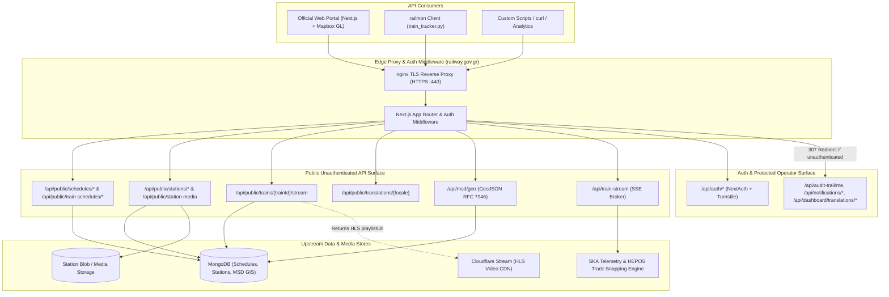
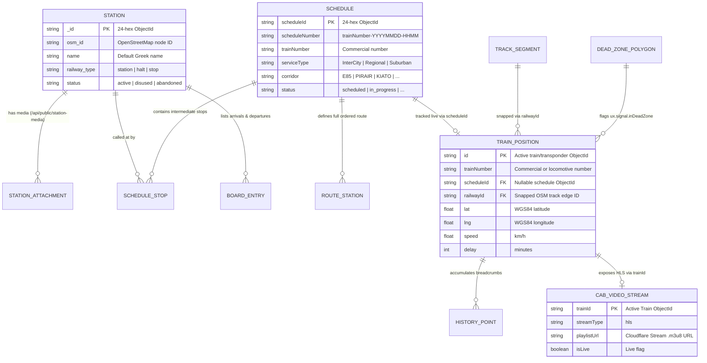
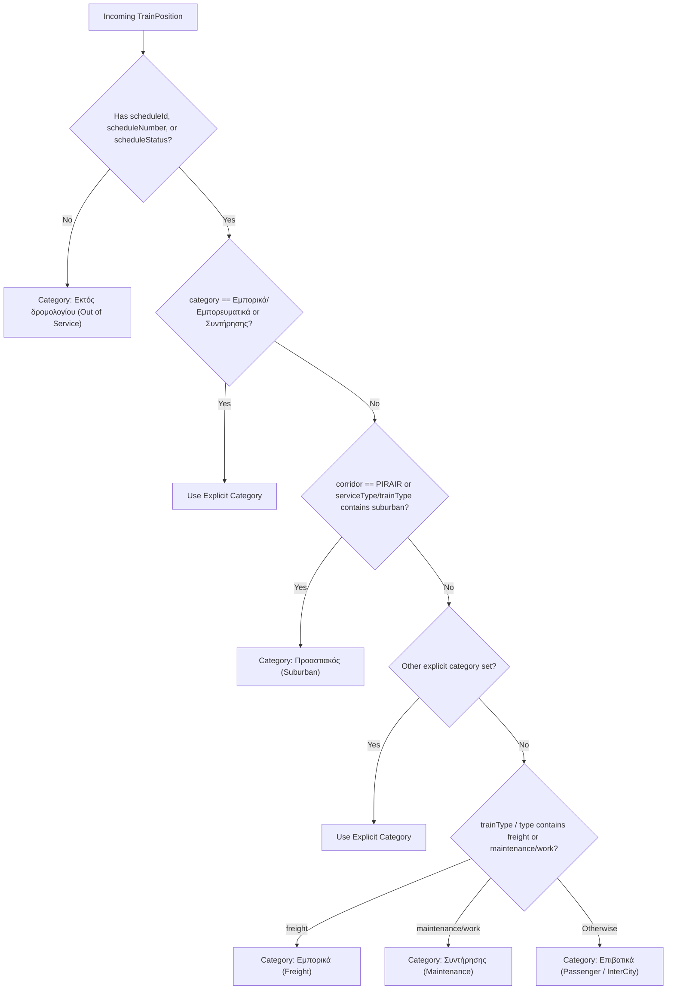

# Hellenic Railways (`railway.gov.gr`) REST & Streaming API Reference

> **Base URL:** `https://railway.gov.gr`  
> **Transport:** HTTPS (TLS 1.2/1.3 via `nginx` reverse proxy to Next.js App Router)  
> **Primary Formats:** JSON (`application/json`), GeoJSON RFC 7946, Server-Sent Events (`text/event-stream`), Binary Media (`image/*`), HLS (`application/vnd.apple.mpegurl`)  
> **Reference Client:** [`train_tracker.py`](../../train_tracker.py) (`RailwayGovClient`)  
> **Upstream Evidence:** Next.js production bundles in [`reference/chunks/`](../../reference/chunks/) and live HTTP verification against `https://railway.gov.gr`  
> **Related Architecture Docs:** [`architecture.md`](./architecture.md), [`train-itinerary-schema-and-time-display-issue.md`](../investigations/train-itinerary-schema-and-time-display-issue.md), [`telemetry-anomalies-and-duplicate-train-numbers-investigation.md`](../investigations/telemetry-anomalies-and-duplicate-train-numbers-investigation.md)

---

## Table of Contents

1. [Overview & API Surface Topology](#1-overview--api-surface-topology)
2. [Quick-Reference Endpoint Matrix](#2-quick-reference-endpoint-matrix)
3. [Global Conventions, Headers & Data Standards](#3-global-conventions-headers--data-standards)
4. [Domain Entity Relationships](#4-domain-entity-relationships)
5. [Public REST API Endpoints (`/api/public/*`)](#5-public-rest-api-endpoints-apipublic)
   - [5.1 Upcoming Schedules](#51-get-apipublicschedulesupcoming)
   - [5.2 Schedule Detail by ID](#52-get-apipublicschedulesscheduleid)
   - [5.3 Active Schedule by Commercial Train Number](#53-get-apipublictrain-schedulesby-train-numbertrainnumber)
   - [5.4 Station Metadata & Amenities](#54-get-apipublicstationsstationid)
   - [5.5 Station Live Departure Board](#55-get-apipublicstationsstationiddepartures)
   - [5.6 Station Live Arrival Board](#56-get-apipublicstationsstationidarrivals)
   - [5.7 Station Media Proxy](#57-get-apipublicstation-media)
   - [5.8 Live Locomotive Cab Video Stream (HLS)](#58-get-apipublictrainstrainidstream)
   - [5.9 Public i18n Translation Catalogs](#59-get-apipublictranslationslocale)
6. [Geospatial Infrastructure API (`/api/msd/geo`)](#6-geospatial-infrastructure-api-apimsdgeo)
7. [Real-Time Telemetry Stream (`/api/train-stream` — SSE)](#7-real-time-telemetry-stream-apitrain-stream--sse)
8. [Authentication & Protected Operator Endpoints](#8-authentication--protected-operator-endpoints)
9. [Error Handling, Status Codes & Resilience Guidelines](#9-error-handling-status-codes--resilience-guidelines)
10. [Client Implementation & Schema Alignment Notes (`railmon`)](#10-client-implementation--schema-alignment-notes-railmon)
11. [End-to-End Integration Cookbook](#11-end-to-end-integration-cookbook)

---

## 1. Overview & API Surface Topology

The official Hellenic Railways live train tracking portal (`https://railway.gov.gr/train-tracker`), operated by the Hellenic Railways Organisation (ΟΣΕ) and the Greek Ministry of Infrastructure and Transport, exposes a Next.js App Router HTTP API backed by MongoDB/Mongoose, an edge Server-Sent Events (SSE) telemetry broker, a Master Spatial Data (MSD) GeoJSON engine, and Cloudflare Stream for locomotive forward cab video.

The API surface divides cleanly into **four functional tiers**:

1. **Public REST Data API (`/api/public/*`)** — Unauthenticated, read-only JSON and media endpoints serving daily passenger schedules, intermediate stop itineraries, station details, live station departure/arrival boards, station photographs, HLS cab video manifests, and UI translations.
2. **Geospatial Master Spatial Data API (`/api/msd/geo`)** — Unauthenticated RFC 7946 GeoJSON endpoint delivering rail network vector topology (stations, tracks, signals, level crossings, switches, tunnels, bridges, RF/GNSS dead zones, and milestones).
3. **Real-Time Telemetry Stream (`/api/train-stream`)** — Unauthenticated persistent HTTP Server-Sent Events (SSE) stream multiplexing HEPOS/RTK track-snapped train positions, raw sensor frames, delay deltas, 20-point breadcrumb histories, and scheduled "ghost" train cards.
4. **Authentication & Protected Operator APIs (`/api/auth/*`, `/api/dashboard/*`, `/api/audit-trail/*`, `/api/notifications/*`)** — NextAuth.js credentials authentication gated by Cloudflare Turnstile, plus session-authenticated operator endpoints for audit trails, notifications, and dashboard localization.

### 1.1 Architectural Topology (Mermaid)



### 1.2 Endpoint Hierarchy Tree (ASCII)

```text
https://railway.gov.gr
├── /api/train-stream                                      [GET, Public, SSE]
│     ├── event: trainPositionsUx                          -> Smoothed, track-snapped train batch (10s UX buffer)
│     ├── event: trainPositions                            -> Raw sensor telemetry batch
│     ├── event: delayUpdates                              -> Incremental train delay deltas
│     ├── event: trainHistory                              -> Trailing ~20-pt trajectory breadcrumbs per train
│     ├── event: scheduleCards                             -> Non-GPS scheduled "ghost" runs
│     └── event: error                                     -> Stream warning / error frame
│
├── /api/msd/geo                                           [GET, Public, GeoJSON]
│     └── ?mode=&types=&limit=&corridor=&station_railway_type=&station_status=
│
├── /api/public/
│     ├── schedules/
│     │     ├── upcoming                                   [GET, Public, JSON]  Today's upcoming runs (cap: 100)
│     │     └── {scheduleId}                               [GET, Public, JSON]  Full itinerary & stop timings
│     ├── train-schedules/
│     │     └── by-train-number/{trainNumber}              [GET, Public, JSON]  Today's schedule by train number
│     ├── stations/
│     │     ├── {stationId}                                [GET, Public, JSON]  Station metadata, services, photos
│     │     ├── {stationId}/departures?limit=15            [GET, Public, JSON]  Live station departure board
│     │     └── {stationId}/arrivals?limit=15              [GET, Public, JSON]  Live station arrival board
│     ├── station-media?pathname={path}                    [GET, Public, Binary] Station photo stream proxy
│     ├── trains/
│     │     └── {trainId}/stream                           [GET, Public, JSON]  Live cab HLS manifest metadata
│     └── translations/{locale}                            [GET, Public, JSON]  UI i18n catalog ("el" | "en")
│
├── /api/auth/
│     ├── turnstile                                        [GET, Public, JSON]  Cloudflare Turnstile siteKey config
│     ├── providers                                        [GET, Public, JSON]  NextAuth configured providers
│     ├── csrf                                             [GET, Public, JSON]  NextAuth CSRF token
│     ├── session                                          [GET, Public, JSON]  Active session or null
│     ├── signin/credentials & callback/credentials        [POST, Public, Form] Credentials sign-in
│     └── signout                                          [POST, Session, Form] Session termination
│
└── Protected Operator Routes (Session Cookie Required; 307 -> /auth/signin if unauthenticated)
      ├── /api/dashboard/translations/{locale}/{scope}     [GET, Session, JSON] Dashboard / help i18n namespaces
      ├── /api/audit-trail/me?page=&limit=&filter=&search= [GET, Session, JSON] Paginated operator activity logs
      ├── /api/notifications?limit=&unread=                [GET, Session, JSON] Operator alert feed
      └── /api/notifications/{notificationId}/read         [POST, Session, JSON] Mark notification as read
```

---

## 2. Quick-Reference Endpoint Matrix

| Tier | Method | Endpoint Path | Auth | Content-Type | Observed `Cache-Control` | `railmon` Method ([`train_tracker.py`](../../train_tracker.py)) |
|---|---|---|---|---|---|---|
| **Public REST** | `GET` | `/api/public/schedules/upcoming` | None | `application/json` | `no-store` | `get_upcoming_schedules()` |
| **Public REST** | `GET` | `/api/public/schedules/{scheduleId}` | None | `application/json` | `no-store` | `get_schedule_by_id()` |
| **Public REST** | `GET` | `/api/public/train-schedules/by-train-number/{trainNumber}` | None | `application/json` | `no-store` | `get_schedule_by_train_number()` |
| **Public REST** | `GET` | `/api/public/stations/{stationId}` | None | `application/json` | *(omitted)* | `get_station()` |
| **Public REST** | `GET` | `/api/public/stations/{stationId}/departures` | None | `application/json` | *(omitted)* | `get_station_departures()` |
| **Public REST** | `GET` | `/api/public/stations/{stationId}/arrivals` | None | `application/json` | *(omitted)* | `get_station_arrivals()` |
| **Public REST** | `GET` | `/api/public/station-media` | None | `image/jpeg` *(varies)* | *(omitted)* | *(Not yet wrapped)* |
| **Public REST** | `GET` | `/api/public/trains/{trainId}/stream` | None | `application/json` | *(omitted)* | `get_cab_stream_url()` |
| **Public REST** | `GET` | `/api/public/translations/{locale}` | None | `application/json` | `s-maxage=31536000` | *(Not used)* |
| **Public GIS** | `GET` | `/api/msd/geo` | None | `application/json` | *(omitted)* | `get_rail_infrastructure()` |
| **Public SSE** | `GET` | `/api/train-stream` | None | `text/event-stream; charset=utf-8` | `no-cache, no-transform` | `stream_train_positions()` |
| **Auth** | `GET` | `/api/auth/turnstile` | None | `application/json` | `no-store` | *(Not used)* |
| **Auth** | `GET` | `/api/auth/providers` | None | `application/json` | *(omitted)* | *(Not used)* |
| **Auth** | `GET` | `/api/auth/csrf` | None | `application/json` | `private, no-cache, no-store` | *(Not used)* |
| **Auth** | `GET` | `/api/auth/session` | Optional | `application/json` | `private, no-cache, no-store` | *(Not used)* |
| **Auth** | `POST` | `/api/auth/signin/{provider}` / `/api/auth/signout` | CSRF / Session | `application/json` / 302 | `private, no-cache, no-store` | *(Not used)* |
| **Protected** | `GET` | `/api/dashboard/translations/{locale}/{scope}` | Session Cookie | `application/json` | *(307 if anon)* | *(Not used)* |
| **Protected** | `GET` | `/api/audit-trail/me` | Session Cookie | `application/json` | *(307 if anon)* | *(Not used)* |
| **Protected** | `GET` | `/api/notifications` | Session Cookie | `application/json` | *(307 if anon)* | *(Not used)* |
| **Protected** | `POST` | `/api/notifications/{id}/read` | Session Cookie | `application/json` | *(307 if anon)* | *(Not used)* |

---

## 3. Global Conventions, Headers & Data Standards

### 3.1 Recommended Request Headers

All public endpoints are accessible without API keys or cookies. Supplying standard browser-compatible headers avoids proxy filtering and ensures accurate content negotiation:

```http
GET /api/public/schedules/upcoming HTTP/1.1
Host: railway.gov.gr
User-Agent: Mozilla/5.0 (X11; Linux x86_64; rv:120.0) Gecko/20100101 Firefox/120.0
Accept: application/json, text/plain, */*
Referer: https://railway.gov.gr/train-tracker
```

For `/api/train-stream`, override `Accept`:

```http
Accept: text/event-stream
```

### 3.2 Standard Server Security & Proxy Headers

Live responses pass through an `nginx` edge proxy in front of Next.js App Router and consistently emit:

| Header | Observed Value |
|---|---|
| `Server` | `nginx` |
| `Strict-Transport-Security` | `max-age=31536000; includeSubDomains` |
| `X-Frame-Options` | `SAMEORIGIN` |
| `X-Content-Type-Options` | `nosniff` |
| `X-XSS-Protection` | `1; mode=block` |
| `Referrer-Policy` | `strict-origin-when-cross-origin` |
| `Permissions-Policy` | `camera=(), microphone=(), payment=(), usb=()` |
| `X-DNS-Prefetch-Control` | `on` |
| `Vary` | `rsc, next-router-state-tree, next-router-prefetch, next-router-segment-prefetch` |

### 3.3 Identifier Formats

| Identifier | Pattern / Example | Origin | Notes |
|---|---|---|---|
| **MongoDB ObjectId** (`_id`, `stationId`, `scheduleId`, `trainId`) | 24-char lowercase hex, e.g. `6928c3c050ab5bc72b39cd8b` | MongoDB | Required verbatim for `/stations/{id}`, `/schedules/{id}`, `/trains/{id}/stream`. |
| **Commercial Train Number** (`trainNumber`) | `"IC56"`, `"3203"`, `"1597"`, `"63502"`, `"220029"` | OSE / Hellenic Train | Not globally unique in SSE when coupled consists (Διπλή Έλξη) share one commercial number. Always key live trains by `id`, not `trainNumber`. |
| **Composite Schedule Number** (`scheduleNumber`) | `"<trainNumber>-<YYYYMMDD>-<HHMM>"`, e.g. `"3203-20261123-2313"` | Schedule Generator | The trailing `HHMM` timestamp is in **`Europe/Athens`** local time, whereas JSON date fields are UTC. |
| **Board Item ID** (arrivals / departures `id`) | `"<scheduleId>-origin-departure"` or `"<scheduleId>-stop:<order>:<stationId>-<arrival\|departure>"` | Station Board API | Synthetic deterministic ID per schedule stop event. |
| **Ghost Schedule Card ID** (`scheduleCards`) | `"schedule:<scheduleId>"` | SSE Broker | Distinguishes un-tracked scheduled trips from live transponder `id`s. |
| **GIS Feature ID** (`featureId`) | `"<entityType>:<osm_id\|_id>"`, e.g. `"station:63116766"`, `"dead_zone:699b5210cbeeeb8a3dfeb4d4"` | MSD GIS Engine | Unique across GeoJSON collections. |
| **Test Train Pattern** | `/^T\d+$/` (e.g., `"T101"`) | Internal Testing | Official frontend skips REST timetable lookup for train numbers matching `/^T\d+$/`. |

### 3.4 Timestamps & Timezone Handling

- **Wire Format:** Every timestamp field across REST and SSE responses uses ISO 8601 UTC with millisecond precision (`YYYY-MM-DDTHH:MM:SS.sssZ`, e.g. `"2026-11-23T21:13:00.000Z"`).
- **Operational Timezone:** Hellenic Railways timetables and passenger displays operate in **`Europe/Athens`**:
  - **EET (Winter):** `UTC+02:00`
  - **EEST (Daylight Saving):** `UTC+03:00`
- **Client Rule:** Always parse ISO 8601 strings as timezone-aware UTC `datetime` objects and convert to `Europe/Athens` before rendering `HH:MM` departure/arrival times. Never slice raw UTC substrings (see [`train-itinerary-schema-and-time-display-issue.md`](../investigations/train-itinerary-schema-and-time-display-issue.md)).

### 3.5 Coordinate System & Axis Order

All geographic coordinates use **WGS84 (`EPSG:4326`)** decimal degrees, bounded within Greece (`lat ∈ [34.0°, 42.0°]`, `lng ∈ [19.0°, 29.0°]`):

- **GeoJSON (`/api/msd/geo`):** Strictly conforms to RFC 7946 **`[longitude, latitude]`** array order (`coordinates: [23.782449, 38.050842]`).
- **SSE Telemetry (`/api/train-stream`):** Uses explicit named scalar fields **`lat`** and **`lng`** (`"lat": 38.050842, "lng": 23.782449`).

---

## 4. Domain Entity Relationships



---

## 5. Public REST API Endpoints (`/api/public/*`)

### 5.1 `GET /api/public/schedules/upcoming`

Returns upcoming passenger train schedules operating on the current service day. Used by the web portal to populate the "Upcoming Trains" drawer and match scheduled corridors.

- **Authentication:** None
- **Caching:** `Cache-Control: no-store`
- **Frontend Polling Cadence:** Every 5 minutes (`300,000 ms`) in [`reference/chunks/79801.a0cbc95dac2cd2a3.js`](../../reference/chunks/79801.a0cbc95dac2cd2a3.js)
- **Query Parameters:** None. Passing `?limit=` is accepted silently and ignored; the server caps the list at **100** schedule objects.

#### Response Schema (`200 OK`)

| Field | Type | Nullable | Description |
|---|---|---|---|
| `schedules` | `Array<UpcomingSchedule>` | No | Ordered array of up to 100 upcoming schedule objects. |
| `schedules[]._id` | `string` | No | 24-hex MongoDB ObjectId of the schedule document. |
| `schedules[].scheduleId` | `string` | No | Duplicate alias of `_id`. |
| `schedules[].scheduleNumber` | `string` | No | Composite run key (`"<trainNumber>-<YYYYMMDD>-<AthensHHMM>"`). |
| `schedules[].trainNumber` | `string` | No | Commercial service number (e.g., `"3203"`, `"IC56"`). |
| `schedules[].serviceType` | `string` | Yes | Service tier: `"InterCity"`, `"Regional"`, or `"Suburban"`. |
| `schedules[].corridor` | `string` | Yes | Corridor identifier (see Corridor Codes table below). |
| `schedules[].scheduledDeparture` | `string` (ISO 8601 UTC) | No | Origin departure timestamp in UTC. |
| `schedules[].scheduledArrival` | `string` (ISO 8601 UTC) | No | Final destination arrival timestamp in UTC. |
| `schedules[].origin` | `StationRef` | No | `{ "name": string, "nameGreek": string }`. |
| `schedules[].destination` | `StationRef` | No | `{ "name": string, "nameGreek": string }`. |
| `schedules[].routeStations` | `Array<RouteStation>` | No | Complete ordered station list including origin, intermediate stops, and terminus. |
| `schedules[].routeStations[].stationId` | `string` | No | 24-hex station ObjectId. |
| `schedules[].routeStations[].name` | `string` | No | Station display name (Greek). |
| `schedules[].routeStations[].nameGreek` | `string` | No | Station Greek name. |
| `schedules[].routeStations[].role` | `string` | No | Stop role: `"origin"`, `"stop"`, or `"destination"`. |
| `schedules[].routeStations[].scheduledArrival` | `string` (ISO 8601 UTC) | Yes | Planned arrival timestamp at this calling point. |
| `schedules[].routeStations[].scheduledDeparture` | `string` (ISO 8601 UTC) | Yes | Planned departure timestamp at this calling point. |
| `schedules[].routeStations[].index` | `integer` | No | Zero-based sequence index (`0` = origin). |
| `schedules[].routeAdjusted` | `boolean` | No | Indicates whether the route has been modified from the nominal timetable. |

#### Observed Corridor Codes

| Code | Corridor Description | Typical Service Types |
|---|---|---|
| `E85` | PATHE Mainline (Piraeus – Athens – Larissa – Thessaloniki) | `InterCity`, `Regional`, Freight |
| `PIRAIR` | Athens Suburban Airport Line (Piraeus – Athens – SKA – Airport) | `Suburban` |
| `KIATO` | Athens – Ano Liosia – Corinth – Kiato Suburban Corridor | `Suburban` |
| `KIAAIGIO` | Kiato – Aigio Extension | `Suburban`, `Regional` |
| `ATHLIA` | Athens – Lianokladi / Regional Central Corridor | `Regional` |
| `CHALKIDA` | Athens – Oinoi – Chalkida Suburban Branch | `Suburban` |
| `THESLAR` | Thessaloniki – Larissa Suburban Corridor | `Suburban` |
| `THESFLOR` | Thessaloniki – Edessa – Florina Western Macedonia Line | `Regional` |
| `ALEXOR` | Alexandroupoli – Ormenio / Thrace Corridor | `Regional` |

#### Live Response Example (`200 OK`)

```json
{
  "schedules": [
    {
      "_id": "6a947456d16c475ca144d8d3",
      "scheduleId": "6a947456d16c475ca144d8d3",
      "scheduleNumber": "3203-20261123-2313",
      "trainNumber": "3203",
      "serviceType": "Suburban",
      "corridor": "PIRAIR",
      "scheduledDeparture": "2026-11-23T21:13:00.000Z",
      "scheduledArrival": "2026-11-23T22:10:00.000Z",
      "origin": {
        "name": "Αεροδρόμιο",
        "nameGreek": "Αεροδρόμιο"
      },
      "destination": {
        "name": "Ταύρος",
        "nameGreek": "Ταύρος"
      },
      "routeStations": [
        {
          "stationId": "6928c3c150ab5bc72b39cec7",
          "nameGreek": "Αεροδρόμιο",
          "name": "Αεροδρόμιο",
          "role": "origin",
          "scheduledArrival": "2026-11-23T21:13:00.000Z",
          "scheduledDeparture": "2026-11-23T21:13:00.000Z",
          "index": 0
        },
        {
          "stationId": "6928c3c150ab5bc72b39d006",
          "nameGreek": "Κορωπί",
          "name": "Κορωπί",
          "role": "stop",
          "scheduledArrival": "2026-11-23T21:19:00.000Z",
          "scheduledDeparture": "2026-11-23T21:19:00.000Z",
          "index": 1
        }
      ],
      "routeAdjusted": false
    }
  ]
}
```

---

### 5.2 `GET /api/public/schedules/{scheduleId}`

Retrieves the complete timetable, live actual arrival/departure timestamps, delay status, intermediate stops, and full route station sequence for a single schedule document.

- **Authentication:** None
- **Caching:** `Cache-Control: no-store`
- **Path Parameters:**
  - `scheduleId` (`string`, **required**): 24-character hexadecimal MongoDB ObjectId (obtained from SSE `trainPositionsUx[].scheduleId` or `/api/public/schedules/upcoming`).

#### Response Schema (`200 OK`)

| Field | Type | Nullable | Description |
|---|---|---|---|
| `scheduleId` | `string` | No | 24-hex schedule ObjectId. |
| `scheduleNumber` | `string` | No | Composite run key (`"<trainNumber>-<YYYYMMDD>-<AthensHHMM>"`). |
| `trainNumber` | `string` | No | Commercial service number. |
| `serviceType` | `string` | Yes | `"InterCity"`, `"Regional"`, or `"Suburban"`. |
| `origin` | `StationRef` | No | `{ "name": string, "nameGreek": string }`. |
| `destination` | `StationRef` | No | `{ "name": string, "nameGreek": string }`. |
| `scheduledDeparture` | `string` (ISO 8601 UTC) | No | Scheduled departure from origin. |
| `scheduledArrival` | `string` (ISO 8601 UTC) | No | Scheduled arrival at destination. |
| `actualDeparture` | `string` (ISO 8601 UTC) | Yes | Actual recorded departure from origin (`null` if not departed). |
| `actualArrival` | `string` (ISO 8601 UTC) | Yes | Actual recorded arrival at destination (`null` if not arrived). |
| `status` | `string` | No | Overall run status (`"scheduled"`, `"in_progress"`, `"completed"`, `"cancelled"`, etc.). |
| `delay` | `integer` | No | Current cumulative delay in minutes. |
| `stops` | `Array<ScheduleStop>` | No | **Intermediate calling points only** (excludes origin and destination). |
| `stops[]._id` | `string` | No | Zero-based string index (`"0"`, `"1"`, ...). |
| `stops[].stationId` | `string` | No | 24-hex station ObjectId. |
| `stops[].name` | `string` | No | Station name in Greek (note: keys like `stationNameEnglish` are **not** present). |
| `stops[].order` | `integer` | No | 1-based intermediate stop sequence number (`1..N`). |
| `stops[].scheduledArrival` | `string` (ISO 8601 UTC) | Yes | Planned arrival time. |
| `stops[].scheduledDeparture` | `string` (ISO 8601 UTC) | Yes | Planned departure time. |
| `stops[].actualArrival` | `string` (ISO 8601 UTC) | Yes | Recorded actual arrival time. |
| `stops[].actualDeparture` | `string` (ISO 8601 UTC) | Yes | Recorded actual departure time. |
| `stops[].status` | `string` | No | Stop progress status (`"scheduled"`, `"arrived"`, `"departed"`, `"skipped"`, `"cancelled"`). |
| `stops[].platform` | `string` | Yes | Assigned platform number/label, if published. |
| `stops[].dwellTime` | `integer` | No | Planned dwell duration in minutes (`0` for brief suburban halts). |
| `routeStations` | `Array<RouteStation>` | No | Full station list **including** `origin` (`index: 0`) and `destination` (final index). |
| `routeAdjusted` | `boolean` | No | Whether route geometry/calling pattern was adjusted. |

> [!IMPORTANT]
> **`stops` vs. `routeStations` Quirk:** The `stops` array contains **only intermediate calling points** (`order: 1` through `order: N`) and excludes both the origin and the final terminus. For example, on run `3203` (Αεροδρόμιο → Ταύρος), `stops[0]` is `Κορωπί` (`order: 1`) and `stops[13]` is `Ρουφ` (`order: 14`). Origin and destination details reside on top-level `origin`/`destination` fields and inside `routeStations[]` (`role: "origin"` and `role: "destination"`).

#### Live Response Example (`200 OK`)

```json
{
  "scheduleId": "6a947456d16c475ca144d8d3",
  "scheduleNumber": "3203-20261123-2313",
  "trainNumber": "3203",
  "serviceType": "Suburban",
  "origin": { "name": "Αεροδρόμιο", "nameGreek": "Αεροδρόμιο" },
  "destination": { "name": "Ταύρος", "nameGreek": "Ταύρος" },
  "scheduledDeparture": "2026-11-23T21:13:00.000Z",
  "scheduledArrival": "2026-11-23T22:10:00.000Z",
  "actualDeparture": null,
  "actualArrival": null,
  "status": "scheduled",
  "delay": 0,
  "stops": [
    {
      "_id": "0",
      "stationId": "6928c3c150ab5bc72b39d006",
      "order": 1,
      "scheduledArrival": "2026-11-23T21:19:00.000Z",
      "scheduledDeparture": "2026-11-23T21:19:00.000Z",
      "actualArrival": null,
      "actualDeparture": null,
      "status": "scheduled",
      "platform": null,
      "dwellTime": 0,
      "name": "Κορωπί"
    }
  ],
  "routeStations": [
    {
      "stationId": "6928c3c150ab5bc72b39cec7",
      "nameGreek": "Αεροδρόμιο",
      "name": "Αεροδρόμιο",
      "role": "origin",
      "scheduledArrival": "2026-11-23T21:13:00.000Z",
      "scheduledDeparture": "2026-11-23T21:13:00.000Z",
      "index": 0
    }
  ],
  "routeAdjusted": false
}
```

#### Error Responses

| HTTP Status | Condition | Observed JSON Body |
|---|---|---|
| `400 Bad Request` | Malformed `scheduleId` (not a 24-hex ObjectId) | `{"error":"Μη έγκυρο αναγνωριστικό δρομολογίου"}` |
| `404 Not Found` | Valid 24-hex ObjectId not present in database | `{"error":"Το δρομολόγιο δεν βρέθηκε"}` |

---

### 5.3 `GET /api/public/train-schedules/by-train-number/{trainNumber}`

Resolves today's active schedule by commercial train number without requiring an advance `scheduleId` lookup.

- **Authentication:** None
- **Caching:** `Cache-Control: no-store`
- **Path Parameters:**
  - `trainNumber` (`string`, **required**): URL-encoded commercial train number (e.g., `3203`, `IC56`, `1597`).
- **Response Schema (`200 OK`):** Identical to [`GET /api/public/schedules/{scheduleId}`](#52-get-apipublicschedulesscheduleid).
- **Frontend Resolution Pattern** ([`reference/chunks/79801.a0cbc95dac2cd2a3.js`](../../reference/chunks/79801.a0cbc95dac2cd2a3.js)):
  1. Skip lookup if `trainNumber` matches test pattern `/^T\d+$/`.
  2. If `scheduleId` is known, query `/api/public/schedules/{scheduleId}` first.
  3. If missing or returns an error, fall back to `/api/public/train-schedules/by-train-number/{trainNumber}`.

#### Error Responses

| HTTP Status | Condition | Observed JSON Body |
|---|---|---|
| `404 Not Found` | No active schedule for that train number on today's operational date | `{"error":"No active schedule found for this train today","trainNumber":"NONEXISTENT999","date":"2026-11-21T22:00:00.000Z"}` |

---

### 5.4 `GET /api/public/stations/{stationId}`

Returns rich station metadata, localized names, HTML description, accessibility/facility flags, address, contact information, opening hours, cover photo path, and media attachments.

- **Authentication:** None
- **Path Parameters:**
  - `stationId` (`string`, **required**): 24-hex MongoDB ObjectId (discoverable via [`GET /api/msd/geo?mode=public&types=station`](#6-geospatial-infrastructure-api-apimsdgeo) `properties._id` or schedule `stationId` fields).

#### Response Schema (`200 OK`)

| Field | Type | Nullable | Description |
|---|---|---|---|
| `_id` | `string` | No | 24-hex MongoDB ObjectId of the station. |
| `osm_id` | `string` | Yes | OpenStreetMap node/way identifier. |
| `names` | `object` | No | `{ "default": string, "el": string \| null, "en": string \| null }`. |
| `railway_type` | `string` | Yes | Observed values: `"station"`, `"halt"`, `"stop"`. Frontend UI also maps `"junction"`, `"yard"`, `"depot"`, `"terminal"`. |
| `status` | `string` | No | Operational state: `"active"`, `"disused"`, or `"abandoned"`. |
| `operator` | `string` | Yes | Infrastructure/service operator (e.g., `"ΟΣΕ"`, `"Hellenic Train"`, `"OSE"`). |
| `title` | `string` | Yes | Formal display title (e.g., `"Σιδηροδρομικός Σταθμός Πειραιά"`). |
| `description` | `string` (HTML) | Yes | Rich HTML description paragraph(s). **Must be sanitized** (e.g., DOMPurify) before rendering in browsers. |
| `services` | `object` | No | Amenities map: `{ "wheelchair": enum, "toilets": enum, "parking": enum }` where each value is `"yes"`, `"limited"`, `"no"`, or `null`. |
| `contact` | `object` | No | `{ "phone": string \| null, "email"?: string \| null, "website": string \| null }`. |
| `address` | `object` | No | `{ "street": string \| null, "city": string \| null, "postcode": string \| null, "country": "GR" }`. |
| `opening_hours` | `string` | Yes | Human-readable station hours string. |
| `coverPhoto` | `string` | Yes | Relative media pathname for [`/api/public/station-media`](#57-get-apipublicstation-media). |
| `attachments` | `Array<StationAttachment>` | No | List of public station images/files. |
| `attachments[].pathname` | `string` | No | Storage key passed to `/api/public/station-media?pathname=...`. |
| `attachments[].filename` | `string` | No | Original display filename (e.g., `"Εικόνα1.jpg"`). |
| `attachments[].mimeType` | `string` | No | MIME type (e.g., `"image/jpeg"`). |
| `attachments[].size` | `integer` | No | File size in bytes. |

#### Live Response Example (`200 OK` — Piraeus Station)

```json
{
  "_id": "6928c3c050ab5bc72b39cd8b",
  "osm_id": "2137213000",
  "names": {
    "default": "Πειραιάς",
    "el": "Πειραιάς",
    "en": "Piraeus"
  },
  "railway_type": "stop",
  "status": "active",
  "operator": "ΟΣΕ",
  "title": "Σιδηροδρομικός Σταθμός Πειραιά",
  "description": "<p>Ο Σιδηροδρομικός Σταθμός «Πειραιάς» αποτελεί έναν από τους σημαντικότερους συγκοινωνιακούς κόμβους της Αθήνας...</p>",
  "services": {
    "wheelchair": "yes",
    "toilets": "yes",
    "parking": "yes"
  },
  "contact": {
    "phone": null,
    "website": null
  },
  "address": {
    "street": "Μαυρομιχάλη Κυριάκου & Ακτή Κονδύλη",
    "city": "Πειραιάς, Αποκεντρωμένη Διοίκηση Αττικής",
    "postcode": "18545",
    "country": "GR"
  },
  "opening_hours": null,
  "coverPhoto": "stations/Εικόνα2-1780388814338-xqu6p2isnsa.jpg",
  "attachments": [
    {
      "pathname": "stations/Εικόνα1-1780388809970-u3ebh5t2awd.jpg",
      "filename": "Εικόνα1.jpg",
      "mimeType": "image/jpeg",
      "size": 47892
    }
  ]
}
```

#### Error Responses

| HTTP Status | Condition | Observed JSON Body |
|---|---|---|
| `404 Not Found` | Non-existent OR malformed `stationId` | `{"error":"Ο σταθμός δεν βρέθηκε"}` |

---

### 5.5 `GET /api/public/stations/{stationId}/departures`

Returns the live departure board for a station, ordered chronologically.

- **Authentication:** None
- **Frontend Polling Cadence:** Every 60 seconds (`60,000 ms`) in [`reference/chunks/51017.498891c087c24464.js`](../../reference/chunks/51017.498891c087c24464.js), fetched in parallel with station detail and arrivals.
- **Path Parameters:**
  - `stationId` (`string`, **required**): Valid 24-hex MongoDB ObjectId.
- **Query Parameters:**
  - `limit` (`integer`, optional): Maximum number of departures returned (frontend requests `limit=15`).

#### Response Schema (`200 OK`)

| Field | Type | Nullable | Description |
|---|---|---|---|
| `success` | `boolean` | No | `true` on success. |
| `count` | `integer` | No | Number of records in `departures`. |
| `departures` | `Array<BoardDeparture>` | No | Chronological list of departures. |
| `departures[].id` | `string` | No | Synthetic board entry ID (`"<scheduleId>-origin-departure"` or `"<scheduleId>-stop:<order>:<stationId>-departure"`). |
| `departures[].trainNumber` | `string` | No | Commercial train number. |
| `departures[].to` | `string` | No | **Next immediate calling station** along the route (not necessarily the final destination terminus). |
| `departures[].scheduledTime` | `string` (ISO 8601 UTC) | No | Scheduled departure timestamp in UTC. |
| `departures[].actualTime` | `string` (ISO 8601 UTC) | Yes | Estimated or recorded actual departure timestamp in UTC. |
| `departures[].platform` | `string` | Yes | Departure platform identifier (`null` if unassigned). |
| `departures[].status` | `string` | No | Live board status enum (see [Board Status Enumeration](#board-status-enumeration)). |
| `departures[].delay` | `integer` | No | Delay in minutes (`0` when on time). |
| `departures[].serviceType` | `string` | Yes | `"Suburban"`, `"InterCity"`, or `"Regional"`. |

> [!WARNING]
> **Two Critical Production Quirks:**
> 1. **`to` Indicates Next Stop, Not Terminus:** On train `3203` (Αεροδρόμιο → Ταύρος), Airport departures report `"to": "Κορωπί"`, and Koropi departures report `"to": "Παιανία-Κάντζα"`. To display the final terminus, extract `<scheduleId>` from the prefix of `id` and resolve via `/api/public/schedules/{scheduleId}`.
> 2. **Malformed IDs Trigger HTTP `500`:** Unlike `/api/public/stations/{stationId}` (which returns `404`), passing a non-24-hex `stationId` to `/departures` or `/arrivals` throws an unhandled server `CastError`, returning `HTTP 500 {"success":false,"error":"Internal server error"}`. Conversely, a valid-format 24-hex ObjectId that does not exist returns `HTTP 200 {"success":true,"count":0,"departures":[]}`.

#### Live Response Example (`200 OK` — Koropi Station)

```json
{
  "success": true,
  "count": 3,
  "departures": [
    {
      "id": "6a947456d16c475ca144d7ea-stop:1:6928c3c150ab5bc72b39d006-departure",
      "trainNumber": "3201",
      "to": "Παιανία-Κάντζα",
      "scheduledTime": "2026-11-23T20:16:00.000Z",
      "actualTime": "2026-11-23T20:15:56.000Z",
      "platform": null,
      "status": "scheduled",
      "delay": 0,
      "serviceType": "Suburban"
    },
    {
      "id": "6a947456d16c475ca144d8d3-stop:1:6928c3c150ab5bc72b39d006-departure",
      "trainNumber": "3203",
      "to": "Παιανία-Κάντζα",
      "scheduledTime": "2026-11-23T21:19:00.000Z",
      "actualTime": "2026-11-23T21:19:00.000Z",
      "platform": null,
      "status": "boarding",
      "delay": 0,
      "serviceType": "Suburban"
    }
  ]
}
```

---

### 5.6 `GET /api/public/stations/{stationId}/arrivals`

Returns the live arrival board for a station, mirroring the departures schema with `arrivals` and `from` instead of `departures` and `to`.

- **Authentication:** None
- **Path Parameters:** `stationId` (`string`, **required** — valid 24-hex MongoDB ObjectId)
- **Query Parameters:** `limit` (`integer`, optional; frontend uses `15`)

#### Live Response Example (`200 OK` — Koropi Station)

```json
{
  "success": true,
  "count": 3,
  "arrivals": [
    {
      "id": "6a947456d16c475ca144d7ea-stop:1:6928c3c150ab5bc72b39d006-arrival",
      "trainNumber": "3201",
      "from": "Αεροδρόμιο",
      "scheduledTime": "2026-11-23T20:16:00.000Z",
      "actualTime": "2026-11-23T20:15:56.000Z",
      "platform": null,
      "status": "arrived",
      "delay": 0,
      "serviceType": "Suburban"
    },
    {
      "id": "6a947456d16c475ca144d8d3-stop:1:6928c3c150ab5bc72b39d006-arrival",
      "trainNumber": "3203",
      "from": "Αεροδρόμιο",
      "scheduledTime": "2026-11-23T21:19:00.000Z",
      "actualTime": "2026-11-23T21:19:00.000Z",
      "platform": null,
      "status": "approaching",
      "delay": 0,
      "serviceType": "Suburban"
    }
  ]
}
```

#### Board Status Enumeration

Derived from [`reference/chunks/51017.498891c087c24464.js`](../../reference/chunks/51017.498891c087c24464.js):

| `status` Value | Greek UI Label | English Meaning |
|---|---|---|
| `onTime` | Στην ώρα του | On Time |
| `delayed` | Καθυστέρηση | Delayed (UI appends `<delay>'`) |
| `boarding` | Επιβίβαση | Boarding |
| `approaching` | Προσεγγίζει | Approaching |
| `ready` | Έτοιμο | Ready for Departure |
| `scheduled` | Προγραμματισμένο | Scheduled (default fallback) |
| `cancelled` | Ακυρωμένο | Cancelled |
| `departed` | Αναχώρησε | Departed |
| `arrived` | Έφτασε | Arrived |

---

### 5.7 `GET /api/public/station-media`

Proxies public station photographs and attachments referenced in `station.coverPhoto` and `station.attachments[].pathname`.

- **Authentication:** None
- **Query Parameters:**
  - `pathname` (`string`, **required**): URL-encoded relative storage key (e.g., `stations/Εικόνα2-1780388814338-xqu6p2isnsa.jpg`).

#### Response (`200 OK`)

- **Content-Type:** Matches stored object MIME type (e.g., `image/jpeg`).
- **Content-Length:** Exact byte size of binary image.
- **Body:** Raw binary image stream (no JSON wrapper, no `Content-Disposition` header).

#### Error Responses

| HTTP Status | Condition | Observed JSON Body |
|---|---|---|
| `400 Bad Request` | Missing `pathname` query parameter | `{"error":"Δεν παρέχεται pathname"}` |
| `400 Bad Request` | Path traversal (`..`) or disallowed pathname prefix | `{"error":"Μη έγκυρο pathname"}` |
| `404 Not Found` | Object does not exist or is not marked public | `{"error":"Το αρχείο δεν είναι διαθέσιμο δημόσια"}` |

---

### 5.8 `GET /api/public/trains/{trainId}/stream`

Returns live forward-facing locomotive cab video stream configuration (HLS over Cloudflare Stream) for an active train.

- **Authentication:** None
- **Path Parameters:**
  - `trainId` (`string`, **required**): 24-hex active `Train` MongoDB ObjectId (`id` / `trainId` from SSE `trainPositionsUx`).
- **Non-Existent Route Note:** Commercial train numbers cannot be queried via `/api/public/trains/by-number/{trainNumber}/stream` (that route does **not** exist upstream and returns a Next.js `404` HTML page). Likewise, unassigned locomotives (e.g., shunting/depot units with `trainType: "unassigned"`) return `404 {"error":"Train not found"}`.

#### Response Schema (`200 OK`)

| Field | Type | Nullable | Description |
|---|---|---|---|
| `trainId` | `string` | No | 24-hex active train ObjectId. |
| `trainNumber` | `string` | No | Commercial or operational train number. |
| `trainName` | `string` | Yes | Display name of the train. |
| `streamType` | `string` | No | Streaming protocol identifier (`"hls"`). |
| `hls` | `object` | Yes | HLS stream descriptor object. |
| `hls.playlistUrl` | `string` (URL) | Yes | Cloudflare Stream HLS master playlist URL (`.m3u8`). |
| `hls.isLive` | `boolean` | No | Whether an active live broadcast is currently ingesting. |
| `hls.streamingStatus` | `string` | Yes | Broadcast state string (e.g., `"live"`). |

#### Live Response Example (`200 OK`)

```json
{
  "trainId": "6b045797ebbd3d8ac01b282f",
  "trainNumber": "63502",
  "trainName": "63502",
  "streamType": "hls",
  "hls": {
    "playlistUrl": "https://customer-kzm2w3p94zwtm8dv.cloudflarestream.com/<stream-uid>/manifest/video.m3u8",
    "isLive": true,
    "streamingStatus": "live"
  }
}
```

#### Frontend Liveness & Playback Rules

From [`reference/chunks/51017.498891c087c24464.js`](../../reference/chunks/51017.498891c087c24464.js) and [`reference/chunks/50508.7bb72d5062a6c808.js`](../../reference/chunks/50508.7bb72d5062a6c808.js):

1. **Liveness Predicate:** A stream is considered playable only when:
   ```javascript
   Boolean(payload?.hls?.playlistUrl) &&
     (payload.hls.isLive === true || String(payload.hls.streamingStatus || "").toLowerCase() === "live")
   ```
2. **Cache Busting:** When starting native/HLS.js playback or recovering from stalls, the web player appends `?_r=<epochMs>-<tag>` to `playlistUrl`.
3. **Recovery Polling:** When a camera drops out of coverage (e.g., inside tunnels), the frontend re-polls `/api/public/trains/{trainId}/stream` every `1.2s–2.0s` until `isLive` returns `true` or `playlistUrl` rotates.

#### Error Responses

| HTTP Status | Condition | Observed JSON Body |
|---|---|---|
| `404 Not Found` | Train ID not found, unassigned locomotive, or no stream document | `{"error":"Train not found"}` |

---

### 5.9 `GET /api/public/translations/{locale}`

Serves static JSON localization dictionaries for the public web application.

- **Authentication:** None
- **Caching:** `Cache-Control: s-maxage=31536000` (1-year immutable CDN cache)
- **Path Parameters:**
  - `locale` (`string`, **required**): Must be `"el"` (Greek) or `"en"` (English). Any unsupported locale (e.g., `"fr"`) returns Next.js `404` HTML (`text/html; charset=utf-8`).
- **Response (`200 OK`):** Nested JSON object containing 15 top-level translation namespaces:
  `common`, `navigation`, `header`, `auth`, `errors`, `language`, `audit`, `map`, `history`, `toast`, `enums`, `activity`, `landing`, `publicSchedules`, `notifications`.

---

## 6. Geospatial Infrastructure API (`/api/msd/geo`)

`GET /api/msd/geo` serves Hellenic Railways Master Spatial Data (MSD) as an RFC 7946 GeoJSON `FeatureCollection` wrapped in a standard `{ success, data, meta }` envelope.

- **Authentication:** None (public GIS layers are openly accessible in both `mode=public` and `mode=all`).

### 6.1 Query Parameters

| Parameter | Type | Default (when omitted) | Allowed / Observed Values | Description |
|---|---|---|---|---|
| `mode` | `string` | `"all"` | `"public"`, `"all"` | Dataset visibility mode (`railmon` uses `"public"`; web hook defaults to `"all"`). |
| `types` | `string` (CSV) | `"station,signal,crossing,switch,tunnel,bridge,track,dead_zone"` | `station`, `track`, `signal`, `crossing`, `switch`, `tunnel`, `bridge`, `dead_zone`, `milestone` | Comma-separated GIS entity types to return. Unknown type names are silently ignored (yielding `0` features for that type). |
| `limit` | `integer` | `1000` | Positive integer (web UI passes `10000`) | **Applied PER ENTITY TYPE**, not globally. Requesting `types=station,track&limit=2` returns up to `4` features (`2` stations + `2` tracks). |
| `corridor` | `string` (CSV) | *(unfiltered)* | `E85`, `PIRAIR`, `KIATO`, etc. | Filters features to one or more corridors. Adds `meta.corridors` to the response. Web UI retries without `corridor` if `0` features match. |
| `station_railway_type` | `string` | *(unfiltered)* | `"station"`, `"halt"`, `"stop"` | Filters `station` features by `railway_type` (only applies when `types` includes `station`). |
| `station_status` | `string` | *(unfiltered)* | `"active"`, `"disused"`, `"abandoned"` | Filters `station` features by operational `status` (web UI defaults to `"active"`). |

### 6.2 Response Envelope (`200 OK`)

```json
{
  "success": true,
  "data": {
    "type": "FeatureCollection",
    "features": [ /* GeoJSON Feature objects */ ]
  },
  "meta": {
    "featureCount": 4,
    "types": ["station", "track"],
    "corridors": ["PIRAIR"]
  }
}
```

### 6.3 Entity Type Geometry & Properties Catalog

All 9 supported entity types (counts observed from bare `GET /api/msd/geo` with default `limit=1000` per type):

| `entityType` | GeoJSON Geometry | Default Count (Live) | Common Properties | Entity-Specific Properties |
|---|---|---|---|---|
| `station` | `Point` | 389 (`312` in `mode=public`) | `_id`, `osm_id`, `featureId`, `entityType`, `name` | `railway_type` (`station`\|`halt`\|`stop`), `status` (`active`\|`disused`\|`abandoned`), `operator` |
| `track` | `LineString` / `MultiLineString` | 1000+ (capped at `limit`) | `_id`, `osm_id`, `featureId`, `entityType`, `name` | `railway_type` (`rail`\|`narrow_gauge`\|...), `status`, `electrified` (`yes`\|`no`), `usage` (`main`\|`branch`\|...), `service`, `ref`, `railway_ref`, `line_ref`, `isOOS` (`bool`), `outOfService` |
| `signal` | `Point` | 450 | `_id`, `osm_id`, `featureId`, `entityType`, `name` | `signal_type` (e.g., `"main"`) |
| `crossing` | `Point` | 1000+ (capped at `limit`) | `_id`, `osm_id`, `featureId`, `entityType`, `name` | `crossing_type` (`"level_crossing"`), `hasBarrier` (`"yes"`\|`"no"`) |
| `switch` | `Point` | 1000+ (capped at `limit`) | `_id`, `osm_id`, `featureId`, `entityType`, `name` | `switch_type` (`"default"`), `isElectric` (`bool`) |
| `tunnel` | `LineString` | 353 | `_id`, `osm_id`, `featureId`, `entityType`, `name` | `tunnel_type` (`"yes"`) |
| `bridge` | `LineString` | 1000+ (capped at `limit`) | `_id`, `osm_id`, `featureId`, `entityType`, `name` | `bridge_type` (`"yes"`) |
| `dead_zone` | `Polygon` | 225 | `_id`, `featureId`, `entityType`, `name` *(no `osm_id`)* | `zoneType` (`"tunnel"`), `severity` (`"high"`), `source` (`"tunnel_seed"`), `status` (`"confirmed"`\|`"candidate"`) |
| `milestone` | `Point` | 0 *(currently empty)* | `_id`, `osm_id`, `featureId`, `entityType`, `name` | Parsed by frontend into `msdData.milestones[]`; currently returns `0` public features. |

#### Verified Feature Samples

```json
{
  "type": "Feature",
  "geometry": {
    "type": "LineString",
    "coordinates": [[22.1979735, 38.1917097], [22.1982424, 38.1916377]]
  },
  "properties": {
    "_id": "6928c40d50ab5bc72b39efec",
    "osm_id": "127096457",
    "featureId": "track:127096457",
    "entityType": "track",
    "name": "Οδοντωτός σιδηρόδρομος Διακοπτού - Καλαβρύτων",
    "railway_type": "narrow_gauge",
    "status": "active",
    "electrified": "no",
    "usage": "branch",
    "service": null,
    "ref": null,
    "railway_ref": null,
    "line_ref": null,
    "isOOS": false,
    "outOfService": null
  }
}
```

```json
{
  "type": "Feature",
  "geometry": {
    "type": "Polygon",
    "coordinates": [[[22.5956164, 40.0074163], [22.5968449, 40.0064626], [22.5956164, 40.0074163]]]
  },
  "properties": {
    "_id": "699b5210cbeeeb8a3dfeb4d5",
    "featureId": "dead_zone:699b5210cbeeeb8a3dfeb4d5",
    "entityType": "dead_zone",
    "name": "Σήραγγα Πλαταμώνα",
    "zoneType": "tunnel",
    "severity": "high",
    "source": "tunnel_seed",
    "status": "confirmed"
  }
}
```

---

## 7. Real-Time Telemetry Stream (`/api/train-stream` — SSE)

`GET /api/train-stream` opens a persistent HTTP Server-Sent Events (SSE) stream pushing live network-wide train kinematics, track-snapping telemetry, trailing history breadcrumbs, delay updates, and un-tracked scheduled runs.

- **Authentication:** None (browser opens `new EventSource("/api/train-stream", { withCredentials: true })`, configurable via `NEXT_PUBLIC_TRAIN_STREAM_SSE_URL`).
- **Response Headers:**
  - `Content-Type: text/event-stream; charset=utf-8`
  - `Cache-Control: no-cache, no-transform`
  - `Transfer-Encoding: chunked`

### 7.1 Streaming & Hydration Protocol (Mermaid + ASCII)

```mermaid
sequenceDiagram
    autonumber
    participant Client as Client (Web / railmon)
    participant SSE as GET /api/train-stream
    participant REST as REST (/api/public/* & /api/msd/geo)

    Client->>REST: GET /api/msd/geo?mode=public&types=station,track&limit=10000
    REST-->>Client: 200 GeoJSON FeatureCollection
    Client->>SSE: GET /api/train-stream (Accept: text/event-stream)
    SSE-->>Client: 200 OK (text/event-stream; charset=utf-8)
    SSE-->>Client: event: trainHistory (initial 20-pt trails per active train)
    SSE-->>Client: event: trainPositionsUx (smoothed batch, ~1 Hz)
    SSE-->>Client: event: scheduleCards (ghost runs without GPS)
    loop Continuous Real-Time Push
        SSE-->>Client: event: trainPositionsUx (positions[])
        opt Delay Delta Detected
            SSE-->>Client: event: delayUpdates (delays[])
        end
    end
    Client->>REST: GET /api/public/schedules/{scheduleId}
    REST-->>Client: 200 Full Stop Itinerary
    Client->>REST: GET /api/public/trains/{trainId}/stream
    REST-->>Client: 200 Cloudflare HLS playlistUrl
```

```text
+------------------------------------------------------------------------------+
|                      SSE Wire Format (/api/train-stream)                     |
+------------------------------------------------------------------------------+
|  event: trainHistory\n                                                       |
|  data: {"history":{"<trainId>":[{"ts":"...","lat":...,"lng":...},...]}}\n    |
|  \n                                                                          |
|  event: trainPositionsUx\n                                                   |
|  data: {"positions":[{"id":"...","trainNumber":"IC56","lat":...},...]}\n     |
|  \n                                                                          |
|  event: scheduleCards\n                                                      |
|  data: {"ghosts":[{"id":"schedule:...","ghost":true,"progress":...}]}\n      |
|  \n                                                                          |
|  event: delayUpdates\n                                                       |
|  data: {"delays":[{"trainNumber":"1597","delay":4}]}\n                       |
|  \n                                                                          |
+------------------------------------------------------------------------------+
```

### 7.2 Multiplexed SSE Event Catalog

| Event Name | Top-Level JSON Envelope | Delivery Semantics | Consumer Role |
|---|---|---|---|
| `trainPositionsUx` | `{"positions": [...]}` | Continuous (~1 Hz); 10-second UX smoothing buffer (`ux.delayMs: 10000`) | **Primary feed** consumed by the official map UI and `railmon`. |
| `trainPositions` | `{"positions": [...]}` | Continuous raw sensor stream (pre-UX interpolation) | Used only when frontend UX smoothing mode is explicitly toggled off. |
| `delayUpdates` | `{"delays": [{"trainNumber": str, "delay": int}]}` | Event-driven delta updates | Patches active train delay values in-place. |
| `trainHistory` | `{"history": {"<trainId>": [HistoryPoint, ...]}}` | Initial snapshot upon connect (and periodic updates); ~20 trailing 1 Hz points per train | Hydrates breadcrumb trails on connect. |
| `scheduleCards` | `{"ghosts": [GhostTrain, ...]}` | Periodic snapshot | Renders in-progress scheduled runs lacking live GPS (`ghost: true`). |
| `error` | *(Stream warning payload)* | On stream faults | Non-fatal error channel listened to by the `EventSource` client. |

### 7.3 Complete `trainPositionsUx` Object Schema (43 Verified Fields)

Every element inside `data.positions[]` contains the following fields (verified against live production payloads):

| Category | Field | Type | Nullable | Description |
|---|---|---|---|---|
| **Identifiers** | `id` | `string` | No | Active train/transponder 24-hex ObjectId (**primary unique key**). |
| | `trainId` | `string` | No | Same 24-hex ObjectId as `id`. |
| | `name` | `string` | Yes | Display name (e.g., `"InterCity 56"`, `"220029"`). |
| | `trainNumber` | `string` | No | Commercial service number (e.g., `"IC56"`) or locomotive number if unassigned. |
| | `locomotiveNumber` | `string` | Yes | Physical traction unit number (e.g., `"220005"`, `"460103"`). |
| | `locomotiveName` | `string` | Yes | Optional locomotive alias. |
| | `locomotiveStatus` | `string` | Yes | Traction unit status (e.g., `"active"`). |
| **Classification** | `trainType` | `string` | Yes | `"intercity"`, `"passenger"`, `"freight"`, `"unassigned"`, etc. |
| | `serviceType` | `string` | Yes | `"InterCity"`, `"Suburban"`, `"Regional"`, or `null`. |
| | `operationPattern` | `string` | Yes | Consist pattern (e.g., `"standard_consist"` or `""`). |
| | `circuitDirectional` | `boolean` | No | Whether operating on a directional circuit pattern. |
| **Schedule Binding** | `scheduleId` | `string` | Yes | Bound 24-hex schedule ObjectId (`null` if out-of-service / unassigned). |
| | `scheduleNumber` | `string` | Yes | Composite schedule key (`"IC56-20261123-1758"`). |
| | `scheduleStatus` | `string` | Yes | `"in_progress"`, `"scheduled"`, or `null`. |
| | `origin` | `string` | Yes | Origin station name in Greek. |
| | `destination` | `string` | Yes | Terminus station name in Greek. |
| | `scheduledDeparture` | `string` (ISO 8601 UTC) | Yes | Origin departure time. |
| | `scheduledArrival` | `string` (ISO 8601 UTC) | Yes | Destination arrival time. |
| | `nextStationId` | `string` | Yes | 24-hex ObjectId of the next calling station. |
| | `nextStation` | `string` | Yes | Name of the next calling station in Greek. |
| | `delay` | `integer` | No | Live delay in minutes (`0` = on time, negative = early). |
| **Kinematics & GNSS** | `lat` | `number` (float) | No | WGS84 latitude (HEPOS/RTK track-snapped). |
| | `lng` | `number` (float) | No | WGS84 longitude (HEPOS/RTK track-snapped). |
| | `altitude` | `number` (float) | Yes | Elevation in meters above sea level. |
| | `speed` | `number` (float) | No | Ground speed in **km/h**. |
| | `course` | `number` (float) | Yes | Raw GNSS compass azimuth in degrees (`0°–360°`). |
| | `hasCourse` | `boolean` | No | Whether `course` is valid. |
| | `trackHeading` | `number` (float) | Yes | Track-vector aligned heading in degrees (`0°–360°`). |
| | `trackDirection` | `integer` | Yes | Linear direction along OSM edge (`1` forward, `-1` reverse). |
| | `headingSource` | `string` | Yes | Heading origin: `"track"` or `"sensor"`. |
| | `timestamp` | `string` (ISO 8601 UTC) | No | Telemetry fix timestamp in UTC. |
| **Linear Referencing** | `corridor` | `string` | Yes | Corridor code (e.g., `"E85"`, `"PIRAIR"`, `"KIATO"`). |
| | `chainage_m` | `integer` | Yes | Corridor kilometer-post chainage in meters (e.g., `365600` = km 365.6). |
| | `railwayId` | `string` | Yes | Snapped OpenStreetMap / MSD track `osm_id` (e.g., `"204736314"`). |
| | `alongTrackDistance` | `number` (float) | Yes | Offset distance in meters along the snapped `railwayId` edge. |
| | `distanceToNextStation_m` | `integer` | Yes | Remaining track distance to next station in meters (`null` if unavailable). |
| | `distanceToDestination_m` | `integer` | Yes | Remaining track distance to terminus in meters. |
| | `progress` | `number` (float) | Yes | Normalized journey completion ratio in `[0.0, 1.0]`. |
| **Signal & UX Metadata** | `approximate` | `boolean` | No | `true` when position is dead-reckoned / interpolated (e.g., inside tunnels). |
| | `watermarked` | `boolean` | No | Indicates telemetry has passed through UX smoothing watermark pipeline. |
| | `signalStatus` | `string` | Yes | Telemetry link health (`"ok"`, `"none"`, etc.). |
| | `fxk` | `boolean` | No | RTK/HEPOS fixed-solution quality indicator. |
| | `ux` | `object` | Yes | `{ "watermarked": bool, "delayMs": int (10000), "signal": { "inDeadZone": bool, "zoneType": string \| null } }`. |

#### Live `trainPositionsUx` Sample (Assigned InterCity + Unassigned Unit)

```json
{
  "positions": [
    {
      "id": "6b044438ebbd3d8ac01b25eb",
      "name": "InterCity 56",
      "trainNumber": "IC56",
      "trainId": "6b044438ebbd3d8ac01b25eb",
      "trainType": "intercity",
      "serviceType": "InterCity",
      "operationPattern": "standard_consist",
      "scheduleId": "6a94745bd16c475ca144e488",
      "scheduleNumber": "IC56-20261123-1758",
      "scheduleStatus": "in_progress",
      "circuitDirectional": false,
      "origin": "Αθήνα",
      "destination": "Θεσσαλονίκη",
      "scheduledDeparture": "2026-11-23T15:58:00.000Z",
      "scheduledArrival": "2026-11-23T21:10:00.000Z",
      "nextStationId": "6928c3c150ab5bc72b39cee1",
      "nextStation": "Κατερίνη",
      "delay": 0,
      "chainage_m": 365600,
      "corridor": "E85",
      "distanceToNextStation_m": null,
      "distanceToDestination_m": 116793,
      "progress": 0.7578882778149766,
      "lng": 22.62885966935907,
      "lat": 39.98123216219955,
      "speed": 44.135068800058185,
      "course": 305.26783180291693,
      "hasCourse": true,
      "trackHeading": 305.26783180291693,
      "trackDirection": 1,
      "timestamp": "2026-11-23T20:40:33.000Z",
      "locomotiveNumber": "220005",
      "locomotiveName": null,
      "locomotiveStatus": "active",
      "altitude": 48.73,
      "approximate": false,
      "railwayId": "204736314",
      "alongTrackDistance": 2.3028308465096727,
      "watermarked": true,
      "headingSource": "track",
      "signalStatus": "ok",
      "fxk": true,
      "ux": {
        "watermarked": true,
        "delayMs": 10000,
        "signal": {
          "inDeadZone": false,
          "zoneType": null
        }
      }
    }
  ]
}
```

### 7.4 `trainHistory` Event Schema

Delivered upon stream open as a map keyed by active train `id`, each containing ~20 trailing 1 Hz telemetry points:

```json
{
  "history": {
    "6b02cce4ebbd3d8ac01aeb48": [
      {
        "ts": "2026-11-23T21:09:53.000Z",
        "lat": 40.013107445270435,
        "lng": 22.58822324981594,
        "speed": 137.65384598998048,
        "course": 317.5700383237862,
        "hasCourse": true,
        "trackHeading": 138.51082621143317,
        "trackDirection": 1,
        "railwayId": "161737220",
        "alongTrackDistance": 719.7203845121232,
        "receivedAt": "2026-11-23T21:09:53.077Z",
        "fxk": true
      }
    ]
  }
}
```

### 7.5 `scheduleCards` Event Schema ("Ghost" Runs)

Represents currently scheduled runs (`scheduleStatus: "in_progress"`) that have no live GNSS transponder signal (`ghost: true`, `gpsStatus: "none"`), with time-estimated `progress`:

```json
{
  "ghosts": [
    {
      "id": "schedule:6a94743bd16c475ca1449e4a",
      "name": "1237",
      "trainNumber": "1237",
      "scheduleId": "6a94743bd16c475ca1449e4a",
      "scheduleNumber": "1237-20261123-2232",
      "scheduleStatus": "in_progress",
      "origin": "Αεροδρόμιο",
      "destination": "Πειραιάς",
      "scheduledDeparture": "2026-11-23T20:32:00.000Z",
      "scheduledArrival": "2026-11-23T21:37:00.000Z",
      "serviceType": "Suburban",
      "category": "Προαστιακός",
      "delay": 0,
      "corridor": "PIRAIR",
      "ghost": true,
      "gpsStatus": "none",
      "signalStatus": "none",
      "lat": null,
      "lng": null,
      "speed": null,
      "course": null,
      "progress": 0.5944471776281719,
      "timestamp": "2026-11-23T21:10:53.755Z"
    }
  ]
}
```

### 7.6 Official Client Normalization, Categorization & Lifecycle Rules

Derived directly from [`reference/chunks/79801.a0cbc95dac2cd2a3.js`](../../reference/chunks/79801.a0cbc95dac2cd2a3.js) and [`reference/chunks/47794.19386b2538c55881.js`](../../reference/chunks/47794.19386b2538c55881.js):

1. **Coordinate Sanity Gate:** Discard any position where `lat` or `lng` is `null`, `undefined`, `NaN`, or outside `lat ∈ [-90, 90]`, `lng ∈ [-180, 180]`.
2. **Heading Resolution:**
   - If `trackHeading != null`: use `trackHeading` (`headingSource = "track"`).
   - Otherwise: use sensor `course || bearing || 0` (`headingSource = "sensor"`), latching the last valid azimuth whenever `speed < 5 km/h` to prevent stationary compass jitter.
3. **Motion Status:** `"Κανονική"` if `speed > 5.0` km/h, else `"Στάση"`.
4. **Absent Train Pruning:** The SSE stream does **not** emit explicit delete events when a run finishes. The official web client purges any `id` omitted from incoming `trainPositionsUx` batches for **15 seconds** (`15_000 ms`). `railmon` uses a **90-second** grace window to tolerate transient packet drops.
5. **Coupled Multiple-Unit Consists (Διπλή Έλξη):** Coupled EMUs (e.g., twin Siemens Desiro 460 sets) carry independent GPS transponders with distinct `id` and `locomotiveNumber` values (e.g., `460103` and `460108`) broadcasting the **same** commercial `trainNumber`. Clients must always index records by `id` (never `trainNumber`).
6. **Service Categorization Decision Tree:**



---

## 8. Authentication & Protected Operator Endpoints

While the public tracker requires no authentication, the `railway.gov.gr` web bundles expose an internal operator dashboard protected by **NextAuth.js** (Credentials provider) and **Cloudflare Turnstile** bot verification.

> [!IMPORTANT]
> **Unauthenticated Redirect Behavior:** Calling any protected endpoint (`/api/dashboard/*`, `/api/audit-trail/*`, `/api/notifications*`) without a valid NextAuth session cookie does **not** return `401 Unauthorized` JSON. Instead, Next.js Auth middleware returns **`HTTP 307 Temporary Redirect`** with `Location: /auth/signin?callbackUrl=<encoded-path>`. HTTP clients that auto-follow redirects will receive `HTTP 200 text/html` (the sign-in page). Always verify `Content-Type: application/json` before parsing responses.

### 8.1 Authentication & Turnstile Endpoints (`/api/auth/*`)

| Method | Path | Cache-Control | Purpose & Observed Response |
|---|---|---|---|
| `GET` | `/api/auth/turnstile` | `no-store` | Returns Cloudflare Turnstile login gate config: `{"enabled": true, "siteKey": "0x4AAAAAA..."}`. |
| `GET` | `/api/auth/providers` | *(omitted)* | Returns NextAuth provider manifest: `{"credentials": {"id": "credentials", "name": "credentials", "type": "credentials", "signinUrl": "https://railway.gov.gr/api/auth/signin/credentials", "callbackUrl": "https://railway.gov.gr/api/auth/callback/credentials"}}`. |
| `GET` | `/api/auth/csrf` | `private, no-cache, no-store` | Issues NextAuth anti-CSRF token: `{"csrfToken": "<64-hex>"}`. |
| `GET` | `/api/auth/session` | `private, no-cache, no-store` | Returns active operator session JSON, or `null` when unauthenticated. |
| `POST` | `/api/auth/signin/credentials` | `private, no-cache, no-store` | Form-encoded (`application/x-www-form-urlencoded`) credentials sign-in with `X-Auth-Return-Redirect: 1`, `csrfToken`, `callbackUrl`, credentials, and Turnstile token. |
| `POST` | `/api/auth/signout` | `private, no-cache, no-store` | Form-encoded sign-out requiring `csrfToken` and `callbackUrl`. |

### 8.2 Protected Operator Endpoints (Observed in Client Bundles)

Observed in [`reference/chunks/68109-934417fb698a98c0.js`](../../reference/chunks/68109-934417fb698a98c0.js) and [`reference/chunks/29114-e79bd71e34f22ec7.js`](../../reference/chunks/29114-e79bd71e34f22ec7.js) — all require `credentials: "include"` (valid NextAuth session cookie):

| Method | Path | Query Parameters | Expected Success Payload |
|---|---|---|---|
| `GET` | `/api/dashboard/translations/{locale}/{scope}` | *(none)*; `locale ∈ {"el","en"}`, `scope ∈ {"dashboard","help"}` | Nested JSON translation dictionary for dashboard/help namespaces. |
| `GET` | `/api/audit-trail/me` | `page` (int, default `1`), `limit` (int, default `20`), `filter` (optional; omitted when `"all"`), `search` (optional) | `{"success": true, "logs": [...], "pagination": {"pages": N}}` |
| `GET` | `/api/notifications` | `limit` (int, default `20`), `unread` (`"true"` when unread-only) | `{"success": true, "data": {"items": [...], "unreadCount": N}}` (items ordered by `occurredAt` desc, capped to 50 in UI). |
| `POST` | `/api/notifications/{notificationId}/read` | *(none)* | `{"success": true, "data": { /* updated notification with readAt */ }}` |

---

## 9. Error Handling, Status Codes & Resilience Guidelines

### 9.1 HTTP Status Code Matrix

| HTTP Status | Trigger Context | Observed Content-Type | Observed Body Shape | Retry Guidance |
|---|---|---|---|---|
| `200 OK` | Successful REST, GIS, Media, or SSE stream | `application/json`, `image/*`, `text/event-stream` | Endpoint-specific payload | — |
| `307 Temporary Redirect` | Unauthenticated call to protected operator routes | *(redirect body)* | `Location: /auth/signin?callbackUrl=...` | Do **not** retry; authenticate first. |
| `400 Bad Request` | Invalid `scheduleId` ObjectId, missing/traversal `pathname` on `/station-media` | `application/json` | `{"error": "<Greek error message>"}` | Do **not** retry; fix client input. |
| `404 Not Found` | Missing schedule, station, train stream, public media file, or invalid locale/route | `application/json` (API) or `text/html` (Next.js route miss) | `{"error": "..."}` or HTML 404 page | Do **not** retry (except cab stream polling when camera reconnects). |
| `429 Too Many Requests` | Upstream edge/rate limiter saturation | `application/json` or `text/plain` | Rate-limit error + optional `Retry-After` header | Honor `Retry-After` (delta-seconds or HTTP-date); enforce `>= 30s` floor, cap at `300s`. |
| `500 Internal Server Error` | Unhandled server error (e.g., malformed `stationId` passed to `/stations/{id}/arrivals` or `/departures`) | `application/json` | `{"success": false, "error": "Internal server error"}` | Validate ObjectId format client-side first; apply bounded exponential backoff if transient. |
| `502` / `503` / `504` | Edge proxy or backend restart | `text/html` or `application/json` | Upstream gateway error | Exponential backoff with jitter (`0.8–1.2x`), capped at `30s` (REST) / `60s` (SSE). |

### 9.2 Resilience & Security Best Practices

```text
+------------------------------------------------------------------------------+
|                   Recommended Client Resilience State Machine                |
+------------------------------------------------------------------------------+
|                                                                              |
|   [HTTP Request] ---> (Status 200 & Expected Content-Type?)                  |
|                            |                                                 |
|                +-----------+-----------+                                     |
|                | Yes                   | No                                  |
|                v                       v                                     |
|         [Parse Payload]       +--------+--------+--------------------+       |
|                               |                 |                    |       |
|                           [HTTP 429]       [HTTP 5xx / I/O]     [HTTP 4xx /  |
|                               |                 |                 307 HTML]  |
|                               v                 v                    |       |
|                      Parse Retry-After   Exp Backoff * Jitter        v       |
|                      Clamp [30s, 300s]   Clamp [base, 30s/60s]   Fail Fast   |
|                               |                 |                (No Retry)  |
|                               +--------+--------+                            |
|                                        |                                     |
|                                        v                                     |
|                           [Retry up to max_retries]                          |
+------------------------------------------------------------------------------+
```

1. **Strict Origin Pinning (SSRF Defense):** Pin base requests strictly to `https://railway.gov.gr` on port `443` with full TLS certificate verification enabled (see `validate_base_url()` in [`train_tracker.py`](../../train_tracker.py#L243-L273)).
2. **Validate MongoDB ObjectIds Client-Side:** Before calling `/api/public/stations/{stationId}/departures` or `/arrivals`, validate `^[0-9a-fA-F]{24}$` to prevent tripping upstream `HTTP 500` Mongoose cast errors.
3. **Check `Content-Type` Before JSON Decoding:** Protected route redirects (`307` -> HTML) and unknown Next.js routes (`404` -> HTML) return HTML documents; always check `application/json` before invoking `json.loads()`.
4. **Defensive Coordinate & Type Parsing:** Guard every numeric field against `null`, `NaN`, `Inf`, and out-of-range WGS84 values before map projection or persistence.

---

## 10. Client Implementation & Schema Alignment Notes (`railmon`)

This table maps upstream `railway.gov.gr` endpoints to `railmon`'s reference client in [`train_tracker.py`](../../train_tracker.py#L778-L1111) and highlights notable schema behaviors:

| Upstream Endpoint | `RailwayGovClient` Method | Alignment & Implementation Notes |
|---|---|---|
| `GET /api/train-stream` | `stream_train_positions()` | Filters `event: trainPositionsUx` by default; supports `stop_event`, `Retry-After` on 429, exponential backoff with jitter up to 60s, and defensive field coercion in `TrainPosition.from_dict()`. |
| `GET /api/public/schedules/upcoming` | `get_upcoming_schedules()` | Unwraps top-level `schedules[]` list cleanly. |
| `GET /api/public/schedules/{scheduleId}` | `get_schedule_by_id()` | Returns full dict (`stops[]` + `routeStations[]`). `storage/cli_formatters.py` and `tui/renderer.py` resolve `stop["name"]` and convert UTC ISO strings to `Europe/Athens`. |
| `GET /api/public/train-schedules/by-train-number/{num}` | `get_schedule_by_train_number()` | Returns full schedule dict identical to `get_schedule_by_id()`. |
| `GET /api/public/stations/{stationId}` | `get_station()` | Returns raw station metadata dict (`names`, `services`, `attachments`, etc.). |
| `GET /api/public/stations/{stationId}/departures` | `get_station_departures()` | Unwraps `departures[]`; default `limit=15`. |
| `GET /api/public/stations/{stationId}/arrivals` | `get_station_arrivals()` | Unwraps `arrivals[]`; default `limit=15`. |
| `GET /api/msd/geo` | `get_rail_infrastructure()` | Requests `mode=public`; remember `limit` applies **per entity type** (pass `limit=10000` to avoid truncation of `track`/`bridge`/`crossing`/`switch` collections). |
| `GET /api/public/trains/{trainId}/stream` | `get_cab_stream_url()` | **Schema Alignment Note:** Live upstream responses nest stream fields under `"hls": {"playlistUrl": "...", "isLive": true, "streamingStatus": "live"}` with top-level `"streamType": "hls"` (no top-level `hasStream` or `playlistUrl`). Currently [`CabStreamInfo.from_dict()`](../../train_tracker.py#L527-L546) inspects top-level `hasStream` and `playlistUrl` rather than nested `hls.*`, so consumers parsing live upstream responses directly should read `payload.get("hls", {})`. |
| `GET /api/public/station-media` | *(Not wrapped)* | Can be fetched directly with `urllib` using `station["coverPhoto"]` or `station["attachments"][i]["pathname"]`. |

---

## 11. End-to-End Integration Cookbook

### 11.1 `curl` Examples

```bash
# 1. Stream live smoothed train positions via SSE
curl -N \
  -H "Accept: text/event-stream" \
  -H "Referer: https://railway.gov.gr/train-tracker" \
  "https://railway.gov.gr/api/train-stream"

# 2. Fetch today's upcoming schedules (up to 100 runs)
curl -s \
  -H "Accept: application/json" \
  -H "Referer: https://railway.gov.gr/train-tracker" \
  "https://railway.gov.gr/api/public/schedules/upcoming" | jq '.schedules[:3]'

# 3. Look up today's itinerary for a commercial train number (e.g. IC56)
curl -s \
  -H "Accept: application/json" \
  "https://railway.gov.gr/api/public/train-schedules/by-train-number/IC56" | jq '{trainNumber, origin, destination, status, delay, stopCount: (.stops | length)}'

# 4. Query active stations and RF dead zones in GeoJSON format
curl -s \
  "https://railway.gov.gr/api/msd/geo?mode=public&types=station,dead_zone&station_status=active&limit=500" \
  | jq '.meta'

# 5. Fetch station metadata, departures, and arrivals (Piraeus: 6928c3c050ab5bc72b39cd8b)
curl -s "https://railway.gov.gr/api/public/stations/6928c3c050ab5bc72b39cd8b" | jq '{title, names, services, coverPhoto}'
curl -s "https://railway.gov.gr/api/public/stations/6928c3c050ab5bc72b39cd8b/departures?limit=15" | jq '.'
curl -s "https://railway.gov.gr/api/public/stations/6928c3c050ab5bc72b39cd8b/arrivals?limit=15" | jq '.'

# 6. Download a station photograph via the media proxy
curl -sG --data-urlencode "pathname=stations/Εικόνα2-1780388814338-xqu6p2isnsa.jpg" \
  "https://railway.gov.gr/api/public/station-media" -o piraeus.jpg

# 7. Check live cab camera HLS manifest for an active train ObjectId
curl -s "https://railway.gov.gr/api/public/trains/6b045797ebbd3d8ac01b282f/stream" | jq '.'
```

### 11.2 Python Client Example (Using [`train_tracker.py`](../../train_tracker.py))

```python
from datetime import datetime
from zoneinfo import ZoneInfo
from train_tracker import RailwayGovClient

ATHENS_TZ = ZoneInfo("Europe/Athens")
client = RailwayGovClient()

# 1. Discover stations via MSD GeoJSON
geo = client.get_rail_infrastructure(types="station", limit=500)
stations = geo.get("data", {}).get("features", [])
print(f"Loaded {len(stations)} stations from /api/msd/geo")

# 2. Inspect today's upcoming schedules in local Greek time
upcoming = client.get_upcoming_schedules()
for sched in upcoming[:5]:
    dep_utc = datetime.fromisoformat(sched["scheduledDeparture"].replace("Z", "+00:00"))
    dep_local = dep_utc.astimezone(ATHENS_TZ).strftime("%H:%M")
    print(
        f"{sched['trainNumber']:>6} | {dep_local} EET/EEST | "
        f"{sched['origin']['name']} -> {sched['destination']['name']} ({sched.get('corridor')})"
    )

# 3. Consume one real-time batch from /api/train-stream
for batch in client.stream_train_positions():
    print(f"Live SSE frame: {len(batch)} active trains")
    for train in batch[:5]:
        print(
            f"  #{train.train_number} (loco={train.locomotive_number}) "
            f"@ ({train.lat:.5f}, {train.lng:.5f}) {train.speed:.1f} km/h delay={train.delay}m"
        )
    break
```
