# TUI Feature Enhancements & Expansion Specification

Detailed architectural and technical specification for upcoming interactive, analytical, and geospatial enhancements to the `railmon` Curses Terminal User Interface (`tui/`).

---

## 1. Executive Summary

While the current `railmon` TUI provides a real-time Braille GIS terminal map, live train roster, telemetry inspector, corridor presets (`0`–`3`), camera follow mode (`f`), interactive filtering (`/`), dynamic train roster sorting (`s`), and historical breadcrumb trail mode toggling (`b`), several high-value analytical, interactive, and storage features can be added to further enrich the operator experience while preserving zero-dependency standard-library purity.

### Feature Summary Matrix

| Tier | Feature ID | Feature Name | Keybinding / CLI | Status | Primary Modules Affected |
| :--- | :--- | :--- | :--- | :--- | :--- |
| **Tier 1 (Parity)** | **F-1.1** | Dynamic Train Roster Sorting (`ID`, `Speed`, `Delay`) | `s` / `S` | **Implemented** | [`tui/state.py`](../../tui/state.py), [`tui/app.py`](../../tui/app.py), [`tui/renderer.py`](../../tui/renderer.py) |
| **Tier 1 (Parity)** | **F-1.2** | Historical Breadcrumb Trail Mode Toggle (`All`, `Selected`, `Off`) | `b` / `B` | **Implemented** | [`tui/state.py`](../../tui/state.py), [`tui/app.py`](../../tui/app.py), [`tui/renderer.py`](../../tui/renderer.py) |
| **Tier 2 (Inspector)** | **F-2.1** | Live Speed Sparkline & Telemetry Age Indicator | *(Auto)* | **Implemented** | [`tui/renderer.py`](../../tui/renderer.py), [`tui/state.py`](../../tui/state.py) |
| **Tier 2 (Inspector)** | **F-2.2** | WGS84 Coordinate Readout, Next-Station Distance & ETA | *(Auto)* | **Implemented** | [`tui/renderer.py`](../../tui/renderer.py), [`tui/geo.py`](../../tui/geo.py) |
| **Tier 3 (Map & UX)** | **F-3.1** | Terminal Mouse Interaction (Click-to-Select & Scroll Zoom) | Mouse | **Implemented** | [`tui/app.py`](../../tui/app.py), [`tui/renderer.py`](../../tui/renderer.py) |
| **Tier 3 (Map & UX)** | **F-3.2** | Station Departure Board & Proximity Inspector Mode | `m` / `M` | **Implemented** | [`tui/state.py`](../../tui/state.py), [`tui/app.py`](../../tui/app.py), [`tui/renderer.py`](../../tui/renderer.py) |
| **Tier 3 (Map & UX)** | **F-3.3** | Map Layer Toggles (Station Labels & Corridor Colors) | `v` / `t` | **Implemented** | [`tui/state.py`](../../tui/state.py), [`tui/app.py`](../../tui/app.py), [`tui/renderer.py`](../../tui/renderer.py) |
| **Tier 3 (Map & UX)** | **F-3.4** | Dynamic Conformal Map Scale Bar Overlay | *(Auto)* | **Implemented** | [`tui/renderer.py`](../../tui/renderer.py), [`tui/geo.py`](../../tui/geo.py) |
| **Tier 4 (Storage)** | **F-4.1** | Instant In-TUI GeoJSON / CSV Trajectory Snapshot Export | `e` / `E` | **Implemented** | [`tui/app.py`](../../tui/app.py), [`tui/renderer.py`](../../tui/renderer.py), [`storage/repository.py`](../../storage/repository.py) |
| **Tier 4 (Storage)** | **F-4.2** | SQLite Historical DVR Playback & Timeline Scrubbing | `--replay` | **Implemented** | [`tui/app.py`](../../tui/app.py), [`tui/stream_worker.py`](../../tui/stream_worker.py), [`storage/repository.py`](../../storage/repository.py), [`train_tracker.py`](../../train_tracker.py) |
| **Tier 5 (Safety)** | **F-5.1** | Corridor Headway & Opposing Train Conflict Watchdog | `railmon conflicts` | **Implemented** | [`tui/geo.py`](../../tui/geo.py), [`tui/state.py`](../../tui/state.py), [`tui/renderer.py`](../../tui/renderer.py), [`tui/app.py`](../../tui/app.py), [`train_tracker.py`](../../train_tracker.py), [`watchdog.py`](../../watchdog.py) |
| **Tier 5 (Safety)** | **F-5.2** | Telemetry Drop & Sensor Freezing Watchdog | *(Auto)* | **Implemented** | [`tui/state.py`](../../tui/state.py), [`tui/renderer.py`](../../tui/renderer.py), [`tui/geo.py`](../../tui/geo.py), [`train_tracker.py`](../../train_tracker.py) |
| **Tier 5 (Safety)** | **F-5.3** | Corridor Speed Limit Exceedance & Slow-Order Alerts | *(Auto)* | **Implemented** | [`tui/geo.py`](../../tui/geo.py), [`tui/renderer.py`](../../tui/renderer.py), [`tui/state.py`](../../tui/state.py), [`train_tracker.py`](../../train_tracker.py) |
| **Tier 6 (Commuter)** | **F-6.1** | CLI Station Departure & Arrival Boards | `railmon departures` | **Implemented** | [`train_tracker.py`](../../train_tracker.py), [`storage/cli_formatters.py`](../../storage/cli_formatters.py), [`tui/mock_engine.py`](../../tui/mock_engine.py) |
| **Tier 6 (Commuter)** | **F-6.2** | Train Timetable & Intermediate Stop Inspector | `i` / `I` / CLI | **Implemented** | [`train_tracker.py`](../../train_tracker.py), [`storage/cli_formatters.py`](../../storage/cli_formatters.py), [`tui/mock_engine.py`](../../tui/mock_engine.py), [`tui/renderer.py`](../../tui/renderer.py), [`tui/app.py`](../../tui/app.py) |
| **Tier 6 (Commuter)** | **F-6.3** | Proximity & Delay Push Alerting Engine | `railmon watch` / `a` | **Implemented** | [`train_tracker.py`](../../train_tracker.py), [`watchdog.py`](../../watchdog.py), [`tui/app.py`](../../tui/app.py), [`tui/state.py`](../../tui/state.py), [`tui/renderer.py`](../../tui/renderer.py) |
| **Tier 7 (Visual/GIS)** | **F-7.1** | Live Locomotive Forward Cab Video Stream Launcher | `w` / `W` | **Implemented** | [`train_tracker.py`](../../train_tracker.py), [`tui/app.py`](../../tui/app.py), [`tui/renderer.py`](../../tui/renderer.py), [`tui/mock_engine.py`](../../tui/mock_engine.py) |
| **Tier 7 (Visual/GIS)** | **F-7.2** | Infrastructure GIS Layers (Tunnels, Bridges & Signals) | `g` / `G` / CLI | **Implemented** | [`train_tracker.py`](../../train_tracker.py), [`tui/geo.py`](../../tui/geo.py), [`tui/renderer.py`](../../tui/renderer.py), [`tui/mock_engine.py`](../../tui/mock_engine.py), [`storage/cli_formatters.py`](../../storage/cli_formatters.py) |
| **Tier 7 (Visual/GIS)** | **F-7.3** | Custom Terminal Color Theme Profiles | `F10` / `K` | **Implemented** | [`tui/theme.py`](../../tui/theme.py), [`tui/renderer.py`](../../tui/renderer.py), [`tui/state.py`](../../tui/state.py), [`tui/app.py`](../../tui/app.py), [`train_tracker.py`](../../train_tracker.py) |
| **Tier 7 (Visual/GIS)** | **F-7.4** | Dual Split-Screen Multi-Train Follow Viewport | `D` | Planned | [`tui/renderer.py`](../../tui/renderer.py), [`tui/app.py`](../../tui/app.py) |
| **Tier 8 (DevOps)** | **F-8.1** | Embedded Zero-Dependency Web Map Daemon | `railmon serve` | **Implemented** | [`server/daemon.py`](../../server/daemon.py), [`server/handler.py`](../../server/handler.py), [`server/sse.py`](../../server/sse.py), [`server/assets.py`](../../server/assets.py), [`server/models.py`](../../server/models.py), [`train_tracker.py`](../../train_tracker.py) |
| **Tier 8 (DevOps)** | **F-8.2** | Prometheus & OpenMetrics Operational Exporter | `railmon metrics` | **Implemented** | [`exporter/server.py`](../../exporter/server.py), [`exporter/collector.py`](../../exporter/collector.py), [`exporter/formatter.py`](../../exporter/formatter.py), [`exporter/models.py`](../../exporter/models.py), [`train_tracker.py`](../../train_tracker.py) |
| **Tier 8 (DevOps)** | **F-8.3** | GTFS-Realtime (GTFS-RT) Protocol Buffer Feed Exporter | `railmon export --gtfs-rt` | **Implemented** | [`gtfs_rt/wire.py`](../../gtfs_rt/wire.py), [`gtfs_rt/models.py`](../../gtfs_rt/models.py), [`gtfs_rt/mapper.py`](../../gtfs_rt/mapper.py), [`gtfs_rt/exporter.py`](../../gtfs_rt/exporter.py), [`gtfs_rt/server.py`](../../gtfs_rt/server.py), [`storage/repository.py`](../../storage/repository.py), [`train_tracker.py`](../../train_tracker.py) |
| **Tier 9 (Analytics)** | **F-9.1** | Corridor Bottleneck & Station Dwell Delay Heatmaps | `railmon history bottlenecks` | **Implemented** | [`storage/repository.py`](../../storage/repository.py), [`storage/cli_formatters.py`](../../storage/cli_formatters.py) |
| **Tier 9 (Analytics)** | **F-9.2** | Empirical Segment Transit Time & ML/Regression ETA Engine | *(Auto)* / `railmon history segments` | **Implemented** | [`storage/repository.py`](../../storage/repository.py), [`storage/cli_formatters.py`](../../storage/cli_formatters.py), [`tui/renderer.py`](../../tui/renderer.py), [`train_tracker.py`](../../train_tracker.py) |
| **Tier 10 (API Parity)** | **F-10.1** | Multiplexed SSE Ingestion (`trainHistory`, `scheduleCards` Ghosts & `delayUpdates`) | `u` / `U` / *(Auto)* | **Implemented** | [`train_tracker.py`](../../train_tracker.py), [`tui/stream_worker.py`](../../tui/stream_worker.py), [`tui/state.py`](../../tui/state.py), [`tui/mock_engine.py`](../../tui/mock_engine.py), [`tui/app.py`](../../tui/app.py), [`tui/renderer.py`](../../tui/renderer.py), [`gtfs_rt/mapper.py`](../../gtfs_rt/mapper.py), [`exporter/collector.py`](../../exporter/collector.py) |
| **Tier 10 (API Parity)** | **F-10.2** | Extended Telemetry Signal & Track-Snap Fields (`inDeadZone`, `fxk`, `approximate`, `railwayId`) | *(Auto)* | Planned | [`train_tracker.py`](../../train_tracker.py), [`tui/state.py`](../../tui/state.py), [`tui/geo.py`](../../tui/geo.py), [`tui/renderer.py`](../../tui/renderer.py), [`exporter/collector.py`](../../exporter/collector.py) |
| **Tier 10 (API Parity)** | **F-10.3** | Full MSD GIS Layers (`dead_zone` Polygons, Level Crossings, Switches & Track Attributes) | `g` / `G` / `railmon infrastructure` | Planned | [`train_tracker.py`](../../train_tracker.py), [`tui/geo.py`](../../tui/geo.py), [`tui/renderer.py`](../../tui/renderer.py), [`tui/state.py`](../../tui/state.py), [`server/handler.py`](../../server/handler.py), [`server/assets.py`](../../server/assets.py) |
| **Tier 10 (API Parity)** | **F-10.4** | Station Directory, Amenities & Media Proxy | `railmon station` / `o` | Planned | [`train_tracker.py`](../../train_tracker.py), [`storage/cli_formatters.py`](../../storage/cli_formatters.py), [`tui/renderer.py`](../../tui/renderer.py), [`tui/app.py`](../../tui/app.py), [`server/handler.py`](../../server/handler.py), [`server/assets.py`](../../server/assets.py) |
| **Tier 10 (API Parity)** | **F-10.5** | Live Cab Stream Schema Alignment (`hls.*`) & Tunnel Reconnect Recovery | `w` / `W` / `railmon cab` | Planned | [`train_tracker.py`](../../train_tracker.py), [`tui/app.py`](../../tui/app.py), [`server/handler.py`](../../server/handler.py) |
| **Tier 11 (TUI Dispatch)** | **F-11.1** | Interactive Time-Distance (Marey / Stringline) Diagram | `y` / `Y` / `railmon history stringline` | Planned | [`tui/renderer.py`](../../tui/renderer.py), [`tui/app.py`](../../tui/app.py), [`tui/geo.py`](../../tui/geo.py), [`storage/repository.py`](../../storage/repository.py), [`storage/cli_formatters.py`](../../storage/cli_formatters.py), [`train_tracker.py`](../../train_tracker.py) |
| **Tier 11 (TUI Dispatch)** | **F-11.2** | Corridor Elevation & Speed-vs-Chainage Profile | `z` / `Z` / `railmon history profile` | Planned | [`tui/renderer.py`](../../tui/renderer.py), [`tui/app.py`](../../tui/app.py), [`tui/geo.py`](../../tui/geo.py), [`storage/repository.py`](../../storage/repository.py), [`storage/cli_formatters.py`](../../storage/cli_formatters.py), [`train_tracker.py`](../../train_tracker.py) |
| **Tier 11 (TUI Dispatch)** | **F-11.3** | Persistent User Configuration (`config.toml`) | `--config` / *(Auto)* | Planned | [`train_tracker.py`](../../train_tracker.py), [`tui/app.py`](../../tui/app.py), [`tui/theme.py`](../../tui/theme.py), [`watchdog.py`](../../watchdog.py) |
| **Tier 12 (Web Parity)** | **F-12.1** | Web DVR Historical Playback & Timeline Scrubber | `railmon serve --replay <db>` | Planned | [`server/daemon.py`](../../server/daemon.py), [`server/handler.py`](../../server/handler.py), [`server/sse.py`](../../server/sse.py), [`server/assets.py`](../../server/assets.py), [`tui/stream_worker.py`](../../tui/stream_worker.py), [`storage/repository.py`](../../storage/repository.py), [`train_tracker.py`](../../train_tracker.py) |
| **Tier 12 (Web Parity)** | **F-12.2** | Inline Web Station Boards, Timetable Drawer, Station Photos & Cab Video Modal | Web UI (`/api/station/*`, `/api/schedule/*`, `/api/cab/*`) | Planned | [`server/handler.py`](../../server/handler.py), [`server/assets.py`](../../server/assets.py), [`train_tracker.py`](../../train_tracker.py) |
| **Tier 12 (Web Parity)** | **F-12.3** | Web Corridor Bottleneck & Empirical Delay Heatmap Overlay | Web UI (`/api/analytics/*`) | Planned | [`server/handler.py`](../../server/handler.py), [`server/assets.py`](../../server/assets.py), [`storage/repository.py`](../../storage/repository.py) |
| **Tier 13 (Commuter+)** | **F-13.1** | Delay-Aware Point-to-Point Journey & Connection Planner | `railmon route` / `r` | Planned | [`train_tracker.py`](../../train_tracker.py), [`storage/repository.py`](../../storage/repository.py), [`storage/cli_formatters.py`](../../storage/cli_formatters.py), [`tui/renderer.py`](../../tui/renderer.py), [`tui/app.py`](../../tui/app.py) |
| **Tier 13 (Commuter+)** | **F-13.2** | Fleet, Corridor & Global Conflict Rule-Based Watchdog | `railmon watch --corridor` / `--all-conflicts` | Planned | [`watchdog.py`](../../watchdog.py), [`train_tracker.py`](../../train_tracker.py), [`tui/state.py`](../../tui/state.py) |
| **Tier 14 (Ecosystem)** | **F-14.1** | Persistent Safety Incident & Anomaly Audit Log (SQLite Schema v2) | `railmon history incidents` | Planned | [`storage/schema.py`](../../storage/schema.py), [`storage/recorder.py`](../../storage/recorder.py), [`storage/repository.py`](../../storage/repository.py), [`storage/cli_formatters.py`](../../storage/cli_formatters.py), [`train_tracker.py`](../../train_tracker.py) |
| **Tier 14 (Ecosystem)** | **F-14.2** | Locomotive Fleet Utilization & Coupled Consist (*Διπλή Έλξη*) Analytics | `railmon history fleet` | Planned | [`storage/repository.py`](../../storage/repository.py), [`storage/cli_formatters.py`](../../storage/cli_formatters.py), [`train_tracker.py`](../../train_tracker.py) |
| **Tier 14 (Ecosystem)** | **F-14.3** | Automated Self-Contained Operations Reports (Markdown / Standalone HTML+SVG) | `railmon history report` | Planned | [`storage/repository.py`](../../storage/repository.py), [`storage/cli_formatters.py`](../../storage/cli_formatters.py), [`train_tracker.py`](../../train_tracker.py) |
| **Tier 14 (Ecosystem)** | **F-14.4** | Companion Static GTFS Feed Generator (`.zip`) | `railmon export --gtfs-static` | Planned | `gtfs_rt/static_exporter.py` *(proposed)*, [`gtfs_rt/mapper.py`](../../gtfs_rt/mapper.py), [`train_tracker.py`](../../train_tracker.py) |
| **Tier 14 (Ecosystem)** | **F-14.5** | Additional Telemetry & GIS Exports (GPX, KML & NDJSON Streaming) | `railmon history export --format gpx\|kml` / `--ndjson` | Planned | [`storage/repository.py`](../../storage/repository.py), [`train_tracker.py`](../../train_tracker.py) |
| **Tier 14 (Ecosystem)** | **F-14.6** | Grafana Dashboard & Prometheus Alerting Rules Bundle | `railmon metrics --export-dashboard` | Planned | [`exporter/collector.py`](../../exporter/collector.py), [`train_tracker.py`](../../train_tracker.py) |
| **Tier 14 (Ecosystem)** | **F-14.7** | Zero-Dependency Shell Autocompletion Generator | `railmon completions <shell>` | Planned | [`train_tracker.py`](../../train_tracker.py), [`tui/data/stations.json`](../../tui/data/stations.json) |

---

## 2. Updated Dashboard Layout & Visual Mockup

### 2.1 Enhanced Multi-Pane Console Mockup (ASCII)

```text
+---------------------------------------------------------------------------------------------------+
| RAILMON | HELLENIC RAILWAYS (railway.gov.gr) | View: PATHE Mainline | Active: 14 | Delayed: 3 [●] |
+--------------------------------------------------------------------+------------------------------+
| [Map Viewport: 39.80°N, 22.50°E | Zoom: 1.5x | Trails: ALL]        | [ACTIVE TRAINS (14) | Sort:▼]|
|                                                                    |  #   TRAIN  TYPE  SPD▼  DLY  |
|   Thessaloniki                                                     | > 1  1599   IC    142   +9m  |
|     ◉===========================                                   |   2  1597   IC    118   +4m  |
|       \                        \                                   |   3  2232   PR    114    0m  |
|        \ Platy                  \                                  |   4  1314   PR     92   +1m  |
|         ◉===                     ◉ Kilkis                          |   5  2236   PR     86    0m  |
|          \  \                                                      |   6  1598   IC      0    0m  |
|           \  \ Katerini                                            +------------------------------+
|            \  ◉                                                    | [SELECTED TRAIN TELEMETRY]   |
|             \  \  ·                                                | Train No:     1599 (IC)      |
|              \  \  ·                                               | Locomotive:   120-024        |
|               \  ◉ Larissa                                         | Route:        ΑΘΗΝ -> ΘΕΣΣ   |
|                \  \  ·                                             | Next Station: Λάρισα (14.2km)|
|                 \  \  ▲ ◄ [1599] (142km/h, +9m)                    | Est. Arrival: ~6 min         |
|                  \  \                                              | Speed:        142.0 km/h     |
|                   \  ◉ Domokos                                     | Speed Trend:  ▂▃▅▆▇██▇▇█     |
|                    \  \                                            | Delay:        +9 min (Minor) |
|                     \  ◉ Lianokladi                                | Coords:       39.4821N,22.34E|
|                                                                    | Telemetry:    Updated 2s ago |
|  |---- 25 km ----|                                                 | Progress:     [======>--] 68%|
+--------------------------------------------------------------------+------------------------------+
| [q]Quit [h/j/k/l]Pan [+/-]Zoom [s]Sort [b]Trails [e]Export [m]Stations [f]Follow [/]Filter [?]Help|
+---------------------------------------------------------------------------------------------------+
```

### 2.2 Architectural Data & Event Flow (Mermaid)

```mermaid
flowchart TD
    subgraph Ingestion ["Background Ingestion / Playback"]
        SSE["StreamWorker (Live SSE / Mock)"]
        DVR["ReplayWorker (SQLite Historical DVR)"]
    end

    subgraph State ["State Layer (tui/state.py)"]
        STORE["TrainStateStore (RLock)"]
        SNAP["StateSnapshot (Immutable DTO)"]
    end

    subgraph Controller ["Controller Layer (tui/app.py)"]
        INPUT["Input & Mouse Dispatcher"]
        CAM["GeoProjector & Viewport Kinematics"]
        EXP["Snapshot Exporter (GeoJSON/CSV)"]
    end

    subgraph Presentation ["Presentation Layer (tui/renderer.py)"]
        MAP["Map Pane (Braille + Trails + Scale Bar)"]
        ROSTER["Roster Pane (Sorted Table)"]
        INSP["Inspector Pane (Train Sparkline / Station Board)"]
        STATUS["Status Bar (Prompts & Toast Alerts)"]
    end

    SSE -->|update_positions| STORE
    DVR -->|update_positions| STORE
    STORE -->|get_snapshot| SNAP
    INPUT -->|Sort / Filter / Breadcrumb / Mode| STORE
    INPUT -->|Pan / Zoom / Click| CAM
    INPUT -->|Key 'e'| EXP
    SNAP --> MAP
    SNAP --> ROSTER
    SNAP --> INSP
    SNAP --> STATUS
    CAM --> MAP
```

---

## 3. Tier 1: Documentation Parity & Core Roster Controls

These two features are listed in the Controls Reference table of [`README.md`](../../README.md#L168-L180) (`s` and `b`) and have been **implemented** to establish full parity between documentation and runtime behavior.

---

### F-1.1: Dynamic Train Roster Sorting (`s` / `S`) — *Implemented*

#### Problem Statement
[`README.md`](../../README.md#L177) documents `s` to *"Cycle train roster sorting (Train ID, Speed, Delay)"*. Previously, [`TrainStateStore._compute_filtered_list`](../../tui/state.py#L543-L575) sorted exclusively by `_natural_sort_key` (Train ID).

#### Technical Design & Implementation Plan
1. **`RosterSortMode` Enum & Sort Keys in [`tui/state.py`](../../tui/state.py#L40-L46):**
   ```python
   class RosterSortMode(Enum):
       """Ordering criteria for the active train roster table."""

       TRAIN_ID = auto()  # Ascending natural alphanumeric train number (e.g. 50 before 1597)
       SPEED = auto()     # Descending speed in km/h (fastest first), tie-broken by TRAIN_ID
       DELAY = auto()     # Descending delay in minutes (most delayed first), tie-broken by TRAIN_ID
   ```
   - **Deterministic Comparator Functions ([`tui/state.py`](../../tui/state.py#L225-L244)):**
     - `_natural_sort_key(rec: TrainRecord) -> Tuple[int, str]`: Extracts numeric digits to order commercial numbers naturally (`(0, f"{int(digits):010d}_{tn}")`) before non-numeric identifiers (`(1, tn or rec.position.id)`).
     - `_speed_sort_key(rec: TrainRecord) -> Tuple[float, Tuple[int, str]]`: Returns `(-spd, _natural_sort_key(rec))` where `spd = float(rec.position.speed) if rec.position.speed is not None else 0.0`.
     - `_delay_sort_key(rec: TrainRecord) -> Tuple[float, Tuple[int, str]]`: Returns `(-dly, _natural_sort_key(rec))` where `dly = float(rec.position.delay) if rec.position.delay is not None else 0.0`.

2. **State Machine Transition:**

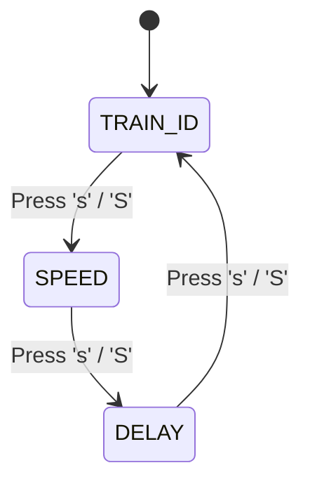

```text
+-------------------------+  Press 's' / 'S'  +-------------------------+  Press 's' / 'S'  +-------------------------+
| RosterSortMode.TRAIN_ID | ----------------> |  RosterSortMode.SPEED   | ----------------> |  RosterSortMode.DELAY   |
|   (Ascending: TRAIN▲)   |                   |   (Descending: SPD▼)    |                   |   (Descending: DLY▼)    |
+-------------------------+                   +-------------------------+                   +-------------------------+
             ^                                                                                           |
             +------------------------------------ Press 's' / 'S' --------------------------------------+
```

3. **Store & Snapshot Extension in [`tui/state.py`](../../tui/state.py):**
   - Initialize `self._sort_mode: RosterSortMode = RosterSortMode.TRAIN_ID` in [`TrainStateStore.__init__`](../../tui/state.py#L267).
   - Expose `sort_mode: RosterSortMode = RosterSortMode.TRAIN_ID` on immutable [`StateSnapshot`](../../tui/state.py#L128) and populate it in [`TrainStateStore.get_snapshot`](../../tui/state.py#L389).
   - Implement [`set_sort_mode(mode: RosterSortMode) -> None`](../../tui/state.py#L485-L492) with `isinstance(mode, RosterSortMode)` runtime type validation and version increment on state change.
   - Implement [`cycle_sort_mode() -> RosterSortMode`](../../tui/state.py#L494-L505) to cycle `TRAIN_ID -> SPEED -> DELAY -> TRAIN_ID` under `self._lock`, preserving `self._selected_id` (and dynamically recomputing `selected_index` in the newly ordered `filtered_trains` tuple) while incrementing `self._version`.
   - Dispatch sorting in [`_compute_filtered_list`](../../tui/state.py#L569-L575) based on `self._sort_mode`, ensuring `select_next()` and `select_prev()` cursor traversal automatically follow the active sort order.

4. **Renderer Glyphs & Header Indicator in [`tui/renderer.py`](../../tui/renderer.py):**
   - Extend [`RenderGlyphs`](../../tui/renderer.py#L93-L94) with `sort_asc` and `sort_desc`:
     - [`GLYPHS_UTF8`](../../tui/renderer.py#L113-L114): `sort_asc="▲"`, `sort_desc="▼"`
     - [`GLYPHS_ASCII`](../../tui/renderer.py#L133-L134): `sort_asc="^"`, `sort_desc="v"`
   - Update [`TUIRenderer.render_roster`](../../tui/renderer.py#L888-L895) to render the active sort indicator while preserving fixed column alignment (`[Cursor:2][#:3][TRAIN:6][TYPE:5][SPD:5][DLY:5][ST:4]`):
     - `RosterSortMode.TRAIN_ID`: `" #   TRAIN▲ TYPE  SPD   DLY  ST"` (ASCII: `" #   TRAIN^ TYPE  SPD   DLY  ST"`)
     - `RosterSortMode.SPEED`: `" #   TRAIN  TYPE  SPD▼  DLY  ST"` (ASCII: `" #   TRAIN  TYPE  SPDv  DLY  ST"`)
     - `RosterSortMode.DELAY`: `" #   TRAIN  TYPE  SPD   DLY▼ ST"` (ASCII: `" #   TRAIN  TYPE  SPD   DLYv ST"`)
   - Include `[s] Sort` in the bottom status bar shortcuts ([`TUIRenderer.render_status_bar`](../../tui/renderer.py#L1093)) and document `s / S` in [`TUIRenderer.render_help_modal`](../../tui/renderer.py#L1167).

5. **Controller Keybinding in [`tui/app.py`](../../tui/app.py):**
   - Add [`TUIApp.cycle_sort() -> RosterSortMode`](../../tui/app.py#L377-L379) delegating to `self.store.cycle_sort_mode()`.
   - Bind `key in (ord("s"), ord("S"))` in [`TUIApp._handle_normal_input`](../../tui/app.py#L449-L451) to `self.cycle_sort()` (leaving `InputMode.SEARCH` unaffected so typing `s` in a search query appends to `search_buffer`).

6. **Verification Coverage:**
   - [`tests/test_tui_state.py`](../../tests/test_tui_state.py#L344-L400) (`test_sort_mode_cycling_and_ordering`): Verifies `TRAIN_ID -> SPEED -> DELAY -> TRAIN_ID` cycling, deterministic natural ID tie-breaking, selection preservation across sort changes, `select_next()` order adherence, and `TypeError` validation on invalid enum values.
   - [`tests/test_tui_controls.py`](../../tests/test_tui_controls.py#L697-L718) (`test_key_s_cycles_roster_sort_mode_in_normal_mode`, `test_key_s_in_search_mode_appends_character_without_sorting`): Verifies `s`/`S` key dispatch in `NORMAL` vs. `SEARCH` modes.
   - [`tests/test_tui_renderer.py`](../../tests/test_tui_renderer.py#L954-L994) (`test_render_roster_displays_sort_direction_indicators_utf8_and_ascii`): Verifies `TRAIN▲`/`SPD▼`/`DLY▼` and `TRAIN^`/`SPDv`/`DLYv` header rendering.

---

### F-1.2: Historical Breadcrumb Trail Mode Toggle (`b` / `B`) — *Implemented*

#### Problem Statement
[`README.md`](../../README.md#L176) documents `b` to *"Toggle historical breadcrumb trails"*. Previously, [`TUIRenderer.render_map`](../../tui/renderer.py#L744-L771) unconditionally rendered breadcrumb trails for all trains in `snapshot.trains.values()` (even trains excluded by an active search or corridor filter). On dense suburban corridors, operators need the ability to isolate trails to the currently selected train or hide trails completely.

#### Technical Design & Implementation Plan
1. **`BreadcrumbMode` Enum in [`tui/state.py`](../../tui/state.py#L48-L53):**
   ```python
   class BreadcrumbMode(Enum):
       """Visibility policy for historical breadcrumb trails on the map canvas."""

       ALL = auto()       # Draw breadcrumb dots for all active filtered trains
       SELECTED = auto()  # Draw breadcrumb dots only for snapshot.selected_train
       OFF = auto()       # Hide all historical breadcrumb trails
   ```
2. **State Machine Transition:**

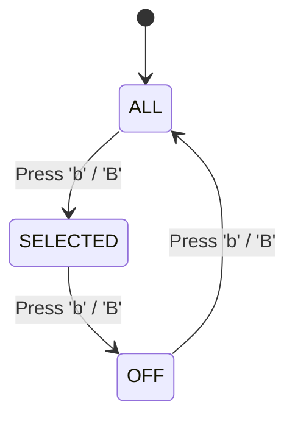

```text
+--------------------+  Press 'b' / 'B'  +-------------------------+  Press 'b' / 'B'  +--------------------+
| BreadcrumbMode.ALL | ----------------> | BreadcrumbMode.SELECTED | ----------------> | BreadcrumbMode.OFF |
|   (Trails: ALL)    |                   |      (Trails: SEL)      |                   |   (Trails: OFF)    |
+--------------------+                   +-------------------------+                   +--------------------+
          ^                                                                                      |
          +----------------------------------- Press 'b' / 'B' ----------------------------------+
```

3. **Store & Snapshot Extension in [`tui/state.py`](../../tui/state.py):**
   - Initialize `self._breadcrumb_mode: BreadcrumbMode = BreadcrumbMode.ALL` in [`TrainStateStore.__init__`](../../tui/state.py#L268).
   - Expose `breadcrumb_mode: BreadcrumbMode = BreadcrumbMode.ALL` on [`StateSnapshot`](../../tui/state.py#L129) and populate it in [`TrainStateStore.get_snapshot`](../../tui/state.py#L390).
   - Implement [`set_breadcrumb_mode(mode: BreadcrumbMode) -> None`](../../tui/state.py#L507-L514) with `isinstance(mode, BreadcrumbMode)` runtime type validation and version increment on change.
   - Implement [`cycle_breadcrumb_mode() -> BreadcrumbMode`](../../tui/state.py#L516-L527) to cycle `ALL -> SELECTED -> OFF -> ALL` under `self._lock` while incrementing `self._version`.

4. **Renderer Integration in [`tui/renderer.py`](../../tui/renderer.py#L716-L771):**
   - **Map Viewport Title Badge ([`tui/renderer.py`](../../tui/renderer.py#L716-L728)):**
     - Map `snapshot.breadcrumb_mode` to `trails_label` (`"ALL"`, `"SEL"`, or `"OFF"`) and display `| Trails: {trails_label}` in the map viewport header:
       `[ Map Viewport: 39.80°N, 22.50°E | Zoom: 1.5x | Trails: ALL ]`.
   - **Filtered Trail Resolution ([`tui/renderer.py`](../../tui/renderer.py#L744-L757)):**
     - `BreadcrumbMode.OFF`: `trail_records = ()` (skips rendering historical breadcrumb dots).
     - `BreadcrumbMode.SELECTED`: Renders `snapshot.selected_train` trail if and only if `snapshot.selected_train` is not `None` and is currently visible in `snapshot.filtered_trains`; otherwise `trail_records = ()`.
     - `BreadcrumbMode.ALL`: `trail_records = snapshot.filtered_trains` (ensuring trains hidden by corridor or text filters do not leak ghost trails onto the map).
   - **Status Bar & Help Modal:**
     - Include `[b] Trails` in the status bar cheat sheet ([`TUIRenderer.render_status_bar`](../../tui/renderer.py#L1093)) and document `b / B` in [`TUIRenderer.render_help_modal`](../../tui/renderer.py#L1168).

5. **Controller Keybinding in [`tui/app.py`](../../tui/app.py):**
   - Add [`TUIApp.cycle_breadcrumbs() -> BreadcrumbMode`](../../tui/app.py#L381-L383) delegating to `self.store.cycle_breadcrumb_mode()`.
   - Bind `key in (ord("b"), ord("B"))` in [`TUIApp._handle_normal_input`](../../tui/app.py#L453-L455) to `self.cycle_breadcrumbs()`.

6. **Verification Coverage:**
   - [`tests/test_tui_state.py`](../../tests/test_tui_state.py#L401-L442) (`test_breadcrumb_mode_cycling_and_explicit_set`): Verifies `ALL -> SELECTED -> OFF -> ALL` transitions, version increments, idempotent `set_breadcrumb_mode`, and `TypeError` validation.
   - [`tests/test_tui_controls.py`](../../tests/test_tui_controls.py#L719-L740) (`test_key_b_cycles_breadcrumb_mode_in_normal_mode`, `test_key_b_in_search_mode_appends_character_without_toggling_breadcrumbs`): Verifies `b`/`B` key handling in `NORMAL` vs. `SEARCH` modes.
   - [`tests/test_tui_renderer.py`](../../tests/test_tui_renderer.py#L996-L1084) (`test_render_map_breadcrumb_modes_all_selected_off_and_filter_exclusion`): Verifies map title badge (`Trails: ALL`/`SEL`/`OFF`), corridor filter trail exclusion, and trail dot rendering across all three modes.

---

## 4. Tier 2: Telemetry Inspector & Analytical Enhancements

These enhancements enrich the **Selected Train Telemetry** pane ([`TUIRenderer.render_inspector`](../../tui/renderer.py#L903-L992)) using data already present in [`TrainRecord`](../../tui/state.py#L51-L92) and [`tui/data/stations.json`](../../tui/data/stations.json).

---

### F-2.1: Live Speed Sparkline & Telemetry Age Indicator — *Implemented*

#### Problem Statement
The Selected Train Telemetry pane previously displayed only instantaneous speed (`pos.speed: 142.0 km/h`) without historical velocity context, momentum direction, or transponder freshness. Operators could not immediately tell if a train was cruising at line speed, decelerating for a signal or station stop, accelerating, or if a stationary reading represented an active dwell versus a dead GPS transponder or stream stall.

#### Technical Design & Implementation Details
1. **State Layer & Chronological Speed History ([`tui/state.py`](../../tui/state.py#L86-L125)):**
   - Implemented [`TrainRecord.get_speed_history(self, max_samples: int = 15) -> List[float]`](../tui/state.py#L106-L125): Chronologically extracts non-negative float speed samples from `record.trail` breadcrumbs and merges the current position speed (`pos.speed`) if updated or changed, while clamping `None` or negative speeds to `0.0`.
   - Updated [`TrainRecord.append_breadcrumb`](../../tui/state.py#L86-L104) and initial record ingestion in [`TrainStateStore.update_positions`](../../tui/state.py#L326-L334) to defensively sanitize `pos.speed` via `float(pos.speed) if pos.speed is not None else 0.0`.

2. **Unicode & ASCII Sparkline Generator ([`tui/renderer.py`](../../tui/renderer.py#L446-L495)):**
   - **8-Level Block Height Glyphs:**
     - UTF-8: `SPARKLINE_BARS_UTF8 = (" ", "▂", "▃", "▄", "▅", "▆", "▇", "█")`
     - ASCII: `SPARKLINE_BARS_ASCII = ("_", ".", "-", "=", "+", "*", "#", "@")`
   - **Dynamic Speed Normalization:** Normalized against dynamic ceiling $V_{\max} = \max(160.0, \max(\text{speeds}))\text{ km/h}$, ensuring standard $160\text{ km/h}$ PATHE mainline velocities use the full vertical range while gracefully scaling up during high-speed runs without index overflow.
   - **Kinematic Trend Arrow:** Appends instantaneous gradient arrow:
     - Accelerating ($\Delta v > +3.0\text{ km/h}$): `▲` (ASCII: `^`)
     - Braking ($\Delta v < -3.0\text{ km/h}$): `▼` (ASCII: `v`)
     - Steady cruise ($|\Delta v| \le 3.0\text{ km/h}$): `─` (ASCII: `-`)

3. **Telemetry Age & Multi-Tier Staleness Alerting ([`tui/renderer.py`](../../tui/renderer.py#L497-L536)):**
   - Implemented [`format_telemetry_age(last_updated: float, update_count: int, now: Optional[float] = None) -> Tuple[str, int]`](../tui/renderer.py#L497-L536).
   - Computes elapsed age $T_{\text{age}} = \max(0, \text{int}(\text{now} - \text{last\_updated}))$.
   - **Alert Attributes:**
     - Normal ($T_{\text{age}} \le 30\text{s}$): `PAIR_DEFAULT` (`2s ago (#48)`)
     - Warning ($30\text{s} < T_{\text{age}} \le 120\text{s}$): `PAIR_TRAIN_WARN` in yellow (`45s ago (#48)`)
     - Critical Stale ($T_{\text{age}} > 120\text{s}$): `PAIR_TRAIN_ALERT` in bold red (`2m ago [STALE]`)
   - Formatted compactly ($< 15$ characters) to guarantee zero text truncation inside narrow $32$-column sidebar inspector windows.

4. **Visual State Machine & Data Flow:**

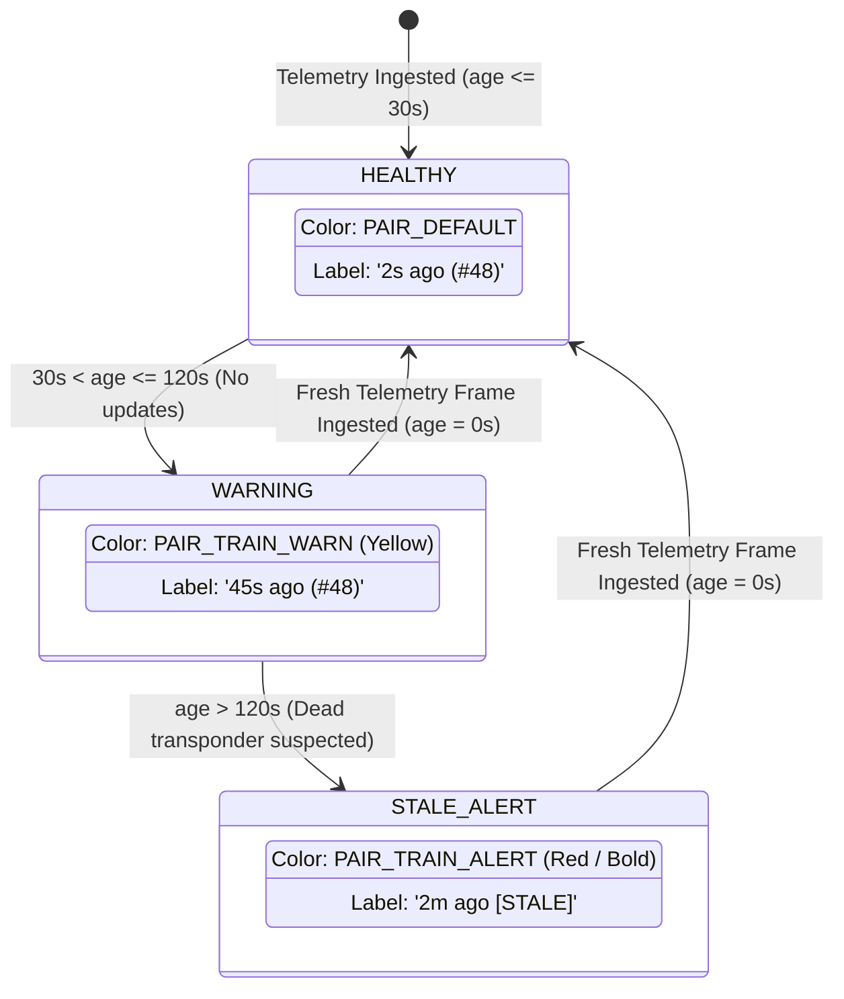

```text
+------------------------------+
| [ SELECTED TRAIN TELEMETRY ] |
| Train No:     1599 (IC)      |
| Route:        ΑΘΗΝ -> ΘΕΣΣ   |
| Next Station: Λάρισα         |
| Speed:        142.0 km/h     |
| Speed Trend:   ▂▃▅▆▇██▇▇█ ▲  |
| Delay:        +9 min (Minor) |
| Telemetry:    2s ago (#48)   |
| Progress:     [=====>----] 52|
| Heading:      340.0° (NNW)   |
| Locomotive:   120-024        |
+------------------------------+
```

5. **Adaptive Inspector Row Layout ([`tui/renderer.py`](../../tui/renderer.py#L1120-L1145)):**
   - Reordered `rows` hierarchy in `render_inspector` so primary operational telemetry (`Train No:`, `Route:`, `Next Station:`, `Speed:`, `Speed Trend:`, `Delay:`, `Telemetry:`, `Progress:`) is completely visible on standard $80 \times 24$ consoles (`inner_h = 9`), while secondary fields (`Heading:`, `Locomotive:`, `Status:`, `Chainage:`) render when vertical space permits.

6. **Verification Coverage:**
   - [`tests/test_tui_state.py`](../../tests/test_tui_state.py#L795-L824) (`test_train_record_get_speed_history`): Validates chronological velocity extraction from breadcrumbs, dwell speed changes without spatial translation, and sample count bounds.
   - [`tests/test_tui_renderer.py`](../../tests/test_tui_renderer.py#L301-L380) (`test_format_speed_sparkline`, `test_format_telemetry_age`): Validates empty lists, constant cruising, acceleration and braking trend arrows, dynamic ceiling expansion for speeds $> 160\text{ km/h}$, 7-bit ASCII purity, age thresholds, and negative elapsed time protection.
   - [`tests/test_tui_renderer.py`](../../tests/test_tui_renderer.py#L525-L547) (`test_render_inspector_live_sparkline_and_telemetry_age`): Validates rendering of `Speed Trend:` and `Telemetry:` rows in curses mock windows, including `PAIR_TRAIN_ALERT` color attribute activation on stale trains ($> 120\text{s}$).

---

### F-2.2: WGS84 Coordinate Readout, Next-Station Distance & ETA — *Implemented*

#### Problem Statement
While the map viewport title displays the camera center coordinates, the Selected Train Telemetry Inspector previously displayed only the raw `pos.next_station` name without showing the selected train's exact WGS84 latitude/longitude, its remaining distance to `next_station`, or its kinematic estimated time of arrival (ETA).

#### Technical Design & Implementation Details
1. **Haversine Distance Helper in [`tui/geo.py`](../../tui/geo.py#L118-L143):**
   - Implemented [`haversine_distance_km(a: GeoPoint, b: GeoPoint) -> float`](../../tui/geo.py#L121-L143) using standard spherical Earth radius $R = 6371.0\text{ km}$ with domain clamping `min(1.0, max(0.0, h))`.
2. **Diacritic-Insensitive Station Lookup Index in [`TUIRenderer.__init__`](../../tui/renderer.py#L549-L601):**
   - Implemented [`normalize_station_key(name: str) -> str`](../../tui/renderer.py#L549-L565) using Unicode `NFD` decomposition to strip combining Greek accents/*tonos* (`Mn`) and casefold.
   - Implemented [`_build_station_index(stations: Sequence[StationNode]) -> Dict[str, StationNode]`](../tui/renderer.py#L568-L601) indexing station `id`, `code`, Greek (`name_el`), English (`name_en`), parenthetical-stripped base names (`"Αθήνα (Σ.Σ. Λαρίσης)"` $\rightarrow$ `"αθηνα"`), and airport aliases, exposed via [`TUIRenderer.resolve_station`](../../tui/renderer.py#L728-L741).
3. **Next-Station Distance & Kinematic ETA ([`format_next_station_eta`](../../tui/renderer.py#L604-L651)):**
   - When `pos.next_station` resolves to a known `StationNode` and `(pos.lat, pos.lng)` is a valid non-zero coordinate:
     - Computes great-circle distance $d_{\text{km}} = \text{haversine\_distance\_km}(\text{train\_pt}, \text{station.point})$.
     - If `pos.speed >= 5.0`, computes $\text{ETA}_{\min} = \text{round}\left(\frac{d_{\text{km}}}{\text{pos.speed}} \times 60\right)$ and renders `Next Station: Λάρισα (14.2 km, ~6m)` (or `<1m` when $d_{\text{km}} < 0.1\text{ km}$, `~XhYYm` when $\text{ETA}_{\min} \ge 120$).
     - If halted (`pos.speed < 5.0`), renders `Λάρισα (0.1 km, AT)` when at the station platform ($d_{\text{km}} < 0.25\text{ km}$) or `Λάρισα (14.2 km)` when stopped en route.
4. **Coordinate Readout Row ([`format_wgs84_coords`](../../tui/renderer.py#L654-L683)):**
   - Renders `Coordinates: 39.6384°N, 22.4192°E` in UTF-8 mode (or `39.6384d N, 22.4192d E` in `--ascii` mode) at row index 8 of [`TUIRenderer.render_inspector`](../../tui/renderer.py#L1217-L1242), immediately visible on standard $80 \times 24$ consoles (`inner_h = 9`).
5. **Verification Coverage:**
   - [`tests/test_tui_geo.py`](../../tests/test_tui_geo.py#L334-L356) (`test_haversine_distance_km`): Validates identity distance, symmetry, 1° meridian arc ($\approx 111.195\text{ km}$), Athens–SKA ($\approx 9.23\text{ km}$), and Athens–Thessaloniki ($\approx 302.3\text{ km}$).
   - [`tests/test_tui_renderer.py`](../../tests/test_tui_renderer.py#L371-L469) (`test_format_next_station_eta`, `test_format_wgs84_coords`) and [`tests/test_tui_renderer.py`](../../tests/test_tui_renderer.py#L1278-L1337) (`test_station_lookup_index_and_inspector_coordinates_eta`): Validates Greek/English/toneless station resolution, moving/halted/platform ETA formatting, UTF-8/ASCII coordinate formatting, and Curses Inspector window rendering.

---

## 5. Tier 3: Map Canvas & Interactive UX Features

---

### F-3.1: Terminal Mouse Interaction (Click-to-Select & Scroll Zoom) — *Implemented*

> **Detailed Implementation Plan:** [`docs/f-3-1-terminal-mouse-interaction-plan.md`](../plans/features/f-3-1-terminal-mouse-interaction-plan.md)

#### Overview
Modern terminal emulators (Windows Terminal, iTerm2, Kitty, Alacritty, GNOME Terminal, xterm) report mouse clicks and wheel events through `curses.getmouse()`. Adding mouse support makes spatial exploration and train selection instantaneous while keeping keyboard navigation 100% functional.

#### Technical Design
1. **Mouse Initialization in [`TUIApp.setup_terminal`](../../tui/app.py#L199):**
   ```python
   try:
       curses.mousemask(curses.ALL_MOUSE_EVENTS | curses.REPORT_MOUSE_POSITION)
   except curses.error:
       pass  # Gracefully degrade on terminals without mouse support
   ```
2. **Event Dispatch (`key == curses.KEY_MOUSE`) in [`TUIApp.process_input`](../../tui/app.py#L498):**
   - Call `_, mx, my, _, bstate = curses.getmouse()`.
   - **Region 1: Roster Pane (`geometry.roster_x <= mx < roster_x + roster_w` and `roster_y <= my < roster_y + roster_h`):**
     - **Left Click (`BUTTON1_CLICKED | BUTTON1_PRESSED`):** Map clicked row `r_idx = my - (geometry.roster_y + 2)` + active `scroll_offset` to `snapshot.filtered_trains[item_idx]` and call `self.store.select_by_id(...)`.
     - **Double Click (`BUTTON1_DOUBLE_CLICKED`):** Select train and engage follow camera (`self.store.set_follow_mode(True)`).
     - **Scroll Wheel Up / Down (`BUTTON4_PRESSED` / `BUTTON5_PRESSED`):** Cycle train selection backward / forward.
   - **Region 2: Map Pane (`geometry.map_x < mx < map_x + map_w - 1` and `map_y < my < map_y + map_h - 1`):**
     - **Left Click:** Hit-test `(col = mx - map_x - 1, row = my - map_y - 1)` against projected train cells (Manhattan radius $\le 1$ cell). If a train is hit, select it; otherwise, if double-clicked on empty canvas, recenter the viewport on the clicked geographic coordinate via `projector.subpixel_to_geo(col * 2 + 1, row * 4 + 2)`.
     - **Scroll Wheel Up / Down:** Zoom in (`self.zoom(1.25)`) / Zoom out (`self.zoom(0.8)`).

---

### F-3.2: Station Departure Board & Proximity Inspector Mode (`m` / `M`) — *Implemented*

> **Detailed Implementation Plan:** [`docs/f-3-2-station-departure-board-proximity-inspector-plan.md`](../plans/features/f-3-2-station-departure-board-proximity-inspector-plan.md)

#### Overview
Allow users to switch the bottom-right Inspector pane between **Train Telemetry Mode** (default) and **Station Proximity Board Mode** (`m` / `M` key or clicking a station node `◉` on the map).

#### Visual Layout of Station Inspector Mode

```text
+------------------------------+
| [STATION BOARD: Larissa]     |
| Corridor: PATHE Mainline     |
| Coords:   39.6385°N, 22.422E |
|                              |
| APPROACHING / AT STATION:    |
| TRAIN  DIR  DIST   ETA   DLY |
| 1598   HLT  0.1km  AT     0m |
| 1597   NNW  4.2km  ~2m   +4m |
| 2591   SSE  11.8km ~7m    0m |
+------------------------------+
```

#### Technical Design
1. **State Layer ([`tui/state.py`](../../tui/state.py)):**
   - Add `InspectorMode` enum (`TRAIN`, `STATION`) and expose `inspector_mode: InspectorMode = InspectorMode.TRAIN` and `selected_station_id: Optional[str] = None` on [`StateSnapshot`](../../tui/state.py).
   - Implement thread-safe `set_inspector_mode()`, `set_selected_station()`, and `cycle_station_board()` on [`TrainStateStore`](../../tui/state.py) with anchor-tracked wrap-around cycling that returns to `InspectorMode.TRAIN` after visiting all candidate hubs.
2. **Controller Layer ([`tui/app.py`](../../tui/app.py)):**
   - Pressing `m` in `InputMode.NORMAL` enters `InspectorMode.STATION` starting at the selected train's `next_station` (if resolved) or the hub station nearest to `projector.viewport.center`, and subsequent `m` presses cycle through active corridor/network hub stations before wrapping back to `InspectorMode.TRAIN`.
   - Pressing `M` (`Shift+M`) while in `InspectorMode.STATION` immediately exits back to `InspectorMode.TRAIN`.
3. **Proximity Engine & Presentation Layer ([`tui/renderer.py`](../../tui/renderer.py)):**
   - Implement `StationBoardEntry` and `compute_station_board_entries()` computing Haversine distance from the selected `StationNode` to all active filtered trains, retaining trains within $80.0\text{ km}$ or whose `next_station` / `origin` / `destination` resolves to the station, sorted by ascending distance with natural train ID tie-breaking.
   - Render the Station Board in `TUIRenderer.render_station_inspector()` with adaptive column widths for $80 \times 24$ (`28`-col) and wide (`32+`-col) sidebars, and highlight the active station node on the map canvas (`curses.A_REVERSE | curses.A_BOLD`).

---

### F-3.3: Map Layer Toggles (`v` Station Labels / `t` Corridor Track Colors) — *Implemented*

> **Detailed Implementation Plan:** [`docs/f-3-3-map-layer-toggles-plan.md`](../plans/features/f-3-3-map-layer-toggles-plan.md)

#### Overview
At low zoom levels (`0.5x`–`1.0x`), station labels can crowd narrow corridors, and monochromatic white Braille tracks make it harder to distinguish suburban lines from the mainline trunk.

#### Technical Design
1. **Station Label Visibility Mode (`v` / `V` key & `StationLabelMode` in [`tui/state.py`](../../tui/state.py)):**
   - Cycles through:
     1. `HUBS_AND_SECONDARY` (default: all stations with collision avoidance)
     2. `HUBS_ONLY` (only `stn.is_hub == True` labels shown, plus active inspected station in `InspectorMode.STATION`)
     3. `MARKERS_ONLY` (draw `◉` / `#`/`+` glyphs without text labels for maximum track visibility)
2. **Corridor-Colored Braille Tracks (`t` / `T` key & `TrackColorMode` in [`tui/state.py`](../../tui/state.py)):**
   - Toggle between uniform dim-white tracks (`TrackColorMode.UNIFORM`, `PAIR_TRACK`) and corridor-colored track layers (`TrackColorMode.CORRIDOR`) while preserving composite $2 \times 4$ Braille sub-pixel bitmasks at shared junctions:
     - `PATHE`: `PAIR_TRACK` (White)
     - `PROASTIAKOS`: `PAIR_TRAIN_PROAST` (Cyan)
     - `NORTHERN` / `THESSALY` / `MACEDONIA`: `PAIR_STATION_DIM` (Yellow)

---

### F-3.4: Dynamic Conformal Map Scale Bar Overlay — *Implemented*

> **Detailed Implementation Plan:** [`docs/f-3-4-dynamic-conformal-map-scale-bar-plan.md`](../plans/features/f-3-4-dynamic-conformal-map-scale-bar-plan.md)

#### Overview
Because the zoom factor ranges from `0.2x` to `25.0x`, users benefit from a live geographic scale bar in the bottom-left corner of the map viewport showing real-world distance.

#### Technical Design
1. **Scale Calculation in [`GeoProjector`](../../tui/geo.py):**
   - Compute kilometers per terminal column cell at current viewport center latitude $\phi_0$ via `GeoProjector.get_km_per_cell()`:
     $$\text{km\_per\_cell} = \frac{2.0}{S_x \cdot \cos(\phi_0)} \times 111.32$$
   - Snap a target bar width of $12\text{--}18$ cells via `GeoProjector.compute_scale_bar()` to the nearest standard cartographic interval in `SCALE_BAR_INTERVALS_KM` ($1\text{--}1500\text{ km}$, spaced with Voronoï cell ratios $< 1.25\times$ so every `+`/`-` zoom step transitions to a distinct kilometer value across `0.2x`–`25.0x`), returning an immutable `ScaleBarSpec(distance_km, width_cells, km_per_cell)`.
2. **Rendering in [`TUIRenderer.render_map`](../../tui/renderer.py):**
   - Format the scale bar via `format_scale_bar()` (`|--- 25 km ---|` in `--ascii` mode or `├─── 25 km ───┤` / `├──── 25 km ────┤` in UTF-8 mode), reserve its bottom-left cells in `occupied_cells` to prevent station label overlap, and draw it at row `max_y - 2`, column `2` inside the map window before overlaying trains.

---

## 6. Tier 4: Historical Storage & Replay Integration

The repository already includes a rich SQLite historical subsystem in [`storage/`](../../storage) ([`storage/repository.py`](../../storage/repository.py), [`storage/recorder.py`](../../storage/recorder.py)). Integrating it directly with the interactive TUI bridges live monitoring and post-trip analysis.

---

### F-4.1: Instant In-TUI GeoJSON / CSV Trajectory Snapshot Export (`e` / `E`) — *Implemented*

> **Detailed Implementation Plan:** [`docs/f-4-1-instant-in-tui-trajectory-export-plan.md`](../plans/features/f-4-1-instant-in-tui-trajectory-export-plan.md)

#### Overview
When observing an interesting delay event or anomaly in the TUI, pressing `e` immediately exports the selected train's trajectory to a timestamped `.geojson` file (or `E` for `.csv`) in the working directory without leaving the dashboard.

#### Technical Design
1. **Dual-Source Trajectory Resolution:**
   - **If `--record` is active** (`snapshot.is_recording and snapshot.recording_db`): Query full recorded trip points for `selected_train.position.train_number` via [`HistoricalRepository.export_trip_geojson`](../../storage/repository.py) (for `e`) or [`HistoricalRepository.export_csv`](../../storage/repository.py) (for `E`), seamlessly falling back to the in-memory trail if the selected train has not yet been flushed to SQLite.
   - **If running without `--record` (Live or `--demo`):** Build an RFC 7946 GeoJSON `FeatureCollection` or 17-column telemetry CSV directly from the in-memory `selected_train.trail` (`Deque[HistoricalBreadcrumb]`) and current [`TrainPosition`](../../train_tracker.py) via [`export_in_memory_geojson`](../../storage/repository.py) and [`export_in_memory_csv`](../../storage/repository.py).
2. **Filename & Security Validation:**
   - Sanitize `train_number` via [`sanitize_train_identifier`](../../storage/repository.py) and reuse path sanitization rules from [`validate_export_path`](../../storage/repository.py) to write `railmon_train_<train_no>_<YYYYMMDD_HHMMSS>.geojson` (or `.csv`).
3. **Transient Status Bar Toast Notification:**
   - Added `toast_message: Optional[str]`, `toast_expiry: float`, and `toast_is_error: bool` to [`TUIApp`](../../tui/app.py).
   - Displays `[✓ Exported railmon_train_1597_20261120_160500.geojson]` (or `[OK Exported ...]` in `--ascii` mode) in the status bar for 4 seconds.

---

### F-4.2: SQLite Historical DVR Playback & Timeline Scrubbing (`--replay <db>`) — *Implemented*

> **Detailed Implementation Plan:** [`docs/f-4-2-sqlite-historical-dvr-playback-plan.md`](../plans/features/f-4-2-sqlite-historical-dvr-playback-plan.md)

#### Overview
Allow `railmon --tui --replay railway_history.db` to replay recorded historical telemetry through the exact same Curses TUI dashboard, complete with pause, fast-forward (`1x`, `5x`, `15x`, `60x`), and timeline scrubbing (`[` / `]` to jump $\pm 5\text{ minutes}$).

#### Sequence Diagram

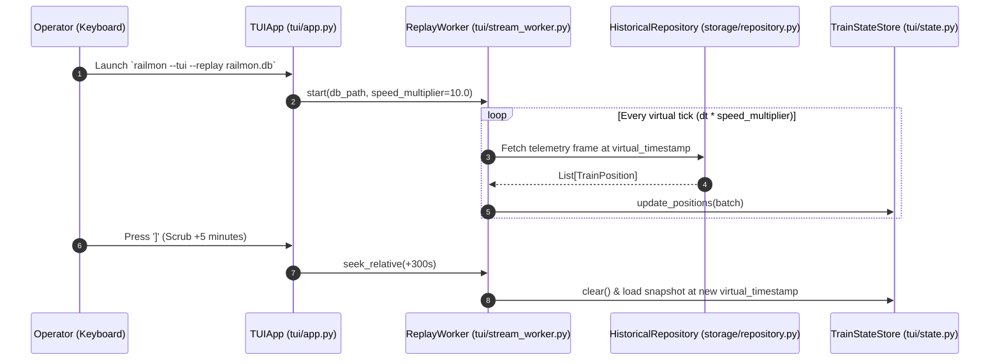

#### ASCII Architecture Diagram

```text
+----------------------------------+       seek / speed        +----------------------------------+
|            TUIApp                | ------------------------> |          ReplayWorker            |
|  Keys: [Space] Pause             |                           |  Virtual Clock: t_cur            |
|        [ / ]   Scrub -/+ 5m      |                           |  Multiplier: 1x / 5x / 15x / 60x |
|        < / >   Speed Multiplier  |                           +----------------------------------+
+----------------------------------+                                            |
                 ^                                                              | SQL Window Query
                 | get_snapshot()                                               v
+----------------------------------+                           +----------------------------------+
|         TrainStateStore          | <------------------------ |       HistoricalRepository       |
|   (In-Memory Active Positions)   |     update_positions()    |     (SQLite WAL Read-Only)       |
+----------------------------------+                           +----------------------------------+
```

---

## 7. Tier 5: Safety, Dispatch & Anomaly Watchdogs

Operational rail safety and anomaly detection provide automated surveillance over active trains, identifying dangerous network conditions, track conflicts, and sensor dropouts in real time.

---

### F-5.1: Corridor Headway & Opposing Train Conflict Watchdog — *Implemented*

> **Detailed Implementation Plan:** [`../plans/features/f-5-1-corridor-headway-and-opposing-train-conflict-watchdog-plan.md`](../plans/features/f-5-1-corridor-headway-and-opposing-train-conflict-watchdog-plan.md)

#### Overview
On the Greek rail network, sections of single-track infrastructure (such as portions of the Peloponnese network, regional spurs, and ongoing maintenance single-line operations on the PATHE corridor) require strict block occupancy. This feature introduces an automated headway and collision vector evaluation engine in [`tui/state.py`](../../tui/state.py) that continuously evaluates spatial distance and course vectors between trains on shared corridors.

#### Conflict Classification
1. **Head-on / Opposing Collision Risk (`CRITICAL`):**
   Two trains assigned to the same corridor or track edge (`railwayId`) moving with reciprocal headings ($\Delta\theta \approx 180^\circ \pm 35^\circ$) whose projected distance $D < 10.0\text{ km}$ and closing velocity $V_{\text{close}} > 0$.
2. **Headway Violation (`WARNING`):**
   Two trains traveling in the same direction on the same corridor where spatial separation $D < 2.5\text{ km}$ (exceeding standard service braking curve limits).

#### Visual & Audio Alerts
- Status bar displays flashing alert: `[⚠ CONFLICT: IC52 <-> IC59 on PATHE (3.4km)]` (or `[! CONFLICT ...]` in `--ascii` mode).
- Optional audible terminal bell (`\a`) fired once per conflict state transition.
- Inspector pane displays a highlighted `CONFLICT WARNING` card with relative speed and distance.

#### Sequence Diagram

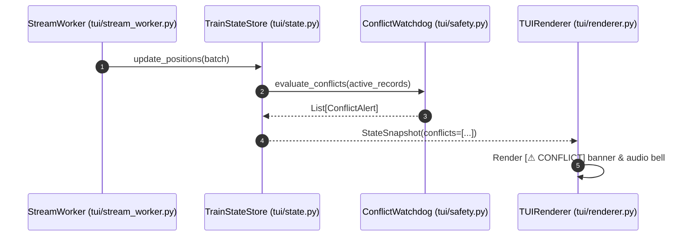

#### ASCII Architecture Diagram

```text
+-----------------------------------------------------------------------------------+
|                        Safety Conflict Watchdog Pipeline                          |
+-----------------------------------------------------------------------------------+

   Active Train Snapshot
     [IC52: 39.21N, 22.45E, course: 350°]
     [IC59: 39.24N, 22.46E, course: 170°]
                    |
                    v
   +------------------------------------+
   |     Corridor Spatial Partition     |
   |      (Group by corridor/track)     |
   +------------------------------------+
                    |
                    v
   +------------------------------------+
   |   Pairwise Kinematic Evaluation    |
   |   - Haversine Distance: 3.4 km     |
   |   - Relative Bearing: Opposing     |
   |   - Closing Speed: 240 km/h        |
   +------------------------------------+
                    |
                    v  Condition: D < 10km & Opposing
   +------------------------------------+
   |   Conflict Alert Event Generated   |
   |   Severity: CRITICAL               |
   |   Action: Terminal Bell + UI Flash |
   +------------------------------------+
```

---

### F-5.2: Telemetry Drop & Sensor Freezing Watchdog — *Implemented*

> **Detailed Implementation Plan:** [`../plans/features/f-5-2-telemetry-drop-sensor-freezing-watchdog-plan.md`](../plans/features/f-5-2-telemetry-drop-sensor-freezing-watchdog-plan.md)

#### Overview
Locomotives traversing remote mountain passes (e.g., Mount Othrys, Kallidromo tunnels) occasionally lose cellular backhaul or Starlink satellite tracking. This engine monitors telemetry update intervals and kinematic continuity to distinguish between normal stationary halts and frozen or lost sensor streams.

#### Sensor Health Tiers
- **Normal Motion:** Updated $\le 30\text{s}$ ago, position actively advancing.
- **Station Dwell:** Speed $0\text{ km/h}$, position within $250\text{m}$ of a known station centroid.
- **Sensor Freeze (`[FROZEN]`):** Speed $> 0\text{ km/h}$, but coordinates unchanged for $> 45\text{s}$.
- **Telemetry Drop (`[DROPPED]`):** No telemetry packet received for $> 120\text{s}$ while train was in active transit.

---

### F-5.3: Corridor Speed Limit Exceedance & Slow-Order Alerts — *Implemented*

> **Detailed Implementation Plan:** [`../plans/features/f-5-3-corridor-speed-limit-exceedance-and-slow-order-alerts-plan.md`](../plans/features/f-5-3-corridor-speed-limit-exceedance-and-slow-order-alerts-plan.md)

#### Overview
Maps train instantaneous speeds against maximum design speeds and temporary speed restrictions (TSR) across Greek rail corridors:
- Athens–Thessaloniki High-Speed Sections: $160\text{ km/h}$
- Urban / Suburban Segments (SKC–SKA–Oinoi): $90\text{--}120\text{ km/h}$
- Mountain Pass Branches: $60\text{--}80\text{ km/h}$

When speed exceeds the corridor threshold by $\ge 10\text{ km/h}$, the telemetry inspector highlights the speed value in `PAIR_TRAIN_ALERT` with an `[OVERSPEED]` tag.

---

## 8. Tier 6: Commuter & Route Operational Tools

These features transform `railmon` from an analytical tracking utility into a daily terminal tool for passengers, commuters, and station dispatchers.

---

### F-6.1: CLI Station Departure & Arrival Boards (`railmon departures`) — *Implemented*

> **Detailed Implementation Plan:** [`../plans/features/f-6-1-cli-station-departure-and-arrival-boards-plan.md`](../plans/features/f-6-1-cli-station-departure-and-arrival-boards-plan.md)

#### Overview
Direct command-line interface accessing `/api/public/stations/{id}/departures` and `/api/public/stations/{id}/arrivals` to view live station departure boards without launching the interactive TUI.

#### CLI Syntax & Usage
```bash
# View upcoming departures from Athens Central Station
railmon departures Athens

# View upcoming arrivals at Thessaloniki with limit of 10
railmon departures Thessaloniki --arrivals --limit 10

# Filter for suburban Proastiakos services at SKA
railmon departures SKA --type suburban
```

#### Tabular Terminal Output Mockup
```text
================================================================================
STATION DEPARTURE BOARD: ATHENS CENTRAL (Σ.Σ. ΛΑΡΙΣΗΣ) [14:25:00]
================================================================================
TIME   TRAIN   TYPE   DESTINATION          PLATFORM   STATUS      DELAY
--------------------------------------------------------------------------------
14:32  IC52    IC     Thessaloniki         1          ON TIME      0m
14:45  1597    PR     Chalkida             3          DELAYED     +8m
15:05  2236    PR     Athens Airport       2          ON TIME      0m
15:22  IC54    IC     Kalambaka            1          ON TIME      0m
================================================================================
```

---

### F-6.2: Train Timetable & Intermediate Stop Inspector (`i` / `I` / CLI) — *Implemented*

*(Detailed implementation plan: [`docs/plans/features/f-6-2-train-timetable-and-intermediate-stop-inspector-plan.md`](../plans/features/f-6-2-train-timetable-and-intermediate-stop-inspector-plan.md))*

#### Overview
Inspects the full scheduled itinerary of a train, showing intermediate stations, planned versus actual arrival/departure times, scheduled dwell durations, and platform tracks.

#### TUI & CLI Integration
- **In-TUI:** Pressing `i` on any selected train opens an interactive scrollable modal window displaying the full stop timetable retrieved from `/api/public/train-schedules/by-train-number/{trainNumber}`.
- **CLI Subcommand:** `railmon schedule 1597` outputs the timetable to stdout.

#### Timetable Inspection Modal Mockup
```text
+----------------------------------------------------------------------------+
| TIMETABLE & ITINERARY: TRAIN 1597 (Athens -> Chalkida)                     |
+----------------------------------------------------------------------------+
| STATION             SCHED ARR  ACTUAL ARR  SCHED DEP  ACTUAL DEP  PLAT  DLY |
| Athens (Larissa)    --:--      --:--       14:28      14:36       3     +8m |
| Agioi Anargyroi     14:34      14:42       14:35      14:43       2     +8m |
| SKA Hub             14:41      14:50       14:42      14:51       4     +9m |
| Acharnes            14:46      --:--       14:47      --:--       1     --- |
| Oinoi               15:15      --:--       15:17      --:--       2     --- |
| Chalkida            15:42      --:--       --:--      --:--       1     --- |
+----------------------------------------------------------------------------+
| [Esc / i] Close Itinerary Modal    [▲ / ▼] Scroll Stops                    |
+----------------------------------------------------------------------------+
```

---

### F-6.3: Proximity & Delay Push Alerting Engine (`railmon watch`) — *Implemented*

> **Detailed Implementation Plan:** [`../plans/features/f-6-3-proximity-delay-push-alerting-engine-plan.md`](../plans/features/f-6-3-proximity-delay-push-alerting-engine-plan.md)

#### Overview
A background terminal watchdog daemon that monitors a specific train trip or passenger journey and issues desktop notifications or webhook dispatches based on user-defined triggers:
- Train departure confirmed.
- Delay increases by more than $\Delta t$ minutes.
- Train crosses within $R\text{ km}$ or $M\text{ minutes}$ of the user's destination station.

#### Architecture
```text
+-------------------------------------+
|        railmon watch IC52           |
|  --notify 15m --dest Thessaloniki   |
+-------------------------------------+
                   |
                   v
+-------------------------------------+
|      Live Telemetry Monitor         |
|  - Tracks IC52 progress & ETA       |
+-------------------------------------+
                   |
                   +---> Desktop Notification (notify-send / Windows Toast)
                   +---> Terminal Bell (\a)
                   +---> Webhook POST (Telegram / Discord / Slack)
```

---

## 9. Tier 7: TUI Visual Enhancements & Infrastructure GIS

Enhances spatial realism, infrastructure rendering, and visual ergonomics across terminal environments.

---

### F-7.1: Live Locomotive Forward Cab Video Stream Launcher (`w` / `W`) — *Implemented*

> **Detailed Implementation Plan:** [`../plans/features/f-7-1-live-locomotive-cab-video-stream-launcher-plan.md`](../plans/features/f-7-1-live-locomotive-cab-video-stream-launcher-plan.md)

#### Overview
Hellenic Railways operates forward-facing locomotive cameras on several modern trainsets (Siemens Desiro Electric 460 EMU, HellasSprinter 120, Alstom ETR 470), streaming live HLS at `/api/public/trains/{id}/stream`.
Pressing `w` or `W` resolves the HLS `.m3u8` playlist URL for the currently selected train and launches an external lightweight video player (`mpv`, `ffplay`, `vlc`, or default web browser) in a detached asynchronous subprocess without interrupting Curses TUI rendering.

#### Subprocess Launch Flow (Mermaid)
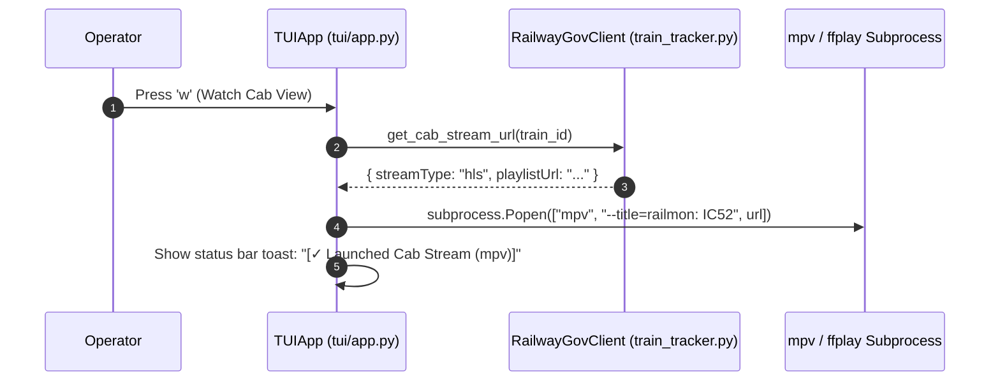

#### ASCII Architecture Diagram
```text
+---------------------+      Key 'w' / 'W'     +---------------------+
|       TUIApp        | ---------------------> |  Background Worker  |
|  (Curses Main Loop) |                        | (Daemon Thread)     |
+---------------------+                        +---------------------+
           ^                                              |
           | Toast: "[✓ Launched Cab Stream (mpv)]"       | 1. get_cab_stream_url()
           |                                              v
+---------------------+                        +---------------------+
|  Status Bar Toast   | <--------------------- |  RailwayGovClient   |
+---------------------+                        +---------------------+
                                                          | 2. detect_video_player()
                                                          v
                                               +---------------------+
                                               | Detached Subprocess |
                                               | (mpv / ffplay / vlc)|
                                               +---------------------+
```

#### CLI Syntax & Usage
```bash
# Launch cab video stream for train 1597 in auto-detected player
railmon cab 1597

# Query raw HLS stream URL without launching player
railmon cab 1597 --url-only

# Emit machine-readable stream metadata JSON
railmon cab 1597 --json
```

---

### F-7.2: Infrastructure GIS Layers: Tunnels, Bridges & Signals (`g` / `G`) — *Implemented*

> **Detailed Implementation Plan:** [`../plans/features/f-7-2-infrastructure-gis-layers-tunnels-bridges-signals-plan.md`](../plans/features/f-7-2-infrastructure-gis-layers-tunnels-bridges-signals-plan.md)

#### Overview
Ingests infrastructure GeoJSON features from `/api/msd/geo?types=tunnel,bridge,signal` and overlays them onto the Braille canvas:
- **Tunnels:** Rendered as shaded portal markers (`∩` / `[ ]`) showing mountain crossings (Callidromon, Platamonas, Tempi). When a train's coordinates fall inside a tunnel bounding polyline, an indicator `[TUNNEL]` appears in the inspector.
- **Bridges / Viaducts:** Highlighted bridge markers (`═` / `∏`).
- **Key Interlocking Signals:** Rendered at corridor junctions.
- **Keybinding:** `g` / `G` cycles infrastructure overlay (`All` → `Tunnels & Bridges` → `Off`).

---

### F-7.3: Custom Terminal Color Theme Profiles (`F10` / `K`) — *Implemented*

#### Overview
Adds switchable 16-color and 256-color palette presets in [`tui/renderer.py`](../../tui/renderer.py) to accommodate different terminal emulator backgrounds:
1. **Hellenic Azure (Default):** Deep blue branding, bright cyan tracks, golden train glyphs.
2. **Retro Amber CRT Phosphor:** Warm monochrome amber on black styling.
3. **Matrix Green:** High-contrast phosphor green for night monitoring.
4. **Solarized Dark:** Standard low-fatigue palette for terminal developers.
5. **High-Contrast Monochrome:** Pure black-and-white for minimal/e-ink consoles.

See the detailed implementation plan in [`../plans/features/f-7-3-custom-terminal-color-theme-profiles-plan.md`](../plans/features/f-7-3-custom-terminal-color-theme-profiles-plan.md).

---

### F-7.4: Dual Split-Screen Multi-Train Follow Viewport (`D`) — *Planned*

#### Overview
Enables split-screen viewport rendering where two opposing or interacting trains (e.g., `IC52` northbound and `IC53` southbound) are centered in dual sub-viewports simultaneously, tracking their convergence and crossing maneuvers in real time.

---

## 10. Tier 8: Integrations, Web Services & Observability

Expands `railmon` into multi-user operations, third-party transit apps, and enterprise observability stacks.

---

### F-8.1: Embedded Zero-Dependency Web Map Daemon (`railmon serve`) — *Implemented*

> **Detailed Implementation Plan:** [`../plans/features/f-8-1-embedded-zero-dependency-web-map-daemon-plan.md`](../plans/features/f-8-1-embedded-zero-dependency-web-map-daemon-plan.md)

#### Overview
A lightweight multi-threaded headless HTTP service in [`server/`](../../server) ([`server/daemon.py`](../../server/daemon.py), [`server/handler.py`](../../server/handler.py), [`server/sse.py`](../../server/sse.py), [`server/assets.py`](../../server/assets.py), [`server/models.py`](../../server/models.py)) utilizing Python's built-in `http.server` and socket library to serve a responsive browser GIS dashboard on `http://localhost:8080`.
- Serves an embedded Leaflet single-page web app with CartoDB / OpenStreetMap tiles, corridor tracks, station nodes, infrastructure layers, speed limits, and conflict alert banners.
- Pushes live train positions, trails, and safety conflict alerts via Server-Sent Events (`/api/stream`), exposes JSON REST endpoints (`/api/trains`, `/api/conflicts`, `/api/health`, `/api/history/train/{id}`), and cross-exposes `/metrics` (F-8.2) and `/gtfs-rt/*` (F-8.3).
- Requires zero third-party runtime dependencies (`pip install` not required).

---

### F-8.2: Prometheus & OpenMetrics Operational Exporter (`railmon metrics`) — *Implemented*

> **Detailed Master Implementation Plan:** [`../plans/features/f-8-2-prometheus-openmetrics-operational-exporter-plan.md`](../plans/features/f-8-2-prometheus-openmetrics-operational-exporter-plan.md)  
> **Phase 1 Plan (Primitives & Serialization):** [`../plans/features/f-8-2-phase-1-metric-primitives-and-serialization-engine-plan.md`](../plans/features/f-8-2-phase-1-metric-primitives-and-serialization-engine-plan.md)  
> **Phase 2 Plan (Domain Collectors & Registry):** [`../plans/features/f-8-2-phase-2-domain-telemetry-collectors-and-registry-plan.md`](../plans/features/f-8-2-phase-2-domain-telemetry-collectors-and-registry-plan.md)  
> **Phase 3 Plan (HTTP Server Daemon & Negotiation):** [`../plans/features/f-8-2-phase-3-http-server-daemon-and-content-negotiation-plan.md`](../plans/features/f-8-2-phase-3-http-server-daemon-and-content-negotiation-plan.md)  
> **Phase 4 Plan (CLI & Web Daemon Cross-Exposing):** [`../plans/features/f-8-2-phase-4-cli-subcommand-integration-and-web-daemon-cross-exposing-plan.md`](../plans/features/f-8-2-phase-4-cli-subcommand-integration-and-web-daemon-cross-exposing-plan.md)  
> **Phase 5 Plan (Verification & Quality Gate):** [`../plans/features/f-8-2-phase-5-verification-ci-quality-gate-and-documentation-plan.md`](../plans/features/f-8-2-phase-5-verification-ci-quality-gate-and-documentation-plan.md)

#### Overview
A lightweight, multi-threaded operational telemetry exporter exposing live Hellenic Railways operational status, safety conflicts, and storage metrics to industry-standard monitoring systems (Prometheus, VictoriaMetrics, OpenTelemetry Collector, Grafana). Built with **100% Python standard library purity** without requiring third-party libraries (`pip install prometheus_client` not required).

#### Key Capabilities
- **Content Negotiation:** Transparently negotiates between **Prometheus Text Format 0.0.4** (`text/plain; version=0.0.4`) and **OpenMetrics Standard 1.0.0** (`application/openmetrics-text; version=1.0.0`) with mandatory `# EOF\n` termination and `_total` counter enforcement based on incoming client `Accept` headers.
- **Dual-Mode Serving:**
  1. Stand-alone daemon via `railmon metrics` (default port `9100`).
  2. Cross-exposed endpoint `/metrics` on the web GIS map daemon (`railmon serve` on port `8080`).
- **Safety & Cardinality Protection:** Dynamic timeseries scoping reaps completed trains upon journey end, preventing memory leaks in Prometheus TSDBs. Snapshot acquisition holds `TrainStateStore` RLock for $< 1.0\text{ ms}$.

#### CLI Syntax & Usage
```bash
# Launch Prometheus exporter daemon in simulation demo mode
railmon metrics --demo

# Launch operational exporter on custom port and host interface
railmon metrics --host 0.0.0.0 --port 9100

# Expose metrics with historical SQLite WAL storage metrics
railmon metrics --db railway_history.db

# Aliases
railmon exporter --demo
railmon prometheus --port 9100
```

#### Metrics Dictionary Reference

| Metric Identifier | Metric Type | Unit | Description & Dimensions |
| :--- | :---: | :---: | :--- |
| `railmon_active_trains` | Gauge | `trains` | Total number of currently active trains operating on the network. Dimensions: `corridor`. |
| `railmon_train_delay_minutes` | Gauge | `minutes` | Current schedule delay in minutes for an individual train. Dimensions: `train_number`, `type`, `corridor`. |
| `railmon_train_speed_kmh` | Gauge | `km/h` | Instantaneous GPS speed for an individual train. Dimensions: `train_number`, `type`, `corridor`. |
| `railmon_train_max_speed_kmh` | Gauge | `km/h` | Peak speed observed along the active journey. Dimensions: `train_number`, `corridor`. |
| `railmon_trains_delayed_total` | Gauge | `trains` | Count of active trains grouped by delay severity tier (`on_time`, `minor`, `moderate`, `severe`). Dimensions: `corridor`, `severity`. |
| `railmon_corridor_punctuality_ratio` | Gauge | `ratio` | Ratio ($0.0 - 1.0$) of on-time trains ($\le 5\text{ min}$ delay) per corridor. Dimensions: `corridor`. |
| `railmon_corridor_average_delay_minutes` | Gauge | `minutes` | Mean delay in minutes across all active trains per corridor. Dimensions: `corridor`. |
| `railmon_watchdog_conflicts_active` | Gauge | `alerts` | Number of active safety watchdog conflict alerts. Dimensions: `corridor`, `severity`. |
| `railmon_watchdog_conflicts_total` | Counter | `alerts` | Cumulative count of unique safety conflicts detected. Dimensions: `corridor`, `severity`. |
| `railmon_sensor_freezes_active` | Gauge | `trains` | Count of locomotives with frozen GPS coordinates ($> 45\text{s}$). Dimensions: `corridor`. |
| `railmon_telemetry_drops_active` | Gauge | `trains` | Count of locomotives with dropped telemetry packets ($> 120\text{s}$). Dimensions: `corridor`. |
| `railmon_speed_exceedances_active` | Gauge | `trains` | Count of trains currently exceeding line speed limits. Dimensions: `corridor`. |
| `railmon_stream_connected` | Gauge | `boolean` | Connection status to upstream SSE stream ($1 = \text{connected}, 0 = \text{disconnected}$). |
| `railmon_stream_messages_total` | Counter | `messages` | Total number of SSE telemetry frames ingested. |
| `railmon_stream_reconnects_total` | Counter | `events` | Total number of SSE stream reconnection events. |
| `railmon_stream_latency_seconds` | Gauge | `seconds` | Telemetry age (seconds elapsed since last upstream packet). |
| `railmon_db_records_total` | Counter | `rows` | Cumulative telemetry observations stored in the SQLite WAL database. |
| `railmon_db_file_size_bytes` | Gauge | `bytes` | Current disk file size for main database and WAL. Dimensions: `file_type`. |
| `railmon_db_write_queue_depth` | Gauge | `rows` | Telemetry rows currently queued in-memory awaiting disk commit. |
| `railmon_db_deadband_suppressed_total` | Counter | `rows` | Telemetry updates suppressed by deadband filter. |
| `railmon_exporter_build_info` | Info | — | Exporter build metadata. Dimensions: `version`, `python_version`. |
| `railmon_exporter_uptime_seconds` | Gauge | `seconds` | Exporter process uptime in seconds. |
| `railmon_exporter_scrapes_total` | Counter | `scrapes` | Cumulative scrape requests handled. Dimensions: `endpoint`, `status`. |
| `railmon_exporter_scrape_duration_seconds`| Gauge | `seconds` | Execution duration of the most recent scrape cycle. |

#### Prometheus Scrape Configuration (`prometheus.yml`)
```yaml
scrape_configs:
  - job_name: "railmon"
    scrape_interval: 15s
    scrape_timeout: 10s
    static_configs:
      - targets: ["127.0.0.1:9100"]
```

#### Sample PromQL Alerting Rules
```yaml
groups:
  - name: railmon_safety_alerts
    rules:
      - alert: CriticalTrainCollisionRisk
        expr: railmon_watchdog_conflicts_active{severity="critical"} > 0
        for: 0m
        labels:
          severity: page
        annotations:
          summary: "Critical opposing train collision risk detected on Greek rail network"
          description: "Watchdog detected opposing vectors or headway collapse in corridor {{ $labels.corridor }}."

      - alert: SevereFleetDelaySpike
        expr: railmon_corridor_punctuality_ratio{corridor="PATHE"} < 0.50
        for: 5m
        labels:
          severity: warning
        annotations:
          summary: "PATHE Mainline punctuality dropped below 50%"
          description: "Over half of trains on PATHE are delayed by > 5 minutes."

      - alert: UpstreamTelemetryStreamDisconnected
        expr: railmon_stream_connected == 0
        for: 1m
        labels:
          severity: warning
        annotations:
          summary: "Lost SSE connection to railway.gov.gr"
          description: "railmon exporter has been disconnected from upstream telemetry for > 1 minute."
```

---

### F-8.3: GTFS-Realtime (GTFS-RT) Protocol Buffer Feed Exporter — *Implemented*

> **Detailed Implementation Plan:** [`../plans/features/f-8-3-gtfs-realtime-protocol-buffer-feed-exporter-plan.md`](../plans/features/f-8-3-gtfs-realtime-protocol-buffer-feed-exporter-plan.md)

#### Overview
Translates live `railway.gov.gr` SSE train positions, offline `--demo` simulations, and historical SQLite WAL telemetry snapshots into the standard **General Transit Feed Specification Realtime (GTFS-RT v2.0)** Protocol Buffers binary wire format (`FeedMessage` with `VehiclePositions`, `TripUpdates`, and bilingual `el`/`en` `Service Alerts`) plus canonical ProtoJSON. Built with **100% Python standard library purity** (zero external `protobuf` or `gtfs-realtime-bindings` runtime dependencies).

#### Key Capabilities
- **Native Proto2 Wire Codec ([`gtfs_rt/wire.py`](../../gtfs_rt/wire.py)):** Zero-dependency iterative varint (including 10-byte two's-complement negative `int32` early-train delays), IEEE-754 `<f`/`<d`, and length-delimited encoder/decoder with `math.isfinite()` bounds checks.
- **Hellenic Railways Domain Translation ([`gtfs_rt/mapper.py`](../../gtfs_rt/mapper.py)):** Automatic unit conversions (`km/h -> m/s`, `min -> sec`), `Europe/Athens` local service dates, coupled EMU consist deduplication (`vp:<id>` vs `tu:<trip_id>`), station proximity `VehicleStopStatus` inference, opt-in bounded TTL schedule enrichment (`--enrich-schedules`), and bilingual (`el`/`en`) delay & watchdog conflict alerts.
- **Multi-Mode Export & Serving:** One-shot atomic `.pb`/`.json` snapshots (`--out`, `--out-dir`), historical SQLite point-in-time reconstruction (`--from-db [--at]`), continuous atomic file sync (`--watch`), zero-dependency `.pb` decoding (`--inspect`), standalone HTTP server (`--serve` on port `8085` with `ETag`/`304`, `gzip`, CORS), and cross-exposed `/gtfs-rt/*` endpoints inside `railmon serve` (port `8080`).

#### CLI Syntax & Usage
```bash
# Export one-shot binary GTFS-RT snapshot from synthetic demo or live feed
railmon export --gtfs-rt --demo --out hellenic_rail.pb

# Decode any .pb feed to ProtoJSON without external protoc tools
railmon export --gtfs-rt --inspect hellenic_rail.pb

# Export historical point-in-time GTFS-RT feed from SQLite WAL recording
railmon export --gtfs-rt --from-db railway_history.db --at 2026-11-23T18:00:00Z --out hist.pb

# Launch standalone GTFS-RT v2.0 HTTP feed server (default port 8085)
railmon export --gtfs-rt --serve --demo --port 8085
railmon gtfs-rt --serve --port 8085
```

---

## 11. Tier 9: Historical Analytics & Predictive Engine

Leverages the embedded SQLite WAL database for deep operational analytics and machine-learning-assisted delay prediction.

---

### F-9.1: Corridor Bottleneck & Station Dwell Delay Heatmaps (`railmon history bottlenecks`) — *Implemented*

> **Detailed Master Implementation Plan:** [`../plans/features/f-9-1-corridor-bottleneck-and-station-dwell-delay-heatmaps-plan.md`](../plans/features/f-9-1-corridor-bottleneck-and-station-dwell-delay-heatmaps-plan.md)

#### Overview
Analyzes recorded telemetry to compute cumulative delay deltas per track block and station dwell. Outputs terminal ASCII heatmaps identifying infrastructure bottlenecks:
```text
================================================================================
CORRIDOR BOTTLENECK ANALYSIS: ATHENS - THESSALONIKI (Last 30 Days)
================================================================================
SEGMENT / STATION         AVG DWELL   MEDIAN DELAY   MAX DELAY   BOTTLENECK INDEX
--------------------------------------------------------------------------------
Larissa Station           4m 12s      +7.4m          +42m        ██████████ (HIGH)
Lianokladi Station        3m 45s      +4.1m          +28m        ██████ (MED)
Domokos Pass              0m 00s      +3.8m          +35m        █████ (MED)
Oinoi Junction            2m 10s      +1.2m          +14m        ██ (LOW)
Platy Junction            1m 50s      +0.8m          +11m        █ (LOW)
================================================================================
```

---

### F-9.2: Empirical Segment Transit Time & ETA Engine — *Implemented*

> **Detailed Implementation Plan:** [`../plans/features/f-9-2-empirical-segment-transit-time-and-eta-engine-plan.md`](../plans/features/f-9-2-empirical-segment-transit-time-and-eta-engine-plan.md)

#### Overview
Replaces raw Euclidean/Haversine velocity-based ETA calculations with empirical segment transit durations compiled from historical runs. If a train is halted at Lianokladi with a red signal, the engine does not report `ETA: 0 min` or infinite time, but instead applies the historical 90th-percentile transit time across the Lianokladi–Domokos mountain section (`Domokos (14.2 km, ~18m [p90])`). Includes CLI empirical segment matrix analyzer (`railmon history segments`).

---

## 12. Tier 10: Upstream `railway.gov.gr` Telemetry & GIS Parity

Unlocks live, unauthenticated upstream telemetry streams, sensor quality indicators, GIS layers, station media, and schema fixes documented in [`./railway-gov-gr-api-reference.md`](./railway-gov-gr-api-reference.md) that are not yet consumed by [`train_tracker.py`](../../train_tracker.py).

### 12.1 Upstream Multiplexed Data & GIS Pipeline (Mermaid + ASCII)

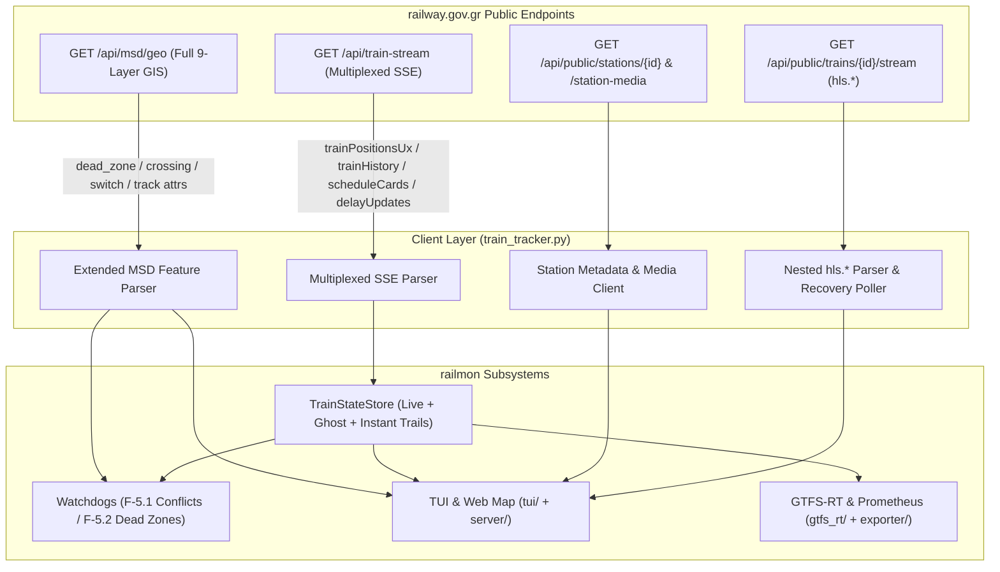

```text
+---------------------------------------------------------------------------------+
|                   Upstream railway.gov.gr Multiplexed Ingestion                 |
+---------------------------------------------------------------------------------+
   /api/train-stream                                      /api/msd/geo
     |-- event: trainPositionsUx  (43 fields + ux.*)        |-- dead_zone (225)
     |-- event: trainHistory      (~20-pt instant trails)   |-- crossing  (1000+)
     |-- event: scheduleCards     (ghost scheduled runs)    |-- switch    (1000+)
     +-- event: delayUpdates      (incremental deltas)      +-- track     (electrified/OOS)
                   |                                                   |
                   v                                                   v
   +-----------------------------------+             +-----------------------------------+
   |   TrainStateStore (tui/state.py)  | <---------> |  GIS & Watchdog Layer (tui/geo)   |
   |  - Instant breadcrumb hydration   |             |  - RF dead-zone alert suppression |
   |  - Ghost run tracking (no GPS)    |             |  - OSM railwayId edge matching    |
   |  - Live delay delta patching      |             |  - RTK (fxk) & dead-reckon flags  |
   +-----------------------------------+             +-----------------------------------+
```

---

### F-10.1: Multiplexed SSE Ingestion (`trainHistory`, `scheduleCards` Ghosts & `delayUpdates`) — *Implemented*

> **Detailed Implementation Plan:** [`../plans/features/f-10-1-multiplexed-sse-ingestion-plan.md`](../plans/features/f-10-1-multiplexed-sse-ingestion-plan.md)

#### Overview
Currently [`RailwayGovClient.stream_train_positions()`](../../train_tracker.py) filters strictly for `event: trainPositionsUx`, discarding three additional live SSE event channels documented in [`./railway-gov-gr-api-reference.md`](./railway-gov-gr-api-reference.md#72-multiplexed-sse-event-catalog):
1. **`trainHistory` Instant Breadcrumb Hydration:** On initial connect, upstream delivers ~20 trailing 1 Hz points per active train. Ingesting this immediately hydrates `TrainRecord.trail` breadcrumbs and F-2.1 speed sparklines at startup instead of waiting for live ticks to accumulate.
2. **`scheduleCards` ("Ghost" Runs Without GPS):** Surfaces active `in_progress` scheduled trains that lack a live transponder signal (`ghost: true`, `gpsStatus: "none"`, time-estimated `progress`) with a dedicated `[GHOST]` indicator in the TUI roster (toggleable via `u` / `U`), Station Departure Boards, and GTFS-RT `TripUpdates` ([`gtfs_rt/mapper.py`](../../gtfs_rt/mapper.py)).
3. **`delayUpdates` Incremental Patching:** Applies event-driven delay deltas (`{"delays": [{"trainNumber": ..., "delay": ...}]}`) in-place between position batches for sub-second schedule accuracy.

---

### F-10.2: Extended Telemetry Signal & Track-Snap Fields (`inDeadZone`, `fxk`, `approximate`, `railwayId`) — *Planned*

#### Overview
Extend [`TrainPosition`](../../train_tracker.py) to parse additional live `trainPositionsUx` fields already transmitted on every SSE frame:
- **`ux.signal.inDeadZone` & `ux.signal.zoneType`:** Explicit upstream RF/GNSS tunnel dead-zone classification.
- **`approximate` (`bool`) & `fxk` (`bool`):** Distinguishes dead-reckoned/interpolated positions from locked HEPOS/RTK GNSS fixes.
- **`railwayId` (`str`) & `alongTrackDistance` (`float`):** Exact snapped OpenStreetMap track edge ID and linear offset, enabling high-precision track-edge conflict validation in F-5.1.
- **`distanceToNextStation_m` (`int`) & `nextStationId` (`str`):** Uses authoritative upstream along-track distance (falling back to Haversine when `null`) and direct station ObjectId resolution.

#### Operational Integration
- **Safety Watchdogs (F-5.1 & F-5.2):** Suppress false `[DROPPED]` / `[FROZEN]` alarms when `inDeadZone == True` or `approximate == True`, and display `[DEAD ZONE]` / `[RTK]` status badges in [`tui/renderer.py`](../../tui/renderer.py).
- **Observability (F-8.2):** Expose `railmon_trains_in_dead_zone` and `railmon_trains_rtk_fixed` gauges in [`exporter/collector.py`](../../exporter/collector.py).

---

### F-10.3: Full MSD GIS Layers (`dead_zone` Polygons, Level Crossings, Switches & Track Attributes) — *Planned*

#### Overview
Expand [`RailwayGovClient.get_rail_infrastructure()`](../../train_tracker.py) and [`tui/geo.py`](../../tui/geo.py) beyond tunnels, bridges, and signals to ingest the full `/api/msd/geo` entity catalog (passing `limit=10000` per entity type to prevent silent truncation):
- **RF/GNSS `dead_zone` Polygons (`225` features):** Point-in-polygon detection feeding directly into F-5.2 telemetry-drop resilience and map visualization.
- **Level `crossing`s (`hasBarrier`):** Renders gated vs. ungated level crossings (`×` / `X`) on high-zoom TUI and Leaflet views.
- **Turnout `switch`es (`isElectric`):** Highlights electric interlocking turnouts vs. manual points at major junctions.
- **Enriched `track` Attributes (`electrified`, `isOOS`, `railway_type`):** Differentiates electrified 25 kV AC corridors, diesel branches, narrow-gauge lines (e.g., Odontotos rack railway), and out-of-service (`isOOS: true`) track sections.

---

### F-10.4: Station Directory, Amenities & Media Proxy (`railmon station <name>`) — *Planned*

#### Overview
Expose full station facility metadata from `/api/public/stations/{stationId}` and wrap `/api/public/station-media?pathname=...` (with strict pathname validation against path traversal) in [`train_tracker.py`](../../train_tracker.py):
- **CLI Subcommand (`railmon station <query>`):** Displays bilingual station names (`el`/`en`), railway type (`station`/`halt`/`stop`), operational status, operator, street address, opening hours, contact details, accessibility & facility badges (`wheelchair`, `toilets`, `parking`), sanitized plain-text description, and downloadable photo URLs (`--download-photo`, `--json`).
- **TUI Integration (`o` / `O`):** Displays station amenities and facility summary inside the Station Inspector pane ([`tui/renderer.py`](../../tui/renderer.py)).
- **Web Map Integration (`railmon serve`):** Proxies station details and cover photos via `/api/station/{id}` and `/api/station-media` for rich station popups in [`server/assets.py`](../../server/assets.py).

---

### F-10.5: Live Cab Stream Schema Alignment (`hls.*`) & Tunnel Reconnect Recovery — *Planned*

#### Overview
Aligns [`CabStreamInfo.from_dict()`](../../train_tracker.py) with the live upstream `/api/public/trains/{trainId}/stream` schema verified in [`./railway-gov-gr-api-reference.md`](./railway-gov-gr-api-reference.md#58-get-apipublictrainstrainidstream):
- **Nested `hls.*` Parsing:** Inspect `payload.get("hls", {})` for `playlistUrl`, `isLive`, and `streamingStatus` (while preserving backward compatibility with flat mock payloads).
- **Liveness Predicate & Cache Busting:** Treat streams as playable when `playlistUrl` is present and `(isLive is True or streamingStatus.lower() == "live")`, appending `?_r=<epochMs>` on stall recovery.
- **Tunnel Reconnect Polling:** Optionally poll every `1.5s–2.0s` (`--auto-reconnect`) when a locomotive temporarily loses cellular/Starlink uplink inside mountain tunnels.

---

## 13. Tier 11: Advanced TUI Dispatch, Profiles & Configuration

Brings classic railway operations diagrams and persistent user customization to the terminal interface while maintaining 100% Python standard-library purity.

---

### F-11.1: Interactive Time-Distance (Marey / Stringline) Diagram (`y` / `Y` / `railmon history stringline`) — *Planned*

#### Overview
Plots a classic railway dispatcher **Time-Distance (Marey / Stringline) Diagram** directly on the Braille canvas (or ASCII fallback), mapping corridor stations and kilometer chainage along the vertical axis against wall-clock time along the horizontal axis. Operators immediately see scheduled vs. actual trajectories, single-track crossings, express overtakes, and suburban headway bunching.

#### Visual Mockup (ASCII)
```text
+------------------------------------------------------------------------------+
| [ TIME-DISTANCE STRINGLINE: PATHE (ATHENS <-> THESSALONIKI) | 12:00 - 16:00 ]|
+------------------------------------------------------------------------------+
| km 502 Thessaloniki |                    / IC52                   \ IC55     |
| km 465 Platy        |                  /                           \         |
| km 432 Katerini     |                /                              \        |
| km 350 Larissa      |             / (X Crossing 13:42)               \       |
| km 270 Domokos      |           /   \ IC53                            \      |
| km 220 Lianokladi   |         /       \                                \     |
| km  61 Oinoi        |       /           \   / 1597                      \    |
| km   0 Athens       |_____/_______________\/_____________________________\___|
|                     12:00      13:00      14:00      15:00      16:00        |
+------------------------------------------------------------------------------+
| [y / Esc] Close   [0-3] Corridor   [+/-] Time Span   [h/l] Pan Time          |
+------------------------------------------------------------------------------+
```

#### Technical Design
- **In-TUI Modal (`y` / `Y`):** Renders live session trails + SQLite history (when `--record` or `--replay` is active) overlaid against dashed scheduled timetable lines.
- **CLI Subcommand (`railmon history stringline --corridor PATHE --from ... --to ...`):** Generates terminal Braille/ASCII or standalone SVG stringline diagrams from recorded SQLite runs.

---

### F-11.2: Corridor Elevation & Speed-vs-Chainage Profile (`z` / `Z` / `railmon history profile`) — *Planned*

#### Overview
Leverages the `altitude` (meters above sea level) and `chainage_m` fields already captured in [`TrainPosition`](../../train_tracker.py) and `telemetry_history` ([`storage/schema.py`](../../storage/schema.py)) to render a dual-track longitudinal profile:
1. **Top Band:** Instantaneous train speed curve overlaid against corridor posted speed limits and active Temporary Speed Restrictions from [`tui/data/speed_limits.json`](../../tui/data/speed_limits.json).
2. **Bottom Band:** Shaded terrain elevation profile highlighting steep mountain grades (Bralos, Kallidromo, Mount Othrys, Domokos Pass) and tunnel portals.

#### Visual Mockup (ASCII)
```text
+------------------------------------------------------------------------------+
| [ SPEED & ELEVATION PROFILE: TRAIN IC52 (PATHE) | km 180 -> km 360 ]         |
+------------------------------------------------------------------------------+
| 160 km/h |-------- limit ---------____----------- limit -------------------- |
| 120 km/h |   ▄▄▄▄▄▄              /    \  ▄▄▄▄▄▄▄▄▄▄▄                         |
|  80 km/h |  /      \___▄▄▄▄▄▄___/      \/           \                        |
|   0 km/h +------------------------------------------------------------------ |
| 600 m    |               ▲ Domokos Pass (580m)                               |
| 300 m    |         ▄▄▄▄███▄▄▄▄                                               |
|   0 m    |▄▄▄▄▄▄▄███████████████▄▄▄▄▄▄▄▄▄▄▄▄▄▄▄▄▄▄▄▄▄▄▄▄▄▄▄▄▄▄▄▄▄▄▄▄▄▄▄▄▄▄▄▄ |
|          km 180   Lianokladi     [TUNNEL] Domokos          Larissa   km 360  |
+------------------------------------------------------------------------------+
| [z / Esc] Close   [Tab] Switch Train   [e] Export CSV Profile                |
+------------------------------------------------------------------------------+
```

---

### F-11.3: Persistent User Configuration (`~/.config/railmon/config.toml`) — *Planned*

#### Overview
Adds zero-dependency persistent configuration using Python 3.11+ standard-library `tomllib` (with an INI fallback for Python 3.10) resolved in strict precedence order: **CLI flags > environment variables (`RAILMON_*`) > `--config <path>` > user config file > built-in defaults**.

#### Supported Configuration Keys
- **`[tui]`:** Default `theme`, `corridor_preset`, `breadcrumb_mode`, `station_label_mode`, `track_color_mode`, `ascii_mode`, and `favorite_trains` / `favorite_stations`.
- **`[storage]`:** Default `db_path`, `deadband_enabled`, `deadband_meters`, `retention_days`, and `archive_dir`.
- **`[safety]`:** Custom Temporary Speed Restriction (TSR / slow-order) overrides and conflict audio-bell preferences.
- **`[alerts]`:** Default webhook endpoints (resolved safely from environment variable references, never hardcoded secrets) and commuter watch presets.

---

## 14. Tier 12: Web Map Daemon (`railmon serve`) Parity & Interactive Upgrades

Brings the browser GIS dashboard ([`server/`](../../server)) to full feature parity with the CLI, TUI, and SQLite analytical engine while preserving zero external dependencies.

### 14.1 Expanded Web Map Architecture (Mermaid + ASCII)

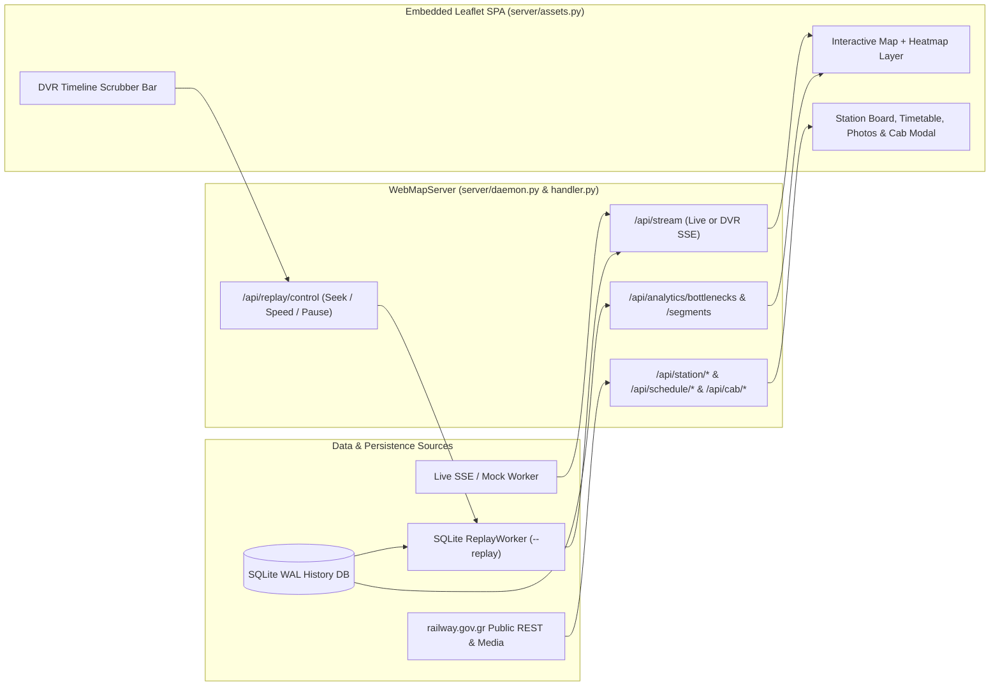

```text
+---------------------------------------------------------------------------------+
|                      Upgraded railmon serve Architecture                        |
+---------------------------------------------------------------------------------+
  Browser Leaflet SPA (server/assets.py)
    |-- [DVR Scrubber]  --- POST/GET /api/replay/* ---> ReplayWorker -> SQLite WAL
    |-- [Station Click] --- GET /api/station/{id}/* --> Cached Proxy -> railway.gov.gr
    |-- [Train Click]   --- GET /api/schedule/{id}  --> Cached Proxy -> railway.gov.gr
    |-- [Cab Stream]    --- GET /api/cab/{id}       --> HLS Resolver -> Cloudflare HLS
    +-- [Heatmap Layer] --- GET /api/analytics/*    --> HistoricalRepository (F-9.1/9.2)
```

---

### F-12.1: Web DVR Historical Playback & Timeline Scrubber (`railmon serve --replay <db>`) — *Planned*

#### Overview
Connects the existing SQLite `ReplayWorker` ([`tui/stream_worker.py`](../../tui/stream_worker.py)) to [`WebMapServer`](../../server/daemon.py), allowing operators to replay recorded historical traffic directly in a web browser:
- **Timeline Controls:** Play/Pause toggle, interactive timeline scrub slider, $\pm 5\text{ min}$ skip buttons, and playback speed selector (`1x`, `5x`, `15x`, `60x`).
- **Telemetry Sync:** Streams virtual-clock timestamps and historical trail segments over `/api/stream` so map markers, HUD roster, and speed readouts update identically to live mode.

---

### F-12.2: Inline Web Station Boards, Timetable Drawer, Station Photos & Cab Video Modal — *Planned*

#### Overview
Replaces the external departure redirect ([`server/assets.py`](../../server/assets.py#L941)) and unwired `/cab?train=...` link ([`server/assets.py`](../../server/assets.py#L1216)) with native in-dashboard panels backed by TTL-cached read-only proxy endpoints in [`server/handler.py`](../../server/handler.py):
- **Station Drawer (`/api/station/{id}`, `/api/station/{id}/board`, `/api/station-media`):** Clicking any station node opens live arrivals/departures, accessibility/amenity badges, and station cover photography without leaving the SPA.
- **Train Timetable Drawer (`/api/schedule/{id}`):** Clicking any train opens its complete calling-point itinerary with scheduled vs. actual times in `Europe/Athens` local time and platform numbers.
- **Working Cab Stream Modal (`/api/cab/{id}`):** Resolves live Cloudflare HLS manifests (using F-10.5 `hls.*` parsing) and renders a clean modal with native Safari HLS playback / direct `.m3u8` player launch link and live status indicator.

---

### F-12.3: Web Corridor Bottleneck & Empirical Delay Heatmap Overlay — *Planned*

#### Overview
Exposes F-9.1 ([`railmon history bottlenecks`](../../storage/repository.py)) and F-9.2 ([`railmon history segments`](../../storage/repository.py)) via `/api/analytics/bottlenecks` and `/api/analytics/segments` when `railmon serve --db <path>` is active:
- **Leaflet Heatmap Overlay:** Color-codes track segments and station circles by median delay delta and bottleneck index (`LOW` green -> `MED` amber -> `HIGH` red).
- **Segment Tooltips:** Hovering any track section displays historical `p50` / `p90` transit durations, average dwell times, and sample counts.

---

## 15. Tier 13: Commuter Journey Planning & Fleet Watchdogs

Expands passenger decision support and continuous operational alerting beyond single-train lookups.

### 15.1 Journey Planner & Rule-Based Watchdog Flow (Mermaid + ASCII)

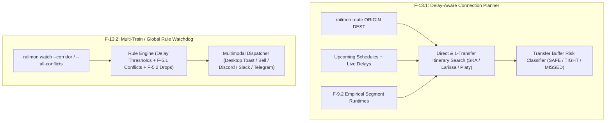

```text
+--------------------------------------+      +--------------------------------------+
|    railmon route Airport Larissa     |      | railmon watch --corridor PATHE       |
+--------------------------------------+      |   --delay-gt 10 --all-conflicts      |
                  |                           +--------------------------------------+
                  v                                              |
  Leg 1: 3203 Airport -> SKA (+2m)                               v
         Transfer @ SKA: 14m -> 12m [OK]       Continuous Fleet Rule Evaluation:
  Leg 2: IC54 SKA -> Larissa (+0m, p90)         - Per-corridor / per-station delay rules
         Est. Arrival: 14:18 EET                - Global F-5.1 conflict forwarding
                                                - Cooldown & deduplication per rule
```

---

### F-13.1: Delay-Aware Point-to-Point Journey & Connection Planner (`railmon route` / `r`) — *Planned*

#### Overview
Combines `/api/public/schedules/upcoming`, live SSE delays, and F-9.2 empirical segment runtimes ([`storage/repository.py`](../../storage/repository.py)) to compute practical passenger itineraries:
- **Direct & 1-Transfer Search:** Discovers both direct trains and realistic single-transfer connections across major interchange hubs (`SKA`, `Athens`, `Oinoi`, `Larissa`, `Platy`, `Thessaloniki`, `Kiato`).
- **Live Transfer Risk Classification:** Adjusts incoming leg arrivals by live delay and empirical `p90` runtime to flag connections as `SAFE` ($\ge 10\text{ min}$ buffer), `TIGHT` ($3\text{--}9\text{ min}$), or `AT RISK / MISSED` ($< 3\text{ min}$).
- **CLI & TUI Access:** `railmon route "Athens Airport" Larissa [--at HH:MM] [--json]` and interactive `r` / `R` prompt modal in the TUI.

---

### F-13.2: Fleet, Corridor & Global Conflict Rule-Based Watchdog (`railmon watch --corridor` / `--all-conflicts`) — *Planned*

#### Overview
Generalizes [`watchdog.py`](../../watchdog.py) from tracking a single train number to declarative multi-train, corridor, station, and fleet-wide operational watch rules:
- **Commuter Rules:** e.g., `railmon watch --station Koropi --dest Athens --window 07:00-09:30 --delay-gt 10` notifies commuters whenever any morning train serving their commute exceeds a delay threshold.
- **Safety Operations Rules:** e.g., `railmon watch --all-conflicts --corridor PATHE --webhook <url>` continuously forwards F-5.1 opposing/headway conflicts and F-5.2 telemetry drops to Discord, Slack, Telegram, or generic JSON webhooks with per-incident cooldown deduplication.

---

## 16. Tier 14: Historical Forensics, Fleet Analytics & Ecosystem Interoperability

Extends SQLite long-term analytics, transit data standard interoperability, observability packaging, and CLI developer ergonomics.

### 16.1 SQLite Schema v2 (`incidents`) & Paired GTFS Ecosystem (Mermaid + ASCII)

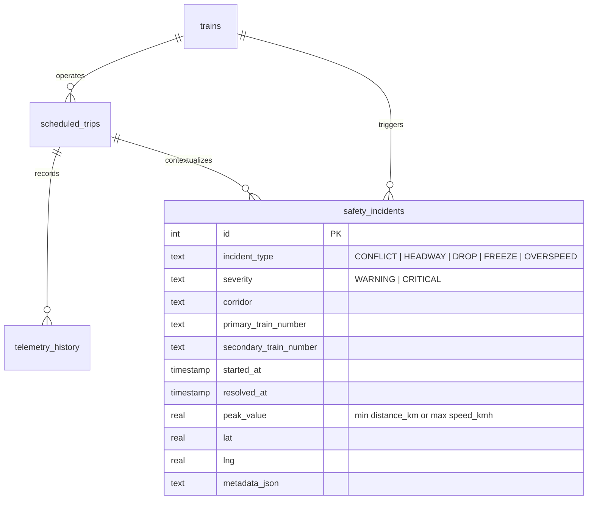

```text
+---------------------------------------------------------------------------------+
|                   Paired Static GTFS + GTFS-RT v2.0 Pipeline                    |
+---------------------------------------------------------------------------------+
  /api/msd/geo (stations, tracks) + /api/public/schedules/upcoming
                                |
                                v
      [ F-14.4: railmon export --gtfs-static --out hellenic_rail_gtfs.zip ]
        |-- agency.txt, stops.txt, routes.txt, calendar.txt
        |-- trips.txt, stop_times.txt, shapes.txt
        |       (Shared deterministic trip_id / stop_id keys)
        +---------------------------+-------------------------------+
                                    |                               |
                                    v                               v
            [ F-8.3: GTFS-RT v2.0 (.pb / HTTP :8085) ]     OpenTripPlanner /
              VehiclePositions + TripUpdates + Alerts      Transitland / Home Asst.
```

---

### F-14.1: Persistent Safety Incident & Anomaly Audit Log (SQLite Schema v2) (`railmon history incidents`) — *Planned*

#### Overview
Currently F-5.1 conflicts, F-5.2 telemetry drops/sensor freezes, and F-5.3 overspeed alerts exist only in ephemeral in-memory state. Introducing an idempotent **Schema v2** migration (`PRAGMA user_version = 2`) in [`storage/schema.py`](../../storage/schema.py) adds a `safety_incidents` table written asynchronously by [`TelemetryRecorder`](../../storage/recorder.py):
- **Incident Lifecycle Recording:** Opens a row on alert onset (`started_at`), updates peak severity/values (closest approach distance, peak exceedance speed), and stamps `resolved_at` upon clearance.
- **Forensic CLI Queries (`railmon history incidents`):** Filter by `--type conflict|freeze|drop|overspeed`, `--corridor`, `--severity`, `--train`, or date window to identify chronic RF blackspots, recurring single-track conflict zones, and habitual overspeed segments.

---

### F-14.2: Locomotive Fleet Utilization & Coupled Consist (*Διπλή Έλξη*) Analytics (`railmon history fleet`) — *Planned*

#### Overview
Aggregates historical SQLite telemetry grouped by physical `locomotive_number` rather than commercial `train_number`:
- **Utilization Metrics:** Total kilometers traveled (integrated from geodesic breadcrumb spans), active motion hours vs. dwell/idle hours, average/peak operating speeds, and assigned routes per traction unit (e.g., HellasSprinter `120-xxx`, Siemens Desiro `460-xxx`, Adtranz `220-xxx`).
- **Coupled Consist Detection:** Automatically detects paired locomotives operating simultaneously under the same commercial `train_number` (*Διπλή Έλξη*) and reports consist pairing frequency.

---

### F-14.3: Automated Self-Contained Operations Reports (`railmon history report`) — *Planned*

#### Overview
Generates comprehensive daily, weekly, or custom-window operational summaries directly from SQLite WAL history (`--format markdown|html --out report.html`):
- **KPIs & Trends:** Network and per-corridor on-time performance (OTP), delay distributions by day-of-week and hour-of-day, top 10 most delayed services, worst dwell bottlenecks (F-9.1), and safety incident counts (F-14.1).
- **Zero-Dependency Visuals:** Standalone HTML output embeds inline SVG charts and CSS (zero external CDN scripts required) suitable for offline archiving, email attachments, or static hosting.

---

### F-14.4: Companion Static GTFS Feed Generator (`railmon export --gtfs-static`) — *Planned*

#### Overview
Complements the implemented GTFS-RT v2.0 exporter (F-8.3) by synthesizing a standards-compliant **Static GTFS `.zip` archive** (`agency.txt`, `stops.txt`, `routes.txt`, `calendar.txt`, `trips.txt`, `stop_times.txt`, `shapes.txt`) using Python's built-in `zipfile` and `csv` modules:
- **Key Alignment:** Emits deterministic `trip_id`, `route_id`, and `stop_id` identifiers matching [`gtfs_rt/mapper.py`](../../gtfs_rt/mapper.py) so downstream transit platforms (OpenTripPlanner, Transitland, Home Assistant, MobilityData validators) can immediately join static schedules with live GTFS-RT `VehiclePositions` and `TripUpdates`.
- **Dual Serving:** Optionally serves `/gtfs/static.zip` alongside `/gtfs-rt/*` from `railmon export --gtfs-rt --serve` and `railmon serve`.

---

### F-14.5: Additional Telemetry & GIS Exports (GPX, KML & NDJSON Streaming) — *Planned*

#### Overview
Broadens `railmon`'s interoperability with GPS analyzers, 3D earth viewers, and analytical data pipelines using standard-library `xml.etree.ElementTree` and `json`:
- **GPX 1.1 (`--format gpx`) & KML (`--format kml`):** Exports recorded trajectories (`railmon history export <train> --format gpx|kml`) with WGS84 coordinates, `<ele>` altitude profiles, UTC `<time>` stamps, and speed/delay metadata for Google Earth, Garmin/Strava tools, and QGIS.
- **NDJSON Live Streaming (`railmon stream --ndjson`):** Emits one compact JSON object per train update per line to `stdout` for seamless Unix piping into `jq`, DuckDB, ClickHouse, or log aggregators.

---

### F-14.6: Grafana Dashboard & Prometheus Alerting Rules Bundle — *Planned*

#### Overview
Packages ready-to-import observability templates pre-wired to all 24 `railmon_*` metrics exposed by F-8.2 ([`exporter/collector.py`](../../exporter/collector.py)):
- **Grafana Dashboard JSON:** Pre-built panels for live fleet count, corridor punctuality ratios, per-train speed/delay time series, watchdog conflict/freeze/drop counters, SSE ingestion latency, and SQLite WAL size/queue depth.
- **Prometheus Alerting Rules YAML:** Production-ready alert groups for critical opposing conflicts, severe punctuality drops, stale telemetry streams, and SQLite write-queue saturation.
- **CLI Export Helper:** `railmon metrics --export-dashboard grafana.json` and `railmon metrics --export-alerts alerts.yml` emit the bundled assets directly from the CLI.

---

### F-14.7: Zero-Dependency Shell Autocompletion Generator (`railmon completions <shell>`) — *Planned*

#### Overview
Generates native tab-completion scripts for `bash`, `zsh`, `fish`, and PowerShell (`pwsh`) directly from the live `argparse` command tree in [`train_tracker.py`](../../train_tracker.py) and bundled station/corridor catalogs ([`tui/data/stations.json`](../../tui/data/stations.json)):
```bash
# Examples
eval "$(railmon completions bash)"
railmon completions zsh > ~/.zfunc/_railmon
railmon completions pwsh | Out-String | Invoke-Expression
```

---

## 17. Consolidated Controls & CLI Reference

### A. Interactive TUI Keybindings

| Key | Mode | Action | Status |
| :--- | :--- | :--- | :--- |
| `h` / `j` / `k` / `l` or Arrows | Normal | Pan map viewport West / South / North / East | Existing |
| `+` / `-` | Normal | Zoom In / Zoom Out (`0.2x` to `25.0x`) | Existing |
| `0` / `1` / `2` / `3` | Normal | Apply corridor viewport & filter presets | Existing |
| `Tab` / `n` / `p` | Normal | Cycle active train selection forward / backward | Existing |
| `f` / `F` | Normal | Toggle camera auto-follow on selected train | Existing |
| `c` / `C` | Normal | Clear search filter, corridor filter, and selection | Existing |
| `/` | Normal | Open interactive real-time search filter prompt | Existing |
| `Space` | Normal | Pause / resume telemetry stream or replay clock | Existing |
| `?` | Normal | Toggle interactive Keyboard Controls modal | Existing |
| `q` / `Esc` | Normal | Clean exit from `railmon` TUI | Existing |
| **`s` / `S`** | **Normal** | **Cycle roster sorting (`Train ID` → `Speed` → `Delay`)** | **Implemented (Tier 1)** |
| **`b` / `B`** | **Normal** | **Cycle breadcrumb trails (`All` → `Selected` → `Off`)** | **Implemented (Tier 1)** |
| **`v` / `V`** | **Normal** | **Cycle station labels (`All` → `Hubs Only` → `Markers Only`)** | **Implemented (Tier 3)** |
| **`t` / `T`** | **Normal** | **Toggle corridor-colored Braille track rendering** | **Implemented (Tier 3)** |
| **`m` / `M`** | **Normal** | **Cycle Station Departure Board / Return to Train Telemetry** | **Implemented (Tier 3)** |
| **Mouse Click / Wheel** | **Normal** | **Click-to-select train or station, double-click follow/recenter, wheel zoom/scroll** | **Implemented (Tier 3)** |
| **`e` / `E`** | **Normal** | **Export selected train trajectory to GeoJSON (`e`) / CSV (`E`) file** | **Implemented (Tier 4)** |
| **`[` / `]`** | **Replay** | **Scrub historical replay timeline `-5 min` / `+5 min`** | **Implemented (Tier 4)** |
| **`<` / `>`** | **Replay** | **Decrease / Increase historical replay speed (`1x`..`60x`)** | **Implemented (Tier 4)** |
| **`i` / `I`** | **Normal** | **Open Train Timetable & Intermediate Stop Itinerary modal** | **Implemented (Tier 6)** |
| **`a` / `A`** | **Normal** | **Toggle proximity & delay push alerting watchdog for selected train** | **Implemented (Tier 6)** |
| **`w` / `W`** | **Normal** | **Launch forward cab video stream in external media player (`mpv`)** | **Implemented (Tier 7)** |
| **`g` / `G`** | **Normal** | **Cycle infrastructure GIS layer (`All` → `Tunnels/Bridges` → `Off`)** | **Implemented (Tier 7)** |
| **`F10` / `K`** | **Normal** | **Cycle terminal color themes (Azure, Amber, Green, Solarized, Mono)** | **Implemented (Tier 7)** |
| **`D`** | **Normal** | **Toggle dual split-screen multi-train follow view** | **Planned (Tier 7)** |
| **`u` / `U`** | **Normal** | **Toggle untracked scheduled "ghost" runs (`scheduleCards`) visibility** | **Implemented (Tier 10)** |
| **`o` / `O`** | **Normal** | **Inspect station directory, amenities & accessibility metadata** | **Planned (Tier 10)** |
| **`y` / `Y`** | **Normal** | **Open Time-Distance (Marey / Stringline) diagram modal** | **Planned (Tier 11)** |
| **`z` / `Z`** | **Normal** | **Open Corridor Elevation & Speed-vs-Chainage profile modal** | **Planned (Tier 11)** |
| **`r` / `R`** | **Normal** | **Open Delay-Aware Point-to-Point Route & Connection Planner modal** | **Planned (Tier 13)** |

---

### B. Command-Line Interface (CLI) Commands

| Command | Tier | Status | Description |
| :--- | :--- | :--- | :--- |
| `railmon --tui` | Tier 0 | **Implemented** | Launch interactive terminal map dashboard |
| `railmon --tui --record` | Tier 4 | **Implemented** | Launch TUI with concurrent SQLite telemetry recording |
| `railmon --tui --replay <db>` | Tier 4 | **Implemented** | Launch TUI historical DVR replay and timeline scrubber |
| `railmon conflicts` / `sensor-health` / `speed-limits` | Tier 5 | **Implemented** | Audit active track conflicts, sensor drops/freezes, and corridor speed limits |
| `railmon departures <station>` | Tier 6 | **Implemented** | Query upcoming departures and arrivals for a station |
| `railmon schedule <train_num>` | Tier 6 | **Implemented** | Display full timetable stop itinerary for a train |
| `railmon watch <train_num>` | Tier 6 | **Implemented** | Background watcher firing notifications on delay or proximity |
| `railmon cab <train_num>` | Tier 7 | **Implemented** | Launch or inspect live locomotive forward cab HLS video stream |
| `railmon infrastructure` | Tier 7 | **Implemented** | Inspect GIS infrastructure assets (tunnels, bridges, signals) |
| `railmon serve [--port 8080]` | Tier 8 | **Implemented** | Start zero-dependency local web map and SSE server |
| `railmon metrics [--port 9100]` | Tier 8 | **Implemented** | Expose operational Prometheus / OpenMetrics endpoint |
| `railmon export --gtfs-rt [--serve]` | Tier 8 | **Implemented** | Export or serve GTFS-Realtime v2.0 Protocol Buffer feeds |
| `railmon history bottlenecks` | Tier 9 | **Implemented** | Output corridor dwell and delay bottleneck analysis |
| `railmon history segments` | Tier 9 | **Implemented** | Profile empirical station-to-station transit runtimes and percentiles |
| `railmon station <name>` | **Tier 10** | Planned | Display station metadata, accessibility amenities, and cover photos |
| `railmon history stringline` | **Tier 11** | Planned | Render corridor Time-Distance (Marey / Stringline) diagram |
| `railmon history profile <train>` | **Tier 11** | Planned | Render elevation & speed-vs-chainage profile against speed limits |
| `railmon --config <config.toml>` | **Tier 11** | Planned | Load persistent user configuration, favorites, and custom TSRs |
| `railmon serve --replay <db>` | **Tier 12** | Planned | Launch web GIS dashboard with interactive SQLite DVR timeline scrubber |
| `railmon route <origin> <dest>` | **Tier 13** | Planned | Delay-aware direct and 1-transfer journey & connection planner |
| `railmon watch --corridor / --all-conflicts` | **Tier 13** | Planned | Fleet-wide, station, and corridor rule-based alert watchdog daemon |
| `railmon history incidents` | **Tier 14** | Planned | Query persisted SQLite Schema v2 safety conflict and anomaly logs |
| `railmon history fleet` | **Tier 14** | Planned | Locomotive fleet mileage, utilization, and coupled consist analytics |
| `railmon history report` | **Tier 14** | Planned | Generate standalone Markdown or self-contained HTML+SVG ops reports |
| `railmon export --gtfs-static` | **Tier 14** | Planned | Synthesize companion static GTFS `.zip` archive aligned with GTFS-RT |
| `railmon history export --format gpx\|kml` | **Tier 14** | Planned | Export recorded trajectories to GPX 1.1 or KML format |
| `railmon stream --ndjson` | **Tier 14** | Planned | Emit newline-delimited JSON telemetry stream to stdout |
| `railmon metrics --export-dashboard` | **Tier 14** | Planned | Export pre-wired Grafana dashboard JSON and Prometheus alert rules |
| `railmon completions <shell>` | **Tier 14** | Planned | Generate shell tab-completion scripts (`bash`, `zsh`, `fish`, `pwsh`) |

---

## 18. Phased Implementation & Verification Plan

### Phase 1: Tier 1 Parity (`s` Sorting & `b` Breadcrumb Modes) — *Completed*
- Added [`RosterSortMode`](../../tui/state.py#L40) and [`BreadcrumbMode`](../../tui/state.py#L48) enums and deterministic comparators in [`tui/state.py`](../../tui/state.py).
- Wired `s`/`S` and `b`/`B` controls in [`tui/app.py`](../../tui/app.py) and [`tui/renderer.py`](../../tui/renderer.py).
- Verified via unit test suites in [`tests/test_tui_state.py`](../../tests/test_tui_state.py), [`tests/test_tui_controls.py`](../../tests/test_tui_controls.py), and [`tests/test_tui_renderer.py`](../../tests/test_tui_renderer.py).

### Phase 2: Tier 2 Inspector Analytics (Sparklines, Telemetry Age, Distance & ETA) — *Completed*
- Implemented [`format_speed_sparkline`](../../tui/renderer.py#L446-L495) with dynamic ceiling and velocity history tracking in [`tui/state.py`](../../tui/state.py).
- Implemented [`format_telemetry_age`](../../tui/renderer.py#L497-L536) and next-station Haversine distance and ETA calculations in [`tui/geo.py`](../../tui/geo.py) and [`tui/renderer.py`](../../tui/renderer.py).

### Phase 3: Tier 3 Interactive Map & Mouse Support — *Completed*
- Added mouse click-to-select and scroll-wheel zoom support (`F-3.1`) in [`tui/app.py`](../../tui/app.py).
- Added dynamic conformal scale bar (`F-3.4`), station labels mode (`F-3.3`), corridor track colors, and station departure board mode (`F-3.2`) in [`tui/renderer.py`](../../tui/renderer.py).

### Phase 4: Tier 4 Storage Export & Historical Replay — *Completed*
- Added instant trajectory snapshot export (`e`/`E`) generating GeoJSON and CSV files directly from in-memory or SQLite records in [`storage/repository.py`](../../storage/repository.py).
- Implemented SQLite DVR replay engine (`ReplayWorker`), timeline scrubbing (`[`/`]`), and speed multiplier (`<`/`>`) in [`tui/stream_worker.py`](../../tui/stream_worker.py) and [`tui/app.py`](../../tui/app.py).

### Phase 5: Tier 5 Safety & Anomaly Watchdogs (F-5.1, F-5.2 & F-5.3 Implemented) — *Completed*
- Implemented corridor headway & opposing train conflict watchdog (`F-5.1`), telemetry drop & sensor freezing watchdog (`F-5.2`), and corridor speed limit / TSR exceedance alerts (`F-5.3`) across [`tui/geo.py`](../../tui/geo.py), [`tui/state.py`](../../tui/state.py), [`tui/renderer.py`](../../tui/renderer.py), [`watchdog.py`](../../watchdog.py), and CLI subcommands `railmon conflicts`, `railmon sensor-health`, `railmon speed-limits`, and `railmon slow-orders`.
- Hardened against real-world telemetry edge cases (tunnel deadbands, station dwell preemption, packet freshness, coupled consist headway suppression, and dynamic corridor snapping).

### Phase 6: Tier 6 Commuter & Route Services (F-6.1, F-6.2 & F-6.3 Implemented) — *Completed*
1. **F-6.1 (*Completed*):** Added `departures` subparser in [`train_tracker.py`](../../train_tracker.py), multi-key diacritic-insensitive station resolution and suggestion engine in [`tui/mock_engine.py`](../../tui/mock_engine.py), responsive UTF-8 / ASCII tabular formatter in [`storage/cli_formatters.py`](../../storage/cli_formatters.py), offline `--demo` timetable synthesis, and automated test suite in [`tests/test_cli_departures.py`](../../tests/test_cli_departures.py).
2. **F-6.2 (*Completed*):** Implemented itinerary inspection overlay in [`tui/renderer.py`](../../tui/renderer.py) bound to `i`/`I` and CLI `railmon schedule <train_num>` (see detailed plan in [`docs/plans/features/f-6-2-train-timetable-and-intermediate-stop-inspector-plan.md`](../plans/features/f-6-2-train-timetable-and-intermediate-stop-inspector-plan.md)).
3. **F-6.3 (*Completed*):** Added `watch` subparser in [`train_tracker.py`](../../train_tracker.py), train trip watchdog evaluator, proximity calculations, and multimodal alert dispatchers in [`watchdog.py`](../../watchdog.py), in-TUI watchdog alert integration in [`tui/app.py`](../../tui/app.py) (`a`/`A`), and automated test suites in [`tests/test_watchdog.py`](../../tests/test_watchdog.py), [`tests/test_cli_watch.py`](../../tests/test_cli_watch.py), and [`tests/test_tui_watch.py`](../../tests/test_tui_watch.py) (see detailed plan in [`docs/plans/features/f-6-3-proximity-delay-push-alerting-engine-plan.md`](../plans/features/f-6-3-proximity-delay-push-alerting-engine-plan.md)).

### Phase 7: Tier 7 Visual Enhancements & GIS Layers (F-7.1, F-7.2 & F-7.3 Implemented; F-7.4 Planned)
1. **F-7.2 (*Completed*):** Ingest tunnel, bridge, and signal GeoJSON in [`tui/geo.py`](../../tui/geo.py) from `/api/msd/geo`, overlay portals (`∩` / `[ ]`), bridges (`═` / `||`), and interlocking signals (`◆` / `[S]`), detect in-tunnel transit (`[TUNNEL]` badge), and toggle layers via `g` / `G` and CLI `railmon infrastructure` (see detailed plan in [`../plans/features/f-7-2-infrastructure-gis-layers-tunnels-bridges-signals-plan.md`](../plans/features/f-7-2-infrastructure-gis-layers-tunnels-bridges-signals-plan.md)).
2. **F-7.3 (*Completed*):** Implemented color palette switcher in [`tui/theme.py`](../../tui/theme.py) and [`tui/renderer.py`](../../tui/renderer.py) (`F10`/`K`) (see detailed plan in [`../plans/features/f-7-3-custom-terminal-color-theme-profiles-plan.md`](../plans/features/f-7-3-custom-terminal-color-theme-profiles-plan.md)).
3. **F-7.1 (*Completed*):** Added cab stream launcher subprocess execution in [`tui/app.py`](../../tui/app.py) (`w`/`W`) and CLI `railmon cab` (see detailed plan in [`../plans/features/f-7-1-live-locomotive-cab-video-stream-launcher-plan.md`](../plans/features/f-7-1-live-locomotive-cab-video-stream-launcher-plan.md)).
4. **F-7.4 (*Planned*):** Implement dual split-screen multi-train follow viewport (`D`) in [`tui/renderer.py`](../../tui/renderer.py) and [`tui/app.py`](../../tui/app.py).

### Phase 8: Tier 8 Integrations & DevOps (F-8.1, F-8.2 & F-8.3 Implemented) — *Completed*
1. **F-8.1 (*Completed*):** Implemented zero-dependency multi-threaded web map daemon (`railmon serve`) in [`server/`](../../server) with embedded Leaflet SPA, SSE broadcasting, and REST endpoints.
2. **F-8.2 (*Completed*):** Implemented zero-dependency Prometheus 0.0.4 & OpenMetrics 1.0.0 exporter (`railmon metrics`) in [`exporter/`](../../exporter) and cross-exposed `/metrics` on `railmon serve`.
3. **F-8.3 (*Completed*):** Implemented zero-dependency GTFS-Realtime v2.0 binary Protobuf & ProtoJSON feed exporter and HTTP server (`railmon export --gtfs-rt`) in [`gtfs_rt/`](../../gtfs_rt).

### Phase 9: Tier 9 Historical Analytics & Predictive Engine (F-9.1 & F-9.2 Implemented) — *Completed*
1. Added bottleneck and dwell analytical SQL queries in [`storage/repository.py`](../../storage/repository.py) and CLI `railmon history bottlenecks`.
2. Implemented empirical segment transit duration profiling and hybrid kinematic/empirical ETA prediction (`F-9.2`) in [`storage/repository.py`](../../storage/repository.py), [`storage/cli_formatters.py`](../../storage/cli_formatters.py), [`tui/renderer.py`](../../tui/renderer.py), and CLI `railmon history segments`.

### Phase 10: Tier 10 Upstream `railway.gov.gr` Telemetry & GIS Parity (F-10.1 Implemented; F-10.2–F-10.5 Planned)
1. **F-10.1 (*Completed*):** Implemented multiplexed SSE frame decoding (`SSEEventType`, `SSEFrame`, `TrainHistoryPoint`, `GhostTrain`, `DelayUpdate`, `stream_events()`) in [`train_tracker.py`](../../train_tracker.py), out-of-order `trainHistory` staging, isolated `_ghosts` registry with live supersession & selection promotion, and consist-aware `delayUpdates` in [`tui/state.py`](../../tui/state.py), [`tui/stream_worker.py`](../../tui/stream_worker.py), [`tui/mock_engine.py`](../../tui/mock_engine.py), [`tui/app.py`](../../tui/app.py) (`u`/`U`), [`tui/renderer.py`](../../tui/renderer.py), [`gtfs_rt/mapper.py`](../../gtfs_rt/mapper.py), and [`exporter/collector.py`](../../exporter/collector.py). Verified via [`tests/test_multiplexed_sse.py`](../../tests/test_multiplexed_sse.py).
2. Align `CabStreamInfo.from_dict()` with nested upstream `hls.*` payloads and add tunnel-drop recovery polling (`F-10.5`).
3. Extend `TrainPosition` signal/track-snap fields (`inDeadZone`, `fxk`, `approximate`, `railwayId`, `distanceToNextStation_m`) (`F-10.2`).
4. Ingest full `/api/msd/geo` layers (`dead_zone`, `crossing`, `switch`, enriched `track` attributes) (`F-10.3`) and wrap `/api/public/station-media` for `railmon station` (`F-10.4`).

### Phase 11: Tier 11 Advanced TUI Dispatch, Profiles & Configuration — *Planned*
1. Build Braille/ASCII Time-Distance (Marey / Stringline) modal (`y`/`Y`) and `railmon history stringline` (`F-11.1`).
2. Build Corridor Elevation & Speed-vs-Chainage profile modal (`z`/`Z`) and `railmon history profile` (`F-11.2`).
3. Implement zero-dependency `tomllib`/INI user configuration loader (`--config` / `~/.config/railmon/config.toml`) (`F-11.3`).

### Phase 12: Tier 12 Web Map Daemon (`railmon serve`) Parity & Interactive Upgrades — *Planned*
1. Wire `ReplayWorker` and browser timeline scrubber controls into `railmon serve --replay <db>` (`F-12.1`).
2. Add TTL-cached `/api/station/*`, `/api/schedule/*`, and `/api/cab/*` endpoints and embedded drawers/modals in [`server/assets.py`](../../server/assets.py) (`F-12.2`).
3. Expose `/api/analytics/bottlenecks` and `/api/analytics/segments` as interactive Leaflet delay heatmap overlays (`F-12.3`).

### Phase 13: Tier 13 Commuter Journey Planning & Fleet Watchdogs — *Planned*
1. Implement direct & 1-transfer delay-aware connection search in `railmon route` and TUI `r`/`R` modal (`F-13.1`).
2. Extend [`watchdog.py`](../../watchdog.py) with declarative corridor, station-window, and global conflict rule-based alerting (`F-13.2`).

### Phase 14: Tier 14 Historical Forensics, Fleet Analytics & Ecosystem Interoperability — *Planned*
1. Implement idempotent SQLite Schema v2 migration (`safety_incidents`) and `railmon history incidents` (`F-14.1`).
2. Implement locomotive utilization / coupled consist analytics (`railmon history fleet`, `F-14.2`) and self-contained Markdown/HTML+SVG reports (`railmon history report`, `F-14.3`).
3. Add companion Static GTFS `.zip` generator (`F-14.4`), GPX/KML/NDJSON exports (`F-14.5`), Grafana dashboard & Prometheus alert bundles (`F-14.6`), and shell autocompletion generator (`F-14.7`).
