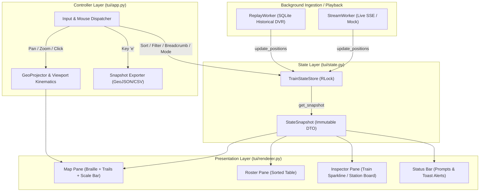
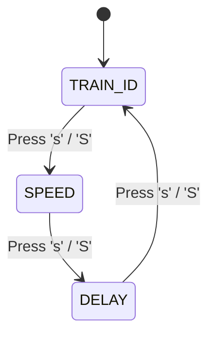
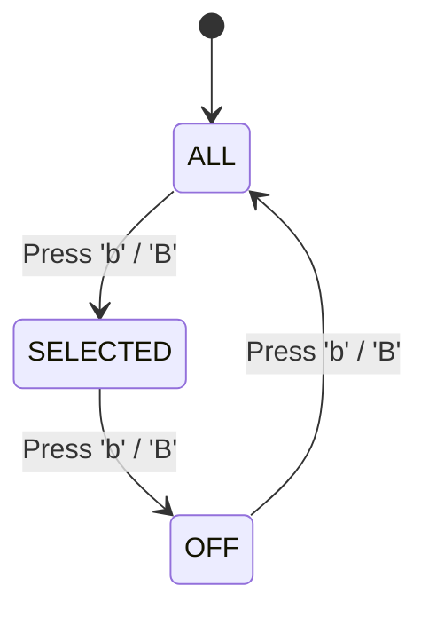
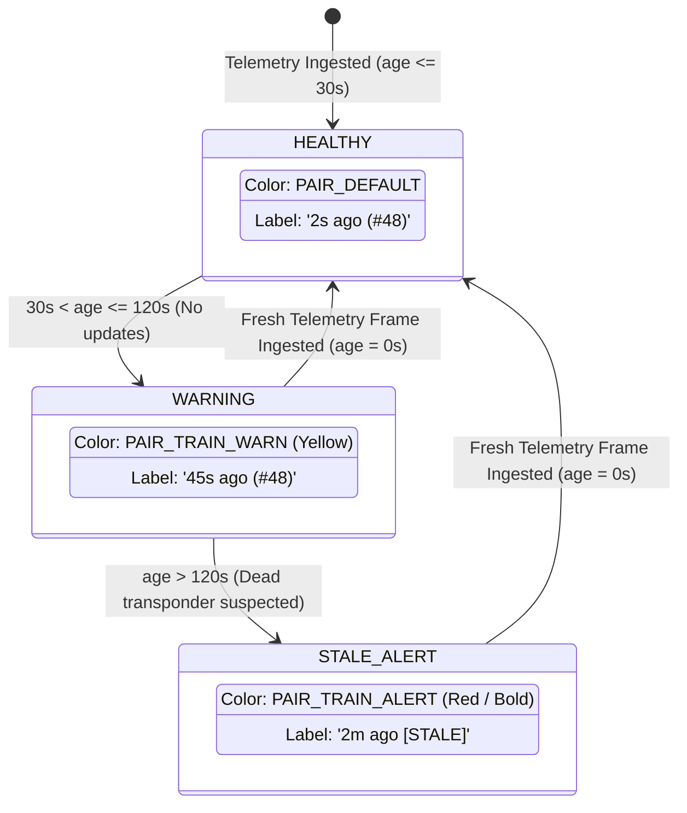
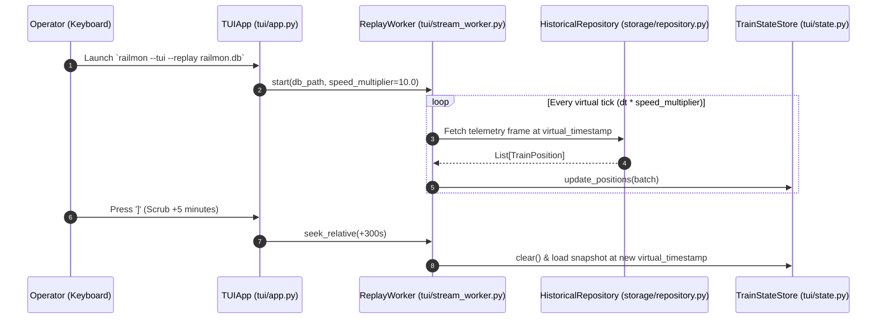
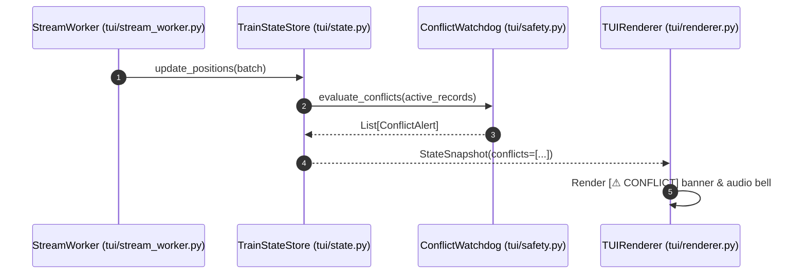
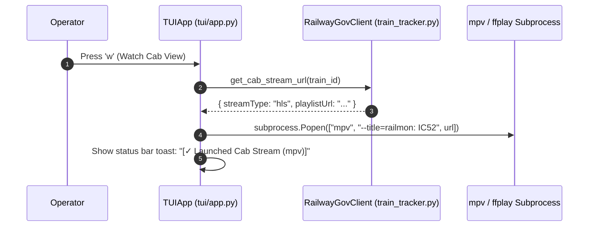

# TUI Feature Enhancements & Expansion Specification

Detailed architectural and technical specification for upcoming interactive, analytical, and geospatial enhancements to the `railmon` Curses Terminal User Interface (`tui/`).

---

## 1. Executive Summary

While the current `railmon` TUI provides a real-time Braille GIS terminal map, live train roster, telemetry inspector, corridor presets (`0`–`3`), camera follow mode (`f`), interactive filtering (`/`), dynamic train roster sorting (`s`), and historical breadcrumb trail mode toggling (`b`), several high-value analytical, interactive, and storage features can be added to further enrich the operator experience while preserving zero-dependency standard-library purity.

### Feature Summary Matrix

| Tier | Feature ID | Feature Name | Keybinding / CLI | Status | Primary Modules Affected |
| :--- | :--- | :--- | :--- | :--- | :--- |
| **Tier 1 (Parity)** | **F-1.1** | Dynamic Train Roster Sorting (`ID`, `Speed`, `Delay`) | `s` / `S` | **Implemented** | [`tui/state.py`](../../tui/state.py), [`tui/app.py`](../../tui/app.py), [`tui/renderer.py`](../../tui/renderer.py) |
| **Tier 1 (Parity)** | **F-1.2** | Historical Breadcrumb Trail Mode Toggle (`All`, `Selected`, `Off`) | `b` / `B` | **Implemented** | [`tui/state.py`](../../tui/state.py), [`tui/app.py`](../../tui/app.py), [`tui/renderer.py`](../../tui/renderer.py) |
| **Tier 2 (Inspector)** | **F-2.1** | Live Speed Sparkline & Telemetry Age Indicator | *(Auto)* | **Implemented** | [`tui/renderer.py`](../../tui/renderer.py), [`tui/state.py`](../../tui/state.py) |
| **Tier 2 (Inspector)** | **F-2.2** | WGS84 Coordinate Readout, Next-Station Distance & ETA | *(Auto)* | **Implemented** | [`tui/renderer.py`](../../tui/renderer.py), [`tui/geo.py`](../../tui/geo.py) |
| **Tier 3 (Map & UX)** | **F-3.1** | Terminal Mouse Interaction (Click-to-Select & Scroll Zoom) | Mouse | **Implemented** | [`tui/app.py`](../../tui/app.py), [`tui/renderer.py`](../../tui/renderer.py) |
| **Tier 3 (Map & UX)** | **F-3.2** | Station Departure Board & Proximity Inspector Mode | `m` / `M` | **Implemented** | [`tui/state.py`](../../tui/state.py), [`tui/app.py`](../../tui/app.py), [`tui/renderer.py`](../../tui/renderer.py) |
| **Tier 3 (Map & UX)** | **F-3.3** | Map Layer Toggles (Station Labels & Corridor Colors) | `v` / `t` | **Implemented** | [`tui/state.py`](../../tui/state.py), [`tui/app.py`](../../tui/app.py), [`tui/renderer.py`](../../tui/renderer.py) |
| **Tier 3 (Map & UX)** | **F-3.4** | Dynamic Conformal Map Scale Bar Overlay | *(Auto)* | **Implemented** | [`tui/renderer.py`](../../tui/renderer.py), [`tui/geo.py`](../../tui/geo.py) |
| **Tier 4 (Storage)** | **F-4.1** | Instant In-TUI GeoJSON / CSV Trajectory Snapshot Export | `e` / `E` | **Implemented** | [`tui/app.py`](../../tui/app.py), [`tui/renderer.py`](../../tui/renderer.py), [`storage/repository.py`](../../storage/repository.py) |
| **Tier 4 (Storage)** | **F-4.2** | SQLite Historical DVR Playback & Timeline Scrubbing | `--replay` | **Implemented** | [`tui/app.py`](../../tui/app.py), [`tui/stream_worker.py`](../../tui/stream_worker.py), [`storage/repository.py`](../../storage/repository.py), [`train_tracker.py`](../../train_tracker.py) |
| **Tier 5 (Safety)** | **F-5.1** | Corridor Headway & Opposing Train Conflict Watchdog | *(Auto / Bell)* | Planned | [`tui/state.py`](../../tui/state.py), [`tui/renderer.py`](../../tui/renderer.py), [`tui/app.py`](../../tui/app.py) |
| **Tier 5 (Safety)** | **F-5.2** | Telemetry Drop & Sensor Freezing Watchdog | *(Auto)* | Planned | [`tui/state.py`](../../tui/state.py), [`tui/renderer.py`](../../tui/renderer.py) |
| **Tier 5 (Safety)** | **F-5.3** | Corridor Speed Limit Exceedance & Slow-Order Alerts | *(Auto)* | Planned | [`tui/geo.py`](../../tui/geo.py), [`tui/renderer.py`](../../tui/renderer.py) |
| **Tier 6 (Commuter)** | **F-6.1** | CLI Station Departure & Arrival Boards | `railmon departures` | **Implemented** | [`train_tracker.py`](../../train_tracker.py), [`storage/cli_formatters.py`](../../storage/cli_formatters.py), [`tui/mock_engine.py`](../../tui/mock_engine.py) |
| **Tier 6 (Commuter)** | **F-6.2** | Train Timetable & Intermediate Stop Inspector | `i` / `I` / CLI | **Implemented** | [`train_tracker.py`](../../train_tracker.py), [`storage/cli_formatters.py`](../../storage/cli_formatters.py), [`tui/mock_engine.py`](../../tui/mock_engine.py), [`tui/renderer.py`](../../tui/renderer.py), [`tui/app.py`](../../tui/app.py) |
| **Tier 6 (Commuter)** | **F-6.3** | Proximity & Delay Push Alerting Engine | `railmon watch` | Planned | [`train_tracker.py`](../../train_tracker.py), [`tui/app.py`](../../tui/app.py) |
| **Tier 7 (Visual/GIS)** | **F-7.1** | Live Locomotive Forward Cab Video Stream Launcher | `w` / `W` | **Implemented** | [`train_tracker.py`](../../train_tracker.py), [`tui/app.py`](../../tui/app.py), [`tui/renderer.py`](../../tui/renderer.py), [`tui/mock_engine.py`](../../tui/mock_engine.py) |
| **Tier 7 (Visual/GIS)** | **F-7.2** | Infrastructure GIS Layers (Tunnels, Bridges & Signals) | `g` / `G` | Planned | [`train_tracker.py`](../../train_tracker.py), [`tui/geo.py`](../../tui/geo.py), [`tui/renderer.py`](../../tui/renderer.py) |
| **Tier 7 (Visual/GIS)** | **F-7.3** | Custom Terminal Color Theme Profiles | `F10` / `K` | Planned | [`tui/renderer.py`](../../tui/renderer.py), [`tui/app.py`](../../tui/app.py) |
| **Tier 7 (Visual/GIS)** | **F-7.4** | Dual Split-Screen Multi-Train Follow Viewport | `D` | Planned | [`tui/renderer.py`](../../tui/renderer.py), [`tui/app.py`](../../tui/app.py) |
| **Tier 8 (DevOps)** | **F-8.1** | Embedded Zero-Dependency Web Map Daemon | `railmon serve` | Planned | [`train_tracker.py`](../../train_tracker.py), [`storage/db.py`](../../storage/db.py) |
| **Tier 8 (DevOps)** | **F-8.2** | Prometheus & OpenMetrics Operational Exporter | `railmon metrics` | Planned | [`train_tracker.py`](../../train_tracker.py), [`storage/repository.py`](../../storage/repository.py) |
| **Tier 8 (DevOps)** | **F-8.3** | GTFS-Realtime (GTFS-RT) Protocol Buffer Feed Exporter | `railmon export --gtfs-rt` | Planned | [`train_tracker.py`](../../train_tracker.py), [`storage/repository.py`](../../storage/repository.py) |
| **Tier 9 (Analytics)** | **F-9.1** | Corridor Bottleneck & Station Dwell Delay Heatmaps | `railmon history bottlenecks` | Planned | [`storage/repository.py`](../../storage/repository.py), [`storage/cli_formatters.py`](../../storage/cli_formatters.py) |
| **Tier 9 (Analytics)** | **F-9.2** | Empirical Segment Transit Time & ML/Regression ETA Engine | *(Auto)* | Planned | [`storage/repository.py`](../../storage/repository.py), [`tui/renderer.py`](../../tui/renderer.py) |

---

## 2. Updated Dashboard Layout & Visual Mockup

### 2.1 Enhanced Multi-Pane Console Mockup (ASCII)

```text
+---------------------------------------------------------------------------------------------------+
| RAILMON | HELLENIC RAILWAYS (railway.gov.gr) | View: PATHE Mainline | Active: 14 | Delayed: 3 [●] |
+--------------------------------------------------------------------+------------------------------+
| [Map Viewport: 39.80°N, 22.50°E | Zoom: 1.5x | Trails: ALL]        | [ACTIVE TRAINS (14) | Sort:▼]|
|                                                                    |  #   TRAIN  TYPE  SPD▼  DLY  |
|   Thessaloniki                                                     | > 1  1599   IC    142   +9m  |
|     ◉===========================                                   |   2  1597   IC    118   +4m  |
|       \                        \                                   |   3  2232   PR    114    0m  |
|        \ Platy                  \                                  |   4  1314   PR     92   +1m  |
|         ◉===                     ◉ Kilkis                          |   5  2236   PR     86    0m  |
|          \  \                                                      |   6  1598   IC      0    0m  |
|           \  \ Katerini                                            +------------------------------+
|            \  ◉                                                    | [SELECTED TRAIN TELEMETRY]   |
|             \  \  ·                                                | Train No:     1599 (IC)      |
|              \  \  ·                                               | Locomotive:   120-024        |
|               \  ◉ Larissa                                         | Route:        ΑΘΗΝ -> ΘΕΣΣ   |
|                \  \  ·                                             | Next Station: Λάρισα (14.2km)|
|                 \  \  ▲ ◄ [1599] (142km/h, +9m)                    | Est. Arrival: ~6 min         |
|                  \  \                                              | Speed:        142.0 km/h     |
|                   \  ◉ Domokos                                     | Speed Trend:  ▂▃▅▆▇██▇▇█     |
|                    \  \                                            | Delay:        +9 min (Minor) |
|                     \  ◉ Lianokladi                                | Coords:       39.4821N,22.34E|
|                                                                    | Telemetry:    Updated 2s ago |
|  |---- 25 km ----|                                                 | Progress:     [======>--] 68%|
+--------------------------------------------------------------------+------------------------------+
| [q]Quit [h/j/k/l]Pan [+/-]Zoom [s]Sort [b]Trails [e]Export [m]Stations [f]Follow [/]Filter [?]Help|
+---------------------------------------------------------------------------------------------------+
```

### 2.2 Architectural Data & Event Flow (Mermaid)



---

## 3. Tier 1: Documentation Parity & Core Roster Controls

These two features are listed in the Controls Reference table of [`README.md`](../../README.md#L168-L180) (`s` and `b`) and have been **implemented** to establish full parity between documentation and runtime behavior.

---

### F-1.1: Dynamic Train Roster Sorting (`s` / `S`) — *Implemented*

#### Problem Statement
[`README.md`](../../README.md#L177) documents `s` to *"Cycle train roster sorting (Train ID, Speed, Delay)"*. Previously, [`TrainStateStore._compute_filtered_list`](../../tui/state.py#L543-L575) sorted exclusively by `_natural_sort_key` (Train ID).

#### Technical Design & Implementation Plan
1. **`RosterSortMode` Enum & Sort Keys in [`tui/state.py`](../../tui/state.py#L40-L46):**
   ```python
   class RosterSortMode(Enum):
       """Ordering criteria for the active train roster table."""

       TRAIN_ID = auto()  # Ascending natural alphanumeric train number (e.g. 50 before 1597)
       SPEED = auto()     # Descending speed in km/h (fastest first), tie-broken by TRAIN_ID
       DELAY = auto()     # Descending delay in minutes (most delayed first), tie-broken by TRAIN_ID
   ```
   - **Deterministic Comparator Functions ([`tui/state.py`](../../tui/state.py#L225-L244)):**
     - `_natural_sort_key(rec: TrainRecord) -> Tuple[int, str]`: Extracts numeric digits to order commercial numbers naturally (`(0, f"{int(digits):010d}_{tn}")`) before non-numeric identifiers (`(1, tn or rec.position.id)`).
     - `_speed_sort_key(rec: TrainRecord) -> Tuple[float, Tuple[int, str]]`: Returns `(-spd, _natural_sort_key(rec))` where `spd = float(rec.position.speed) if rec.position.speed is not None else 0.0`.
     - `_delay_sort_key(rec: TrainRecord) -> Tuple[float, Tuple[int, str]]`: Returns `(-dly, _natural_sort_key(rec))` where `dly = float(rec.position.delay) if rec.position.delay is not None else 0.0`.

2. **State Machine Transition:**



```text
+-------------------------+  Press 's' / 'S'  +-------------------------+  Press 's' / 'S'  +-------------------------+
| RosterSortMode.TRAIN_ID | ----------------> |  RosterSortMode.SPEED   | ----------------> |  RosterSortMode.DELAY   |
|   (Ascending: TRAIN▲)   |                   |   (Descending: SPD▼)    |                   |   (Descending: DLY▼)    |
+-------------------------+                   +-------------------------+                   +-------------------------+
             ^                                                                                           |
             +------------------------------------ Press 's' / 'S' --------------------------------------+
```

3. **Store & Snapshot Extension in [`tui/state.py`](../../tui/state.py):**
   - Initialize `self._sort_mode: RosterSortMode = RosterSortMode.TRAIN_ID` in [`TrainStateStore.__init__`](../../tui/state.py#L267).
   - Expose `sort_mode: RosterSortMode = RosterSortMode.TRAIN_ID` on immutable [`StateSnapshot`](../../tui/state.py#L128) and populate it in [`TrainStateStore.get_snapshot`](../../tui/state.py#L389).
   - Implement [`set_sort_mode(mode: RosterSortMode) -> None`](../../tui/state.py#L485-L492) with `isinstance(mode, RosterSortMode)` runtime type validation and version increment on state change.
   - Implement [`cycle_sort_mode() -> RosterSortMode`](../../tui/state.py#L494-L505) to cycle `TRAIN_ID -> SPEED -> DELAY -> TRAIN_ID` under `self._lock`, preserving `self._selected_id` (and dynamically recomputing `selected_index` in the newly ordered `filtered_trains` tuple) while incrementing `self._version`.
   - Dispatch sorting in [`_compute_filtered_list`](../../tui/state.py#L569-L575) based on `self._sort_mode`, ensuring `select_next()` and `select_prev()` cursor traversal automatically follow the active sort order.

4. **Renderer Glyphs & Header Indicator in [`tui/renderer.py`](../../tui/renderer.py):**
   - Extend [`RenderGlyphs`](../../tui/renderer.py#L93-L94) with `sort_asc` and `sort_desc`:
     - [`GLYPHS_UTF8`](../../tui/renderer.py#L113-L114): `sort_asc="▲"`, `sort_desc="▼"`
     - [`GLYPHS_ASCII`](../../tui/renderer.py#L133-L134): `sort_asc="^"`, `sort_desc="v"`
   - Update [`TUIRenderer.render_roster`](../../tui/renderer.py#L888-L895) to render the active sort indicator while preserving fixed column alignment (`[Cursor:2][#:3][TRAIN:6][TYPE:5][SPD:5][DLY:5][ST:4]`):
     - `RosterSortMode.TRAIN_ID`: `" #   TRAIN▲ TYPE  SPD   DLY  ST"` (ASCII: `" #   TRAIN^ TYPE  SPD   DLY  ST"`)
     - `RosterSortMode.SPEED`: `" #   TRAIN  TYPE  SPD▼  DLY  ST"` (ASCII: `" #   TRAIN  TYPE  SPDv  DLY  ST"`)
     - `RosterSortMode.DELAY`: `" #   TRAIN  TYPE  SPD   DLY▼ ST"` (ASCII: `" #   TRAIN  TYPE  SPD   DLYv ST"`)
   - Include `[s] Sort` in the bottom status bar shortcuts ([`TUIRenderer.render_status_bar`](../../tui/renderer.py#L1093)) and document `s / S` in [`TUIRenderer.render_help_modal`](../../tui/renderer.py#L1167).

5. **Controller Keybinding in [`tui/app.py`](../../tui/app.py):**
   - Add [`TUIApp.cycle_sort() -> RosterSortMode`](../../tui/app.py#L377-L379) delegating to `self.store.cycle_sort_mode()`.
   - Bind `key in (ord("s"), ord("S"))` in [`TUIApp._handle_normal_input`](../../tui/app.py#L449-L451) to `self.cycle_sort()` (leaving `InputMode.SEARCH` unaffected so typing `s` in a search query appends to `search_buffer`).

6. **Verification Coverage:**
   - [`tests/test_tui_state.py`](../../tests/test_tui_state.py#L344-L400) (`test_sort_mode_cycling_and_ordering`): Verifies `TRAIN_ID -> SPEED -> DELAY -> TRAIN_ID` cycling, deterministic natural ID tie-breaking, selection preservation across sort changes, `select_next()` order adherence, and `TypeError` validation on invalid enum values.
   - [`tests/test_tui_controls.py`](../../tests/test_tui_controls.py#L697-L718) (`test_key_s_cycles_roster_sort_mode_in_normal_mode`, `test_key_s_in_search_mode_appends_character_without_sorting`): Verifies `s`/`S` key dispatch in `NORMAL` vs. `SEARCH` modes.
   - [`tests/test_tui_renderer.py`](../../tests/test_tui_renderer.py#L954-L994) (`test_render_roster_displays_sort_direction_indicators_utf8_and_ascii`): Verifies `TRAIN▲`/`SPD▼`/`DLY▼` and `TRAIN^`/`SPDv`/`DLYv` header rendering.

---

### F-1.2: Historical Breadcrumb Trail Mode Toggle (`b` / `B`) — *Implemented*

#### Problem Statement
[`README.md`](../../README.md#L176) documents `b` to *"Toggle historical breadcrumb trails"*. Previously, [`TUIRenderer.render_map`](../../tui/renderer.py#L744-L771) unconditionally rendered breadcrumb trails for all trains in `snapshot.trains.values()` (even trains excluded by an active search or corridor filter). On dense suburban corridors, operators need the ability to isolate trails to the currently selected train or hide trails completely.

#### Technical Design & Implementation Plan
1. **`BreadcrumbMode` Enum in [`tui/state.py`](../../tui/state.py#L48-L53):**
   ```python
   class BreadcrumbMode(Enum):
       """Visibility policy for historical breadcrumb trails on the map canvas."""

       ALL = auto()       # Draw breadcrumb dots for all active filtered trains
       SELECTED = auto()  # Draw breadcrumb dots only for snapshot.selected_train
       OFF = auto()       # Hide all historical breadcrumb trails
   ```
2. **State Machine Transition:**



```text
+--------------------+  Press 'b' / 'B'  +-------------------------+  Press 'b' / 'B'  +--------------------+
| BreadcrumbMode.ALL | ----------------> | BreadcrumbMode.SELECTED | ----------------> | BreadcrumbMode.OFF |
|   (Trails: ALL)    |                   |      (Trails: SEL)      |                   |   (Trails: OFF)    |
+--------------------+                   +-------------------------+                   +--------------------+
          ^                                                                                      |
          +----------------------------------- Press 'b' / 'B' ----------------------------------+
```

3. **Store & Snapshot Extension in [`tui/state.py`](../../tui/state.py):**
   - Initialize `self._breadcrumb_mode: BreadcrumbMode = BreadcrumbMode.ALL` in [`TrainStateStore.__init__`](../../tui/state.py#L268).
   - Expose `breadcrumb_mode: BreadcrumbMode = BreadcrumbMode.ALL` on [`StateSnapshot`](../../tui/state.py#L129) and populate it in [`TrainStateStore.get_snapshot`](../../tui/state.py#L390).
   - Implement [`set_breadcrumb_mode(mode: BreadcrumbMode) -> None`](../../tui/state.py#L507-L514) with `isinstance(mode, BreadcrumbMode)` runtime type validation and version increment on change.
   - Implement [`cycle_breadcrumb_mode() -> BreadcrumbMode`](../../tui/state.py#L516-L527) to cycle `ALL -> SELECTED -> OFF -> ALL` under `self._lock` while incrementing `self._version`.

4. **Renderer Integration in [`tui/renderer.py`](../../tui/renderer.py#L716-L771):**
   - **Map Viewport Title Badge ([`tui/renderer.py`](../../tui/renderer.py#L716-L728)):**
     - Map `snapshot.breadcrumb_mode` to `trails_label` (`"ALL"`, `"SEL"`, or `"OFF"`) and display `| Trails: {trails_label}` in the map viewport header:
       `[ Map Viewport: 39.80°N, 22.50°E | Zoom: 1.5x | Trails: ALL ]`.
   - **Filtered Trail Resolution ([`tui/renderer.py`](../../tui/renderer.py#L744-L757)):**
     - `BreadcrumbMode.OFF`: `trail_records = ()` (skips rendering historical breadcrumb dots).
     - `BreadcrumbMode.SELECTED`: Renders `snapshot.selected_train` trail if and only if `snapshot.selected_train` is not `None` and is currently visible in `snapshot.filtered_trains`; otherwise `trail_records = ()`.
     - `BreadcrumbMode.ALL`: `trail_records = snapshot.filtered_trains` (ensuring trains hidden by corridor or text filters do not leak ghost trails onto the map).
   - **Status Bar & Help Modal:**
     - Include `[b] Trails` in the status bar cheat sheet ([`TUIRenderer.render_status_bar`](../../tui/renderer.py#L1093)) and document `b / B` in [`TUIRenderer.render_help_modal`](../../tui/renderer.py#L1168).

5. **Controller Keybinding in [`tui/app.py`](../../tui/app.py):**
   - Add [`TUIApp.cycle_breadcrumbs() -> BreadcrumbMode`](../../tui/app.py#L381-L383) delegating to `self.store.cycle_breadcrumb_mode()`.
   - Bind `key in (ord("b"), ord("B"))` in [`TUIApp._handle_normal_input`](../../tui/app.py#L453-L455) to `self.cycle_breadcrumbs()`.

6. **Verification Coverage:**
   - [`tests/test_tui_state.py`](../../tests/test_tui_state.py#L401-L442) (`test_breadcrumb_mode_cycling_and_explicit_set`): Verifies `ALL -> SELECTED -> OFF -> ALL` transitions, version increments, idempotent `set_breadcrumb_mode`, and `TypeError` validation.
   - [`tests/test_tui_controls.py`](../../tests/test_tui_controls.py#L719-L740) (`test_key_b_cycles_breadcrumb_mode_in_normal_mode`, `test_key_b_in_search_mode_appends_character_without_toggling_breadcrumbs`): Verifies `b`/`B` key handling in `NORMAL` vs. `SEARCH` modes.
   - [`tests/test_tui_renderer.py`](../../tests/test_tui_renderer.py#L996-L1084) (`test_render_map_breadcrumb_modes_all_selected_off_and_filter_exclusion`): Verifies map title badge (`Trails: ALL`/`SEL`/`OFF`), corridor filter trail exclusion, and trail dot rendering across all three modes.

---

## 4. Tier 2: Telemetry Inspector & Analytical Enhancements

These enhancements enrich the **Selected Train Telemetry** pane ([`TUIRenderer.render_inspector`](../../tui/renderer.py#L903-L992)) using data already present in [`TrainRecord`](../../tui/state.py#L51-L92) and [`tui/data/stations.json`](../../tui/data/stations.json).

---

### F-2.1: Live Speed Sparkline & Telemetry Age Indicator — *Implemented*

#### Problem Statement
The Selected Train Telemetry pane previously displayed only instantaneous speed (`pos.speed: 142.0 km/h`) without historical velocity context, momentum direction, or transponder freshness. Operators could not immediately tell if a train was cruising at line speed, decelerating for a signal or station stop, accelerating, or if a stationary reading represented an active dwell versus a dead GPS transponder or stream stall.

#### Technical Design & Implementation Details
1. **State Layer & Chronological Speed History ([`tui/state.py`](../../tui/state.py#L86-L125)):**
   - Implemented [`TrainRecord.get_speed_history(self, max_samples: int = 15) -> List[float]`](../tui/state.py#L106-L125): Chronologically extracts non-negative float speed samples from `record.trail` breadcrumbs and merges the current position speed (`pos.speed`) if updated or changed, while clamping `None` or negative speeds to `0.0`.
   - Updated [`TrainRecord.append_breadcrumb`](../../tui/state.py#L86-L104) and initial record ingestion in [`TrainStateStore.update_positions`](../../tui/state.py#L326-L334) to defensively sanitize `pos.speed` via `float(pos.speed) if pos.speed is not None else 0.0`.

2. **Unicode & ASCII Sparkline Generator ([`tui/renderer.py`](../../tui/renderer.py#L446-L495)):**
   - **8-Level Block Height Glyphs:**
     - UTF-8: `SPARKLINE_BARS_UTF8 = (" ", "▂", "▃", "▄", "▅", "▆", "▇", "█")`
     - ASCII: `SPARKLINE_BARS_ASCII = ("_", ".", "-", "=", "+", "*", "#", "@")`
   - **Dynamic Speed Normalization:** Normalized against dynamic ceiling $V_{\max} = \max(160.0, \max(\text{speeds}))\text{ km/h}$, ensuring standard $160\text{ km/h}$ PATHE mainline velocities use the full vertical range while gracefully scaling up during high-speed runs without index overflow.
   - **Kinematic Trend Arrow:** Appends instantaneous gradient arrow:
     - Accelerating ($\Delta v > +3.0\text{ km/h}$): `▲` (ASCII: `^`)
     - Braking ($\Delta v < -3.0\text{ km/h}$): `▼` (ASCII: `v`)
     - Steady cruise ($|\Delta v| \le 3.0\text{ km/h}$): `─` (ASCII: `-`)

3. **Telemetry Age & Multi-Tier Staleness Alerting ([`tui/renderer.py`](../../tui/renderer.py#L497-L536)):**
   - Implemented [`format_telemetry_age(last_updated: float, update_count: int, now: Optional[float] = None) -> Tuple[str, int]`](../tui/renderer.py#L497-L536).
   - Computes elapsed age $T_{\text{age}} = \max(0, \text{int}(\text{now} - \text{last\_updated}))$.
   - **Alert Attributes:**
     - Normal ($T_{\text{age}} \le 30\text{s}$): `PAIR_DEFAULT` (`2s ago (#48)`)
     - Warning ($30\text{s} < T_{\text{age}} \le 120\text{s}$): `PAIR_TRAIN_WARN` in yellow (`45s ago (#48)`)
     - Critical Stale ($T_{\text{age}} > 120\text{s}$): `PAIR_TRAIN_ALERT` in bold red (`2m ago [STALE]`)
   - Formatted compactly ($< 15$ characters) to guarantee zero text truncation inside narrow $32$-column sidebar inspector windows.

4. **Visual State Machine & Data Flow:**



```text
+------------------------------+
| [ SELECTED TRAIN TELEMETRY ] |
| Train No:     1599 (IC)      |
| Route:        ΑΘΗΝ -> ΘΕΣΣ   |
| Next Station: Λάρισα         |
| Speed:        142.0 km/h     |
| Speed Trend:   ▂▃▅▆▇██▇▇█ ▲  |
| Delay:        +9 min (Minor) |
| Telemetry:    2s ago (#48)   |
| Progress:     [=====>----] 52|
| Heading:      340.0° (NNW)   |
| Locomotive:   120-024        |
+------------------------------+
```

5. **Adaptive Inspector Row Layout ([`tui/renderer.py`](../../tui/renderer.py#L1120-L1145)):**
   - Reordered `rows` hierarchy in `render_inspector` so primary operational telemetry (`Train No:`, `Route:`, `Next Station:`, `Speed:`, `Speed Trend:`, `Delay:`, `Telemetry:`, `Progress:`) is completely visible on standard $80 \times 24$ consoles (`inner_h = 9`), while secondary fields (`Heading:`, `Locomotive:`, `Status:`, `Chainage:`) render when vertical space permits.

6. **Verification Coverage:**
   - [`tests/test_tui_state.py`](../../tests/test_tui_state.py#L795-L824) (`test_train_record_get_speed_history`): Validates chronological velocity extraction from breadcrumbs, dwell speed changes without spatial translation, and sample count bounds.
   - [`tests/test_tui_renderer.py`](../../tests/test_tui_renderer.py#L301-L380) (`test_format_speed_sparkline`, `test_format_telemetry_age`): Validates empty lists, constant cruising, acceleration and braking trend arrows, dynamic ceiling expansion for speeds $> 160\text{ km/h}$, 7-bit ASCII purity, age thresholds, and negative elapsed time protection.
   - [`tests/test_tui_renderer.py`](../../tests/test_tui_renderer.py#L525-L547) (`test_render_inspector_live_sparkline_and_telemetry_age`): Validates rendering of `Speed Trend:` and `Telemetry:` rows in curses mock windows, including `PAIR_TRAIN_ALERT` color attribute activation on stale trains ($> 120\text{s}$).

---

### F-2.2: WGS84 Coordinate Readout, Next-Station Distance & ETA — *Implemented*

#### Problem Statement
While the map viewport title displays the camera center coordinates, the Selected Train Telemetry Inspector previously displayed only the raw `pos.next_station` name without showing the selected train's exact WGS84 latitude/longitude, its remaining distance to `next_station`, or its kinematic estimated time of arrival (ETA).

#### Technical Design & Implementation Details
1. **Haversine Distance Helper in [`tui/geo.py`](../../tui/geo.py#L118-L143):**
   - Implemented [`haversine_distance_km(a: GeoPoint, b: GeoPoint) -> float`](../../tui/geo.py#L121-L143) using standard spherical Earth radius $R = 6371.0\text{ km}$ with domain clamping `min(1.0, max(0.0, h))`.
2. **Diacritic-Insensitive Station Lookup Index in [`TUIRenderer.__init__`](../../tui/renderer.py#L549-L601):**
   - Implemented [`normalize_station_key(name: str) -> str`](../../tui/renderer.py#L549-L565) using Unicode `NFD` decomposition to strip combining Greek accents/*tonos* (`Mn`) and casefold.
   - Implemented [`_build_station_index(stations: Sequence[StationNode]) -> Dict[str, StationNode]`](../tui/renderer.py#L568-L601) indexing station `id`, `code`, Greek (`name_el`), English (`name_en`), parenthetical-stripped base names (`"Αθήνα (Σ.Σ. Λαρίσης)"` $\rightarrow$ `"αθηνα"`), and airport aliases, exposed via [`TUIRenderer.resolve_station`](../../tui/renderer.py#L728-L741).
3. **Next-Station Distance & Kinematic ETA ([`format_next_station_eta`](../../tui/renderer.py#L604-L651)):**
   - When `pos.next_station` resolves to a known `StationNode` and `(pos.lat, pos.lng)` is a valid non-zero coordinate:
     - Computes great-circle distance $d_{\text{km}} = \text{haversine\_distance\_km}(\text{train\_pt}, \text{station.point})$.
     - If `pos.speed >= 5.0`, computes $\text{ETA}_{\min} = \text{round}\left(\frac{d_{\text{km}}}{\text{pos.speed}} \times 60\right)$ and renders `Next Station: Λάρισα (14.2 km, ~6m)` (or `<1m` when $d_{\text{km}} < 0.1\text{ km}$, `~XhYYm` when $\text{ETA}_{\min} \ge 120$).
     - If halted (`pos.speed < 5.0`), renders `Λάρισα (0.1 km, AT)` when at the station platform ($d_{\text{km}} < 0.25\text{ km}$) or `Λάρισα (14.2 km)` when stopped en route.
4. **Coordinate Readout Row ([`format_wgs84_coords`](../../tui/renderer.py#L654-L683)):**
   - Renders `Coordinates: 39.6384°N, 22.4192°E` in UTF-8 mode (or `39.6384d N, 22.4192d E` in `--ascii` mode) at row index 8 of [`TUIRenderer.render_inspector`](../../tui/renderer.py#L1217-L1242), immediately visible on standard $80 \times 24$ consoles (`inner_h = 9`).
5. **Verification Coverage:**
   - [`tests/test_tui_geo.py`](../../tests/test_tui_geo.py#L334-L356) (`test_haversine_distance_km`): Validates identity distance, symmetry, 1° meridian arc ($\approx 111.195\text{ km}$), Athens–SKA ($\approx 9.23\text{ km}$), and Athens–Thessaloniki ($\approx 302.3\text{ km}$).
   - [`tests/test_tui_renderer.py`](../../tests/test_tui_renderer.py#L371-L469) (`test_format_next_station_eta`, `test_format_wgs84_coords`) and [`tests/test_tui_renderer.py`](../../tests/test_tui_renderer.py#L1278-L1337) (`test_station_lookup_index_and_inspector_coordinates_eta`): Validates Greek/English/toneless station resolution, moving/halted/platform ETA formatting, UTF-8/ASCII coordinate formatting, and Curses Inspector window rendering.

---

## 5. Tier 3: Map Canvas & Interactive UX Features

---

### F-3.1: Terminal Mouse Interaction (Click-to-Select & Scroll Zoom) — *Implemented*

> **Detailed Implementation Plan:** [`docs/f-3-1-terminal-mouse-interaction-plan.md`](../plans/features/f-3-1-terminal-mouse-interaction-plan.md)

#### Overview
Modern terminal emulators (Windows Terminal, iTerm2, Kitty, Alacritty, GNOME Terminal, xterm) report mouse clicks and wheel events through `curses.getmouse()`. Adding mouse support makes spatial exploration and train selection instantaneous while keeping keyboard navigation 100% functional.

#### Technical Design
1. **Mouse Initialization in [`TUIApp.setup_terminal`](../../tui/app.py#L199):**
   ```python
   try:
       curses.mousemask(curses.ALL_MOUSE_EVENTS | curses.REPORT_MOUSE_POSITION)
   except curses.error:
       pass  # Gracefully degrade on terminals without mouse support
   ```
2. **Event Dispatch (`key == curses.KEY_MOUSE`) in [`TUIApp.process_input`](../../tui/app.py#L498):**
   - Call `_, mx, my, _, bstate = curses.getmouse()`.
   - **Region 1: Roster Pane (`geometry.roster_x <= mx < roster_x + roster_w` and `roster_y <= my < roster_y + roster_h`):**
     - **Left Click (`BUTTON1_CLICKED | BUTTON1_PRESSED`):** Map clicked row `r_idx = my - (geometry.roster_y + 2)` + active `scroll_offset` to `snapshot.filtered_trains[item_idx]` and call `self.store.select_by_id(...)`.
     - **Double Click (`BUTTON1_DOUBLE_CLICKED`):** Select train and engage follow camera (`self.store.set_follow_mode(True)`).
     - **Scroll Wheel Up / Down (`BUTTON4_PRESSED` / `BUTTON5_PRESSED`):** Cycle train selection backward / forward.
   - **Region 2: Map Pane (`geometry.map_x < mx < map_x + map_w - 1` and `map_y < my < map_y + map_h - 1`):**
     - **Left Click:** Hit-test `(col = mx - map_x - 1, row = my - map_y - 1)` against projected train cells (Manhattan radius $\le 1$ cell). If a train is hit, select it; otherwise, if double-clicked on empty canvas, recenter the viewport on the clicked geographic coordinate via `projector.subpixel_to_geo(col * 2 + 1, row * 4 + 2)`.
     - **Scroll Wheel Up / Down:** Zoom in (`self.zoom(1.25)`) / Zoom out (`self.zoom(0.8)`).

---

### F-3.2: Station Departure Board & Proximity Inspector Mode (`m` / `M`) — *Implemented*

> **Detailed Implementation Plan:** [`docs/f-3-2-station-departure-board-proximity-inspector-plan.md`](../plans/features/f-3-2-station-departure-board-proximity-inspector-plan.md)

#### Overview
Allow users to switch the bottom-right Inspector pane between **Train Telemetry Mode** (default) and **Station Proximity Board Mode** (`m` / `M` key or clicking a station node `◉` on the map).

#### Visual Layout of Station Inspector Mode

```text
+------------------------------+
| [STATION BOARD: Larissa]     |
| Corridor: PATHE Mainline     |
| Coords:   39.6385°N, 22.422E |
|                              |
| APPROACHING / AT STATION:    |
| TRAIN  DIR  DIST   ETA   DLY |
| 1598   HLT  0.1km  AT     0m |
| 1597   NNW  4.2km  ~2m   +4m |
| 2591   SSE  11.8km ~7m    0m |
+------------------------------+
```

#### Technical Design
1. **State Layer ([`tui/state.py`](../../tui/state.py)):**
   - Add `InspectorMode` enum (`TRAIN`, `STATION`) and expose `inspector_mode: InspectorMode = InspectorMode.TRAIN` and `selected_station_id: Optional[str] = None` on [`StateSnapshot`](../../tui/state.py).
   - Implement thread-safe `set_inspector_mode()`, `set_selected_station()`, and `cycle_station_board()` on [`TrainStateStore`](../../tui/state.py) with anchor-tracked wrap-around cycling that returns to `InspectorMode.TRAIN` after visiting all candidate hubs.
2. **Controller Layer ([`tui/app.py`](../../tui/app.py)):**
   - Pressing `m` in `InputMode.NORMAL` enters `InspectorMode.STATION` starting at the selected train's `next_station` (if resolved) or the hub station nearest to `projector.viewport.center`, and subsequent `m` presses cycle through active corridor/network hub stations before wrapping back to `InspectorMode.TRAIN`.
   - Pressing `M` (`Shift+M`) while in `InspectorMode.STATION` immediately exits back to `InspectorMode.TRAIN`.
3. **Proximity Engine & Presentation Layer ([`tui/renderer.py`](../../tui/renderer.py)):**
   - Implement `StationBoardEntry` and `compute_station_board_entries()` computing Haversine distance from the selected `StationNode` to all active filtered trains, retaining trains within $80.0\text{ km}$ or whose `next_station` / `origin` / `destination` resolves to the station, sorted by ascending distance with natural train ID tie-breaking.
   - Render the Station Board in `TUIRenderer.render_station_inspector()` with adaptive column widths for $80 \times 24$ (`28`-col) and wide (`32+`-col) sidebars, and highlight the active station node on the map canvas (`curses.A_REVERSE | curses.A_BOLD`).

---

### F-3.3: Map Layer Toggles (`v` Station Labels / `t` Corridor Track Colors) — *Implemented*

> **Detailed Implementation Plan:** [`docs/f-3-3-map-layer-toggles-plan.md`](../plans/features/f-3-3-map-layer-toggles-plan.md)

#### Overview
At low zoom levels (`0.5x`–`1.0x`), station labels can crowd narrow corridors, and monochromatic white Braille tracks make it harder to distinguish suburban lines from the mainline trunk.

#### Technical Design
1. **Station Label Visibility Mode (`v` / `V` key & `StationLabelMode` in [`tui/state.py`](../../tui/state.py)):**
   - Cycles through:
     1. `HUBS_AND_SECONDARY` (default: all stations with collision avoidance)
     2. `HUBS_ONLY` (only `stn.is_hub == True` labels shown, plus active inspected station in `InspectorMode.STATION`)
     3. `MARKERS_ONLY` (draw `◉` / `#`/`+` glyphs without text labels for maximum track visibility)
2. **Corridor-Colored Braille Tracks (`t` / `T` key & `TrackColorMode` in [`tui/state.py`](../../tui/state.py)):**
   - Toggle between uniform dim-white tracks (`TrackColorMode.UNIFORM`, `PAIR_TRACK`) and corridor-colored track layers (`TrackColorMode.CORRIDOR`) while preserving composite $2 \times 4$ Braille sub-pixel bitmasks at shared junctions:
     - `PATHE`: `PAIR_TRACK` (White)
     - `PROASTIAKOS`: `PAIR_TRAIN_PROAST` (Cyan)
     - `NORTHERN` / `THESSALY` / `MACEDONIA`: `PAIR_STATION_DIM` (Yellow)

---

### F-3.4: Dynamic Conformal Map Scale Bar Overlay — *Implemented*

> **Detailed Implementation Plan:** [`docs/f-3-4-dynamic-conformal-map-scale-bar-plan.md`](../plans/features/f-3-4-dynamic-conformal-map-scale-bar-plan.md)

#### Overview
Because the zoom factor ranges from `0.2x` to `25.0x`, users benefit from a live geographic scale bar in the bottom-left corner of the map viewport showing real-world distance.

#### Technical Design
1. **Scale Calculation in [`GeoProjector`](../../tui/geo.py):**
   - Compute kilometers per terminal column cell at current viewport center latitude $\phi_0$ via `GeoProjector.get_km_per_cell()`:
     $$\text{km\_per\_cell} = \frac{2.0}{S_x \cdot \cos(\phi_0)} \times 111.32$$
   - Snap a target bar width of $12\text{--}18$ cells via `GeoProjector.compute_scale_bar()` to the nearest standard cartographic interval in `SCALE_BAR_INTERVALS_KM` ($1\text{--}1500\text{ km}$, spaced with Voronoï cell ratios $< 1.25\times$ so every `+`/`-` zoom step transitions to a distinct kilometer value across `0.2x`–`25.0x`), returning an immutable `ScaleBarSpec(distance_km, width_cells, km_per_cell)`.
2. **Rendering in [`TUIRenderer.render_map`](../../tui/renderer.py):**
   - Format the scale bar via `format_scale_bar()` (`|--- 25 km ---|` in `--ascii` mode or `├─── 25 km ───┤` / `├──── 25 km ────┤` in UTF-8 mode), reserve its bottom-left cells in `occupied_cells` to prevent station label overlap, and draw it at row `max_y - 2`, column `2` inside the map window before overlaying trains.

---

## 6. Tier 4: Historical Storage & Replay Integration

The repository already includes a rich SQLite historical subsystem in [`storage/`](../../storage) ([`storage/repository.py`](../../storage/repository.py), [`storage/recorder.py`](../../storage/recorder.py)). Integrating it directly with the interactive TUI bridges live monitoring and post-trip analysis.

---

### F-4.1: Instant In-TUI GeoJSON / CSV Trajectory Snapshot Export (`e` / `E`) — *Implemented*

> **Detailed Implementation Plan:** [`docs/f-4-1-instant-in-tui-trajectory-export-plan.md`](../plans/features/f-4-1-instant-in-tui-trajectory-export-plan.md)

#### Overview
When observing an interesting delay event or anomaly in the TUI, pressing `e` immediately exports the selected train's trajectory to a timestamped `.geojson` file (or `E` for `.csv`) in the working directory without leaving the dashboard.

#### Technical Design
1. **Dual-Source Trajectory Resolution:**
   - **If `--record` is active** (`snapshot.is_recording and snapshot.recording_db`): Query full recorded trip points for `selected_train.position.train_number` via [`HistoricalRepository.export_trip_geojson`](../../storage/repository.py) (for `e`) or [`HistoricalRepository.export_csv`](../../storage/repository.py) (for `E`), seamlessly falling back to the in-memory trail if the selected train has not yet been flushed to SQLite.
   - **If running without `--record` (Live or `--demo`):** Build an RFC 7946 GeoJSON `FeatureCollection` or 17-column telemetry CSV directly from the in-memory `selected_train.trail` (`Deque[HistoricalBreadcrumb]`) and current [`TrainPosition`](../../train_tracker.py) via [`export_in_memory_geojson`](../../storage/repository.py) and [`export_in_memory_csv`](../../storage/repository.py).
2. **Filename & Security Validation:**
   - Sanitize `train_number` via [`sanitize_train_identifier`](../../storage/repository.py) and reuse path sanitization rules from [`validate_export_path`](../../storage/repository.py) to write `railmon_train_<train_no>_<YYYYMMDD_HHMMSS>.geojson` (or `.csv`).
3. **Transient Status Bar Toast Notification:**
   - Added `toast_message: Optional[str]`, `toast_expiry: float`, and `toast_is_error: bool` to [`TUIApp`](../../tui/app.py).
   - Displays `[✓ Exported railmon_train_1597_20261120_160500.geojson]` (or `[OK Exported ...]` in `--ascii` mode) in the status bar for 4 seconds.

---

### F-4.2: SQLite Historical DVR Playback & Timeline Scrubbing (`--replay <db>`) — *Implemented*

> **Detailed Implementation Plan:** [`docs/f-4-2-sqlite-historical-dvr-playback-plan.md`](../plans/features/f-4-2-sqlite-historical-dvr-playback-plan.md)

#### Overview
Allow `railmon --tui --replay railway_history.db` to replay recorded historical telemetry through the exact same Curses TUI dashboard, complete with pause, fast-forward (`1x`, `5x`, `15x`, `60x`), and timeline scrubbing (`[` / `]` to jump $\pm 5\text{ minutes}$).

#### Sequence Diagram



#### ASCII Architecture Diagram

```text
+----------------------------------+       seek / speed        +----------------------------------+
|            TUIApp                | ------------------------> |          ReplayWorker            |
|  Keys: [Space] Pause             |                           |  Virtual Clock: t_cur            |
|        [ / ]   Scrub -/+ 5m      |                           |  Multiplier: 1x / 5x / 15x / 60x |
|        < / >   Speed Multiplier  |                           +----------------------------------+
+----------------------------------+                                            |
                 ^                                                              | SQL Window Query
                 | get_snapshot()                                               v
+----------------------------------+                           +----------------------------------+
|         TrainStateStore          | <------------------------ |       HistoricalRepository       |
|   (In-Memory Active Positions)   |     update_positions()    |     (SQLite WAL Read-Only)       |
+----------------------------------+                           +----------------------------------+
```

---

## 7. Tier 5: Safety, Dispatch & Anomaly Watchdogs

Operational rail safety and anomaly detection provide automated surveillance over active trains, identifying dangerous network conditions, track conflicts, and sensor dropouts in real time.

---

### F-5.1: Corridor Headway & Opposing Train Conflict Watchdog — *Planned*

#### Overview
On the Greek rail network, sections of single-track infrastructure (such as portions of the Peloponnese network, regional spurs, and ongoing maintenance single-line operations on the PATHE corridor) require strict block occupancy. This feature introduces an automated headway and collision vector evaluation engine in [`tui/state.py`](../../tui/state.py) that continuously evaluates spatial distance and course vectors between trains on shared corridors.

#### Conflict Classification
1. **Head-on / Opposing Collision Risk (`CRITICAL`):**
   Two trains assigned to the same corridor or track edge (`railwayId`) moving with reciprocal headings ($\Delta\theta \approx 180^\circ \pm 35^\circ$) whose projected distance $D < 10.0\text{ km}$ and closing velocity $V_{\text{close}} > 0$.
2. **Headway Violation (`WARNING`):**
   Two trains traveling in the same direction on the same corridor where spatial separation $D < 2.5\text{ km}$ (exceeding standard service braking curve limits).

#### Visual & Audio Alerts
- Status bar displays flashing alert: `[⚠ CONFLICT: IC52 <-> IC59 on PATHE (3.4km)]` (or `[! CONFLICT ...]` in `--ascii` mode).
- Optional audible terminal bell (`\a`) fired once per conflict state transition.
- Inspector pane displays a highlighted `CONFLICT WARNING` card with relative speed and distance.

#### Sequence Diagram



#### ASCII Architecture Diagram

```text
+-----------------------------------------------------------------------------------+
|                        Safety Conflict Watchdog Pipeline                          |
+-----------------------------------------------------------------------------------+

   Active Train Snapshot
     [IC52: 39.21N, 22.45E, course: 350°]
     [IC59: 39.24N, 22.46E, course: 170°]
                    |
                    v
   +------------------------------------+
   |     Corridor Spatial Partition     |
   |      (Group by corridor/track)     |
   +------------------------------------+
                    |
                    v
   +------------------------------------+
   |   Pairwise Kinematic Evaluation    |
   |   - Haversine Distance: 3.4 km     |
   |   - Relative Bearing: Opposing     |
   |   - Closing Speed: 240 km/h        |
   +------------------------------------+
                    |
                    v  Condition: D < 10km & Opposing
   +------------------------------------+
   |   Conflict Alert Event Generated   |
   |   Severity: CRITICAL               |
   |   Action: Terminal Bell + UI Flash |
   +------------------------------------+
```

---

### F-5.2: Telemetry Drop & Sensor Freezing Watchdog — *Planned*

#### Overview
Locomotives traversing remote mountain passes (e.g., Mount Othrys, Kallidromo tunnels) occasionally lose cellular backhaul or Starlink satellite tracking. This engine monitors telemetry update intervals and kinematic continuity to distinguish between normal stationary halts and frozen or lost sensor streams.

#### Sensor Health Tiers
- **Normal Motion:** Updated $\le 30\text{s}$ ago, position actively advancing.
- **Station Dwell:** Speed $0\text{ km/h}$, position within $250\text{m}$ of a known station centroid.
- **Sensor Freeze (`[FROZEN]`):** Speed $> 0\text{ km/h}$, but coordinates unchanged for $> 45\text{s}$.
- **Telemetry Drop (`[DROPPED]`):** No telemetry packet received for $> 120\text{s}$ while train was in active transit.

---

### F-5.3: Corridor Speed Limit Exceedance & Slow-Order Alerts — *Planned*

#### Overview
Maps train instantaneous speeds against maximum design speeds and temporary speed restrictions (TSR) across Greek rail corridors:
- Athens–Thessaloniki High-Speed Sections: $160\text{ km/h}$
- Urban / Suburban Segments (SKC–SKA–Oinoi): $90\text{--}120\text{ km/h}$
- Mountain Pass Branches: $60\text{--}80\text{ km/h}$

When speed exceeds the corridor threshold by $\ge 10\text{ km/h}$, the telemetry inspector highlights the speed value in `PAIR_TRAIN_ALERT` with an `[OVERSPEED]` tag.

---

## 8. Tier 6: Commuter & Route Operational Tools

These features transform `railmon` from an analytical tracking utility into a daily terminal tool for passengers, commuters, and station dispatchers.

---

### F-6.1: CLI Station Departure & Arrival Boards (`railmon departures`) — *Implemented*

> **Detailed Implementation Plan:** [`../plans/features/f-6-1-cli-station-departure-and-arrival-boards-plan.md`](../plans/features/f-6-1-cli-station-departure-and-arrival-boards-plan.md)

#### Overview
Direct command-line interface accessing `/api/public/stations/{id}/departures` and `/api/public/stations/{id}/arrivals` to view live station departure boards without launching the interactive TUI.

#### CLI Syntax & Usage
```bash
# View upcoming departures from Athens Central Station
railmon departures Athens

# View upcoming arrivals at Thessaloniki with limit of 10
railmon departures Thessaloniki --arrivals --limit 10

# Filter for suburban Proastiakos services at SKA
railmon departures SKA --type suburban
```

#### Tabular Terminal Output Mockup
```text
================================================================================
STATION DEPARTURE BOARD: ATHENS CENTRAL (Σ.Σ. ΛΑΡΙΣΗΣ) [14:25:00]
================================================================================
TIME   TRAIN   TYPE   DESTINATION          PLATFORM   STATUS      DELAY
--------------------------------------------------------------------------------
14:32  IC52    IC     Thessaloniki         1          ON TIME      0m
14:45  1597    PR     Chalkida             3          DELAYED     +8m
15:05  2236    PR     Athens Airport       2          ON TIME      0m
15:22  IC54    IC     Kalambaka            1          ON TIME      0m
================================================================================
```

---

### F-6.2: Train Timetable & Intermediate Stop Inspector (`i` / `I` / CLI) — *Implemented*

*(Detailed implementation plan: [`docs/plans/features/f-6-2-train-timetable-and-intermediate-stop-inspector-plan.md`](../plans/features/f-6-2-train-timetable-and-intermediate-stop-inspector-plan.md))*

#### Overview
Inspects the full scheduled itinerary of a train, showing intermediate stations, planned versus actual arrival/departure times, scheduled dwell durations, and platform tracks.

#### TUI & CLI Integration
- **In-TUI:** Pressing `i` on any selected train opens an interactive scrollable modal window displaying the full stop timetable retrieved from `/api/public/train-schedules/by-train-number/{trainNumber}`.
- **CLI Subcommand:** `railmon schedule 1597` outputs the timetable to stdout.

#### Timetable Inspection Modal Mockup
```text
+----------------------------------------------------------------------------+
| TIMETABLE & ITINERARY: TRAIN 1597 (Athens -> Chalkida)                     |
+----------------------------------------------------------------------------+
| STATION             SCHED ARR  ACTUAL ARR  SCHED DEP  ACTUAL DEP  PLAT  DLY |
| Athens (Larissa)    --:--      --:--       14:28      14:36       3     +8m |
| Agioi Anargyroi     14:34      14:42       14:35      14:43       2     +8m |
| SKA Hub             14:41      14:50       14:42      14:51       4     +9m |
| Acharnes            14:46      --:--       14:47      --:--       1     --- |
| Oinoi               15:15      --:--       15:17      --:--       2     --- |
| Chalkida            15:42      --:--       --:--      --:--       1     --- |
+----------------------------------------------------------------------------+
| [Esc / i] Close Itinerary Modal    [▲ / ▼] Scroll Stops                    |
+----------------------------------------------------------------------------+
```

---

### F-6.3: Proximity & Delay Push Alerting Engine (`railmon watch`) — *Planned*

#### Overview
A background terminal watchdog daemon that monitors a specific train trip or passenger journey and issues desktop notifications or webhook dispatches based on user-defined triggers:
- Train departure confirmed.
- Delay increases by more than $\Delta t$ minutes.
- Train crosses within $R\text{ km}$ or $M\text{ minutes}$ of the user's destination station.

#### Architecture
```text
+-------------------------------------+
|        railmon watch IC52           |
|  --notify 15m --dest Thessaloniki   |
+-------------------------------------+
                   |
                   v
+-------------------------------------+
|      Live Telemetry Monitor         |
|  - Tracks IC52 progress & ETA       |
+-------------------------------------+
                   |
                   +---> Desktop Notification (notify-send / Windows Toast)
                   +---> Terminal Bell (\a)
                   +---> Webhook POST (Telegram / Discord / Slack)
```

---

## 9. Tier 7: TUI Visual Enhancements & Infrastructure GIS

Enhances spatial realism, infrastructure rendering, and visual ergonomics across terminal environments.

---

### F-7.1: Live Locomotive Forward Cab Video Stream Launcher (`w` / `W`) — *Implemented*

> **Detailed Implementation Plan:** [`../plans/features/f-7-1-live-locomotive-cab-video-stream-launcher-plan.md`](../plans/features/f-7-1-live-locomotive-cab-video-stream-launcher-plan.md)

#### Overview
Hellenic Railways operates forward-facing locomotive cameras on several modern trainsets (Siemens Desiro Electric 460 EMU, HellasSprinter 120, Alstom ETR 470), streaming live HLS at `/api/public/trains/{id}/stream`.
Pressing `w` or `W` resolves the HLS `.m3u8` playlist URL for the currently selected train and launches an external lightweight video player (`mpv`, `ffplay`, `vlc`, or default web browser) in a detached asynchronous subprocess without interrupting Curses TUI rendering.

#### Subprocess Launch Flow (Mermaid)


#### ASCII Architecture Diagram
```text
+---------------------+      Key 'w' / 'W'     +---------------------+
|       TUIApp        | ---------------------> |  Background Worker  |
|  (Curses Main Loop) |                        | (Daemon Thread)     |
+---------------------+                        +---------------------+
           ^                                              |
           | Toast: "[✓ Launched Cab Stream (mpv)]"       | 1. get_cab_stream_url()
           |                                              v
+---------------------+                        +---------------------+
|  Status Bar Toast   | <--------------------- |  RailwayGovClient   |
+---------------------+                        +---------------------+
                                                          | 2. detect_video_player()
                                                          v
                                               +---------------------+
                                               | Detached Subprocess |
                                               | (mpv / ffplay / vlc)|
                                               +---------------------+
```

#### CLI Syntax & Usage
```bash
# Launch cab video stream for train 1597 in auto-detected player
railmon cab 1597

# Query raw HLS stream URL without launching player
railmon cab 1597 --url-only

# Emit machine-readable stream metadata JSON
railmon cab 1597 --json
```

---

### F-7.2: Infrastructure GIS Layers: Tunnels, Bridges & Signals (`g` / `G`) — *Planned*

#### Overview
Ingests infrastructure GeoJSON features from `/api/msd/geo?types=tunnel,bridge,signal` and overlays them onto the Braille canvas:
- **Tunnels:** Rendered as shaded portal markers (`∩` / `[ ]`) showing mountain crossings (Callidromon, Platamonas, Tempi). When a train's coordinates fall inside a tunnel bounding polyline, an indicator `[TUNNEL]` appears in the inspector.
- **Bridges / Viaducts:** Highlighted bridge markers (`═` / `∏`).
- **Key Interlocking Signals:** Rendered at corridor junctions.
- **Keybinding:** `g` / `G` cycles infrastructure overlay (`All` → `Tunnels & Bridges` → `Off`).

---

### F-7.3: Custom Terminal Color Theme Profiles (`F10` / `K`) — *Planned*

#### Overview
Adds switchable 16-color and 256-color palette presets in [`tui/renderer.py`](../../tui/renderer.py) to accommodate different terminal emulator backgrounds:
1. **Hellenic Azure (Default):** Deep blue branding, bright cyan tracks, golden train glyphs.
2. **Retro Amber CRT Phosphor:** Warm monochrome amber on black styling.
3. **Matrix Green:** High-contrast phosphor green for night monitoring.
4. **Solarized Dark:** Standard low-fatigue palette for terminal developers.
5. **High-Contrast Monochrome:** Pure black-and-white for minimal/e-ink consoles.

---

### F-7.4: Dual Split-Screen Multi-Train Follow Viewport (`D`) — *Planned*

#### Overview
Enables split-screen viewport rendering where two opposing or interacting trains (e.g., `IC52` northbound and `IC53` southbound) are centered in dual sub-viewports simultaneously, tracking their convergence and crossing maneuvers in real time.

---

## 10. Tier 8: Integrations, Web Services & Observability

Expands `railmon` into multi-user operations, third-party transit apps, and enterprise observability stacks.

---

### F-8.1: Embedded Zero-Dependency Web Map Daemon (`railmon serve`) — *Planned*

#### Overview
A lightweight headless service utilizing Python's built-in `http.server` and socket library to serve a responsive browser GIS dashboard on `http://localhost:8080`.
- Serves an embedded Leaflet / MapLibre single-page web app with OpenStreetMap / CartoDB tiles.
- Pushes live train positions and track geometry via WebSockets or Server-Sent Events (SSE).
- Requires zero third-party dependencies (`pip install` not required).

---

### F-8.2: Prometheus & OpenMetrics Operational Exporter (`railmon metrics`) — *Planned*

#### Overview
Exposes an HTTP `/metrics` endpoint on port `9100` conforming to OpenMetrics and Prometheus standards for monitoring Greek rail operations in Grafana.

#### Metrics Schema
```text
# HELP railmon_active_trains Total number of currently active trains
# TYPE railmon_active_trains gauge
railmon_active_trains{corridor="PATHE"} 6
railmon_active_trains{corridor="PROASTIAKOS"} 8

# HELP railmon_train_delay_minutes Current delay in minutes
# TYPE railmon_train_delay_minutes gauge
railmon_train_delay_minutes{train_number="IC52",type="IC"} 0
railmon_train_delay_minutes{train_number="1597",type="PR"} 8

# HELP railmon_train_speed_kmh Instantaneous train speed in km/h
# TYPE railmon_train_speed_kmh gauge
railmon_train_speed_kmh{train_number="IC52"} 142.0

# HELP railmon_db_records_total Historical telemetry rows stored
# TYPE railmon_db_records_total counter
railmon_db_records_total 128450
```

---

### F-8.3: GTFS-Realtime (GTFS-RT) Protocol Buffer Feed Exporter — *Planned*

#### Overview
Translates live `railway.gov.gr` train positions and delay packets into the standard **General Transit Feed Specification Realtime (GTFS-RT)** format (`FeedMessage` with `VehiclePositions` and `TripUpdates`). Allows third-party transit apps (Transit App, OpenTripPlanner, Google Maps) to consume real-time Greek rail telemetry directly.

---

## 11. Tier 9: Historical Analytics & Predictive Engine

Leverages the embedded SQLite WAL database for deep operational analytics and machine-learning-assisted delay prediction.

---

### F-9.1: Corridor Bottleneck & Station Dwell Delay Heatmaps (`railmon history bottlenecks`) — *Planned*

#### Overview
Analyzes recorded telemetry to compute cumulative delay deltas per track block and station dwell. Outputs terminal ASCII heatmaps identifying infrastructure bottlenecks:
```text
================================================================================
CORRIDOR BOTTLENECK ANALYSIS: ATHENS - THESSALONIKI (Last 30 Days)
================================================================================
SEGMENT / STATION         AVG DWELL   MEDIAN DELAY   MAX DELAY   BOTTLENECK INDEX
--------------------------------------------------------------------------------
Larissa Station           4m 12s      +7.4m          +42m        ██████████ (HIGH)
Lianokladi Station        3m 45s      +4.1m          +28m        ██████ (MED)
Domokos Pass              0m 00s      +3.8m          +35m        █████ (MED)
Oinoi Junction            2m 10s      +1.2m          +14m        ██ (LOW)
Platy Junction            1m 50s      +0.8m          +11m        █ (LOW)
================================================================================
```

---

### F-9.2: Empirical Segment Transit Time & ETA Engine — *Planned*

#### Overview
Replaces raw Euclidean/Haversine velocity-based ETA calculations with empirical segment transit durations compiled from historical runs. If a train is halted at Lianokladi with a red signal, the engine does not report `ETA: 0 min` or infinite time, but instead applies the historical 90th-percentile transit time across the Lianokladi–Domokos mountain section.

---

## 12. Consolidated Controls & CLI Reference

### A. Interactive TUI Keybindings

| Key | Mode | Action | Status |
| :--- | :--- | :--- | :--- |
| `h` / `j` / `k` / `l` or Arrows | Normal | Pan map viewport West / South / North / East | Existing |
| `+` / `-` | Normal | Zoom In / Zoom Out (`0.2x` to `25.0x`) | Existing |
| `0` / `1` / `2` / `3` | Normal | Apply corridor viewport & filter presets | Existing |
| `Tab` / `n` / `p` | Normal | Cycle active train selection forward / backward | Existing |
| `f` / `F` | Normal | Toggle camera auto-follow on selected train | Existing |
| `c` / `C` | Normal | Clear search filter, corridor filter, and selection | Existing |
| `/` | Normal | Open interactive real-time search filter prompt | Existing |
| `Space` | Normal | Pause / resume telemetry stream or replay clock | Existing |
| `?` | Normal | Toggle interactive Keyboard Controls modal | Existing |
| `q` / `Esc` | Normal | Clean exit from `railmon` TUI | Existing |
| **`s` / `S`** | **Normal** | **Cycle roster sorting (`Train ID` → `Speed` → `Delay`)** | **Implemented (Tier 1)** |
| **`b` / `B`** | **Normal** | **Cycle breadcrumb trails (`All` → `Selected` → `Off`)** | **Implemented (Tier 1)** |
| **`v` / `V`** | **Normal** | **Cycle station labels (`All` → `Hubs Only` → `Markers Only`)** | **Implemented (Tier 3)** |
| **`t` / `T`** | **Normal** | **Toggle corridor-colored Braille track rendering** | **Implemented (Tier 3)** |
| **`m` / `M`** | **Normal** | **Cycle Station Departure Board / Return to Train Telemetry** | **Implemented (Tier 3)** |
| **Mouse Click / Wheel** | **Normal** | **Click-to-select train or station, double-click follow/recenter, wheel zoom/scroll** | **Implemented (Tier 3)** |
| **`e` / `E`** | **Normal** | **Export selected train trajectory to GeoJSON (`e`) / CSV (`E`) file** | **Implemented (Tier 4)** |
| **`[` / `]`** | **Replay** | **Scrub historical replay timeline `-5 min` / `+5 min`** | **Implemented (Tier 4)** |
| **`<` / `>`** | **Replay** | **Decrease / Increase historical replay speed (`1x`..`60x`)** | **Implemented (Tier 4)** |
| **`i` / `I`** | **Normal** | **Open Train Timetable & Intermediate Stop Itinerary modal** | **Planned (Tier 6)** |
| **`w` / `W`** | **Normal** | **Launch forward cab video stream in external media player (`mpv`)** | **Planned (Tier 7)** |
| **`g` / `G`** | **Normal** | **Cycle infrastructure GIS layer (`All` → `Tunnels/Bridges` → `Off`)** | **Planned (Tier 7)** |
| **`F10` / `K`** | **Normal** | **Cycle terminal color themes (Azure, Amber, Green, Solarized)** | **Planned (Tier 7)** |
| **`D`** | **Normal** | **Toggle dual split-screen multi-train follow view** | **Planned (Tier 7)** |

---

### B. Command-Line Interface (CLI) Commands

| Command | Tier | Description |
| :--- | :--- | :--- |
| `railmon --tui` | Tier 0 | Launch interactive terminal map dashboard |
| `railmon --tui --record` | Tier 4 | Launch TUI with concurrent SQLite telemetry recording |
| `railmon --tui --replay <db>` | Tier 4 | Launch TUI historical DVR replay and timeline scrubber |
| `railmon departures <station>` | **Tier 6** | Query upcoming departures and arrivals for a station |
| `railmon schedule <train_num>` | **Tier 6** | Display full timetable stop itinerary for a train |
| `railmon watch <train_num>` | **Tier 6** | Background watcher firing notifications on delay or proximity |
| `railmon serve [--port 8080]` | **Tier 8** | Start zero-dependency local web map and SSE server |
| `railmon metrics [--port 9100]` | **Tier 8** | Expose operational Prometheus / OpenMetrics endpoint |
| `railmon history bottlenecks` | **Tier 9** | Output corridor dwell and delay bottleneck analysis |

---

## 13. Phased Implementation & Verification Plan

### Phase 1: Tier 1 Parity (`s` Sorting & `b` Breadcrumb Modes) — *Completed*
- Added [`RosterSortMode`](../../tui/state.py#L40) and [`BreadcrumbMode`](../../tui/state.py#L48) enums and deterministic comparators in [`tui/state.py`](../../tui/state.py).
- Wired `s`/`S` and `b`/`B` controls in [`tui/app.py`](../../tui/app.py) and [`tui/renderer.py`](../../tui/renderer.py).
- Verified via unit test suites in [`tests/test_tui_state.py`](../../tests/test_tui_state.py), [`tests/test_tui_controls.py`](../../tests/test_tui_controls.py), and [`tests/test_tui_renderer.py`](../../tests/test_tui_renderer.py).

### Phase 2: Tier 2 Inspector Analytics (Sparklines, Telemetry Age, Distance & ETA) — *Completed*
- Implemented [`format_speed_sparkline`](../../tui/renderer.py#L446-L495) with dynamic ceiling and velocity history tracking in [`tui/state.py`](../../tui/state.py).
- Implemented [`format_telemetry_age`](../../tui/renderer.py#L497-L536) and next-station Haversine distance and ETA calculations in [`tui/geo.py`](../../tui/geo.py) and [`tui/renderer.py`](../../tui/renderer.py).

### Phase 3: Tier 3 Interactive Map & Mouse Support — *Completed*
- Added mouse click-to-select and scroll-wheel zoom support (`F-3.1`) in [`tui/app.py`](../../tui/app.py).
- Added dynamic conformal scale bar (`F-3.4`), station labels mode (`F-3.3`), corridor track colors, and station departure board mode (`F-3.2`) in [`tui/renderer.py`](../../tui/renderer.py).

### Phase 4: Tier 4 Storage Export & Historical Replay — *Completed*
- Added instant trajectory snapshot export (`e`/`E`) generating GeoJSON and CSV files directly from in-memory or SQLite records in [`storage/repository.py`](../../storage/repository.py).
- Implemented SQLite DVR replay engine (`ReplayWorker`), timeline scrubbing (`[`/`]`), and speed multiplier (`<`/`>`) in [`tui/stream_worker.py`](../../tui/stream_worker.py) and [`tui/app.py`](../../tui/app.py).

### Phase 5: Tier 5 Safety & Anomaly Watchdogs — *Planned*
1. **Safety Engine Module ([`tui/safety.py`](../../tui/safety.py)):**
   - Implement `evaluate_conflicts(active_records: List[TrainRecord]) -> List[ConflictAlert]` testing pairwise Haversine distances, corridor IDs, and heading convergence.
   - Implement `evaluate_telemetry_drops(active_records: List[TrainRecord]) -> List[SensorAnomaly]`.
2. **State Store & Presentation Integration:**
   - Store active conflicts on [`StateSnapshot`](../../tui/state.py).
   - Render flashing status alerts and optional terminal bell in [`TUIRenderer.render_status_bar`](../../tui/renderer.py).
3. **Automated Verification:**
   - Unit tests covering opposing vectors, same-direction safe spacing, stationary false positives, and audio bell rate-limiting.

### Phase 6: Tier 6 Commuter & Route Services (F-6.1 Completed, F-6.2–F-6.3 Planned)
1. **F-6.1 (*Completed*):** Added `departures` subparser in [`train_tracker.py`](../../train_tracker.py), multi-key diacritic-insensitive station resolution and suggestion engine in [`tui/mock_engine.py`](../../tui/mock_engine.py), responsive UTF-8 / ASCII tabular formatter in [`storage/cli_formatters.py`](../../storage/cli_formatters.py), offline `--demo` timetable synthesis, and automated test suite in [`tests/test_cli_departures.py`](../../tests/test_cli_departures.py).
2. **F-6.2 (*Completed*):** Implement itinerary inspection overlay in [`tui/renderer.py`](../../tui/renderer.py) bound to `i`/`I` and CLI `railmon schedule <train_num>` (see detailed plan in [`docs/plans/features/f-6-2-train-timetable-and-intermediate-stop-inspector-plan.md`](../plans/features/f-6-2-train-timetable-and-intermediate-stop-inspector-plan.md)).
3. **F-6.3 (*Planned*):** Implement `railmon watch <train_num>` background proximity and delay notification engine.

### Phase 7: Tier 7 Visual Enhancements & GIS Layers — *Planned*
1. Ingest tunnel and bridge GeoJSON in [`tui/geo.py`](../../tui/geo.py) from `/api/msd/geo`.
2. Implement color palette switcher in [`tui/renderer.py`](../../tui/renderer.py) (`F10`/`K`).
3. Add cab stream launcher subprocess execution in [`tui/app.py`](../../tui/app.py) (`w`/`W`).

### Phase 8: Tier 8 Integrations & DevOps — *Planned*
1. Implement zero-dependency HTTP server in [`train_tracker.py`](../../train_tracker.py) for `railmon serve`.
2. Implement Prometheus text-format exporter for `railmon metrics`.
3. Build GTFS-RT feed generator.

### Phase 9: Tier 9 Historical Analytics & Predictive Engine — *Planned*
1. Add bottleneck and dwell analytical SQL queries in [`storage/repository.py`](../../storage/repository.py).
2. Wire empirical transit duration matrix for enhanced ETA predictions.
