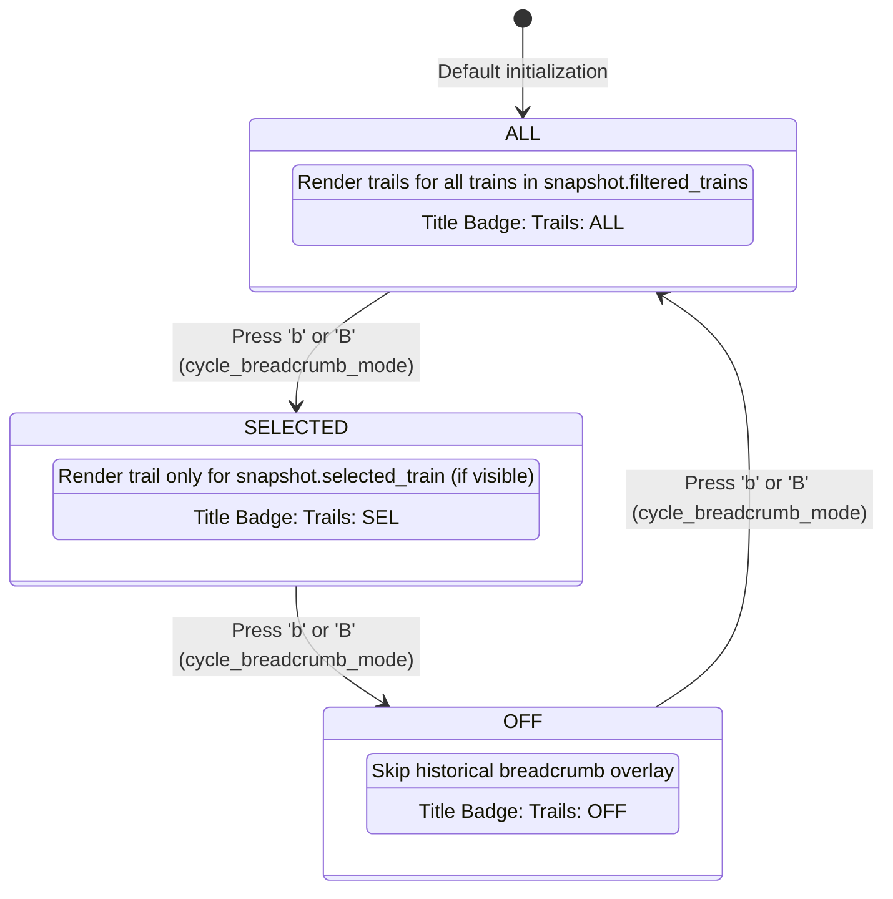

# Implementation Plan — F-1.2: Historical Breadcrumb Trail Mode Toggle (`b` / `B`)

> **Reference:** [TUI Feature Enhancements & Expansion Specification (`F-1.2`)](./tui-feature-enhancements.md#f-12-historical-breadcrumb-trail-mode-toggle-b--b), [`README.md` Controls Reference](../README.md#L176)  
> **Target Modules:** [`../tui/state.py`](../tui/state.py), [`../tui/app.py`](../tui/app.py), [`../tui/renderer.py`](../tui/renderer.py), [`../tui/__init__.py`](../tui/__init__.py)  
> **Test Suites:** [`../tests/test_tui_state.py`](../tests/test_tui_state.py), [`../tests/test_tui_controls.py`](../tests/test_tui_controls.py), [`../tests/test_tui_renderer.py`](../tests/test_tui_renderer.py)  
> **Relevant Rules & Skills:** [`../.agents/skills/diagrams-and-documentation/SKILL.md`](../.agents/skills/diagrams-and-documentation/SKILL.md), [`../.agents/skills/markdown-relative-paths/SKILL.md`](../.agents/skills/markdown-relative-paths/SKILL.md), [`../.agents/skills/ci-quality-gate/SKILL.md`](../.agents/skills/ci-quality-gate/SKILL.md)

---

## 1. Executive Summary & Objective

The Controls Reference table in [`../README.md`](../README.md#L176) documents the `b` shortcut as:
> `b` — *Toggle historical breadcrumb trails*

Currently, [`TUIRenderer.render_map`](../tui/renderer.py#L727-L741) unconditionally renders breadcrumb trails (`·` in UTF-8 mode, `.` in `--ascii` mode) for all trains in `snapshot.trains.values()`, and [`TUIApp._handle_normal_input`](../tui/app.py#L388-L457) has no handler for `ord("b")` or `ord("B")`.

This implementation plan specifies the end-to-end design to add **Historical Breadcrumb Trail Mode Toggle (`F-1.2`)** across the state store, controller event loop, and multi-pane Curses renderer while ensuring:
1. **Three-State Visibility Cycling (`ALL -> SELECTED -> OFF -> ALL`):** Pressing `b` or `B` in `InputMode.NORMAL` cycles breadcrumb rendering between all visible trains (`ALL`), only the currently selected train (`SELECTED`), and completely hidden (`OFF`).
2. **Filtered Train Consistency Fix:** In `BreadcrumbMode.ALL`, breadcrumb rendering iterates over `snapshot.filtered_trains` rather than `snapshot.trains.values()`, fixing a subtle bug where historical trails of trains excluded by active corridor presets (`1`–`3`) or search queries (`/`) were still drawn on the map canvas.
3. **Visual Feedback & ASCII Fallback:** The **Map Viewport** title badge displays `| Trails: ALL`, `| Trails: SEL`, or `| Trails: OFF`, the bottom status bar includes `[b] Trails`, and the `?` Help Modal documents `b / B`.

---

## 2. Architecture & State Machine Diagrams

### 2.1 Breadcrumb Mode State Machine

#### Mermaid State Diagram



#### ASCII State & Data Flow Diagram

```text
+-----------------------------------------------------------------------------------+
|                     BREADCRUMB TRAIL MODE STATE & RENDER PIPELINE                 |
+-----------------------------------------------------------------------------------+

  User Keypress ('b' / 'B')
             |
             v
+---------------------------+   cycle_breadcrumb_mode()   +-------------------------+
|          TUIApp           | --------------------------> |     TrainStateStore     |
|  _handle_normal_input()   |                             |  _breadcrumb_mode:      |
|  cycle_breadcrumbs()      |                             |    ALL      -> SELECTED |
+---------------------------+                             |    SELECTED -> OFF      |
                                                          |    OFF      -> ALL      |
                                                          |  _version += 1          |
                                                          +-------------------------+
                                                                       |
                                                                       | get_snapshot()
                                                                       v
+---------------------------+        render_map()         +-------------------------+
|        TUIRenderer        | <-------------------------- |      StateSnapshot      |
|  Title: Trails: ALL/SEL/OFF|                            |  filtered_trains: Tuple |
|  ALL:   filtered_trains   |                             |  selected_train: Record |
|  SEL:   selected_train    |                             |  breadcrumb_mode: Enum  |
|  OFF:   () (skip step 2)  |                             +-------------------------+
+---------------------------+
```

---

## 3. Detailed Component Specifications

### 3.1 State Layer: [`../tui/state.py`](../tui/state.py)

#### A. `BreadcrumbMode` Enum Definition
Add `BreadcrumbMode` right after [`RosterSortMode`](../tui/state.py#L40-L46):

```python
class BreadcrumbMode(Enum):
    """Visibility policy for historical breadcrumb trails on the map canvas."""

    ALL = auto()       # Draw breadcrumb dots for all active filtered trains
    SELECTED = auto()  # Draw breadcrumb dots only for snapshot.selected_train
    OFF = auto()       # Hide all historical breadcrumb trails
```

#### B. `StateSnapshot` Extension
Add `breadcrumb_mode` with a backward-compatible default value (`BreadcrumbMode.ALL`) to [`StateSnapshot`](../tui/state.py#L102-L121):

```python
@dataclass(frozen=True)
class StateSnapshot:
    ...
    version: int
    is_recording: bool = False
    recording_db: Optional[str] = None
    sort_mode: RosterSortMode = RosterSortMode.TRAIN_ID
    breadcrumb_mode: BreadcrumbMode = BreadcrumbMode.ALL
```

#### C. `TrainStateStore` Attributes & Methods
1. In [`TrainStateStore.__init__`](../tui/state.py#L240-L263), initialize:
   ```python
   self._breadcrumb_mode: BreadcrumbMode = BreadcrumbMode.ALL
   ```
2. In [`TrainStateStore.get_snapshot`](../tui/state.py#L346-L380), pass `breadcrumb_mode=self._breadcrumb_mode` to `StateSnapshot`.
3. Add `set_breadcrumb_mode` and `cycle_breadcrumb_mode` methods under `self._lock`:
   ```python
   def set_breadcrumb_mode(self, mode: BreadcrumbMode) -> None:
       """Explicitly set the active historical breadcrumb trail visibility mode."""
       if not isinstance(mode, BreadcrumbMode):
           raise TypeError(f"Expected BreadcrumbMode, got {type(mode).__name__}")
       with self._lock:
           if self._breadcrumb_mode != mode:
               self._breadcrumb_mode = mode
               self._version += 1

   def cycle_breadcrumb_mode(self) -> BreadcrumbMode:
       """Cycle historical breadcrumb trail visibility: ALL -> SELECTED -> OFF -> ALL."""
       cycle_order = (
           BreadcrumbMode.ALL,
           BreadcrumbMode.SELECTED,
           BreadcrumbMode.OFF,
       )
       with self._lock:
           curr_idx = cycle_order.index(self._breadcrumb_mode)
           self._breadcrumb_mode = cycle_order[(curr_idx + 1) % len(cycle_order)]
           self._version += 1
           return self._breadcrumb_mode
   ```

---

### 3.2 Package Exports: [`../tui/__init__.py`](../tui/__init__.py)

Export `BreadcrumbMode` and `RosterSortMode` in [`../tui/__init__.py`](../tui/__init__.py#L24-L30) and include them in `__all__`.

---

### 3.3 Controller Layer: [`../tui/app.py`](../tui/app.py)

1. **Imports:** Import `BreadcrumbMode` from `tui.state`.
2. **Action Method `TUIApp.cycle_breadcrumbs`:**
   ```python
   def cycle_breadcrumbs(self) -> BreadcrumbMode:
       """Cycle historical breadcrumb trail visibility mode (ALL -> SELECTED -> OFF)."""
       return self.store.cycle_breadcrumb_mode()
   ```
3. **Keybinding Dispatch in [`TUIApp._handle_normal_input`](../tui/app.py#L388-L457):**
   ```python
   # Cycle historical breadcrumb trail mode (All, Selected, Off)
   elif key in (ord("b"), ord("B")):
       self.cycle_breadcrumbs()
   ```

---

### 3.4 Presentation Layer: [`../tui/renderer.py`](../tui/renderer.py)

#### A. Map Viewport Title Badge in [`TUIRenderer.render_map`](../tui/renderer.py#L703-L711)
Format the active `BreadcrumbMode` as a compact title segment (`ALL`, `SEL`, or `OFF`):
```python
breadcrumb_mode = getattr(snapshot, "breadcrumb_mode", BreadcrumbMode.ALL)
if breadcrumb_mode == BreadcrumbMode.SELECTED:
    trails_label = "SEL"
elif breadcrumb_mode == BreadcrumbMode.OFF:
    trails_label = "OFF"
else:
    trails_label = "ALL"

title = (
    f" Map Viewport: {center.lat:.2f}{d_sym}N, {center.lng:.2f}{d_sym}E"
    f" | Zoom: {projector.viewport.zoom:.1f}x | Trails: {trails_label}{follow_str} "
)
```

#### B. Filtered Breadcrumb Overlay in [`TUIRenderer.render_map`](../tui/renderer.py#L727-L741)
Replace the unconditional loop over `snapshot.trains.values()` with mode-aware filtering over visible trains:
```python
# 2. Overlay historical breadcrumbs
if breadcrumb_mode == BreadcrumbMode.OFF:
    trail_records: Sequence[TrainRecord] = ()
elif breadcrumb_mode == BreadcrumbMode.SELECTED:
    if snapshot.selected_train is not None and any(
        r.position.id == snapshot.selected_train.position.id
        for r in snapshot.filtered_trains
    ):
        trail_records = (snapshot.selected_train,)
    else:
        trail_records = ()
else:
    trail_records = snapshot.filtered_trains

trail_glyph = self.glyphs.trail_dot
for record in trail_records:
    corridor_hint = record.position.corridor
    for crumb in tuple(record.trail):
        raw_pt = GeoPoint(lat=crumb.lat, lng=crumb.lng)
        snapped_pt = snap_to_track_network(
            raw_pt, self.tracks, corridor_hint=corridor_hint
        )
        col, row = projector.resolve_track_cell(snapped_pt, canvas)
        if 0 <= col < inner_w and 0 <= row < inner_h:
            try:
                win.addstr(1 + row, 1 + col, trail_glyph, trail_attr)
            except curses.error:
                pass
```

#### C. Status Bar & Help Modal Updates
1. **Status Bar Cheat Sheet ([`TUIRenderer.render_status_bar`](../tui/renderer.py#L1061-L1064)):**
   ```python
   shortcuts = f" [q] Quit  [h/j/k/l] Pan  [+/-] Zoom  [Tab] Select  [s] Sort  [b] Trails  {follow_str}  [/] Filter  [?] Help  [0..3] Presets"
   ```
2. **Help Modal Overlay ([`TUIRenderer.render_help_modal`](../tui/renderer.py#L1100-L1145)):**
   Add `("b / B", "Cycle breadcrumb trails (All, Selected, Off)")` under the `TRAIN SELECTION & TRACKING` section and update `box_h = min(24, max(17, height - 2))`.

---

## 4. Edge Cases & Invariants

| Scenario | Expected Behavior |
| :--- | :--- |
| **`BreadcrumbMode.ALL` with active corridor or search filter** | Only trains present in `snapshot.filtered_trains` have their trails drawn; trains filtered out by preset (`1`–`3`) or query (`/`) do not leave orphan breadcrumb dots on the map. |
| **`BreadcrumbMode.SELECTED` with no train selected** | `snapshot.selected_train` is `None`, so `trail_records` evaluates to `()` and no breadcrumbs are drawn until a train is selected. |
| **`BreadcrumbMode.SELECTED` when selected train is filtered out** | Because `selected_train` is not in `snapshot.filtered_trains`, neither the train icon nor its breadcrumb trail is drawn while filtered out. |
| **`BreadcrumbMode.OFF` does not discard stored history** | Cycling through `OFF` only suppresses visual rendering in `render_map`; `TrainRecord.trail` continues recording coordinates in `TrainStateStore` so switching back to `ALL` or `SELECTED` immediately displays the full up-to-date trail. |
| **Search input mode (`InputMode.SEARCH`)** | Pressing `b` or `B` while typing a search filter appends `"b"` or `"B"` to `search_buffer` without modifying `breadcrumb_mode`. |

---

## 5. Verification & Test Plan

### 5.1 Automated Unit Tests

1. **State Store Breadcrumb Mode Tests ([`../tests/test_tui_state.py`](../tests/test_tui_state.py)):**
   - `test_breadcrumb_mode_cycling_and_explicit_set`: Verify initial `snapshot.breadcrumb_mode == BreadcrumbMode.ALL`, verify `cycle_breadcrumb_mode()` transitions `ALL -> SELECTED -> OFF -> ALL` while incrementing `snapshot.version`, and verify `set_breadcrumb_mode()` updates mode and raises `TypeError` on invalid input.

2. **Controller Input Tests ([`../tests/test_tui_controls.py`](../tests/test_tui_controls.py)):**
   - `test_key_b_cycles_breadcrumb_mode_in_normal_mode`: Send `ord("b")` and `ord("B")` via `app.process_input()` in `InputMode.NORMAL` and verify `store.get_snapshot().breadcrumb_mode` cycles through `SELECTED`, `OFF`, and `ALL`.
   - `test_key_b_in_search_mode_appends_character_without_toggling_breadcrumbs`: Send `ord("b")` while in `InputMode.SEARCH` and verify it appends `"b"` to `app.search_buffer` while `breadcrumb_mode` remains `BreadcrumbMode.ALL`.

3. **Renderer Map Trail & Title Tests ([`../tests/test_tui_renderer.py`](../tests/test_tui_renderer.py)):**
   - `test_render_map_breadcrumb_modes_all_selected_off`: Seed two moving trains at distinct coordinates, render map across `ALL`, `SELECTED` (with selection and without selection), and `OFF`, and verify both the map title badge (`Trails: ALL`, `Trails: SEL`, `Trails: OFF`) and exact rendered trail dot coordinates.
   - `test_render_map_breadcrumbs_exclude_filtered_out_trains`: Verify that in `BreadcrumbMode.ALL`, applying a filter that excludes a train also hides its breadcrumb trail.

### 5.2 Quality Gate Execution
Run the repository quality gate ([`../.agents/skills/ci-quality-gate/SKILL.md`](../.agents/skills/ci-quality-gate/SKILL.md)):
```bash
python -m unittest discover -s tests -v
python -m mypy train_tracker.py tui storage tests
python -m flake8 train_tracker.py tui storage tests
```
