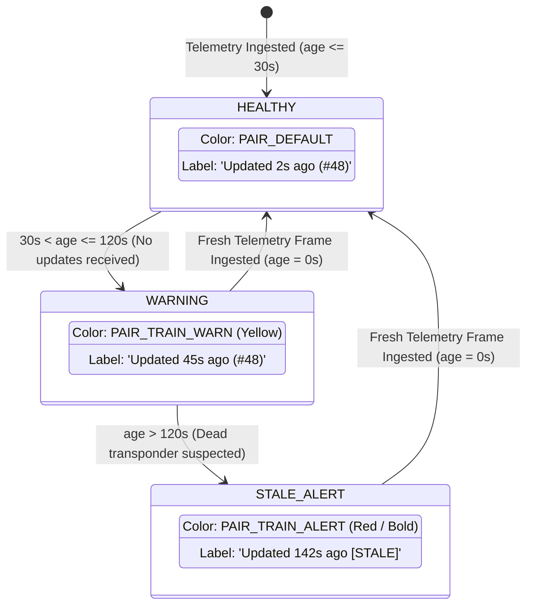
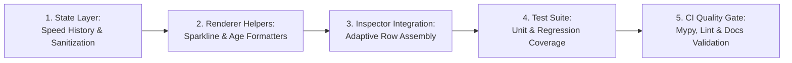

# Implementation Plan — F-2.1: Live Speed Sparkline & Telemetry Age Indicator

> **Reference:** [TUI Feature Enhancements & Expansion Specification (`F-2.1`)](./tui-feature-enhancements.md#f-21-live-speed-sparkline--telemetry-age-indicator), [`README.md` Architectural Overview](../README.md)  
> **Target Modules:** [`../tui/renderer.py`](../tui/renderer.py), [`../tui/state.py`](../tui/state.py)  
> **Test Suites:** [`../tests/test_tui_renderer.py`](../tests/test_tui_renderer.py), [`../tests/test_tui_state.py`](../tests/test_tui_state.py)  
> **Relevant Rules & Skills:** [`../.agents/skills/diagrams-and-documentation/SKILL.md`](../.agents/skills/diagrams-and-documentation/SKILL.md), [`../.agents/skills/markdown-relative-paths/SKILL.md`](../.agents/skills/markdown-relative-paths/SKILL.md), [`../.agents/skills/tui-compatibility-tester/SKILL.md`](../.agents/skills/tui-compatibility-tester/SKILL.md), [`../.agents/skills/ci-quality-gate/SKILL.md`](../.agents/skills/ci-quality-gate/SKILL.md)

---

## 1. Executive Summary & Objective

The **Selected Train Telemetry Inspector** ([`../tui/renderer.py#L945-L1034`](../tui/renderer.py#L945-L1034)) provides granular telemetry for the train highlighted in the roster or followed by the camera. Currently, the Inspector displays static instantaneous speed (`Speed: 142.0 km/h`) without historical velocity context, and provides no indication of telemetry data freshness or transponder connectivity health.

On Hellenic Railways lines, trains routinely transition between high-speed mainline segments (up to $160\text{ km/h}$ on PATHE) and mountainous or suburban deceleration corridors, as well as dwell periods at stations. Without temporal context, operators cannot determine whether a train is accelerating out of a station, cruising at track speed, braking for a switch, or if a stationary reading represents an active dwell or a dropped GPS transponder.

This implementation plan delivers **Feature F-2.1: Live Speed Sparkline & Telemetry Age Indicator** while adhering strictly to zero-dependency standard-library purity, UTF-8/ASCII dual rendering, and thread-safe snapshot isolation.

### Core Objectives
1. **Live Speed Sparkline (`format_speed_sparkline`):** Render a compact historical velocity graph (up to 10–12 recent samples from `record.trail`) using an 8-level glyph scale normalized against $V_{\max} = \max(160.0, \max(\text{speeds}))\text{ km/h}$, followed by an instantaneous kinematic trend arrow (`▲` accelerating, `▼` braking, `─` steady).
2. **Telemetry Freshness & Deadband Stale Indicator (`format_telemetry_age`):** Surface the elapsed time since the transponder's last position report (`time.time() - record.last_updated`) and sequence counter (`#update_count`), visually color-coded with normal, warning ($>30\text{s}$), and critical alert ($>120\text{s}$) attributes to instantly highlight transponder drops or dead reckoning freezes.
3. **Responsive Inspector Window Formatting:** Prioritize rows within the Inspector pane so critical telemetry (Train No, Route, Speed, Speed Trend, Delay, Telemetry Freshness, Progress) remains fully visible on standard $80 \times 24$ consoles (`inner_h = 9`), while smoothly accommodating secondary attributes (Locomotive, Status, Heading, Chainage) on larger displays.
4. **100% Zero-Dependency & ASCII Degradation:** Provide an ASCII fallback (`_.-=+*#@` and `^ / v / -`) when launched with `--ascii` or on legacy monochrome consoles.

---

## 2. Architecture & Data Flow Diagrams

### 2.1 Telemetry Age & Sparkline Generation Flow (Mermaid)

```mermaid
flowchart TD
    subgraph Ingestion ["Telemetry Ingestion (StreamWorker Thread)"]
        SSE["SSE / Mock Telemetry Stream"] -->|TrainPosition| AP["TrainRecord.append_breadcrumb()"]
        AP -->|Updates| TR["TrainRecord (trail: Deque[HistoricalBreadcrumb], last_updated, update_count)"]
    end

    subgraph Snapshot ["State Layer (tui/state.py)"]
        TR -->|get_snapshot()| SNAP["StateSnapshot (selected_train clone)"]
    end

    subgraph Formatting ["Sparkline & Age Pipeline (tui/renderer.py)"]
        SNAP -->|Extract Speeds| SPK["format_speed_sparkline(speeds, max_bars, ascii_mode)"]
        SNAP -->|Extract last_updated| AGE["format_telemetry_age(last_updated, update_count, now)"]
        SPK -->|8-Level Glyphs + Trend Arrow| ROW_SPK["Row: 'Speed Trend:'"]
        AGE -->|Elapsed Time + Alert Pair| ROW_AGE["Row: 'Telemetry:'"]
    end

    subgraph Display ["Curses Rendering Pane (tui/renderer.py)"]
        ROW_SPK --> INSP["TUIRenderer.render_inspector()"]
        ROW_AGE --> INSP
        INSP --> WIN["Inspector Curses Window"]
    end
```

### 2.2 Telemetry Health State Machine (Mermaid)



### 2.3 Visual Pipeline & Inspector Console Layout (ASCII)

```text
+-----------------------------------------------------------------------------------+
|               LIVE SPEED SPARKLINE & TELEMETRY AGE RENDER PIPELINE                |
+-----------------------------------------------------------------------------------+

  TrainRecord.trail (Deque[HistoricalBreadcrumb]) + TrainRecord.last_updated
                                    |
                                    v
  [1. Speed History Extraction]     |   [2. Telemetry Freshness Assessment]
  speeds = [b.speed for b in trail] |   age_sec = now - record.last_updated
  speeds.append(pos.speed)          |   count = record.update_count
                                    |
                                    v
  [format_speed_sparkline()]        |   [format_telemetry_age()]
  V_max = max(160.0, max(speeds))   |   - age <= 30s  -> PAIR_DEFAULT
  levels = int((v / V_max) * 8)     |   - age <= 120s -> PAIR_TRAIN_WARN
  delta_v = speeds[-1] - speeds[-2] |   - age > 120s  -> PAIR_TRAIN_ALERT
                                    |
                                    v
+-----------------------------------------------------------------------------------+
|                        INSPECTOR PANE LAYOUT (32 x 11)                            |
+-----------------------------------------------------------------------------------+
| [ SELECTED TRAIN TELEMETRY ]                                                      |
| Train No:     1599 (IC)                                                           |
| Route:        ΑΘΗΝΑ -> ΘΕΣΣΑΛΟΝΙΚΗ                                                |
| Next Station: Λάρισα                                                              |
| Speed:        142.0 km/h                                                          |
| Speed Trend:   ▂▃▅▆▇██▇▇█ ▲                                                       |
| Delay:        +9 min (Minor Delay)                                                |
| Telemetry:    Updated 2s ago (#48)                                                |
| Progress:     [======>---------------]  28%                                       |
| Locomotive:   120-024                                                             |
+-----------------------------------------------------------------------------------+
```

---

## 3. Detailed Component Specifications

### 3.1 State Layer Extension: [`../tui/state.py`](../tui/state.py)

#### A. Defensive Speed Sanitization in `append_breadcrumb`
Ensure `HistoricalBreadcrumb.speed` is guaranteed to be a valid `float` (coercing `None` to `0.0`), preventing `TypeError` during mathematical normalization:

```python
# In TrainRecord.append_breadcrumb:
speed_val = float(pos.speed) if pos.speed is not None else 0.0
self.trail.append(
    HistoricalBreadcrumb(
        lat=pos.lat,
        lng=pos.lng,
        timestamp=now,
        speed=speed_val,
    )
)
```

#### B. Helper Method: `TrainRecord.get_speed_history`
Add a dedicated helper on `TrainRecord` to extract an ordered sequence of velocity points including the latest instantaneous position:

```python
def get_speed_history(self, max_samples: int = 15) -> List[float]:
    """Extract chronological speed samples from historical trail and current position.

    Args:
        max_samples: Maximum number of recent velocity readings to return.

    Returns:
        List of non-negative float speed values in km/h.
    """
    speeds: List[float] = []
    for crumb in self.trail:
        speeds.append(max(0.0, float(crumb.speed if crumb.speed is not None else 0.0)))

    # Include instantaneous speed from current position if available
    curr_spd = self.position.speed
    if curr_spd is not None:
        speeds.append(max(0.0, float(curr_spd)))

    if len(speeds) > max_samples:
        return speeds[-max_samples:]
    return speeds
```

---

### 3.2 Renderer Layer: [`../tui/renderer.py`](../tui/renderer.py)

#### A. Sparkline Glyphs Constants
Define 8-level height bars for UTF-8 and ASCII modes:

```python
SPARKLINE_BARS_UTF8: Tuple[str, ...] = (" ", "▂", "▃", "▄", "▅", "▆", "▇", "█")
SPARKLINE_BARS_ASCII: Tuple[str, ...] = ("_", ".", "-", "=", "+", "*", "#", "@")

TREND_UP_UTF8: str = "▲"
TREND_DOWN_UTF8: str = "▼"
TREND_STEADY_UTF8: str = "─"

TREND_UP_ASCII: str = "^"
TREND_DOWN_ASCII: str = "v"
TREND_STEADY_ASCII: str = "-"
```

#### B. Sparkline Generation Function: `format_speed_sparkline`

```python
def format_speed_sparkline(
    speeds: Sequence[float],
    max_bars: int = 10,
    ascii_mode: bool = False,
    v_max_floor: float = 160.0,
) -> str:
    """Render a compact speed sparkline with instantaneous kinematic trend arrow.

    Args:
        speeds: Chronological sequence of speed samples in km/h.
        max_bars: Maximum number of bar characters to render.
        ascii_mode: Whether to restrict output to 7-bit ASCII characters.
        v_max_floor: Baseline normalization speed ceiling in km/h (default: 160.0 km/h).

    Returns:
        Formatted string containing sparkline bars and trailing trend arrow (e.g. ' ▂▃▅▆▇██ ▲').
    """
    if not speeds:
        empty_bar = "_" if ascii_mode else " "
        trend_steady = TREND_STEADY_ASCII if ascii_mode else TREND_STEADY_UTF8
        return f"{empty_bar} {trend_steady}"

    # Select recent window
    window = list(speeds[-max_bars:]) if len(speeds) > max_bars else list(speeds)
    v_max = max(v_max_floor, max(window))

    bar_glyphs = SPARKLINE_BARS_ASCII if ascii_mode else SPARKLINE_BARS_UTF8
    num_levels = len(bar_glyphs)

    bars: List[str] = []
    for spd in window:
        clamped_spd = max(0.0, float(spd))
        ratio = clamped_spd / v_max if v_max > 0.0 else 0.0
        idx = min(num_levels - 1, int(ratio * num_levels))
        bars.append(bar_glyphs[idx])

    # Compute trend arrow from last two points
    if len(window) >= 2:
        delta_v = window[-1] - window[-2]
    else:
        delta_v = 0.0

    if delta_v > 3.0:
        arrow = TREND_UP_ASCII if ascii_mode else TREND_UP_UTF8
    elif delta_v < -3.0:
        arrow = TREND_DOWN_ASCII if ascii_mode else TREND_DOWN_UTF8
    else:
        arrow = TREND_STEADY_ASCII if ascii_mode else TREND_STEADY_UTF8

    return f"{''.join(bars)} {arrow}"
```

#### C. Telemetry Age Formatting Function: `format_telemetry_age`

```python
def format_telemetry_age(
    last_updated: float,
    update_count: int,
    now: Optional[float] = None,
) -> Tuple[str, int]:
    """Calculate elapsed telemetry age and resolve warning color attributes.

    Args:
        last_updated: Epoch timestamp of the last received position message.
        update_count: Total position updates received for this train.
        now: Current epoch timestamp (defaults to time.time()).

    Returns:
        Tuple of (formatted_age_string, curses_color_pair_index).
    """
    current_time = now if now is not None else time.time()
    age_sec = max(0, int(current_time - last_updated))

    if age_sec < 60:
        age_str = f"{age_sec}s ago"
    elif age_sec < 3600:
        mins = age_sec // 60
        secs = age_sec % 60
        age_str = f"{mins}m {secs}s ago"
    else:
        hours = age_sec // 3600
        mins = (age_sec % 3600) // 60
        age_str = f"{hours}h {mins}m ago"

    if age_sec > 120:
        return f"Updated {age_str} [STALE]", PAIR_TRAIN_ALERT
    elif age_sec > 30:
        return f"Updated {age_str} (#{update_count})", PAIR_TRAIN_WARN
    else:
        return f"Updated {age_str} (#{update_count})", PAIR_DEFAULT
```

#### D. Adaptive Row Layout in `TUIRenderer.render_inspector`
To guarantee that the newly added `Speed Trend` and `Telemetry` rows do not push `Progress` off-screen when the terminal row count is constrained ($80 \times 24$ where `inner_h = 9`), assemble `rows` in hierarchical priority order:

```python
# Priority row hierarchy:
# 1. Train No
# 2. Route
# 3. Next Station
# 4. Speed
# 5. Speed Trend (F-2.1)
# 6. Delay
# 7. Telemetry (F-2.1)
# 8. Progress
# 9. Locomotive
# 10. Status (Visible when inner_h >= 10)
# 11. Heading (Visible when inner_h >= 11)
# 12. Chainage (Visible when inner_h >= 12)
```

---

## 4. Visual Mockups

### 4.1 UTF-8 Inspector Pane ($80 \times 24$ Standard Terminal, `inner_h = 9`)

```text
+------------------------------+
| [ SELECTED TRAIN TELEMETRY ] |
| Train No:     1599 (IC)      |
| Route:        ΑΘΗΝ -> ΘΕΣΣ   |
| Next Station: Λάρισα         |
| Speed:        142.0 km/h     |
| Speed Trend:   ▂▃▅▆▇██▇▇█ ▲  |
| Delay:        +9 min (Minor) |
| Telemetry:    Updated 2s ago |
| Progress:     [=====>----] 52|
| Locomotive:   120-024        |
+------------------------------+
```

### 4.2 ASCII Fallback Inspector Pane (`--ascii` Mode)

```text
+------------------------------+
| [ SELECTED TRAIN TELEMETRY ] |
| Train No:     1599 (IC)      |
| Route:        ATH -> THESS   |
| Next Station: Larissa        |
| Speed:        142.0 km/h     |
| Speed Trend:  _.-=+*##@@# ^  |
| Delay:        +9 min (Minor) |
| Telemetry:    Updated 2s ago |
| Progress:     [=====>----] 52|
| Locomotive:   120-024        |
+------------------------------+
```

### 4.3 Stale Transponder Alert State (`age_sec = 145s`)

```text
+------------------------------+
| [ SELECTED TRAIN TELEMETRY ] |
| Train No:     2236 (PR)      |
| Route:        ΠΕΙΡ -> ΑΕΡΟ   |
| Next Station: Μεταμόρφωση    |
| Speed:          0.0 km/h     |
| Speed Trend:   ▂▂            |
| Delay:        0 min (On Time)|
| Telemetry:    Updated 2m 25s |  <-- In BOLD RED (PAIR_TRAIN_ALERT)
|               ago [STALE]    |
| Progress:     [==========]100|
| Locomotive:   460-108        |
+------------------------------+
```

---

## 5. Step-by-Step Implementation Tasks



### Task 1: Update State Layer ([`../tui/state.py`](../tui/state.py))
- [ ] In `TrainRecord.append_breadcrumb`: Sanitize `pos.speed` via `float(pos.speed) if pos.speed is not None else 0.0`.
- [ ] Add `TrainRecord.get_speed_history(self, max_samples: int = 15) -> List[float]`.
- [ ] Ensure `TrainRecord.clone()` preserves sanitized speed data in the cloned trail deque.

### Task 2: Implement Sparkline & Age Helpers ([`../tui/renderer.py`](../tui/renderer.py))
- [ ] Define `SPARKLINE_BARS_UTF8`, `SPARKLINE_BARS_ASCII`, and `TREND_*` glyph constants.
- [ ] Implement `format_speed_sparkline(speeds, max_bars=10, ascii_mode=False, v_max_floor=160.0) -> str`.
- [ ] Implement `format_telemetry_age(last_updated, update_count, now=None) -> Tuple[str, int]`.
- [ ] Handle all boundary conditions: empty speed lists, uniform speeds, speeds exceeding $160\text{ km/h}$, zero velocities, negative elapsed seconds.

### Task 3: Integrate into Inspector Pane ([`../tui/renderer.py`](../tui/renderer.py))
- [ ] Extract speed history from `record.get_speed_history(max_samples=10)`.
- [ ] Generate `speed_trend_str` and `telemetry_age_str`.
- [ ] Reorder `rows` in `TUIRenderer.render_inspector` to prioritize high-value operational metrics on constrained consoles.
- [ ] Apply `PAIR_TRAIN_WARN` and `PAIR_TRAIN_ALERT` styling to the `Telemetry:` row based on age severity.

### Task 4: Expand Unit & Integration Test Suites ([`../tests/test_tui_renderer.py`](../tests/test_tui_renderer.py), [`../tests/test_tui_state.py`](../tests/test_tui_state.py))
- [ ] Test `format_speed_sparkline` across various speed trajectories:
  - Accelerating trajectory: assert `▲` / `^` trend arrow.
  - Braking trajectory: assert `▼` / `v` trend arrow.
  - Steady cruising trajectory: assert `─` / `-` trend arrow.
  - Speeds $> 160\text{ km/h}$ dynamic ceiling rescaling.
  - Zero speeds and empty sequences.
  - UTF-8 vs. `--ascii` character sets.
- [ ] Test `format_telemetry_age` thresholds:
  - $\le 30\text{s}$: `PAIR_DEFAULT` and `Updated Xs ago (#N)`.
  - $31\text{--}120\text{s}$: `PAIR_TRAIN_WARN` and `Updated Xm Ys ago (#N)`.
  - $> 120\text{s}$: `PAIR_TRAIN_ALERT` and `Updated ... ago [STALE]`.
- [ ] Test `render_inspector` output in `MockCursesWindow` at height 20, 24, and 40.

### Task 5: Execute CI Quality Gate & Documentation Validation
- [ ] Run full test suite: `python3 -m unittest discover -s tests`.
- [ ] Verify zero regressions in existing 384 tests.
- [ ] Run relative paths and documentation link audit:
  ```bash
  grep -En "file://|/home/|/Users/|[A-Za-z]:\\\\" docs/f-2-1-speed-sparkline-telemetry-age-plan.md
  ```

---

## 6. Verification & Test Plan

| Test ID | Target Function | Test Scenario | Expected Outcome |
| :--- | :--- | :--- | :--- |
| **TEST-SPK-01** | `format_speed_sparkline` | Empty speed list | Returns single baseline glyph and steady arrow (`  ─` / `_ -`) |
| **TEST-SPK-02** | `format_speed_sparkline` | Steady speed `[120.0, 120.0, 120.0]` | Uniform bars with `─` (UTF-8) or `-` (ASCII) |
| **TEST-SPK-03** | `format_speed_sparkline` | Rapid acceleration `[80.0, 100.0, 130.0]` | Ascending glyph levels with `▲` (UTF-8) or `^` (ASCII) |
| **TEST-SPK-04** | `format_speed_sparkline` | Hard braking `[140.0, 110.0, 60.0]` | Descending glyph levels with `▼` (UTF-8) or `v` (ASCII) |
| **TEST-SPK-05** | `format_speed_sparkline` | High speed test `200.0 km/h` | $V_{\max}$ dynamic scaling to 200, no bar overflow |
| **TEST-SPK-06** | `format_speed_sparkline` | `--ascii` mode flag | 100% 7-bit ASCII characters (`_.-=+*#@`, `^/v/-`) |
| **TEST-AGE-01** | `format_telemetry_age` | Fresh telemetry (`age = 2s`) | Returns `"Updated 2s ago (#10)"` with `PAIR_DEFAULT` |
| **TEST-AGE-02** | `format_telemetry_age` | Warning threshold (`age = 45s`) | Returns `"Updated 45s ago (#10)"` with `PAIR_TRAIN_WARN` |
| **TEST-AGE-03** | `format_telemetry_age` | Critical staleness (`age = 150s`) | Returns `"Updated 2m 30s ago [STALE]"` with `PAIR_TRAIN_ALERT` |
| **TEST-INSP-01** | `render_inspector` | Standard $80 \times 24$ geometry | `Speed Trend` and `Telemetry` rows visible without row overlap |
| **TEST-INSP-02** | `render_inspector` | Sub-minimum height ($40 \times 10$) | Graceful row truncation without curses exceptions |

---

## 7. Risk Analysis & Defensive Guardrails

1. **Terminal Font Compatibility (Missing Unicode Braille / Block Elements):**
   - *Risk:* Some minimal SSH clients or Windows `cmd.exe` without UTF-8 codepages render Unicode block elements as replacement glyphs (`?` or ``).
   - *Mitigation:* The existing `--ascii` CLI flag and auto-detection mechanism in `TUIRenderer` route to `SPARKLINE_BARS_ASCII` (`_.-=+*#@`) and ASCII trend arrows (`^`, `v`, `-`), which are verified across all standard terminal emulators.
2. **Missing or `None` Speeds in Stream Ingestion:**
   - *Risk:* Live upstream SSE feeds may emit `null` or missing speed values during station stops or tunnel traverses.
   - *Mitigation:* `get_speed_history()` defensive coercions guarantee all extracted values are normalized to `float >= 0.0`.
3. **Clock Jitter / NTP Time Adjustments:**
   - *Risk:* If local system time adjusts backward during execution, `time.time() - last_updated` could evaluate to negative numbers.
   - *Mitigation:* `max(0, int(current_time - last_updated))` strictly guards against negative ages.
4. **Thread-Safe Snapshot Isolation:**
   - *Risk:* The UI thread reads `record.trail` while `StreamWorker` mutates it on another thread.
   - *Mitigation:* Existing `StateSnapshot` shallow cloning copies `deque(record.trail)` under `TrainStateStore._lock`, ensuring renderer calculations operate on an immutable, thread-isolated collection.
