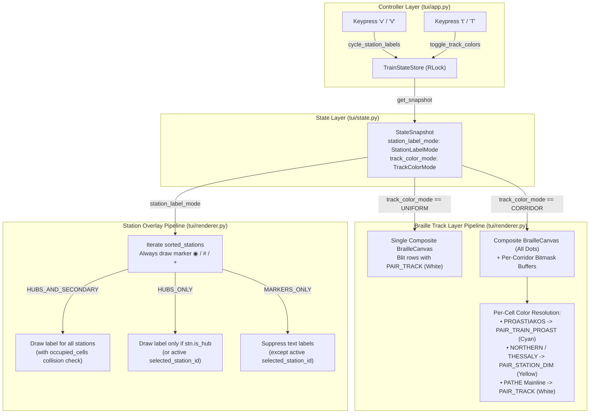
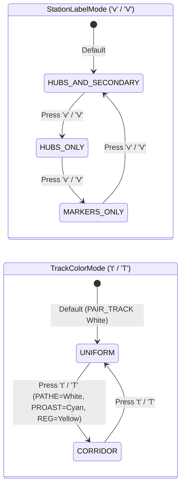
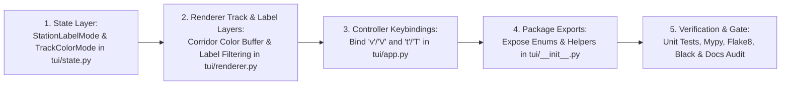

# Implementation Plan — F-3.3: Map Layer Toggles (`v` Station Labels / `t` Corridor Track Colors)

> **Reference:** [TUI Feature Enhancements & Expansion Specification (`F-3.3`)](./tui-feature-enhancements.md#f-33-map-layer-toggles-v-station-labels--t-corridor-track-colors), [`README.md` Architectural Overview](../README.md)  
> **Target Modules:** [`../tui/state.py`](../tui/state.py), [`../tui/app.py`](../tui/app.py), [`../tui/renderer.py`](../tui/renderer.py), [`../tui/__init__.py`](../tui/__init__.py)  
> **Test Suites:** [`../tests/test_tui_state.py`](../tests/test_tui_state.py), [`../tests/test_tui_controls.py`](../tests/test_tui_controls.py), [`../tests/test_tui_renderer.py`](../tests/test_tui_renderer.py)  
> **Relevant Rules & Skills:** [`../.agents/skills/diagrams-and-documentation/SKILL.md`](../.agents/skills/diagrams-and-documentation/SKILL.md), [`../.agents/skills/markdown-relative-paths/SKILL.md`](../.agents/skills/markdown-relative-paths/SKILL.md), [`../.agents/skills/tui-compatibility-tester/SKILL.md`](../.agents/skills/tui-compatibility-tester/SKILL.md), [`../.agents/skills/ci-quality-gate/SKILL.md`](../.agents/skills/ci-quality-gate/SKILL.md)

---

## 1. Executive Summary & Objective

At macro and national zoom levels (`0.2x`–`1.5x`), the 48 stations in [`../tui/data/stations.json`](../tui/data/stations.json) project into dense clusters along the Attica basin (*Piraeus*–*Athens*–*SKA*–*Airport*–*Chalkida*), Thessaly junctions (*Paleofarsalos*–*Larissa*–*Volos*), and Thessaloniki approaches (*Platy*–*Thessaloniki*). Even with greedy horizontal collision avoidance in [`TUIRenderer.render_map`](../tui/renderer.py#L1262-L1345), rendering secondary station text labels at low zoom levels can obscure adjacent track geometry and live train heading glyphs. Simultaneously, rasterizing all seven railway corridors from [`../tui/data/tracks.json`](../tui/data/tracks.json) onto a single monochromatic dim-white [`BrailleCanvas`](../tui/geo.py#L566-L748) (`PAIR_TRACK`) makes it difficult to visually distinguish the electrified `PATHE` mainline trunk from `PROASTIAKOS` suburban branches or `NORTHERN` / `THESSALY` / `WESTERN_MACEDONIA` regional lines.

This implementation plan delivers **Feature F-3.3: Map Layer Toggles (`v` Station Labels / `t` Corridor Track Colors)** across the thread-safe state repository ([`../tui/state.py`](../tui/state.py)), event controller ([`../tui/app.py`](../tui/app.py)), and multi-pane Curses renderer ([`../tui/renderer.py`](../tui/renderer.py)) while preserving 100% Python standard-library purity, sub-pixel orthogonal track-snapping alignment, and 7-bit `--ascii` fallback compatibility.

### Core Objectives
1. **Station Label Visibility Mode (`v` / `V` Key & `StationLabelMode` Enum in [`../tui/state.py`](../tui/state.py)):**
   - Cycle station label density across three cartographic levels:
     1. `StationLabelMode.HUBS_AND_SECONDARY` (default: all stations with greedy collision avoidance; major hubs in bold yellow `PAIR_STATION`, secondary stations in dim yellow `PAIR_STATION_DIM`).
     2. `StationLabelMode.HUBS_ONLY` (draw all 48 `◉` / `#`/`+` station node markers, but render text labels exclusively for major interchange/terminal hubs where `stn.is_hub == True` or the active station in `InspectorMode.STATION`).
     3. `StationLabelMode.MARKERS_ONLY` (draw all `◉` / `#`/`+` station node markers without text labels—except for the active inspected station in `InspectorMode.STATION`—for maximum track and train visibility).
2. **Corridor-Colored Braille Track Layers (`t` / `T` Key & `TrackColorMode` Enum in [`../tui/state.py`](../tui/state.py)):**
   - Toggle between uniform dim-white tracks (`TrackColorMode.UNIFORM`, default `PAIR_TRACK`) and semantic corridor-colored Braille track rendering (`TrackColorMode.CORRIDOR`):
     - **Mainline Trunk (`PATHE` / `pathe-mainline`):** `PAIR_TRACK` (White)
     - **Suburban Lines (`PROASTIAKOS` / `proastiakos-airport-kiato`, `proastiakos-chalkida`):** `PAIR_TRAIN_PROAST` (Cyan)
     - **Northern & Regional Branches (`NORTHERN`, `THESSALY`, `MACEDONIA` / `northern-corridor`, `thessaloniki-idomeni`, `thessaly-kalambaka`, `thessaly-volos`, `western-macedonia`):** `PAIR_STATION_DIM` (Yellow)
   - Preserve exact $2 \times 4$ Braille sub-pixel bitmask composition (`chr(0x2800 + mask)`) at shared junction cells (e.g., *SKA* where `pathe-mainline`, `proastiakos-airport-kiato`, and `proastiakos-chalkida` converge) while resolving deterministic per-cell color priority (`PROASTIAKOS` $\rightarrow$ `NORTHERN`/`THESSALY` $\rightarrow$ `PATHE`).
3. **Viewport Title Badge, Status Bar & Help Modal Integration ([`../tui/renderer.py`](../tui/renderer.py)):**
   - Reflect non-default or active layer states in the map viewport header badge, bottom status bar cheat sheet (`[v] Labels  [t] Tracks`), and `?` Keyboard Controls modal.

---

## 2. Architecture & State Machine Diagrams

### 2.1 Map Layer Toggle & Multi-Layer Braille Composition Pipeline (Mermaid)



### 2.2 Station Label & Track Color State Machines (Mermaid)



### 2.3 Visual Pipeline & Multi-Layer Sub-Pixel Rasterization (ASCII)

```text
+-----------------------------------------------------------------------------------+
|            F-3.3 MAP LAYER TOGGLES: STATION LABELS ('v') & TRACK COLORS ('t')     |
+-----------------------------------------------------------------------------------+

  [User Keypress 'v' / 'V']                        [User Keypress 't' / 'T']
              |                                                |
              v                                                v
  +---------------------------------------+        +--------------------------------+
  | TrainStateStore.cycle_station_labels()|        | TrainStateStore                |
  |                                       |        |   .toggle_track_color_mode()   |
  |  HUBS_AND_SECONDARY  (Labels: ALL)    |        |                                |
  |         |                             |        |  UNIFORM   (Tracks: MONO)      |
  |         v                             |        |     |                          |
  |     HUBS_ONLY        (Labels: HUBS)   |        |     v                          |
  |         |                             |        |  CORRIDOR  (Tracks: COLOR)     |
  |         v                             |        +--------------------------------+
  |    MARKERS_ONLY      (Labels: NONE)   |                        |
  +---------------------------------------+                        |
              |                                                    |
              +------------------------+---------------------------+
                                       |
                                       v
  +---------------------------------------------------------------------------------+
  | TUIRenderer.render_map(win, snapshot, projector)                                |
  |                                                                                 |
  |  1. Track Rasterization:                                                        |
  |     - Master BrailleCanvas accumulates all 2x4 sub-pixel dots across corridors  |
  |       (used by projector.resolve_track_cell() for train & station snapping).    |
  |     - If TrackColorMode.UNIFORM:                                                |
  |         Render each row string in PAIR_TRACK | A_DIM (White).                   |
  |     - If TrackColorMode.CORRIDOR:                                               |
  |         Resolve per-cell corridor attribute via resolve_track_corridor_pair()   |
  |         and blit contiguous color runs:                                         |
  |           * PATHE ('pathe-mainline')              -> PAIR_TRACK (White)         |
  |           * PROASTIAKOS ('proastiakos-*')         -> PAIR_TRAIN_PROAST (Cyan)   |
  |           * NORTHERN / THESSALY / MACEDONIA       -> PAIR_STATION_DIM (Yellow)  |
  |                                                                                 |
  |  2. Station Node & Label Overlay:                                               |
  |     - Always draw station node glyph ('◉' in UTF-8, '#' / '+' in --ascii)       |
  |       and mark (col, row) in occupied_cells.                                    |
  |     - Evaluate should_draw_station_label(stn, mode, is_active_station):         |
  |         * HUBS_AND_SECONDARY -> True for all stations                           |
  |         * HUBS_ONLY          -> True iff stn.is_hub or is_active_station        |
  |         * MARKERS_ONLY       -> True iff is_active_station                      |
  +---------------------------------------------------------------------------------+
```

---

## 3. Detailed Component Specifications

### 3.1 State Layer: [`../tui/state.py`](../tui/state.py)

#### A. `StationLabelMode` and `TrackColorMode` Enums
Following the repository's enum standard (see [`docs/p2-4-boolean-parameters-to-enums-fix-plan.md`](./p2-4-boolean-parameters-to-enums-fix-plan.md)), define both layer states as explicit `Enum` types right after `InspectorMode` in [`../tui/state.py`](../tui/state.py#L56-L61):

```python
class StationLabelMode(Enum):
    """Visibility policy for station text labels on the map canvas."""

    HUBS_AND_SECONDARY = auto()  # Default: All stations labeled (with collision avoidance)
    HUBS_ONLY = auto()           # Only major interchange/terminal hub labels (stn.is_hub)
    MARKERS_ONLY = auto()        # Draw ◉ / #/+ station markers without text labels


class TrackColorMode(Enum):
    """Colorization policy for Braille railway track polylines on the map canvas."""

    UNIFORM = auto()   # Default: Uniform dim-white tracks (PAIR_TRACK)
    CORRIDOR = auto()  # Corridor-colored tracks (PATHE=White, PROASTIAKOS=Cyan, Regional=Yellow)
```

#### B. `StateSnapshot` Extension
Add `station_label_mode` and `track_color_mode` with backward-compatible default values to [`StateSnapshot`](../tui/state.py#L144-L166):

```python
@dataclass(frozen=True)
class StateSnapshot:
    ...
    sort_mode: RosterSortMode = RosterSortMode.TRAIN_ID
    breadcrumb_mode: BreadcrumbMode = BreadcrumbMode.ALL
    inspector_mode: InspectorMode = InspectorMode.TRAIN
    selected_station_id: Optional[str] = None
    station_label_mode: StationLabelMode = StationLabelMode.HUBS_AND_SECONDARY
    track_color_mode: TrackColorMode = TrackColorMode.UNIFORM
```

*(Defaulting `station_label_mode = StationLabelMode.HUBS_AND_SECONDARY` and `track_color_mode = TrackColorMode.UNIFORM` ensures full backward compatibility with all existing unit tests constructing `StateSnapshot`).*

#### C. `TrainStateStore` Attributes & Thread-Safe Mutators
1. In [`TrainStateStore.__init__`](../tui/state.py#L285-L312), initialize:
   ```python
   self._station_label_mode: StationLabelMode = StationLabelMode.HUBS_AND_SECONDARY
   self._track_color_mode: TrackColorMode = TrackColorMode.UNIFORM
   ```
2. In [`TrainStateStore.get_snapshot`](../tui/state.py#L395-L433), include:
   ```python
   station_label_mode=self._station_label_mode,
   track_color_mode=self._track_color_mode,
   ```
3. Add thread-safe setters and cycling methods under `self._lock` in [`TrainStateStore`](../tui/state.py):
   ```python
   def set_station_label_mode(self, mode: StationLabelMode) -> None:
       """Explicitly set the active station label visibility mode."""
       if not isinstance(mode, StationLabelMode):
           raise TypeError(f"Expected StationLabelMode, got {type(mode).__name__}")
       with self._lock:
           if self._station_label_mode != mode:
               self._station_label_mode = mode
               self._version += 1

   def cycle_station_label_mode(self) -> StationLabelMode:
       """Cycle station label visibility: HUBS_AND_SECONDARY -> HUBS_ONLY -> MARKERS_ONLY -> HUBS_AND_SECONDARY."""
       cycle_order = (
           StationLabelMode.HUBS_AND_SECONDARY,
           StationLabelMode.HUBS_ONLY,
           StationLabelMode.MARKERS_ONLY,
       )
       with self._lock:
           curr_idx = cycle_order.index(self._station_label_mode)
           self._station_label_mode = cycle_order[(curr_idx + 1) % len(cycle_order)]
           self._version += 1
           return self._station_label_mode

   def set_track_color_mode(self, mode: TrackColorMode) -> None:
       """Explicitly set the active Braille track colorization mode."""
       if not isinstance(mode, TrackColorMode):
           raise TypeError(f"Expected TrackColorMode, got {type(mode).__name__}")
       with self._lock:
           if self._track_color_mode != mode:
               self._track_color_mode = mode
               self._version += 1

   def cycle_track_color_mode(self) -> TrackColorMode:
       """Toggle Braille track colorization mode: UNIFORM <-> CORRIDOR."""
       cycle_order = (
           TrackColorMode.UNIFORM,
           TrackColorMode.CORRIDOR,
       )
       with self._lock:
           curr_idx = cycle_order.index(self._track_color_mode)
           self._track_color_mode = cycle_order[(curr_idx + 1) % len(cycle_order)]
           self._version += 1
           return self._track_color_mode
   ```

---

### 3.2 Controller Layer: [`../tui/app.py`](../tui/app.py)

1. **Imports:** Import `StationLabelMode` and `TrackColorMode` from `tui.state`.
2. **Action Methods on `TUIApp`:**
   ```python
   def cycle_station_labels(self) -> StationLabelMode:
       """Cycle station label visibility mode (HUBS_AND_SECONDARY -> HUBS_ONLY -> MARKERS_ONLY)."""
       return self.store.cycle_station_label_mode()

   def toggle_track_colors(self) -> TrackColorMode:
       """Toggle corridor-colored Braille track rendering (UNIFORM <-> CORRIDOR)."""
       return self.store.cycle_track_color_mode()
   ```
3. **Keybinding Dispatch in [`TUIApp._handle_normal_input`](../tui/app.py#L477-L556):**
   Bind `v` / `V` and `t` / `T` in `InputMode.NORMAL` (leaving `InputMode.SEARCH` untouched so typing `v` or `t` in a search query appends to `self.search_buffer`):
   ```python
   # Cycle station label visibility mode (All, Hubs Only, Markers Only)
   elif key in (ord("v"), ord("V")):
       self.cycle_station_labels()

   # Toggle corridor-colored Braille track rendering (Uniform, Corridor)
   elif key in (ord("t"), ord("T")):
       self.toggle_track_colors()
   ```

---

### 3.3 Presentation Layer: [`../tui/renderer.py`](../tui/renderer.py)

#### A. Corridor Track Color Mapping (`get_track_corridor_color_pair`)
In [`../tui/data/tracks.json`](../tui/data/tracks.json), the 7 railway corridors have the following `corridor_id` values:
- `"pathe-mainline"` (`PATHE Mainline`)
- `"proastiakos-airport-kiato"` (`Proastiakos Airport - SKA - Kiato`)
- `"proastiakos-chalkida"` (`Proastiakos SKA - Inoi - Chalkida`)
- `"thessaloniki-idomeni"` (`Trans-Balkan Line`)
- `"northern-corridor"` (`Eastern Macedonia & Thrace`)
- `"thessaly-kalambaka"` (`Thessaly West Branch`)
- `"thessaly-volos"` (`Thessaly East Branch`)
- `"western-macedonia"` (`Western Macedonia Branch`)

Define a deterministic helper function `get_track_corridor_color_pair(corridor_id: Optional[str]) -> int` in [`../tui/renderer.py`](../tui/renderer.py):

```python
def get_track_corridor_color_pair(corridor_id: Optional[str]) -> int:
    """Resolve the curses color pair for a track polyline corridor in TrackColorMode.CORRIDOR.

    Mapping per F-3.3 specification:
        - PATHE ('pathe', 'pathe-mainline', 'e85', 'mainline'): PAIR_TRACK (White)
        - PROASTIAKOS ('proastiakos-*', 'suburban', 'pirair', 'kiato', 'chalkida'): PAIR_TRAIN_PROAST (Cyan)
        - NORTHERN / THESSALY / Regional ('northern-*', 'thessaly-*', 'thessaloniki-idomeni',
          'western-macedonia', 'macedonia', 'thrace'): PAIR_STATION_DIM (Yellow)

    Args:
        corridor_id: Corridor identifier or name from TrackPolyline.

    Returns:
        Curses color pair constant (PAIR_TRACK, PAIR_TRAIN_PROAST, or PAIR_STATION_DIM).
    """
    if not corridor_id or not corridor_id.strip():
        return PAIR_TRACK
    norm = corridor_id.strip().upper()
    if any(
        k in norm
        for k in ("PROAST", "SUBURBAN", "PIRAIR", "KIATO", "AERODROMIO", "AIRPORT", "CHALKIDA")
    ):
        return PAIR_TRAIN_PROAST
    if any(
        k in norm
        for k in (
            "NORTHERN",
            "THESSALY",
            "MACEDONIA",
            "THRACE",
            "IDOMENI",
            "VOLOS",
            "KALAMBAKA",
            "FLORINA",
            "ALEX",
        )
    ):
        return PAIR_STATION_DIM
    return PAIR_TRACK
```

#### B. Multi-Layer Braille Track Rendering with Sub-Pixel Bitmask Composition
A critical detail in Braille rasterization is what happens when two tracks share a character cell (or overlap along the *SKA*–*Inoi* shared trunk where both `pathe-mainline` and `proastiakos-chalkida` run, or at *Larissa* / *Paleofarsalos* / *Platy* / *Thessaloniki* junctions):
1. **Master `canvas` for Orthogonal Track Snapping & Combined Sub-Pixel Dots:**
   - We continue rasterizing all `self.tracks` onto the primary `canvas = BrailleCanvas(width_cells=inner_w, height_cells=inner_h, ascii_mode=self.ascii_mode)`.
   - This guarantees that:
     - Every cell's 8-dot Braille character (`rows = canvas.render_rows()`) contains the union of all sub-pixel dots entering that cell (never overwriting one track's dots with spaces from another track!).
     - `projector.resolve_track_cell(snapped_pt, canvas)` works identically in both `UNIFORM` and `CORRIDOR` modes.
2. **Per-Cell Color Attribute Resolution in `TrackColorMode.CORRIDOR`:**
   - When `track_color_mode == TrackColorMode.UNIFORM` (default):
     - Fast path: blit each `row_str` in `rows` with a single `safe_addstr(win, 1 + r_idx, 1, row_str, track_attr, max_w=inner_w, ascii_mode=self.ascii_mode)`.
   - When `track_color_mode == TrackColorMode.CORRIDOR`:
     - Maintain a lightweight per-cell color pair buffer `cell_pairs: List[int] = [PAIR_TRACK] * (inner_w * inner_h)`.
     - For each `track` in `self.tracks`:
       - Rasterize `sub_points = [projector.geo_to_subpixel(pt) for pt in track.points]` into a per-track `track_canvas = BrailleCanvas(inner_w, inner_h, ascii_mode=self.ascii_mode)` (or directly merge into `canvas.buffer` while tagging touched cell indices).
       - Even simpler and zero-allocation-overhead: record the track's color pair `pair = get_track_corridor_color_pair(track.corridor_id)`. For every cell index `idx` where `track_canvas.buffer[idx] != 0`:
         - Merge `canvas.buffer[idx] |= track_canvas.buffer[idx]`.
         - Update `cell_pairs[idx]` using a clean visual priority order so branch/suburban colors remain visible at mainline junctions (or follow track definition order where `pathe-mainline` is drawn first, then `proastiakos-*` and regional branches overlay their corridor color):
           - Priority: `PAIR_TRAIN_PROAST` (Cyan) and `PAIR_STATION_DIM` (Yellow) override `PAIR_TRACK` (White) at shared cells.
     - When blitting each row `r_idx` of `rows = canvas.render_rows()`:
       - Group consecutive columns with identical cell attributes into contiguous horizontal runs `(run_start_col, run_text, run_attr)` and draw each run via `safe_addstr()`.
       - Grouping by contiguous color runs reduces curses `addstr` calls by $>90\%$ compared to cell-by-cell drawing, keeping frame rendering well under $1\text{ ms}$.

Let's verify the attributes used for each corridor color pair in `TrackColorMode.CORRIDOR`:
- `PAIR_TRACK`: `safe_color_pair(PAIR_TRACK, curses.A_DIM) | curses.A_DIM` (White)
- `PAIR_TRAIN_PROAST`: `safe_color_pair(PAIR_TRAIN_PROAST, curses.A_NORMAL)` (Cyan)
- `PAIR_STATION_DIM`: `safe_color_pair(PAIR_STATION_DIM, curses.A_DIM) | curses.A_DIM` (Yellow)

#### C. Station Label Visibility Filtering in `TUIRenderer.render_map`
In Step 3 of [`TUIRenderer.render_map`](../tui/renderer.py#L1262-L1345):
1. Read `station_label_mode = getattr(snapshot, "station_label_mode", StationLabelMode.HUBS_AND_SECONDARY)`.
2. For each station `stn` in `sorted_stations`:
   - Project `(col, row) = projector.resolve_track_cell(stn.point, canvas)`.
   - **Always** render the station marker glyph (`◉` in UTF-8, `#` for hubs / `+` for normal stations in `--ascii` mode) at `(1 + row, 1 + col)` and add `(col, row)` to `occupied_cells`.
   - Determine whether the text label should be drawn:
     ```python
     if station_label_mode == StationLabelMode.MARKERS_ONLY:
         should_draw_label = is_active_station
     elif station_label_mode == StationLabelMode.HUBS_ONLY:
         should_draw_label = stn.is_hub or is_active_station
     else:
         should_draw_label = True
     ```
   - Notice how keeping `is_active_station` (`InspectorMode.STATION` highlight from F-3.2) visible even in `HUBS_ONLY` or `MARKERS_ONLY` ensures that if an operator is actively inspecting a station departure board via `m`, that single inspected station's `[Name]` callout remains identifiable on the map! For all other stations:
     - In `HUBS_AND_SECONDARY`: all 48 stations draw labels (subject to `occupied_cells` collision avoidance).
     - In `HUBS_ONLY`: only hub stations (`stn.is_hub == True`) draw labels; secondary stations (`stn.is_hub == False`) draw only their `◉` / `+` marker and do not reserve label cells in `occupied_cells` (freeing horizontal space for nearby hub labels!).
     - In `MARKERS_ONLY`: no station text labels are drawn (only `◉` / `#`/`+` markers), providing an unobstructed view of tracks, breadcrumbs, and live train callouts.

#### D. Map Viewport Title Badge & Status Bar / Help Modal Integration
1. **Map Viewport Title Badge ([`TUIRenderer.render_map`](../tui/renderer.py#L1199-L1217)):**
   - Currently, the map viewport title is:
     `[ Map Viewport: 39.80°N, 22.50°E | Zoom: 1.5x | Trails: ALL ]`
   - To give operators immediate visual confirmation when cycling `v` (`StationLabelMode`) or `t` (`TrackColorMode`) while keeping the header compact on $80 \times 24$ terminals (`map_w = 52`, `max_w = 48`):
     - When `station_label_mode == StationLabelMode.HUBS_ONLY`, append ` | Labels: HUBS`; when `station_label_mode == StationLabelMode.MARKERS_ONLY`, append ` | Labels: NONE` (or always show `Labels: ALL`/`HUBS`/`NONE` when space permits, or include `| Labels: {labels_tag}` when non-default or when `max_x >= 68`).
     - Wait—let's check how `Follow: #1599` works on line 1201 of [`../tui/renderer.py`](../tui/renderer.py#L1201-L1216) and what existing tests in [`../tests/test_tui_renderer.py`](../tests/test_tui_renderer.py) assert on the map title!
     - Let's check existing tests in `tests/test_tui_renderer.py` to make sure we don't break any exact substring assertions on the map title.

---

## 4. Compatibility Audit with Existing Tests

Let's inspect how `tests/test_tui_renderer.py` and `tests/test_tui_controls.py` test `render_map`, `render_status_bar`, and `render_help_modal`.
- In `render_map`:
  - Existing tests check `"Map Viewport:"`, `"Zoom: 1.0x"`, `"Trails: ALL"`, `"Trails: SEL"`, `"Trails: OFF"`, and `"Follow: #IC 50"`.
  - If `station_label_mode` is at its default (`StationLabelMode.HUBS_AND_SECONDARY`) and `track_color_mode` is at its default (`TrackColorMode.UNIFORM`), keeping the default title format unchanged (`Map Viewport: ... | Zoom: ... | Trails: ALL{follow_str}`) guarantees 100% compatibility with all existing title assertions, while appending compact layer indicators when toggled:
    - When `station_label_mode == StationLabelMode.HUBS_ONLY`: append ` | Labels: HUBS`
    - When `station_label_mode == StationLabelMode.MARKERS_ONLY`: append ` | Labels: OFF` (or `NONE`)
    - When `track_color_mode == TrackColorMode.CORRIDOR`: append ` | Tracks: COLOR`
- In `render_status_bar`:
  - Update the status bar shortcuts string in [`TUIRenderer.render_status_bar`](../tui/renderer.py#L1782) to include `[v] Labels` and `[t] Tracks`:
    ```python
    shortcuts = (
        f" [q] Quit  [h/j/k/l] Pan  [+/-] Zoom  [Tab] Select  [s] Sort  [b] Trails  "
        f"[v] Labels  [t] Tracks  [m] Stations  {follow_str}  [/] Filter  [?] Help  [0..3] Presets"
    )
    ```
- In `render_help_modal`:
  - Add `v / V` and `t / T` to [`TUIRenderer.render_help_modal`](../tui/renderer.py#L1848-L1877) under `NAVIGATION & VIEWPORT`:
    ```python
    ("NAVIGATION & VIEWPORT", [
        ("h/j/k/l, Arrows", "Pan viewport West / South / North / East"),
        ("+ / =, - / _", "Zoom In / Zoom Out (0.2x to 25.0x)"),
        ("0, 1, 2, 3", "Presets (0: Greece, 1: Suburban, 2: PATHE, 3: North)"),
        ("v / V, t / T", "Cycle station labels / Toggle corridor track colors"),
    ]),
    ```
    Packing `("v / V, t / T", "Cycle station labels / Toggle corridor track colors")` onto a single line in `NAVIGATION & VIEWPORT` (just like `"+ / =, - / _"` and `"?, q"`) keeps the total help modal height within 24 rows so every single section (`NAVIGATION & VIEWPORT`, `TRAIN SELECTION & TRACKING`, `SEARCH & SYSTEM CONTROLS`, and `SYMBOLS & COLOR LEGEND`) remains 100% visible without vertical clipping even on a minimum $80 \times 24$ terminal (`height = 24`, `box_h = 22`)!

---

## 5. Visual Mockups

### 5.1 Station Label Modes (`v` Key Cycling)

```text
+--------------------------------------------------------------------+
|Mode 1: HUBS_AND_SECONDARY (Default)                                |
| [ Map Viewport: 39.50°N, 22.35°E | Zoom: 2.0x | Trails: ALL ]      |
|                                                                    |
|        ◉ Larissa                                                   |
|         \ \                                                        |
|          \ ◉ Velestino                                             |
|           \ \                                                      |
|            \ ◉ Volos                                               |
|             ◉ Paleofarsalos                                        |
|            / \                                                     |
|   Karditsa ◉  ◉ Domokos                                            |
+--------------------------------------------------------------------+
|Mode 2: HUBS_ONLY (Press 'v' once)                                  |
| [ Map Viewport: 39.50°N, 22.35°E | Zoom: 2.0x | Trails: ALL | Labels: HUBS ]
|                                                                    |
|        ◉ Larissa                                                   |
|         \ \                                                        |
|          \ ◉                                                       |
|           \ \                                                      |
|            \ ◉ Volos                                               |
|             ◉ Paleofarsalos                                        |
|            / \                                                     |
|          ◉    ◉                                                    |
+--------------------------------------------------------------------+
|Mode 3: MARKERS_ONLY (Press 'v' twice)                              |
| [ Map Viewport: 39.50°N, 22.35°E | Zoom: 2.0x | Trails: ALL | Labels: OFF ]
|                                                                    |
|        ◉                                                           |
|         \ \                                                        |
|          \ ◉                                                       |
|           \ \                                                      |
|            \ ◉                                                     |
|             ◉                                                      |
|            / \                                                     |
|          ◉    ◉                                                    |
+--------------------------------------------------------------------+
```

### 5.2 Corridor-Colored Track Layer Mode (`t` Key Toggle)

```text
+--------------------------------------------------------------------+
| [ Map Viewport: 38.05°N, 23.75°E | Zoom: 3.5x | Trails: ALL | Tracks: COLOR ]
|                                                                    |
|            (White: PAIR_TRACK)      (Cyan: PAIR_TRAIN_PROAST)      |
|                 PATHE Trunk              Chalkida Branch           |
|                      \                      /                      |
|                       \                    /                       |
|                        ◉ SKA ==============                        |
|                       / \                                          |
|    (Cyan: Proastiakos)   \ (Cyan: Proastiakos Airport Branch)      |
|      to Kiato =======     ==================== ◉ Airport           |
|                      \                                             |
|                       ◉ Athens (White: PATHE Mainline)             |
|                       |                                            |
|                       ◉ Piraeus                                    |
+--------------------------------------------------------------------+
```

---

## 6. Step-by-Step Implementation Tasks



### Task 1: Extend State Layer ([`../tui/state.py`](../tui/state.py))
- [x] Define `StationLabelMode` (`HUBS_AND_SECONDARY`, `HUBS_ONLY`, `MARKERS_ONLY`) and `TrackColorMode` (`UNIFORM`, `CORRIDOR`) enums in [`../tui/state.py`](../tui/state.py).
- [x] Add `station_label_mode: StationLabelMode = StationLabelMode.HUBS_AND_SECONDARY` and `track_color_mode: TrackColorMode = TrackColorMode.UNIFORM` to [`StateSnapshot`](../tui/state.py).
- [x] Initialize `self._station_label_mode` and `self._track_color_mode` in [`TrainStateStore.__init__`](../tui/state.py) and populate them in [`TrainStateStore.get_snapshot`](../tui/state.py).
- [x] Implement thread-safe `set_station_label_mode()`, `cycle_station_label_mode()`, `set_track_color_mode()`, and `cycle_track_color_mode()` on [`TrainStateStore`](../tui/state.py) with `TypeError` validation and `self._version` increments.

### Task 2: Implement Station Label Filtering & Corridor Track Colorization ([`../tui/renderer.py`](../tui/renderer.py))
- [x] Implement `get_track_corridor_color_pair(corridor_id: Optional[str]) -> int` mapping:
  - `PATHE` (`pathe-mainline`, etc.) $\rightarrow$ `PAIR_TRACK` (White)
  - `PROASTIAKOS` (`proastiakos-airport-kiato`, `proastiakos-chalkida`, etc.) $\rightarrow$ `PAIR_TRAIN_PROAST` (Cyan)
  - `NORTHERN` / `THESSALY` / `MACEDONIA` (`northern-corridor`, `thessaloniki-idomeni`, `thessaly-kalambaka`, `thessaly-volos`, `western-macedonia`, etc.) $\rightarrow$ `PAIR_STATION_DIM` (Yellow)
- [x] Update Step 1 of `TUIRenderer.render_map()` to support both `TrackColorMode.UNIFORM` (fast-path row blitting with `PAIR_TRACK`) and `TrackColorMode.CORRIDOR` (composite `BrailleCanvas` sub-pixel bitmasks + per-cell corridor color attribute blitting in contiguous horizontal runs).
- [x] Update Step 3 of `TUIRenderer.render_map()` to filter station text labels according to `snapshot.station_label_mode`:
  - `HUBS_AND_SECONDARY`: draw marker and label for all stations (with `occupied_cells` collision avoidance).
  - `HUBS_ONLY`: draw marker for all stations, but draw text label only when `stn.is_hub` (or `is_active_station`).
  - `MARKERS_ONLY`: draw marker for all stations, suppressing text labels (except `is_active_station`).
- [x] Update the map viewport title badge in `TUIRenderer.render_map()` to append `| Labels: HUBS` or `| Labels: OFF` when `station_label_mode` is non-default and `| Tracks: COLOR` when `track_color_mode == TrackColorMode.CORRIDOR`.
- [x] Update `TUIRenderer.render_status_bar()` and `TUIRenderer.render_help_modal()` to document `v` and `t`.

### Task 3: Wire Keybindings in Application Controller ([`../tui/app.py`](../tui/app.py))
- [x] Add `TUIApp.cycle_station_labels() -> StationLabelMode` and `TUIApp.toggle_track_colors() -> TrackColorMode`.
- [x] Bind `key in (ord("v"), ord("V"))` to `self.cycle_station_labels()` and `key in (ord("t"), ord("T"))` to `self.toggle_track_colors()` in `TUIApp._handle_normal_input()`.

### Task 4: Export Public API ([`../tui/__init__.py`](../tui/__init__.py))
- [x] Export `StationLabelMode`, `TrackColorMode`, and `get_track_corridor_color_pair` in [`../tui/__init__.py`](../tui/__init__.py).

### Task 5: Expand Automated Test Suites & Update Specification Status
- [x] Add state store unit tests in [`../tests/test_tui_state.py`](../tests/test_tui_state.py):
  - `test_station_label_mode_cycling_and_explicit_set`: Verifies default `HUBS_AND_SECONDARY`, cycling `HUBS_AND_SECONDARY -> HUBS_ONLY -> MARKERS_ONLY -> HUBS_AND_SECONDARY`, version increments, idempotent `set_station_label_mode()`, and `TypeError` on invalid input.
  - `test_track_color_mode_cycling_and_explicit_set`: Verifies default `UNIFORM`, toggling `UNIFORM -> CORRIDOR -> UNIFORM`, version increments, idempotent `set_track_color_mode()`, and `TypeError` on invalid input.
- [x] Add controller input tests in [`../tests/test_tui_controls.py`](../tests/test_tui_controls.py):
  - `test_key_v_cycles_station_label_mode_in_normal_mode`: Verifies `v` and `V` cycle `StationLabelMode` in `InputMode.NORMAL`.
  - `test_key_t_toggles_track_color_mode_in_normal_mode`: Verifies `t` and `T` toggle `TrackColorMode` in `InputMode.NORMAL`.
  - `test_keys_v_and_t_in_search_mode_append_characters_without_toggling_layers`: Verifies typing `v` and `t` in `InputMode.SEARCH` appends to `search_buffer` without altering `station_label_mode` or `track_color_mode`.
- [x] Add renderer unit and integration tests in [`../tests/test_tui_renderer.py`](../tests/test_tui_renderer.py):
  - `test_get_track_corridor_color_pair_mapping`: Verifies `pathe-mainline` $\rightarrow$ `PAIR_TRACK`, `proastiakos-airport-kiato` / `proastiakos-chalkida` $\rightarrow$ `PAIR_TRAIN_PROAST`, and `northern-corridor` / `thessaly-volos` / `thessaloniki-idomeni` / `western-macedonia` $\rightarrow$ `PAIR_STATION_DIM`.
  - `test_render_map_station_label_modes_all_hubs_markers`: Renders a map containing both a hub station (`is_hub=True`, e.g. `Larissa`) and a secondary station (`is_hub=False`, e.g. `Thiva`) at non-colliding coordinates across all three `StationLabelMode` states, verifying that:
    - `HUBS_AND_SECONDARY` renders both `"Larissa"` and `"Thiva"` labels and markers.
    - `HUBS_ONLY` renders `"Larissa"` and both station markers, while omitting `"Thiva"` and displaying `Labels: HUBS` in the title.
    - `MARKERS_ONLY` renders both station markers (`◉` or `#`/`+`), omits both `"Larissa"` and `"Thiva"` text labels, and displays `Labels: OFF` in the title.
  - `test_render_map_track_color_modes_uniform_vs_corridor`: Renders a map with `pathe-mainline`, `proastiakos-airport-kiato`, and `thessaly-volos` polylines in `TrackColorMode.UNIFORM` vs `TrackColorMode.CORRIDOR`, verifying that `CORRIDOR` applies distinct color pair attributes (`PAIR_TRACK`, `PAIR_TRAIN_PROAST`, `PAIR_STATION_DIM`) while preserving identical Braille glyph geometry and 7-bit `--ascii` compliance.

---

## 7. Verification & Test Matrix

| Test ID | Target Component | Test Scenario | Expected Outcome |
| :--- | :--- | :--- | :--- |
| **TC-F33-01** | `TrainStateStore.cycle_station_label_mode` ([`../tui/state.py`](../tui/state.py)) | Call `cycle_station_label_mode()` 3 times from default state | Transitions `HUBS_AND_SECONDARY -> HUBS_ONLY -> MARKERS_ONLY -> HUBS_AND_SECONDARY` and increments `version` each step |
| **TC-F33-02** | `TrainStateStore.cycle_track_color_mode` ([`../tui/state.py`](../tui/state.py)) | Call `cycle_track_color_mode()` twice from default state | Transitions `UNIFORM -> CORRIDOR -> UNIFORM` and increments `version` each step |
| **TC-F33-03** | `TUIApp.process_input` ([`../tui/app.py`](../tui/app.py)) | Press `v`/`V` and `t`/`T` in `InputMode.NORMAL` vs `InputMode.SEARCH` | `NORMAL` cycles `StationLabelMode` and `TrackColorMode`; `SEARCH` appends `'v'`/`'t'` to `search_buffer` |
| **TC-F33-04** | `get_track_corridor_color_pair` ([`../tui/renderer.py`](../tui/renderer.py)) | Evaluate all 7 corridor IDs from [`../tui/data/tracks.json`](../tui/data/tracks.json) | `pathe-mainline` $\rightarrow$ `PAIR_TRACK`; `proastiakos-*` $\rightarrow$ `PAIR_TRAIN_PROAST`; `northern-*`, `thessaly-*`, `thessaloniki-idomeni`, `western-macedonia` $\rightarrow$ `PAIR_STATION_DIM` |
| **TC-F33-05** | `TUIRenderer.render_map` ([`../tui/renderer.py`](../tui/renderer.py)) | Render hub (`is_hub=True`) and secondary (`is_hub=False`) stations across `StationLabelMode` | `HUBS_AND_SECONDARY`: both labeled; `HUBS_ONLY`: only hub labeled; `MARKERS_ONLY`: only `◉` markers drawn |
| **TC-F33-06** | `TUIRenderer.render_map` ([`../tui/renderer.py`](../tui/renderer.py)) | Render multi-corridor tracks in `TrackColorMode.CORRIDOR` (UTF-8 and `--ascii`) | Track cells carry corridor color attributes (`PAIR_TRACK`, `PAIR_TRAIN_PROAST`, `PAIR_STATION_DIM`); shared junction cells preserve combined Braille sub-pixel dots |
| **TC-F33-07** | `TUIRenderer.render_help_modal` ([`../tui/renderer.py`](../tui/renderer.py)) | Render help modal on $80 \times 24$ terminal | `v / V, t / T` and all 4 help sections fit inside modal box without overflowing bottom border |

---

## 8. Risk Analysis & Defensive Guardrails

1. **Sub-Pixel Braille Dot Loss at Shared Corridor Junctions:**
   - *Risk:* If each track corridor were rasterized onto a separate `BrailleCanvas` and blitted sequentially as full row strings, later tracks (or empty space in later canvases) would overwrite earlier tracks' Braille dots at shared cells such as *SKA* or *Thessaloniki*.
   - *Mitigation:* All track polylines are rasterized into the master `canvas` (so every cell's byte in `canvas.buffer` holds the bitwise OR of all sub-pixel dots across all intersecting corridors), while a parallel `cell_pairs` array tracks the winning corridor color pair per cell. Only cells with `canvas.buffer[idx] != 0` receive corridor color attributes.
2. **Secondary Station Labels Blocking Hub Labels in `HUBS_ONLY` / `MARKERS_ONLY`:**
   - *Risk:* If suppressed secondary station labels still added their bounding boxes to `occupied_cells`, they would invisibly block nearby hub labels or the scale bar.
   - *Mitigation:* In `render_map()`, when `should_draw_label` is `False`, only the single station marker coordinate `(col, row)` is added to `occupied_cells`; label cells `(col + 1 .. col + label_w, row)` are only reserved when a label is actually drawn.
3. **Search Mode Input Isolation (`v` / `t`):**
   - *Risk:* Typing station or train names containing `v` or `t` (e.g., `"Volos"`, `"Thiva"`, `"Thessaloniki"`, `"Kiato"`) in interactive search mode (`/`) must never trigger map layer toggles.
   - *Mitigation:* `ord("v")`, `ord("V")`, `ord("t")`, and `ord("T")` are bound strictly inside `TUIApp._handle_normal_input()`, which executes only when `self.input_mode == InputMode.NORMAL`.
4. **Help Modal Vertical Overflow on $80 \times 24$ Terminals:**
   - *Risk:* On a 24-row terminal, `box_h = min(25, max(17, height - 2)) = 22` leaves 19 inner content rows (`start_y + 1` through `start_y + box_h - 3`). Adding two separate lines to `help_sections` would push the last row of `SYMBOLS & COLOR LEGEND` past `start_y + box_h - 2`.
   - *Mitigation:* Consolidate the map layer shortcuts onto a single row `("v / V, t / T", "Cycle station labels / Toggle corridor track colors")` under `NAVIGATION & VIEWPORT` (matching `"+ / =, - / _"` and `"?, q"`), keeping total help modal content at exactly 19 rows so all 4 sections render completely on $80 \times 24$ consoles.
