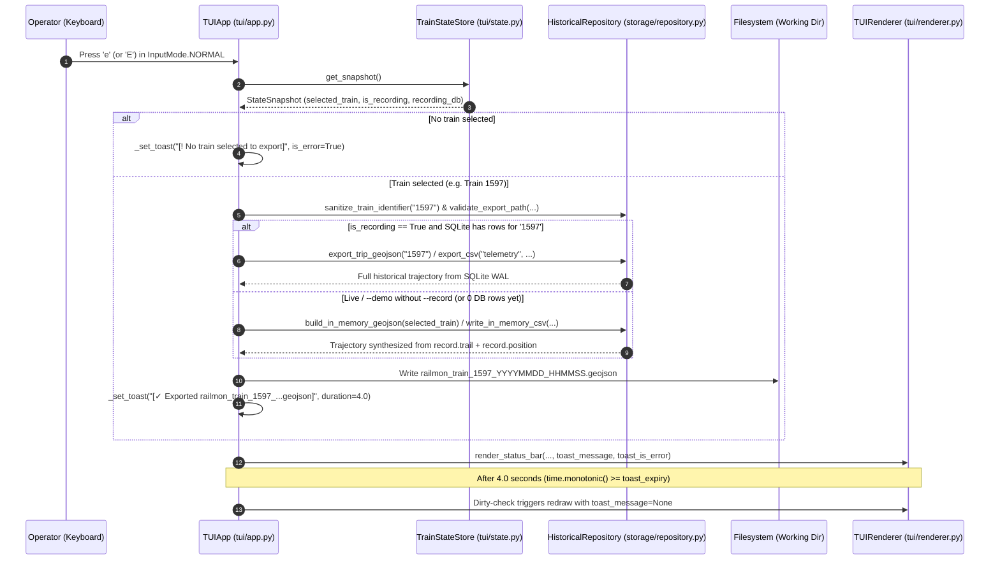
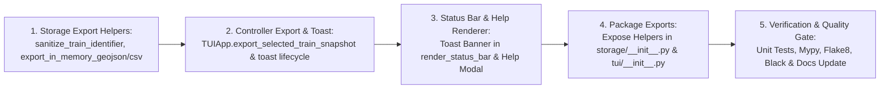

# Implementation Plan — F-4.1: Instant In-TUI GeoJSON / CSV Trajectory Snapshot Export (`e`)

> **Reference:** [TUI Feature Enhancements & Expansion Specification (`F-4.1`)](./tui-feature-enhancements.md#f-41-instant-in-tui-geojson--csv-trajectory-snapshot-export-e), [`README.md` Architectural Overview](../README.md)  
> **Target Modules:** [`../tui/app.py`](../tui/app.py), [`../tui/renderer.py`](../tui/renderer.py), [`../storage/repository.py`](../storage/repository.py), [`../tui/__init__.py`](../tui/__init__.py)  
> **Test Suites:** [`../tests/test_tui_controls.py`](../tests/test_tui_controls.py), [`../tests/test_tui_renderer.py`](../tests/test_tui_renderer.py), [`../tests/test_storage_repository.py`](../tests/test_storage_repository.py)  
> **Relevant Rules & Skills:** [`../.agents/skills/diagrams-and-documentation/SKILL.md`](../.agents/skills/diagrams-and-documentation/SKILL.md), [`../.agents/skills/markdown-relative-paths/SKILL.md`](../.agents/skills/markdown-relative-paths/SKILL.md), [`../.agents/skills/security-audit/SKILL.md`](../.agents/skills/security-audit/SKILL.md), [`../.agents/skills/tui-compatibility-tester/SKILL.md`](../.agents/skills/tui-compatibility-tester/SKILL.md), [`../.agents/skills/ci-quality-gate/SKILL.md`](../.agents/skills/ci-quality-gate/SKILL.md)

---

## 1. Executive Summary & Objective

When railway dispatchers or analysts observe a delay anomaly, sudden emergency braking, or prolonged station dwell in the interactive `railmon` Curses dashboard (`railmon --tui`), they currently have to exit the TUI and execute a separate CLI command (`railmon history export <train_no> -o ...`)—which is only possible if `--record` was enabled at launch. If the operator is running a live SSE session (`railmon --tui`) or offline simulation (`railmon --tui --demo`) without `--record`, the in-memory historical breadcrumb trail (`TrainRecord.trail`) is lost as soon as the dashboard closes.

This implementation plan delivers **Feature F-4.1: Instant In-TUI GeoJSON / CSV Trajectory Snapshot Export (`e` / `E`)** across the historical storage repository ([`../storage/repository.py`](../storage/repository.py)), the TUI event controller ([`../tui/app.py`](../tui/app.py)), and the Curses presentation engine ([`../tui/renderer.py`](../tui/renderer.py)) while preserving 100% Python standard-library purity, path-traversal security hardening, and 7-bit `--ascii` fallback compatibility.

### Core Objectives
1. **Dual-Source Trajectory Resolution ([`../tui/app.py`](../tui/app.py) & [`../storage/repository.py`](../storage/repository.py)):**
   - **SQLite Recorded History Source (`snapshot.is_recording and snapshot.recording_db`):** When background recording (`--record`) is active and the SQLite database contains recorded observations for `selected_train.position.train_number`, query the full persisted trajectory via [`HistoricalRepository.export_trip_geojson()`](../storage/repository.py#L472-L561) (for `e` GeoJSON export) or [`HistoricalRepository.export_csv()`](../storage/repository.py#L562-L587) (for `E` CSV export).
   - **In-Memory Live / Demo Fallback Source:** When running without `--record` (or before the background [`TelemetryRecorder`](../storage/recorder.py) has flushed its first batch for the selected train to disk), synthesize an RFC 7946-compliant GeoJSON `FeatureCollection` or telemetry CSV directly from the selected [`TrainRecord.trail`](../tui/state.py#L93) (`Deque[HistoricalBreadcrumb]`) merged with the current live [`TrainPosition`](../train_tracker.py#L401).
2. **Keyboard Shortcuts (`e` for GeoJSON, `E` for CSV in [`../tui/app.py`](../tui/app.py)):**
   - Pressing `e` in `InputMode.NORMAL` exports the selected train's trajectory to `railmon_train_<sanitized_train_no>_<YYYYMMDD_HHMMSS>.geojson` in the configured export directory (default: current working directory).
   - Pressing `E` (`Shift+E`) in `InputMode.NORMAL` exports the selected train's trajectory to `railmon_train_<sanitized_train_no>_<YYYYMMDD_HHMMSS>.csv`.
   - In `InputMode.SEARCH`, pressing `e` or `E` appends normally to `search_buffer` without triggering an export.
3. **Identifier Sanitization & Path Traversal Security ([`../storage/repository.py`](../storage/repository.py)):**
   - Sanitize `train_number` via `sanitize_train_identifier()` (stripping/replacing path separators, whitespace, and non-alphanumeric characters outside `[A-Za-z0-9_-]`) and validate the target destination path through [`validate_export_path()`](../storage/repository.py#L27-L90) to guarantee immunity against directory traversal (`../`) and symlink escape.
4. **Transient Status Bar Toast Notification ([`../tui/app.py`](../tui/app.py) & [`../tui/renderer.py`](../tui/renderer.py)):**
   - Add `toast_message: Optional[str]`, `toast_expiry: float`, and `toast_is_error: bool` to [`TUIApp`](../tui/app.py).
   - Display a high-visibility status bar toast notification for `4.0` seconds:
     - UTF-8 Success: `[✓ Exported railmon_train_1597_20261120_160500.geojson]`
     - `--ascii` Success: `[OK Exported railmon_train_1597_20261120_160500.geojson]`
     - Warning / Error (e.g., no train selected or `OSError`): `[! Export failed: No train selected]`
   - Integrate toast state into the event loop's dirty-frame signature in [`TUIApp.run_loop`](../tui/app.py#L1002-L1016) so the status bar redraws immediately on export and automatically restores the normal shortcut bar upon toast expiration.

---

## 2. Architecture & Workflow Diagrams

### 2.1 End-to-End Snapshot Export & Toast Notification Pipeline (Mermaid)

```mermaid
flowchart TD
    subgraph Input ["User Input Layer (tui/app.py)"]
        KEY_E["Keypress 'e' (GeoJSON) / 'E' (CSV)<br>in InputMode.NORMAL"]
    end

    subgraph Controller ["Snapshot Export Controller (TUIApp.export_selected_train_snapshot)"]
        KEY_E --> CHECK_SEL{"snapshot.selected_train<br>is not None?"}
        CHECK_SEL -->|No| ERR_TOAST["Set Error Toast (4.0s):<br>'[! No train selected to export]'"]
        CHECK_SEL -->|Yes| SAN["Sanitize Filename & Validate Path:<br>sanitize_train_identifier(train_no)<br>validate_export_path(filename, base_dir)"]
        SAN --> CHECK_REC{"snapshot.is_recording<br>and recording_db exists?"}
    end

    subgraph DualSource ["Dual-Source Trajectory Resolution"]
        CHECK_REC -->|Yes| DB_QUERY["Query SQLite WAL via HistoricalRepository:<br>• 'e': repo.export_trip_geojson(train_no)<br>• 'E': repo.export_csv('telemetry', ...)<br>(If 0 rows flushed yet, fall back to In-Memory)"]
        CHECK_REC -->|No| MEM_BUILD["Build Snapshot from In-Memory TrainRecord:<br>Merge record.trail + record.position<br>• 'e': build_in_memory_record_geojson(record)<br>• 'E': write_in_memory_record_csv(record)"]
    end

    subgraph FileIO ["Atomic & Validated Disk Write"]
        DB_QUERY --> WRITE["Write UTF-8 .geojson / .csv<br>to Validated Destination Path"]
        MEM_BUILD --> WRITE
        WRITE -->|Success| OK_TOAST["Set Success Toast (4.0s):<br>UTF-8: '[✓ Exported railmon_train_...]'<br>ASCII: '[OK Exported railmon_train_...]'"]
        WRITE -->|OSError / PermissionError| FAIL_TOAST["Set Error Toast (4.0s):<br>'[! Export failed: <reason>]'"]
    end

    subgraph Presentation ["Status Bar Renderer (TUIRenderer.render_status_bar)"]
        OK_TOAST --> RENDER["Render Toast Banner on Left of Status Bar<br>(Preserving Right Connection Badge)"]
        ERR_TOAST --> RENDER
        FAIL_TOAST --> RENDER
        RENDER -->|time.monotonic() >= toast_expiry| EXPIRE["Auto-Expire Toast & Dirty-Frame Redraw<br>Restore Standard Keybindings Bar"]
    end
```

### 2.2 Dual-Source Export & Toast Lifecycle Sequence Diagram (Mermaid)



### 2.3 Toast Notification State Machine (Mermaid)

```mermaid
stateDiagram-v2
    [*] --> IDLE : TUIApp initialized (toast_message = None)

    IDLE --> TOAST_SUCCESS : Press 'e'/'E' (Train selected & file written)
    IDLE --> TOAST_ERROR : Press 'e'/'E' (No train selected or I/O error)

    TOAST_SUCCESS --> TOAST_SUCCESS : Press 'e'/'E' again (Refreshes filename & resets 4.0s timer)
    TOAST_ERROR --> TOAST_SUCCESS : Select train & press 'e'/'E'
    TOAST_SUCCESS --> SEARCH_OVERRIDE : Press '/' (InputMode.SEARCH prompt takes priority)
    TOAST_ERROR --> SEARCH_OVERRIDE : Press '/' (InputMode.SEARCH prompt takes priority)
    SEARCH_OVERRIDE --> IDLE : Commit / cancel search after toast_expiry
    TOAST_SUCCESS --> IDLE : time.monotonic() >= toast_expiry (4.0s elapsed)
    TOAST_ERROR --> IDLE : time.monotonic() >= toast_expiry (4.0s elapsed)

    state IDLE {
        [*] : Status Bar shows normal shortcuts:
        [*] : '[q] Quit [h/j/k/l] Pan ... [e] Export ...'
    }
    state TOAST_SUCCESS {
        [*] : Color: PAIR_CONNECTED (Bold Green)
        [*] : UTF-8: ' [✓ Exported railmon_train_1597_20261120_160500.geojson] '
        [*] : ASCII: ' [OK Exported railmon_train_1597_20261120_160500.geojson] '
    }
    state TOAST_ERROR {
        [*] : Color: PAIR_TRAIN_WARN / PAIR_TRAIN_ALERT (Bold Yellow/Red)
        [*] : Text: ' [! No train selected to export] '
    }
```

### 2.4 Visual Architecture & Status Bar Layout (ASCII)

```text
+-----------------------------------------------------------------------------------+
|          F-4.1 INSTANT IN-TUI GEOJSON / CSV TRAJECTORY SNAPSHOT EXPORT            |
+-----------------------------------------------------------------------------------+

  [User Presses 'e' (GeoJSON) or 'E' (CSV) in InputMode.NORMAL]
          |
          v
  +-------------------------------------------------------------------------------+
  | 1. Selection & Filename Sanitization                                          |
  |    - Verify snapshot.selected_train is not None                               |
  |    - Extract raw_id = pos.train_number or pos.id                              |
  |    - safe_id = sanitize_train_identifier(raw_id)   (e.g. "IC 50" -> "IC_50")  |
  |    - filename = f"railmon_train_{safe_id}_{YYYYMMDD_HHMMSS}.{ext}"            |
  |    - target_path = validate_export_path(os.path.join(export_dir, filename))   |
  +-------------------------------------------------------------------------------+
          |
          v
  +-------------------------------------------------------------------------------+
  | 2. Dual-Source Trajectory Resolution                                          |
  |                                                                               |
  |    +-----------------------------------+-----------------------------------+  |
  |    | Source A: SQLite Historical DB    | Source B: In-Memory TrainRecord   |  |
  |    | (snapshot.is_recording == True)   | (Live SSE / --demo / Unflushed)   |  |
  |    +-----------------------------------+-----------------------------------+  |
  |    | • Open read-safe Database(db_path)| • Extract chronological points    |  |
  |    | • Query HistoricalRepository:     |   from record.trail + current pos |  |
  |    |   - 'e': export_trip_geojson()    | • If 1 unique point:              |  |
  |    |   - 'E': export_csv('telemetry')  |   - RFC 7946 Point feature (or    |  |
  |    | • If DB returns 0 rows (buffer    |     2-vertex LineString / Point)  |  |
  |    |   not flushed yet), seamlessly    | • If >= 2 points:                 |  |
  |    |   fall back to Source B!          |   - RFC 7946 LineString feature   |  |
  |    +-----------------------------------+-----------------------------------+  |
  +-------------------------------------------------------------------------------+
          |
          v
  +-------------------------------------------------------------------------------+
  | 3. Status Bar Toast Notification (4.0 Seconds Duration)                       |
  |                                                                               |
  | Normal Status Bar (Idle):                                                     |
  | +---------------------------------------------------------------------------+ |
  | | [q] Quit [h/j/k/l] Pan ... [s] Sort [b] Trails [e] Export ...  ● LIVE     | |
  | +---------------------------------------------------------------------------+ |
  |                                                                               |
  | Active Toast Status Bar (UTF-8 Mode, 0.0s .. 4.0s after pressing 'e'):        |
  | +---------------------------------------------------------------------------+ |
  | | [✓ Exported railmon_train_1597_20261120_160500.geojson]        ● LIVE     | |
  | +---------------------------------------------------------------------------+ |
  |                                                                               |
  | Active Toast Status Bar (--ascii Mode, 0.0s .. 4.0s after pressing 'e'):      |
  | +---------------------------------------------------------------------------+ |
  | | [OK Exported railmon_train_1597_20261120_160500.geojson]       * LIVE     | |
  | +---------------------------------------------------------------------------+ |
  +-------------------------------------------------------------------------------+
```

---

## 3. Detailed Component Specifications

### 3.1 Storage & Export Helpers: [`../storage/repository.py`](../storage/repository.py)

To keep GeoJSON and CSV formatting logic unified between the CLI (`railmon history export`) and the interactive TUI (`e` / `E`), we add three clean, zero-dependency helper functions to [`../storage/repository.py`](../storage/repository.py):

#### A. Identifier Sanitization (`sanitize_train_identifier`)
Commercial train numbers in Hellenic Railways telemetry can contain spaces or special characters (e.g., `"IC 50"`, `"1597/1598"`, `"PR-2232"`). To build a safe cross-platform filename without risking path traversal or illegal filesystem characters on Linux, macOS, or Windows:

```python
def sanitize_train_identifier(raw_identifier: Optional[str]) -> str:
    """Sanitize a train number or ID into a filesystem-safe token ([A-Za-z0-9_-]+).

    Replaces whitespace and punctuation with underscores, collapses consecutive
    underscores, and falls back to 'unknown' if the input contains no valid characters.

    Args:
        raw_identifier: Raw train_number or position.id string.

    Returns:
        Filesystem-safe train identifier token (max 32 chars).
    """
    if not raw_identifier:
        return "unknown"
    cleaned_chars: List[str] = []
    for ch in str(raw_identifier).strip():
        if ch.isalnum() or ch in ("-", "_"):
            cleaned_chars.append(ch)
        else:
            cleaned_chars.append("_")
    token = "".join(cleaned_chars).strip("_")
    while "__" in token:
        token = token.replace("__", "_")
    return (token[:32] if token else "unknown")
```

#### B. In-Memory `TrainRecord` Trajectory Synthesis (`export_in_memory_geojson` & `export_in_memory_csv`)
When running in live or `--demo` mode without `--record` (or when `--record` is enabled but `TelemetryRecorder` has not yet flushed its first batch for the selected train), we construct the trajectory from `record.trail` (`Deque[HistoricalBreadcrumb]`) and `record.position` (`TrainPosition`):

1. **Chronological Point Extraction (`_extract_in_memory_trajectory_points`):**
   - Convert each [`HistoricalBreadcrumb`](../tui/state.py#L79-L86) `(lat, lng, timestamp, speed)` in `record.trail` into a normalized point dictionary with an ISO-8601 UTC timestamp (`datetime.fromtimestamp(crumb.timestamp, tz=timezone.utc).isoformat().replace("+00:00", "Z")`).
   - Check `record.position`: if `record.trail` is empty, or if the current position `(pos.lat, pos.lng)` differs from the last breadcrumb or has a newer timestamp (`record.last_updated > record.trail[-1].timestamp + 1e-3`), append the current position so the snapshot always includes the latest instantaneous telemetry state.
2. **RFC 7946 GeoJSON Construction (`export_in_memory_geojson`):**
   - Matches the exact schema produced by [`HistoricalRepository.export_trip_geojson()`](../storage/repository.py#L472-L561):
     - Top-level `{"type": "FeatureCollection", "features": [feature]}`.
     - `feature["id"] = train_number`.
     - `feature["geometry"]`:
       - `"type": "LineString"`
       - `"coordinates"`: list of `[lng, lat]` (or `[lng, lat, altitude]` if `pos.altitude is not None`).
       - Note on RFC 7946 Section 3.1.4 (`LineString` coordinate count): if only a single breadcrumb exists (`len(points) == 1`) and `feature_type == "LineString"`, duplicate the coordinate vertex `[coord, coord]` (or allow `"Point"` if `feature_type == "Point"`), ensuring strict RFC 7946 `LineString` compliance (minimum 2 positions) in GIS viewers like QGIS, Mapbox, and GeoJSON.io while preserving `"total_points": 1` in `properties`!
     - `feature["properties"]`:
       ```python
       {
           "train_number": train_number,
           "train_id": pos.id,
           "train_type": pos.train_type,
           "service_type": pos.service_type,
           "corridor": pos.corridor,
           "origin": pos.origin,
           "destination": pos.destination,
           "next_station": pos.next_station,
           "status": pos.status,
           "source": "in_memory_tui_snapshot",
           "start_time": timestamps[0],
           "end_time": timestamps[-1],
           "total_points": len(points),
           "max_speed_kmh": max(speeds),
           "avg_speed_kmh": round(sum(speeds) / len(speeds), 1),
           "max_delay_min": int(pos.delay or 0),
           "timestamps": timestamps,
           "speeds_kmh": speeds,
           "delays_min": [int(pos.delay or 0)] * len(points),
       }
       ```
3. **In-Memory Telemetry CSV Export (`export_in_memory_csv`):**
   - Writes the exact 17-column header format used by [`HistoricalRepository._write_csv_data(qtype="telemetry")`](../storage/repository.py#L606-L648):
     `["id", "train_number", "schedule_id", "recorded_at", "lat", "lng", "speed", "course", "track_heading", "altitude", "delay_min", "status", "progress", "chainage_m", "dist_to_dest_m", "next_station", "corridor"]`
   - Populates one row per extracted breadcrumb point and returns the number of rows written.

---

### 3.2 Controller Layer: [`../tui/app.py`](../tui/app.py)

#### A. Toast State & Export Configuration in `TUIApp.__init__`
In [`TUIApp.__init__`](../tui/app.py#L155-L203), add:
```python
        self.export_dir: str = export_dir if export_dir is not None else "."
        self.toast_duration_sec: float = 4.0
        self.toast_message: Optional[str] = None
        self.toast_expiry: float = 0.0
        self.toast_is_error: bool = False
```
*(Adding an optional `export_dir: Optional[str] = None` parameter to `TUIApp.__init__` defaulting to `"."` makes unit and integration tests completely hermetic via `tempfile.TemporaryDirectory()` without needing `os.chdir()`!)*.

#### B. Toast Management Helpers on `TUIApp`
```python
    def _set_toast(
        self,
        message: str,
        duration_sec: Optional[float] = None,
        is_error: bool = False,
    ) -> None:
        """Set a transient status bar toast notification message."""
        dur = self.toast_duration_sec if duration_sec is None else max(0.1, float(duration_sec))
        self.toast_message = message
        self.toast_expiry = time.monotonic() + dur
        self.toast_is_error = is_error
        self._force_redraw = True

    def get_active_toast(self, now: Optional[float] = None) -> Tuple[Optional[str], bool]:
        """Return (toast_message, toast_is_error) if a toast is currently active, else (None, False)."""
        if self.toast_message is None:
            return None, False
        current_mono = time.monotonic() if now is None else now
        if current_mono >= self.toast_expiry:
            self.toast_message = None
            self.toast_is_error = False
            return None, False
        return self.toast_message, self.toast_is_error
```

#### C. Dual-Source Snapshot Export Method (`TUIApp.export_selected_train_snapshot`)
```python
    def export_selected_train_snapshot(self, fmt: str = "geojson") -> Optional[str]:
        """Export the selected train's trajectory to a timestamped GeoJSON or CSV file.

        Resolves trajectory data from SQLite HistoricalRepository when background recording
        (--record) is active and has persisted rows for the train; otherwise synthesizes
        the trajectory directly from the in-memory TrainRecord breadcrumb trail.

        Args:
            fmt: Export format, either 'geojson' (default, bound to 'e') or 'csv' (bound to 'E').

        Returns:
            Canonical absolute path of the exported file on success, or None if export failed.
        """
        norm_fmt = fmt.strip().lower()
        if norm_fmt not in ("geojson", "csv"):
            raise ValueError(f"Unsupported export format '{fmt}': must be 'geojson' or 'csv'")

        snapshot = self.store.get_snapshot()
        selected = snapshot.selected_train
        if selected is None:
            warn_prefix = "!" if self.ascii_mode else "!"
            self._set_toast(f"[{warn_prefix} No train selected to export]", is_error=True)
            return None

        pos = selected.position
        train_no = (pos.train_number or pos.id or "unknown").strip()
        safe_train_no = sanitize_train_identifier(train_no)
        timestamp_str = datetime.now().strftime("%Y%m%d_%H%M%S")
        ext = "geojson" if norm_fmt == "geojson" else "csv"
        filename = f"railmon_train_{safe_train_no}_{timestamp_str}.{ext}"
        raw_target = os.path.join(self.export_dir, filename)

        try:
            clean_path = validate_export_path(raw_target, base_dir=self.export_dir)
            exported_from_db = False

            if snapshot.is_recording and snapshot.recording_db and os.path.exists(snapshot.recording_db):
                db = Database(snapshot.recording_db, auto_migrate=False)
                try:
                    repo = HistoricalRepository(db)
                    if norm_fmt == "geojson":
                        geojson_data = repo.export_trip_geojson(train_number=train_no)
                        if geojson_data.get("features"):
                            out_str = json.dumps(geojson_data, indent=2, ensure_ascii=False)
                            with open(clean_path, "w", encoding="utf-8") as f:
                                f.write(out_str)
                            exported_from_db = True
                    else:
                        history_rows = repo.get_train_history(train_number=train_no)
                        if history_rows:
                            repo.export_csv(
                                query_type="telemetry",
                                target=clean_path,
                                params={"train_number": train_no},
                            )
                            exported_from_db = True
                finally:
                    db.close()

            if not exported_from_db:
                if norm_fmt == "geojson":
                    geojson_data = export_in_memory_geojson(selected)
                    out_str = json.dumps(geojson_data, indent=2, ensure_ascii=False)
                    with open(clean_path, "w", encoding="utf-8") as f:
                        f.write(out_str)
                else:
                    export_in_memory_csv(selected, clean_path)

            ok_icon = "OK" if self.ascii_mode else "✓"
            self._set_toast(f"[{ok_icon} Exported {filename}]", is_error=False)
            logger.info("Exported train %s trajectory snapshot to %s", train_no, clean_path)
            return clean_path

        except (ValueError, PermissionError, OSError) as exc:
            logger.error("Failed to export trajectory snapshot for train %s: %s", train_no, exc)
            self._set_toast(f"[! Export failed: {exc}]", is_error=True)
            return None
```

#### D. Keybinding Dispatch in `TUIApp._handle_normal_input`
In [`TUIApp._handle_normal_input`](../tui/app.py#L590-L595):
```python
        # Instant In-TUI GeoJSON ('e') / CSV ('E') Trajectory Snapshot Export (F-4.1)
        elif key == ord("e"):
            self.export_selected_train_snapshot(fmt="geojson")
        elif key == ord("E"):
            self.export_selected_train_snapshot(fmt="csv")
```

#### E. Event Loop Dirty-Frame Signature Integration in `TUIApp.run_loop`
In [`TUIApp.run_loop`](../tui/app.py#L1002-L1028):
- Call `active_toast_msg, active_toast_err = self.get_active_toast(frame_start)`.
- Include `active_toast_msg` and `active_toast_err` in `current_modal`:
  ```python
  current_modal = (
      self.input_mode,
      self.search_buffer,
      self.show_help,
      self.paused,
      active_toast_msg,
      active_toast_err,
  )
  ```
- Pass `toast_message=active_toast_msg` and `toast_is_error=active_toast_err` to `self.renderer.render_all(...)`.
- This guarantees that when the 4-second timer expires (`frame_start >= self.toast_expiry`), `active_toast_msg` transitions from `"[✓ Exported ...]"` to `None`, changing `current_modal` and immediately triggering a clean status bar redraw even if no keys are pressed and telemetry is paused!

---

### 3.3 Presentation Layer: [`../tui/renderer.py`](../tui/renderer.py)

#### A. Status Bar Toast Rendering in `TUIRenderer.render_status_bar`
Extend [`TUIRenderer.render_status_bar`](../tui/renderer.py#L1908-L1997) and [`TUIRenderer.render_all`](../tui/renderer.py#L2084-L2156) with optional backward-compatible keyword arguments:
```python
    def render_status_bar(
        self,
        win: Any,
        snapshot: StateSnapshot,
        width: int,
        msg_rate: float = 0.0,
        input_mode: InputMode = InputMode.NORMAL,
        search_buffer: str = "",
        playback_state: PlaybackState = PlaybackState.RUNNING,
        *,
        toast_message: Optional[str] = None,
        toast_is_error: bool = False,
        search_mode: Optional[bool] = None,
        paused: Optional[bool] = None,
    ) -> None:
```
1. **Priority Order in Status Bar:**
   - **Priority 1 (`input_mode == InputMode.SEARCH`):** Interactive search filter prompt (`Search filter: <buffer>█ (Enter: Apply, Esc: Cancel)`).
   - **Priority 2 (`toast_message` is not `None` and non-empty):**
     - Render the right-hand connection status badge (`● LIVE`, `● DEMO MODE`, `❚❚ PAUSED`, etc.) as usual so live stream health remains visible.
     - Compute available left width `avail_w = max(0, width - badge_w - 1)`.
     - Choose toast attribute:
       - If `toast_is_error`: `warn_attr` (`PAIR_TRAIN_WARN | curses.A_BOLD`)
       - Else: `connected_attr` (`PAIR_CONNECTED | curses.A_BOLD`)
     - Draw `f" {toast_message.strip()} "` at `(y=0, x=0)` with `max_w=avail_w`.
   - **Priority 3 (Default Normal Shortcut Bar):**
     - Include `[e] Export` in the shortcuts bar:
       ```python
       shortcuts = (
           f" [q] Quit  [h/j/k/l] Pan  [+/-] Zoom  [Tab] Select  [s] Sort  [b] Trails  "
           f"[e] Export  [v] Labels  [t] Tracks  [m] Stations  {follow_str}  [/] Filter  [?] Help  [0..3] Presets"
       )
       ```
2. **Help Modal Reference (`TUIRenderer.render_help_modal`):**
   - Under `SEARCH & SYSTEM CONTROLS` in [`TUIRenderer.render_help_modal`](../tui/renderer.py#L2050-L2054), update the controls list so `e / E` is documented while keeping the compact row count within $80 \times 24$ terminal limits (`box_h = 22`):
     ```python
     ("SEARCH & SYSTEM CONTROLS", [
         ("/, Esc", "Enter search filter mode / Cancel and return"),
         ("e / E, Space", "Export train GeoJSON / CSV / Pause telemetry stream"),
         ("?, q", "Toggle this help dialog / Clean exit dashboard"),
     ]),
     ```
     Notice how combining `("e / E, Space", "Export train GeoJSON / CSV / Pause telemetry stream")` preserves the exact 19-row inner height in `render_help_modal`, guaranteeing zero vertical clipping on $80 \times 24$ consoles!

---

## 4. Visual Mockups

### 4.1 Status Bar Toast Notification — UTF-8 Mode (`e` Pressed on Train `1597`)

```text
+---------------------------------------------------------------------------------------------------+
| [✓ Exported railmon_train_1597_20261120_160500.geojson]                      ● LIVE (1.0 msg/s)   |
+---------------------------------------------------------------------------------------------------+
```

### 4.2 Status Bar Toast Notification — `--ascii` Fallback Mode (`e` Pressed on Train `1597`)

```text
+---------------------------------------------------------------------------------------------------+
| [OK Exported railmon_train_1597_20261120_160500.geojson]                     * LIVE (1.0 msg/s)   |
+---------------------------------------------------------------------------------------------------+
```

### 4.3 Status Bar Warning Toast — When No Train Is Selected

```text
+---------------------------------------------------------------------------------------------------+
| [! No train selected to export]                                              ● LIVE (1.0 msg/s)   |
+---------------------------------------------------------------------------------------------------+
```

### 4.4 Exported GeoJSON Structure (`railmon_train_1597_20261120_160500.geojson`)

```json
{
  "type": "FeatureCollection",
  "features": [
    {
      "type": "Feature",
      "id": "1597",
      "geometry": {
        "type": "LineString",
        "coordinates": [
          [23.7203, 37.9926],
          [23.7381, 38.0744],
          [23.3186, 38.3242]
        ]
      },
      "properties": {
        "train_number": "1597",
        "corridor": "PATHE",
        "start_time": "2026-11-20T14:00:00Z",
        "end_time": "2026-11-20T14:04:00Z",
        "total_points": 3,
        "max_speed_kmh": 142.0,
        "avg_speed_kmh": 120.5,
        "max_delay_min": 4,
        "timestamps": [
          "2026-11-20T14:00:00Z",
          "2026-11-20T14:02:00Z",
          "2026-11-20T14:04:00Z"
        ],
        "speeds_kmh": [99.5, 120.0, 142.0],
        "delays_min": [4, 4, 4]
      }
    }
  ]
}
```

---

## 5. Step-by-Step Implementation Tasks



### Task 1: Add Identifier Sanitization & In-Memory Snapshot Exporters in [`../storage/repository.py`](../storage/repository.py)
- [x] Implement `sanitize_train_identifier(raw_identifier: Optional[str]) -> str` in [`../storage/repository.py`](../storage/repository.py) to sanitize arbitrary train numbers/IDs into safe `[A-Za-z0-9_-]` filename tokens.
- [x] Implement `export_in_memory_geojson(record: Any, feature_type: str = "LineString") -> Dict[str, Any]` in [`../storage/repository.py`](../storage/repository.py) to construct an RFC 7946 `FeatureCollection` from a [`TrainRecord`](../tui/state.py#L89-L157)'s `trail` deque and current `position`.
- [x] Implement `export_in_memory_csv(record: Any, target: Union[str, TextIO]) -> int` in [`../storage/repository.py`](../storage/repository.py) to write the 17-column telemetry CSV from a [`TrainRecord`](../tui/state.py#L89-L157).
- [x] Export `sanitize_train_identifier`, `export_in_memory_geojson`, and `export_in_memory_csv` in [`../storage/__init__.py`](../storage/__init__.py).

### Task 2: Wire Snapshot Exporter & Toast Lifecycle in [`../tui/app.py`](../tui/app.py)
- [x] Add `export_dir: str = "."`, `toast_duration_sec: float = 4.0`, `toast_message: Optional[str] = None`, `toast_expiry: float = 0.0`, and `toast_is_error: bool = False` to [`TUIApp.__init__`](../tui/app.py#L155-L203).
- [x] Implement `_set_toast()`, `get_active_toast()`, and `export_selected_train_snapshot(fmt: str = "geojson") -> Optional[str]` on [`TUIApp`](../tui/app.py):
  - Query [`HistoricalRepository.export_trip_geojson()`](../storage/repository.py#L472-L561) / [`HistoricalRepository.export_csv()`](../storage/repository.py#L562-L587) when `snapshot.is_recording and snapshot.recording_db` has persisted rows for the selected train.
  - Fall back to `export_in_memory_geojson()` / `export_in_memory_csv()` when running without `--record` or when the train's first batch has not yet been flushed to SQLite.
  - Validate the output filename via [`validate_export_path(..., base_dir=self.export_dir)`](../storage/repository.py#L27-L90).
  - Trigger a 4-second status bar toast (`[✓ Exported <filename>]` in UTF-8 or `[OK Exported <filename>]` in `--ascii`).
- [x] Bind `key == ord("e")` to `self.export_selected_train_snapshot(fmt="geojson")` and `key == ord("E")` to `self.export_selected_train_snapshot(fmt="csv")` in [`TUIApp._handle_normal_input`](../tui/app.py#L523-L611).
- [x] Include `(active_toast_msg, active_toast_err)` in `current_modal` inside [`TUIApp.run_loop`](../tui/app.py#L1002-L1028) and forward `toast_message` / `toast_is_error` to `self.renderer.render_all()`.

### Task 3: Render Status Bar Toast Notifications & Update Help Modal in [`../tui/renderer.py`](../tui/renderer.py)
- [x] Extend [`TUIRenderer.render_status_bar`](../tui/renderer.py#L1908-L1997) and [`TUIRenderer.render_all`](../tui/renderer.py#L2084-L2156) with `toast_message: Optional[str] = None` and `toast_is_error: bool = False`.
- [x] When `input_mode != InputMode.SEARCH` and `toast_message` is active, render the toast banner on the left side of the status bar (`PAIR_CONNECTED | curses.A_BOLD` for success, `PAIR_TRAIN_WARN | curses.A_BOLD` for warning/error) while keeping the right-hand stream status badge intact.
- [x] Add `[e] Export` to the normal status bar shortcut list and document `e / E` in [`TUIRenderer.render_help_modal`](../tui/renderer.py#L1998-L2083).

### Task 4: Expand Unit & Integration Test Suites
- [x] Add storage unit tests in [`../tests/test_storage_repository.py`](../tests/test_storage_repository.py):
  - `test_sanitize_train_identifier`: Verifies spaces, slashes, Greek characters, path traversal tokens (`../1597`), empty strings, and length clamping.
  - `test_export_in_memory_geojson_and_csv`: Verifies RFC 7946 `FeatureCollection` `LineString` and `Point` synthesis from a `TrainRecord` with multiple breadcrumbs as well as a single stationary point, plus 17-column CSV output.
- [x] Add controller tests in [`../tests/test_tui_controls.py`](../tests/test_tui_controls.py):
  - `test_key_e_exports_in_memory_geojson_and_csv_with_toast`: Verifies pressing `e` and `E` in `InputMode.NORMAL` writes valid `.geojson` and `.csv` files in `app.export_dir`, populates `app.toast_message` (`[✓ Exported railmon_train_1597_...geojson]`), and respects `--ascii` mode (`[OK Exported ...]`).
  - `test_key_e_exports_from_sqlite_when_recording_active_and_falls_back_if_unflushed`: Seeds a temporary SQLite database, enables `store.set_recording_status(True, db_path)`, presses `e` and `E`, and verifies the exported `.geojson` and `.csv` contain the full SQLite historical trajectory (and seamlessly fall back to in-memory breadcrumbs if the selected train has 0 rows in SQLite).
  - `test_key_e_without_selected_train_or_on_io_error_sets_warning_toast`: Verifies pressing `e` when no train is selected sets `[! No train selected to export]` with `toast_is_error=True` and writes no files.
  - `test_key_e_in_search_mode_appends_character_without_exporting`: Verifies pressing `e` or `E` in `InputMode.SEARCH` appends to `search_buffer` without creating files or setting a toast.
  - `test_toast_lifecycle_and_expiration`: Verifies `get_active_toast()` returns the message before `toast_expiry` and automatically clears to `(None, False)` once 4.0 seconds elapse.
- [x] Add renderer tests in [`../tests/test_tui_renderer.py`](../tests/test_tui_renderer.py):
  - `test_render_status_bar_toast_notification_utf8_and_ascii`: Verifies `render_status_bar` displays the toast notification banner alongside the connection badge, prioritizes the search prompt when `InputMode.SEARCH` is active, and maintains 7-bit ASCII purity when `ascii_mode=True`.

### Task 5: Update Specification Status & Run Full CI Quality Gate
- [x] Update [`./tui-feature-enhancements.md`](./tui-feature-enhancements.md) to mark **F-4.1** as **Implemented** and link to [`./f-4-1-instant-in-tui-trajectory-export-plan.md`](./f-4-1-instant-in-tui-trajectory-export-plan.md).
- [x] Execute [`../.agents/skills/ci-quality-gate/SKILL.md`](../.agents/skills/ci-quality-gate/SKILL.md), [`../.agents/skills/security-audit/SKILL.md`](../.agents/skills/security-audit/SKILL.md), [`../.agents/skills/tui-compatibility-tester/SKILL.md`](../.agents/skills/tui-compatibility-tester/SKILL.md), and [`../.agents/skills/markdown-relative-paths/SKILL.md`](../.agents/skills/markdown-relative-paths/SKILL.md).

---

## 6. Verification & Test Matrix

| Test ID | Target Component | Test Scenario | Expected Outcome |
| :--- | :--- | :--- | :--- |
| **TC-F41-01** | `sanitize_train_identifier` ([`../storage/repository.py`](../storage/repository.py)) | Sanitize `"1597"`, `"IC 50"`, `"../etc/passwd"`, `""`, `None` | Produces `"1597"`, `"IC_50"`, `"etc_passwd"`, `"unknown"`, `"unknown"` (strictly `[A-Za-z0-9_-]+`) |
| **TC-F41-02** | `export_in_memory_geojson` ([`../storage/repository.py`](../storage/repository.py)) | Export `TrainRecord` with 3 trail breadcrumbs + current position | Valid RFC 7946 `FeatureCollection` with `LineString` geometry, `[lng, lat]` coordinates, speeds, delays, and ISO timestamps |
| **TC-F41-03** | `export_in_memory_csv` ([`../storage/repository.py`](../storage/repository.py)) | Export `TrainRecord` to CSV file | Writes 17-column telemetry header and chronological breadcrumb rows matching SQLite CSV schema |
| **TC-F41-04** | `TUIApp.export_selected_train_snapshot` ([`../tui/app.py`](../tui/app.py)) | Press `e` / `E` in Live/Demo mode (`is_recording=False`) | Creates `railmon_train_<no>_<ts>.geojson` / `.csv` from in-memory trail and sets 4s success toast |
| **TC-F41-05** | `TUIApp.export_selected_train_snapshot` ([`../tui/app.py`](../tui/app.py)) | Press `e` / `E` with `--record` active (`is_recording=True`) | Queries full persisted trip from SQLite via `HistoricalRepository`; falls back to in-memory trail if train not yet flushed |
| **TC-F41-06** | `TUIApp.process_input` ([`../tui/app.py`](../tui/app.py)) | Press `e` when `selected_train is None` | Sets error toast `[! No train selected to export]` for 4s; zero files written |
| **TC-F41-07** | `TUIApp.process_input` ([`../tui/app.py`](../tui/app.py)) | Press `e` / `E` in `InputMode.SEARCH` | Appends `'e'` / `'E'` to `search_buffer`; does not trigger file export |
| **TC-F41-08** | `TUIRenderer.render_status_bar` ([`../tui/renderer.py`](../tui/renderer.py)) | Render status bar with active toast in UTF-8 and `--ascii` modes | Renders `[✓ Exported ...]` / `[OK Exported ...]` on left, preserves live connection badge on right, 100% 7-bit ASCII in `--ascii` |

---

## 7. Risk Analysis & Defensive Guardrails

1. **Unflushed Recorder Buffer Race Condition (`--record` Active):**
   - *Risk:* When `railmon --tui --record` is launched, [`TelemetryRecorder`](../storage/recorder.py) buffers incoming positions up to `batch_size=50` or `flush_interval_sec=2.0`. If an operator selects a train and presses `e` within the first second of launch (or if deadband filtering suppressed stationary updates before a database flush), `HistoricalRepository.export_trip_geojson()` could return an empty `{"type": "FeatureCollection", "features": []}`.
   - *Mitigation:* `TUIApp.export_selected_train_snapshot()` checks whether the SQLite query returned at least one feature/row; if the database returns 0 rows for the selected train, it transparently falls back to `export_in_memory_geojson(selected)` / `export_in_memory_csv(selected)` so the exported file is never empty.
2. **Malicious or Malformed Upstream `train_number` (Path Traversal Prevention):**
   - *Risk:* If a corrupted or spoofed SSE payload contained a `trainNumber` like `"../../.bashrc"` or `"1597\x00.geojson"`, string interpolation into a filename could attempt path traversal.
   - *Mitigation:* Every train identifier is first scrubbed through `sanitize_train_identifier()` (restricting characters strictly to `[A-Za-z0-9_-]`) and the resulting path is validated through [`validate_export_path(raw_target, base_dir=self.export_dir)`](../storage/repository.py#L27-L90) before opening the file.
3. **Single-Point Trajectory RFC 7946 `LineString` Validity:**
   - *Risk:* According to RFC 7946 Section 3.1.4, a GeoJSON `LineString` coordinates array must contain at least 2 positions. A newly appeared train with only 1 breadcrumb in `record.trail` would produce a 1-element coordinates array if not handled.
   - *Mitigation:* When `export_in_memory_geojson()` constructs a `LineString` from a single unique coordinate, it duplicates the vertex `[coord, coord]` so strict RFC 7946 parsers and GIS tools accept the geometry without error while `properties.total_points` accurately reports `1`.
4. **Status Bar Toast Expiration During Idle Frames:**
   - *Risk:* If the operator presses `e` and then does not touch the keyboard while the stream is paused or quiet, a naive renderer might leave the toast stuck on screen past 4 seconds if dirty-frame checking only watches `snapshot.version`.
   - *Mitigation:* `TUIApp.run_loop()` evaluates `active_toast_msg, active_toast_err = self.get_active_toast(frame_start)` on every frame tick and includes them in `current_modal`. As soon as `frame_start >= self.toast_expiry`, `active_toast_msg` becomes `None`, mutating `current_modal` and forcing an immediate status bar redraw.
