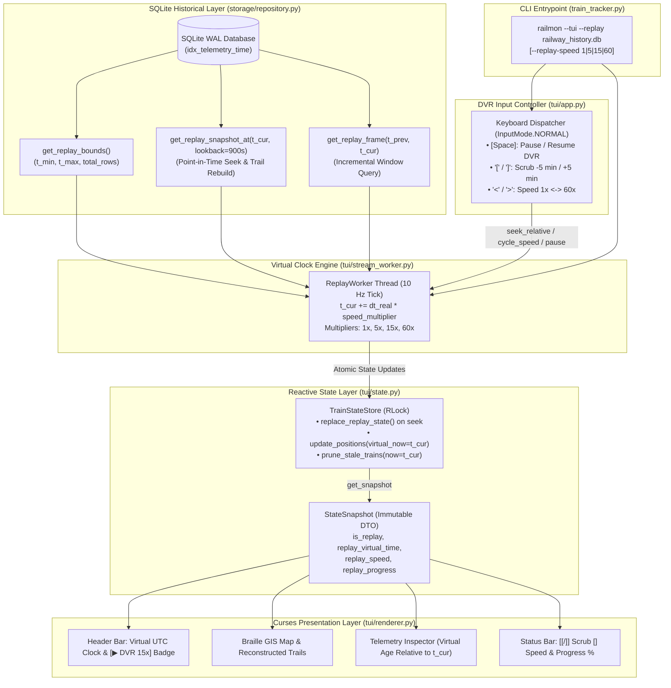
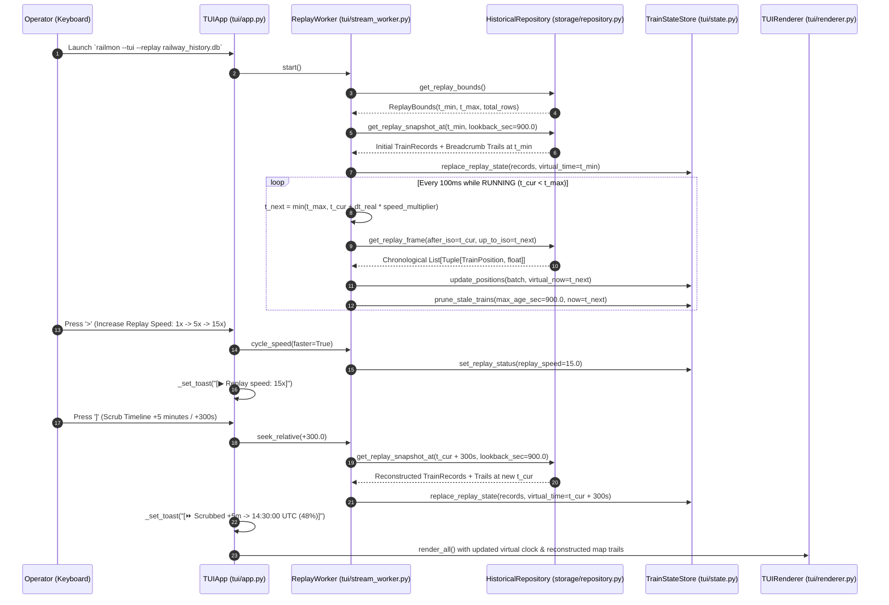
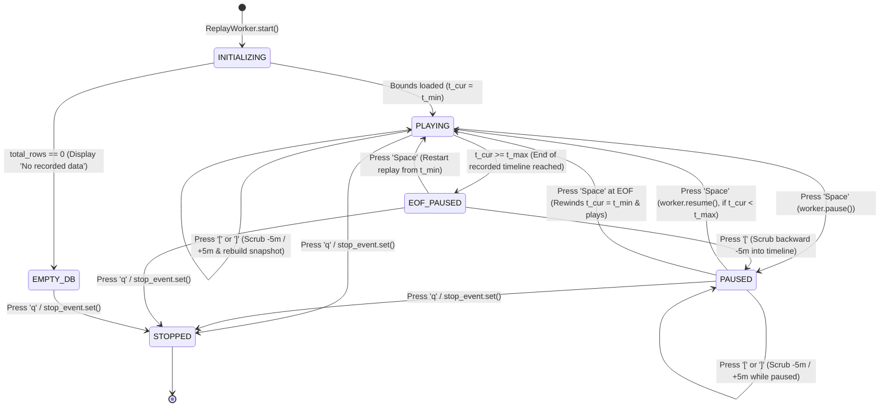
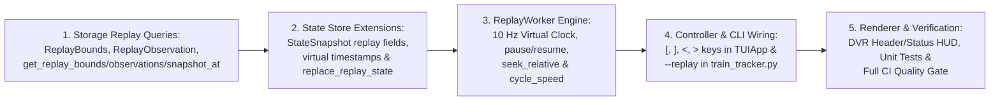

# Implementation Plan — F-4.2: SQLite Historical DVR Playback & Timeline Scrubbing (`--replay <db>`)

> **Reference:** [TUI Feature Enhancements & Expansion Specification (`F-4.2`)](./tui-feature-enhancements.md#f-42-sqlite-historical-dvr-playback--timeline-scrubbing---replay-db), [`README.md` Architectural Overview](../README.md)  
> **Target Modules:** [`../train_tracker.py`](../train_tracker.py), [`../storage/repository.py`](../storage/repository.py), [`../storage/models.py`](../storage/models.py), [`../tui/stream_worker.py`](../tui/stream_worker.py), [`../tui/state.py`](../tui/state.py), [`../tui/app.py`](../tui/app.py), [`../tui/renderer.py`](../tui/renderer.py), [`../storage/__init__.py`](../storage/__init__.py), [`../tui/__init__.py`](../tui/__init__.py)  
> **Test Suites:** [`../tests/test_storage_repository.py`](../tests/test_storage_repository.py), [`../tests/test_tui_state.py`](../tests/test_tui_state.py), [`../tests/test_tui_controls.py`](../tests/test_tui_controls.py), [`../tests/test_tui_renderer.py`](../tests/test_tui_renderer.py), [`../tests/test_cli_modes.py`](../tests/test_cli_modes.py)  
> **Relevant Rules & Skills:** [`../.agents/skills/diagrams-and-documentation/SKILL.md`](../.agents/skills/diagrams-and-documentation/SKILL.md), [`../.agents/skills/markdown-relative-paths/SKILL.md`](../.agents/skills/markdown-relative-paths/SKILL.md), [`../.agents/skills/tui-compatibility-tester/SKILL.md`](../.agents/skills/tui-compatibility-tester/SKILL.md), [`../.agents/skills/ci-quality-gate/SKILL.md`](../.agents/skills/ci-quality-gate/SKILL.md)

---

## 1. Executive Summary & Objective

While `railmon` records high-frequency train telemetry into an indexed SQLite Write-Ahead Logging (WAL) database (`railmon record` or `railmon --tui --record`) and supports tabular CLI queries (`railmon history trips`, `railmon history train`, `railmon history dwell`), operators and analysts previously lacked a way to **visually replay** recorded incidents, delay cascades, or timetable disruptions through the interactive Curses Braille GIS dashboard.

This implementation plan delivers **Feature F-4.2: SQLite Historical DVR Playback & Timeline Scrubbing (`--replay <db>`)**, enabling `railmon --tui --replay railway_history.db` (or `railmon --replay railway_history.db`) to stream historical telemetry from SQLite through the full multi-pane Curses dashboard with interactive DVR controls:
- **Pause / Resume (`Space`):** Freeze and inspect the network at an exact historical second.
- **Variable Playback Speed (`<` / `>` or `,` / `.`):** Step dynamically across `1x`, `5x`, `15x`, and `60x` virtual clock multipliers.
- **Timeline Scrubbing (`[` / `]`):** Jump backward (`-5 minutes`) or forward (`+5 minutes`) along the recorded timeline with instant point-in-time state and breadcrumb trail reconstruction.

### Core Objectives
1. **Indexed SQLite Time-Window & Point-in-Time Reconstruction ([`../storage/repository.py`](../storage/repository.py) & [`../storage/models.py`](../storage/models.py)):**
   - Implement `ReplayBounds` and `HistoricalRepository.get_replay_bounds()` to resolve the earliest (`min_recorded_at`) and latest (`max_recorded_at`) timestamps, epoch bounds, and total observation counts in $O(\log N)$ time via `idx_telemetry_time`.
   - Implement `HistoricalRepository.get_replay_frame(after_iso, up_to_iso)` for incremental virtual-clock ticks, joining `telemetry_history` with `trains` and `scheduled_trips` so replayed [`TrainPosition`](../train_tracker.py#L401) entities retain full metadata (`train_type`, `service_type`, `locomotive_number`, `origin`, `destination`).
   - Implement `HistoricalRepository.get_replay_snapshot_at(target_iso, lookback_sec=900.0, max_trail_len=15)` to reconstruct the active train roster and each train's chronological breadcrumb trail (`Deque[HistoricalBreadcrumb]`) at any arbitrary target timestamp—compensating seamlessly for deadband-suppressed stationary intervals.
2. **Virtual Clock `ReplayWorker` Engine ([`../tui/stream_worker.py`](../tui/stream_worker.py)):**
   - Implement `ReplayWorker` with a monotonic virtual clock ($t_{\text{cur}} \in [t_{\min}, t_{\max}]$), thread-safe `pause()`, `resume()`, `seek_relative(delta_sec)`, `seek_to(target_epoch)`, `set_speed(multiplier)`, and `cycle_speed(faster)`.
   - Advance $t_{\text{cur}}$ at $10\text{ Hz}$ real-time resolution ($\Delta t_{\text{virtual}} = \Delta t_{\text{real}} \times M_{\text{speed}}$), streaming incremental frames into [`TrainStateStore`](../tui/state.py#L300) and automatically pausing at `[END OF REPLAY]` when $t_{\text{cur}}$ reaches $t_{\max}$ (so the operator can inspect the final state or press `[` to rewind).
3. **Replay-Aware State & Virtual Timestamp Coherence ([`../tui/state.py`](../tui/state.py)):**
   - Extend [`StateSnapshot`](../tui/state.py#L160) and [`TrainStateStore`](../tui/state.py#L300) with replay metadata (`is_replay`, `replay_db`, `replay_virtual_time`, `replay_start_time`, `replay_end_time`, `replay_speed`, `replay_progress`).
   - Support virtual timestamp injection in `TrainRecord.append_breadcrumb()`, `TrainStateStore.update_positions()`, and `TrainStateStore.replace_replay_state()` so telemetry staleness indicators (`format_telemetry_age`) and exported snapshots (`e` / `E`) reflect the historical replay clock rather than current wall-clock time.
4. **DVR Keyboard Controls & Visual HUD ([`../tui/app.py`](../tui/app.py) & [`../tui/renderer.py`](../tui/renderer.py)):**
   - Bind `[` (`-5m` scrub), `]` (`+5m` scrub), `<` / `,` (slower multiplier), and `>` / `.` (faster multiplier) in [`TUIApp._handle_normal_input`](../tui/app.py#L667).
   - Render the historical virtual timestamp and DVR speed badge (`[▶ DVR 15x]` / `[> DVR 15x]`) in the top header bar, and display timeline progress (`▶ REPLAY 15x (14:25:10 | 42%)`) and DVR shortcut hints in the bottom status bar.

---

## 2. Architecture & Workflow Diagrams

### 2.1 End-to-End Historical DVR Playback Architecture (Mermaid)



### 2.2 Timeline Scrubbing & Virtual Clock Sequence Diagram (Mermaid)



### 2.3 ReplayWorker Lifecycle & Playback State Machine (Mermaid)



### 2.4 Visual Architecture & DVR HUD Layout (ASCII)

```text
+---------------------------------------------------------------------------------------------------+
| RAILMON | HELLENIC RAILWAYS | View: National Network | Active: 14 | Delayed: 3 [▶ DVR 15x] 14:25:10|
+--------------------------------------------------------------------+------------------------------+
| [Map Viewport: 39.80°N, 22.50°E | Zoom: 1.5x | Trails: ALL]        | [ACTIVE TRAINS (14) | Sort:▲]|
|                                                                    |  #   TRAIN▲ TYPE  SPD   DLY  |
|   Thessaloniki                                                     | > 1  50     IC    158    0m  |
|     ◉===========================                                   |   2  1597   IC    118   +4m  |
|       \                        \                                   |   3  1599   IC    142   +9m  |
|        \ Platy                  \                                  |   4  2232   PR    114    0m  |
|         ◉===                     ◉ Kilkis                          +------------------------------+
|          \  \                                                      | [SELECTED TRAIN TELEMETRY]   |
|           \  \ Katerini                                            | Train No:     50 (IC)        |
|            \  ◉                                                    | Route:        ΑΘΗΝ -> ΘΕΣΣ   |
|             \  \  ·                                                | Next Station: Λάρισα (14.2km)|
|              \  \  ·                                               | Speed:        158.0 km/h     |
|               \  ◉ Larissa                                         | Speed Trend:  ▃▄▅▆▇█████ ▲   |
|                \  \  ·                                             | Delay:        0 min (On Time)|
|                 \  \  ▲ ◄ [50] (158km/h, 0m)                       | Telemetry:    4s ago (#19)   |
|                  \  \                                              | Progress:     [======>--] 68%|
|  ├─── 25 km ───┤  \  ◉ Domokos                                     | Coordinates:  39.4821°N,22.3E|
+--------------------------------------------------------------------+------------------------------+
| [q]Quit [h/j/k/l]Pan [+/-]Zoom [[/]]Scrub [</>]Speed [Space]Pause [e]Export [?]Help ▶ DVR 15x 42% |
+---------------------------------------------------------------------------------------------------+
```

---

## 3. Detailed Component Specifications

### 3.1 Storage Layer Replay Queries: [`../storage/models.py`](../storage/models.py) & [`../storage/repository.py`](../storage/repository.py)

#### A. Replay Data Transfer Models in [`../storage/models.py`](../storage/models.py)
Add two immutable dataclasses to [`../storage/models.py`](../storage/models.py) (and export them in [`../storage/__init__.py`](../storage/__init__.py)):

```python
@dataclass(frozen=True)
class ReplayBounds:
    """Temporal boundaries and observation counts for SQLite historical DVR replay."""

    min_recorded_at: str
    max_recorded_at: str
    min_epoch: float
    max_epoch: float
    total_rows: int
    total_trains: int

    @property
    def duration_sec(self) -> float:
        """Total timeline span in seconds."""
        return max(0.0, self.max_epoch - self.min_epoch)


@dataclass(frozen=True)
class ReplayObservation:
    """A single historical telemetry observation enriched with vehicle and trip metadata."""

    position: TrainPosition
    recorded_at: str
    recorded_epoch: float
```

#### B. Timestamp Parsing Helper (`parse_iso_to_epoch` & `epoch_to_iso_utc`) in [`../storage/repository.py`](../storage/repository.py)
SQLite stores `recorded_at` as ISO-8601 UTC strings (e.g. `"2026-11-20T14:25:10.123456Z"` or `"2026-11-20 14:25:10"`). Furthermore, [`Database`](../storage/db.py#L25-L39) registers a `TIMESTAMP` converter that parses `TIMESTAMP` columns into `datetime` objects (or leaves strings when unparsed). We add a fast, deterministic helper:

```python
def parse_iso_to_epoch(val: Any) -> float:
    """Convert an ISO-8601 timestamp string or datetime object to a UTC POSIX epoch float."""
    if isinstance(val, (int, float)):
        return float(val)
    if isinstance(val, datetime):
        dt = val if val.tzinfo is not None else val.replace(tzinfo=timezone.utc)
        return dt.timestamp()
    s = str(val).strip()
    if not s:
        return 0.0
    if s.endswith("Z"):
        s = s[:-1] + "+00:00"
    elif " " in s and "T" not in s:
        s = s.replace(" ", "T")
    try:
        dt = datetime.fromisoformat(s)
        if dt.tzinfo is None:
            dt = dt.replace(tzinfo=timezone.utc)
        return dt.timestamp()
    except (ValueError, TypeError):
        return 0.0
```

#### C. Enriched SQL Query Methods on [`HistoricalRepository`](../storage/repository.py#L402)
1. **`get_replay_bounds(start_time: Optional[str] = None, end_time: Optional[str] = None) -> Optional[ReplayBounds]`:**
   - Executes an indexed aggregate query over `telemetry_history`:
     ```sql
     SELECT
         MIN(recorded_at) AS min_ts,
         MAX(recorded_at) AS max_ts,
         COUNT(*) AS total_rows,
         COUNT(DISTINCT train_number) AS total_trains
     FROM telemetry_history
     WHERE (? IS NULL OR recorded_at >= ?)
       AND (? IS NULL OR recorded_at <= ?);
     ```
   - If `total_rows == 0` or `min_ts is None`, returns `None`.
   - Converts `min_ts` and `max_ts` into canonical ISO-8601 UTC strings and POSIX epoch floats (`min_epoch`, `max_epoch`).

2. **`get_replay_observations(start_time: str, end_time: str, include_start: bool = False) -> List[ReplayObservation]`:**
   - Queries `telemetry_history` within `(start_time, end_time]` (when `include_start=False`, for incremental virtual clock ticks) or `[start_time, end_time]` (when `include_start=True`, for point-in-time seek reconstruction), joined with `trains` and `scheduled_trips`:
     ```sql
     SELECT
         th.id,
         th.train_number,
         th.schedule_id,
         th.recorded_at,
         th.lat,
         th.lng,
         th.speed,
         th.course,
         th.track_heading,
         th.altitude,
         th.delay_min,
         th.status,
         th.progress,
         th.chainage_m,
         th.dist_to_dest_m,
         th.next_station,
         COALESCE(th.corridor, st.corridor) AS corridor,
         t.locomotive_number,
         t.default_name,
         t.train_type,
         t.service_type,
         st.origin,
         st.destination
     FROM telemetry_history th
     LEFT JOIN trains t ON th.train_number = t.train_number
     LEFT JOIN scheduled_trips st ON th.schedule_id = st.schedule_id
     WHERE (CASE WHEN ? = 1 THEN th.recorded_at >= ? ELSE th.recorded_at > ? END)
       AND th.recorded_at <= ?
     ORDER BY th.recorded_at ASC, th.id ASC;
     ```
   - Uses `idx_telemetry_time` (`telemetry_history(recorded_at)`) for sub-millisecond window scans and constructs a complete [`TrainPosition`](../train_tracker.py#L401) for every row (`id=train_number`, `train_number=train_number`, plus enriched `locomotive_number`, `name`, `train_type`, `service_type`, `origin`, `destination`).

3. **`get_replay_snapshot_at(target_epoch: float, lookback_sec: float = 900.0) -> List[ReplayObservation]`:**
   - Computes `window_start_iso = _epoch_to_iso_utc(target_epoch - lookback_sec)` and `target_iso = _epoch_to_iso_utc(target_epoch)`.
   - Calls `self.get_replay_observations(window_start_iso, target_iso, include_start=True)`.
   - Why `lookback_sec = 900.0` (15 minutes)? Because [`DeadbandFilter`](../storage/filter.py) suppresses stationary train coordinates for up to `heartbeat_interval_sec = 300.0` seconds (5 minutes), a 15-minute lookback window guarantees that every active train on the network has at least 1–3 heartbeat rows and up to 15 motion breadcrumbs ready to reconstruct its exact position, velocity sparkline, and trail immediately after scrubbing with `[` or `]`!

---

### 3.2 Reactive State Layer Extensions: [`../tui/state.py`](../tui/state.py)

#### A. Replay Speed Constants & `StateSnapshot` Fields
In [`../tui/state.py`](../tui/state.py):
```python
REPLAY_SPEED_MULTIPLIERS: Tuple[float, ...] = (1.0, 5.0, 15.0, 60.0)
```
Extend [`StateSnapshot`](../tui/state.py#L160-L183) with backward-compatible fields (all with default values so existing callers and tests remain 100% compatible):
```python
    is_replay: bool = False
    replay_db: Optional[str] = None
    replay_virtual_time: Optional[float] = None
    replay_start_time: Optional[float] = None
    replay_end_time: Optional[float] = None
    replay_speed: float = 1.0
```

#### B. Virtual Timestamp Support in `TrainRecord` and `TrainStateStore`
1. **`TrainRecord.append_breadcrumb(self, pos: TrainPosition, threshold_deg: float = 1e-5, now: Optional[float] = None) -> None`:**
   - Replace hardcoded `now = time.time()` with `ts = float(now) if now is not None else time.time()`.
   - Uses `ts` for `HistoricalBreadcrumb.timestamp` and `self.last_updated = ts`.
2. **`TrainStateStore.update_positions(self, positions: List[TrainPosition], virtual_now: Optional[float] = None) -> None`:**
   - Accepts an optional `virtual_now: Optional[float] = None`.
   - When `virtual_now` is provided (or when individual `pos.timestamp` is parsed during replay), sets `record.first_seen`, `record.last_updated`, and `HistoricalBreadcrumb.timestamp` to the historical epoch timestamp.
3. **`TrainStateStore.replace_replay_state(self, observations: Sequence[ Tuple[TrainPosition, float] ], virtual_now: float) -> None`:**
   - Used when initializing replay at $t_{\min}$ or when the operator scrubs the timeline (`[` / `]`).
   - Under `self._lock`:
     - Preserves UI view state (`_selected_id`, `_follow_mode`, `_filter_query`, `_corridor_filter`, `_sort_mode`, `_breadcrumb_mode`, `_inspector_mode`, `_selected_station_id`, `_station_label_mode`, `_track_color_mode`).
     - Rebuilds `self._trains` chronologically from `observations`: each observation `(pos, obs_epoch)` either initializes a `TrainRecord` or calls `record.append_breadcrumb(pos, now=obs_epoch)`.
     - If `self._selected_id` is no longer present in the new time window's active trains, clears `_selected_id` and `_follow_mode` cleanly; if it is still active, selection and camera follow lock persist seamlessly across the scrub!
     - Updates `self._replay_virtual_time = virtual_now`, `self._last_update_ts = virtual_now`, and increments `self._version`.
4. **`TrainStateStore.prune_stale_trains(self, max_age_sec: Optional[float] = None, now: Optional[float] = None) -> int`:**
   - Accepts optional `now: Optional[float] = None` (defaulting to `self._replay_virtual_time` if `self._is_replay and self._replay_virtual_time is not None` else `time.time()`).
   - Ensures virtual-time replay observations are never accidentally pruned by wall-clock comparisons.
5. **`TrainStateStore.set_replay_status(...) -> None`:**
   ```python
   def set_replay_status(
       self,
       is_replay: bool,
       db_path: Optional[str] = None,
       virtual_time: Optional[float] = None,
       start_time: Optional[float] = None,
       end_time: Optional[float] = None,
       speed: Optional[float] = None,
   ) -> None:
   ```

---

### 3.3 Virtual Clock DVR Engine (`ReplayWorker`): [`../tui/stream_worker.py`](../tui/stream_worker.py)

Add `ReplayWorker` to [`../tui/stream_worker.py`](../tui/stream_worker.py) (and export it in [`../tui/__init__.py`](../tui/__init__.py)):

```python
class ReplayWorker:
    """
    Background historical DVR playback worker reading recorded telemetry from SQLite.

    Maintains a controllable virtual clock (t_cur in [t_min, t_max]), supporting pause/resume,
    variable speed multipliers (1x, 5x, 15x, 60x), and relative/absolute timeline scrubbing
    with point-in-time state and breadcrumb trail reconstruction.
    """
```

#### Key Attributes & Methods
- **Constructor (`ReplayWorker.__init__`):**
  ```python
  def __init__(
      self,
      store: TrainStateStore,
      db_path: str,
      speed_multiplier: float = 1.0,
      start_time: Optional[str] = None,
      end_time: Optional[str] = None,
      lookback_sec: float = 900.0,
      tick_interval_sec: float = 0.1,
  ) -> None:
  ```
- **Properties:**
  - `is_running -> bool`: Whether background replay thread is alive.
  - `is_paused -> bool`: Whether virtual clock progression is currently paused.
  - `speed_multiplier -> float`: Current speed multiplier (`1.0`, `5.0`, `15.0`, or `60.0`).
  - `virtual_time -> float`: Current virtual epoch timestamp $t_{\text{cur}}$.
  - `bounds -> Optional[ReplayBounds]`: Resolved database timeline boundaries.
  - `at_eof -> bool`: True when $t_{\text{cur}} \ge t_{\max}$.
- **DVR Transport Control API (Thread-Safe via `self._clock_lock`):**
  1. **`pause() -> None`:** Pauses virtual clock advancement and updates store status to `ConnectionStatus.PAUSED`.
  2. **`resume() -> None`:** If `self.at_eof`, automatically rewinds to `bounds.min_epoch` and reconstructs initial state so pressing `Space` at the end of a recording restarts playback cleanly; unsets pause state and sets `ConnectionStatus.CONNECTED`.
  3. **`set_speed(multiplier: float) -> float`:** Snaps/validates `multiplier` to `REPLAY_SPEED_MULTIPLIERS` (`1.0`, `5.0`, `15.0`, `60.0`), updates `self._speed_multiplier`, resets tick delta baseline, and updates `self.store.set_replay_status(...)`.
  4. **`cycle_speed(faster: bool = True) -> float`:** Steps up (`1x -> 5x -> 15x -> 60x`, clamped at `60x`) when `faster=True` or down (`60x -> 15x -> 5x -> 1x`, clamped at `1x`) when `faster=False` (or wraps/clamps deterministically). Let's clamp at `1.0x` minimum and `60.0x` maximum for `<` (decrease) and `>` (increase) as specified in `Consolidated Controls Reference` (`< / >: Decrease / Increase historical replay speed (1x..60x)`).
  5. **`seek_to(target_epoch: float) -> float`:**
     - Clamps `target_epoch` to `[bounds.min_epoch, bounds.max_epoch]`.
     - Queries `repo.get_replay_snapshot_at(clamped_epoch, lookback_sec=self.lookback_sec)`.
     - Calls `self.store.replace_replay_state([(obs.position, obs.recorded_epoch) for obs in observations], virtual_now=clamped_epoch)`.
     - Updates `self._virtual_time = clamped_epoch` and returns `clamped_epoch`.
  6. **`seek_relative(delta_sec: float) -> float`:**
     - Computes `target = self._virtual_time + delta_sec` and delegates to `self.seek_to(target)`.
     - Works instantaneously whether playback is running, paused, or at EOF!

---

### 3.4 Controller Layer Integration: [`../tui/app.py`](../tui/app.py)

#### A. Polymorphic Worker & Replay Control Methods on [`TUIApp`](../tui/app.py#L162)
`TUIApp` accepts `worker: Union[StreamWorker, ReplayWorker]`. Add dedicated DVR controller methods on `TUIApp`:

1. **`scrub_replay(self, delta_sec: float) -> Optional[float]`:**
   - Checks if `isinstance(self.worker, ReplayWorker)` or `hasattr(self.worker, "seek_relative")` and `self.store.get_snapshot().is_replay`.
   - If not in replay mode, returns `None` (no-op in live/demo mode).
   - Calls `new_epoch = self.worker.seek_relative(delta_sec)`.
   - Formats a transient 4-second status bar toast notification:
     - Calculate progress percentage: `pct = int(round(((new_epoch - start_t) / max(1.0, end_t - start_t)) * 100))`
     - Format UTC time: `ts_str = datetime.fromtimestamp(new_epoch, tz=timezone.utc).strftime("%H:%M:%S UTC")`
     - Direction label: `"-5m"` if `delta_sec < 0` else `"+5m"` (or `f"{int(delta_sec // 60):+d}m"`).
     - Icon: `"<<"` / `">>"` in `--ascii` mode, `"⏪"` / `"⏩"` in UTF-8 mode.
     - Calls `self._set_toast(f"[{icon} Scrubbed {dir_str} -> {ts_str} ({pct}%)]")`.
2. **`change_replay_speed(self, faster: bool) -> Optional[float]`:**
   - Checks if `hasattr(self.worker, "cycle_speed")` and `self.store.get_snapshot().is_replay`.
   - Calls `new_speed = self.worker.cycle_speed(faster=faster)`.
   - Formats speed string (`f"{int(new_speed)}x"`).
   - Icon: `">"` in `--ascii` mode, `"▶"` in UTF-8 mode.
   - Calls `self._set_toast(f"[{icon} Replay speed: {speed_str}]")`.
3. **Keybindings in [`TUIApp._handle_normal_input`](../tui/app.py#L667):**
   ```python
   # Historical DVR Timeline Scrubbing ('[' = -5m, ']' = +5m) & Speed ('<' / '>' = 1x..60x) (F-4.2)
   elif key == ord("["):
       self.scrub_replay(-300.0)
   elif key == ord("]"):
       self.scrub_replay(300.0)
   elif key in (ord("<"), ord(",")):
       self.change_replay_speed(faster=False)
   elif key in (ord(">"), ord(".")):
       self.change_replay_speed(faster=True)
   ```
   - Note: In `InputMode.SEARCH`, pressing `[`, `]`, `<`, `>`, `,`, or `.` is handled by `_handle_search_input` and appends to `search_buffer` without scrubbing or changing replay speed.
4. **Sync `TUIApp.paused` with `ReplayWorker` Auto-Pause at EOF:**
   - In `TUIApp.run_loop`, synchronize `self.paused = bool(self.worker.is_paused)` so if `ReplayWorker` reaches the end of the timeline (`EOF`) and transitions to paused, the UI status bar immediately reflects the paused state (`❚❚ DVR PAUSED (EOF)`), and pressing `Space` resumes/restarts smoothly.

---

### 3.5 Presentation Layer Integration: [`../tui/renderer.py`](../tui/renderer.py)

#### A. Header Bar Replay Badge & Virtual Clock (`TUIRenderer.render_header`)
In [`TUIRenderer.render_header`](../tui/renderer.py#L1159-L1208):
1. **DVR Mode Badge:**
   - When `snapshot.is_replay` is `True` and `width > left_w + 14`:
     - Format speed multiplier: `spd_label = f"{int(snapshot.replay_speed)}x"`.
     - Play/Pause icon:
       - If `snapshot.connection_status == ConnectionStatus.PAUSED`: `icon = "||" if self.ascii_mode else "❚❚"`
       - Else: `icon = ">" if self.ascii_mode else "▶"`
     - Draw `f" [{icon} DVR {spd_label}]"` using `PAIR_TRAIN_PROAST | curses.A_BOLD` (or `PAIR_TRAIN_WARN | curses.A_BOLD` when paused).
2. **Right-Aligned Virtual Clock:**
   - When `snapshot.is_replay and snapshot.replay_virtual_time is not None`:
     - Format the historical timestamp in UTC:
       `dt_utc = datetime.fromtimestamp(snapshot.replay_virtual_time, tz=timezone.utc)`
       - If `width - left_w >= 22`: `time_str = dt_utc.strftime(" %Y-%m-%d %H:%M:%S ")`
       - Else: `time_str = dt_utc.strftime(" %H:%M:%S ")`
   - Otherwise, render the standard system wall-clock `time.strftime(" %H:%M:%S ")`.

#### B. Inspector Telemetry Age in Replay Mode (`TUIRenderer.render_inspector`)
In [`TUIRenderer.render_inspector`](../tui/renderer.py#L1869):
- Pass `now=snapshot.replay_virtual_time if getattr(snapshot, "is_replay", False) else None` into `format_telemetry_age(record.last_updated, record.update_count, now=...)`.
- This guarantees that a train recorded 3 weeks ago shows `4s ago (#19)` relative to the virtual replay clock instead of `504h ago [STALE]`.

#### C. Bottom Status Bar & Help Modal (`TUIRenderer.render_status_bar` & `render_help_modal`)
1. **Right-Hand Replay Timeline Progress Badge in `render_status_bar`:**
   - When `getattr(snapshot, "is_replay", False)` is `True`:
     - Compute timeline progress percentage:
       ```python
       v_now = snapshot.replay_virtual_time or 0.0
       v_start = snapshot.replay_start_time or v_now
       v_end = snapshot.replay_end_time or v_now
       span = max(0.0, v_end - v_start)
       pct = int(round(((v_now - v_start) / span) * 100)) if span > 0 else 100
       pct = max(0, min(100, pct))
       ```
     - Format virtual time `hh_mm_ss = datetime.fromtimestamp(v_now, tz=timezone.utc).strftime("%H:%M:%S") if v_now > 0 else "--:--:--"`.
     - Format speed `spd_str = f"{int(snapshot.replay_speed)}x"`.
     - If `playback_state == PlaybackState.PAUSED` or `snapshot.connection_status == ConnectionStatus.PAUSED`:
       - Icon: `"||"` if `self.ascii_mode` else `"❚❚"`
       - `badge = f" {icon} DVR {spd_str} ({hh_mm_ss} | {pct}%) "`
       - `b_attr = warn_attr`
     - Else:
       - Icon: `">"` if `self.ascii_mode` else `"▶"`
       - `badge = f" {icon} DVR {spd_str} ({hh_mm_ss} | {pct}%) "`
       - `b_attr = connected_attr`
2. **Status Bar Shortcuts in Replay Mode:**
   - When `snapshot.is_replay` is `True`, include `[[/]] Scrub  [</>] Speed` in the status bar shortcuts:
     ```python
     if getattr(snapshot, "is_replay", False):
         shortcuts = (
             f" [q] Quit  [h/j/k/l] Pan  [+/-] Zoom  [[/]] Scrub  [</>] Speed  [Space] Pause  "
             f"[Tab] Select  [s] Sort  [b] Trails  [e] Export  {follow_str}  [/] Filter  [?] Help"
         )
     ```
3. **Help Modal Reference (`render_help_modal`):**
   - Update `SEARCH & SYSTEM CONTROLS` in [`TUIRenderer.render_help_modal`](../tui/renderer.py#L2068-L2072) to include DVR controls while keeping the compact 19-row inner height so $80 \times 24$ terminals never clip:
     ```python
     ("SEARCH & SYSTEM CONTROLS", [
         ("/, Esc", "Enter search filter mode / Cancel and return"),
         ("e / E, Space", "Export train GeoJSON / CSV / Pause stream or DVR"),
         ("[ / ], < / >, ?, q", "DVR scrub -/+5m & speed (1x..60x) / Help / Quit"),
     ]),
     ```

---

### 3.6 CLI Arguments & Entrypoint Wiring: [`../train_tracker.py`](../train_tracker.py)

1. **Extend `TelemetrySource` Enum in [`../train_tracker.py`](../train_tracker.py#L33-L38):**
   ```python
   class TelemetrySource(Enum):
       """Source stream for train positions."""

       LIVE = "live"
       DEMO = "demo"
       REPLAY = "replay"
   ```
2. **Add CLI Arguments in [`build_parser()`](../train_tracker.py#L798-L908):**
   ```python
   parser.add_argument(
       "--replay",
       type=str,
       default=None,
       metavar="DB_PATH",
       help="Replay historical telemetry from an existing SQLite database file in the TUI DVR.",
   )
   parser.add_argument(
       "--replay-speed",
       type=float,
       default=1.0,
       help="Initial playback speed multiplier for --replay mode (1, 5, 15, or 60; default: 1.0).",
   )
   ```
3. **Update `main()` and `_dispatch_cli_mode()` in [`../train_tracker.py`](../train_tracker.py#L1714-L1817):**
   - When `--replay <db_path>` is provided:
     - Validate that the SQLite file exists (`os.path.exists(replay_db)`); if not, print a clear error message to `sys.stderr` and return exit code `1`.
     - Implicitly enable TUI mode (`is_tui = not (args.headless or args.daemon)`) so `railmon --replay railway_history.db` and `railmon --tui --replay railway_history.db` both launch the interactive Curses DVR dashboard.
     - Automatically disable background `--record` during `--replay` so a historical database never re-records into itself.
     - In `run_tui_mode()`, when `source == TelemetrySource.REPLAY` (or `replay_db is not None`):
       - Instantiate `ReplayWorker(store=store, db_path=replay_db, speed_multiplier=replay_speed)` instead of `StreamWorker`.

---

## 4. Visual Mockups

### 4.1 Header & Status Bar in Replay Mode — UTF-8 Mode (`15x` Speed, Active Playback)

```text
Header:
+---------------------------------------------------------------------------------------------------+
| RAILMON | HELLENIC RAILWAYS | View: National Network | Active: 8 | Delayed: 2 [▶ DVR 15x] 14:25:10|
+---------------------------------------------------------------------------------------------------+

Status Bar:
+---------------------------------------------------------------------------------------------------+
| [q] Quit [h/j/k/l] Pan [+/-] Zoom [[/]] Scrub [</>] Speed [Space] Pause ...  ▶ DVR 15x (14:25:10 | 42%) |
+---------------------------------------------------------------------------------------------------+
```

### 4.2 Header & Status Bar in Replay Mode — `--ascii` Fallback Mode (Paused after Scrubbing `+5m`)

```text
Header:
+---------------------------------------------------------------------------------------------------+
| RAILMON | HELLENIC RAILWAYS | View: National Network | Active: 8 | Delayed: 2 [|| DVR 15x] 14:30:10|
+---------------------------------------------------------------------------------------------------+

Status Bar (with 4.0s Scrub Toast Notification):
+---------------------------------------------------------------------------------------------------+
| [>> Scrubbed +5m -> 14:30:10 UTC (58%)]                                     || DVR 15x (14:30:10 | 58%) |
+---------------------------------------------------------------------------------------------------+
```

---

## 5. Step-by-Step Implementation Tasks



### Task 1: Add Replay Models & Time-Window Queries in [`../storage/models.py`](../storage/models.py) and [`../storage/repository.py`](../storage/repository.py)
- [x] Add `ReplayBounds` and `ReplayObservation` frozen dataclasses to [`../storage/models.py`](../storage/models.py).
- [x] Implement `parse_iso_to_epoch(val: Any) -> float` in [`../storage/repository.py`](../storage/repository.py).
- [x] Implement `HistoricalRepository.get_replay_bounds()`, `HistoricalRepository.get_replay_observations()`, and `HistoricalRepository.get_replay_snapshot_at()` in [`../storage/repository.py`](../storage/repository.py), joining `telemetry_history` with `trains` and `scheduled_trips`.
- [x] Export `ReplayBounds`, `ReplayObservation`, and `parse_iso_to_epoch` in [`../storage/__init__.py`](../storage/__init__.py).

### Task 2: Extend [`TrainStateStore`](../tui/state.py) and [`StateSnapshot`](../tui/state.py) for Virtual Replay Time
- [x] Add `REPLAY_SPEED_MULTIPLIERS = (1.0, 5.0, 15.0, 60.0)` and replay fields (`is_replay`, `replay_db`, `replay_virtual_time`, `replay_start_time`, `replay_end_time`, `replay_speed`) to [`StateSnapshot`](../tui/state.py) and [`TrainStateStore`](../tui/state.py).
- [x] Update `TrainRecord.append_breadcrumb()` and `TrainStateStore.update_positions()` to accept an optional `now` / `virtual_now` epoch float.
- [x] Implement `TrainStateStore.set_replay_status()` and `TrainStateStore.replace_replay_state()` for atomic point-in-time roster and breadcrumb trail reconstruction during timeline scrubbing.
- [x] Update `TrainStateStore.prune_stale_trains()` to accept `now: Optional[float] = None` (defaulting to `_replay_virtual_time` when replay mode is active).

### Task 3: Implement `ReplayWorker` Virtual Clock DVR Engine in [`../tui/stream_worker.py`](../tui/stream_worker.py)
- [x] Implement `ReplayWorker` in [`../tui/stream_worker.py`](../tui/stream_worker.py) with `start()`, `stop()`, `pause()`, `resume()`, `set_speed()`, `cycle_speed()`, `seek_to()`, and `seek_relative()`.
- [x] Load initial snapshot at `bounds.min_epoch` upon startup, advance virtual clock at $10\text{ Hz}$ scaled by `speed_multiplier`, ingest incremental frames via `get_replay_observations()`, prune inactive trains older than `lookback_sec` (`900.0s` virtual time), and transition cleanly to paused at `bounds.max_epoch` (`EOF`).
- [x] Export `ReplayWorker` and `REPLAY_SPEED_MULTIPLIERS` in [`../tui/__init__.py`](../tui/__init__.py).

### Task 4: Wire DVR Keybindings in [`../tui/app.py`](../tui/app.py) & CLI Flags in [`../train_tracker.py`](../train_tracker.py)
- [x] Implement `TUIApp.scrub_replay(delta_sec: float)` and `TUIApp.change_replay_speed(faster: bool)` in [`../tui/app.py`](../tui/app.py) with 4-second status bar toast notifications.
- [x] Bind `[` (`-300.0s`), `]` (`+300.0s`), `<` / `,` (`faster=False`), and `>` / `.` (`faster=True`) in [`TUIApp._handle_normal_input`](../tui/app.py#L667).
- [x] Update `TUIApp.export_selected_train_snapshot()` so pressing `e` / `E` during `--replay` also queries full trip trajectories from `snapshot.replay_db` (or in-memory reconstructed trails).
- [x] Add `TelemetrySource.REPLAY`, `--replay <db>`, and `--replay-speed` to [`../train_tracker.py`](../train_tracker.py), validating database existence and wiring `ReplayWorker` into `run_tui_mode()` and `run_plain_stream_mode()`.

### Task 5: Update Header, Inspector & Status Bar HUD in [`../tui/renderer.py`](../tui/renderer.py)
- [x] Update [`TUIRenderer.render_header`](../tui/renderer.py#L1159) to display the `[▶ DVR <N>x]` / `[> DVR <N>x]` badge and the virtual UTC replay clock when `snapshot.is_replay` is `True`.
- [x] Update [`TUIRenderer.render_inspector`](../tui/renderer.py#L1869) to evaluate `format_telemetry_age(..., now=snapshot.replay_virtual_time)` when `snapshot.is_replay` is `True`.
- [x] Update [`TUIRenderer.render_status_bar`](../tui/renderer.py#L1908) and [`TUIRenderer.render_help_modal`](../tui/renderer.py#L2016) to display replay progress (`▶ DVR 15x (14:25:10 | 42%)`) and DVR shortcut hints (`[[/]] Scrub`, `[</>] Speed`).

### Task 6: Unit & Integration Tests and Quality Gate Verification
- [x] Add storage replay query tests in [`../tests/test_storage_repository.py`](../tests/test_storage_repository.py).
- [x] Add state store replay & virtual timestamp tests in [`../tests/test_tui_state.py`](../tests/test_tui_state.py).
- [x] Add `ReplayWorker` and DVR keyboard control tests (`[`, `]`, `<`, `>`, `Space`) in [`../tests/test_tui_controls.py`](../tests/test_tui_controls.py).
- [x] Add DVR header, inspector virtual age, and status bar rendering tests (UTF-8 and `--ascii`) in [`../tests/test_tui_renderer.py`](../tests/test_tui_renderer.py).
- [x] Add CLI `--replay` argument parsing and dispatch tests in [`../tests/test_cli.py`](../tests/test_cli.py) and [`../tests/test_enums.py`](../tests/test_enums.py).
- [x] Run full CI quality gate ([`../.agents/skills/ci-quality-gate/SKILL.md`](../.agents/skills/ci-quality-gate/SKILL.md)) and update [`./tui-feature-enhancements.md`](./tui-feature-enhancements.md).

---

## 6. Verification & Test Matrix

| Test ID | Target Component | Test Scenario | Expected Outcome |
| :--- | :--- | :--- | :--- |
| **TC-F42-01** | `HistoricalRepository.get_replay_bounds` ([`../storage/repository.py`](../storage/repository.py)) | Query bounds on seeded SQLite DB and empty DB | Returns accurate `ReplayBounds(min_epoch, max_epoch, total_rows, total_trains)` or `None` when empty |
| **TC-F42-02** | `HistoricalRepository.get_replay_snapshot_at` ([`../storage/repository.py`](../storage/repository.py)) | Reconstruct state at $t_0 + 600\text{s}$ with $900\text{s}$ lookback | Returns chronologically ordered observations joined with `trains` and `scheduled_trips` metadata |
| **TC-F42-03** | `TrainStateStore.replace_replay_state` ([`../tui/state.py`](../tui/state.py)) | Scrub timeline across multiple observations for train `1597` | Rebuilds `TrainRecord.trail` breadcrumbs with historical timestamps while preserving active selection & sort mode |
| **TC-F42-04** | `ReplayWorker` ([`../tui/stream_worker.py`](../tui/stream_worker.py)) | Start worker, advance virtual clock, `seek_relative(+300)`, `cycle_speed()` | Virtual clock advances by `dt * multiplier`, seeks clamp to `[min_epoch, max_epoch]`, pauses at EOF |
| **TC-F42-05** | `TUIApp._handle_normal_input` ([`../tui/app.py`](../tui/app.py)) | Press `]`, `[`, `>`, `<`, and `Space` in Replay mode | Scrubs $+5\text{m}$ / $-5\text{m}$, steps speed `1x -> 5x -> 15x -> 60x`, toggles pause, and sets 4s status bar toast |
| **TC-F42-06** | `TUIApp._handle_search_input` ([`../tui/app.py`](../tui/app.py)) | Press `[`, `]`, `<`, `>` while in `InputMode.SEARCH` | Appends characters to `search_buffer`; does not scrub timeline or alter replay speed |
| **TC-F42-07** | `TUIRenderer` ([`../tui/renderer.py`](../tui/renderer.py)) | Render header, inspector, and status bar in Replay mode (UTF-8 & `--ascii`) | Header shows `[▶ DVR 15x]` + virtual UTC clock; Inspector computes virtual telemetry age; 100% 7-bit ASCII in `--ascii` |
| **TC-F42-08** | `build_parser` & `_dispatch_cli_mode` ([`../train_tracker.py`](../train_tracker.py)) | Parse `railmon --tui --replay history.db --replay-speed 15` and missing DB path | Dispatches `run_tui_mode(source=TelemetrySource.REPLAY, ...)`; returns exit code `1` with error on missing DB file |

---

## 7. Risk Analysis & Defensive Guardrails

1. **Deadband-Suppressed Stationary Gaps During Timeline Scrubbing:**
   - *Risk:* During live recording, [`DeadbandFilter`](../storage/filter.py) suppresses stationary coordinate updates for up to `300.0` seconds (5 minutes). If a timeline seek (`[` / `]`) only queried a narrow 10-second window around $t_{\text{cur}}$, halted trains at stations would vanish from the map after a seek.
   - *Mitigation:* `HistoricalRepository.get_replay_snapshot_at()` queries a `lookback_sec = 900.0` (15-minute) lookback window ending at $t_{\text{cur}}$, guaranteeing that any train active within the last 15 minutes (3 heartbeat cycles) is reconstructed with its latest known position and up to 15 trail breadcrumbs.
2. **Wall-Clock vs. Historical Timestamp Mismatch (False `[STALE]` Alerts & Premature Pruning):**
   - *Risk:* Recorded telemetry timestamps are from the past (hours, days, or months ago). Comparing `record.last_updated` against `time.time()` in `TUIApp.run_loop`'s periodic pruner or `TUIRenderer.render_inspector`'s `format_telemetry_age()` would immediately prune all replayed trains or flag them as `[STALE]`.
   - *Mitigation:* In replay mode, `record.last_updated` stores the historical observation epoch, `TrainStateStore.prune_stale_trains()` compares against `replay_virtual_time`, `TUIApp.run_loop` delegates pruning to `ReplayWorker`, and `TUIRenderer.render_inspector` passes `now=snapshot.replay_virtual_time` to `format_telemetry_age()`.
3. **Self-Recording Feedback Loop (`--replay` Combined with `--record`):**
   - *Risk:* If a user accidentally passes both `--replay history.db` and `--record`, replayed positions could be re-enqueued into `TelemetryRecorder` and duplicated in the database.
   - *Mitigation:* `_dispatch_cli_mode()` and `run_tui_mode()` explicitly force `RecordingMode.DISABLED` whenever `--replay` is active and open SQLite read queries without starting `TelemetryRecorder`.
4. **Empty or Corrupt SQLite Database Handling:**
   - *Risk:* A user might invoke `--replay` on an empty database file (0 rows in `telemetry_history`) or a non-existent path.
   - *Mitigation:* `_dispatch_cli_mode()` verifies file existence before initializing curses, and `ReplayWorker` gracefully handles `get_replay_bounds() is None` by setting `ConnectionStatus.ERROR` with status message `"No recorded telemetry in database"` and pausing cleanly without crashing the TUI.
