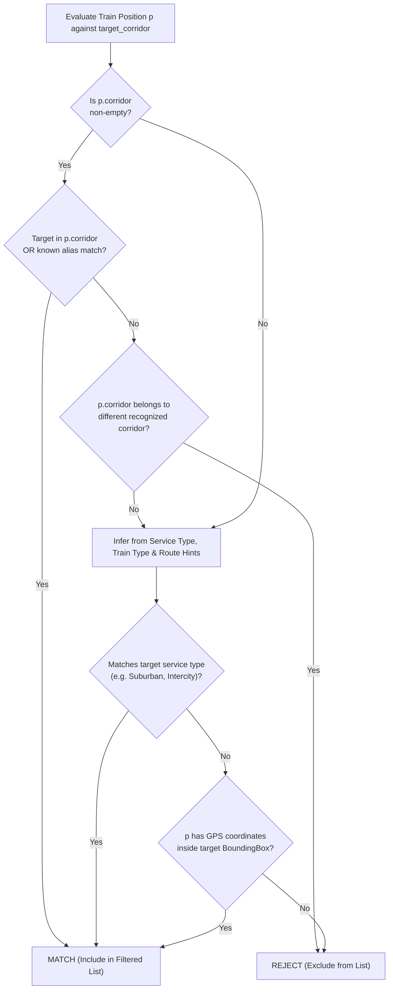

# Incident Report & Technical Resolution: Live Telemetry Corridor Preset Filtering

Investigation, root cause analysis, architectural resolution, and test verification for the Greek railway corridor presets filtering discrepancy in `railmon` interactive TUI.

---

## 1. Issue Summary

### 1.1 User Symptom
When operating `railmon --tui` against the live Hellenic Railways telemetry feed (`https://railway.gov.gr/api/train-stream`), the following behavior was observed:
- In **Preset 0 (`National Network`)**, active trains rendered as expected across the map and in the sidebar roster.
- In **Presets 1 (`Proastiakos`), 2 (`PATHE Mainline`), and 3 (`Northern Greece`)**, no trains appeared on the map canvas or in the active train roster (0 trains displayed).

```text
+---------------------------------------------------------------------------------------+
| Presets Comparison (Before Fix)                                                      |
+---------------------------------------------------------------------------------------+
| Preset Key | Viewport Target            | Corridor Filter | Result (Live Stream)      |
+------------+----------------------------+-----------------+---------------------------+
| '0'        | National Network (Greece)  | None            | Trains visible (e.g., 14) |
| '1'        | Athens Suburban            | "PROASTIAKOS"   | 0 trains visible          |
| '2'        | PATHE Mainline             | "PATHE"         | 0 trains visible          |
| '3'        | Northern Greece (Macedonia)| "NORTHERN"      | 0 trains visible          |
+---------------------------------------------------------------------------------------+
```

---

## 2. Root Cause Analysis

### 2.1 Divergence Between Synthetic Mock Fleet and Live API Payloads

During initial implementation (Phase 2 & Phase 3), corridor filtering was validated against the offline synthetic simulator ([`tui/mock_engine.py`](../../tui/mock_engine.py)). In the mock generator, each train record was constructed with normalized corridor strings:
- Mock train `ic-50` $\to$ `corridor="PATHE"`
- Mock train `pro-1597` $\to$ `corridor="PROASTIAKOS"`
- Mock train `reg-3672` $\to$ `corridor="NORTHERN"`

However, live telemetry payloads delivered by the Hellenic Railways SSE feed (`railway.gov.gr/api/train-stream`) follow different conventions:
1. **Unset Corridor Metadata:** The majority of live train events do not carry a populated `corridor` attribute (`corridor: null` or omitted in JSON).
2. **Operational Segment Codes:** Trains that do specify a corridor use operational Greek track codes rather than the preset enum name:
   - Athens Suburban lines: `"PIRAIR"` (Piraeus – SKA – Athens Airport) or `"KIATO"` (Kiato line).
   - Mainline spine: `"E85"` (European rail route designation for PATHE).
3. **Classification via Service & Train Types:** Real trains identify their service tier through `serviceType` (e.g. `"Suburban"`, `"Intercity"`, `"Regional"`) and `trainType` (e.g. `"passenger"`, `"freight"`).

### 2.2 Naive Substring Filtering in `TrainStateStore`

In [`tui/state.py`](../../tui/state.py), `_compute_filtered_list()` performed an exact uppercase substring check:

```python
# Defective filtering logic
if self._corridor_filter:
    corridor_str = (p.corridor or "").upper()
    target_corridor = self._corridor_filter.upper()
    if target_corridor not in corridor_str:
        continue
```

When the user activated Preset 1 (`target_corridor = "PROASTIAKOS"`):
- A live suburban train with `corridor = "PIRAIR"` evaluated `"PROASTIAKOS" in "PIRAIR"` $\to$ `False`.
- A live train with `corridor = None` evaluated `"PROASTIAKOS" in ""` $\to$ `False`.
- Every active train was dropped from `snapshot.filtered_trains`, emptying both the roster sidebar and the Braille map overlay.

---

## 3. Solution Architecture

A robust, multi-tier classification algorithm was introduced in [`tui/state.py`](../../tui/state.py#L94-L180) via `_train_matches_corridor(p, target_corridor)`.



### 3.1 Corridor Alias & Keyword Mapping
Recognized corridor aliases derived from official Hellenic rail datasets ([`tui/data/stations.json`](../../tui/data/stations.json) and [`reference/`](../../reference)):

| Target Preset | Target Identifier | Operational Aliases & Keywords |
|---|---|---|
| **Preset 1** | `PROASTIAKOS` | `PROASTIAKOS`, `PROASTIAKOS_ATH`, `PIRAIR`, `KIATO`, `AERODROMIO`, `AIRPORT`, `CHALKIDA` |
| **Preset 2** | `PATHE` | `PATHE`, `PATHE_MAINLINE`, `E85`, `MAINLINE` |
| **Preset 3** | `NORTHERN` | `NORTHERN`, `NORTHERN_GREECE`, `MACEDONIA`, `THRACE`, `STRYMONAS`, `ALEX`, `IDOMENI` |
| **Branch** | `THESSALY` | `THESSALY`, `VOLOS`, `KALAMBAKA` |

### 3.2 Geospatial Bounding Box Fallback
When a live train payload carries no corridor tag and ambiguous service type metadata, the system checks whether the train's current WGS84 GPS position $(lat, lng)$ is physically enclosed within the corridor's curated bounding box defined in [`tui/geo.py`](../../tui/geo.py#L78-L105):
- `PROASTIAKOS_PRESET`: Attica & Corinthia corridor ($37.85^\circ\text{N} - 38.45^\circ\text{N}$, $22.75^\circ\text{E} - 24.05^\circ\text{E}$)
- `PATHE_PRESET`: Athens – Thessaloniki mainline ($37.90^\circ\text{N} - 40.75^\circ\text{N}$, $21.80^\circ\text{E} - 23.95^\circ\text{E}$)
- `NORTHERN_GREECE_PRESET`: Macedonia & Thrace ($40.30^\circ\text{N} - 41.35^\circ\text{N}$, $21.40^\circ\text{E} - 26.65^\circ\text{E}$)

### 3.3 Suburban Train Color Glyphs
In [`tui/renderer.py`](../../tui/renderer.py#L285-L298), `get_train_color_pair()` was updated to inspect `service_type` and operational corridor aliases (`"PIRAIR"`, `"KIATO"`, etc.) in addition to `train_type`, ensuring live suburban trains display in yellow (`PAIR_TRAIN_PROAST`) according to the UI specification.

---

## 4. Verification and Automated Testing

### 4.1 Unit Test Coverage
Dedicated regression tests were added across test suites:

1. **State Store Corridor Resolution ([`tests/test_tui_state.py`](../../tests/test_tui_state.py#L201-L260)):**
   - Validates live payloads containing `corridor="PIRAIR"`, `serviceType="Suburban"` map to Preset 1.
   - Validates live Intercity payloads with `corridor=None`, `serviceType="Intercity"` map to Preset 2.
   - Validates regional payloads in Thrace/Macedonia with `corridor=None` map to Preset 3.
   - Validates Preset 0 retains all active trains regardless of categorization.

2. **Interactive Controls & Presets ([`tests/test_tui_controls.py`](../../tests/test_tui_controls.py#L274-L328)):**
   - Validates pressing `1`, `2`, `3`, and `0` dynamically updates `store.filtered_trains` with real-world train dictionaries.

### 4.2 Test Execution Results
All 109 automated tests pass with 0 failures:

```bash
python3 -m unittest discover tests
# Ran 109 tests in 4.08s - OK
```

---

## 5. Related Documentation
- [Phase 5: Interactive Controls, Following & Filtering](../plans/core/phase-5-interactive-controls-following-filtering.md)
- [Phase 3: Thread-Safe State Store & SSE Worker](../plans/core/phase-3-thread-safe-state-store-sse-worker.md)
- [System Architecture & Reverse Engineering Specification](../architecture/architecture.md)
