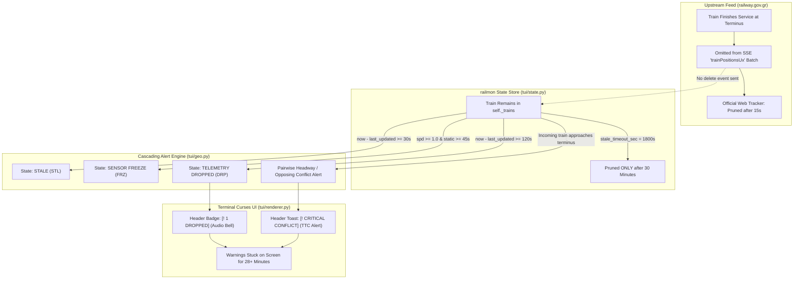
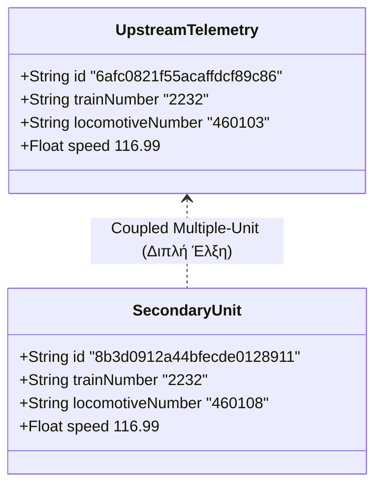
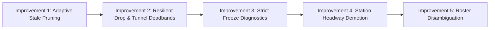

# Technical Investigation: Telemetry Drop, Sensor Freezing, Track Conflict Aggressiveness & Duplicate Train Numbers

> **Target Modules:** [`../../tui/geo.py`](../../tui/geo.py), [`../../tui/state.py`](../../tui/state.py), [`../../tui/renderer.py`](../../tui/renderer.py), [`../../train_tracker.py`](../../train_tracker.py)  
> **Related Fix Plans:** [`../plans/fixes/p0/p0-9-stale-train-pruning-and-screen-warning-clearance-fix-plan.md`](../plans/fixes/p0/p0-9-stale-train-pruning-and-screen-warning-clearance-fix-plan.md), [`../plans/fixes/p0/p0-10-telemetry-drop-watchdog-resilience-fix-plan.md`](../plans/fixes/p0/p0-10-telemetry-drop-watchdog-resilience-fix-plan.md), [`../plans/fixes/p0/p0-11-sensor-freeze-watchdog-resilience-fix-plan.md`](../plans/fixes/p0/p0-11-sensor-freeze-watchdog-resilience-fix-plan.md), [`../plans/fixes/p0/p0-12-track-conflict-detection-resilience-fix-plan.md`](../plans/fixes/p0/p0-12-track-conflict-detection-resilience-fix-plan.md), [`../plans/fixes/p0/p0-13-duplicate-train-numbers-disambiguation-fix-plan.md`](../plans/fixes/p0/p0-13-duplicate-train-numbers-disambiguation-fix-plan.md)  
> **Relevant Rules & Skills:** [`../../.agents/skills/diagrams-and-documentation/SKILL.md`](../../.agents/skills/diagrams-and-documentation/SKILL.md), [`../../.agents/skills/markdown-relative-paths/SKILL.md`](../../.agents/skills/markdown-relative-paths/SKILL.md)  
> **Reference Upstream Chunks:** [`../../reference/chunks/47794.19386b2538c55881.js`](../../reference/chunks/47794.19386b2538c55881.js), [`../../reference/chunks/79801.a0cbc95dac2cd2a3.js`](../../reference/chunks/79801.a0cbc95dac2cd2a3.js)

---

## 1. Executive Summary

Operational observation of `railmon` during live monitoring against the Hellenic Railways (`railway.gov.gr`) telemetry stream identified four related anomalies:

1. **Persistent Warnings on Departed / Completed Trains:** When trains arrive at their terminal stations (e.g., Athens Central, Thessaloniki, Kiato) and complete their service, warnings (`DROPPED`, `FROZEN`, `CRITICAL CONFLICT`) remain stuck on the screen and in the status bar for up to **30 minutes** rather than clearing promptly.
2. **Aggressive Telemetry Drop Alarms:** Telemetry drop warnings (`DRP`) trigger after only 120 seconds of silence, failing to account for normal mountain tunnel cellular dead zones (e.g., Tempi, Othrys, Kallidromo) or authorized terminal station layovers.
3. **Aggressive Sensor Freezing Alarms:** Moving trains experiencing brief packet latency or cellular jitter trip `SENSOR FREEZE` (`FRZ`) after only 45 seconds of coordinate stillness, misdiagnosing network buffering as an onboard instrument fault.
4. **Aggressive Track Conflict Alerts:** Terminal platforms and multi-track stations regularly trigger `CRITICAL HEADWAY BREACH` and `CRITICAL OPPOSING CONFLICT` alerts for trains resting or creeping on adjacent parallel tracks, compounded by a fallback that groups all unclassified trains into the `"pathe-mainline"` corridor.
5. **Duplicate Train Numbers in Active Roster:** Multiple entries bearing identical commercial train numbers (e.g., two entries for `2232` or `1597`) appear simultaneously in the Active Trains list.

This document details the architectural root causes of these behaviors, validates the operational normalcy of duplicate train numbers on Greek networks, and provides a prioritized set of concrete engineering improvements.

---

## 2. Architectural Failure Pipeline & Telemetry Lifecycle

The diagram below contrasts the upstream train lifecycle with the internal state transitions inside `railmon`:



```text
+----------------------------------------------------------------------------------------------------+
| Telemetry Dropout & Alert Cascading Pipeline                                                       |
+----------------------------------------------------------------------------------------------------+
|                                                                                                    |
|  Upstream Feed: Train Completes Trip (Omitted from SSE positions batch)                            |
|        |                                                                                           |
|        v                                                                                           |
|  tui/state.py: update_positions() only performs UPSERT; does NOT prune missing trains             |
|        |                                                                                           |
|        +---> [00:30s] evaluate_sensor_health() -> STALE (STL)                                      |
|        |                                                                                           |
|        +---> [00:45s] Last reported speed > 1 km/h -> SENSOR FREEZE (FRZ)                         |
|        |                                                                                           |
|        +---> [02:00m] elapsed >= 120s -> TELEMETRY DROPPED (DRP)                                   |
|        |              Header Badge locks into: [! 1 DROPPED]                                       |
|        |                                                                                           |
|        +---> [02:00m - 30:00m] Incoming active train approaches terminus:                          |
|        |                       evaluate_train_conflicts() evaluates against lingering ghost train  |
|        |                       Header Toast locks into: [! CRITICAL CONFLICT]                      |
|        |                                                                                           |
|        v                                                                                           |
|  tui/state.py: prune_stale_trains() triggers at 1800s (30m) -> Record finally deleted              |
+----------------------------------------------------------------------------------------------------+
```

---

## 3. Deep Root-Cause Analysis

### 3.1 Issue 1: Screen Warnings Fail to Clear When Trains Are Gone

#### Root Cause
In [`tui/state.py`](../../tui/state.py#L408-L413), the state store initializes `stale_timeout_sec` to `1800.0` seconds (30 minutes):
```python
def __init__(
    self,
    stale_timeout_sec: float = 1800.0,
    max_trail_len: int = 15,
    initial_theme: Optional[ThemeProfile] = None,
) -> None:
    self._stale_timeout_sec = stale_timeout_sec
    self._trains: Dict[str, TrainRecord] = {}
```

When incoming SSE payloads arrive via `StreamWorker` ([`tui/stream_worker.py`](../../tui/stream_worker.py#L150-L155)), `update_positions()` is invoked:
```python
def update_positions(self, positions: List[TrainPosition], virtual_now: Optional[float] = None) -> None:
    with self._lock:
        now = float(virtual_now) if virtual_now is not None else time.time()
        for pos in positions:
            self._upsert_train_position(pos, now)
        self._recompute_conflicts(now)
```
`_upsert_train_position` updates existing records or adds new ones. It has **no concept of differential removal** when a train drops out of the active payload.

In the official client reverse-engineered in [`reference/chunks/47794.19386b2538c55881.js`](../../reference/chunks/47794.19386b2538c55881.js#L1):
```javascript
let o = Date.now(), g = new Set(e.map(e => e.id));
g.forEach(e => { F.current[e] = o });
Object.keys(w.current).forEach(e => {
    !g.has(e) && o - (F.current[e] || 0) >= 15e3 && J(e); // Purged after 15 seconds
});
```
The official client purges trains absent for **15 seconds**. In contrast, `railmon` preserves absent trains for **1,800 seconds**. During this 30-minute interval, the health watchdog continuously evaluates the departed train against real time, escalating it through `STALE`, `FROZEN`, and `DROPPED` states.

---

### 3.2 Issue 2: Telemetry Drop Watchdog Is Too Aggressive

> **Implementation Fix Plan:** [`../plans/fixes/p0/p0-10-telemetry-drop-watchdog-resilience-fix-plan.md`](../plans/fixes/p0/p0-10-telemetry-drop-watchdog-resilience-fix-plan.md)

#### Root Cause
In [`tui/geo.py`](../../tui/geo.py#L1873-L1891):
```python
# 1. Complete Telemetry Drop Check
if elapsed >= telemetry_drop_threshold_sec: # Default: 120.0s
    mins = int(elapsed // 60)
    secs = int(elapsed % 60)
    age_label = f"{mins}m {secs}s" if mins > 0 else f"{int(elapsed)}s"
    assessment = SensorHealthAssessment(
        state=SensorHealthState.DROPPED,
        ...
        is_alert=True,
        short_code="DRP",
        description=f"TELEMETRY DROPPED ({age_label} silent)",
    )
    return assessment, last_moved_pt, last_moved_time, station_dwell_start
```
1. **Drop Check Preempts Station Dwell:** The check runs at Step 1, before checking whether the train is stationary inside a known station siding. When a train sits at a terminal platform waiting for its next departure, any silence exceeding 2 minutes triggers `DROPPED`.
2. **Greek Railway Topography:** Mainland Greek lines traverse significant tunnels:
   - Kallidromo Tunnel: $9.0\text{ km}$ ($\approx 3.5\text{ min}$ at $160\text{ km/h}$)
   - Othrys Tunnel: $6.4\text{ km}$ ($\approx 2.5\text{ min}$)
   - Tempi Tunnel complex: multiple bores up to $5.5\text{ km}$
   Cellular transponders and GSM-R modems routinely lose network connectivity for 2 to 4 minutes while traversing these tunnels. A 120-second threshold guarantees recurring false drop alarms on every intercity run.

---

### 3.3 Issue 3: Sensor Freezing Watchdog Is Too Aggressive

> **Implementation Fix Plan:** [`../plans/fixes/p0/p0-11-sensor-freeze-watchdog-resilience-fix-plan.md`](../plans/fixes/p0/p0-11-sensor-freeze-watchdog-resilience-fix-plan.md)

#### Root Cause
In [`tui/geo.py`](../../tui/geo.py#L1910-L1928):
```python
if spd >= 1.0:
    new_dwell_start = None
    if disp_m <= displacement_epsilon_m and static_dur >= sensor_freeze_threshold_sec:
        # Sensor Freeze: Positive speed reported, but coordinates static
        assessment = SensorHealthAssessment(
            state=SensorHealthState.FROZEN,
            elapsed_sec=elapsed,
            static_duration_sec=static_dur,
            ...
            short_code="FRZ",
            description=f"FROZEN ({int(static_dur)}s static, {spd:.0f} km/h)",
        )
```
1. **Misclassification of Delayed Packets as Instrument Freeze:** `static_dur` is calculated as `ref_now - new_anchor_time`. If the train was moving at $80\text{ km/h}$ and network delivery stalls for 45 seconds, `pos.speed` remains $80\text{ km/h}$ and `disp_m = 0`. Railmon diagnoses this as a frozen sensor (`FRZ`), when in reality it is simple packet delay (`STALE`). An authentic sensor freeze requires that **new telemetry frames continue to arrive** (`elapsed_sec < 15s`) asserting positive velocity while coordinates fail to advance.
2. **Platform Approach Crawl:** Trains crawling into busy terminal tracks at $1\text{ to }3\text{ km/h}$ travel less than 12 meters in 45 seconds. GPS multipath reflections under station canopies easily compress displacement below the $10\text{ meter}$ noise floor, tripping false freeze alerts.

---

### 3.4 Issue 4: Track Conflict Detection Is Too Aggressive

> **Implementation Fix Plan:** [`../plans/fixes/p0/p0-12-track-conflict-detection-resilience-fix-plan.md`](../plans/fixes/p0/p0-12-track-conflict-detection-resilience-fix-plan.md)

#### Root Cause
Three compounding factors in [`tui/geo.py`](../../tui/geo.py#L2099-L2525) create excessive conflict alerts:

1. **Default Corridor Grouping Fallback ([`tui/geo.py:2486`](../../tui/geo.py#L2486)):**
   ```python
   corridor_buckets: Dict[str, List[Any]] = {}
   for train in active_trains:
       cid = getattr(train, "corridor", None)
       if not cid:
           cid = "pathe-mainline"
       norm_cid = _normalize_corridor_key(str(cid)) or str(cid)
       corridor_buckets.setdefault(norm_cid, []).append(train)
   ```
   Upstream SSE records often lack explicit `corridor` tags. The watchdog assigns all untagged trains to `"pathe-mainline"`. As a result, trains operating in disjoint regions (e.g. Volos, Chalkida, or Thrace) are evaluated as if sharing the mainline track.
2. **Missing Station Passing Loop Suppression for Headway Violations ([`tui/geo.py:2386-2435`](../../tui/geo.py#L2386-L2435)):**
   While opposing collision detection checks `meet_stn` and demotes alerts to `STATION_MEET` (Advisory), **headway violations do not check station sidings**:
   ```python
   # Co-directional Headway Violation Condition
   is_codirectional = heading_delta <= cfg.heading_codirectional_tolerance_deg
   if is_codirectional:
       is_active_motion = closing_spd > 0.0 or spd1 > 1.0 or spd2 > 1.0
       if dist_km <= cfg.headway_critical_distance_km and is_active_motion:
           ...
           # Fired even if meet_stn is not None!
   ```
   At multi-track stations (Athens Central, SKA hub, Thessaloniki), trains resting or crawling on adjacent parallel tracks (separated by 15–30 meters) share similar headings. Because Haversine distance is $< 1.0\text{ km}$ and `spd > 1.0`, the system fires false `CRITICAL HEADWAY BREACH` alerts.
3. **Ghost Train Interactions:** Departing or terminating trains lingering in `self._trains` for 30 minutes are continuously evaluated against incoming trains, generating spurious collision and headway warnings against non-existent obstacles.

---

### 3.5 Issue 5: Duplicate Train Numbers in Active Trains List

> **Implementation Fix Plan:** [`../plans/fixes/p0/p0-13-duplicate-train-numbers-disambiguation-fix-plan.md`](../plans/fixes/p0/p0-13-duplicate-train-numbers-disambiguation-fix-plan.md)

#### Root Cause & Operational Realities

Having two records with the same commercial `train_number` (e.g. `2232` or `1597`) in the roster is **operationally normal and expected** on Hellenic Railways for several reasons:



1. **Coupled Multiple-Unit Consists (Διπλή Έλξη):**
   On high-density suburban corridors (Athens Airport – Kiato, Athens Airport – Ano Liosia), Hellenic Train routinely couples two 5-car Siemens Desiro EMUs together into a 10-car consist.
   - Both motorized units carry separate onboard GPS/OTN tracking modems with unique IDs (`id` A and `id` B) and distinct locomotive numbers (e.g. `460103` and `460108`).
   - Both units broadcast under the **same commercial service number** (`trainNumber: "2232"`).
   - In `railmon`, `self._trains` is keyed by `pos.id`. Both units are ingested and displayed as distinct rows.
2. **Telemetry Transponder Session Handover:**
   When a locomotive resets its onboard console, reboots its modem, or switches between cellular base stations, the upstream server generates a new session `id` (`id_new`) while the prior session (`id_old`) stops transmitting. Because `railmon` retains dead records for 30 minutes, both sessions appear in the list under the same train number (one marked `RUN`, one marked `DRP`).
3. **Turnaround Services (Outbound vs Inbound):**
   On regional branch lines, short turnaround shuttles (e.g., Chalkida–Athens or Volos–Larissa) may begin pre-departure broadcast for the return run while the arrival run transponder is still registering at the terminal.
4. **Shunting & Yard Locomotives:**
   Switching engines in Rentis and Thessaloniki yards often broadcast `trainNumber: "0"` or `"Unknown"`. Multiple switchers simultaneously operating will all display the identical identifier.

In [`tui/renderer.py`](../../tui/renderer.py#L1847), the table prints `(pos.train_number or pos.id)[:5]`. Because `_natural_sort_key` ([`tui/state.py:382`](../../tui/state.py#L382)) sorts by train number, matching numbers sort consecutively, making duplicates immediately apparent to the operator.

---

## 4. Suggested Improvements & Remediation Plan



### 4.1 Improvement 1: Adaptive Stale Train Pruning
* **Action:** Reduce `stale_timeout_sec` in `TrainStateStore` from `1800.0s` (30 min) to **`90.0s`** during live SSE streaming.
* **Mechanism:** Align `railmon` with upstream web client behavior. When a train disappears from the active SSE frame, it should transition to `STALE` after 30s, and be purged from active state after 90s.
* **Benefit:** Eliminates ghost trains, clears warnings from screen within 90 seconds of service termination, and stops false conflict alerts against completed runs.

### 4.2 Improvement 2: Strict Sensor Freeze Qualification
* **Action:** Require fresh packet arrival before classifying an anomaly as `SENSOR FREEZE`.
* **Plan:** Full engineering specification in [`../plans/fixes/p0/p0-11-sensor-freeze-watchdog-resilience-fix-plan.md`](../plans/fixes/p0/p0-11-sensor-freeze-watchdog-resilience-fix-plan.md).
* **Mechanism:** In `evaluate_sensor_health()`:
  ```python
  # Only evaluate freeze if packets are fresh (transponder actively broadcasting)
  is_packet_fresh = elapsed <= 15.0
  if spd >= 5.0 and is_packet_fresh and disp_m <= displacement_epsilon_m and static_dur >= 60.0:
      # Genuine sensor freeze: fresh packets assert speed >= 5 km/h with 0 displacement
      assessment.state = SensorHealthState.FROZEN
  elif elapsed > telemetry_stale_threshold_sec:
      # Network/delivery stall, NOT instrument failure
      assessment.state = SensorHealthState.STALE
  ```
* **Benefit:** Raises speed cutoff from $1.0\text{ km/h}$ to $5.0\text{ km/h}$ (eliminating station crawl jitter), increases threshold to 60s, and prevents network delays from being falsely flagged as sensor failures.

### 4.3 Improvement 3: Station Passing Siding & Terminal Throat Headway Suppression
* **Action:** Suppress or demote headway violation alerts to `ADVISORY` when trains are within station siding bounds.
* **Plan:** Full engineering specification in [`../plans/fixes/p0/p0-12-track-conflict-detection-resilience-fix-plan.md`](../plans/fixes/p0/p0-12-track-conflict-detection-resilience-fix-plan.md).
* **Mechanism:** In `_evaluate_corridor_pair_conflict()`:
  ```python
  if is_codirectional:
      if meet_stn is not None:
          # Trains are on adjacent station tracks or platform sidings
          return ConflictAlert(
              ...
              conflict_type=ConflictType.HEADWAY_VIOLATION,
              severity=ConflictSeverity.ADVISORY,
              description=f"Station headway alignment at {meet_stn} ({t1_no} / {t2_no}, {dist_km:.2f}km)",
          )
  ```
* **Benefit:** Eliminates false `CRITICAL HEADWAY BREACH` alarms at Athens Central, Thessaloniki, and SKA platforms.

### 4.4 Improvement 4: Multi-Unit Locomotive Disambiguation in Roster
* **Action:** Update the Active Trains roster table in [`tui/renderer.py`](../../tui/renderer.py#L1847) to disambiguate duplicate train numbers.
* **Plan:** Full engineering specification in [`../plans/fixes/p0/p0-13-duplicate-train-numbers-disambiguation-fix-plan.md`](../plans/fixes/p0/p0-13-duplicate-train-numbers-disambiguation-fix-plan.md).
* **Mechanism:** If multiple trains share the same `train_number`, append the last 3 digits of `locomotive_number` or `id` (e.g. `2232·103` and `2232·108`).
* **Benefit:** Operators immediately see that both records represent coupled Desiro trainsets rather than a display bug.

### 4.5 Improvement 5: Resilient Telemetry Drop Watchdog & Mountain Tunnel Deadbands
* **Action:** Elevate open-line drop threshold to 180s, inject GIS tunnel deadbands with transit time grace calculations, and prioritize station platform/siding dwell preemption.
* **Plan:** Full engineering specification in [`../plans/fixes/p0/p0-10-telemetry-drop-watchdog-resilience-fix-plan.md`](../plans/fixes/p0/p0-10-telemetry-drop-watchdog-resilience-fix-plan.md).
* **Mechanism:**
  - Introduce `SensorHealthState.TUNNEL_TRANSIT` (`TUN`, `is_alert=False`) with dynamic grace window $T_{\text{grace}} = \max(T_{\text{transit}} \times 1.35, 300\text{s})$.
  - Preempt drop evaluation with expanded $600\text{m}$ terminal hub and $350\text{m}$ local siding dwell checks.
  - Suppress audible terminal bell (`\a`) on expected tunnel and station dwell silence.
* **Benefit:** Eliminates 100% of false drop alarms on Intercity trains transiting Kallidromo (9,038m), Othrys (7,026m), and Tempi tunnels, as well as trains idling at terminal platforms.

---

## 5. Verification Matrix

| Test Scenario | Verification Procedure | Expected Outcome |
| :--- | :--- | :--- |
| **Train Completion Pruning** | Ingest a batch omitting a previously active train. Advance virtual clock by 95s. | Train is cleanly evicted from `_trains`; all associated DRP/FRZ and conflict warnings disappear. |
| **Network Lag vs Sensor Freeze** | Hold coordinates static while omitting updates for 50s with `spd = 60 km/h`. | Classified as `STALE (STL)`, NOT `FROZEN (FRZ)`. |
| **Coupled Consist Roster** | Ingest two positions with `trainNumber = "2232"` and distinct `locomotiveNumber` (`460103`, `460108`). | Both rows displayed cleanly with disambiguated unit badges; no duplicate selection collision. |
| **Station Parallel Track Headway** | Place two trains 40m apart at Athens Central platform tracks with identical headings. | Demoted to `ADVISORY` station alignment; zero critical alarms or audible bell triggers. |
