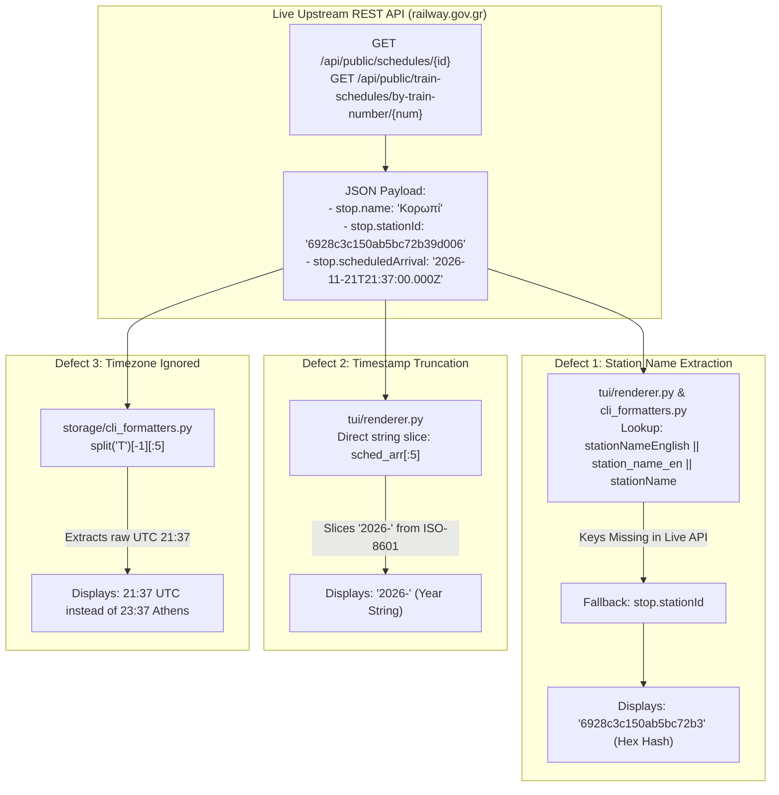

# Incident Report: Train Timetable & Itinerary Display Defect (Hexadecimal Station IDs & "2026" Timestamps)

> **Target Modules:** [`../../tui/renderer.py`](../../tui/renderer.py), [`../../storage/cli_formatters.py`](../../storage/cli_formatters.py), [`../../train_tracker.py`](../../train_tracker.py)  
> **Related Plan:** [`../plans/fixes/p0/p0-7-train-itinerary-schema-and-time-display-fix-plan.md`](../plans/fixes/p0/p0-7-train-itinerary-schema-and-time-display-fix-plan.md)  
> **Relevant Rules & Skills:** [`../../.agents/rules/diagrams-and-visual-documentation.md`](../../.agents/rules/diagrams-and-visual-documentation.md), [`../../.agents/rules/markdown-relative-paths.md`](../../.agents/rules/markdown-relative-paths.md), [`../../.agents/skills/diagrams-and-documentation/SKILL.md`](../../.agents/skills/diagrams-and-documentation/SKILL.md)

---

## 1. Executive Summary & Problem Overview

When operators or commuters inspect train itineraries in `railmon` (via the interactive Curses modal `i` / `I` or via the CLI subcommand `railmon schedule <train_number>`), the displayed timetable fails to provide human-readable information when querying live train services from `railway.gov.gr`:

1. **Station Column Displays Hexadecimal Hash:** Intermediate calling points display raw 24-character hexadecimal MongoDB ObjectIds (e.g. `6928c3c150ab5bc72b39d006` in the CLI, truncated to `6928c3c150ab5bc72b3` in the TUI modal) instead of Greek/English station names (e.g. `Koropi` / `Κορωπί`).
2. **Scheduled & Actual Times Display the Year `2026`:** The `SCHED ARR` and `SCHED DEP` columns render as `2026-` across all stops in the TUI, showing the calendar year rather than scheduled arrival and departure times (`HH:MM`).
3. **Route Endpoints Missing in Modal Header:** The timetable title in the TUI renders without origin or destination endpoints (e.g. `TIMETABLE & ITINERARY: TRAIN 1239` instead of `TIMETABLE & ITINERARY: TRAIN 1239 (Airport -> Tavros)`).
4. **Timezone Discrepancy:** The CLI formatter parses timestamps in raw UTC rather than local Greek operational time (`Europe/Athens`), creating a 2-hour offset (EET) or 3-hour offset (EEST) against real-world Hellenic Railways schedules.

```text
+----------------------------------------------------------------------------------------------------+
| Visual Defect Observed in TUI & CLI (Before Fix)                                                   |
+----------------------------------------------------------------------------------------------------+
| TUI Modal (Key 'i'):                                                                               |
|   TIMETABLE & ITINERARY: TRAIN 1239                                                                |
|   ST   STATION              SCHED ARR   ACTUAL ARR   SCHED DEP   ACT DEP  PLAT                     |
|   ------------------------------------------------------------------------                         |
|        6928c3c150ab5bc72b3    2026-       --:--        2026-      --:--    -                       |
|        6928c3c150ab5bc72b3    2026-       --:--        2026-      --:--    -                       |
|                                                                                                    |
| CLI Output (`railmon schedule 1239`):                                                              |
|   ST   STATION                      SCHED ARR ACTUAL ARR SCHED DEP ACTUAL DEP PLAT  STATUS   DELAY |
|   ------------------------------------------------------------------------------------------------ |
|        6928c3c150ab5bc72b39d006       21:37     --:--      21:37     --:--      —   SCHEDULED ---  |
+----------------------------------------------------------------------------------------------------+
```

---

## 2. Technical Architecture & Failure Pipeline



---

## 3. Deep Root-Cause Analysis

### 3.1 Defect 1: Station Name Key Omission & Hexadecimal ObjectId Fallback

#### Root Cause
In [`tui/mock_engine.py`](../../tui/mock_engine.py#L814-L827), the mock generator synthesizes intermediate stops using synthetic dictionary keys:
```python
stops.append({
    "stopSequence": i + 1,
    "stationId": stn.id,            # e.g. "ATH", "SKG"
    "stationNameGreek": stn.name_el, # e.g. "Αθήνα"
    "stationNameEnglish": stn.name_en,# e.g. "Athens"
    ...
})
```
However, the live production MongoDB backend of Hellenic Railways (`railway.gov.gr`) does not use `stationNameEnglish` or `stationNameGreek`. Its schema for stop records is:
```json
{
  "_id": "0",
  "stationId": "6928c3c150ab5bc72b39d006",
  "order": 1,
  "scheduledArrival": "2026-11-21T21:37:00.000Z",
  "scheduledDeparture": "2026-11-21T21:37:00.000Z",
  "actualArrival": null,
  "actualDeparture": null,
  "status": "scheduled",
  "platform": null,
  "dwellTime": 0,
  "name": "Κορωπί"
}
```
In [`tui/renderer.py`](../../tui/renderer.py#L2437):
```python
stn_name = (
    stop.get("stationNameEnglish")
    or stop.get("station_name_en")
    or stop.get("stationName")
    or stop.get("stationId", "")
)
```
And in [`storage/cli_formatters.py`](../../storage/cli_formatters.py#L435-L437):
```python
en = stop.get("stationNameEnglish") or stop.get("station_name_en")
el = stop.get("stationNameGreek") or stop.get("station_name_el")
name = stop.get("stationName") or stop.get("station_name") or stop.get("stationId")
```
**`stop.get("name")` was completely omitted from both fallback chains.** Because the keys `stationNameEnglish`, `stationNameGreek`, and `stationName` are `None`, the expression immediately falls back to `stationId`. Since `stationId` in the production database is a 24-character hexadecimal ObjectId (`"6928c3c150ab5bc72b39d006"`), the user sees a raw database hash.

---

### 3.2 Defect 2: ISO 8601 Timestamp Slicing Yields Year `2026-`

#### Root Cause
In [`tui/mock_engine.py`](../../tui/mock_engine.py#L779-L780), mock schedule generation populated `scheduledArrival` and `scheduledDeparture` with pre-formatted 5-character `"HH:MM"` strings (e.g. `"14:30"`).

In the live production API, timestamps are full ISO 8601 UTC strings:
```text
"2026-11-21T21:37:00.000Z"
```

In [`tui/renderer.py`](../../tui/renderer.py#L2438-L2456), the code naively took the first 5 characters:
```python
sched_arr = stop.get("scheduledArrival") or time_dash
...
stop_line = f" {ind:<4} {stn_name[:19]:<20} {sched_arr[:5]:^10} ..."
```
The first 5 characters of `"2026-11-21T21:37:00.000Z"` are **`"2026-"`**. In the centered 10-character field (`{sched_arr[:5]:^10}`), curses rendered `"  2026-   "`, presenting the current year instead of the scheduled time.

---

### 3.3 Defect 3: Timezone Neglect (UTC vs. Greek Local Time `Europe/Athens`)

In [`storage/cli_formatters.py`](../../storage/cli_formatters.py#L450-L456), `_extract_stop_time_field()` split the string on `"T"`:
```python
def _extract_stop_time_field(raw_time: Any, empty_dash: str = "--:--") -> str:
    if not raw_time or str(raw_time).lower() in ("none", "null", ""):
        return empty_dash
    s = str(raw_time).strip()
    clean = s.split("T")[-1].replace("Z", "")
    return clean[:5] if len(clean) >= 5 else clean
```
While this prevented slicing the year on ISO strings containing `"T"`, it extracted **raw UTC time** (`21:37`).
In Greece:
* Standard Winter Time (EET): $\text{UTC} + 2$
* Daylight Saving Time (EEST): $\text{UTC} + 3$

For train 1239 (schedule number `"1239-20261121-2332"`), the train's commercial departure is **23:32 local Athens time**. Outputting `21:32` represents a 2-hour error against station departure boards and passenger tickets. The official web application (`reference/chunks/79801.a0cbc95dac2cd2a3.js`) explicitly performs timezone conversion:
```javascript
new Date(e).toLocaleTimeString("en-GB", {
  hour: "2-digit",
  minute: "2-digit",
  hour12: false,
  timeZone: "Europe/Athens"
})
```

---

### 3.4 Defect 4: Missing Origin and Destination Route Endpoints in Modal Header

In [`tui/renderer.py`](../../tui/renderer.py#L2382-L2386):
```python
if isinstance(timetable, dict):
    orig_raw = timetable.get("origin")
    dest_raw = timetable.get("destination")
    orig = orig_raw.get("nameEnglish", "") if isinstance(orig_raw, dict) else str(orig_raw or "")
    dest = dest_raw.get("nameEnglish", "") if isinstance(dest_raw, dict) else str(dest_raw or "")
```
The live API returns:
```json
"origin": {
  "name": "Αεροδρόμιο",
  "nameGreek": "Αεροδρόμιο"
},
"destination": {
  "name": "Ταύρος",
  "nameGreek": "Ταύρος"
}
```
Because `nameEnglish` is absent, `orig` and `dest` evaluate to empty strings `""`, stripping origin and destination from the modal title.

---

## 4. Summary of Required Modifications

| Component | File | Defective Logic | Corrected Logic |
|---|---|---|---|
| **Station Resolution** | [`../../storage/cli_formatters.py`](../../storage/cli_formatters.py), [`../../tui/renderer.py`](../../tui/renderer.py) | Omitted `stop.get("name")` and `stop.get("stationNameGreek")` | Extract `name`, resolve against `load_stations()` index, fallback to Latin transliteration in ASCII mode |
| **Time Formatting** | [`../../tui/renderer.py`](../../tui/renderer.py), [`../../storage/cli_formatters.py`](../../storage/cli_formatters.py) | `sched_arr[:5]` (sliced year `2026-`) and raw UTC split | Parse ISO 8601 string, convert to `Europe/Athens` timezone, output `HH:MM` |
| **Route Endpoints** | [`../../tui/renderer.py`](../../tui/renderer.py), [`../../storage/cli_formatters.py`](../../storage/cli_formatters.py) | Only checked `nameEnglish` | Check `nameEnglish`, `name`, `nameGreek`, `name_en`, `name_el`, and resolve station aliases |
| **Regression Tests** | [`../../tests/test_cli_schedule.py`](../../tests/test_cli_schedule.py), [`../../tests/test_tui_timetable.py`](../../tests/test_tui_timetable.py) | Only tested mock data with pre-formatted `"HH:MM"` and custom keys | Add tests parsing real API JSON payloads with ISO 8601 UTC strings and MongoDB ObjectIds |
