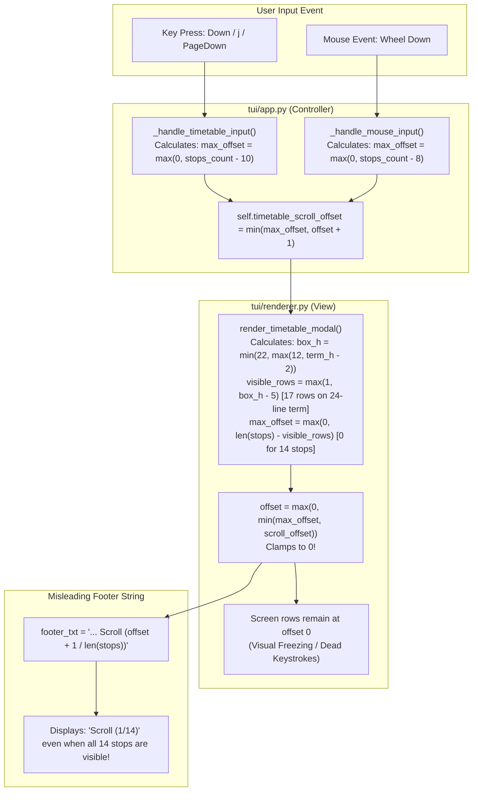

# Incident Report: Train Itinerary & Timetable Modal Scrolling Discrepancies

> **Target Modules:** [`../../tui/app.py`](../../tui/app.py), [`../../tui/renderer.py`](../../tui/renderer.py)  
> **Related Plan:** [`../plans/fixes/p0/p0-8-tui-timetable-modal-scrolling-fix-plan.md`](../plans/fixes/p0/p0-8-tui-timetable-modal-scrolling-fix-plan.md)  
> **Relevant Rules & Skills:** [`../../.agents/rules/diagrams-and-visual-documentation.md`](../../.agents/rules/diagrams-and-visual-documentation.md), [`../../.agents/rules/markdown-relative-paths.md`](../../.agents/rules/markdown-relative-paths.md), [`../../.agents/skills/diagrams-and-documentation/SKILL.md`](../../.agents/skills/diagrams-and-documentation/SKILL.md)

---

## 1. Executive Summary & Defect Overview

When operators navigate train itineraries in the interactive Curses TUI modal (`i` / `I`), the scrolling behavior exhibits several unintuitive and defective behaviors:

1. **Dead / Ghost Scrolling on Standard Terminals:** For trains whose stops fit entirely within the viewport (such as Suburban train 1239 with 14 stops, where 17 stop rows are visible on standard 80x24 consoles), pressing Down (`▼`, `j`) or scrolling the mouse wheel does not shift any rows on screen, but silently increments an internal offset. When users later attempt to scroll up (`▲`, `k`), the interface ignores keystrokes until the ghost offset is exhausted.
2. **Unreachable Final Stops on Compact Displays:** On smaller terminal windows (e.g. 15–18 rows high), `max_offset` is artificially clamped to `stops_count - 10`, preventing users from scrolling to the final intermediate calling points.
3. **Mismatched Keyboard vs. Mouse Limits:** Keyboard navigation clamps at `stops_count - 10`, while mouse wheel navigation clamps at `stops_count - 8`.
4. **Misleading Footer Notation (`Scroll (1/14)`):** When all stops are visible, the footer reads `Scroll (1/14)`. Users interpret `(1/14)` as "showing stop 1 of 14", leading them to attempt to scroll to see stops 2–14. When the display does not move, users perceive the interface as frozen. Similarly, at the bottom of a 25-stop service, the footer displays `(9/25)`, misleading users into believing stops 10–25 cannot be reached.
5. **Asynchronous Thread Overwrites User Scroll Position:** When opening the modal for an uncached train, the background fetch worker callback unconditionally resets `timetable_scroll_offset` when the HTTP request finishes, discarding any user scroll adjustments made while loading.
6. **Inactive Live Station Auto-Centering:** Auto-centering searches for `is_current` or `status: "APPROACH"` flags that only exist in synthetic mock objects. For live production trains, `selected_train.position.next_station` is never matched against stop records, anchoring the modal unconditionally at offset 0.

---

## 2. Technical Architecture & Failure Pipeline



---

## 3. Deep Root-Cause Analysis

### 3.1 Defect 1: Viewport Desynchronization Between Controller & View

#### Root Cause
In [`tui/renderer.py`](../../tui/renderer.py#L2362-L2425), the number of rows allocated for timetable stops is computed dynamically based on the curses terminal window height:
```python
box_h = min(22, max(12, height - 2))
visible_rows = max(1, box_h - 5)
max_offset = max(0, len(stops) - visible_rows)
offset = max(0, min(max_offset, scroll_offset))
```
On a standard 24-row terminal (`height = 24`), `box_h = 22` and `visible_rows = 17`.

However, in [`tui/app.py`](../../tui/app.py#L1102), the keyboard input handler uses a hardcoded formula:
```python
max_offset = max(0, stops_count - 10)  # Hardcoded - 10
```
And in [`tui/app.py`](../../tui/app.py#L1439), mouse wheel handling uses:
```python
self.timetable_scroll_offset = min(max(0, stops_count - 8), self.timetable_scroll_offset + 2)  # Hardcoded - 8
```

#### The Resulting Failure Modes
1. **Dead Scroll Keystrokes (Ghost Scrolling):**
   * Train 1239 has 14 stops. On a 24-row terminal, `visible_rows = 17`.
   * In `renderer.py`, `max_offset = max(0, 14 - 17) = 0`.
   * In `app.py`, `max_offset = max(0, 14 - 10) = 4`.
   * When the user presses Down or `j`, `self.timetable_scroll_offset` increments $0 \to 1 \to 2 \to 3 \to 4$.
   * `renderer.py` clamps `scroll_offset` to `0`, so **no text moves on screen**.
   * When the user presses Up or `k`, the offset decrements $4 \to 3 \to 2 \to 1$, requiring 4 dead keystrokes before any actual upward scroll could occur.
2. **Unreachable Final Stops on Compact Displays:**
   * On a 15-row console, `box_h = 13` and `visible_rows = 8`.
   * To view stops 9 through 14 of a 14-stop train, `offset` must reach $14 - 8 = 6$.
   * In `app.py`, `max_offset` is capped at $14 - 10 = 4$.
   * The user cannot scroll past offset 4; stops 13 and 14 are permanently cut off.
3. **Mismatched Input Modes:**
   * A user scrolling with the mouse wheel can reach offset 6 (`stops_count - 8`), but keyboard navigation stops at offset 4 (`stops_count - 10`).

---

### 3.2 Defect 2: Misleading / Ambiguous Footer Page Notation

In [`tui/renderer.py`](../../tui/renderer.py#L2471):
```python
footer_txt = f" [Esc / i] Close    [▲ / ▼, j / k] Scroll ({offset + 1}/{len(stops)}) "[: box_w - 4]
```
The expression `({offset + 1}/{len(stops)})` creates severe user confusion:
* **All Stops Visible (`offset = 0`, `len(stops) = 14`):** Displays `Scroll (1/14)`. Users assume only stop 1 is displayed and try to scroll to see the rest. Since all 14 stops are already visible, nothing moves.
* **Scrolled to the Bottom of 25 Stops:** With 17 rows visible and `offset = 8` (showing stops 9–25), the footer displays `Scroll (9/25)`. Users assume stops 10 through 25 are missing and cannot be reached.

---

### 3.3 Defect 3: Asynchronous Thread Resets User Scroll Position

In [`tui/app.py`](../../tui/app.py#L1051-L1074), when `toggle_timetable_modal()` is triggered for a train not currently cached:
1. `self.timetable_scroll_offset = 0` is set and `_worker()` is spawned in a background daemon thread.
2. If the user starts scrolling while data is fetching over the network, `self.timetable_scroll_offset` changes to their desired position.
3. When `_worker()` receives the response, it unconditionally executes `self._auto_scroll_to_current_stop()`, snapping the scroll position back and ignoring user input.

---

### 3.4 Defect 4: Missing Live Station Telemetry Matching for Auto-Centering

In [`tui/app.py`](../../tui/app.py#L1000-L1008):
```python
current_idx = 0
for i, s in enumerate(stops):
    if isinstance(s, dict) and (s.get("is_current") or s.get("status") == "APPROACH"):
        current_idx = i
        break
    elif hasattr(s, "is_current") and getattr(s, "is_current", False):
        current_idx = i
        break
```
* Live API responses from `railway.gov.gr` do not contain `is_current` or `status: "APPROACH"`.
* The train's actual approaching calling point is provided by live telemetry in `selected_train.position.next_station` (e.g. `"Doukissis Plakentias"`).
* Because `next_station` is never checked, `current_idx` always defaults to `0`, preventing live trains from auto-centering on their approaching station.

---

## 4. Summary of Required Modifications

| Component | File | Defective Logic | Corrected Logic |
|---|---|---|---|
| **Visible Rows Calculation** | [`../../tui/renderer.py`](../../tui/renderer.py), [`../../tui/app.py`](../../tui/app.py) | View uses dynamic `box_h - 5`; Controller hardcoded `- 10` (keyboard) and `- 8` (mouse) | Shared `calculate_timetable_visible_rows(term_height)` function used by both Controller and View |
| **Max Offset Synchronization** | [`../../tui/app.py`](../../tui/app.py) | `max_offset = max(0, stops_count - 10)` | `max_offset = max(0, stops_count - visible_rows)` across keyboard, mouse, and resize |
| **Footer Range Display** | [`../../tui/renderer.py`](../../tui/renderer.py) | `Scroll (offset + 1 / len(stops))` | `All N stops displayed` or `Scroll (Stops start-end of total)` |
| **Async State Preservation** | [`../../tui/app.py`](../../tui/app.py) | Worker unconditionally calls `_auto_scroll_to_current_stop()` | Only auto-scroll on initial load if user has not manually scrolled |
| **Live Telemetry Progress** | [`../../tui/app.py`](../../tui/app.py), [`../../tui/renderer.py`](../../tui/renderer.py) | Only checks `is_current` / `APPROACH` in stop payload | Match `selected_train.position.next_station` against stop names to mark passed `[X]`, current `►`, and auto-center |
