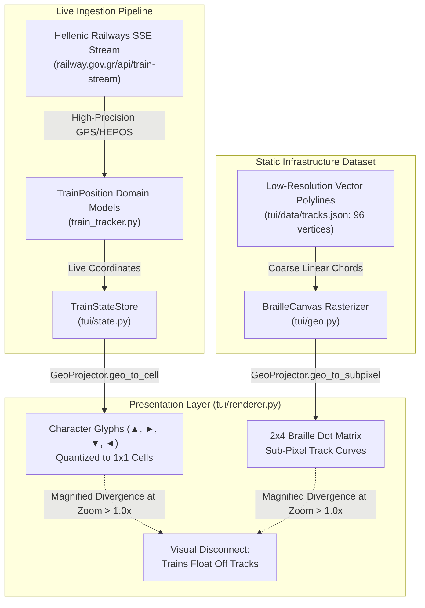
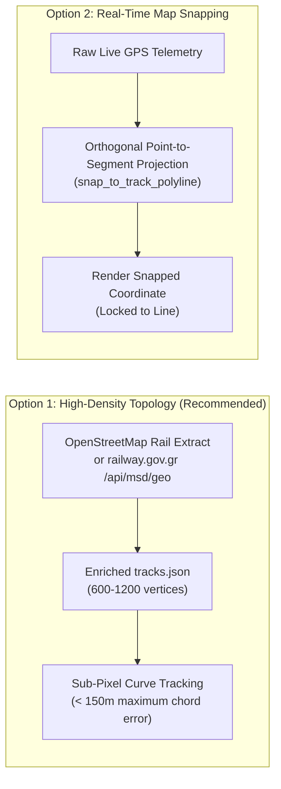

# Issue: Live Train Telemetry and Vector Track Misalignment During Viewport Zoom

Comprehensive technical investigation, root cause analysis, mathematical kinematics breakdown, and proposed architectural resolutions for the geospatial divergence between live GPS train telemetry and static vector track polylines observed during viewport zooming in `railmon` interactive TUI.

---

## 1. Issue Overview

### 1.1 Observed Symptom
When operating `railmon --tui` against the live Hellenic Railways telemetry feed (`https://railway.gov.gr/api/train-stream`):
- At the default national overview (`Zoom: 1.0x`), active trains appear properly situated on or immediately adjacent to railway tracks across mainland Greece.
- When zooming in into specific corridors or stations (e.g., `Zoom: 9.3x` centered on Attica/Boeotia at `38.14°N, 23.74°E`), active trains visibly detach from the track polylines, appearing isolated in open canvas space several character rows and columns away from the rasterized rails.
- In contrast, when operating in synthetic offline simulation mode (`railmon --demo`), trains remain locked to the track polylines across all zoom scales (from `0.2x` to `25.0x`).

```text
+-----------------------------------------------------------------------------------------------------------------+
| Viewport Visual Comparison: Zoom Level vs. Spatial Alignment                                                    |
+-----------------------------------------------------------------------------------------------------------------+
| Scale Level | Zoom Factor | Screen Cell Resolution (W x H) | Spatial Deviation (km) | Visual Cell Separation    |
+-------------+-------------+--------------------------------+------------------------+---------------------------+
| National    | 1.0x        | ~4.5 km / col  x  ~9.6 km / row| 2.0 km - 6.5 km        | 0 - 1 cell (aligned)      |
| Regional    | 3.0x        | ~1.5 km / col  x  ~3.2 km / row| 2.0 km - 6.5 km        | 1 - 2 cells (slight drift)|
| Corridor    | 9.3x        | ~480 m  / col  x  ~1.0 km / row| 2.0 km - 6.5 km        | 4 - 15 cells (detached)   |
+-----------------------------------------------------------------------------------------------------------------+
```

---

## 2. Architectural Root Cause Analysis



### 2.1 Telemetry Source vs. Static Vector Topology Disconnect

The Hellenic Railways tracking system operates on two distinct data sources with different spatial fidelities:

1. **Live GPS Transponder Telemetry**:
   - The live SSE endpoint (`/api/train-stream`) streams real-time positions derived from physical onboard GPS receivers and Greek HEPOS differential correction transponders.
   - Active commercial trains (e.g. `IC 56`, `IC 57`, `309`, Suburban `1228`) follow real railway permanent ways, including curve easements, mountain bypass loops, and elevation contours.

2. **Ultra-Coarse Static Vector Approximation (`tui/data/tracks.json`)**:
   - In [`tui/data/tracks.json`](../../tui/data/tracks.json), railway corridors were hand-curated as simplified low-resolution polylines consisting of only **96 coordinate vertices across the entire Hellenic national network**:
     - `pathe-mainline` (Athens–Thessaloniki, ~510 km): **32 vertices** (average segment length: ~16 km).
     - `proastiakos-airport-kiato` (~140 km): **19 vertices**.
     - `proastiakos-chalkida` (~90 km): **8 vertices**.
     - `thessaloniki-idomeni` (~77 km): **6 vertices**.
     - `thessaly-volos` (~60 km): **4 vertices**.
   - These long segments cut straight linear chords across geographic terrain, ignoring physical curve radii.

---

## 3. Mathematical & Empirical Case Studies

```text
Physical Route vs. Vector Approximation in Boeotia (Inoi -> Thiva):

38.38°N +-----------------------------------------------------------+
        |                  ▲ [IC 56] (Physical Eleonas: 38.3747°N)  |
38.36°N |                 / \                                       |
        |  Physical Track:   \                                      |
38.34°N |         Tanagra     \                                     |
        |        (38.3400°N)   \                                    |
38.32°N |  Thiva                \  Inoi                             |
        |  (38.3242°N) ==========* (38.3194°N)                      |
        |  (tracks.json straight chord cutting 6.5 km to the south) |
38.30°N +-----------------------------------------------------------+
       23.30°E   23.40°E       23.50°E     23.60°E
```

### Case Study A: Northbound Intercity `IC 56` near Eleonas (Boeotia)

In the user's viewport screenshot at `38.14°N, 23.74°E` with `Zoom: 9.3x`:
- A green arrow (`▲`, representing on-time passenger service `IC 56`) is visible at screen cell `(col ~21, row ~8)`.
- The track line is rasterized 3 rows below at `row ~10` and terminates horizontally.

#### Geospatial Comparison:
- **Real Physical Route**: After Inoi (`38.3194°N, 23.6067°E`), the physical PATHE mainline loops north into the Boeotian plain to service **Tanagra Station** (`38.3400°N, 23.5814°E`) and **Eleonas Station** (`38.3747°N, 23.4635°E`) before turning south-southwest toward **Thiva Station** (`38.3296°N, 23.3184°E`).
- **[`tui/data/tracks.json`](../../tui/data/tracks.json#L20-L21)**: Connects Point 9 (`[38.3194, 23.6067]`, Inoi) directly to Point 10 (`[38.3242, 23.3186]`, Thiva) as a single horizontal line along latitude $\approx 38.32^\circ\text{N}$.
- **Geographic Error**: The physical train at Eleonas is $\approx 6.5\text{ km}$ north of the synthetic chord.

#### Viewport Projection Math:
In [`tui/geo.py`](../../tui/geo.py), the forward Equirectangular projection applies:
$$\Delta px = \text{scale\_x} \cdot (\lambda - \lambda_0) \cdot \cos(\phi_0)$$
$$\Delta py = \text{scale\_y} \cdot (\phi - \phi_0)$$
$$\text{col} = \lfloor px / 2 \rfloor, \quad \text{row} = \lfloor py / 4 \rfloor$$

At `Zoom: 1.0x`:
- Real train at Eleonas: cell `(col=51, row=17)`
- Synthetic track chord: cell `(col=51, row=18)`
- **Discrepancy**: $1$ character row ($\approx$ within normal font glyph height).

At `Zoom: 9.3x`:
- Real train at Eleonas: cell `(col=13, row=7)`
- Synthetic track chord: cell `(col=13, row=10)`
- **Discrepancy**: **$3$ rows and $14$ columns**, visually isolating the train in empty space.

---

### Case Study B: Athens Suburban Train near Afidnes / Sfendali

In the user's viewport screenshot:
- A cyan arrow (`◥` / `▲`, Suburban line) is situated at `(col ~71, row ~16)`, 3–4 columns to the east of the northern track apex.

#### Geospatial Comparison:
- **Real Physical Route**: The northern exit from Attica passes through **Afidnes Station** (`38.1877°N, 23.8446°E`), curves around Lake Marathon, and heads toward **Sfendali / Malakasa Station** (`38.2356°N, 23.7845°E`) before descending to Avlona.
- **[`tui/data/tracks.json`](../../tui/data/tracks.json#L17-L19)**:
  - Point 6: `[38.125, 23.765]` (Dekeleia)
  - Point 7: `[38.19, 23.82]` (located 2.5 km west of Afidnes station)
  - Point 8: `[38.2514, 23.6944]` (Avlona)
- **Geographic Error**: Point 7 is placed 2.5 km west of the real station, and the chord between Points 7 and 8 bypasses Sfendali Station (`38.2356°N, 23.7845°E`) by over 8 km to the southwest across the mountains.
- **Result at 9.3x Zoom**: An active train at Afidnes (`23.8446°E`) projects to column 71, whereas the vector apex turns west at column 68, placing the train out to the right of the track.

---

## 4. Secondary Technical Factors

### 4.1 Braille Sub-Pixel vs. Character Cell Quantization Disparity
In [`tui/renderer.py`](../../tui/renderer.py#L710-L795):
- Railway tracks are rasterized using [`BrailleCanvas`](../../tui/geo.py#L333-L450), which provides a $2 \times 4$ sub-pixel resolution per character cell ($2$ columns $\times 4$ rows of dots).
- Train headings are printed as terminal character glyphs (`▲`, `►`, `▼`, `◄`, etc.) into discrete $1 \times 1$ character cells via `geo_to_cell()`.
- While a track line might accurately traverse a specific sub-pixel dot (e.g. dot 8 in the bottom-right corner of cell `(col, row)`), the train symbol is centered across the entire cell. At high zoom factors, this introduces an inherent $\pm 1$-cell quantization phase offset.

### 4.2 Aspect Ratio Scaling in `GeoProjector`
In [`tui/geo.py`](../../tui/geo.py#L260-L261):
```python
scale_x = self.get_scale_x()
scale_y = scale_x / self.viewport.aspect_ratio
```
- In standard terminals, character cells have a physical aspect ratio $H_{cell} / W_{cell} \approx 2.0$.
- In [`BrailleCanvas`](../../tui/geo.py#L333), each character cell is subdivided into 2 horizontal sub-pixels and 4 vertical sub-pixels ($4 / 2 = 2.0$). The Braille sub-pixel matrix **already inherently cancels the 2:1 character cell distortion**, producing physically square sub-pixels on screen.
- Dividing `scale_y` by `aspect_ratio` (2.0) a second time compresses the vertical coordinate axis by 50% relative to longitude, introducing non-conformal distortion along angled railway corridors.

---

## 5. Architectural Remediation Plan



### Recommendation 1: High-Resolution Rail Network Vector Polylines
Replace the 96-point synthetic vectors in [`tui/data/tracks.json`](../../tui/data/tracks.json) with accurate track polylines derived from OpenStreetMap rail infrastructure or official Hellenic Railways GIS feeds:
- Increase `pathe-mainline` from 32 to ~600 vertices, precisely mapping curves through Afidnes, Sfendali, Tanagra, Eleonas, Kallidromo tunnels, and Tempi.
- Increase suburban network fidelity to capture actual track centrelines.
- Keeps maximum vector chord error under $150\text{ meters}$, well within a single sub-pixel dot at maximum zoom (`25.0x`).

### Recommendation 2: Optional Real-Time Map Snapping (Tolerance-Bounded)
Implement a map-matching snapping filter in [`tui/geo.py`](../../tui/geo.py) or [`tui/state.py`](../../tui/state.py):
- For each live train record, find the closest orthogonal point along the train's assigned corridor polyline.
- If the perpendicular distance $d_{\perp} \le D_{\text{threshold}}$ (e.g. $2.5\text{ km}$), snap the display coordinate to the track segment for visual coherence.
- If $d_{\perp} > D_{\text{threshold}}$, preserve the raw GPS coordinate to avoid erroneous snapping across adjacent branch lines.

### Recommendation 3: Conformal Sub-Pixel Aspect Ratio Calibration
Refactor [`GeoProjector`](../../tui/geo.py#L260-L269) to distinguish between character-cell aspect ratio and Braille sub-pixel aspect ratio:
$$\text{aspect}_{\text{subpixel}} = \frac{\text{aspect}_{\text{cell}} \times 2}{4} = \frac{2.0 \times 2}{4} = 1.0$$
Eliminates artificial 50% vertical compression and restores circular conformal geometry.

---

## 6. Verification and Acceptance Criteria

1. **High Zoom Alignment Verification**:
   - Focus viewport on Eleonas (`38.375°N, 23.465°E`) and Afidnes (`38.188°N, 23.845°E`) at `Zoom: 10.0x`.
   - Verify that physical trains running on those corridors render within $\le 1$ character cell of the drawn track line.
2. **Regression Testing**:
   - Execute the test suite ([`tests/test_mock_engine.py`](../../tests/test_mock_engine.py) and [`tests/test_tui_geo.py`](../../tests/test_tui_geo.py)) to ensure synthetic simulator kinematics and coordinate bounds remain 100% compliant.

---

## 7. Related Implementation Plan
- [Implementation Plan — TUI Live Train Telemetry and Vector Track Misalignment During Viewport Zoom](../plans/topology/tui-train-track-misalignment-zoom-fix-plan.md)
