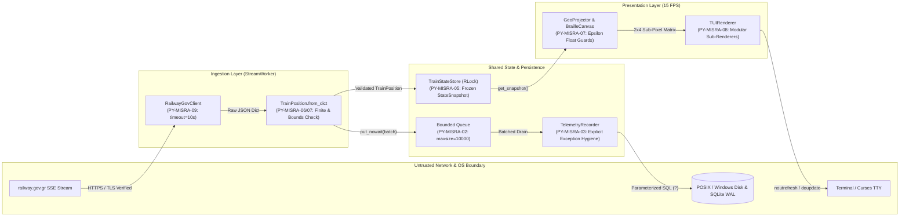
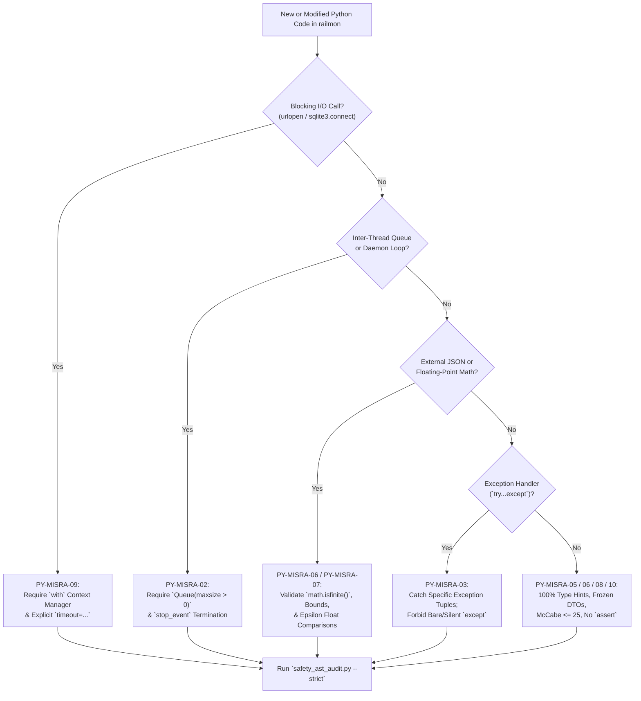

# MISRA C++, AUTOSAR C++14, and NASA JPL Safety Standards for Python: Architectural Rationale in `railmon`

## 1. Executive Summary

Safety-critical and high-assurance software standards—specifically **MISRA C:2012 / MISRA C++:2023**, **AUTOSAR C++14**, **SEI CERT**, and **NASA JPL's "Power of 10" Rules**—were originally authored for compiled, manually-managed or deterministic systems languages (C and C++) running on embedded controllers, avionics, and railway signaling platforms.

When applied to Python, a **literal 1:1 port of C++ MISRA/AUTOSAR rules is both impossible and counterproductive** because Python relies on a dynamic runtime, reference-counted/generational garbage collection, heap-allocated stack frames, and exception-driven control flow. Conversely, leaving a 24/7 multi-threaded Python telemetry daemon unguarded exposes the application to late-stage runtime crashes (`TypeError` on unexpected `None`, silent thread death, unbounded queue Out-Of-Memory crashes, hung TCP sockets, and `NaN` propagation into SQLite or `curses` geometry).

This document explains in detail:
1. **Why** specific MISRA, AUTOSAR, and NASA JPL rules were selected and adapted into [`PY-MISRA-01` through `PY-MISRA-10`](../.agents/rules/misra-autosar-python.md).
2. **How** each rule maps directly to the concrete runtime architecture and failure modes of `railmon` ([`train_tracker.py`](../train_tracker.py), [`storage/`](../storage/), [`tui/`](../tui/)).
3. **Which** rules require pragmatic tuning in Python (and how our AST gate is calibrated to avoid pedantic friction).
4. **Which** C++ MISRA/AUTOSAR rules were intentionally excluded because they fight Python's runtime and degrade code quality.

---

## 2. Why `railmon` Needs High-Assurance Static Safety Rules

Unlike a short-lived CLI utility or a stateless web handler that terminates after a 50 ms HTTP request, `railmon` operates as a **long-running, multi-threaded real-time telemetry system**:

1. **Continuous Upstream Network Ingestion:** [`RailwayGovClient.stream_train_positions`](../train_tracker.py#L724-L787) and [`StreamWorker`](../tui/stream_worker.py#L21-L218) maintain persistent Server-Sent Events (SSE) HTTPS streams over unstable networks, parsing untrusted external JSON frames every second for days or weeks at a time.
2. **Asynchronous Producer-Consumer Persistence:** [`TelemetryRecorder`](../storage/recorder.py#L42-L509) runs a background daemon thread consuming batches from an inter-thread `queue.Queue`, filtering stationary noise via [`DeadbandFilter`](../storage/filter.py#L43-L221), and executing atomic `BEGIN IMMEDIATE` transactions against an on-disk SQLite WAL database ([`Database`](../storage/db.py#L42-L264)).
3. **Concurrent Curses Terminal Rendering:** [`TUIApp`](../tui/app.py#L152-L1076) and [`TUIRenderer`](../tui/renderer.py#L1031-L2155) run a 15 FPS double-buffered rendering loop that reads immutable [`StateSnapshot`](../tui/state.py#L159-L183) objects from [`TrainStateStore`](../tui/state.py#L300-L792) while performing trigonometric WGS84-to-Braille sub-pixel projections ([`GeoProjector`](../tui/geo.py#L293-L564)) and orthogonal track snapping ([`snap_to_track_network`](../tui/mock_engine.py#L258-L314)).

### `railmon` Runtime Safety Boundaries (Mermaid)



### `railmon` Runtime Safety Boundaries (ASCII)

```text
+-----------------------------------------------------------------------------------+
|                      RAILMON HIGH-ASSURANCE SAFETY BOUNDARIES                     |
+-----------------------------------------------------------------------------------+

  [Untrusted SSE JSON]
           |
           v  (PY-MISRA-09: Explicit socket timeout=10.0s, context manager `with`)
+----------------------+
|   RailwayGovClient   |
+----------------------+
           |
           v  (PY-MISRA-06 & PY-MISRA-07: Strict type narrowing, NaN/Inf & lat/lng bounds)
+----------------------+
| TrainPosition.from_  |------------------------------------+
|        dict()        |                                    |
+----------------------+                                    |
           |                                                |
           v  (RLock mutex)                                 v  (PY-MISRA-02: Bounded Queue)
+----------------------+                         +----------------------+
|   TrainStateStore    |                         |  queue.Queue(10000)  |
+----------------------+                         +----------------------+
           |                                                |
           v  (PY-MISRA-05: @dataclass(frozen=True))        v  (PY-MISRA-02: stop_event loop)
+----------------------+                         +----------------------+
|    StateSnapshot     |                         |  TelemetryRecorder   |
+----------------------+                         +----------------------+
           |                                                |
           v  (PY-MISRA-07/08: Float safety & modular UI)   v  (PY-MISRA-09: timeout=5.0s WAL)
+----------------------+                         +----------------------+
| TUIApp & TUIRenderer |                         | SQLite WAL Database  |
+----------------------+                         +----------------------+
```

---

## 3. Tier 1: Rules That Make 100% Sense for Python (High Value, Low Friction)

The following rules target defects that a C++ compiler normally prevents at compile time, or resource leaks that cause long-running Python daemons to fail after hours or days in production.

### 3.1 `PY-MISRA-02`: Bounded Loops, Retries, and Inter-Thread Queues
* **C++ Standard Origin:** *NASA JPL Power-of-10 Rule 2 ("All loops must have fixed bounds")* and *AUTOSAR A6-5-1*.
* **Why Python Needs It:**
  In Python's standard library, `queue.Queue()` defaults to `maxsize=0` (an **infinite** queue). If `railmon` is running in `--record` mode and the disk experiences temporary I/O contention or a slow NFS/SD-card mount, the network reader thread (`StreamWorker`) continues pushing `TrainPosition` batches into the queue every second. Without a hard bound, the Python process silently consumes gigabytes of RAM until the OS OOM-killer terminates it.
* **How It Protects `railmon`:**
  * [` safety_ast_audit.py`](../.agents/skills/static-safety-analyzer/scripts/safety_ast_audit.py) inspects every `queue.Queue`, `LifoQueue`, and `PriorityQueue` AST call node and fails the build if `maxsize` is omitted or $\le 0$.
  * In [`TelemetryRecorder.__init__`](../storage/recorder.py#L64-L66), the queue is bounded to `maxsize=self.config.queue_maxsize` (`10,000`), and [`enqueue_batch`](../storage/recorder.py#L277-L291) uses non-blocking `put_nowait()` with explicit drop logging when saturated.
  * Every daemon loop ([`RailwayGovClient.stream_train_positions`](../train_tracker.py#L724-L787), [`TelemetryRecorder._worker_loop`](../storage/recorder.py#L293-L360), [`StreamWorker._run_loop`](../tui/stream_worker.py#L113-L200), [`TUIApp.run_loop`](../tui/app.py#L953-L1076)) is gated on `not stop_event.is_set()` and uses interruptible `stop_event.wait(timeout=...)` instead of uninterruptible blocking calls.

### 3.2 `PY-MISRA-09`: Deterministic Resource Lifecycle (RAII & Mandatory I/O Timeouts)
* **C++ Standard Origin:** *AUTOSAR A18-5-2 / MISRA Rule 22.1 (RAII - Resource Acquisition Is Initialization)*.
* **Why Python Needs It:**
  1. Unlike C++ destructors which run deterministically at scope exit, Python's `__del__` runs non-deterministically whenever garbage collection occurs. Leaving a file, socket, or SQLite transaction outside a `with` context manager can hold OS file descriptors or SQLite write locks open indefinitely when an exception is raised.
  2. Even worse, Python's `urllib.request.urlopen(req)` defaults to `timeout=socket._GLOBAL_DEFAULT_TIMEOUT` (`None`, meaning **wait forever**). If an intermediate router drops a NAT entry while streaming from `railway.gov.gr`, a socket read without an explicit timeout will hang the ingestion thread forever without ever raising an exception or triggering a reconnect.
* **How It Protects `railmon`:**
  * `safety_ast_audit.py` flags any `urlopen()` or `sqlite3.connect()` call in production modules that does not pass an explicit `timeout=...` argument.
  * [`RailwayGovClient._get`](../train_tracker.py#L510) enforces `timeout=15`, [`stream_train_positions`](../train_tracker.py#L729) enforces `timeout=10.0`, and [`Database._create_connection`](../storage/db.py#L112-L131) enforces `timeout=5.0` alongside `PRAGMA busy_timeout = 5000;`.

### 3.3 `PY-MISRA-03`: Explicit Exception Hygiene (No Bare or Silent `except`)
* **C++ Standard Origin:** *AUTOSAR A15-3-4 ("Catch handlers shall catch specific exception types") / MISRA C++ 15-3-4*.
* **Why Python Needs It:**
  In Python, a bare `except:` catches `BaseException`, which includes `SystemExit` (raised by `sys.exit()`), `KeyboardInterrupt` (Ctrl+C), and `MemoryError`. Furthermore, a silent `except Exception: pass` is uniquely dangerous in an interpreted language: if a developer introduces a variable name typo (`NameError`) or calls a missing method (`AttributeError`) inside that `try` block, Python raises a runtime exception that gets silently swallowed, masquerading as normal operation.
* **How It Protects `railmon`:**
  * Bare `except:` is a hard AST error across the entire repository.
  * Silent `except Exception: pass` outside destructor/teardown methods (`close()`, `__exit__()`, `__del__()`) is flagged by `safety_ast_audit.py`.
  * For example, in [`storage/db.py`](../storage/db.py#L25-L36), timestamp parsing catches `(ValueError, TypeError)` specifically, and in [`train_tracker.py`](../train_tracker.py#L1669-L1685), Windows console setup catches `(ImportError, AttributeError, OSError, ValueError)`.

### 3.4 `PY-MISRA-05`: Immutability by Default & No Mutable Default Arguments
* **C++ Standard Origin:** *AUTOSAR A7-1-1 ("Constexpr or const shall be used whenever possible")*.
* **Why Python Needs It:**
  * Python evaluates default argument expressions **once at function definition time**, not at call time. A function defined as `def collect(items: List[str] = [])` mutates the same list across every call—a classic Python bug.
  * In multi-threaded applications like `railmon`, passing mutable dictionaries or dataclasses between a background worker thread and a UI thread invites race conditions (`RuntimeError: deque mutated during iteration`).
* **How It Protects `railmon`:**
  * `safety_ast_audit.py` bans mutable default arguments (`[]`, `{}`, `set()`, `list()`, `dict()`) in function signatures.
  * Cross-thread value objects and configurations—[`StateSnapshot`](../tui/state.py#L159-L183), [`HistoricalBreadcrumb`](../tui/state.py#L78-L85), [`GeoPoint`](../tui/geo.py#L103-L113), [`BoundingBox`](../tui/geo.py#L205-L243), [`PaneGeometry`](../tui/renderer.py#L169-L227), [`RecorderConfig`](../storage/recorder.py#L25-L40), [`DeadbandConfig`](../storage/filter.py#L14-L27), and all database row models in [`storage/models.py`](../storage/models.py)—are declared with `@dataclass(frozen=True)`, making accidental cross-thread mutation impossible.

### 3.5 `PY-MISRA-06` & `PY-MISRA-04`: Complete Type Annotations, Strict Narrowing & Return Consistency
* **C++ Standard Origin:** *MISRA Rule 10.1 (Type soundness)* and *MISRA Rule 17.7 / AUTOSAR A0-1-2 (Return value handling)*.
* **Why Python Needs It:**
  Without static type annotations and `mypy --strict`, Python does not verify whether a function parameter or return value can be `None` until that specific branch executes at runtime. In live railway telemetry, upstream JSON fields (`nextStation`, `altitude`, `progress`, `corridor`, `delay`) frequently flip between numbers, strings, and `null` depending on whether a locomotive is in a yard, mid-corridor, or lacking GPS lock.
* **How It Protects `railmon`:**
  * `safety_ast_audit.py` enforces 100% parameter and return type annotation coverage on every function and method in [`train_tracker.py`](../train_tracker.py), [`storage/`](../storage/), and [`tui/`](../tui/), and verifies that no function mixes bare `return` with value `return <expr>`.
  * [`pyproject.toml`](../pyproject.toml#L84-L103) configures `mypy` with `strict = true`, `disallow_untyped_defs = true`, `no_implicit_optional = true`, and `warn_unreachable = true`.
  * Untrusted dictionaries from `json.loads()` are immediately quarantined and coerced at the boundary via [`TrainPosition.from_dict`](../train_tracker.py#L427-L484) and the `_safe_float` / `_safe_int` / `_safe_optional_str` helpers ([`train_tracker.py`](../train_tracker.py#L334-L398)).

### 3.6 `PY-MISRA-01` & `PY-MISRA-10`: No Dynamic Execution, Wildcard Imports, Recursion, or Production `assert`
* **C++ Standard Origin:** *NASA JPL Rule 1 (No recursion / dynamic control flow)*, *MISRA Dir 4.12*, and *SEI CERT*.
* **Why Python Needs It:**
  * **No `assert` in production code (`PY-MISRA-10`):** Many Python developers use `assert isinstance(data, dict)` or `assert lat >= -90` for input validation. However, running Python with optimization enabled (`python3 -O` or `PYTHONOPTIMIZE=1`) **completely strips every `assert` statement from the bytecode**, silently disabling all validation. Production code must raise explicit `ValueError` or `TypeError`.
  * **No recursion (`PY-MISRA-10`):** Python does not perform Tail-Call Optimization (TCO) and has a fixed call stack limit (`sys.getrecursionlimit()`, default 1000). Any recursive graph/polyline traversal or retry loop will crash with `RecursionError` on long inputs.
  * **No `eval` / `exec` / `pickle` / `shell=True` (`PY-MISRA-01`):** Prevents arbitrary code execution when handling external telemetry streams or user-supplied CLI export paths.

---

## 4. Tier 2: Rules That Require Pragmatic Tuning in Python

Two rules originating from aerospace and automotive C++ standards provide real value in `railmon`, but **only if tuned pragmatically** so they do not punish idiomatic Python.

### 4.1 `PY-MISRA-07`: Floating-Point Equality and Coordinate Safety
* **C++ Standard Origin:** *MISRA Dir 4.6 / AUTOSAR A4-7-1 (Floating-point precision and representation)*.
* **Why It Matters in `railmon`:**
  `railmon` performs continuous IEEE 754 floating-point math across four subsystems:
  1. **WGS84 Coordinate Ingestion:** Validating latitude $\in [-90.0, 90.0]$ and longitude $\in [-180.0, 180.0]$ and rejecting `NaN` or `Inf` before inserting into SQLite `REAL` columns or calculating Haversine distances ([`TrainPosition.from_dict`](../train_tracker.py#L431-L447)).
  2. **Conformal Equirectangular Map Projection:** Converting $(\text{lat}, \text{lng})$ to 2x4 Braille sub-pixels using $\cos(\phi_0)$ scaling ([`GeoProjector`](../tui/geo.py#L362-L383)).
  3. **Orthogonal Track Snapping:** Projecting noisy GPS coordinates onto polyline segments ([`project_point_to_segment`](../tui/mock_engine.py#L73-L115), [`TrackPolyline.interpolate_at_distance`](../tui/mock_engine.py#L186-L227)).
  4. **Station Proximity & Kinematic ETA:** Computing $\text{ETA} = (d_{\text{km}} / v_{\text{km/h}}) \times 60$ and guarding against division by zero or uninitialized $(0.0, 0.0)$ "Null Island" coordinates ([`format_next_station_eta`](../tui/renderer.py#L622-L670), [`_train_matches_corridor`](../tui/state.py#L229-L273)).
* **Where It Can Feel Strict & How We Tuned It:**
  Checking `lat != 0.0` or `seg_len == 0.0` directly with `==` or `!=` fails when floating-point arithmetic leaves a residual like `1e-16`. In `railmon`, we use epsilon bounds (`abs(p.lat) > 1e-9`, `seg_len_sq <= 1e-12`) and `math.isfinite()`. If a developer ever needs to compare an exact float sentinel constant where epsilon is unnecessary, they can annotate the line with `# safety: ignore[PY-MISRA-07]`.

### 4.2 `PY-MISRA-08`: McCabe Cyclomatic Complexity and Nesting Depth Bounds
* **C++ Standard Origin:** *NASA JPL Rule 6 / MISRA Quality Metrics (McCabe Cyclomatic Complexity $\le 10$ or $\le 15$)*.
* **Why It Matters in `railmon`:**
  When we ran the first baseline AST audit on `railmon`, [`TUIRenderer.render_map`](../tui/renderer.py#L1450) had a McCabe complexity of **61** (over 270 lines in a single method handling borders, uniform tracks, corridor-colored run-length blitting, breadcrumbs, scale bars, station collision avoidance, and train callouts). Similarly, [`HistoricalRepository.archive_before`](../storage/repository.py#L949) had a complexity of **34**, and [`RailwayGovClient.stream_train_positions`](../train_tracker.py#L724) had a nesting depth of **7**.
  Decomposing those functions into focused helpers (`_render_map_tracks`, `_render_map_breadcrumbs`, `_render_map_stations`, `_render_map_trains`, `_collect_archive_payload`, `_iter_sse_payloads`, `_compute_sse_reconnect_wait`) immediately made each stage independently readable and testable.
* **Why Classic MISRA ($\le 10$) Is Too Strict for Python & How We Tuned It:**
  In Python, rich TUI and CLI applications naturally have functions with 15–23 linear branches that are *not* complex to read:
  * **Keyboard event dispatchers** like [`TUIApp._handle_normal_input`](../tui/app.py#L523-L610) (`if key == ... elif key == ...` across 18 hotkeys).
  * **Data formatting tables** like [`TUIRenderer.render_inspector`](../tui/renderer.py#L1791) where 13 fields use inline `val or "N/A"` fallback expressions.
  * **Calibration in `safety_ast_audit.py`:**
    1. **Standard McCabe Counting:** Boolean fallback expressions (`a or b`) do not inflate structural branch complexity; only actual control-flow branches (`if`, `for`, `while`, `except`, ternary `if/else`, list comprehensions) are counted (matching `flake8-mccabe` / `ruff C901`).
    2. **Flat `elif` Chains Exempted from Nesting Depth:** In Python's AST, an `elif` is represented as an `If` node nested inside the parent `If.orelse`. A naive AST walker counts a 20-branch `elif` chain as nesting depth 20! Our auditor ([`_compute_max_nesting_depth`](../.agents/skills/static-safety-analyzer/scripts/safety_ast_audit.py#L111-L148)) treats `elif` chains at the same indentation level, only penalizing true rightward indentation pyramids (depth $> 5$).
    3. **Pragmatic Ceiling ($\le 25$):** The hard gate enforces McCabe $\le 25$ (and supports `--warn-complexity 15` when looking for refactoring candidates).

---

## 5. Tier 3: C++ MISRA / AUTOSAR Rules Intentionally Excluded from Python

To keep the rule set practical and idiomatic, we deliberately **rejected** the following C++ MISRA and AUTOSAR rules:

| Excluded C++ Rule | Original C++ Mandate | Why It Is Counterproductive in Python / `railmon` |
| :--- | :--- | :--- |
| **MISRA C++ Dir 4.12 / AUTOSAR A18-5-1** | *No dynamic heap memory allocation (`new` / `malloc`) after initialization.* | **Impossible in Python.** Every Python integer, string, tuple, generator frame, and dataclass is heap-allocated by the CPython allocator (`pymalloc`). Instead of banning allocation, `railmon` bounds *object retention* via `deque(maxlen=15)` ([`TrainRecord`](../tui/state.py#L93)), `queue.Queue(maxsize=10000)`, and 30-minute stale vehicle eviction (`prune_stale_trains()`). |
| **MISRA C:2012 Rule 15.5 / AUTOSAR M6-4-1** | *A function shall have a single point of exit (`return`) at the end of the function.* | **Hurts Python readability and increases nesting.** Idiomatic Python relies on **early guard clauses** (e.g., `if not geometry.is_valid: return`) to keep the main logic flat. Enforcing single-return in Python forces deep `if/else` indentation pyramids. Instead, `PY-MISRA-04` enforces *consistent* return types (no mixing bare `return` and `return value`). |
| **AUTOSAR A15-0-1 / Embedded C++** | *Exceptions shall not be used for control flow or error recovery; use error codes.* | **Fights the Python language.** Exceptions are fundamental to Python's iterator protocol (`StopIteration`), context managers (`__exit__`), `curses.error` handling, and `urllib` / `sqlite3` error reporting. Instead of banning exceptions, `PY-MISRA-03` enforces *strict exception hygiene* (specific exception tuples and no silent swallowing). |
| **MISRA C++ Rule 5-0-3 / Implicit Conversions** | *No implicit integral or floating-point promotions (`int` to `float`).* | **Redundant with PEP 484 & MyPy.** In Python, `int` is a subtype of `float` in type annotations (`float` accepts `int`), and Python `int` has arbitrary precision (cannot overflow 32/64-bit registers like C++ `int32_t`). |
| **AUTOSAR A5-2-2 / Pointer Arithmetic** | *Rules governing raw pointers, `reinterpret_cast`, array decay, and union aliasing.* | **Handled by CPython Memory Safety.** Python does not expose raw memory pointers in pure Python code (except via `ctypes`, which is restricted in `railmon` to a 2-line Windows UTF-8 console codepage call in [`_configure_win32_utf8_console`](../train_tracker.py#L1669-L1686)). |

---

## 6. Architectural Comparison: Rule Impact Matrix

### Decision Flow for Applying Safety Rules in `railmon` (Mermaid)



### Summary Mapping to `railmon` Subsystems

| Rule ID | Rule Name | Primary `railmon` Subsystem Protected | Prevented Production Failure Mode |
| :--- | :--- | :--- | :--- |
| **`PY-MISRA-01`** | No Dynamic Execution / `shell=True` | [`train_tracker.py`](../train_tracker.py), [`storage/repository.py`](../storage/repository.py) | Remote code execution or command injection via malformed payloads or export paths. |
| **`PY-MISRA-02`** | Bounded Queues & Loops | [`storage/recorder.py`](../storage/recorder.py), [`tui/stream_worker.py`](../tui/stream_worker.py) | Unbounded memory growth (OOM crash) during disk stalls; zombie threads on Ctrl+C / `SIGTERM`. |
| **`PY-MISRA-03`** | Explicit Exception Hygiene | All modules (`train_tracker.py`, `storage/`, `tui/`) | Masked `NameError`/`AttributeError` bugs; trapping `KeyboardInterrupt` or `SystemExit`. |
| **`PY-MISRA-04`** | Consistent Explicit Returns | [`storage/repository.py`](../storage/repository.py), [`tui/state.py`](../tui/state.py) | Accidental implicit `None` return on edge-case branches causing downstream `AttributeError`. |
| **`PY-MISRA-05`** | Immutability & No Mutable Defaults | [`tui/state.py`](../tui/state.py), [`storage/models.py`](../storage/models.py), [`tui/geo.py`](../tui/geo.py) | Cross-thread data races between `StreamWorker` and `TUIApp`; shared state corruption across calls. |
| **`PY-MISRA-06`** | 100% Type Annotation Coverage | All production modules (`train_tracker.py`, `storage/`, `tui/`) | Late runtime `TypeError` when optional telemetry fields (`corridor`, `delay`, `next_station`) are `None`. |
| **`PY-MISRA-07`** | Float & Coordinate Safety | [`train_tracker.py`](../train_tracker.py), [`tui/geo.py`](../tui/geo.py), [`tui/mock_engine.py`](../tui/mock_engine.py) | `NaN`/`Inf` poisoning of SQLite `telemetry_history` or `ValueError` in `BrailleCanvas` sub-pixel projection. |
| **`PY-MISRA-08`** | McCabe Complexity ($\le 25$) & Nesting ($\le 5$) | [`tui/renderer.py`](../tui/renderer.py), [`train_tracker.py`](../train_tracker.py), [`storage/repository.py`](../storage/repository.py) | Untestable monolithic functions and deeply nested SSE / SQLite transaction recovery logic. |
| **`PY-MISRA-09`** | RAII Contexts & I/O Timeouts | [`train_tracker.py`](../train_tracker.py), [`storage/db.py`](../storage/db.py) | Infinite socket hangs on half-open SSE connections; leaked SQLite locks (`database is locked`). |
| **`PY-MISRA-10`** | No Recursion, `import *`, or Runtime `assert` | All production modules | `RecursionError` stack overflows; validation silently disappearing under `python3 -O`. |

---

## 7. Multi-Layered Static Verification Pipeline

To uphold `railmon`'s **Zero External Runtime Dependency** guarantee ([`pyproject.toml`](../pyproject.toml#L40-L44)), static safety enforcement is split into two layers:

```text
+-------------------------------------------------------------------------------+
| LAYER 1: Zero-Dependency Built-In AST Gate (Always Available Everywhere)      |
|   Script : .agents/skills/static-safety-analyzer/scripts/safety_ast_audit.py  |
|   Runtime: Python 3.10+ Standard Library (`ast`, `tokenize`, `pathlib`)       |
|   Checks : PY-MISRA-01 .. PY-MISRA-10 (Timeouts, Queues, Types, Float, McCabe)|
+-------------------------------------------------------------------------------+
                                       |
                                       v
+-------------------------------------------------------------------------------+
| LAYER 2: Extended Dev-Dependency Static Analysis Suite (`pip install .[dev]`) |
|   Config : pyproject.toml ([tool.mypy], [tool.ruff.lint], [tool.bandit])      |
|   Tools  : mypy --strict | ruff (B, BLE, C90, S, RET, PL) | bandit | flake8   |
+-------------------------------------------------------------------------------+
```

### Running the Verification Gates

1. **Zero-Dependency AST Safety Gate (Standalone):**
   ```bash
   python3 .agents/skills/static-safety-analyzer/scripts/safety_ast_audit.py --strict
   ```
2. **Automated Unit Test Verification of the Safety Gate:**
   ```bash
   python3 -m unittest tests/test_static_safety.py -v
   ```
3. **Documented Escape Hatch for Intentional Exceptions:**
   When a specific line genuinely requires an exception to a rule (for example, catching a broad exception in a best-effort OS teardown hook or comparing a float sentinel), annotate that line with an explicit justification pragma:
   ```python
   except Exception:  # safety: ignore[PY-MISRA-03] - best-effort cleanup on process exit
   ```

---

## 8. Related Documentation & Customizations

- **Mandatory Coding Rule:** [`.agents/rules/misra-autosar-python.md`](../.agents/rules/misra-autosar-python.md)
- **Static Safety Analyzer Skill:** [`.agents/skills/static-safety-analyzer/SKILL.md`](../.agents/skills/static-safety-analyzer/SKILL.md)
- **AST Auditor Implementation:** [`.agents/skills/static-safety-analyzer/scripts/safety_ast_audit.py`](../.agents/skills/static-safety-analyzer/scripts/safety_ast_audit.py)
- **CI Quality Gate Skill:** [`.agents/skills/ci-quality-gate/SKILL.md`](../.agents/skills/ci-quality-gate/SKILL.md)
- **System Architecture Specification:** [`./architecture.md`](./architecture.md)
- **Production Readiness Review:** [`./production-readiness-review.md`](./production-readiness-review.md)
