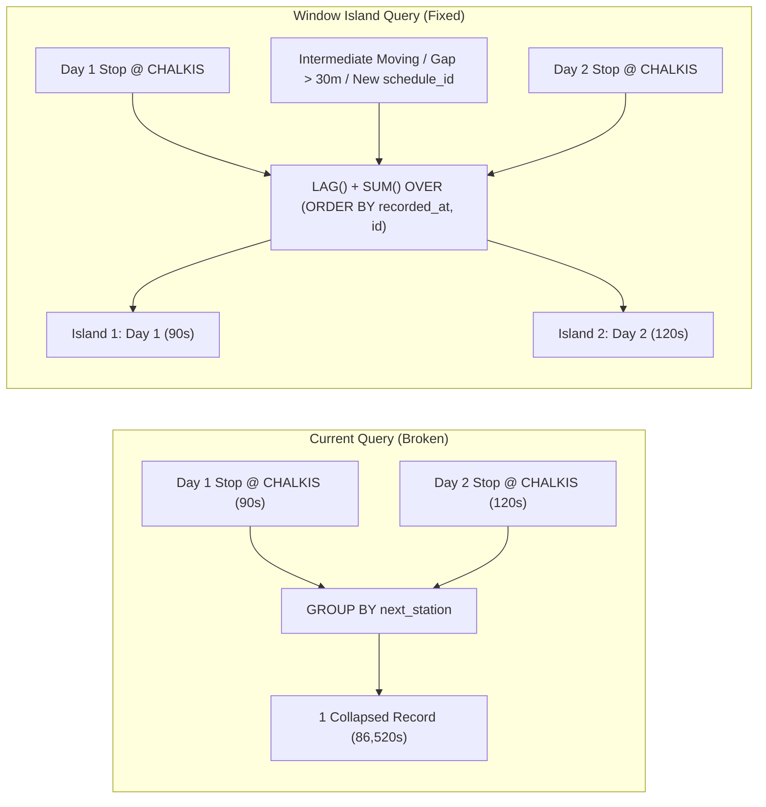
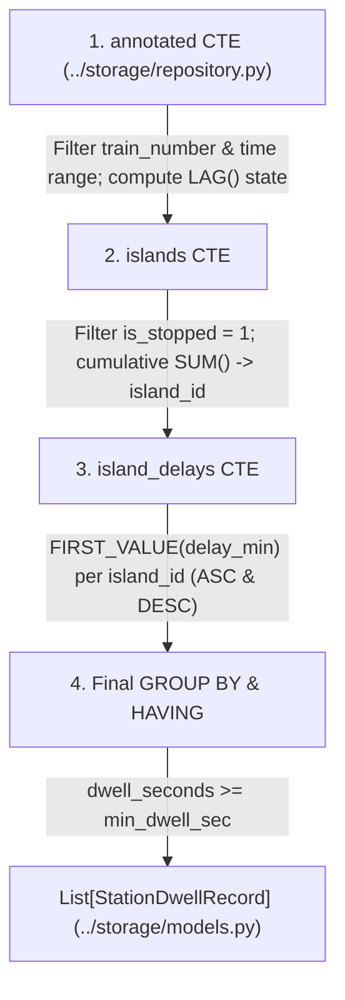

# Implementation Plan — P0-1: Station Dwell Multi-Trip Collapse Fix

> **Reference:** [Production Readiness & Architecture Review (`P0-1`)](./production-readiness-review.md#p0-1-station-dwell-query-collapses-multi-trip-stops)  
> **Target Module:** [`../storage/repository.py`](../storage/repository.py#L301-L360) (`HistoricalRepository.get_station_dwell_times`)  
> **Test Suite:** [`../tests/test_storage_repository.py`](../tests/test_storage_repository.py#L202-L217)

---

## 1. Root-Cause Bug Analysis

### A. Defect Mechanism
In [`../storage/repository.py`](../storage/repository.py#L313-L342), `HistoricalRepository.get_station_dwell_times` filters stationary rows (`speed <= ? AND next_station IS NOT NULL`) and groups strictly by `GROUP BY next_station`:

1. **Cross-Trip & Multi-Day Collapse:** All stationary observations for a given `train_number` and `next_station` across separate trips, return journeys, or calendar days collapse into a single row. `MIN(recorded_at)` binds to the first historic arrival and `MAX(recorded_at)` binds to the latest departure, producing multi-hour or multi-day `dwell_seconds`.
2. **Unscoped Correlated Delay Subqueries:** Lines 336–339 execute two correlated subqueries matching only `(train_number, recorded_at)` without constraining `next_station` or row `id`, performing two extra table lookups per dwell record.

### B. Visual Comparison (ASCII & Mermaid)

```text
BEFORE (Broken GROUP BY next_station):
Trip 1 (Day 1 @ CHALKIS):  [10:10:00 .. 10:11:30] (90s)  \
                                                          +--> 1 Row: [Day 1 10:10:00 .. Day 2 10:12:00] (86,520s)
Trip 2 (Day 2 @ CHALKIS):  [10:10:00 .. 10:12:00] (120s) /

AFTER (Contiguous Island Partitioning):
Trip 1 (Day 1 @ CHALKIS):  [10:10:00 .. 10:11:30] ---> Island 1 (90s,  arr_delay=1, dep_delay=3)
Trip 2 (Day 2 @ CHALKIS):  [10:10:00 .. 10:12:00] ---> Island 2 (120s, arr_delay=5, dep_delay=6)
```



### C. Architectural Implications
- **Single-Pass Index Scan:** Scans composite index `idx_telemetry_train_time (train_number, recorded_at)` defined in [`../storage/schema.py`](../storage/schema.py#L101) once in chronological order. Eliminates both correlated subqueries on `telemetry_history`.
- **Island Boundary Conditions:** A new `island_id` starts on a stationary frame (`is_stopped = 1`) whenever any of four conditions holds relative to the preceding telemetry frame for that train:
  1. `prev_stopped = 0`: Transition from moving (`speed > threshold`) to stationary.
  2. `prev_station IS NOT station_name`: Station identifier changed.
  3. `COALESCE(prev_schedule, '') != COALESCE(schedule_id, '')`: Distinct `schedule_id`.
  4. `(JULIANDAY(recorded_at) - JULIANDAY(prev_recorded_at)) * 86400.0 > 1800.0`: Inter-sample gap exceeds 30 minutes (e.g., overnight terminal layover or daemon restart with no intermediate moving frames).
- **Zero API Breaking Changes:** Public signature and return type (`List[StationDwellRecord]` in [`../storage/models.py`](../storage/models.py#L347-L383)) remain unchanged.

---

## 2. Pipeline Execution Flow

### A. CTE Pipeline Stages (ASCII)

```text
+-----------------------------------------------------------------------+
| Stage 1: annotated CTE                                                |
|  - Filter: train_number = ? AND recorded_at IN [start_time, end_time] |
|  - Compute: is_stopped = (speed <= threshold AND next_station != NULL)|
|  - Window LAG(..., 1) OVER (ORDER BY recorded_at ASC, id ASC):        |
|    prev_stopped, prev_station, prev_schedule, prev_recorded_at        |
+-----------------------------------------------------------------------+
                                   |
                                   v
+-----------------------------------------------------------------------+
| Stage 2: islands CTE                                                  |
|  - Filter: WHERE is_stopped = 1                                       |
|  - Window SUM(is_new_island) OVER (ORDER BY recorded_at ASC, id ASC)  |
|    assigns monotonically increasing island_id per contiguous stop     |
+-----------------------------------------------------------------------+
                                   |
                                   v
+-----------------------------------------------------------------------+
| Stage 3: island_delays CTE                                            |
|  - Window FIRST_VALUE(delay_min) OVER (PARTITION BY island_id         |
|    ORDER BY recorded_at ASC/DESC, id ASC/DESC)                        |
|    captures arrival_delay_min and departure_delay_min                 |
+-----------------------------------------------------------------------+
                                   |
                                   v
+-----------------------------------------------------------------------+
| Stage 4: Final Aggregation                                            |
|  - GROUP BY train_number, station_name, island_id                     |
|  - Compute MIN(recorded_at), MAX(recorded_at), dwell_seconds          |
|  - Filter: HAVING dwell_seconds >= min_dwell_sec                      |
+-----------------------------------------------------------------------+
```

### B. CTE Pipeline Stages (Mermaid)



---

## 3. Code Changes

### A. [`../storage/repository.py`](../storage/repository.py#L301-L360)
Replace `query` and `params` in `HistoricalRepository.get_station_dwell_times`:

```python
        query = """
        WITH annotated AS (
            SELECT
                id,
                train_number,
                schedule_id,
                next_station AS station_name,
                recorded_at,
                COALESCE(delay_min, 0) AS delay_min,
                CASE WHEN speed <= ? AND next_station IS NOT NULL THEN 1 ELSE 0 END AS is_stopped,
                LAG(CASE WHEN speed <= ? AND next_station IS NOT NULL THEN 1 ELSE 0 END, 1, 0)
                    OVER (ORDER BY recorded_at ASC, id ASC) AS prev_stopped,
                LAG(next_station) OVER (ORDER BY recorded_at ASC, id ASC) AS prev_station,
                LAG(schedule_id) OVER (ORDER BY recorded_at ASC, id ASC) AS prev_schedule,
                LAG(recorded_at) OVER (ORDER BY recorded_at ASC, id ASC) AS prev_recorded_at
            FROM telemetry_history
            WHERE train_number = ?
              AND (? IS NULL OR recorded_at >= ?)
              AND (? IS NULL OR recorded_at <= ?)
        ),
        islands AS (
            SELECT
                id,
                train_number,
                station_name,
                recorded_at,
                delay_min,
                SUM(
                    CASE
                        WHEN prev_stopped = 0
                          OR prev_station IS NOT station_name
                          OR COALESCE(prev_schedule, '') != COALESCE(schedule_id, '')
                          OR (JULIANDAY(recorded_at) - JULIANDAY(prev_recorded_at)) * 86400.0 > 1800.0
                        THEN 1
                        ELSE 0
                    END
                ) OVER (ORDER BY recorded_at ASC, id ASC) AS island_id
            FROM annotated
            WHERE is_stopped = 1
        ),
        island_delays AS (
            SELECT
                train_number,
                station_name,
                recorded_at,
                island_id,
                FIRST_VALUE(delay_min) OVER (
                    PARTITION BY island_id ORDER BY recorded_at ASC, id ASC
                ) AS arrival_delay_min,
                FIRST_VALUE(delay_min) OVER (
                    PARTITION BY island_id ORDER BY recorded_at DESC, id DESC
                ) AS departure_delay_min
            FROM islands
        )
        SELECT
            train_number,
            station_name,
            MIN(recorded_at) AS arrival_time,
            MAX(recorded_at) AS departure_time,
            CAST(ROUND((JULIANDAY(MAX(recorded_at)) - JULIANDAY(MIN(recorded_at))) * 86400.0) AS INTEGER) AS dwell_seconds,
            MIN(arrival_delay_min) AS arrival_delay_min,
            MIN(departure_delay_min) AS departure_delay_min
        FROM island_delays
        GROUP BY train_number, station_name, island_id
        HAVING dwell_seconds >= ?
        ORDER BY arrival_time ASC;
        """
        params = (
            speed_threshold_kmh,
            speed_threshold_kmh,
            train_number,
            start_time,
            start_time,
            end_time,
            end_time,
            min_dwell_sec,
        )
```

### B. [`../tests/test_storage_repository.py`](../tests/test_storage_repository.py#L202-L217)
Add two unit tests following TDD ([`../.agents/rules/testing.md`](../.agents/rules/testing.md)):
1. `test_station_dwell_times_multiple_visits_same_station`: Inserts a second stop for train `2232` at `CHALKIS` on the following day (`2026-11-19T10:10:00Z` to `2026-11-19T10:12:00Z`, `dwell_seconds=120`, `arrival_delay_min=5`, `departure_delay_min=6`) after intermediate moving rows. Asserts `len(dwells) == 2`, `dwells[0].dwell_seconds == 90`, and `dwells[1].dwell_seconds == 120`.
2. `test_station_dwell_times_temporal_gap_separation`: Inserts two stationary intervals at the same station separated by $> 30$ minutes with no intermediate moving rows. Asserts `len(dwells) == 2`.

### C. [`./storage-phase-3-historical-repository-and-query-engine.md`](./storage-phase-3-historical-repository-and-query-engine.md#L451-L476)
Synchronize Section `4.4 Station Dwell Detection Algorithm` with the window query implementation.

---

## 4. Verification & Quality Gates

1. **TDD Red-Green Verification:**
   ```bash
   python -m unittest tests/test_storage_repository.py -v
   ```
2. **Full Test Suite:**
   ```bash
   python -m unittest discover tests -v
   ```
3. **Storage Benchmark Gate ([`../scripts/benchmark_storage.py`](../scripts/benchmark_storage.py)):**
   ```bash
   python scripts/benchmark_storage.py --records 2000
   ```
4. **Relative Path Audit:** Verify zero non-relative links per [`../.agents/skills/markdown-relative-paths/SKILL.md`](../.agents/skills/markdown-relative-paths/SKILL.md).
