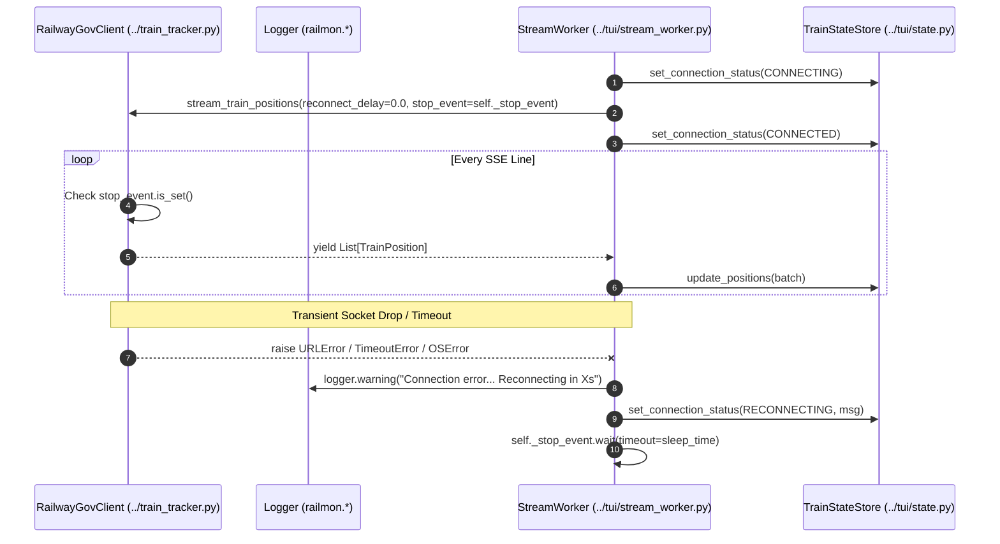
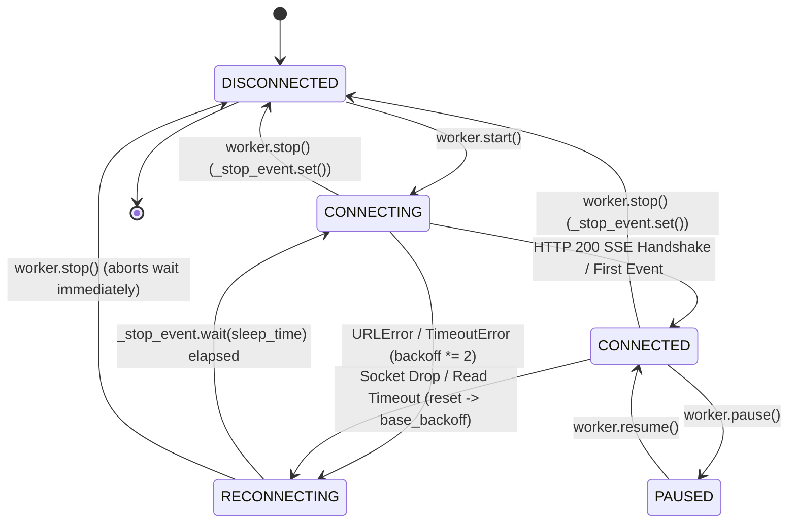

# Implementation Plan — P0-2: SSE Exception Swallowing, Curses Buffer Corruption & Blocking Shutdown Fix

> **Reference:** [Production Readiness & Architecture Review (`P0-2`)](./production-readiness-review.md#p0-2-sse-exception-swallowing-curses-buffer-corruption--blocking-shutdown)  
> **Target Modules:** [`../train_tracker.py`](../train_tracker.py#L137-L188) (`RailwayGovClient.stream_train_positions`), [`../tui/stream_worker.py`](../tui/stream_worker.py#L85-L148) (`StreamWorker`)  
> **Test Suites:** [`../tests/test_tracker.py`](../tests/test_tracker.py#L150-L178), [`../tests/test_tui_state.py`](../tests/test_tui_state.py#L369-L467)

---

## 1. Root-Cause Bug Analysis

### A. Defect Mechanism
In [`../train_tracker.py`](../train_tracker.py#L137-L188), `RailwayGovClient.stream_train_positions` currently wraps its `urllib.request.urlopen` SSE stream loop inside an unconditional `while True:` block that catches `(urllib.error.URLError, TimeoutError)`, prints directly to `sys.stdout`, and blocks with `time.sleep(reconnect_delay)`:

1. **Curses Terminal Buffer Corruption:** Calling `print(f"[Stream Warning] Connection interrupted: {e}...")` from `StreamWorkerThread` while `curses` owns the terminal screen buffer writes raw characters over active TUI panes, violating [`../.agents/rules/logging-and-observability.md`](../.agents/rules/logging-and-observability.md#L5-L8).
2. **Swallowed Exceptions & Dead `StreamWorker` Backoff Engine:** Because `stream_train_positions()` catches `URLError` and `TimeoutError` internally and never raises them unless `reconnect_delay` is omitted, `StreamWorker._run_loop` ([`../tui/stream_worker.py`](../tui/stream_worker.py#L120-L135)) never enters its `except Exception as exc:` handler. Consequently:
   - `TrainStateStore` remains permanently stuck on `ConnectionStatus.CONNECTED` during network outages instead of transitioning to `ConnectionStatus.RECONNECTING`.
   - `StreamWorker`'s exponential backoff with randomized jitter (`backoff * random.uniform(0.8, 1.2)`) is completely bypassed in favor of a fixed 3.0s sleep.
3. **Uninterruptible Shutdown & Socket Read Blocking:** `stream_train_positions()` accepts no `stop_event: Optional[threading.Event]` parameter and uses a 30-second blocking `urlopen(..., timeout=30)` alongside an uninterruptible `time.sleep(reconnect_delay)`. When `StreamWorker.stop(timeout_sec=2.0)` is invoked on exit, the worker thread cannot abort the sleep or check `stop_event` between SSE lines, delaying teardown or leaving an orphaned daemon thread reading from the socket.

### B. Visual Comparison (ASCII & Mermaid)

```text
BEFORE (Broken Exception Swallowing & stdout Pollution):
RailwayGovClient                sys.stdout (Curses TUI)             StreamWorker
       |                                  |                              |
       |-- URLError / TimeoutError ------>|                              |
       |-- print("[Stream Warning]...") ->| (Corrupts Curses Screen)     |
       |-- time.sleep(3.0) -------------->| (Blocks stop_event)          | (Never notified;
       |                                  |                              |  status stuck on CONNECTED;
       |                                  |                              |  exponential backoff bypassed)

AFTER (Propagated Exceptions / Interruptible Reconnect & Structured Logging):
RailwayGovClient                railmon.train_tracker Logger        StreamWorker
       |                                  |                              |
       |-- stop_event Checked Per Line -->|                              |
       |-- URLError / TimeoutError ------>|                              |
       |   (reconnect_delay <= 0)         |                              |
       |----------------------------------+-- Raises Error ------------->|
       |                                  |                              |-- Status -> RECONNECTING
       |                                  |<-- logger.warning(backoff) --|-- stop_event.wait(sleep_time)
```



### C. Architectural Implications
- **Separation of Concerns (Single-Attempt vs. Managed Retry Modes):**
  - When invoked by `StreamWorker` (`reconnect_delay=0.0` and `stop_event=self._stop_event`), `RailwayGovClient.stream_train_positions()` executes a **single connection lifecycle** and immediately re-raises `(urllib.error.URLError, TimeoutError, OSError)` to `StreamWorker._run_loop()`, delegating backoff calculation, jitter, and `ConnectionStatus.RECONNECTING` state transitions to `StreamWorker`.
  - When invoked directly by CLI loops (`run_plain_stream_mode` or `run_record_mode` with `reconnect_delay > 0`), `stream_train_positions()` logs disconnection warnings via `logger.warning(...)` (never raw `print()`) and waits using an interruptible `stop_event.wait(reconnect_delay)` so `SIGINT`/`SIGTERM` shutdown signals abort retries immediately.
- **Responsive Cancellation:** Checking `stop_event.is_set()` inside the raw SSE line iteration loop and reducing the socket read timeout to a configurable `timeout: float = 10.0` ensures blocked reads wake and check the cancellation token promptly.
- **First-Batch `CONNECTED` Confirmation:** In `StreamWorker._run_loop()`, `ConnectionStatus.CONNECTED` and `backoff = self.base_backoff_sec` are set only after the HTTP connection handshake succeeds (or first batch/iteration starts), preventing failed `urlopen()` calls from briefly flashing `CONNECTED` and resetting the exponential backoff counter.

---

## 2. Ingestion & Reconnection Lifecycle

### A. State & Control Flow (ASCII)

```text
+-------------------------------------------------------------------------+
| 1. StreamWorker._run_loop()                                             |
|    - Check _stop_event / wait on _pause_event                           |
|    - store.set_connection_status(CONNECTING, "Connecting to stream...") |
+-------------------------------------------------------------------------+
                                    |
                                    v
+-------------------------------------------------------------------------+
| 2. RailwayGovClient.stream_train_positions(                             |
|        reconnect_delay=0.0, stop_event=self._stop_event, timeout=10.0)  |
|    - Open HTTP GET /api/train-stream                                    |
|    - Check stop_event.is_set() on entry and before reading each line    |
|    - Parse 'event:' and 'data:' lines; skip malformed JSON with debug   |
+-------------------------------------------------------------------------+
                     /                             \
        On Batch Yielded                     On URLError / TimeoutError / OSError
                   /                                 \
                  v                                   v
+-----------------------------------+   +---------------------------------+
| 3a. Healthy Ingestion             |   | 3b. Failure & Backoff Recovery  |
|  - Transition CONNECTING ->       |   |  - Compute sleep_time =         |
|    CONNECTED & reset backoff      |   |    min(backoff * jitter, max)   |
|  - store.update_positions(batch)  |   |  - logger.warning(...)          |
|  - recorder.enqueue_batch(batch)  |   |  - Status -> RECONNECTING       |
|                                   |   |  - _stop_event.wait(sleep_time) |
|                                   |   |  - backoff = min(backoff*2, max)|
+-----------------------------------+   +---------------------------------+
```

### B. State Transitions (Mermaid)



---

## 3. Proposed Code Changes

### A. [`../train_tracker.py`](../train_tracker.py#L7-L20) — Module Logger Initialization
Add `logging` and `threading` imports at the top of [`../train_tracker.py`](../train_tracker.py) and initialize the hierarchical module logger in compliance with [`../.agents/rules/logging-and-observability.md`](../.agents/rules/logging-and-observability.md#L10-L15):

```python
import logging
import threading

logger = logging.getLogger("railmon." + __name__)
```

### B. [`../train_tracker.py`](../train_tracker.py#L137-L188) — `RailwayGovClient.stream_train_positions`
Refactor `stream_train_positions` to:
1. Accept `reconnect_delay: float = 3.0`, `stop_event: Optional[threading.Event] = None`, and `timeout: float = 10.0`.
2. Check `stop_event.is_set()` in the outer loop, inside the line iteration loop, and during reconnect waits.
3. Replace the bare `print(f"[Stream Warning]...")` with `logger.warning(...)`.
4. When `reconnect_delay <= 0` (used by `StreamWorker`), re-raise `(urllib.error.URLError, TimeoutError, OSError)` directly instead of catching and sleeping so the caller's backoff state machine handles retries.
5. Log malformed JSON SSE payloads at `logger.debug(...)` instead of silently ignoring them with `pass`.

```python
    def stream_train_positions(
        self,
        event_filter: str = "trainPositionsUx",
        reconnect_delay: float = 3.0,
        stop_event: Optional[threading.Event] = None,
        timeout: float = 10.0,
    ) -> Generator[List[TrainPosition], None, None]:
        """
        Stream live train positions via Server-Sent Events (SSE).
        Yields a list of TrainPosition objects whenever an update arrives.

        Args:
            event_filter: SSE event name to parse (default: 'trainPositionsUx').
            reconnect_delay: Seconds to wait before reconnecting on error. If <= 0,
                connection exceptions are raised directly to the caller (e.g. StreamWorker).
            stop_event: Optional threading.Event to signal immediate stream termination.
            timeout: Socket read timeout in seconds (default: 10.0).
        """
        stream_url = f"{self.base_url}/api/train-stream"
        headers = {**DEFAULT_HEADERS, "Accept": "text/event-stream"}

        while stop_event is None or not stop_event.is_set():
            try:
                req = urllib.request.Request(stream_url, headers=headers)
                with urllib.request.urlopen(req, context=self.ssl_ctx, timeout=timeout) as resp:
                    current_event = "message"
                    data_buffer: List[str] = []

                    for raw_line in resp:
                        if stop_event is not None and stop_event.is_set():
                            return

                        line = raw_line.decode("utf-8", errors="ignore").strip()

                        if not line:
                            # End of event block
                            if data_buffer:
                                payload_str = "".join(data_buffer)
                                data_buffer = []

                                if current_event == event_filter:
                                    try:
                                        payload = json.loads(payload_str)
                                        raw_positions = payload.get("positions", [])
                                        trains = [
                                            TrainPosition.from_dict(p)
                                            for p in raw_positions
                                            if p.get("lat") is not None and p.get("lng") is not None
                                        ]
                                        yield trains
                                    except json.JSONDecodeError as exc:
                                        logger.debug("Skipping malformed SSE JSON payload: %s", exc)
                            current_event = "message"
                            continue

                        if line.startswith("event:"):
                            current_event = line.split(":", 1)[1].strip()
                        elif line.startswith("data:"):
                            data_buffer.append(line.split(":", 1)[1].strip())

                    # If upstream closed the response stream cleanly without stop_event
                    if reconnect_delay <= 0:
                        return

            except (urllib.error.URLError, TimeoutError, OSError) as e:
                if stop_event is not None and stop_event.is_set():
                    return
                if reconnect_delay <= 0:
                    raise
                logger.warning(
                    "SSE connection interrupted: %s. Reconnecting in %.1fs...",
                    e,
                    reconnect_delay,
                )
                if stop_event is not None:
                    if stop_event.wait(timeout=reconnect_delay):
                        return
                else:
                    time.sleep(reconnect_delay)
```

### C. [`../tui/stream_worker.py`](../tui/stream_worker.py#L16-L148) — `StreamWorker` Reconnection & Status Transition
1. Update the module logger to `logger = logging.getLogger("railmon." + __name__)`.
2. In `StreamWorker._get_stream_generator()`, pass `reconnect_delay=0.0` and `stop_event=self._stop_event` to `self.client.stream_train_positions(...)` so connection errors propagate directly to `StreamWorker._run_loop()`.
3. In `StreamWorker._run_loop()`, transition to `ConnectionStatus.CONNECTED` and reset `backoff = self.base_backoff_sec` only when the first batch is received from the generator, ensuring repeated handshake failures in `urlopen()` increment `backoff` ($1\text{s} \to 2\text{s} \to 4\text{s} \to \dots$) rather than resetting `backoff` before the generator executes its first line.

```python
            try:
                stream = self._get_stream_generator()

                for batch in stream:
                    if self._stop_event.is_set():
                        break

                    # Wait if paused mid-stream
                    self._pause_event.wait()
                    if self._stop_event.is_set():
                        break

                    if self.store.get_snapshot().connection_status != ConnectionStatus.CONNECTED:
                        self.store.set_connection_status(ConnectionStatus.CONNECTED, "Live stream active")
                    backoff = self.base_backoff_sec  # Reset backoff upon successful data frame

                    if batch:
                        self.store.update_positions(batch)
                        if self.recorder is not None and getattr(self.recorder, "is_running", False):
                            self.recorder.enqueue_batch(batch)
```

And in `_get_stream_generator`:
```python
    def _get_stream_generator(self) -> Iterable[List[TrainPosition]]:
        """Instantiate appropriate telemetry stream source."""
        if self.custom_stream is not None:
            return self.custom_stream
        elif self.mock_engine is not None:
            return self.mock_engine.stream_positions(interval_sec=1.0)
        elif self.client is not None:
            return self.client.stream_train_positions(
                reconnect_delay=0.0,
                stop_event=self._stop_event,
            )
        else:
            raise ValueError("No valid telemetry source provided to StreamWorker")
```

---

## 4. Test Plan (TDD Red-Green-Refactor)

Following [`../.agents/rules/testing.md`](../.agents/rules/testing.md) and [`../.agents/skills/stream-resilience-tester/SKILL.md`](../.agents/skills/stream-resilience-tester/SKILL.md), add unit tests before applying the implementation changes:

### A. [`../tests/test_tracker.py`](../tests/test_tracker.py)
1. `test_stream_train_positions_raises_when_reconnect_disabled`:
   - Mock `urllib.request.urlopen` to raise `urllib.error.URLError("Connection refused")`.
   - Call `next(self.client.stream_train_positions(reconnect_delay=0.0))` while capturing `sys.stdout`.
   - Assert `urllib.error.URLError` is raised and `sys.stdout.getvalue() == ""` (zero console output pollution).
2. `test_stream_train_positions_logs_warning_and_honors_stop_event_on_retry`:
   - Mock `urllib.request.urlopen` to raise `TimeoutError("Read timed out")` on first call, and set `stop_event` during wait.
   - Verify `railmon.train_tracker` logs a `WARNING` message, `sys.stdout` receives zero bytes, and the generator exits cleanly without hanging.
3. `test_stream_train_positions_aborts_mid_stream_on_stop_event`:
   - Feed a multi-event SSE stream where `stop_event.set()` is triggered after the first yielded batch.
   - Verify the generator terminates immediately on the next iteration.
4. `test_stream_train_positions_skips_malformed_json_and_continues`:
   - Feed an SSE stream with a corrupted JSON `data: {bad_json}` block followed by a valid `trainPositionsUx` event.
   - Verify the corrupted frame is skipped without raising and the valid frame is yielded.

### B. [`../tests/test_tui_state.py`](../tests/test_tui_state.py)
1. `test_stream_worker_client_error_transitions_to_reconnecting_without_stdout`:
   - Pass a `RailwayGovClient` whose `urlopen` raises `urllib.error.URLError("Network unreachable")` into `StreamWorker`.
   - Capture `sys.stdout` while the worker runs through a reconnect cycle.
   - Assert `self.store.get_snapshot().connection_status == ConnectionStatus.RECONNECTING`, `backoff` increases exponentially across consecutive failures, and `sys.stdout.getvalue() == ""` (protecting the Curses TUI buffer).

---

## 5. Verification & Quality Gates

1. **Targeted Network & Worker Resilience Tests:**
   ```bash
   python -m unittest tests/test_tracker.py tests/test_tui_state.py -v
   ```
2. **Full Unit & Integration Test Suite:**
   ```bash
   python -m unittest discover tests -v
   ```
3. **Markdown Relative Path Audit ([`../.agents/skills/markdown-relative-paths/SKILL.md`](../.agents/skills/markdown-relative-paths/SKILL.md)):**
   Confirm zero non-relative links or absolute workstation paths exist in [`./p0-2-sse-exception-curses-shutdown-fix-plan.md`](./p0-2-sse-exception-curses-shutdown-fix-plan.md) and [`./production-readiness-review.md`](./production-readiness-review.md).
