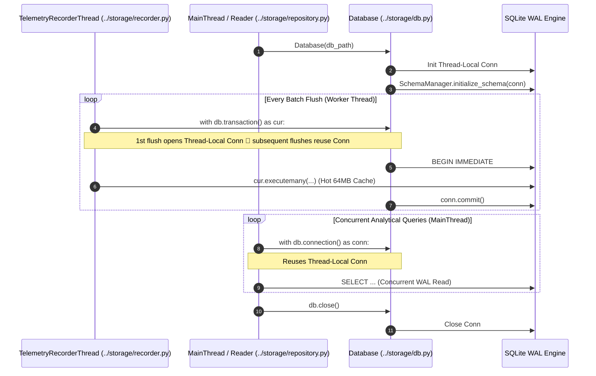
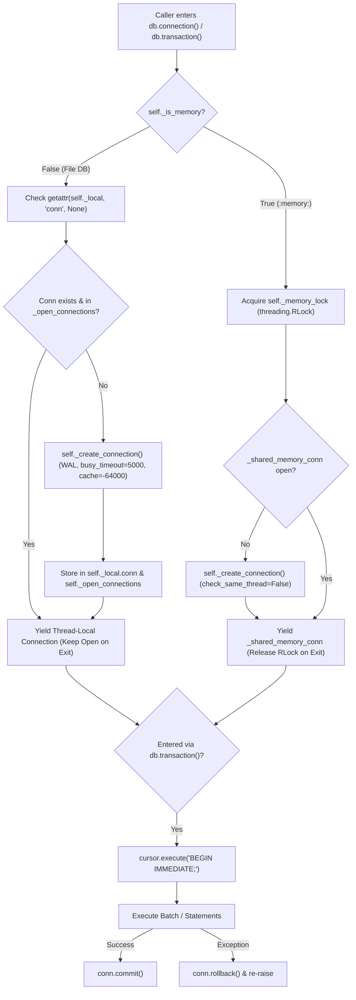

# Implementation Plan — P0-5: Per-Transaction SQLite Connection Churn & Cross-Thread `:memory:` Sharing

> **Reference:** [Production Readiness & Architecture Review (`P0-5`)](./production-readiness-review.md#p0-5-per-transaction-sqlite-connection-churn--cross-thread-memory-sharing)  
> **Target Module:** [`../storage/db.py`](../storage/db.py#L31-L131) (`Database`)  
> **Test Suites:** [`../tests/test_storage_db.py`](../tests/test_storage_db.py), [`../tests/test_storage_recorder.py`](../tests/test_storage_recorder.py), [`../tests/test_storage_benchmarks.py`](../tests/test_storage_benchmarks.py)

---

## 1. Root-Cause Bug Analysis

### A. Defect Mechanism
1. **Per-Transaction SQLite Connection Churn & 64 MB Cache Destruction (File Databases):**
   - In [`../storage/db.py`](../storage/db.py#L82-L92), `Database.connection()` opens a brand-new `sqlite3.Connection` via `self._create_connection()` and closes it in the `finally:` block on every single invocation:
     ```python
     @contextlib.contextmanager
     def connection(self) -> Generator[sqlite3.Connection, None, None]:
         """Context manager yielding an active SQLite connection."""
         if self._is_memory and self._shared_memory_conn is not None:
             yield self._shared_memory_conn
         else:
             conn = self._create_connection()
             try:
                 yield conn
             finally:
                 conn.close()
     ```
   - Every batch write in [`TelemetryRecorder._flush_buffer()`](../storage/recorder.py#L299) and every analytical read in [`HistoricalRepository`](../storage/repository.py) incurs:
     - Repeated OS file-open syscalls (`open()` on `.db`, `.db-wal`, and `.db-shm`), SQLite header validation, and WAL-index (`-shm`) mmap setup/teardown.
     - Re-execution of 5 `PRAGMA` statements (`journal_mode = WAL`, `synchronous = NORMAL`, `foreign_keys = ON`, `temp_store = MEMORY`, `cache_size = -64000`).
     - Immediate destruction of the 64 MB SQLite page cache (`PRAGMA cache_size = -64000`) upon `conn.close()`, forcing cold disk reads on every query and upsert.
2. **Missing `PRAGMA busy_timeout = 5000;` & Deferred Transaction Locking:**
   - [`Database._create_connection()`](../storage/db.py#L55-L80) omits `PRAGMA busy_timeout = 5000;`, violating [`../.agents/rules/concurrency-and-sqlite.md`](../.agents/rules/concurrency-and-sqlite.md#L10-L18).
   - [`Database.transaction()`](../storage/db.py#L94-L103) delegates transaction control to Python `sqlite3`'s default `with conn:` deferred transaction mode instead of explicitly issuing `BEGIN IMMEDIATE;`. Under concurrent access, a deferred transaction that reads before writing can fail immediately with `sqlite3.OperationalError: database is locked` (`SQLITE_BUSY`) during lock upgrade without waiting for `busy_timeout`, violating [`../.agents/rules/concurrency-and-sqlite.md`](../.agents/rules/concurrency-and-sqlite.md#L27).
3. **Cross-Thread `:memory:` Connection Sharing Without `check_same_thread=False` or Mutex Serialization:**
   - For `:memory:` databases, [`Database.__init__()`](../storage/db.py#L41-L44) creates `self._shared_memory_conn` on the initializing thread (e.g., `MainThread`) with Python's default `check_same_thread=True` and yields it directly in `Database.connection()` without a lock.
   - When `TelemetryRecorder` runs against `Database(":memory:")`, its background `TelemetryRecorderThread` calls `with self.db.transaction():`, immediately raising `sqlite3.ProgrammingError: SQLite objects created in a thread can only be used in that same thread`.
   - Even with `check_same_thread=False`, sharing a single in-memory `sqlite3.Connection` between `MainThread` and `TelemetryRecorderThread` without a reentrant mutex (`threading.RLock`) causes concurrent transactions on the shared connection to collide with `OperationalError: cannot start a transaction within a transaction`.

### B. Visual Comparison (ASCII & Mermaid)

```text
BEFORE (Per-Transaction Connection Churn & Unsafe :memory: Sharing):
TelemetryRecorderThread / Reader       Database.connection() / transaction()         SQLite Engine (.db / :memory:)
              |                                          |                                         |
              |-- with db.transaction(): --------------->|                                         |
              |                                          |-- sqlite3.connect(db_path) ------------>| (Open FD + parse WAL)
              |                                          |-- Execute 5 PRAGMAs (no busy_timeout) ->|
              |                                          |-- with conn: (Deferred BEGIN) --------->|
              |                                          |-- executemany(...) -------------------->|
              |                                          |-- COMMIT ------------------------------>|
              |                                          |-- conn.close() ------------------------>| (Destroys 64MB cache!)
              |                                          |                                         |
              |-- (If :memory: on worker thread) ------->|-- yield _shared_memory_conn ----------->| x ProgrammingError!
                                                         |   (check_same_thread=True, no RLock)    |   (Cross-thread failure)

AFTER (Thread-Local Persistent Connections, BEGIN IMMEDIATE & Serialized :memory: Access):
TelemetryRecorderThread / Reader       Database.connection() / transaction()         SQLite Engine (.db / :memory:)
              |                                          |                                         |
              |-- with db.transaction(): --------------->|                                         |
              |                                          |-- Lookup self._local.conn ------------->| (1st call: connect +
              |                                          |   (Reuses persistent thread connection) |  6 PRAGMAs incl.
              |                                          |-- cursor.execute("BEGIN IMMEDIATE;") -->|  busy_timeout = 5000)
              |                                          |-- executemany(...) -------------------->| (Hot 64MB page cache!)
              |                                          |-- conn.commit() ----------------------->| (Connection stays open)
              |                                          |                                         |
              |-- (If :memory: on worker thread) ------->|-- with self._memory_lock (RLock): ----->| (Thread-safe shared
              |                                          |   yield _shared_memory_conn             |  in-memory execution)
              |                                          |                                         |
              |-- db.close() (on shutdown) ------------->|-- Close all _open_connections --------->| (Clean FD teardown)
```



---

## 2. Connection Lifecycle & Thread Isolation Architecture

### A. Dual-Mode Connection Coordinator (ASCII)

```text
+-----------------------------------------------------------------------------------+
|                            Database (../storage/db.py)                            |
+-----------------------------------------------------------------------------------+
                                          |
                     +--------------------+--------------------+
                     |                                         |
         File-Backed Database                      In-Memory Database (:memory:)
       (self._is_memory == False)                     (self._is_memory == True)
                     |                                         |
                     v                                         v
+-----------------------------------------+   +-------------------------------------+
| Thread-Local Connection Pool            |   | Shared Memory Connection            |
|  - self._local = threading.local()      |   |  - self._shared_memory_conn         |
|  - self._conn_lock = threading.Lock()   |   |  - check_same_thread = False        |
|  - self._open_connections: Set[Conn]    |   |  - self._memory_lock = RLock()      |
|                                         |   |                                     |
|  Per Thread:                            |   |  On db.connection():                |
|  - Reuses self._local.conn across calls |   |  - Acquires self._memory_lock       |
|  - Preserves 64 MB page cache           |   |  - Serializes cross-thread access   |
|  - Zero cross-thread sharing at runtime |   |    between Main & Recorder threads  |
+-----------------------------------------+   +-------------------------------------+
                     \                                         /
                      \                                       /
                       v                                     v
+-----------------------------------------------------------------------------------+
|                       Database.transaction() & Database.close()                   |
|  - transaction(): Issues "BEGIN IMMEDIATE;", yields cursor, commits or rolls back |
|  - close(): Acquires locks, closes all registered thread & memory connections     |
+-----------------------------------------------------------------------------------+
```

### B. Dual-Mode Connection Coordinator (Mermaid)



---

## 3. Proposed Code Changes

### A. [`../storage/db.py`](../storage/db.py#L31-L131) — Thread-Local Connection Caching, `:memory:` Serialization, `busy_timeout`, and `BEGIN IMMEDIATE`

1. **Imports & Instance State (`Database.__init__`):**
   - Import `threading` and `Set` in [`../storage/db.py`](../storage/db.py#L5-L10).
   - Initialize thread-local storage and connection tracking in `Database.__init__`:
     - `self._local = threading.local()`
     - `self._conn_lock = threading.Lock()`
     - `self._open_connections: Set[sqlite3.Connection] = set()`
     - `self._memory_lock = threading.RLock()`
     - `self._shared_memory_conn: Optional[sqlite3.Connection] = None`

2. **Connection Factory (`Database._create_connection`):**
   - Pass `check_same_thread=False` to `sqlite3.connect(...)` so that:
     - For `:memory:` databases, `TelemetryRecorderThread` and `MainThread` can safely share `self._shared_memory_conn` under `self._memory_lock`.
     - For file databases (which remain strictly isolated per thread at runtime via `self._local`), `Database.close()` called from `MainThread` during shutdown can close connections created by worker threads (`TelemetryRecorderThread`) without triggering `sqlite3.ProgrammingError`.
   - Execute `cursor.execute("PRAGMA busy_timeout = 5000;")` on every created connection in compliance with [`../.agents/rules/concurrency-and-sqlite.md`](../.agents/rules/concurrency-and-sqlite.md#L10-L18).

3. **Persistent Thread-Local Lookup (`Database._get_thread_connection` & `Database.connection`):**
   - Add `_get_thread_connection(self) -> sqlite3.Connection`:
     ```python
     def _get_thread_connection(self) -> sqlite3.Connection:
         """Return the current thread's persistent SQLite connection, creating it if needed."""
         conn: Optional[sqlite3.Connection] = getattr(self._local, "conn", None)
         with self._conn_lock:
             if conn is not None and conn in self._open_connections:
                 return conn

         conn = self._create_connection()
         with self._conn_lock:
             self._open_connections.add(conn)
         self._local.conn = conn
         return conn
     ```
   - Update `Database.connection()` to yield the persistent thread-local connection for file databases (without closing it on context exit) and to serialize access to `self._shared_memory_conn` using `self._memory_lock` for `:memory:` databases:
     ```python
     @contextlib.contextmanager
     def connection(self) -> Generator[sqlite3.Connection, None, None]:
         """Context manager yielding an active thread-scoped SQLite connection."""
         if self._is_memory:
             with self._memory_lock:
                 if self._shared_memory_conn is None:
                     self._shared_memory_conn = self._create_connection()
                 yield self._shared_memory_conn
         else:
             conn = self._get_thread_connection()
             yield conn
     ```

4. **Immediate Write Transactions (`Database.transaction`):**
   - Update `Database.transaction()` to explicitly issue `BEGIN IMMEDIATE;` before yielding the cursor, committing on clean exit and rolling back on exception:
     ```python
     @contextlib.contextmanager
     def transaction(self) -> Generator[sqlite3.Cursor, None, None]:
         """Context manager for atomic write transactions using BEGIN IMMEDIATE."""
         with self.connection() as conn:
             cursor = conn.cursor()
             try:
                 if conn.in_transaction:
                     conn.commit()
                 cursor.execute("BEGIN IMMEDIATE;")
                 try:
                     yield cursor
                 except Exception:
                     if conn.in_transaction:
                         conn.rollback()
                     raise
                 else:
                     if conn.in_transaction:
                         conn.commit()
             finally:
                 cursor.close()
     ```

5. **Deterministic Multi-Thread Connection Cleanup (`Database.close`):**
   - Update `Database.close()` to close both `self._shared_memory_conn` (under `self._memory_lock`) and all thread-local connections registered in `self._open_connections` (under `self._conn_lock`), and clear `self._local.conn`:
     ```python
     def close(self) -> None:
         """Close all open thread-local connections and any shared memory connection."""
         with self._memory_lock:
             if self._shared_memory_conn is not None:
                 try:
                     self._shared_memory_conn.close()
                 except Exception:
                     pass
                 self._shared_memory_conn = None

         with self._conn_lock:
             conns = list(self._open_connections)
             self._open_connections.clear()

         for conn in conns:
             try:
                 conn.close()
             except Exception:
                 pass

         if hasattr(self._local, "conn"):
             self._local.conn = None
     ```

---

## 4. Test Plan (TDD Red-Green-Refactor)

Following [`../.agents/rules/testing.md`](../.agents/rules/testing.md), add unit and concurrency tests first and verify they fail before applying the implementation changes to [`../storage/db.py`](../storage/db.py):

### A. [`../tests/test_storage_db.py`](../tests/test_storage_db.py)
1. `test_file_database_reuses_thread_local_connection`:
   - Instantiate `db = Database(db_path)` on a temporary file database.
   - Enter `with db.connection() as conn1:` and subsequently `with db.connection() as conn2:` and `with db.transaction() as cur:` on the same thread.
   - Assert `conn1 is conn2` and `cur.connection is conn1` (confirming zero per-transaction connection churn and preservation of the 64 MB page cache).
2. `test_file_database_isolates_connections_across_threads`:
   - Capture the `sqlite3.Connection` yielded inside `with db.connection() as main_conn:` on `MainThread` and inside a spawned worker `threading.Thread` (`worker_conn`).
   - Assert `main_conn is not worker_conn` (confirming zero cross-thread sharing of file database connections).
   - Call `db.close()` from `MainThread` after the worker thread joins and assert that all registered connections are closed (`len(db._open_connections) == 0`).
3. `test_connection_configures_busy_timeout_pragma`:
   - Query `PRAGMA busy_timeout;` on both file-backed and `:memory:` connections yielded by `Database`.
   - Assert `conn.execute("PRAGMA busy_timeout;").fetchone()[0] == 5000`.
4. `test_transaction_uses_begin_immediate`:
   - Spy on or inspect transaction state inside `with db.transaction() as cur:` before executing any DML statement.
   - Assert `cur.connection.in_transaction is True` immediately upon entering `with db.transaction() as cur:` (confirming `BEGIN IMMEDIATE` was issued upfront rather than deferred until the first `INSERT`/`UPDATE`).
5. `test_in_memory_database_cross_thread_sharing_and_recorder`:
   - Instantiate `db = Database(":memory:")` on `MainThread`.
   - Start `TelemetryRecorder(db, RecorderConfig(batch_size=5, flush_interval_sec=0.1, enable_deadband=False))` (which writes from `TelemetryRecorderThread`), enqueue 5 `TrainPosition` records, and concurrently query `db` from `MainThread`.
   - Stop the recorder and assert zero `sqlite3.ProgrammingError` or `OperationalError` exceptions occurred and all 5 rows are persisted in `telemetry_history`.

---

## 5. Verification & Quality Gates

1. **Targeted Database & Recorder Concurrency Tests:**
   ```bash
   python -m unittest tests/test_storage_db.py tests/test_storage_recorder.py tests/test_storage_repository.py -v
   ```
2. **Storage Performance Benchmark Gate ([`../.agents/skills/storage-benchmark-gate/SKILL.md`](../.agents/skills/storage-benchmark-gate/SKILL.md)):**
   ```bash
   python -m unittest tests/test_storage_benchmarks.py -v
   python scripts/benchmark_storage.py --records 5000
   ```
3. **Full Unit & Integration Test Suite:**
   ```bash
   python -m unittest discover tests -v
   ```
4. **Markdown Relative Path & Diagram Audit ([`../.agents/skills/markdown-relative-paths/SKILL.md`](../.agents/skills/markdown-relative-paths/SKILL.md), [`../.agents/skills/diagrams-and-documentation/SKILL.md`](../.agents/skills/diagrams-and-documentation/SKILL.md)):**
   Verify zero `file://` URIs or absolute filesystem paths exist in [`./p0-5-sqlite-connection-churn-memory-sharing-fix-plan.md`](./p0-5-sqlite-connection-churn-memory-sharing-fix-plan.md).
