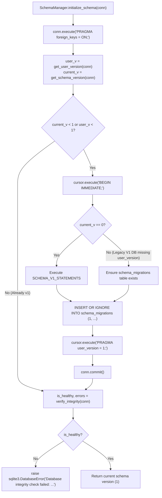

# Implementation Plan — P1-2: Missing `PRAGMA user_version` & Startup Integrity Check

> **Reference:** [Production Readiness & Architecture Review (`P1-2`)](./production-readiness-review.md#p1-2-missing-pragma-user_version--startup-integrity-check)  
> **Target Modules:** [`../storage/schema.py`](../storage/schema.py#L109-L175) (`SchemaManager`), [`../storage/db.py`](../storage/db.py#L45-L67) (`Database`)  
> **Test Suites:** [`../tests/test_storage_schema.py`](../tests/test_storage_schema.py), [`../tests/test_storage_db.py`](../tests/test_storage_db.py)

---

## 1. Root-Cause Bug Analysis

### A. Defect Mechanism
1. **Missing `PRAGMA user_version` Tracking During Schema Initialization & Migration:**
   - In [`../storage/schema.py`](../storage/schema.py#L113-L149), `SchemaManager.initialize_schema()` and `SchemaManager.get_schema_version()` track schema revisions solely through the custom `schema_migrations` table and never read or update SQLite's native header version register (`PRAGMA user_version`):
     ```python
     if current_v == 0:
         with conn:
             for statement in SCHEMA_V1_STATEMENTS:
                 conn.execute(statement)
             conn.execute(
                 "INSERT INTO schema_migrations (version, description) VALUES (?, ?);",
                 (1, "Initial V1 schema setup"),
             )
         return 1
     ```
   - Consequently, `conn.execute("PRAGMA user_version;").fetchone()[0]` remains `0` even after V1 initialization, violating:
     - [`../.agents/rules/concurrency-and-sqlite.md`](../.agents/rules/concurrency-and-sqlite.md#L29-L31) (*"Database schema revisions must be tracked using `PRAGMA user_version`. Migrations must check `PRAGMA user_version` on startup and apply incremental schema patches idempotently before opening writer loops."*).
     - [`../.agents/rules/release-and-versioning.md`](../.agents/rules/release-and-versioning.md#L22-L25) (*"Schema changes must: 1. Increment `PRAGMA user_version`. 2. Provide a migration script that executes inside an explicit transaction (`BEGIN IMMEDIATE`). 3. Validate database integrity with `PRAGMA integrity_check` before completing startup."*).
     - [`../.agents/skills/database-backup-and-migration-validator/SKILL.md`](../.agents/skills/database-backup-and-migration-validator/SKILL.md#L90-L93) (*"`PRAGMA user_version` reflects the target schema version."*).
2. **Deferred Transaction (`with conn:`) Instead of Explicit `BEGIN IMMEDIATE` During Migration:**
   - `SchemaManager.initialize_schema()` uses `with conn:` rather than issuing `BEGIN IMMEDIATE;`. Furthermore, because Python's `sqlite3` module implicitly commits open transactions before executing DDL (`CREATE TABLE`, `CREATE INDEX`) under legacy `isolation_level=""`, wrapping multi-statement DDL + `schema_migrations` insertion + `PRAGMA user_version = 1` inside an explicit `BEGIN IMMEDIATE;` transaction block with explicit `COMMIT` / `ROLLBACK` is required to guarantee atomic lock acquisition and migration state consistency.
3. **Uninvoked `SchemaManager.verify_integrity()` on Startup:**
   - While [`SchemaManager.verify_integrity()`](../storage/schema.py#L151-L175) implements `PRAGMA integrity_check;` and `PRAGMA foreign_key_check;`, it is never called by `SchemaManager.initialize_schema()` or `Database.__init__()` / `Database.init_schema()`.
   - A corrupted SQLite page, broken B-tree index, or foreign-key inconsistency on disk goes undetected at startup, allowing `TelemetryRecorder` or `HistoricalRepository` to start operating on a damaged database instead of failing fast during initialization.
4. **Missing `PRAGMA optimize` Helper & `init_db` Validator Entrypoint:**
   - [`../.agents/rules/concurrency-and-sqlite.md`](../.agents/rules/concurrency-and-sqlite.md#L32) requires storage maintenance routines to support `PRAGMA integrity_check` and `PRAGMA optimize`.
   - [`../.agents/skills/database-backup-and-migration-validator/SKILL.md`](../.agents/skills/database-backup-and-migration-validator/SKILL.md#L26) imports `from storage.schema import init_db`, which is currently absent from [`../storage/schema.py`](../storage/schema.py).

### B. Visual Comparison (ASCII & Mermaid)

```text
BEFORE (user_version Ignored, Deferred Locking & Unchecked Startup Integrity):
Database.__init__()           SchemaManager.initialize_schema(conn)              SQLite Engine
        |                                       |                                      |
        |-- initialize_schema(conn) ----------->|                                      |
        |                                       |-- get_schema_version(conn) --------->| (Checks schema_migrations only;
        |                                       |                                      |  ignores PRAGMA user_version)
        |                                       |-- with conn: (Deferred transaction)  |
        |                                       |   +-- CREATE TABLE / INDEX ... ----->|
        |                                       |   +-- INSERT INTO schema_migrations >| (PRAGMA user_version stays 0!)
        |                                       |                                      |
        |<-- return 1 (No integrity_check!) ----|                                      | x Corrupted DB or FK violations
                                                                                       |   undetected at startup

AFTER (PRAGMA user_version Synchronized, BEGIN IMMEDIATE & Startup Integrity Gate):
Database.__init__()           SchemaManager.initialize_schema(conn)              SQLite Engine
        |                                       |                                      |
        |-- initialize_schema(conn) ----------->|                                      |
        |                                       |-- Check PRAGMA user_version &        |
        |                                       |   schema_migrations                  |
        |                                       |-- BEGIN IMMEDIATE; ----------------->| (Upfront write lock)
        |                                       |   +-- Execute SCHEMA_V1_STATEMENTS ->| (If current_v < 1)
        |                                       |   +-- INSERT OR IGNORE migrations -->|
        |                                       |   +-- PRAGMA user_version = 1; ----->| (Header version = 1)
        |                                       |-- COMMIT; -------------------------->|
        |                                       |-- verify_integrity(conn) ----------->|
        |                                       |   +-- PRAGMA integrity_check; ------>| ("ok")
        |                                       |   +-- PRAGMA foreign_key_check; ---->| (0 violations)
        |                                       |   +-- If unhealthy:                  |
        |                                       |       raise sqlite3.DatabaseError    | (Fails fast on corruption)
        |<-- return 1 --------------------------|                                      |
```

```mermaid
sequenceDiagram
    autonumber
    participant DB as Database (../storage/db.py)
    participant SM as SchemaManager (../storage/schema.py)
    participant S as SQLite WAL Engine

    DB->>SM: initialize_schema(conn)
    SM->>S: PRAGMA foreign_keys = ON;
    SM->>S: PRAGMA user_version; & SELECT MAX(version) FROM schema_migrations;
    alt current_v < 1 or user_v < 1
        SM->>S: BEGIN IMMEDIATE;
        opt current_v == 0
            SM->>S: Execute SCHEMA_V1_STATEMENTS (CREATE TABLE / INDEX IF NOT EXISTS)
        end
        SM->>S: INSERT OR IGNORE INTO schema_migrations (version, description) VALUES (1, ...)
        SM->>S: PRAGMA user_version = 1;
        SM->>S: COMMIT;
    end
    SM->>S: PRAGMA integrity_check;
    SM->>S: PRAGMA foreign_key_check;
    alt Integrity or FK Failure Detected
        SM-->>DB: raise sqlite3.DatabaseError("Database integrity check failed: ...")
    else Database Healthy ("ok")
        SM-->>DB: return CURRENT_SCHEMA_VERSION (1)
    end
```

---

## 2. Schema Migration & Startup Integrity Architecture

### A. Migration & Verification Pipeline (ASCII)

```text
+-------------------------------------------------------------------------+
|                 SchemaManager.initialize_schema(conn)                   |
|                        (../storage/schema.py)                           |
+-------------------------------------------------------------------------+
                                    |
                                    v
+-------------------------------------------------------------------------+
| 1. Version Resolution (get_user_version & get_schema_version)           |
|    - Query PRAGMA user_version -> user_v                                |
|    - Query schema_migrations MAX(version) (if table exists) -> table_v  |
|    - current_v = max(user_v, table_v)                                   |
+-------------------------------------------------------------------------+
                                    |
                                    v
+-------------------------------------------------------------------------+
| 2. Idempotent Migration & Header Sync (BEGIN IMMEDIATE)                 |
|    - Triggered when current_v < CURRENT_SCHEMA_VERSION (1)              |
|      OR user_v < CURRENT_SCHEMA_VERSION (backfills pre-P1-2 DBs)        |
|    - Execute BEGIN IMMEDIATE;                                           |
|    - Apply SCHEMA_V1_STATEMENTS (CREATE TABLE / INDEX IF NOT EXISTS)    |
|    - INSERT OR IGNORE INTO schema_migrations (1, 'Initial V1 ...')      |
|    - Execute static SQL: PRAGMA user_version = 1;                       |
|    - Commit transaction (or rollback on exception)                      |
+-------------------------------------------------------------------------+
                                    |
                                    v
+-------------------------------------------------------------------------+
| 3. Startup Integrity Verification Gate (verify_integrity)               |
|    - Execute PRAGMA integrity_check; -> verify single row 'ok'          |
|    - Execute PRAGMA foreign_key_check; -> verify 0 violation rows       |
|    - If not is_healthy: raise sqlite3.DatabaseError(...)                |
+-------------------------------------------------------------------------+
```

### B. Migration & Verification Decision Flow (Mermaid)



---

## 3. Proposed Code Changes

### A. [`../storage/schema.py`](../storage/schema.py#L109-L175) — Synchronize `PRAGMA user_version`, Enforce `BEGIN IMMEDIATE`, and Run Startup Integrity Check

1. **Static `PRAGMA user_version` Mapping (Zero f-String Interpolation):**
   - To comply strictly with [`../.agents/rules/security-and-data-protection.md`](../.agents/rules/security-and-data-protection.md#L10-L12) and the [`../.agents/skills/security-audit/SKILL.md`](../.agents/skills/security-audit/SKILL.md#L38) regex scan (`grep -En "execute\([f\"'].*\{" storage/*.py`), define static SQL constant(s) for setting `PRAGMA user_version`:
     ```python
     _SET_USER_VERSION_V1_SQL = "PRAGMA user_version = 1;"
     ```
2. **Add `SchemaManager.get_user_version()` and Update `SchemaManager.get_schema_version()`:**
   - Read `PRAGMA user_version;` via `get_user_version(conn)`.
   - In `get_schema_version(conn)`, inspect both `PRAGMA user_version;` and `schema_migrations` (if present), returning `max(user_version, table_version)` so both fresh databases, `PRAGMA user_version`-tracked databases, and legacy pre-P1-2 databases resolve accurately:
     ```python
     @classmethod
     def get_user_version(cls, conn: sqlite3.Connection) -> int:
         """Query SQLite header PRAGMA user_version."""
         cursor = conn.cursor()
         try:
             cursor.execute("PRAGMA user_version;")
             res = cursor.fetchone()
             return int(res[0]) if res and res[0] is not None else 0
         finally:
             cursor.close()

     @classmethod
     def get_schema_version(cls, conn: sqlite3.Connection) -> int:
         """Query current applied schema version from PRAGMA user_version and schema_migrations."""
         user_v = cls.get_user_version(conn)
         cursor = conn.cursor()
         try:
             cursor.execute(
                 "SELECT name FROM sqlite_master WHERE type='table' AND name='schema_migrations';"
             )
             if not cursor.fetchone():
                 return user_v
             cursor.execute("SELECT MAX(version) FROM schema_migrations;")
             res = cursor.fetchone()
             table_v = int(res[0]) if res and res[0] is not None else 0
             return max(user_v, table_v)
         finally:
             cursor.close()
     ```
3. **Update `SchemaManager.initialize_schema()` with `BEGIN IMMEDIATE`, `PRAGMA user_version = 1`, and `verify_integrity()`:**
   - Execute migrations and `PRAGMA user_version = 1;` inside an explicit `BEGIN IMMEDIATE;` transaction block.
   - Support seamless backfill for pre-P1-2 databases where `schema_migrations` already has `version = 1` but `PRAGMA user_version` was `0`.
   - Always invoke `cls.verify_integrity(conn)` before returning, raising `sqlite3.DatabaseError` if any integrity or foreign-key check fails:
     ```python
     @classmethod
     def initialize_schema(cls, conn: sqlite3.Connection) -> int:
         """Apply pending migrations up to CURRENT_SCHEMA_VERSION and verify database integrity.

         Returns:
             The schema version of the database after initialization/migration.

         Raises:
             sqlite3.DatabaseError: If PRAGMA integrity_check or foreign_key_check fails.
         """
         conn.execute("PRAGMA foreign_keys = ON;")
         user_v = cls.get_user_version(conn)
         current_v = cls.get_schema_version(conn)

         if current_v == 0 or user_v < CURRENT_SCHEMA_VERSION:
             cursor = conn.cursor()
             try:
                 if conn.in_transaction:
                     conn.commit()
                 cursor.execute("BEGIN IMMEDIATE;")
                 try:
                     for statement in SCHEMA_V1_STATEMENTS:
                         cursor.execute(statement)
                     cursor.execute(
                         "INSERT OR IGNORE INTO schema_migrations (version, description) VALUES (?, ?);",
                         (1, "Initial V1 schema setup"),
                     )
                     cursor.execute(_SET_USER_VERSION_V1_SQL)
                 except Exception:
                     if conn.in_transaction:
                         conn.rollback()
                     raise
                 else:
                     if conn.in_transaction:
                         conn.commit()
             finally:
                 cursor.close()
             current_v = CURRENT_SCHEMA_VERSION

         is_healthy, errors = cls.verify_integrity(conn)
         if not is_healthy:
             raise sqlite3.DatabaseError(
                 f"Database integrity check failed: {'; '.join(errors)}"
             )

         return current_v
     ```
4. **Add `SchemaManager.optimize()` and Module-Level `init_db()` Helper:**
   - Add `SchemaManager.optimize(cls, conn: sqlite3.Connection) -> None` to execute `PRAGMA optimize;` per [`../.agents/rules/concurrency-and-sqlite.md`](../.agents/rules/concurrency-and-sqlite.md#L32).
   - Add `def init_db(conn: sqlite3.Connection) -> int:` as a clean alias calling `SchemaManager.initialize_schema(conn)` to match [`../.agents/skills/database-backup-and-migration-validator/SKILL.md`](../.agents/skills/database-backup-and-migration-validator/SKILL.md#L26).

### B. [`../storage/db.py`](../storage/db.py#L63-L67) — Expose Integrity Verification & Optimization on `Database`

1. **`Database.init_schema()` Return Value & Maintenance Helpers:**
   - Ensure `Database.__init__(auto_migrate=True)` and `Database.init_schema()` invoke `SchemaManager.initialize_schema(conn)` (which now sets `PRAGMA user_version = 1` and enforces `verify_integrity(conn)`).
   - Add convenience methods `Database.verify_integrity(self) -> Tuple[bool, List[str]]` and `Database.optimize(self) -> None` delegating to `SchemaManager.verify_integrity(conn)` and `SchemaManager.optimize(conn)`.

---

## 4. Test Plan (TDD Red-Green-Refactor)

Following [`../.agents/rules/testing.md`](../.agents/rules/testing.md), write failing unit tests in [`../tests/test_storage_schema.py`](../tests/test_storage_schema.py) and [`../tests/test_storage_db.py`](../tests/test_storage_db.py) first (Red), implement the changes in [`../storage/schema.py`](../storage/schema.py) and [`../storage/db.py`](../storage/db.py) (Green), and run the full test and validator suites:

### A. [`../tests/test_storage_schema.py`](../tests/test_storage_schema.py)
1. `test_schema_initialization_sets_pragma_user_version`:
   - Initialize an empty database with `SchemaManager.initialize_schema(self.conn)`.
   - Verify `self.conn.execute("PRAGMA user_version;").fetchone()[0] == CURRENT_SCHEMA_VERSION` (`1`) and `SchemaManager.get_user_version(self.conn) == 1`.
2. `test_initialize_schema_backfills_pragma_user_version_on_legacy_db`:
   - Simulate a pre-P1-2 database where `SCHEMA_V1_STATEMENTS` and `schema_migrations` (`version = 1`) were applied while `PRAGMA user_version` remained `0`.
   - Call `SchemaManager.initialize_schema(self.conn)` and verify `PRAGMA user_version` is upgraded to `1` without duplicate errors in `schema_migrations`.
3. `test_initialize_schema_verifies_integrity_and_raises_on_fk_violation`:
   - Insert an orphaned row into `scheduled_trips` with `PRAGMA foreign_keys = OFF;`.
   - Verify calling `SchemaManager.initialize_schema(self.conn)` raises `sqlite3.DatabaseError` reporting the foreign key integrity violation.
4. `test_initialize_schema_raises_on_corrupted_integrity_check`:
   - Mock or simulate a connection whose `PRAGMA integrity_check;` returns `(" "*** in database main ***",)` and verify `SchemaManager.initialize_schema()` raises `sqlite3.DatabaseError`.
5. `test_optimize_and_init_db_helper`:
   - Verify `init_db(self.conn)` initializes the schema and sets `PRAGMA user_version = 1`, and `SchemaManager.optimize(self.conn)` executes `PRAGMA optimize;` cleanly.

### B. [`../tests/test_storage_db.py`](../tests/test_storage_db.py)
1. `test_database_startup_sets_user_version_and_verifies_integrity`:
   - Instantiate `db = Database(db_path)` on a temporary file database.
   - Verify `PRAGMA user_version` equals `1` and `db.verify_integrity()` returns `(True, [])`.
   - Re-open `Database(db_path)` a second time against the same file to confirm idempotent startup and integrity verification.
2. `test_database_startup_fails_fast_on_integrity_violation`:
   - Create a file database, insert an invalid foreign key record with `PRAGMA foreign_keys = OFF;`, and verify `Database(db_path)` raises `sqlite3.DatabaseError` on startup.

---

## 5. Verification & Quality Gates

1. **Targeted Schema & Database Unit Tests:**
   ```bash
   python -m unittest tests/test_storage_schema.py tests/test_storage_db.py -v
   ```
2. **Database Backup & Migration Validator Skill ([`../.agents/skills/database-backup-and-migration-validator/SKILL.md`](../.agents/skills/database-backup-and-migration-validator/SKILL.md)):**
   - Run Procedure 1 (Online Hot Backup Under Active Write Load) and Procedure 2 (Idempotent Schema Migration Probing verifying `PRAGMA user_version == 1` and `PRAGMA integrity_check == 'ok'`).
3. **Security Audit SQL Injection Scan ([`../.agents/skills/security-audit/SKILL.md`](../.agents/skills/security-audit/SKILL.md#L34-L39)):**
   ```bash
   grep -En "execute\([f\"'].*\{" storage/*.py
   ```
   **Pass Criteria:** Zero matches (exit code `1`).
4. **Full Unit & Integration Test Suite:**
   ```bash
   python -m unittest discover tests -v
   ```
5. **Markdown Relative Path & Diagram Audit ([`../.agents/skills/markdown-relative-paths/SKILL.md`](../.agents/skills/markdown-relative-paths/SKILL.md), [`../.agents/skills/diagrams-and-documentation/SKILL.md`](../.agents/skills/diagrams-and-documentation/SKILL.md)):**
   Confirm zero non-relative links or absolute workstation paths exist in [`./p1-2-pragma-user-version-startup-integrity-fix-plan.md`](./p1-2-pragma-user-version-startup-integrity-fix-plan.md).
