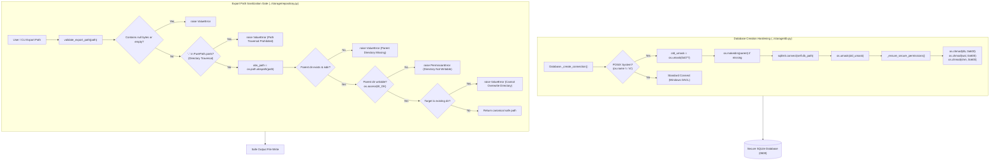

# Implementation Plan — P1-3: Missing POSIX `0600` Database Permissions & Export Path Sanitization

> **Reference:** [Production Readiness & Architecture Review (`P1-3`)](./production-readiness-review.md#p1-3-missing-posix-0600-database-permissions--export-path-sanitization)  
> **Target Modules:** [`../storage/db.py`](../storage/db.py) (`Database`), [`../storage/repository.py`](../storage/repository.py) (`HistoricalRepository`, `validate_export_path`), [`../train_tracker.py`](../train_tracker.py) (`run_history_mode`), [`../storage/__init__.py`](../storage/__init__.py)  
> **Test Suites:** [`../tests/test_storage_db.py`](../tests/test_storage_db.py), [`../tests/test_storage_repository.py`](../tests/test_storage_repository.py), [`../tests/test_cli_storage.py`](../tests/test_cli_storage.py)

---

## 1. Root-Cause Defect Analysis

### A. Defect Mechanisms

#### 1. Insecure Default File Permissions on SQLite Database and WAL Sidecars
- **Location:** [`../storage/db.py`](../storage/db.py#L82-L109) (`Database._create_connection`)
- In [`../storage/db.py`](../storage/db.py), `Database._create_connection()` creates SQLite database files via `sqlite3.connect(self.db_path)`. On POSIX systems, `sqlite3.connect()` creates the file using the default process umask (typically `0022` or `0002`), yielding world-readable or group-readable permissions (`0644` or `0664`):
  ```python
  if not self._is_memory:
      parent = os.path.dirname(os.path.abspath(self.db_path))
      if parent and not os.path.exists(parent):
          os.makedirs(parent, exist_ok=True)

  conn = sqlite3.connect(
      self.db_path,
      timeout=5.0,
      detect_types=sqlite3.PARSE_DECLTYPES | sqlite3.PARSE_COLNAMES,
      check_same_thread=False,
  )
  ```
- Additionally, when Write-Ahead Logging (WAL) is enabled (`PRAGMA journal_mode = WAL;`), SQLite generates `-wal` and `-shm` sidecar files under the same permissive umask.
- Because `railmon` continuously logs timestamps, geographic coordinates (lat/lng/altitude), train numbers, locomotive IDs, and speed profiles across national railway corridors, permissive file permissions expose sensitive operational and location telemetry to unprivileged local users on shared systems, servers, or container hosts.
- This directly violates:
  - [`../.agents/rules/security-and-data-protection.md`](../.agents/rules/security-and-data-protection.md#L14-L26) (*"Restrict newly created database file to owner read/write (POSIX 0600)... `old_umask = os.umask(0o077)`"*).
  - [`../.agents/rules/compliance.md`](../.agents/rules/compliance.md#L12) (*"Data Protection & Local Privacy: Enforce 0600 owner-only permissions on historical SQLite archives and state files on POSIX systems"*).

#### 2. Arbitrary Recursive Directory Creation & Lack of Path Traversal Safeguards
- **Location:** [`../storage/repository.py`](../storage/repository.py#L513-L520) (`HistoricalRepository.export_csv`), [`../train_tracker.py`](../train_tracker.py#L881-L885) (`run_history_mode`)
- In [`../storage/repository.py`](../storage/repository.py#L513-L520), `HistoricalRepository.export_csv()` accepts arbitrary string targets and blindly creates parent directories without validating whether the path attempts directory traversal (`..`) or escapes the expected directory tree:
  ```python
  if isinstance(target, str):
      parent = os.path.dirname(os.path.abspath(target))
      if parent and not os.path.exists(parent):
          os.makedirs(parent, exist_ok=True)
      with open(target, "w", newline="", encoding="utf-8") as f:
          return self._write_csv_data(qtype, f, params)
  ```
- Similarly, in [`../train_tracker.py`](../train_tracker.py#L881-L885), the `history export` subcommand for GeoJSON writes directly to user-supplied `args.out` with zero path validation:
  ```python
  if args.out:
      with open(args.out, "w", encoding="utf-8") as f:
          f.write(out_str)
  ```
- An attacker or misconfigured script invoking `railmon history export --out ../../../etc/bad.json` or `railmon history export --out /var/protected/out.csv` can escape the project directory, trigger unwanted directory creation across arbitrary filesystem paths, or overwrite sensitive files.
- Furthermore, `os.makedirs(parent, exist_ok=True)` masks user input typos by creating arbitrary directory hierarchies anywhere on the disk rather than failing fast when an intended export destination folder does not exist.
- This violates:
  - [`../.agents/rules/security-and-data-protection.md`](../.agents/rules/security-and-data-protection.md#L27-L28) (*"Path Traversal Protection on Exports: For CLI export subcommands... validate and sanitize paths against directory traversal (`../`). Ensure output directories are canonicalized with `os.path.abspath` and verify that the target directory exists and is writable."*).
  - [`../.agents/skills/security-audit/SKILL.md`](../.agents/skills/security-audit/SKILL.md#L55-L58) (*"Ensure paths are validated against `..` escapes. Ensure directories are checked for existence and safe permissions."*).

---

### B. Visual Comparison (ASCII & Mermaid)

```text
BEFORE (Permissive 0644 Permissions & Unsanitized Traversal Paths):
1. SQLite Database Creation:
   Database._create_connection() 
         |
         +--> os.makedirs(parent) (Created with default umask 0022 -> 0755 drwxr-xr-x)
         +--> sqlite3.connect(db) (Created with default umask 0022 -> 0644 -rw-r--r--)
         +--> PRAGMA journal_mode = WAL (db-wal & db-shm created as 0644 -rw-r--r--)
         x Telemetry accessible to all local system users!

2. Export CLI Dispatch:
   CLI: railmon history export 1597 --out "../../etc/cron.d/bad.json"
         |
         +--> repo.export_csv / open(args.out) (No validation!)
         +--> os.makedirs("../../etc/cron.d") (Arbitrary directory creation)
         +--> open("../../etc/cron.d/bad.json", "w") (Directory traversal write)
         x Arbitrary file overwrite / traversal hazard!

AFTER (POSIX 0600 Umask Enforcement & Canonical Export Path Validator):
1. SQLite Database Hardening:
   Database._create_connection()
         |
         +--> old_umask = os.umask(0o077) (POSIX only)
         |     +--> os.makedirs(parent) (Created with 0700 drwx------)
         |     +--> sqlite3.connect(db) (Created with 0600 -rw-------)
         +--> os.umask(old_umask)
         +--> _ensure_secure_permissions()
               +--> os.chmod(db, 0o600) + os.chmod(wal/shm, 0o600)
         ✓ Guaranteed owner-only read/write (POSIX 0600)

2. Export Path Sanitization:
   CLI: railmon history export 1597 --out <path>
         |
         +--> validate_export_path(path)
               |-- Check empty / null-byte injection ("\0") -> raise ValueError
               |-- Check PurePath(path).parts for '..' -> raise ValueError
               |-- Canonicalize via os.path.abspath(path)
               |-- Verify parent exists & isdir -> raise ValueError if missing
               |-- Verify parent writable (os.access W_OK) -> raise PermissionError
               |-- Verify target is not existing dir -> raise ValueError
               +-- Return canonical safe path string
         +--> open(clean_path, "w")
         ✓ Zero traversal, no arbitrary directory creation, verified writable target
```



---

## 2. Architectural Specification & Design

### A. SQLite Permissions Enforcement (`storage/db.py`)
1. **Scoped `os.umask(0o077)` Context:**
   - In [`../storage/db.py`](../storage/db.py), wrap initial directory creation and `sqlite3.connect()` calls on POSIX systems (`os.name != "nt"` and `not self._is_memory`) inside a `try...finally` block resetting the original umask.
   - Any newly created parent directory receives `0700` (`rwx------`) and the SQLite database file receives `0600` (`rw-------`).
2. **Explicit `_ensure_secure_permissions(self)`:**
   - Implement a defensive helper method on `Database` that verifies and hardens file permissions using `os.chmod(target, 0o600)`:
     - Applies to `self.db_path`, `f"{self.db_path}-wal"`, and `f"{self.db_path}-shm"`.
     - Automatically hardens pre-existing database files created prior to the fix (e.g. legacy `0644` files).
     - Defensively catches `OSError` (e.g., read-only mounts, file ownership edge cases) to prevent catastrophic process aborts on non-standard filesystems.
   - Invoked at the end of `Database._create_connection()`, after `Database.checkpoint_wal()`, and inside `Database.__init__()`.

### B. Export Path Validation & Sanitization (`storage/repository.py`)
1. **Public Helper `validate_export_path(path, base_dir=None) -> str`:**
   - Placed in [`../storage/repository.py`](../storage/repository.py) and exported via [`../storage/__init__.py`](../storage/__init__.py).
   - Validates that:
     1. `path` is a non-empty string or PathLike object without null bytes (`\0`).
     2. Path components do not contain `..` (directory traversal sequence), normalizing both forward slashes and backward slashes via `PurePath(path.replace('\\', '/')).parts`.
     3. Canonical path is resolved with `os.path.abspath(path)`.
     4. Destination parent directory exists and is an actual directory (`os.path.isdir`). Does **not** arbitrarily create parent directories.
     5. Destination parent directory is writable by the current process (`os.access(parent, os.W_OK)`).
     6. Destination path does not resolve to an existing directory.
     7. If the target file already exists, it is writable (`os.access(target, os.W_OK)`).
     8. If `base_dir` is supplied, verifies that `os.path.realpath(abs_path)` does not escape `os.path.realpath(base_dir)`.
2. **Integration in `HistoricalRepository.export_csv()`:**
   - If `target` is a `str`, pass it through `clean_path = validate_export_path(target)` before calling `open()`.
   - Remove the unvalidated `os.makedirs(parent, exist_ok=True)` block.
3. **Integration in `HistoricalRepository.resolve_archive_path()`:**
   - When a custom `archive_path` is passed, sanitize and validate it via `validate_export_path(archive_path)` to ensure `--archive-db` cannot escape into unauthorized directories.
4. **Integration in `train_tracker.py` (`run_history_mode`):**
   - In `action == "export"`:
     - For GeoJSON: pass `args.out` to `validate_export_path(args.out)` before writing.
     - For CSV: pass `clean_out = validate_export_path(args.out)` into `repo.export_csv()`.
   - Catch `(ValueError, PermissionError)` cleanly and output user-friendly error messages to `sys.stderr` returning exit code `1`.

---

## 3. Implementation Steps & Code Modifications

### Step 1: Update `storage/db.py` to Enforce POSIX `0600`
In [`../storage/db.py`](../storage/db.py):
1. Add `_ensure_secure_permissions(self) -> None`:
   ```python
   def _ensure_secure_permissions(self) -> None:
       """Enforce owner-only permissions (0600) on POSIX database and WAL files."""
       if self._is_memory or os.name == "nt":
           return

       abs_path = os.path.abspath(self.db_path)
       for suffix in ("", "-wal", "-shm"):
           target = f"{abs_path}{suffix}"
           if os.path.exists(target):
               try:
                   cur_mode = os.stat(target).st_mode & 0o777
                   if cur_mode != 0o600:
                       os.chmod(target, 0o600)
               except OSError:
                   pass
   ```
2. Wrap parent directory creation and `sqlite3.connect()` inside `_create_connection()` with `os.umask(0o077)`:
   ```python
   def _create_connection(self) -> sqlite3.Connection:
       """Create a new SQLite connection configured with optimal ingestion pragmas."""
       if not self._is_memory and os.name != "nt":
           old_umask = os.umask(0o077)
           try:
               parent = os.path.dirname(os.path.abspath(self.db_path))
               if parent and not os.path.exists(parent):
                   os.makedirs(parent, exist_ok=True)
               conn = sqlite3.connect(
                   self.db_path,
                   timeout=5.0,
                   detect_types=sqlite3.PARSE_DECLTYPES | sqlite3.PARSE_COLNAMES,
                   check_same_thread=False,
               )
           finally:
               os.umask(old_umask)
       else:
           if not self._is_memory:
               parent = os.path.dirname(os.path.abspath(self.db_path))
               if parent and not os.path.exists(parent):
                   os.makedirs(parent, exist_ok=True)
           conn = sqlite3.connect(
               self.db_path,
               timeout=5.0,
               detect_types=sqlite3.PARSE_DECLTYPES | sqlite3.PARSE_COLNAMES,
               check_same_thread=False,
           )

       conn.row_factory = sqlite3.Row
       self._ensure_secure_permissions()
       ...
   ```
3. Call `self._ensure_secure_permissions()` in `Database.__init__()` and at the end of `Database.checkpoint_wal()`.

---

### Step 2: Implement `validate_export_path` in `storage/repository.py`
In [`../storage/repository.py`](../storage/repository.py):
1. Import `PurePath` from `pathlib`.
2. Add `validate_export_path(path: Union[str, os.PathLike], base_dir: Optional[str] = None) -> str`:
   ```python
   def validate_export_path(
       path: Union[str, os.PathLike],
       base_dir: Optional[str] = None,
   ) -> str:
       """
       Validate and sanitize an export file destination path.

       Enforces security baselines against directory traversal (e.g. '../'),
       canonicalizes paths via os.path.abspath, and verifies that the destination
       parent directory exists and is writable.

       Args:
           path: Destination file path string or PathLike object.
           base_dir: Optional base directory to restrict exports within.

       Returns:
           Canonical absolute path string.

       Raises:
           ValueError: If path is empty, contains null bytes, contains directory
                       traversal sequences, or is an existing directory.
           FileNotFoundError: If the parent directory does not exist.
           PermissionError: If the parent directory or existing target file is not writable.
       """
       if path is None:
           raise ValueError("Export path cannot be None")

       raw_path = str(path).strip()
       if not raw_path:
           raise ValueError("Export path cannot be empty")

       if "\0" in raw_path:
           raise ValueError("Export path contains invalid null bytes")

       # Guard against directory traversal ('..')
       normalized_parts = PurePath(raw_path.replace("\\", "/")).parts
       if ".." in normalized_parts:
           raise ValueError(f"Directory traversal ('..') prohibited in export path: {raw_path}")

       abs_path = os.path.abspath(raw_path)
       parent_dir = os.path.dirname(abs_path)

       if not os.path.exists(parent_dir):
           raise ValueError(f"Export destination directory does not exist: '{parent_dir}'")

       if not os.path.isdir(parent_dir):
           raise ValueError(f"Export parent path is not a directory: '{parent_dir}'")

       if not os.access(parent_dir, os.W_OK):
           raise PermissionError(f"Export destination directory is not writable: '{parent_dir}'")

       if os.path.exists(abs_path):
           if os.path.isdir(abs_path):
               raise ValueError(f"Export path points to an existing directory: '{abs_path}'")
           if not os.access(abs_path, os.W_OK):
               raise PermissionError(f"Target export file is not writable: '{abs_path}'")

       if base_dir is not None:
           canonical_base = os.path.realpath(os.path.abspath(base_dir))
           canonical_target = os.path.realpath(abs_path)
           if not (canonical_target == canonical_base or canonical_target.startswith(canonical_base + os.sep)):
               raise ValueError(f"Export path escapes allowed base directory: '{raw_path}'")

       return abs_path
   ```
3. Update `HistoricalRepository.export_csv()`:
   ```python
   if isinstance(target, str):
       clean_target = validate_export_path(target)
       with open(clean_target, "w", newline="", encoding="utf-8") as f:
           return self._write_csv_data(qtype, f, params)
   else:
       return self._write_csv_data(qtype, target, params)
   ```
4. Update `HistoricalRepository.resolve_archive_path()` to validate custom `archive_path` parameters via `validate_export_path`.

---

### Step 3: Export `validate_export_path` in `storage/__init__.py`
In [`../storage/__init__.py`](../storage/__init__.py):
- Import `validate_export_path` from `storage.repository`.
- Append `"validate_export_path"` to `__all__`.

---

### Step 4: Integrate Sanitization into `train_tracker.py` (`run_history_mode`)
In [`../train_tracker.py`](../train_tracker.py#L871-L910):
- Import `validate_export_path` from `storage.repository`.
- In `action == "export"`:
  ```python
  elif action == "export":
      fmt = getattr(args, "format", "geojson").lower()
      if fmt == "geojson":
          data = repo.export_trip_geojson(
              train_number=args.train_number,
              start_time=args.start,
              end_time=args.end,
              feature_type=args.feature_type,
          )
          out_str = json.dumps(data, indent=2, ensure_ascii=False)
          if args.out:
              try:
                  clean_out = validate_export_path(args.out)
              except (ValueError, PermissionError) as err:
                  print(f"[Error] Invalid export path: {err}", file=sys.stderr)
                  return 1
              with open(clean_out, "w", encoding="utf-8") as f:
                  f.write(out_str)
              count = len(data.get("features", []))
              print(f"Exported GeoJSON ({count} features) to {clean_out}")
          else:
              print(out_str)
      elif fmt == "csv":
          if args.out:
              try:
                  clean_out = validate_export_path(args.out)
              except (ValueError, PermissionError) as err:
                  print(f"[Error] Invalid export path: {err}", file=sys.stderr)
                  return 1
              count = repo.export_csv(
                  query_type="telemetry",
                  target=clean_out,
                  params={
                      "train_number": args.train_number,
                      "start_time": args.start,
                      "end_time": args.end,
                  },
              )
              print(f"Exported {count} CSV records to {clean_out}")
          else:
              repo.export_csv(...)
  ```

---

## 4. Test Strategy & Verification Plan

### A. Test Cases in `tests/test_storage_db.py`
1. **`test_posix_database_permissions_0600`:**
   - In POSIX environments (`os.name != "nt"`), create a temporary database via `Database(db_path)`.
   - Verify `oct(os.stat(db_path).st_mode & 0o777) == "0o600"`.
   - Execute a transaction in WAL mode; verify `-wal` and `-shm` sidecar files are also `0o600`.
2. **`test_harden_existing_database_file_permissions`:**
   - Pre-create a database file with `os.chmod(db_path, 0o644)`.
   - Instantiate `Database(db_path)`.
   - Verify the database mode is hardened to `0o600`.
3. **`test_nested_parent_directory_permissions`:**
   - Create a nested database path `os.path.join(tmpdir, "a", "b", "test.db")`.
   - On POSIX, verify parent directories `a` and `b` receive `0o700`.

### B. Test Cases in `tests/test_storage_repository.py`
1. **`test_validate_export_path_success`:**
   - Pass valid relative and absolute paths in existing writable directories.
   - Verify return value matches `os.path.abspath(target)`.
2. **`test_validate_export_path_rejects_traversal`:**
   - Test `../foo.csv`, `../../etc/passwd`, `foo/../../bar.csv`, and `..\\bad.json`.
   - Verify `ValueError` is raised with message mentioning directory traversal.
3. **`test_validate_export_path_rejects_missing_directory`:**
   - Test path pointing to non-existent folder `/tmp/does_not_exist_xyz/out.csv`.
   - Verify `ValueError` is raised.
4. **`test_validate_export_path_rejects_existing_directory`:**
   - Test path pointing to an existing directory (e.g. `self.temp_dir`).
   - Verify `ValueError` is raised.
5. **`test_validate_export_path_rejects_empty_and_null_bytes`:**
   - Test `""`, `"   "`, and `"out\0.csv"`.
   - Verify `ValueError` is raised.
6. **`test_validate_export_path_with_base_dir_boundary`:**
   - Test paths attempting to escape an explicit `base_dir`.
   - Verify boundary containment enforcement.
7. **`test_export_csv_with_path_traversal_fails`:**
   - Invoke `repo.export_csv("telemetry", target="../escaped.csv", params={"train_number": "1597"})`.
   - Verify `ValueError` is raised and no file is created.

### C. Test Cases in `tests/test_cli_storage.py`
1. **`test_history_export_cli_traversal_rejected`:**
   - Invoke `run_history_mode` with `--out ../traversal.geojson`.
   - Verify return code is `1` and error message contains `[Error] Invalid export path: Directory traversal ('..') prohibited`.
2. **`test_history_export_cli_missing_parent_rejected`:**
   - Invoke `run_history_mode` with `--out nonexistent_folder_xyz/out.csv`.
   - Verify return code is `1` and error message contains `[Error] Invalid export path: Export destination directory does not exist`.

### D. Security Audit Skill Compliance
Execute manual pattern scan from [`../.agents/skills/security-audit/SKILL.md`](../.agents/skills/security-audit/SKILL.md#L55-L58):
```bash
python3 -m unittest discover -s tests -p "test_storage_db.py"
python3 -m unittest discover -s tests -p "test_storage_repository.py"
python3 -m unittest discover -s tests -p "test_cli_storage.py"
```

---

## 5. Risk Assessment & Compatibility

| Risk | Likelihood | Impact | Mitigation |
|---|---|---|---|
| **Windows Compatibility:** `os.chmod(..., 0o600)` behavior differs on Windows NT. | Low | Low | Guard all permission hardening calls with `if os.name != "nt":` and gracefully handle `OSError`. |
| **Existing Directory Validation Breaking Valid Custom Scripts:** Users expecting auto-creation of deeply nested missing directories. | Medium | Low | Require export parent folders to exist; output clear error message guiding user to create directory first. |
| **Concurrent Threads & `os.umask` Race:** Process-wide umask could theoretically overlap with other library calls. | Low | Low | Keep umask modification localized strictly around file creation, backed by immediate `_ensure_secure_permissions()` `os.chmod` call. |
