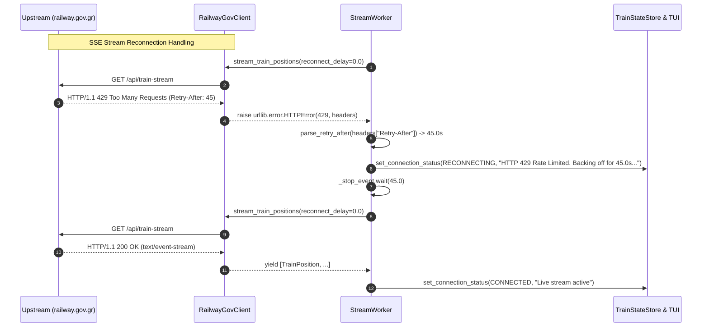
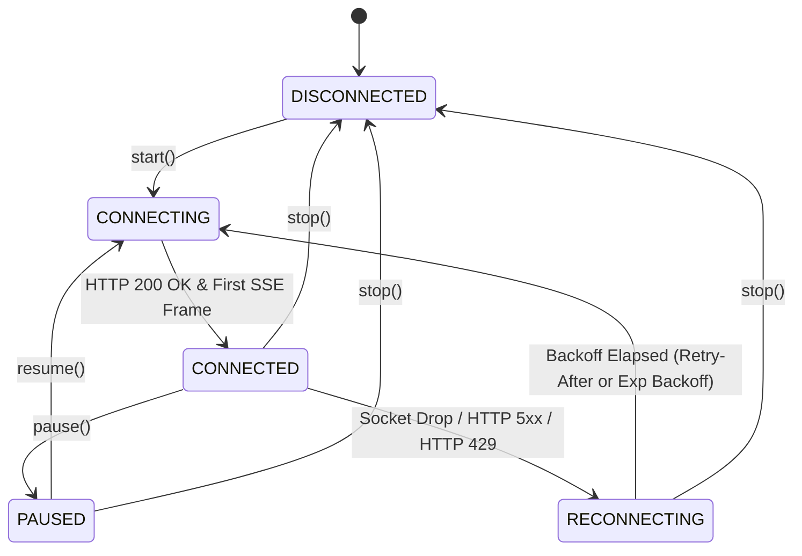

# Implementation Plan — P1-5: Unhandled HTTP 429 (Retry-After) & 5xx Errors in REST / SSE Client

> **Reference:** [Production Readiness & Architecture Review (`P1-5`)](./production-readiness-review.md#p1-5-unhandled-http-429-retry-after--5xx-errors-in-rest--sse-client)  
> **Target Modules:** [`../train_tracker.py`](../train_tracker.py) (`RailwayGovClient._get`, `RailwayGovClient.stream_train_positions`, `run_schedules_mode`, `main`), [`../tui/stream_worker.py`](../tui/stream_worker.py) (`StreamWorker.__init__`, `StreamWorker._run_loop`)  
> **Test Suites:** [`../tests/test_tracker.py`](../tests/test_tracker.py) (`TestRailwayGovClientResilience`, `TestRetryAfterParsing`), [`../tests/test_cli.py`](../tests/test_cli.py) (`TestCLISchedulesResilience`)  
> **Relevant Rules & Skills:** [`../.agents/rules/resilience-and-fallbacks.md`](../.agents/rules/resilience-and-fallbacks.md#L18-L25), [`../.agents/rules/communication.md`](../.agents/rules/communication.md#L16), [`../.agents/rules/diagrams-and-visual-documentation.md`](../.agents/rules/diagrams-and-visual-documentation.md), [`../.agents/skills/stream-resilience-tester/SKILL.md`](../.agents/skills/stream-resilience-tester/SKILL.md), [`../.agents/skills/ci-quality-gate/SKILL.md`](../.agents/skills/ci-quality-gate/SKILL.md)

---

## 1. Executive Summary & Defect Overview

`railmon` interacts with upstream `railway.gov.gr` infrastructure across two distinct networking modalities:
1. **Server-Sent Events (SSE):** Streaming train positions continuously via `/api/train-stream`.
2. **REST Endpoints:** Synchronous JSON retrieval for schedules, station boards, and infrastructure metadata via `/api/public/*` and `/api/msd/geo`.

Under degraded network conditions, upstream maintenance, or rate limiting, the current implementation exhibits critical architectural vulnerabilities:
- **HTTP 429 Ignored / Rapid Spin:** Upstream HTTP 429 (Too Many Requests) responses are either caught as generic connection errors without parsing `Retry-After` headers (retrying after a default 1.0s or 3.0s sleep), or left unhandled. This directly violates the 30-second minimum backoff requirement in [`../.agents/rules/resilience-and-fallbacks.md`](../.agents/rules/resilience-and-fallbacks.md#L23) and risks automated upstream IP banning or permanent throttling.
- **REST CLI Stack Traces:** REST subcommands such as `railmon schedules` lack exception handling around `RailwayGovClient._get()`, crashing immediately with unformatted raw Python tracebacks upon network disconnection, DNS failure, 5xx server errors, or rate limits.
- **Missing REST Retries:** `RailwayGovClient._get()` makes a single `urllib.request.urlopen` call without retries or exponential backoff for transient 5xx server errors (HTTP 500, 502, 503, 504) or socket timeouts.
- **StreamWorker Backoff Inconsistency:** `StreamWorker` defines default backoff intervals (`base_backoff_sec=1.0`, `max_backoff_sec=30.0`) that mismatch the architecture standard specified in [`../.agents/rules/resilience-and-fallbacks.md`](../.agents/rules/resilience-and-fallbacks.md#L21-L22) (`base_delay=3.0`, `max_delay=60.0`).

This implementation plan details the architectural refactoring to introduce `RailwayAPIError`, a robust RFC 7231 / RFC 9110 compliant `parse_retry_after` parser, an automated retry mechanism with exponential backoff and jitter for REST requests, rate limit awareness in SSE streaming and background workers, and graceful CLI error handling.

---

## 2. Root-Cause Defect Analysis

### A. Defect Mechanisms

#### 1. HTTP 429 Rate Limiting Ignored & Rapid Spin Loop
- **Location:** [`../train_tracker.py`](../train_tracker.py#L345-L427) (`RailwayGovClient.stream_train_positions`), [`../tui/stream_worker.py`](../tui/stream_worker.py#L90-L151) (`StreamWorker._run_loop`)
- In `RailwayGovClient.stream_train_positions()`, connection errors are trapped with:
  ```python
  except (urllib.error.URLError, TimeoutError, OSError) as e:
      if stop_event is not None and stop_event.is_set():
          return
      if reconnect_delay <= 0:
          raise
      logger.warning("SSE connection interrupted: %s. Reconnecting in %.1fs...", e, reconnect_delay)
      ...
      time.sleep(reconnect_delay)
  ```
- Because `urllib.error.HTTPError` is a subclass of `URLError`, an HTTP 429 response enters this block:
  1. It ignores `e.headers.get("Retry-After")`.
  2. If `reconnect_delay > 0`, it sleeps for only 3.0s before making another connection request.
  3. If `reconnect_delay <= 0` (as invoked by `StreamWorker`), `HTTPError` is raised into `StreamWorker._run_loop`.
- In `StreamWorker._run_loop`:
  ```python
  except Exception as exc:
      ...
      jitter = random.uniform(0.8, 1.2)
      sleep_time = min(backoff * jitter, self.max_backoff_sec)
      msg = f"Connection error: {exc}. Reconnecting in {sleep_time:.1f}s..."
      logger.warning(msg)
      self.store.set_connection_status(ConnectionStatus.RECONNECTING, msg)
      if self._stop_event.wait(timeout=sleep_time):
          break
      backoff = min(backoff * 2.0, self.max_backoff_sec)
  ```
  `StreamWorker` starts its backoff at `1.0s` (`base_backoff_sec`). When the server returns HTTP 429 with `Retry-After: 120`, `StreamWorker` retries in ~1 second, violating the server's requested delay and hammering the rate-limited API.
- This violates:
  - [`../.agents/rules/resilience-and-fallbacks.md`](../.agents/rules/resilience-and-fallbacks.md#L23) (*"HTTP 429 (Rate Limited) Handling: If upstream responds with HTTP 429, parse the `Retry-After` header if present. If absent, back off for a minimum of 30 seconds before retrying."*).
  - [`../.agents/skills/stream-resilience-tester/SKILL.md`](../.agents/skills/stream-resilience-tester/SKILL.md#L38-L43) (*"Scenario B: Upstream HTTP 429 / 503... Respects `Retry-After` if provided, or applies exponential backoff... Avoids rapid spin loops that would hammer the upstream API."*).

#### 2. Raw Tracebacks & Missing Resilience in REST Client (`_get`) and CLI (`schedules`)
- **Location:** [`../train_tracker.py`](../train_tracker.py#L272-L282) (`RailwayGovClient._get`), [`../train_tracker.py`](../train_tracker.py#L1122-L1136) (`run_schedules_mode`), [`../train_tracker.py`](../train_tracker.py#L1167-L1168) (`main`)
- `RailwayGovClient._get` executes a single request without retry handling:
  ```python
  def _get(self, path: str, params: Optional[Dict[str, Any]] = None) -> Any:
      url = f"{self.base_url}{path}"
      if params:
          query = urllib.parse.urlencode(params)
          url = f"{url}?{query}"
      req = urllib.request.Request(url, headers=DEFAULT_HEADERS)
      with urllib.request.urlopen(req, context=self.ssl_ctx, timeout=15) as resp:
          content = resp.read().decode("utf-8")
          return json.loads(content)
  ```
- Any transient error (e.g., DNS hiccup, HTTP 502/503 during rolling deployment, or HTTP 429) immediately propagates out of `_get()`.
- In `run_schedules_mode()`:
  ```python
  def run_schedules_mode() -> None:
      client = RailwayGovClient()
      print("Fetching today's upcoming train schedules...\n")
      schedules = client.get_upcoming_schedules()
      ...
  ```
  No `try...except` block wraps this invocation. The program terminates with a raw traceback (`urllib.error.HTTPError: HTTP Error 503: Service Unavailable` or `urllib.error.URLError: <urlopen error [Errno -3] Temporary failure in name resolution>`).
- Furthermore, `run_schedules_mode()` returns `None` and does not set a distinct non-zero exit code on failure, failing CLI contract standards.

#### 3. Backoff Parameter Mismatch in `StreamWorker`
- **Location:** [`../tui/stream_worker.py`](../tui/stream_worker.py#L32-L33)
- `StreamWorker.__init__` declares:
  ```python
  base_backoff_sec: float = 1.0,
  max_backoff_sec: float = 30.0,
  ```
- [`../.agents/rules/resilience-and-fallbacks.md`](../.agents/rules/resilience-and-fallbacks.md#L20-L22) dictates:
  $$\text{delay} = \min(\text{base\_delay} \times 2^{\text{attempt}}, \text{max\_delay}) \pm \text{jitter}$$
  - `base_delay`: 3.0 seconds
  - `max_delay`: 60.0 seconds
- The worker starts retrying 3x faster than allowed and caps its retry window at half the mandated maximum.

---

### B. Visual Comparison & Architecture Diagrams

#### 1. Failure Sequence vs Resilient Sequence (ASCII)

```text
CURRENT BROKEN BEHAVIOR (HTTP 429 / 5xx):
Upstream API                  RailwayGovClient / StreamWorker              Terminal / User
     |                                      |                                     |
     |--- HTTP 429 (Retry-After: 60) ------>|                                     |
     |                                      |-- Discards Retry-After              |
     |                                      |-- Backoff: 1.0s                     |
     |<-- Reconnect in 1.0s (Too Early!) ---|                                     |
     |--- HTTP 429 (IP Banned / Blocked) -->|                                     |
     |                                      x Rapid spin loop hammers server!     |
     |                                                                            |
[REST / railmon schedules]:                                                       |
     |--- HTTP 503 (Service Unavailable) -->|                                     |
     |                                      |-- Uncaught urllib.error.HTTPError ->| (CRASH! Raw stack trace)
     |                                                                            x Exit 1 with traceback

RESILIENT BEHAVIOR (P1-5 Remediated):
Upstream API                  RailwayGovClient / StreamWorker              Terminal / User
     |                                      |                                     |
     |--- HTTP 429 (Retry-After: 60) ------>|                                     |
     |                                      |-- parse_retry_after("60") -> 60.0s  |
     |                                      |-- Status: RECONNECTING (429, 60.0s) |
     |                                      |-- Interruptible sleep(60.0s)        |
     |                                      |   (Honors stop_event / pause)       |
     |<-- Reconnect after 60.0s ----------->|                                     |
     |--- 200 OK (Stream Restored) -------->|-- Status: CONNECTED                 |
     |                                      |-- Stream updates continue           |
     |                                                                            |
[REST / railmon schedules]:                                                       |
     |--- HTTP 503 (Attempt 1) ------------>|                                     |
     |                                      |-- Backoff 1.2s (exp + jitter)       |
     |--- HTTP 503 (Attempt 2) ------------>|                                     |
     |                                      |-- Backoff 2.3s                      |
     |--- HTTP 503 (Attempt 3 Failed) ----->|                                     |
     |                                      |-- Raises RailwayAPIError            |
     |                                      |-- Handled in run_schedules_mode() ->| "[Error] Unable to retrieve..."
     |                                                                            ✓ Clean error output, Exit 1
```

#### 2. Sequence Diagram: Resilient Network Handshake (Mermaid)



#### 3. State Machine: Telemetry Reconnection Engine (Mermaid & ASCII)

```text
+-----------------------------------------------------------------------------------+
|                     STREAMWORKER CONNECTION STATE MACHINE                         |
+-----------------------------------------------------------------------------------+
|                                                                                   |
|      [DISCONNECTED] <----------------------+                                      |
|            |                               |                                      |
|     start()|                               | stop()                               |
|            v                               |                                      |
|      [CONNECTING] -------------------------+                                      |
|            |                               |                                      |
|   Connected| (200 OK)                      |                                      |
|            v                               |                                      |
|       [CONNECTED]                          |                                      |
|         |     |                            |                                      |
|    Pause|     | Socket Drop / 5xx / 429    |                                      |
|         v     v                            |                                      |
|     [PAUSED] [RECONNECTING] ---------------+                                      |
|         |     |                                                                   |
|         |     +-- If 429: sleep max(Retry-After, 30.0s)                           |
|         |     +-- If 5xx / Drop: sleep min(base * 2^n, 60s) ± jitter              |
|         |     +-- Then transitions back to [CONNECTING]                           |
|         +-- Unpause transitions to [CONNECTING]                                   |
+-----------------------------------------------------------------------------------+
```



---

## 3. Comprehensive Technical Specification

### A. Custom Exception Hierarchy: `RailwayAPIError`

In [`../train_tracker.py`](../train_tracker.py):
```python
class RailwayAPIError(IOError):
    """Base exception raised when a RailwayGovClient API operation fails."""

    def __init__(
        self,
        message: str,
        status_code: Optional[int] = None,
        retry_after: Optional[float] = None,
    ):
        super().__init__(message)
        self.status_code = status_code
        self.retry_after = retry_after
```
- Inherits from `IOError` (`OSError`), maintaining backwards compatibility with standard I/O exception handling.
- Encapsulates HTTP status code and parsed `retry_after` delay for programmatic decision-making.

### B. Header Parsing: `parse_retry_after`

Per RFC 7231 §7.1.3 and RFC 9110 §10.2.3, `Retry-After` can take one of two forms:
1. **Delta-seconds:** A non-negative decimal integer (e.g. `120`).
2. **HTTP-date:** An IMF-fixdate timestamp (e.g. `Fri, 31 Dec 2026 23:59:59 GMT`).

Helper function in [`../train_tracker.py`](../train_tracker.py):
```python
def parse_retry_after(
    header_val: Optional[str],
    default_delay: float = 30.0,
    min_delay: float = 30.0,
    max_delay: float = 300.0,
) -> float:
    """Parse HTTP Retry-After header adhering to RFC 7231 / RFC 9110.

    Supports both delta-seconds and IMF-fixdate / RFC 2822 HTTP-date formats.
    Enforces repository minimum backoff rules and caps maximum delay.

    Args:
        header_val: Raw Retry-After header string, or None.
        default_delay: Fallback delay in seconds if header is missing or unparseable.
        min_delay: Minimum allowable backoff (mandated >= 30.0s for rate limiting).
        max_delay: Maximum allowable backoff cap (default: 300.0s / 5 minutes).

    Returns:
        Backoff duration in seconds, clamped between min_delay and max_delay.
    """
    if not header_val or not str(header_val).strip():
        return max(default_delay, min_delay)

    clean_val = str(header_val).strip()

    # 1. Attempt delta-seconds integer or float
    try:
        seconds = float(clean_val)
        if math.isnan(seconds) or math.isinf(seconds) or seconds < 0:
            return max(default_delay, min_delay)
        return min(max(seconds, min_delay), max_delay)
    except (ValueError, TypeError):
        pass

    # 2. Attempt HTTP-date timestamp (IMF-fixdate / RFC 2822 / RFC 850)
    try:
        target_dt = email.utils.parsedate_to_datetime(clean_val)
        if target_dt is not None:
            now_dt = datetime.now(timezone.utc)
            delta_sec = (target_dt - now_dt).total_seconds()
            if delta_sec <= 0:
                return max(default_delay, min_delay)
            return min(max(delta_sec, min_delay), max_delay)
    except Exception as exc:
        logger.debug("Failed to parse HTTP-date in Retry-After header %r: %s", clean_val, exc)

    return max(default_delay, min_delay)
```

### C. Hardened REST Client: `RailwayGovClient._get`

Refactor `RailwayGovClient._get` in [`../train_tracker.py`](../train_tracker.py) with automated retries, rate limit awareness, and bounded exponential backoff:
```python
    def _get(
        self,
        path: str,
        params: Optional[Dict[str, Any]] = None,
        max_retries: int = 3,
        base_backoff_sec: float = 1.0,
        max_backoff_sec: float = 30.0,
    ) -> Any:
        url = f"{self.base_url}{path}"
        if params:
            query = urllib.parse.urlencode(params)
            url = f"{url}?{query}"

        for attempt in range(max_retries + 1):
            req = urllib.request.Request(url, headers=DEFAULT_HEADERS)
            try:
                with urllib.request.urlopen(req, context=self.ssl_ctx, timeout=15) as resp:
                    content = resp.read().decode("utf-8")
                    return json.loads(content)
            except urllib.error.HTTPError as err:
                if err.code == 429:
                    retry_header = err.headers.get("Retry-After") if err.headers else None
                    retry_after = parse_retry_after(retry_header, default_delay=30.0, min_delay=30.0)
                    if attempt < max_retries:
                        logger.warning(
                            "HTTP 429 Rate Limited on %s. Retrying after %.1fs (attempt %d/%d)...",
                            url, retry_after, attempt + 1, max_retries
                        )
                        time.sleep(retry_after)
                        continue
                    raise RailwayAPIError(
                        f"HTTP 429 Rate Limited on {path}: upstream limit exceeded (Retry-After: {retry_after:.1f}s)",
                        status_code=429,
                        retry_after=retry_after,
                    ) from err
                elif 500 <= err.code < 600:
                    if attempt < max_retries:
                        jitter = random.uniform(0.8, 1.2)
                        sleep_time = min(base_backoff_sec * (2 ** attempt) * jitter, max_backoff_sec)
                        logger.warning(
                            "HTTP %d Server Error on %s. Retrying in %.1fs (attempt %d/%d)...",
                            err.code, url, sleep_time, attempt + 1, max_retries
                        )
                        time.sleep(sleep_time)
                        continue
                    raise RailwayAPIError(
                        f"HTTP {err.code} Server Error on {path}: {err.reason}",
                        status_code=err.code,
                    ) from err
                else:
                    # Non-retryable 4xx client errors (400, 401, 403, 404)
                    raise RailwayAPIError(
                        f"HTTP {err.code} Client Error on {path}: {err.reason}",
                        status_code=err.code,
                    ) from err
            except (urllib.error.URLError, TimeoutError, OSError) as err:
                if attempt < max_retries:
                    jitter = random.uniform(0.8, 1.2)
                    sleep_time = min(base_backoff_sec * (2 ** attempt) * jitter, max_backoff_sec)
                    logger.warning(
                        "Network error connecting to %s (%s). Retrying in %.1fs (attempt %d/%d)...",
                        url, err, sleep_time, attempt + 1, max_retries
                    )
                    time.sleep(sleep_time)
                    continue
                raise RailwayAPIError(
                    f"Network error connecting to {path}: {err}",
                ) from err
```

### D. Hardened SSE Generator: `RailwayGovClient.stream_train_positions`

Update `RailwayGovClient.stream_train_positions` in [`../train_tracker.py`](../train_tracker.py):
1. When `reconnect_delay <= 0` (e.g. under `StreamWorker`):
   - Immediately re-raise `urllib.error.HTTPError`, `URLError`, `TimeoutError`, and `OSError` without sleeping or logging warning, delegating state management directly to `StreamWorker`.
2. When `reconnect_delay > 0` (e.g. standalone plain stream mode or recording daemon):
   - Track `attempt: int = 0`, resetting to `0` upon each successfully yielded batch.
   - If `isinstance(e, urllib.error.HTTPError)` and `e.code == 429`:
     - Parse `Retry-After` header via `parse_retry_after(..., min_delay=30.0)`.
     - Log `WARNING` indicating rate limit and parsed retry duration.
     - Wait interruptibly via `stop_event.wait(timeout=wait_time)`.
   - If `500 <= e.code < 600` or `URLError` / `TimeoutError`:
     - Apply exponential backoff with jitter:
       $$\text{wait\_time} = \min(\text{reconnect\_delay} \times 2^{\text{attempt}} \times \text{jitter}, 60.0)$$
     - Log `WARNING` with status code and backoff interval.
     - Increment `attempt += 1`.
     - Wait interruptibly via `stop_event.wait(timeout=wait_time)`.

### E. Hardened Ingestion Engine: `StreamWorker`

In [`../tui/stream_worker.py`](../tui/stream_worker.py):
1. Update default backoff parameters:
   ```python
   def __init__(
       self,
       store: TrainStateStore,
       client: Optional[RailwayGovClient] = None,
       mock_engine: Optional[MockTelemetryEngine] = None,
       custom_stream: Optional[Union[Generator[List[TrainPosition], None, None], Iterable[List[TrainPosition]]]] = None,
       recorder: Optional[Any] = None,
       base_backoff_sec: float = 3.0,   # Mandated 3.0s base
       max_backoff_sec: float = 60.0,   # Mandated 60.0s cap
   ):
   ```
2. Refactor `StreamWorker._run_loop`:
   ```python
   except Exception as exc:
       if self._stop_event.is_set():
           break

       if not self._pause_event.is_set():
           self._pause_event.wait()
           if self._stop_event.is_set():
               break

       if isinstance(exc, urllib.error.HTTPError) and exc.code == 429:
           retry_header = exc.headers.get("Retry-After") if exc.headers else None
           sleep_time = parse_retry_after(retry_header, default_delay=30.0, min_delay=30.0)
           msg = f"HTTP 429 Rate Limited. Backing off for {sleep_time:.1f}s (Retry-After)..."
           logger.warning(msg)
           self.store.set_connection_status(ConnectionStatus.RECONNECTING, msg)
       elif isinstance(exc, urllib.error.HTTPError) and 500 <= exc.code < 600:
           jitter = random.uniform(0.8, 1.2)
           sleep_time = min(backoff * jitter, self.max_backoff_sec)
           msg = f"HTTP {exc.code} Server Error ({exc.reason}). Reconnecting in {sleep_time:.1f}s..."
           logger.warning(msg)
           self.store.set_connection_status(ConnectionStatus.RECONNECTING, msg)
           backoff = min(backoff * 2.0, self.max_backoff_sec)
       else:
           jitter = random.uniform(0.8, 1.2)
           sleep_time = min(backoff * jitter, self.max_backoff_sec)
           msg = f"Connection error: {exc}. Reconnecting in {sleep_time:.1f}s..."
           logger.warning(msg)
           self.store.set_connection_status(ConnectionStatus.RECONNECTING, msg)
           backoff = min(backoff * 2.0, self.max_backoff_sec)

       if self._stop_event.wait(timeout=sleep_time):
           break
   ```

### F. REST CLI Hardening: `run_schedules_mode` and `main`

In [`../train_tracker.py`](../train_tracker.py):
1. Update `run_schedules_mode() -> int`:
   ```python
   def run_schedules_mode() -> int:
       """Fetch and display today's upcoming train timetables.

       Returns:
           Exit code (0 on success, 1 on failure).
       """
       client = RailwayGovClient()
       print("Fetching today's upcoming train schedules from railway.gov.gr...\n")
       try:
           schedules = client.get_upcoming_schedules()
       except (RailwayAPIError, urllib.error.URLError, TimeoutError, OSError) as err:
           print(f"[Error] Failed to fetch train timetables: {err}", file=sys.stderr)
           return 1

       if not schedules:
           print("No upcoming train timetables returned for today.")
           return 0

       print(f"Total upcoming schedules: {len(schedules)}")
       for s in schedules[:15]:
           orig = s.get("origin")
           dest = s.get("destination")
           orig_name = orig.get("nameGreek") if isinstance(orig, dict) else orig or "N/A"
           dest_name = dest.get("nameGreek") if isinstance(dest, dict) else dest or "N/A"
           print(
               f"• Train {str(s.get('trainNumber')):>5} | {orig_name} -> {dest_name} | Dep: {s.get('scheduledDeparture', 'N/A')}"
           )
       return 0
   ```
2. In `main()`, route `schedules` exit code:
   ```python
   elif args.mode == "schedules":
       return run_schedules_mode()
   ```

---

## 4. Step-by-Step Implementation Roadmap

```text
+-----------------------------------------------------------------------------------+
|                        P1-5 EXECUTION PHASES & GATES                              |
+-----------------------------------------------------------------------------------+
| Phase 1: Core Primitives & Parsing                                                |
|   1. Define RailwayAPIError in train_tracker.py                                   |
|   2. Implement parse_retry_after() with RFC 7231 / RFC 9110 parsing               |
|                                                                                   |
| Phase 2: REST Client & CLI Hardening                                              |
|   3. Refactor RailwayGovClient._get() with 3-retry exp backoff & 429 support      |
|   4. Update run_schedules_mode() and main() exit code handling                    |
|                                                                                   |
| Phase 3: SSE Streaming & StreamWorker Resilience                                  |
|   5. Update RailwayGovClient.stream_train_positions() with 429 & exp backoff      |
|   6. Update StreamWorker.__init__ defaults and StreamWorker._run_loop 429 logic   |
|                                                                                   |
| Phase 4: Test Suite & Verification                                                |
|   7. Author unit tests for parse_retry_after in tests/test_tracker.py             |
|   8. Author unit tests for RailwayGovClient._get retry & 429/5xx scenarios        |
|   9. Author integration tests for StreamWorker 429/5xx and clean shutdown         |
|  10. Author CLI test for railmon schedules failure handling in tests/test_cli.py  |
|  11. Execute full quality gate: unittest suite and flake8                         |
+-----------------------------------------------------------------------------------+
```

### Detailed Steps

1. **Step 1: Core Primitives & Parsing**
   - Add `RailwayAPIError` class definition in [`../train_tracker.py`](../train_tracker.py).
   - Import `email.utils` in [`../train_tracker.py`](../train_tracker.py).
   - Add `parse_retry_after()` helper in [`../train_tracker.py`](../train_tracker.py), enforcing `min_delay=30.0s` and capping at `max_delay=300.0s`.

2. **Step 2: REST Client & CLI Hardening**
   - Modify `RailwayGovClient._get()` to wrap requests in a retry loop (`max_retries=3`).
   - Catch `HTTPError`: on 429 sleep for `Retry-After`; on 5xx sleep with exponential backoff and jitter; on 4xx re-raise immediately.
   - Catch `URLError` / `TimeoutError` and retry with backoff.
   - Refactor `run_schedules_mode()` in [`../train_tracker.py`](../train_tracker.py) to catch `RailwayAPIError` and network errors, printing to `sys.stderr` and returning exit code 1.
   - Wire `return run_schedules_mode()` in `main()`.

3. **Step 3: SSE Streaming Resilience**
   - In `RailwayGovClient.stream_train_positions()`, track `attempt` counter.
   - When `reconnect_delay > 0`, handle `HTTPError(429)` using `parse_retry_after` and `HTTPError(5xx)` / `URLError` using exponential backoff with jitter up to 60.0s.
   - Reset `attempt = 0` on successful data frame yield.

4. **Step 4: StreamWorker Upgrades**
   - In [`../tui/stream_worker.py`](../tui/stream_worker.py), change `base_backoff_sec=3.0` and `max_backoff_sec=60.0`.
   - In `StreamWorker._run_loop`, catch `HTTPError` separately to parse `Retry-After` on 429, set status to `RECONNECTING`, and sleep for at least 30.0s before retrying.

5. **Step 5: Test Suite Expansion**
   - In [`../tests/test_tracker.py`](../tests/test_tracker.py), create `TestRetryAfterParsing` and `TestRailwayGovClientResilience`.
   - In [`../tests/test_cli.py`](../tests/test_cli.py), add `test_schedules_cli_handles_network_failure_gracefully`.
   - In [`../tests/test_tui_controls.py`](../tests/test_tui_controls.py) or new stream worker tests, verify `StreamWorker` 429 backoff handling.

6. **Step 6: Quality Gate & Documentation Review**
   - Run `python3 -m unittest discover tests -v` to ensure 100% test pass rate.
   - Verify zero regressions across the 265 existing tests.
   - Run flake8 linting to ensure compliance with styling rules.
   - Update [`./production-readiness-review.md`](./production-readiness-review.md) to mark P1-5 as `[RESOLVED]`.

---

## 5. Comprehensive Test & Verification Plan

### A. Test Cases Matrix

| Test ID | Module | Target Function / Scenario | Expected Outcome |
|---|---|---|---|
| **TC-RES-01** | `test_tracker.py` | `parse_retry_after(None)` | Returns default `30.0` |
| **TC-RES-02** | `test_tracker.py` | `parse_retry_after("120")` | Returns `120.0` |
| **TC-RES-03** | `test_tracker.py` | `parse_retry_after("10")` | Enforces minimum `30.0` |
| **TC-RES-04** | `test_tracker.py` | `parse_retry_after("45.5")` | Returns `45.5` |
| **TC-RES-05** | `test_tracker.py` | `parse_retry_after(IMF_date)` (future) | Parses HTTP-date, clamps to $\ge 30.0\text{s}$ |
| **TC-RES-06** | `test_tracker.py` | `parse_retry_after(IMF_date)` (past) | Returns default `30.0` |
| **TC-RES-07** | `test_tracker.py` | `parse_retry_after("invalid_header")` | Returns default `30.0` |
| **TC-RES-08** | `test_tracker.py` | `parse_retry_after("999999")` | Clamped to `max_delay` (`300.0`) |
| **TC-RES-09** | `test_tracker.py` | `_get` succeeds on first attempt | Returns JSON data without sleep |
| **TC-RES-10** | `test_tracker.py` | `_get` encounters 429, retries, succeeds | Waits `Retry-After`, succeeds on attempt 2 |
| **TC-RES-11** | `test_tracker.py` | `_get` encounters 429, exhausts retries | Raises `RailwayAPIError` (code 429, retry_after) |
| **TC-RES-12** | `test_tracker.py` | `_get` encounters 503, retries, succeeds | Backs off exponentially, succeeds on attempt 2 |
| **TC-RES-13** | `test_tracker.py` | `_get` encounters 404 Not Found | Raises `RailwayAPIError` immediately (no retry) |
| **TC-RES-14** | `test_tracker.py` | `_get` encounters `URLError` / Timeout | Retries with backoff, raises `RailwayAPIError` |
| **TC-RES-15** | `test_tracker.py` | `stream_train_positions` (delay>0) on 429 | Respects `Retry-After` with min 30s |
| **TC-RES-16** | `test_tracker.py` | `stream_train_positions` (delay<=0) on 429 | Raises `HTTPError` directly to worker |
| **TC-RES-17** | `test_tui_controls.py` | `StreamWorker` receives 429 from stream | Sets `RECONNECTING`, delays $\ge 30.0\text{s}$ |
| **TC-RES-18** | `test_tui_controls.py` | `StreamWorker` clean stop during 429 wait | `stop()` interrupts sleep within 2 seconds |
| **TC-RES-19** | `test_cli.py` | `run_schedules_mode` on API error | Outputs clean message to `stderr`, returns `1` |
| **TC-RES-20** | `test_cli.py` | `main(["schedules"])` on failure | Returns exit code `1` |

### B. Mock Fixture Strategy
To ensure ultra-fast and deterministic test execution without hitting upstream endpoints or sleeping for real clock durations:
- Patch `time.sleep` with `mock.patch("time.sleep")` in `_get` test fixtures.
- Provide custom `urllib.error.HTTPError` instances constructed with:
  ```python
  def make_http_error(code: int, msg: str, headers: Optional[dict] = None) -> urllib.error.HTTPError:
      hdrs = email.message.Message()
      if headers:
          for k, v in headers.items():
              hdrs[k] = v
      return urllib.error.HTTPError("https://railway.gov.gr/api/...", code, msg, hdrs, io.BytesIO(b""))
  ```
- Use `threading.Event` to simulate interruptible backoff cancellation in worker tests.

---

## 6. Rollback & Contingency Plan

If unforeseen compatibility issues or behavioral regressions occur:
1. **Source Versioning:** All modifications are isolated to [`../train_tracker.py`](../train_tracker.py) and [`../tui/stream_worker.py`](../tui/stream_worker.py).
2. **Reversion Strategy:** Revert git working tree state using `git checkout train_tracker.py tui/stream_worker.py`.
3. **No Database State Risk:** P1-5 modifies only network transport and error trapping layers; no database schemas, migrations, or persistent SQLite records are touched.

---

## 7. Verification Checklist

- [ ] `RailwayAPIError` is defined with `status_code` and `retry_after` attributes.
- [ ] `parse_retry_after` correctly parses delta-seconds and IMF-fixdate formats with 30s minimum enforcement.
- [ ] `RailwayGovClient._get` automatically retries 429, 5xx, and network errors up to 3 times before failing.
- [ ] Non-retryable 4xx client errors (400, 401, 403, 404) are raised immediately without retries.
- [ ] `run_schedules_mode()` traps exceptions cleanly, writes to `sys.stderr`, and returns exit code 1.
- [ ] `main(["schedules"])` returns exit code 1 on failure.
- [ ] `stream_train_positions()` respects `Retry-After` on HTTP 429 when `reconnect_delay > 0`.
- [ ] `StreamWorker` defaults to `base_backoff_sec=3.0` and `max_backoff_sec=60.0`.
- [ ] `StreamWorker._run_loop` parses `Retry-After` on HTTP 429 and updates status to `RECONNECTING`.
- [ ] All unit and integration tests pass cleanly via `python3 -m unittest discover tests`.
- [ ] Flake8 reports 0 lint errors across modified modules.
- [ ] All file links in documentation use document-relative paths (`../` or `./`).
