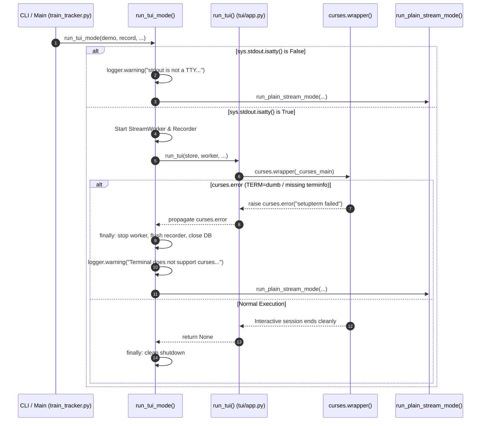

# Implementation Plan — P1-6: Missing TTY Detection & Headless Curses Fallback

> **Reference:** [Production Readiness & Architecture Review (`P1-6`)](./production-readiness-review.md#p1-6-missing-tty-detection--headless-curses-fallback)  
> **Target Modules:** [`../train_tracker.py`](../train_tracker.py) (`run_tui_mode`, `build_parser`, `main`), [`../tui/app.py`](../tui/app.py) (`run_tui`)  
> **Test Suites:** [`../tests/test_cli.py`](../tests/test_cli.py) (`TestCLITTYAndHeadlessFallback`), [`../tests/test_tui_app.py`](../tests/test_tui_app.py) / [`../tests/test_cli.py`](../tests/test_cli.py)  
> **Relevant Rules & Skills:** [`../.agents/rules/resilience-and-fallbacks.md`](../.agents/rules/resilience-and-fallbacks.md#L5-L17), [`../.agents/rules/terminal-and-rendering-compatibility.md`](../.agents/rules/terminal-and-rendering-compatibility.md), [`../.agents/rules/diagrams-and-visual-documentation.md`](../.agents/rules/diagrams-and-visual-documentation.md), [`../.agents/rules/communication.md`](../.agents/rules/communication.md#L16), [`../.agents/rules/markdown-relative-paths.md`](../.agents/rules/markdown-relative-paths.md), [`../.agents/skills/tui-compatibility-tester/SKILL.md`](../.agents/skills/tui-compatibility-tester/SKILL.md), [`../.agents/skills/ci-quality-gate/SKILL.md`](../.agents/skills/ci-quality-gate/SKILL.md)

---

## 1. Executive Summary & Defect Overview

`railmon` provides two interactive and batch streaming modalities for real-time train telemetry:
1. **Interactive Curses TUI (`--tui`):** A multi-pane terminal dashboard featuring a 2x4 subpixel Braille geospatial canvas, train inspection panels, keyboard navigation, and status badges.
2. **Headless Plain-Text Stream (`stream` / default):** A continuous tabular text stream outputting train coordinates, route origins, destinations, speeds, and punctuality deltas directly to `sys.stdout`.

Under headless environments (such as Docker containers, CI test pipelines, SSH remote scripts, cron automation, or shell pipelines like `railmon --tui | tee output.log`), the curses presentation layer fails catastrophically:
- **Missing TTY Detection:** `sys.stdout.isatty()` is never verified before initializing curses. Redirecting output to a file or pipe causes `curses.wrapper()` to attempt low-level terminal ioctl calls against non-character devices, corrupting data streams or raising unhandled curses exceptions.
- **Uncaught `curses.error` on Missing Terminfo / Degraded Consoles:** When executed in minimal container images lacking the `ncurses-term` database, or when `TERM` is unset, empty, or set to `TERM=dumb`, `curses.initscr()` throws `_curses.error: setupterm: could not find terminal`. Currently, `run_tui_mode()` does not catch `curses.error`, causing the process to crash with an unhandled traceback instead of falling back to headless streaming.
- **Resource Cleanup on Curses Crash:** If curses crashes during or immediately after initialization, background threads (`StreamWorker`, `TelemetryRecorder`) and open SQLite database connections (`Database`) must be cleanly halted, flushed, checkpointed, and closed before transferring execution to the fallback stream handler, preventing thread leakage or SQLite WAL lock contention.
- **Missing Explicit `--headless` / `--daemon` Flags:** Although headless operation is supported via the default subparser and `record` daemon, the top-level CLI lacks explicit `--headless` and `--daemon` override flags documented in repository specifications and skills ([`../.agents/rules/resilience-and-fallbacks.md`](../.agents/rules/resilience-and-fallbacks.md#L16-L17), [`../.agents/skills/package-distribution-validator/SKILL.md`](../.agents/skills/package-distribution-validator/SKILL.md#L38)).

This plan details the architectural remediations to detect non-TTY environments, guard `curses.wrapper()`, catch all terminal initialization exceptions, guarantee thread and transaction teardown, cleanly fall back to `run_plain_stream_mode()`, and expose explicit `--headless` / `--daemon` CLI flags.

---

## 2. Root-Cause Defect Analysis

### A. Current Failure Mechanisms

#### 1. Unchecked `sys.stdout.isatty()` in `run_tui_mode` and `run_tui`
- **Location:** [`../train_tracker.py`](../train_tracker.py#L786-L885) (`run_tui_mode`), [`../tui/app.py`](../tui/app.py#L498-L531) (`run_tui`)
- `run_tui_mode()` immediately spins up background database recorders, state stores, and worker threads, and directly invokes `run_tui(...)` without querying standard stream properties:
  ```python
  # Current vulnerable sequence in train_tracker.py:
  worker.start()
  with install_signal_handlers() as stop_event:
      try:
          run_tui(...)  # Calls curses.wrapper without isatty() check
      finally:
          stop_event.set()
          worker.stop()
  ```
- In `tui/app.py`:
  ```python
  def run_tui(...):
      def _curses_main(stdscr: Any) -> None:
          app = TUIApp(...)
          app.run_loop()

      try:
          curses.wrapper(_curses_main)  # Crashes if stdout is a pipe or file
      finally:
          worker.stop()
  ```
- If stdout is redirected (e.g. `railmon --tui > /tmp/railmon.log`), `sys.stdout.isatty()` evaluates to `False`. `curses.wrapper()` attempts to set cbreak mode and keypad attributes on a regular file descriptor, failing with `curses.error: cbreak() returned ERR` or crashing the terminal emulator.
- Violates [`../.agents/rules/resilience-and-fallbacks.md`](../.agents/rules/resilience-and-fallbacks.md#L7) (*"Validate `sys.stdout.isatty()` before launching the curses event loop"*).

#### 2. Uncaught `curses.error` and Missing Fallback in `run_tui_mode`
- When deployed in headless cloud environments (Docker Alpine/Debian-slim, Kubernetes pods, systemd services) where `TERM` is undefined, `TERM=dumb`, or terminfo definitions are absent:
  ```text
  _curses.error: setupterm: could not find terminal
  ```
- Because `run_tui_mode` has no `except curses.error:` block, this exception escapes out to `main()`, which prints a raw Python traceback and terminates with exit code 1.
- Violates [`../.agents/rules/resilience-and-fallbacks.md`](../.agents/rules/resilience-and-fallbacks.md#L8-L15) (*"Catch `curses.error` during `curses.initscr()` ... output an explanatory message ... Falling back to headless mode"*).

#### 3. Thread and Resource Lifecycle During Fallback
- If `curses.wrapper()` fails after background threads have started, simply calling `run_plain_stream_mode()` without proper sequencing causes:
  1. Leaked background threads (`StreamWorker` still consuming network SSE or mock data).
  2. Uncommitted or uncheckpointed SQLite database connections holding open WAL locks on `railway_history.db`.
  3. Signal handler collision between the TUI outer scope and the plain stream inner scope.
- Proper fallback requires a two-phase sequence: Phase 1 terminates and drains all TUI threads and DB connections in a `finally` block; Phase 2 enters `run_plain_stream_mode()` cleanly as a fresh, standalone context.

---

## 3. Architecture & Control Flow

### A. Fallback Decision Flow (ASCII)

```text
+-----------------------------------------------------------------------------------+
|                              User / CLI Invocation                                |
|          railmon --tui | railmon --headless | railmon --daemon | railmon          |
+-----------------------------------------------------------------------------------+
                                          |
                                          v
+-----------------------------------------------------------------------------------+
|                               CLI Argument Parsing                                |
|                  args.headless or args.daemon set explicitly?                     |
+-----------------------------------------------------------------------------------+
                     /                                            \
             YES    /                                              \  NO
                   v                                                v
+------------------------------------+             +--------------------------------+
|       Force Headless Mode          |             |       Interactive Request      |
|    run_plain_stream_mode(...)      |             |         args.tui == True       |
+------------------------------------+             +--------------------------------+
                                                                    |
                                                                    v
                                                   +--------------------------------+
                                                   |       TTY Capability Check     |
                                                   |     sys.stdout.isatty() == T?  |
                                                   +--------------------------------+
                                                              /                  \
                                                      NO     /                    \  YES
                                                            v                      v
                                          +---------------------+      +---------------------+
                                          | Log Warning & Alert |      | Start TUI Workers   |
                                          | Fallback to Stream  |      | Initialize DB/Store |
                                          +---------------------+      +---------------------+
                                                     |                            |
                                                     |                            v
                                                     |                 +---------------------+
                                                     |                 | Curses Environment  |
                                                     |                 | curses.wrapper()    |
                                                     |                 +---------------------+
                                                     |                     /              \
                                                     |          curses.error               \ SUCCESS
                                                     |                   /                  v
                                                     |                  v         +------------------+
                                                     |         +----------------+ | Curses Loop Runs |
                                                     |         | Teardown TUI   | | Normal Shutdown  |
                                                     |         | Worker/DB/WAL  | +------------------+
                                                     |         +----------------+
                                                     |                  |
                                                     |                  v
                                                     |         +----------------+
                                                     |         | Log Warning    |
                                                     |         +----------------+
                                                     |                  |
                                                     +----------------->+
                                                                        |
                                                                        v
                                                       +--------------------------------+
                                                       |   run_plain_stream_mode(...)   |
                                                       |  (Headless Live / Demo Stream) |
                                                       +--------------------------------+
```

### B. Fallback Sequence Diagram (Mermaid)



---

## 4. Target Component & Interface Specifications

### A. Terminal Environment Capability Detection Helper

A reusable capability detection helper `is_tty_supported()` will be placed in [`../tui/app.py`](../tui/app.py) and exposed to [`../train_tracker.py`](../train_tracker.py):

```python
def is_tty_supported() -> bool:
    """Validate whether stdout supports interactive full-screen curses rendering.

    Returns:
        bool: True if sys.stdout is an interactive terminal with an active TTY;
              False if redirected to a pipe, regular file, or null device.
    """
    return bool(hasattr(sys.stdout, "isatty") and sys.stdout.isatty())
```

### B. Guarded `run_tui` in [`../tui/app.py`](../tui/app.py)

Update `run_tui` to explicitly check `is_tty_supported()` prior to calling `curses.wrapper()`. If `sys.stdout` is not a TTY, raise `curses.error("Standard output is not a TTY")`:

```python
def run_tui(
    store: TrainStateStore,
    worker: StreamWorker,
    stations: Optional[Sequence[StationNode]] = None,
    tracks: Optional[Sequence[TrackPolyline]] = None,
    target_fps: float = 20.0,
    stop_event: Optional[threading.Event] = None,
) -> None:
    """Safely start the Curses TUI application with automatic terminal restoration.

    Raises:
        curses.error: If standard output is not a TTY or curses initialization fails.
    """
    if not is_tty_supported():
        raise curses.error("Standard output is not an interactive TTY")

    def _curses_main(stdscr: Any) -> None:
        app = TUIApp(
            stdscr=stdscr,
            store=store,
            worker=worker,
            stations=stations,
            tracks=tracks,
            target_fps=target_fps,
            stop_event=stop_event,
        )
        app.run_loop()

    try:
        curses.wrapper(_curses_main)
    finally:
        worker.stop()
```

### C. Resilient `run_tui_mode` in [`../train_tracker.py`](../train_tracker.py)

Refactor `run_tui_mode` with two-stage fallback protection:
1. **Pre-Flight TTY Check:** If `not is_tty_supported()`, skip starting the TUI background threads, emit a warning log, and immediately invoke `run_plain_stream_mode()`.
2. **Curses Initialization Catch:** If `run_tui()` raises `curses.error` (e.g. invalid `TERM`, container without terminfo, missing `windows-curses`), clean up all resources in `finally:`, mark `fallback_needed = True`, and seamlessly dispatch to `run_plain_stream_mode()`.

```python
def run_tui_mode(
    demo: bool = False,
    fps: float = 20.0,
    reconnect_delay: float = 3.0,
    record: bool = False,
    db_path: str = "railway_history.db",
    enable_deadband: bool = True,
    retention_days: Optional[int] = None,
    archive_path: Optional[str] = None,
) -> None:
    # 1. Early TTY verification before allocating state or background threads
    if not is_tty_supported():
        logger.warning("Terminal environment does not support curses (sys.stdout is not a TTY). Falling back to headless mode.")
        print("[WARN] Standard output is not a TTY. Falling back to plain-text stream mode.", file=sys.stderr)
        run_plain_stream_mode(
            demo=demo,
            reconnect_delay=reconnect_delay,
            record=record,
            db_path=db_path,
            enable_deadband=enable_deadband,
            retention_days=retention_days,
            archive_path=archive_path,
        )
        return

    # 2. Safe module import with Windows-curses check
    try:
        from tui.app import run_tui
        from tui.mock_engine import MockTelemetryEngine, load_stations, load_tracks
        from tui.state import TrainStateStore
        from tui.stream_worker import StreamWorker
    except (ImportError, ModuleNotFoundError) as err:
        if sys.platform == "win32" and "curses" in str(err).lower():
            logger.warning("windows-curses is not installed on Windows (%s). Falling back to headless mode.", err)
            print(
                "\n[WARN] The interactive terminal dashboard (--tui) requires 'windows-curses' on Windows.\n"
                "Falling back to plain-text stream mode. To enable TUI, run: pip install windows-curses\n",
                file=sys.stderr,
            )
            run_plain_stream_mode(
                demo=demo,
                reconnect_delay=reconnect_delay,
                record=record,
                db_path=db_path,
                enable_deadband=enable_deadband,
                retention_days=retention_days,
                archive_path=archive_path,
            )
            return
        raise

    # 3. Setup recorder and worker
    db = None
    recorder = None
    if record:
        from storage.db import Database
        from storage.recorder import RecorderConfig, TelemetryRecorder
        db = Database(db_path)
        db.init_schema()
        recorder = TelemetryRecorder(
            db,
            RecorderConfig(
                mode="demo" if demo else "live",
                enable_deadband=enable_deadband,
                retention_days=retention_days,
                archive_path=archive_path,
            ),
        )
        recorder.start()

    store = TrainStateStore()
    if record:
        store.set_recording_status(True, db_path)

    stations = list(load_stations().values())
    tracks = list(load_tracks().values())

    if demo:
        engine = MockTelemetryEngine()
        worker = StreamWorker(store=store, mock_engine=engine, recorder=recorder)
    else:
        client = RailwayGovClient()
        worker = StreamWorker(
            store=store,
            client=client,
            base_backoff_sec=reconnect_delay,
            recorder=recorder,
        )

    worker.start()

    # 4. Execute curses with full exception recovery
    fallback_needed = False
    with install_signal_handlers() as stop_event:
        try:
            run_tui(
                store=store,
                worker=worker,
                stations=stations,
                tracks=tracks,
                target_fps=fps,
                stop_event=stop_event,
            )
        except curses.error as exc:
            logger.warning(
                "Terminal environment does not support curses (%s). Falling back to headless mode.",
                exc,
            )
            print(
                f"\n[WARN] Terminal environment does not support curses ({exc}). Falling back to plain-text stream mode.\n",
                file=sys.stderr,
            )
            fallback_needed = True
        finally:
            stop_event.set()
            worker.stop()
            if recorder:
                recorder.stop()
            if db:
                db.close()

    # 5. Execute fallback after full teardown of previous resources
    if fallback_needed:
        run_plain_stream_mode(
            demo=demo,
            reconnect_delay=reconnect_delay,
            record=record,
            db_path=db_path,
            enable_deadband=enable_deadband,
            retention_days=retention_days,
            archive_path=archive_path,
        )
```

### D. CLI Arguments: `--headless` & `--daemon` Flags

Add `--headless` and `--daemon` flags to `build_parser()` in [`../train_tracker.py`](../train_tracker.py):

```python
parser.add_argument(
    "--headless",
    action="store_true",
    help="Force headless plain-text streaming mode (suppresses interactive curses TUI).",
)
parser.add_argument(
    "--daemon",
    action="store_true",
    help="Alias for headless background operation.",
)
```

In `main()`:
If `args.headless` or `args.daemon` is set, route to `run_plain_stream_mode` regardless of `args.tui`.

---

## 5. Work Breakdown & Implementation Steps

| Step | Action | Files Affected | Target Completion |
|:---|:---|:---|:---|
| **Step 1** | Implement `is_tty_supported()` in `tui/app.py` and export in `__all__` | [`../tui/app.py`](../tui/app.py) | 10 mins |
| **Step 2** | Add TTY validation guard to `run_tui()` in `tui/app.py` | [`../tui/app.py`](../tui/app.py) | 5 mins |
| **Step 3** | Implement early TTY detection and `curses.error` fallback in `run_tui_mode()` | [`../train_tracker.py`](../train_tracker.py) | 20 mins |
| **Step 4** | Add `--headless` and `--daemon` CLI flags to `build_parser()` and `main()` | [`../train_tracker.py`](../train_tracker.py) | 15 mins |
| **Step 5** | Author unit and integration tests for TTY detection, curses fallback, and flags | [`../tests/test_cli.py`](../tests/test_cli.py) | 25 mins |
| **Step 6** | Execute regression suite and TUI compatibility tests | Entire test suite | 10 mins |

---

## 6. Verification & Validation Protocol

### A. Test Cases

| Test ID | Method / Context | Assertion / Pass Criteria |
|:---|:---|:---|
| `TC-TTY-01` | `is_tty_supported()` with real and mock TTY | Returns `True` when `sys.stdout.isatty()` is `True`; `False` when `False` or attribute absent. |
| `TC-TTY-02` | `run_tui()` with `sys.stdout.isatty() == False` | Raises `curses.error("Standard output is not an interactive TTY")`. |
| `TC-TTY-03` | `run_tui_mode(demo=True)` when `sys.stdout.isatty() == False` | Emits `[WARN]` to stderr, logs warning, and invokes `run_plain_stream_mode(demo=True)`. |
| `TC-TTY-04` | `run_tui_mode` when `run_tui` raises `curses.error` | Performs clean teardown (`worker.stop()`, `recorder.stop()`, `db.close()`) and invokes `run_plain_stream_mode`. |
| `TC-TTY-05` | Parameter forwarding in fallback | Asserts all parameters (`demo`, `reconnect_delay`, `record`, `db_path`, `enable_deadband`, `retention_days`, `archive_path`) are passed intact. |
| `TC-TTY-06` | `--headless` CLI flag overrides `--tui` | `main(["--tui", "--headless"])` dispatches to `run_plain_stream_mode` instead of `run_tui_mode`. |
| `TC-TTY-07` | `--daemon` CLI flag operates headless | `main(["--daemon"])` dispatches to `run_plain_stream_mode`. |
| `TC-TTY-08` | Non-regression of `test_tui_worker_cleanup_on_error` | Arbitrary `RuntimeError` continues to propagate and cleans up worker. |

### B. Automated Verification Commands
```bash
# 1. Run full CLI and TUI test suite
python -m unittest tests/test_cli.py tests/test_cli_storage.py tests/test_tui_integration.py -v

# 2. Verify behavior in non-TTY pipe redirection
python train_tracker.py --tui --demo --fps 15 < /dev/null | head -n 20

# 3. Verify behavior under corrupted TERM environment
TERM=nonexistent_terminal python train_tracker.py --tui --demo < /dev/null | head -n 20
```

---

## 7. Residual Risk & Architectural Impact Assessment

- **Low Risk:** The changes are purely additive and defensive. In normal interactive terminals with valid terminfo, execution follows the existing path with no observable difference.
- **Signal Handling Safety:** Both `run_tui_mode` and `run_plain_stream_mode` utilize `install_signal_handlers()`. By ensuring the TUI context manager exits prior to calling `run_plain_stream_mode`, signal handlers are restored and re-bound cleanly without collision.
- **Resource Leak Prevention:** Guaranteeing `worker.stop()` and `recorder.stop()` run inside the `finally:` block before launching fallback prevents duplicate socket streaming or WAL file locks.
