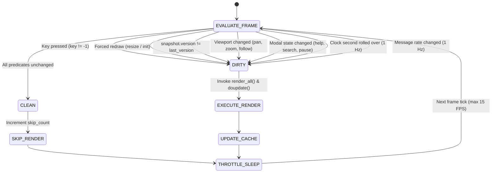

# Implementation Plan — P2-2: TUI Frame Rate Default Exceeds Cap & Redraws Unchanged Frames

> **Reference:** [Production Readiness & Architecture Review (`P2-2`)](./production-readiness-review.md#p2-2-tui-frame-rate-default-exceeds-cap--redraws-unchanged-frames)  
> **Target Modules:** [`../train_tracker.py`](../train_tracker.py), [`../tui/app.py`](../tui/app.py), [`../tui/renderer.py`](../tui/renderer.py)  
> **Test Suites:** [`../tests/test_cli.py`](../tests/test_cli.py), [`../tests/test_cli_storage.py`](../tests/test_cli_storage.py), [`../tests/test_tui_controls.py`](../tests/test_tui_controls.py), [`../tests/test_tui_renderer.py`](../tests/test_tui_renderer.py)  
> **Relevant Rules & Skills:** [`../.agents/rules/performance-and-resource-bounds.md`](../.agents/rules/performance-and-resource-bounds.md), [`../.agents/rules/diagrams-and-visual-documentation.md`](../.agents/rules/diagrams-and-visual-documentation.md), [`../.agents/rules/markdown-relative-paths.md`](../.agents/rules/markdown-relative-paths.md), [`../.agents/rules/terminal-and-rendering-compatibility.md`](../.agents/rules/terminal-and-rendering-compatibility.md), [`../.agents/skills/ci-quality-gate/SKILL.md`](../.agents/skills/ci-quality-gate/SKILL.md), [`../.agents/skills/tui-compatibility-tester/SKILL.md`](../.agents/skills/tui-compatibility-tester/SKILL.md)

---

## 1. Executive Summary & Defect Overview

`railmon` is designed to run continuously for days or months as an unattended monitoring service (`railmon record`) or an interactive curses-based operations dashboard (`railmon --tui`). To sustain non-intrusive terminal operation on low-power devices, remote SSH sessions, laptops, and developer workstations, background CPU consumption and terminal drawing overhead must remain strictly bounded.

[`../.agents/rules/performance-and-resource-bounds.md`](../.agents/rules/performance-and-resource-bounds.md#L18-L23) explicitly mandates:
1. **TUI Frame Rate Cap:** The interactive dashboard must limit refresh rates to a maximum of **10 to 15 frames per second (FPS)**.
2. **Idle State CPU Usage:** When no telemetry frames are arriving and no user input is received, idle CPU consumption must remain below **1% of a single CPU core**.

As identified in the [Production Readiness Review (`P2-2`)](./production-readiness-review.md#p2-2-tui-frame-rate-default-exceeds-cap--redraws-unchanged-frames), `railmon` violates these requirements in two distinct ways:

1. **Default Frame Rate Exceeds Cap and Allows 60 FPS:**
   - In [`../train_tracker.py`](../train_tracker.py#L810-L814), the CLI parser configures `--fps` with a default of `20.0` and allows user-specified frame rates up to `60.0`.
   - In [`../train_tracker.py`](../train_tracker.py#L991) (`run_tui_mode`) and [`../tui/app.py`](../tui/app.py#L64,L83,L529) (`TUIApp.__init__` and `run_tui`), the default target FPS is set to `20.0`, and the internal clamping is configured to `max(5.0, min(60.0, target_fps))`.
   - Running at 20 FPS (50 ms frame budget) or up to 60 FPS (16.6 ms frame budget) wastes CPU cycles on rasterization, exacerbates SSH stream congestion, and accelerates battery drain on mobile operator workstations.

2. **Unconditional Full Canvas Rasterization on Unchanged Idle Frames:**
   - In [`../tui/app.py`](../tui/app.py#L429-L505), `TUIApp.run_loop()` executes an unthrottled redraw cycle on every single iteration:
     - It invokes `self.renderer.render_all()` across all 5 subwindows (`header`, `map`, `roster`, `inspector`, `status`).
     - Inside `render_map()` ([`../tui/renderer.py`](../tui/renderer.py#L714-L865)), a new `BrailleCanvas` is allocated, 4 network track polylines are projected, dozens of station nodes are projected, train coordinates and trails are mapped, Braille dot bitmasks are generated for hundreds of cells, strings are formatted, and curses subwindows are updated via `noutrefresh()` and `curses.doupdate()`.
     - This entire expensive pipeline executes 20 times per second even when **nothing has changed** (i.e. no key was pressed, no resize occurred, no new SSE telemetry arrived, `snapshot.version` is static, viewport center/zoom are stationary, and the 1 Hz header clock has not ticked).

This implementation plan details the architectural refactoring to:
- Enforce the 10–15 FPS ceiling across CLI options, function defaults, and internal clamp boundaries (standardizing default to `15.0` and clamping to `[1.0, 15.0]`).
- Implement an intelligent, low-overhead **dirty-frame tracking engine** in `TUIApp.run_loop()` that skips rendering cycles entirely when the display state is unchanged, reducing idle redraws by $>90\%$ and ensuring idle CPU consumption remains well below 1% of a single core.

---

## 2. Root-Cause Defect Analysis

### A. Defect Mechanisms

#### 1. Frame Rate Default and Clamping Misconfiguration
- **Locations:**
  - [`../train_tracker.py`](../train_tracker.py#L810-L814):
    ```python
    parser.add_argument(
        "--fps",
        type=float,
        default=20.0,
        help="Target frame rate for TUI rendering loop (default: 20.0, range: 5.0-60.0).",
    )
    ```
  - [`../train_tracker.py`](../train_tracker.py#L991): `def run_tui_mode(..., fps: float = 20.0, ...)`
  - [`../tui/app.py`](../tui/app.py#L64): `target_fps: float = 20.0`
  - [`../tui/app.py`](../tui/app.py#L83-L84):
    ```python
    self.target_fps = max(5.0, min(60.0, target_fps))
    self.frame_interval = 1.0 / self.target_fps
    ```
  - [`../tui/app.py`](../tui/app.py#L529): `def run_tui(..., target_fps: float = 20.0, ...)`
- **Failure Mode:**
  1. Default execution runs at 20 FPS, violating the 10–15 FPS maximum requirement.
  2. If an operator sets `--fps 60`, the renderer attempts 60 redraws per second, consuming significant CPU to redraw the Braille map every 16 ms.
  3. Railway train telemetry arrives over SSE every 1.0–5.0 seconds per train; updating the screen faster than 15 FPS yields no perceptual benefit while wasting resources.

#### 2. Redundant Redraw of Static Frames in `TUIApp.run_loop`
- **Location:** [`../tui/app.py`](../tui/app.py#L429-L505)
- **Current Execution Flow:**
  ```python
  while self.running and (self.stop_event is None or not self.stop_event.is_set()):
      frame_start = time.monotonic()
      # 1. Sample keyboard
      key = self.stdscr.getch()
      if key != -1:
          self.process_input(key)
      # 1b. Periodic prune
      ...
      # 2. Get snapshot
      snapshot = self.store.get_snapshot()
      self._update_message_rate(...)
      # 3. Synchronize auto-follow
      if snapshot.follow_mode and snapshot.selected_train:
          pos = snapshot.selected_train.position
          self.projector.viewport.center = GeoPoint(lat=pos.lat, lng=pos.lng)
      # 4. Render all panes (UNCONDITIONAL)
      self.renderer.render_all(...)
      # 5. Flush frame
      for win in self.windows.values():
          win.noutrefresh()
      curses.doupdate()
      # 6. Sleep to frame_interval
      time.sleep(sleep_sec)
  ```
- **Failure Mode:**
  1. When no keyboard input occurs (`key == -1`) and no SSE telemetry packet arrives (so `TrainStateStore` has not mutated and `snapshot.version` remains identical):
     - `self.renderer.render_all()` still rasterizes all track segments, transforms coordinates via trigonometric Lambert/equirectangular projections, and formats all window text buffers.
     - `win.noutrefresh()` and `curses.doupdate()` run on every subwindow.
  2. The only element that naturally updates over time is the 1 Hz header clock (`time.strftime(" %H:%M:%S ")`) and the 1-second ingestion rate calculation.
  3. Redrawing 15 to 20 times per second when only 1 redraw per second (at clock rollover) is required wastes 93.3% of rendering computation during idle telemetry intervals.

---

### B. Visual Comparison (ASCII & Mermaid)

#### ASCII Representation: Unthrottled vs Dirty-Checked Event Loop

```text
CURRENT UNTHROTTLED ARCHITECTURE (Spins at 20-60 FPS):
+-------------------------------------------------------------------------------+
| Frame Start (every 50ms)                                                      |
|   |--> getch() == -1 (No input)                                               |
|   |--> get_snapshot() (version=42, unchanged)                                 |
|   |--> render_all()  <== EXPENSIVE FULL BRAILLE RASTERIZATION (Every frame!)  |
|   |--> curses.doupdate() <== EXPENSIVE TERMINAL ESCAPE EMISSION (Every frame!)|
|   +--> sleep(0.05s)                                                           |
+-------------------------------------------------------------------------------+

TARGET DIRTY-CHECKED ARCHITECTURE (Capped at 15 FPS, Skips Unchanged Frames):
+-------------------------------------------------------------------------------+
| Frame Start (every 66.7ms @ 15 FPS)                                           |
|   |--> getch() -> Was key pressed? ------------------------> [DIRTY: Input]   |
|   |--> Window resized? ------------------------------------> [DIRTY: Resize]  |
|   |--> snapshot.version != last_version? ------------------> [DIRTY: Data]    |
|   |--> Viewport (center, zoom) != last_viewport? ----------> [DIRTY: Camera]  |
|   |--> Clock second != last_clock_second? -----------------> [DIRTY: Clock]   |
|   |--> Modal state (search, help, pause) changed? ---------> [DIRTY: Modal]   |
|   |                                                                           |
|   +--- IS DIRTY? -------------------------------------------------------------+
|          |                                            |                       |
|         YES                                           NO                      |
|          v                                            v                       |
|   +------------------------------------+      +---------------------------+   |
|   | render_all()                       |      | SKIP RENDERING ENTIRELY   |   |
|   | doupdate()                         |      | skip_count += 1           |   |
|   | Cache current state signatures     |      | (Zero curses/raster cost) |   |
|   | render_count += 1                  |      +---------------------------+   |
|   +------------------------------------+                   |                  |
|          |                                                 |                  |
|          +-----------------------+-------------------------+                  |
|                                  v                                            |
|                  sleep_sec = max(0.001, frame_interval - elapsed)             |
|                  time.sleep(sleep_sec)                                        |
+-------------------------------------------------------------------------------+
```

#### Mermaid Sequence: Dirty-Checked Frame Cycle

```mermaid
sequenceDiagram
    autonumber
    participant Loop as TUIApp.run_loop (../tui/app.py)
    participant Store as TrainStateStore (../tui/state.py)
    participant Proj as GeoProjector (../tui/geo.py)
    participant Rend as TUIRenderer (../tui/renderer.py)
    participant Curses as curses (C Extension)

    Note over Loop: Loop ticks at frame_interval (1/15s = 66.7ms)
    Loop->>Loop: getch() -> check user input
    Loop->>Store: get_snapshot() -> get state snapshot
    Loop->>Loop: Check dirty predicates (version, viewport, modal, clock, rate)

    alt State is NOT Dirty (Idle Frame)
        Loop->>Loop: skip_count += 1
        Note over Loop,Curses: Bypass render_all() and doupdate() completely
    else State IS Dirty (Telemetry, Input, Resize, or Clock Tick)
        Loop->>Rend: render_all(windows, geometry, snapshot, projector, ...)
        Rend->>Curses: noutrefresh() on panes
        Loop->>Curses: doupdate()
        Loop->>Loop: Update cache trackers (last_version, last_vp, last_clock_sec, ...)
        Loop->>Loop: render_count += 1
    end

    Loop->>Loop: time.sleep(sleep_sec)
```

#### Mermaid State Machine: Dirty Predicate Resolution



---

## 3. Detailed Technical Specification & Implementation Strategy

### A. Frame Rate Cap & Configuration Normalization

Standardize the frame rate ceiling to **15.0 FPS** across all interfaces while enforcing clamping between **1.0 and 15.0 FPS**.

1. **`build_parser` in [`../train_tracker.py`](../train_tracker.py):**
   ```python
   parser.add_argument(
       "--fps",
       type=float,
       default=15.0,
       help="Target frame rate for TUI rendering loop (default: 15.0, range: 1.0-15.0).",
   )
   ```

2. **`run_tui_mode` in [`../train_tracker.py`](../train_tracker.py):**
   ```python
   def run_tui_mode(
       demo: bool = False,
       fps: float = 15.0,
       reconnect_delay: float = 3.0,
       record: bool = False,
       db_path: str = "railway_history.db",
       enable_deadband: bool = True,
       retention_days: Optional[int] = None,
       ascii_mode: Optional[bool] = None,
   ) -> None:
   ```

3. **`run_tui` in [`../tui/app.py`](../tui/app.py):**
   ```python
   def run_tui(
       store: TrainStateStore,
       worker: StreamWorker,
       stations: Optional[Sequence[StationNode]] = None,
       tracks: Optional[Sequence[TrackPolyline]] = None,
       target_fps: float = 15.0,
       stop_event: Optional[threading.Event] = None,
       ascii_mode: bool = False,
   ) -> None:
   ```

4. **`TUIApp.__init__` in [`../tui/app.py`](../tui/app.py):**
   ```python
   class TUIApp:
       def __init__(
           self,
           stdscr: Any,
           store: TrainStateStore,
           worker: StreamWorker,
           stations: Optional[Sequence[StationNode]] = None,
           tracks: Optional[Sequence[TrackPolyline]] = None,
           target_fps: float = 15.0,
           stop_event: Optional[threading.Event] = None,
           ascii_mode: bool = False,
       ):
           self.stdscr = stdscr
           self.store = store
           self.worker = worker
           # Clamp target_fps to mandated ceiling: max 1.0, min 15.0 FPS
           self.target_fps = max(1.0, min(15.0, float(target_fps)))
           self.frame_interval = 1.0 / self.target_fps
           ...
   ```

---

### B. State Caching & Dirty Detection Engine

To determine whether a frame must be rendered, `TUIApp` tracks state signatures from the previous render.

#### 1. Cache Signatures Stored in `TUIApp`
Add tracking fields to `TUIApp.__init__`:
```python
# Render cycle optimization & dirty-checking state
self._force_redraw: bool = True
self._last_rendered_version: Optional[int] = None
self._last_viewport_state: Optional[Tuple[float, float, float, int, int]] = None
self._last_clock_sec: Optional[int] = None
self._last_rendered_msg_rate: Optional[float] = None
self._last_modal_state: Optional[Tuple[InputMode, str, bool, bool]] = None
self._render_count: int = 0
self._skip_count: int = 0
```

Add public accessors for diagnostics and automated testing:
```python
@property
def render_count(self) -> int:
    """Total number of rendered frames executed."""
    return self._render_count

@property
def skip_count(self) -> int:
    """Total number of unchanged idle frames skipped."""
    return self._skip_count
```

#### 2. Terminal Resize Signal Handling
In `handle_resize()`, mark the frame dirty explicitly:
```python
def handle_resize(self) -> None:
    """Respond to terminal resize signal by rebuilding geometry and repainting."""
    try:
        curses.endwin()
        self.stdscr.refresh()
    except curses.error:
        pass

    self.rebuild_windows()
    self.stdscr.clear()
    self._force_redraw = True
```

#### 3. Dirty Determination Predicate
In `run_loop()`, compute the composite dirty predicate:
```python
is_dirty = self._force_redraw

# 1. Sample user keyboard input (non-blocking)
try:
    key = self.stdscr.getch()
except curses.error:
    key = -1

if key != -1:
    is_dirty = True
    if not self.process_input(key):
        self.running = False
        break

# 1b. Periodic stale train cleanup
if (frame_start - self._last_prune_time) >= self._prune_interval_sec:
    pruned = self.store.prune_stale_trains()
    self._last_prune_time = frame_start
    if pruned > 0:
        is_dirty = True

# 2. Extract atomic snapshot
snapshot = self.store.get_snapshot()
self._update_message_rate(snapshot.total_messages_received)

# 3. Synchronize auto-follow mode center coordinates
if snapshot.follow_mode and snapshot.selected_train:
    pos = snapshot.selected_train.position
    self.projector.viewport.center = GeoPoint(lat=pos.lat, lng=pos.lng)

# 4. Extract current signatures
current_sec = int(time.time())
vp = self.projector.viewport
current_vp = (
    round(vp.center.lat, 6),
    round(vp.center.lng, 6),
    round(vp.zoom, 4),
    vp.width_cells,
    vp.height_cells,
)
current_modal = (
    self.input_mode,
    self.search_buffer,
    self.show_help,
    self.paused,
)

if (
    is_dirty
    or snapshot.version != self._last_rendered_version
    or current_vp != self._last_viewport_state
    or current_sec != self._last_clock_sec
    or self._current_msg_rate != self._last_rendered_msg_rate
    or current_modal != self._last_modal_state
):
    # Perform render
    self.renderer.render_all(
        windows=self.windows,
        geometry=self.geometry,
        snapshot=snapshot,
        projector=self.projector,
        msg_rate=self._current_msg_rate,
        search_mode=(self.input_mode == InputMode.SEARCH),
        search_buffer=self.search_buffer,
        show_help=self.show_help,
        paused=self.paused,
    )

    # Flush double buffer
    if self.geometry.is_valid:
        for win in self.windows.values():
            if win is not self.stdscr:
                try:
                    win.noutrefresh()
                except curses.error:
                    pass
        if self.show_help:
            try:
                self.stdscr.noutrefresh()
            except curses.error:
                pass
    else:
        try:
            self.stdscr.noutrefresh()
        except curses.error:
            pass

    try:
        curses.doupdate()
    except curses.error:
        pass

    # Update cache signatures
    self._force_redraw = False
    self._last_rendered_version = snapshot.version
    self._last_viewport_state = current_vp
    self._last_clock_sec = current_sec
    self._last_rendered_msg_rate = self._current_msg_rate
    self._last_modal_state = current_modal
    self._render_count += 1
else:
    self._skip_count += 1

# 5. Precise frame-rate sleep
elapsed = time.monotonic() - frame_start
sleep_sec = max(0.001, self.frame_interval - elapsed)
time.sleep(sleep_sec)
```

---

## 4. Test Strategy & Verification Plan

### A. Unit Tests in `tests/test_cli.py` and `tests/test_cli_storage.py`
Update assertions expecting `fps=20.0` to verify `fps=15.0`:
1. `test_default_arguments`: `self.assertEqual(args.fps, 15.0)`
2. `test_main_routes_to_tui_demo`: `fps=15.0`
3. `test_main_tui_forwards_ascii_flag`: `fps=15.0`
4. `test_main_tui_default_ascii_false`: `fps=15.0`
5. `test_main_routes_to_tui_with_record` in [`../tests/test_cli_storage.py`](../tests/test_cli_storage.py): `fps=15.0`

### B. Frame Rate Clamping Tests in `tests/test_tui_controls.py`
Add test cases verifying frame rate bounds:
- **`test_target_fps_clamping_to_cap`:**
  - Instantiating `TUIApp(..., target_fps=20.0)` sets `app.target_fps == 15.0`.
  - Instantiating `TUIApp(..., target_fps=60.0)` sets `app.target_fps == 15.0`.
  - Instantiating `TUIApp(..., target_fps=10.0)` sets `app.target_fps == 10.0`.
  - Instantiating `TUIApp(..., target_fps=0.2)` sets `app.target_fps == 1.0`.

### C. Dirty-Frame Detection & Skip Tests in `tests/test_tui_controls.py`
Add dedicated test cases verifying frame skipping:
- **`test_run_loop_skips_unchanged_idle_frames`:**
  - Run `TUIApp.run_loop()` across 4 iterations with mocked `getch()` returning `-1` and frozen clock (`time.time()` mocked).
  - Verify `app.render_count == 1` (initial frame renders).
  - Verify `app.skip_count == 3` (subsequent 3 iterations skip rendering).
  - Verify `app.renderer.render_all.call_count == 1`.
  - Verify `curses.doupdate.call_count == 1`.
- **`test_run_loop_renders_when_telemetry_updates_version`:**
  - On iteration 2, mutate `TrainStateStore` (`store.update_positions([pos])`).
  - Verify iteration 2 renders (`app.render_count == 2`, `app.skip_count == 2`).
- **`test_run_loop_renders_when_clock_second_advances`:**
  - On iteration 2, advance simulated `time.time()` by $1.0\text{s}$.
  - Verify iteration 2 renders because the 1 Hz header clock has rolled over.
- **`test_run_loop_renders_when_viewport_moves`:**
  - On iteration 2, pan or zoom viewport (`app.pan(2, 0)`).
  - Verify iteration 2 renders due to viewport displacement.

### D. Regression & TUI Compatibility Validation
Execute the TUI compatibility skill procedure:
```bash
python3 -m unittest tests/test_tui_controls.py tests/test_tui_geo.py tests/test_tui_renderer.py tests/test_tui_state.py tests/test_tui_integration.py -v
```
Run the full test suite:
```bash
python3 -m unittest discover -s tests -p "test_*.py"
```

---

## 5. Step-by-Step Implementation Roadmap

```text
+--------------------------------------------------------------------------------+
| PHASE 1: FRAME RATE NORMALIZATION & BOUNDS CLAMPING                            |
|  1. Update --fps CLI argument default and help in ../train_tracker.py          |
|  2. Update run_tui_mode default fps in ../train_tracker.py                     |
|  3. Update run_tui and TUIApp.__init__ default target_fps in ../tui/app.py     |
|  4. Clamp target_fps to [1.0, 15.0] in TUIApp.__init__ in ../tui/app.py        |
+--------------------------------------------------------------------------------+
                                       |
                                       v
+--------------------------------------------------------------------------------+
| PHASE 2: DIRTY-FRAME TRACKING & CONDITIONAL REDRAW                             |
|  5. Add signature cache attributes and counters to TUIApp.__init__             |
|  6. Add render_count and skip_count properties to TUIApp                       |
|  7. Set self._force_redraw = True in TUIApp.handle_resize                      |
|  8. Implement composite dirty predicate check in TUIApp.run_loop               |
|  9. Conditionally execute render_all and doupdate; update cache signatures    |
+--------------------------------------------------------------------------------+
                                       |
                                       v
+--------------------------------------------------------------------------------+
| PHASE 3: AUTOMATED TEST SUITE & EMPIRICAL VERIFICATION                         |
| 10. Update existing CLI default assertions in tests/test_cli.py & storage tests|
| 11. Add target_fps clamping tests in tests/test_tui_controls.py                |
| 12. Add frame skipping and dirty redraw tests in tests/test_tui_controls.py    |
| 13. Run full unittest suite across all 335+ test cases                         |
| 14. Update production-readiness-review.md with plan link and resolution status |
+--------------------------------------------------------------------------------+
```

### File-by-File Checklist

| File | Proposed Modifications |
|---|---|
| [`../train_tracker.py`](../train_tracker.py) | Update `--fps` default to `15.0` and help string; update `run_tui_mode` default `fps=15.0`. |
| [`../tui/app.py`](../tui/app.py) | Update `TUIApp.__init__` and `run_tui` default `target_fps=15.0`; clamp `target_fps` to `[1.0, 15.0]`; add dirty signature tracking; conditionally bypass `render_all()` and `doupdate()` when idle. |
| [`../tests/test_cli.py`](../tests/test_cli.py) | Update default `fps` assertions from `20.0` to `15.0`. |
| [`../tests/test_cli_storage.py`](../tests/test_cli_storage.py) | Update mock call assertion in `test_main_routes_to_tui_with_record` to `fps=15.0`. |
| [`../tests/test_tui_controls.py`](../tests/test_tui_controls.py) | Add tests for `target_fps` clamping, idle frame skipping (`skip_count`), and dirty frame redraws (`render_count`). |
| [`./production-readiness-review.md`](./production-readiness-review.md) | Link to this plan under P2-2 and update remediation roadmap status. |
