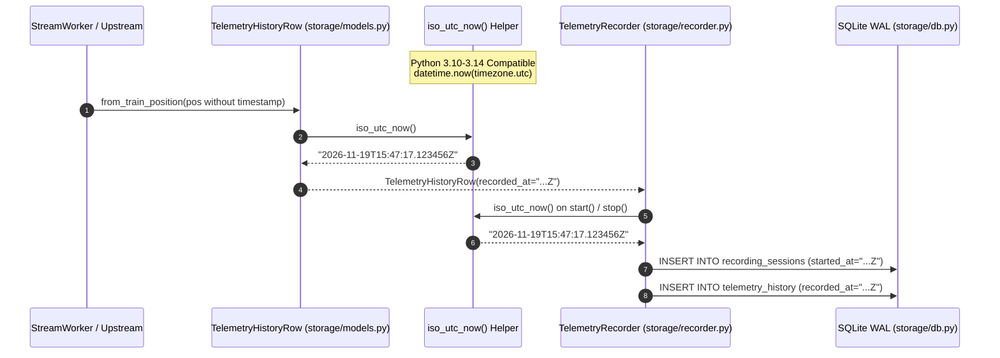

# Implementation Plan — P2-3: Python 3.12+ `datetime.utcnow()` Deprecation Warnings

> **Reference:** [Production Readiness & Architecture Review (`P2-3`)](./production-readiness-review.md#p2-3-python-312-datetimeutcnow-deprecation-warnings)  
> **Target Modules:** [`../storage/models.py`](../storage/models.py), [`../storage/recorder.py`](../storage/recorder.py)  
> **Test Suites:** [`../tests/test_storage_models.py`](../tests/test_storage_models.py), [`../tests/test_storage_recorder.py`](../tests/test_storage_recorder.py)  
> **Relevant Rules & Skills:** [`../.agents/rules/python-idioms.md`](../.agents/rules/python-idioms.md), [`../.agents/rules/communication.md`](../.agents/rules/communication.md), [`../.agents/rules/diagrams-and-visual-documentation.md`](../.agents/rules/diagrams-and-visual-documentation.md), [`../.agents/rules/markdown-relative-paths.md`](../.agents/rules/markdown-relative-paths.md), [`../.agents/skills/ci-quality-gate/SKILL.md`](../.agents/skills/ci-quality-gate/SKILL.md)

---

## 1. Executive Summary & Defect Overview

`railmon` targets multi-platform deployments across Python 3.10, 3.11, 3.12, 3.13, and modern Linux distributions (such as Ubuntu 24.04 LTS, Debian 12/13, Fedora, and Alpine containers).

In Python 3.12, `datetime.datetime.utcnow()` was formally deprecated per PEP 617 / CPython issue #103857 because naive datetime objects representing UTC time are error-prone and frequently cause subtle timezone conversion defects when interacting with arithmetic, local timezones, or serialization routines. On Python 3.12+, invoking `datetime.utcnow()` triggers:
```text
DeprecationWarning: datetime.datetime.utcnow() is deprecated and scheduled for removal in a future version. Use datetime.datetime.now(datetime.UTC) or datetime.datetime.now(timezone.utc).
```

As identified in the [Production Readiness Review (`P2-3`)](./production-readiness-review.md#p2-3-python-312-datetimeutcnow-deprecation-warnings), four separate code locations across the persistence layer still invoke `datetime.utcnow().isoformat() + "Z"`:
1. [`../storage/models.py`](../storage/models.py#L157): Fallback timestamp creation in `TelemetryHistoryRow.from_train_position()`.
2. [`../storage/recorder.py`](../storage/recorder.py#L176): Session audit initialization `_session_started_at` in `TelemetryRecorder.start()`.
3. [`../storage/recorder.py`](../storage/recorder.py#L231): Session audit finalization `ended_at` in `TelemetryRecorder.stop()`.
4. [`../storage/recorder.py`](../storage/recorder.py#L392): Fallback batch timestamp `now_iso` in `TelemetryRecorder._flush_buffer()`.

This implementation plan details the refactoring to:
- Eradicate all `datetime.utcnow()` invocations across [`../storage/models.py`](../storage/models.py) and [`../storage/recorder.py`](../storage/recorder.py).
- Implement a centralized, standardized ISO 8601 UTC helper `iso_utc_now() -> str` in [`../storage/models.py`](../storage/models.py) utilizing `datetime.now(timezone.utc).isoformat().replace("+00:00", "Z")`.
- Maintain strict Python 3.10+ backwards compatibility (`timezone.utc` is supported across Python 3.2+, whereas `datetime.UTC` is only available in 3.11+).
- Ensure 100% byte-for-byte schema format consistency (`YYYY-MM-DDTHH:MM:SS.mmmmmmZ`) for SQLite `TIMESTAMP` columns and downstream parsers.
- Introduce targeted automated test assertions verifying zero deprecation warnings under strict warning filters.

---

## 2. Root-Cause Defect Analysis

### A. Defect Mechanisms

#### 1. Naive Datetime Deprecation in Python 3.12+
- `datetime.utcnow()` returns a naive datetime object (where `tzinfo is None`), but the numbers represent UTC.
- CPython 3.12 marked `utcnow()` and `utcfromtimestamp()` as deprecated. Future Python releases (Python 3.14+) will remove these APIs.
- When running automated test suites or daemons with `-W error` or modern CI environments, unhandled `DeprecationWarning` exceptions can fail execution or pollute daemon log streams.

#### 2. Cross-Version Timezone Compatibility
- Python 3.11 introduced `datetime.UTC` as an alias for `timezone.utc`.
- However, `railmon` supports Python 3.10 (`/usr/bin/python3` on Ubuntu 22.04 LTS).
- Referencing `datetime.UTC` on Python 3.10 raises `AttributeError: type object 'datetime.datetime' has no attribute 'UTC'`.
- Therefore, `from datetime import timezone` and `datetime.now(timezone.utc)` is the only universally safe and standard choice across Python 3.10, 3.11, 3.12, 3.13, and 3.14.

#### 3. String Serialization Discrepancy
- On timezone-aware UTC datetimes, `datetime.now(timezone.utc).isoformat()` emits:
  `"2026-11-19T15:47:17.123456+00:00"`
- Existing `railmon` database records, test assertions, and legacy clients expect timestamps ending in `"Z"`, e.g.:
  `"2026-11-19T15:47:17.123456Z"`
- In [`../storage/db.py`](../storage/db.py#L26-L35), SQLite `TIMESTAMP` converter parses timestamps via:
  ```python
  def _convert_timestamp(val: bytes) -> Union[datetime, str]:
      s = val.decode("utf-8", errors="replace")
      try:
          return datetime.fromisoformat(s.replace("Z", "+00:00"))
      except ValueError:
          pass
  ```
- Stripping or replacing `"+00:00"` with `"Z"` ensures 100% backward compatibility with all historical database records, CSV exports, and test suites.

---

### B. Defect Inventory

```text
+-----------------------+------+-------------------------------------------+-----------------------------------+
| File                  | Line | Existing Implementation                   | Remediated Implementation         |
+-----------------------+------+-------------------------------------------+-----------------------------------+
| storage/models.py     | 157  | datetime.utcnow().isoformat() + "Z"       | iso_utc_now()                     |
| storage/recorder.py   | 176  | datetime.utcnow().isoformat() + "Z"       | iso_utc_now()                     |
| storage/recorder.py   | 231  | datetime.utcnow().isoformat() + "Z"       | iso_utc_now()                     |
| storage/recorder.py   | 392  | datetime.utcnow().isoformat() + "Z"       | iso_utc_now()                     |
+-----------------------+------+-------------------------------------------+-----------------------------------+
```

---

### C. Visual Data Flow & Timestamp Ingestion Topology

#### ASCII Architecture Diagram

```text
+-----------------------------------------------------------------------------------------+
|                               TELEMETRY TIMESTAMP FLOW                                  |
+-----------------------------------------------------------------------------------------+
                                             |
   Live Upstream Stream / Mock Engine        | Missing / None
                   |                         v
                   |         +-------------------------------+
                   |         |        iso_utc_now()          |
                   |         |  datetime.now(timezone.utc)   |
                   |         |    .isoformat()               |
                   |         |    .replace("+00:00", "Z")    |
                   |         +-------------------------------+
                   v                         |
       pos.timestamp (ISO 8601)              | Generated UTC "Z"
                   \                         /
                    v                       v
     +-----------------------------------------------------+
     | TelemetryHistoryRow.from_train_position(pos, ...)   |
     | timestamp = recorded_at or pos.timestamp or         |
     |             iso_utc_now()                           |
     +-----------------------------------------------------+
                                |
                                v
     +-----------------------------------------------------+
     | TelemetryRecorder._flush_buffer                     |
     | - train_rows fallback: pos.timestamp or now_iso     |
     | - recording_sessions.started_at: iso_utc_now()      |
     | - recording_sessions.ended_at: iso_utc_now()        |
     +-----------------------------------------------------+
                                |
                                v
     +-----------------------------------------------------+
     | SQLite WAL Database (storage/db.py)                 |
     | - telemetry_history(recorded_at TEXT/TIMESTAMP)     |
     | - recording_sessions(started_at, ended_at TEXT)     |
     | - trains(first_observed_at, last_observed_at TEXT)  |
     +-----------------------------------------------------+
```

#### Mermaid Sequence Diagram



---

## 3. Detailed Architectural Changes

### A. Core Helper: `iso_utc_now()` in [`../storage/models.py`](../storage/models.py)

Per [`../.agents/rules/communication.md`](../.agents/rules/communication.md#L16), function names must be short, clear, and fewer than 30 characters (`iso_utc_now` is 11 characters).

In [`../storage/models.py`](../storage/models.py):
1. Update imports:
   ```python
   from datetime import datetime, timezone
   ```
2. Define helper function:
   ```python
   def iso_utc_now() -> str:
       """
       Return current UTC timestamp in ISO 8601 format with 'Z' suffix.
       Compatible across Python 3.10-3.14 without deprecation warnings.
       """
       return datetime.now(timezone.utc).isoformat().replace("+00:00", "Z")
   ```
3. Update `TelemetryHistoryRow.from_train_position`:
   ```python
   @classmethod
   def from_train_position(
       cls, pos: TrainPosition, recorded_at: Optional[str] = None
   ) -> "TelemetryHistoryRow":
       """Instantiate a database row from a live TrainPosition telemetry entity."""
       timestamp = recorded_at or pos.timestamp or iso_utc_now()
       return cls(...)
   ```

### B. TelemetryRecorder Refactoring in [`../storage/recorder.py`](../storage/recorder.py)

1. Import `iso_utc_now` from `storage.models`:
   ```python
   from storage.models import (
       RecordingSessionDB,
       ScheduleStopDB,
       ScheduledTripDB,
       TelemetryHistoryRow,
       TrainRecordDB,
       iso_utc_now,
   )
   ```
2. In `TelemetryRecorder.start()` ([`../storage/recorder.py`](../storage/recorder.py#L176)):
   ```python
   self._session_started_at = iso_utc_now()
   ```
3. In `TelemetryRecorder.stop()` ([`../storage/recorder.py`](../storage/recorder.py#L231)):
   ```python
   ended_at = iso_utc_now()
   ```
4. In `TelemetryRecorder._flush_buffer()` ([`../storage/recorder.py`](../storage/recorder.py#L392)):
   ```python
   now_iso = iso_utc_now()
   ```

---

## 4. Test Suite & Verification Strategy

### A. Dedicated Test Cases

1. **`tests/test_storage_models.py`:**
   - Add `test_iso_utc_now_format_and_no_deprecation_warnings`:
     - Execute `iso_utc_now()` inside `warnings.catch_warnings()` catching all warnings.
     - Assert that zero warnings of type `DeprecationWarning` are captured.
     - Assert that output string ends with `"Z"`.
     - Assert that output string parses cleanly with `datetime.fromisoformat(ts.replace("Z", "+00:00"))`.
   - Add `test_telemetry_history_row_fallback_timestamp`:
     - Pass a `TrainPosition` with `timestamp=None` and `recorded_at=None`.
     - Assert that `row.recorded_at` is generated automatically, ends in `"Z"`, and was generated within 2 seconds of current time.

2. **`tests/test_storage_recorder.py`:**
   - Add verification that `recording_sessions` `started_at` and `ended_at` use valid ISO 8601 UTC formats ending in `"Z"`.

### B. CI Quality Gate Execution

Execute full test suite and quality verification:
```bash
# 1. Run all tests with standard runner
python3 -m unittest discover tests -v

# 2. Run with DeprecationWarning treated as fatal errors
PYTHONWARNINGS="error::DeprecationWarning" python3 -m unittest discover tests

# 3. Flake8 Linting
flake8 storage/ tests/ --max-line-length=100 --extend-ignore=E203,W503

# 4. MyPy Static Type Check
mypy storage/ models.py
```

---

## 5. Risk Assessment & Mitigations

| Risk | Impact | Likelihood | Mitigation Strategy |
|---|---|---|---|
| **Python 3.10 `AttributeError` on `datetime.UTC`** | High | Low | Use `timezone.utc` which has been present since Python 3.2. Do not use `datetime.UTC`. |
| **Microsecond / String Format Incompatibility** | Low | Low | `.replace("+00:00", "Z")` retains identical format to previous `utcnow().isoformat() + "Z"`. |
| **Timezone Drift / Local Clock Discrepancies** | Medium | Low | `datetime.now(timezone.utc)` explicitly requests UTC system clock, preventing local offset drift. |

---

## 6. Implementation Deliverables

1. Helper `iso_utc_now()` defined in [`../storage/models.py`](../storage/models.py).
2. Cleaned call sites in [`../storage/models.py`](../storage/models.py) and [`../storage/recorder.py`](../storage/recorder.py).
3. Targeted unit tests in [`../tests/test_storage_models.py`](../tests/test_storage_models.py).
4. Updated status and link in [`./production-readiness-review.md`](./production-readiness-review.md).
