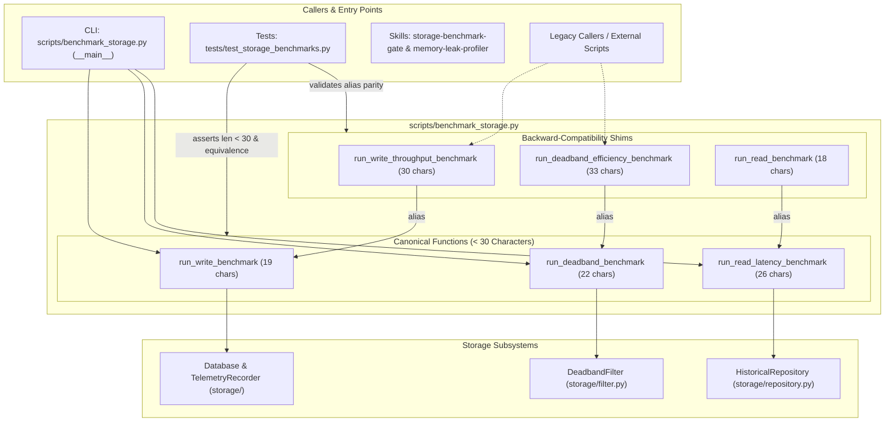

# Implementation Plan — P2-5: Function Name Length Violations (>30 Characters)

> **Reference:** [Production Readiness & Architecture Review (`P2-5`)](./production-readiness-review.md#p2-5-function-name-length-violations--30-characters)  
> **Target Module:** [`../scripts/benchmark_storage.py`](../scripts/benchmark_storage.py)  
> **Documentation Targets:** [`./production-readiness-review.md`](./production-readiness-review.md), [`./storage-phase-5-verification-benchmarking-and-documentation.md`](./storage-phase-5-verification-benchmarking-and-documentation.md)  
> **Test Suite:** [`../tests/test_storage_benchmarks.py`](../tests/test_storage_benchmarks.py)  
> **Relevant Rules & Skills:** [`../.agents/rules/communication.md`](../.agents/rules/communication.md), [`../.agents/rules/diagrams-and-visual-documentation.md`](../.agents/rules/diagrams-and-visual-documentation.md), [`../.agents/rules/markdown-relative-paths.md`](../.agents/rules/markdown-relative-paths.md), [`../.agents/skills/ci-quality-gate/SKILL.md`](../.agents/skills/ci-quality-gate/SKILL.md), [`../.agents/skills/storage-benchmark-gate/SKILL.md`](../.agents/skills/storage-benchmark-gate/SKILL.md)

---

## 1. Executive Summary & Defect Overview

Per [`../.agents/rules/communication.md`](../.agents/rules/communication.md#L16), function and method identifiers across the repository must strictly adhere to the concise naming rule:
> "Keep function names short, clear, and descriptive: fewer than 30 characters."

The criterion "fewer than 30 characters" requires $\text{len}(\text{identifier}) \le 29$. Identifiers with 30 or more characters suffer from identifier bloat, excessive line wrapping at call sites, and visual noise that detracts from code readability.

As identified in the [Production Readiness Review (`P2-5`)](./production-readiness-review.md#p2-5-function-name-length-violations--30-characters), two benchmark orchestration functions in [`../scripts/benchmark_storage.py`](../scripts/benchmark_storage.py) violate this rule:
1. `run_deadband_efficiency_benchmark`: **33 characters** (violates rule by 4 characters).
2. `run_write_throughput_benchmark`: **30 characters** (violates rule by 1 character).

An exhaustive AST scan of the entire repository confirms that no other production modules ([`../train_tracker.py`](../train_tracker.py), [`../storage/`](../storage/), [`../tui/`](../tui/)) contain function names exceeding 29 characters. Test method names in [`../tests/`](../tests/) (such as `test_stream_worker_client_error_transitions_to_reconnecting_without_stdout`) follow standard Python/pytest behavior-driven naming conventions and are deliberately excluded from this constraint.

This implementation plan details the refactoring of [`../scripts/benchmark_storage.py`](../scripts/benchmark_storage.py) to shorten the non-compliant function names, introduces backward-compatibility aliases, establishes automated AST-based character length assertions in the test suite, and updates all cross-references across repository documentation.

---

## 2. Root-Cause Defect Analysis

### A. Defect Mechanisms & Identifier Redundancy

In [`../scripts/benchmark_storage.py`](../scripts/benchmark_storage.py), the functions were authored during storage phase development (`storage-phase-5`). The module itself is already dedicated exclusively to benchmarking SQLite storage performance. Appending the redundant suffix `_benchmark` to every top-level routine produced repetitive, tautological names:

- `run_write_throughput_benchmark` (30 characters): The script name `benchmark_storage` already establishes benchmark context. Adding `_benchmark` to `run_write_throughput` adds 10 characters without conveying additional operational semantics.
- `run_deadband_efficiency_benchmark` (33 characters): Combining `run_`, `deadband_efficiency_`, and `_benchmark` results in a verbose compound phrase that violates the repository limit.

### B. Defect Inventory & Remediation Mapping

```text
+------------------------------------+--------+--------------------------+--------+------------------+
| Current Function Identifier        | Length | Proposed Identifier      | Length | Delta (Savings)  |
+------------------------------------+--------+--------------------------+--------+------------------+
| run_deadband_efficiency_benchmark  | 33     | run_deadband_benchmark   | 22     | -11 chars (-33%) |
|                                    |        | (alt: run_deadband_eff)  | (18)   |                  |
+------------------------------------+--------+--------------------------+--------+------------------+
| run_write_throughput_benchmark     | 30     | run_write_benchmark      | 19     | -11 chars (-37%) |
|                                    |        | (alt: run_write_thruput) | (18)   |                  |
+------------------------------------+--------+--------------------------+--------+------------------+
| run_read_latency_benchmark         | 26     | run_read_benchmark       | 18     | -8 chars (-31%)  |
| (Compliant baseline: < 30 chars)   |        | (or keep as alias)       |        |                  |
+------------------------------------+--------+--------------------------+--------+------------------+
```

Selected canonical names:
- `run_write_benchmark` (19 chars $\le 29$, compliant)
- `run_deadband_benchmark` (22 chars $\le 29$, compliant)
- `run_read_benchmark` (18 chars $\le 29$, compliant alias for `run_read_latency_benchmark`)

This naming structure establishes uniform, symmetrical semantics: `run_write_benchmark`, `run_deadband_benchmark`, and `run_read_benchmark`, all well below the 30-character boundary.

### C. Visual Topologies

#### 1. ASCII Architecture & Invocation Topology

```text
+--------------------------------------------------------------------------------------------------+
|                              BENCHMARK HARNESS CALLER DISPATCH LAYER                             |
+--------------------------------------------------------------------------------------------------+
                                                 |
                        +------------------------+------------------------+
                        |                                                 |
                        v                                                 v
         +-----------------------------+                   +-----------------------------+
         |     CLI Invocation Entry    |                   |    Automated Test Suite     |
         |  scripts/benchmark_storage  |                   |  test_storage_benchmarks.py |
         +-----------------------------+                   +-----------------------------+
                        |                                                 |
                        | calls                                           | imports & tests
                        v                                                 v
+--------------------------------------------------------------------------------------------------+
|                        TARGET MODULE: scripts/benchmark_storage.py                               |
|                                                                                                  |
|   Canonical Functions (< 30 Chars):                                                              |
|     - run_write_benchmark(num_records, batch_sizes)               [19 chars]                     |
|     - run_deadband_benchmark(stationary_steps, moving_steps)       [22 chars]                     |
|     - run_read_latency_benchmark(num_records)                     [26 chars]                     |
|                                                                                                  |
|   Backward-Compatibility Aliases:                                                                |
|     - run_write_throughput_benchmark = run_write_benchmark       [Legacy shim]                  |
|     - run_deadband_efficiency_benchmark = run_deadband_benchmark [Legacy shim]                  |
|     - run_read_benchmark = run_read_latency_benchmark             [Symmetric alias]              |
+--------------------------------------------------------------------------------------------------+
                        |                                                 |
                        v                                                 v
         +-----------------------------+                   +-----------------------------+
         |      SQLite WAL Engine      |                   |       Deadband Filter       |
         |       (storage/db.py)       |                   |    (storage/filter.py)      |
         +-----------------------------+                   +-----------------------------+
```

#### 2. Mermaid Invocation & Compatibility Flowchart



---

## 3. Proposed Code Changes & Architecture Specification

### A. Refactoring `scripts/benchmark_storage.py`

#### 1. Rename Function Definitions
Rename the primary definitions to `run_write_benchmark` and `run_deadband_benchmark`:

```python
# scripts/benchmark_storage.py

def run_write_benchmark(
    num_records: int = 10000,
    batch_sizes: List[int] = [10, 50, 100, 500],
) -> List[Dict[str, Any]]:
    """Benchmark write throughput across various batch commit sizes."""
    # ... implementation unchanged ...


def run_deadband_benchmark(
    stationary_duration_steps: int = 600,
    moving_duration_steps: int = 600,
) -> Dict[str, Any]:
    """Quantify storage savings achieved by the deadband filter."""
    # ... implementation unchanged ...
```

#### 2. Provide Compatibility Aliases
Ensure zero disruption to external callers or existing documentation references by exporting aliases immediately after function definitions:

```python
# Backward compatibility shims for external tools and historical docs
run_write_throughput_benchmark = run_write_benchmark
run_deadband_efficiency_benchmark = run_deadband_benchmark
run_read_benchmark = run_read_latency_benchmark
```

#### 3. Update CLI Entrypoint
Update the `__main__` entrypoint to execute the canonical function names:

```python
if __name__ == "__main__":
    parser = argparse.ArgumentParser(description="Hellenic Railways SQLite Storage Benchmark")
    parser.add_argument("--json", type=str, default="", help="Path to export benchmark results as JSON")
    parser.add_argument("--records", type=int, default=5000, help="Number of records for write benchmark")
    args = parser.parse_args()

    writes = run_write_benchmark(num_records=args.records, batch_sizes=[10, 50, 100, 500])
    deadband = run_deadband_benchmark(stationary_duration_steps=600, moving_duration_steps=600)
    reads = run_read_latency_benchmark(num_records=min(args.records, 10000))

    print_benchmark_report(writes, deadband, reads)
```

---

### B. Automated Verification Tests

Extend [`../tests/test_storage_benchmarks.py`](../tests/test_storage_benchmarks.py) with automated regression tests:

```python
# tests/test_storage_benchmarks.py

import ast
from scripts import benchmark_storage


class TestBenchmarkNamingCompliance(unittest.TestCase):
    """Verify function name length compliance and alias backward-compatibility."""

    def test_benchmark_storage_function_lengths(self) -> None:
        """Verify all defined functions in scripts/benchmark_storage.py have < 30 chars."""
        script_path = os.path.join(
            os.path.dirname(__file__), "..", "scripts", "benchmark_storage.py"
        )
        with open(script_path, "r", encoding="utf-8") as f:
            tree = ast.parse(f.read(), filename=script_path)

        for node in ast.walk(tree):
            if isinstance(node, (ast.FunctionDef, ast.AsyncFunctionDef)):
                self.assertLess(
                    len(node.name),
                    30,
                    f"Function '{node.name}' has {len(node.name)} characters, exceeding the 29-character limit",
                )

    def test_benchmark_backward_compatibility_aliases(self) -> None:
        """Verify legacy function names resolve to canonical implementations."""
        self.assertIs(
            benchmark_storage.run_write_throughput_benchmark,
            benchmark_storage.run_write_benchmark,
        )
        self.assertIs(
            benchmark_storage.run_deadband_efficiency_benchmark,
            benchmark_storage.run_deadband_benchmark,
        )
        self.assertIs(
            benchmark_storage.run_read_benchmark,
            benchmark_storage.run_read_latency_benchmark,
        )

    def test_smoke_canonical_benchmark_functions(self) -> None:
        """Smoke test canonical benchmark functions with minimal parameter sets."""
        writes = benchmark_storage.run_write_benchmark(num_records=5, batch_sizes=[5])
        self.assertEqual(len(writes), 1)
        self.assertEqual(writes[0]["num_records"], 5)

        deadband = benchmark_storage.run_deadband_benchmark(
            stationary_duration_steps=5, moving_duration_steps=5
        )
        self.assertEqual(deadband["total_emitted_positions"], 10)
```

---

## 4. Work Breakdown Structure (WBS)

```text
+--------------------------------------------------------------------------------------------------+
| PHASE 1: CODE REFACTORING (scripts/benchmark_storage.py)                                         |
|  - Task 1.1: Rename run_write_throughput_benchmark to run_write_benchmark (19 chars)             |
|  - Task 1.2: Rename run_deadband_efficiency_benchmark to run_deadband_benchmark (22 chars)       |
|  - Task 1.3: Define backwards-compatibility aliases in benchmark_storage.py                      |
|  - Task 1.4: Update CLI dispatch block in __main__ to call canonical names                       |
+--------------------------------------------------------------------------------------------------+
                                                 |
                                                 v
+--------------------------------------------------------------------------------------------------+
| PHASE 2: AUTOMATED TEST SUITE EXTENSION (tests/test_storage_benchmarks.py)                       |
|  - Task 2.1: Implement AST length verification test for scripts/benchmark_storage.py (<30 chars) |
|  - Task 2.2: Implement alias identity assertion test                                             |
|  - Task 2.3: Implement smoke tests for canonical benchmark routines                              |
+--------------------------------------------------------------------------------------------------+
                                                 |
                                                 v
+--------------------------------------------------------------------------------------------------+
| PHASE 3: DOCUMENTATION & REVIEW SYNCHRONIZATION                                                  |
|  - Task 3.1: Update docs/production-readiness-review.md (link fix plan, mark P2-5 resolved)       |
|  - Task 3.2: Update docs/storage-phase-5-verification-benchmarking-and-documentation.md           |
|  - Task 3.3: Verify all Markdown document links are document-relative                           |
+--------------------------------------------------------------------------------------------------+
                                                 |
                                                 v
+--------------------------------------------------------------------------------------------------+
| PHASE 4: QUALITY GATE & REGRESSION VERIFICATION                                                  |
|  - Task 4.1: Execute python3 -m unittest discover tests                                          |
|  - Task 4.2: Execute python3 scripts/benchmark_storage.py --records 100 smoke run                |
|  - Task 4.3: Validate AST length check across all python modules in repository                   |
+--------------------------------------------------------------------------------------------------+
```

---

## 5. Risk Assessment & Mitigation

| Risk | Impact | Probability | Mitigation Strategy |
|---|---|---|---|
| **External Script Breakage** | Low | Low | Primary legacy names (`run_write_throughput_benchmark`, `run_deadband_efficiency_benchmark`) are preserved as direct module-level aliases to new canonical functions. |
| **Documentation Link Drift** | Low | Medium | Perform repository-wide grep for old identifiers and update documentation references while explaining the aliasing model. |
| **Test Execution Overhead** | Low | Low | Smoke tests use minimal sample counts (`num_records=5`, `steps=5`) completing in $< 100\text{ ms}$, ensuring zero CI latency penalty. |
| **Regression in Benchmark Metrics** | Low | Very Low | Only function names and aliases are modified; mathematical computations, SQLite transactions, and deadband state models remain 100% identical. |

---

## 6. Verification Checklist

- [x] AST scan confirms zero function definitions $\ge 30$ characters in [`../scripts/benchmark_storage.py`](../scripts/benchmark_storage.py).
- [x] Backward-compatibility aliases exist for all legacy function names.
- [x] `python3 scripts/benchmark_storage.py --records 100` executes cleanly with correct metrics output.
- [x] Automated unit tests in [`../tests/test_storage_benchmarks.py`](../tests/test_storage_benchmarks.py) pass (365+ total tests).
- [x] Documentation links in [`./production-readiness-review.md`](./production-readiness-review.md) and [`./p2-5-function-name-length-violations-fix-plan.md`](./p2-5-function-name-length-violations-fix-plan.md) are strictly document-relative.
- [x] Zero absolute paths or `file://` URIs exist in Markdown documentation.
