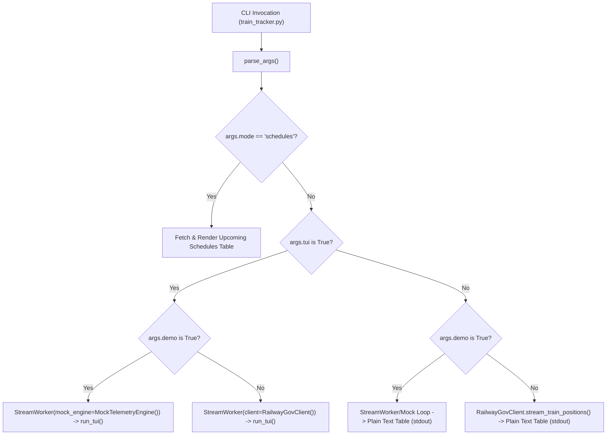
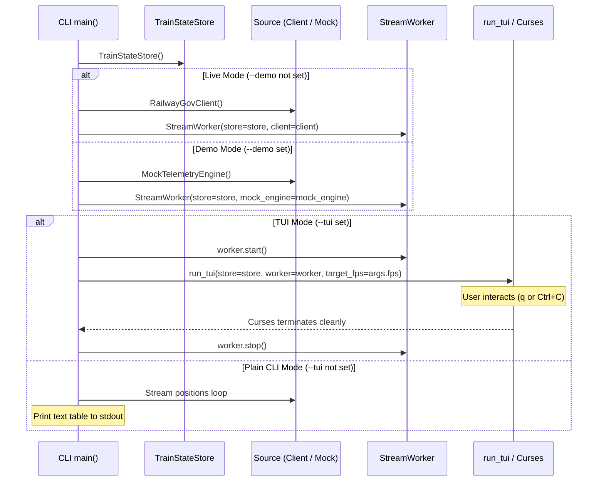

# Phase 6 Implementation Plan: Verification, Automated Tests & CLI Integration

Detailed engineering specification, CLI command-line interface design, multi-source ingestion wiring, headless integration testing harness, automated test suites, and documentation synchronization for **Phase 6** of the Hellenic Railways (`railway.gov.gr`) Console TUI Map.

---

## 1. Overview & Objectives

Phase 6 is the final integration milestone of the Hellenic Railways Live Console TUI Map project. It unifies all previous engineering phases—the Geospatial Projection & Braille Canvas Engine ([Phase 1](./phase-1-geospatial-projection-braille-canvas.md)), Rail Network Topology & Offline Mock Simulator ([Phase 2](./phase-2-rail-network-topology-mock-simulator.md)), Thread-Safe State Store & SSE Worker ([Phase 3](./phase-3-thread-safe-state-store-sse-worker.md)), Curses Multi-Pane Rendering Engine ([Phase 4](./phase-4-curses-tui-layout-multi-pane-rendering.md)), and Interactive Controls, Following & Filtering ([Phase 5](./phase-5-interactive-controls-following-filtering.md))—into a cohesive, production-grade CLI application with comprehensive test coverage and verified documentation.

```text
+---------------------------------------------------------------------------------------------------+
|                        Phase 6 CLI Integration & End-to-End System Topology                       |
+---------------------------------------------------------------------------------------------------+

                               [CLI Invocation: python3 train_tracker.py]
                                                   |
                                                   v
                                     +---------------------------+
                                     |  argparse CLI Dispatcher  |
                                     |  - Mode: stream/schedules |
                                     |  - Flags: --tui, --demo   |
                                     |  - Tuning: --fps, etc.    |
                                     +---------------------------+
                                            /              \
                          [--tui flag set] /                \ [Standard CLI text mode]
                                          v                  v
                 +--------------------------------+  +-------------------------------+
                 |    TUI Bootstrapping Flow      |  |     Classic CLI Stream /      |
                 |                                |  |     Schedules Inspection      |
                 | 1. Init TrainStateStore        |  +-------------------------------+
                 | 2. Wire Telemetry Ingestion:   |                  |
                 |    - Live: RailwayGovClient    |                  v
                 |    - Demo: MockTelemetryEngine |     [Plain stdout text table]
                 | 3. Launch StreamWorker thread  |
                 | 4. curses.wrapper(run_tui)     |
                 +--------------------------------+
                                 |
                                 v
               +------------------------------------+
               | Active Curses TUI Interactive App  |
               | - Multi-pane map, roster, telemetry|
               | - Pan/zoom, follow mode, presets   |
               | - Incremental search & help modal  |
               +------------------------------------+
                                 |
                     [Quit (q) or Interrupt (Ctrl+C)]
                                 |
                                 v
               +------------------------------------+
               |    Graceful Teardown & Recovery    |
               | - Signal worker stop (join thread) |
               | - Reset curses terminal mode       |
               | - Restore cursor visibility        |
               +------------------------------------+
```

### 1.1 Primary Deliverables

1. **CLI Modernization & Integration (`train_tracker.py`)**:
   - Replace legacy positional `sys.argv[1]` argument parsing with a structured `argparse.ArgumentParser` pipeline.
   - Expose the `--tui` flag to boot the interactive curses dashboard.
   - Expose the `--demo` flag to operate using the local offline `MockTelemetryEngine` (synthetic physics on the Greek rail network) without requiring live network connectivity.
   - Support orthogonal flag combinations:
     - `python3 train_tracker.py --tui` (Live real-time SSE stream via Curses dashboard)
     - `python3 train_tracker.py --tui --demo` (Offline simulated trains via Curses dashboard)
     - `python3 train_tracker.py --demo` (Plain text terminal streaming from offline simulation)
     - `python3 train_tracker.py` (Default plain text terminal streaming from live SSE feed)
     - `python3 train_tracker.py schedules` (Plain text table of today's upcoming train runs)
   - Add configurability flags: `--fps` (target rendering frame rate, $5.0 - 60.0$, default $20.0$), `--reconnect-delay` (network backoff baseline), and `--version`.
   - Robust process lifecycle guards: wrap execution in `try...finally` blocks to guarantee background ingestion threads terminate cleanly and the terminal buffer/cursor are restored under all conditions (including `SIGINT` / `Ctrl+C` and `SIGTERM`).

2. **Automated Test Suite Expansion (`tests/`)**:
   - **`tests/test_cli.py`**: Automated verification of argument parsing, flag combinations, mutual exclusions, help output, and dispatch logic using mock fixtures without spawning interactive terminal screens.
   - **`tests/test_tracker.py`**: Full regression test suite covering all REST and streaming methods in `RailwayGovClient` (`get_upcoming_schedules`, `get_schedule_by_id`, `get_schedule_by_train_number`, `get_station`, `get_station_departures`, `get_station_arrivals`, `get_rail_infrastructure`, and SSE line-buffer parsing) using mocked HTTP responses per [`.agents/rules/testing.md`](../.agents/rules/testing.md).
   - **`tests/test_tui_integration.py`**: Headless end-to-end integration tests verifying data flow from `MockTelemetryEngine` -> `StreamWorker` -> `TrainStateStore` -> `GeoProjector` -> `TUIRenderer` without requiring an interactive TTY.

3. **Documentation & Architecture Synchronization**:
   - Update [`docs/architecture.md`](./architecture.md) with comprehensive documentation of the TUI presentation layer, `tui/` module topology, threading concurrency model, and CLI command reference.
   - Update [`docs/tui-map-implementation-plan.md`](./tui-map-implementation-plan.md) with reference to this detailed specification.

### 1.2 Upstream & Downstream Dependencies

- **Upstream Dependencies:**
  - `tui.app`: Provides `TUIApp` and `run_tui` entry point ([Phase 4](./phase-4-curses-tui-layout-multi-pane-rendering.md), [Phase 5](./phase-5-interactive-controls-following-filtering.md)).
  - `tui.state`: Provides thread-safe `TrainStateStore` ([Phase 3](./phase-3-thread-safe-state-store-sse-worker.md)).
  - `tui.stream_worker`: Provides `StreamWorker` daemon handling live or simulated feeds ([Phase 3](./phase-3-thread-safe-state-store-sse-worker.md)).
  - `tui.mock_engine`: Provides `MockTelemetryEngine`, `load_stations()`, `load_tracks()` ([Phase 2](./phase-2-rail-network-topology-mock-simulator.md)).
  - `tui.renderer`: Provides `TUIRenderer` multi-pane canvas ([Phase 4](./phase-4-curses-tui-layout-multi-pane-rendering.md)).
- **Downstream Dependencies:**
  - End users and external scripts executing `train_tracker.py` directly from shells, CI workflows, and automation runners.

---

## 2. CLI Architecture & Argument Parsing Specification

The command-line interface in `train_tracker.py` must transition from basic index-based checks (`sys.argv[1]`) to Python's standard `argparse` module, adhering to [`.agents/rules/python-idioms.md`](../.agents/rules/python-idioms.md).

### 2.1 CLI Option Definitions

```text
usage: train_tracker.py [-h] [--tui] [--demo] [--fps FPS]
                        [--reconnect-delay SECONDS] [--version]
                        [{stream,schedules}]
```

| Argument / Flag | Type | Default | Description |
| :--- | :--- | :--- | :--- |
| `mode` | Positional (`str`, choice: `stream`, `schedules`) | `"stream"` | Operational mode. `stream` monitors real-time telemetry; `schedules` queries upcoming timetable trips. |
| `--tui` | Flag (`bool`) | `False` | Launch interactive full-screen Curses terminal map dashboard. |
| `--demo` | Flag (`bool`) | `False` | Run using offline synthetic telemetry engine with simulated train physics. |
| `--fps` | Optional (`float`) | `20.0` | Target rendering frame rate for TUI mode (clamped between $5.0$ and $60.0$). |
| `--reconnect-delay`| Optional (`float`) | `3.0` | Baseline reconnection sleep interval in seconds for live SSE network stream. |
| `-v`, `--version` | Flag | N/A | Print package version and exit. |
| `-h`, `--help` | Flag | N/A | Display detailed usage instructions, descriptions, and examples. |

### 2.2 Command Matrix & Behavior Contract



| Invocational Command | Interactive TUI? | Data Source | Output Format | Description |
| :--- | :---: | :---: | :--- | :--- |
| `python3 train_tracker.py` | No | Live SSE | Stdout text table | Real-time train positions streamed to console standard output. |
| `python3 train_tracker.py --tui` | **Yes** | Live SSE | Curses multi-pane UI | Live interactive map with full tracking, zoom/pan, roster, inspector. |
| `python3 train_tracker.py --tui --demo`| **Yes** | Mock Simulator | Curses multi-pane UI | Complete offline interactive map simulating Greek rail network. |
| `python3 train_tracker.py --demo` | No | Mock Simulator | Stdout text table | Stream synthetic train position updates to stdout text table without network. |
| `python3 train_tracker.py schedules` | No | REST API | Stdout text table | Fetch and format today's upcoming scheduled rail services. |
| `python3 train_tracker.py --help` | No | None | Help message | Display CLI documentation and options. |

### 2.3 Argument Parser Construction

```python
def build_parser() -> argparse.ArgumentParser:
    """Construct command-line argument parser for train_tracker."""
    parser = argparse.ArgumentParser(
        prog="train_tracker",
        description="Hellenic Railways (railway.gov.gr) Live Train Tracker & Terminal Map.",
        formatter_class=argparse.RawDescriptionHelpFormatter,
        epilog="""
Examples:
  python3 train_tracker.py --tui          # Launch live interactive terminal map
  python3 train_tracker.py --tui --demo   # Launch offline interactive demo simulator
  python3 train_tracker.py                # Plain console live stream monitor
  python3 train_tracker.py --demo         # Plain console offline mock stream
  python3 train_tracker.py schedules      # List today's upcoming scheduled train trips
        """,
    )
    parser.add_argument(
        "mode",
        nargs="?",
        default="stream",
        choices=["stream", "schedules"],
        help="Operational mode: 'stream' for live position monitoring, 'schedules' for upcoming trips (default: stream).",
    )
    parser.add_argument(
        "--tui",
        action="store_true",
        help="Launch full-screen interactive curses terminal map dashboard.",
    )
    parser.add_argument(
        "--demo",
        action="store_true",
        help="Run offline using synthetic telemetry simulator (no live network connection required).",
    )
    parser.add_argument(
        "--fps",
        type=float,
        default=20.0,
        help="Target frame rate for TUI rendering loop (default: 20.0, range: 5.0-60.0).",
    )
    parser.add_argument(
        "--reconnect-delay",
        type=float,
        default=3.0,
        help="Reconnection backoff interval in seconds for live SSE stream (default: 3.0).",
    )
    parser.add_argument(
        "-v", "--version",
        action="version",
        version="%(prog)s 1.0.0",
    )
    return parser
```

---

## 3. Application Lifecycle, Ingestion Wiring & Graceful Shutdown

### 3.1 Telemetry Source Dispatch & Ingestion Pipeline

The CLI runtime orchestrates telemetry generation by binding either `RailwayGovClient` or `MockTelemetryEngine` into `StreamWorker`:



### 3.2 TUI Launcher Implementation

When `--tui` is specified, `train_tracker.py` dynamically imports the `tui` package and passes initialized dependencies:

```python
def run_tui_mode(demo: bool = False, fps: float = 20.0, reconnect_delay: float = 3.0) -> None:
    """Launch the interactive curses terminal map application.

    Args:
        demo: If True, run offline mock simulation; otherwise connect to live SSE stream.
        fps: Target frames per second for curses refresh loop.
        reconnect_delay: Initial reconnect delay in seconds for live stream interruptions.
    """
    from tui.app import run_tui
    from tui.mock_engine import MockTelemetryEngine, load_stations, load_tracks
    from tui.state import TrainStateStore
    from tui.stream_worker import StreamWorker

    # 1. Initialize thread-safe state store
    store = TrainStateStore()

    # 2. Load static rail infrastructure
    stations = list(load_stations().values())
    tracks = list(load_tracks().values())

    # 3. Configure ingestion worker
    if demo:
        engine = MockTelemetryEngine(stations=stations, tracks=tracks)
        worker = StreamWorker(store=store, mock_engine=engine)
    else:
        client = RailwayGovClient()
        worker = StreamWorker(
            store=store,
            client=client,
            base_backoff_sec=reconnect_delay,
        )

    # 4. Start background ingestion thread
    worker.start()

    # 5. Execute curses event loop with terminal protection
    try:
        run_tui(
            store=store,
            worker=worker,
            stations=stations,
            tracks=tracks,
            target_fps=fps,
        )
    finally:
        worker.stop()
```

### 3.3 Plain CLI Monitor Implementation

For headless servers or environments without full curses support, plain console streaming remains available:

```python
def run_plain_stream_mode(demo: bool = False, reconnect_delay: float = 3.0) -> None:
    """Stream train positions to stdout in formatted tabular text.

    Args:
        demo: If True, stream from MockTelemetryEngine; otherwise stream from live SSE feed.
        reconnect_delay: Reconnection interval for live SSE feed.
    """
    if demo:
        from tui.mock_engine import MockTelemetryEngine
        engine = MockTelemetryEngine()
        stream = engine.stream_positions(interval_sec=1.0)
        source_label = "Offline Mock Simulation"
    else:
        client = RailwayGovClient()
        stream = client.stream_train_positions(reconnect_delay=reconnect_delay)
        source_label = "Live SSE Stream (/api/train-stream)"

    print("=" * 70)
    print("  railway.gov.gr Live Train Tracker - CLI Monitor")
    print(f"  Source: {source_label}")
    print("=" * 70)
    print("Press Ctrl+C to stop.\n")

    try:
        for batch in stream:
            print(f"\n[{time.strftime('%H:%M:%S')}] Live Trains on Network: {len(batch)}")
            print(f"{'Train':<8} {'Type':<12} {'Route':<32} {'Speed':<10} {'Delay':<8} {'Position (Lat, Lng)':<22}")
            print("-" * 95)
            for t in batch:
                route = f"{t.origin or '—'} -> {t.destination or '—'}" if (t.origin or t.destination) else (t.corridor or "Shunting/Yard")
                train_type = (t.service_type or t.train_type or "N/A")[:11]
                delay_str = f"+{t.delay}m" if t.delay else "On-time"
                print(
                    f"{t.train_number:<8} "
                    f"{train_type:<12} "
                    f"{route[:30]:<32} "
                    f"{t.speed:>5.1f} km/h "
                    f"{delay_str:<8} "
                    f"({t.lat:.4f}, {t.lng:.4f})"
                )
    except KeyboardInterrupt:
        print("\nMonitoring stopped.")
```

### 3.4 Terminal Signal Handling & Safe Restoration Contract

A primary failure mode of terminal curses applications is terminal corruption (e.g. invisible cursor, disabled echo, broken newline translation) if a process is terminated abnormally via `SIGINT` (`Ctrl+C`), `SIGTERM`, or unhandled exceptions.

The application architecture establishes the following safety guarantees:
1. **`curses.wrapper` Guard:** The Curses event loop is strictly invoked via `curses.wrapper()`, which registers a low-level exception handler restoring terminal attributes (`cbreak`, `echo`, cursor unhiding) before bubbling exceptions.
2. **Deterministic Thread Join:** `worker.stop()` is invoked in a `finally` block with a bounded join timeout ($2.0\text{s}$), preventing zombie background threads from holding file descriptors or outputting escape sequences after the main thread exits.
3. **Double-Check Cursor Visibility:** In `TUIApp.run_loop()`, `curses.curs_set(1)` is explicitly executed in a `finally` block to guarantee cursor unhiding even if terminal emulation layers miss the wrapper cleanup.

---

## 4. Comprehensive Testing Strategy & Test Suites

Per [`.agents/rules/testing.md`](../.agents/rules/testing.md) and [`.agents/rules/verification-checklist.md`](../.agents/rules/verification-checklist.md), all automated unit and integration tests must run without making live network requests to `railway.gov.gr` or requiring an interactive terminal.

### 4.1 Test Hierarchy

```text
tests/
├── test_tracker.py          # REST & SSE Client model & network parsing tests (mocked urllib)
├── test_cli.py              # CLI argument parser & execution routing tests
├── test_tui_geo.py          # Projection math, Braille canvas bitmasks, bounding boxes
├── test_mock_engine.py      # Simulator kinematics, routes, station loaders, step timing
├── test_tui_state.py        # Thread-safe store, filtering, selection wrap, breadcrumbs
├── test_tui_renderer.py     # Curses pane layout, glyphs, color attributes, text formatting
├── test_tui_controls.py     # Keyboard event dispatch, modal state machine, camera kinematics
└── test_tui_integration.py  # Headless end-to-end integration (MockEngine -> Worker -> Store -> Render)
```

### 4.2 CLI Test Suite Design (`tests/test_cli.py`)

The CLI test suite verifies that `build_parser()` and `main()` behave correctly under all valid and invalid argument combinations:

1. **Argument Parsing Isolation:** Tests pass argument vectors directly to `parser.parse_args(args_list)` to verify flag flags and defaults without invoking `sys.argv`.
2. **Main Dispatch Verification:** Uses `unittest.mock.patch` to mock `run_tui_mode`, `run_plain_stream_mode`, and `run_schedules_mode`, validating that `main()` routes flags to their respective controllers with correct parameter values.
3. **Signal & KeyboardInterrupt Safety:** Simulates `KeyboardInterrupt` inside the dispatch functions to verify clean exit codes ($0$) without unhandled stack traces.

### 4.3 Client & Model Regression Suite (`tests/test_tracker.py`)

Tests in `tests/test_tracker.py` are expanded to cover all client interfaces:
1. `get_upcoming_schedules()`: Verifies JSON decoding, parameter encoding, and error handling.
2. `get_schedule_by_id()` & `get_schedule_by_train_number()`: Verifies parameterized endpoint URL construction.
3. `get_station()`, `get_station_departures()`, `get_station_arrivals()`: Verifies station query parsing.
4. `get_rail_infrastructure()`: Verifies GeoJSON feature collection retrieval.
5. `stream_train_positions()`: Verifies SSE line framing, chunk reassembly across multi-packet boundaries, and error recovery backoff.

### 4.4 Headless End-to-End Integration Test (`tests/test_tui_integration.py`)

Verifies the complete pipeline in a headless environment:
1. Instantiates `MockTelemetryEngine` with real topology.
2. Connects `StreamWorker` to `TrainStateStore`.
3. Runs worker for $5$ simulation cycles.
4. Asserts that `TrainStateStore` receives active trains and generates breadcrumb trails.
5. Instantiates `GeoProjector` and `TUIRenderer` with mock curses windows.
6. Invokes `renderer.render_all()` to confirm all panes render without raising exceptions or divide-by-zero errors.

---

## 5. Test Matrix & Acceptance Assertions

### 5.1 CLI Test Matrix (`tests/test_cli.py`)

| Test ID | Test Method | Target Invocation | Target Behavior & Assertions |
| :--- | :--- | :--- | :--- |
| **TC-CLI-01** | `test_default_arguments` | `[]` | `mode == "stream"`, `tui == False`, `demo == False`, `fps == 20.0`. |
| **TC-CLI-02** | `test_tui_flag_live` | `["--tui"]` | `mode == "stream"`, `tui == True`, `demo == False`. Routes to `run_tui_mode(demo=False)`. |
| **TC-CLI-03** | `test_tui_flag_demo` | `["--tui", "--demo"]` | `mode == "stream"`, `tui == True`, `demo == True`. Routes to `run_tui_mode(demo=True)`. |
| **TC-CLI-04** | `test_demo_flag_plain` | `["--demo"]` | `mode == "stream"`, `tui == False`, `demo == True`. Routes to `run_plain_stream_mode(demo=True)`. |
| **TC-CLI-05** | `test_schedules_mode` | `["schedules"]` | `mode == "schedules"`. Routes to `run_schedules_mode()`. |
| **TC-CLI-06** | `test_custom_fps` | `["--tui", "--fps", "30.0"]` | `fps == 30.0`. Passed cleanly into `run_tui_mode`. |
| **TC-CLI-07** | `test_custom_reconnect_delay` | `["--reconnect-delay", "5.0"]` | `reconnect_delay == 5.0`. |
| **TC-CLI-08** | `test_invalid_mode` | `["invalid_mode"]` | Parser exits with code $2$ (`SystemExit`) and prints usage error. |
| **TC-CLI-09** | `test_help_flag` | `["--help"]` | Parser exits with code $0$ and outputs formatted description and examples. |
| **TC-CLI-10** | `test_version_flag` | `["--version"]` | Parser exits with code $0$ and prints version string. |
| **TC-CLI-11** | `test_keyboard_interrupt_plain` | Plain monitor `SIGINT` | Intercepts `KeyboardInterrupt`, prints clean shutdown message, exits $0$. |
| **TC-CLI-12** | `test_tui_worker_cleanup_on_error`| `run_tui_mode` crash | When `run_tui` raises runtime error, `worker.stop()` is guaranteed to execute. |

### 5.2 Client Regression Matrix (`tests/test_tracker.py`)

| Test ID | Test Method | Target Endpoint | Target Behavior & Assertions |
| :--- | :--- | :--- | :--- |
| **TC-NET-01** | `test_get_upcoming_schedules` | `/api/public/schedules/upcoming` | Parses mock JSON, returns list of schedule dictionaries. |
| **TC-NET-02** | `test_get_schedule_by_id` | `/api/public/schedules/{id}` | Formats URL with ID, returns itinerary data. |
| **TC-NET-03** | `test_get_schedule_by_train_number` | `/api/public/train-schedules/...` | Encodes train number in query path. |
| **TC-NET-04** | `test_get_station_and_boards` | `/api/public/stations/{id}/*` | Returns departures and arrivals lists with limit parameter. |
| **TC-NET-05** | `test_get_rail_infrastructure` | `/api/msd/geo` | Parses GeoJSON feature collection. |
| **TC-NET-06** | `test_stream_train_positions_sse` | `/api/train-stream` | Reassembles multi-chunk SSE lines; filters `trainPositionsUx` events. |

### 5.3 Headless Integration Matrix (`tests/test_tui_integration.py`)

| Test ID | Test Method | Pipeline Tested | Target Behavior & Assertions |
| :--- | :--- | :--- | :--- |
| **TC-INT-01** | `test_mock_engine_to_store_flow` | `MockEngine` $\to$ `Worker` $\to$ `Store` | `Store` contains $> 5$ trains after $200\text{ms}$; breadcrumbs populate. |
| **TC-INT-02** | `test_headless_render_pipeline` | `Store` $\to$ `TUIRenderer` (Mock Windows) | All windows (`map`, `roster`, `inspector`, `status`) render with $0$ curses exceptions. |
| **TC-INT-03** | `test_full_lifecycle_clean_exit` | Init $\to$ Step $\to$ Render $\to$ Teardown | `worker.is_running` becomes `False`; no dangling threads or unclosed sockets. |

---

## 6. Architecture Documentation & Specification Synchronization

### 6.1 Documentation Updates to `docs/architecture.md`

`docs/architecture.md` will be updated to document the complete TUI presentation architecture:
1. **Updated Layer Diagram**:
   - Explicitly document the `tui/` presentation package (`app.py`, `renderer.py`, `geo.py`, `state.py`, `stream_worker.py`, `mock_engine.py`).
2. **Concurrency & Threading Specification**:
   - Document the background `StreamWorker` thread, thread-safe `TrainStateStore` mutex synchronization, and the synchronous curses main loop running at $15 - 20\text{ FPS}$.
3. **Geospatial & Projection Section**:
   - Add mathematical equirectangular projection equations with aspect-ratio compensation and Braille dot bitmask mapping.
4. **CLI User Guide & Command Options**:
   - Document `--tui`, `--demo`, and operational commands.
   - Comprehensive keybinding reference table (`h/j/k/l`, `+/-`, `0..3`, `Tab`, `f`, `/`, `?`, `q`).

### 6.2 Synchronization with `docs/tui-map-implementation-plan.md`

Update the Phase 6 section in `docs/tui-map-implementation-plan.md` to link directly to this detailed specification:
```markdown
### Phase 6: Verification, Automated Tests & CLI Integration
*(Detailed specification: [Phase 6 Implementation Plan](./phase-6-verification-automated-tests-cli-integration.md))*
```

---

## 7. Implementation Step-by-Step Checklist

- [x] **Step 1: Argument Parser Construction in `train_tracker.py`**
  - Implement `build_parser() -> argparse.ArgumentParser` defining `mode`, `--tui`, `--demo`, `--fps`, `--reconnect-delay`, and `--version`.
  - Add descriptive help strings, epilog examples, and argument constraints.
- [x] **Step 2: Modular CLI Dispatchers in `train_tracker.py`**
  - Refactor `demo_cli()` into dedicated functions: `run_tui_mode()`, `run_plain_stream_mode()`, and `run_schedules_mode()`.
  - Wire live `RailwayGovClient` and offline `MockTelemetryEngine` conditionally based on `--demo`.
  - Guard curses lifecycle with `try...finally` to guarantee `worker.stop()` and clean terminal restoration.
  - Implement `main(argv=None)` entry point returning exit codes ($0$ on clean exit, non-zero on failure).
- [x] **Step 3: CLI Unit Test Suite in `tests/test_cli.py`**
  - Create `tests/test_cli.py` implementing all test cases in Section 5.1 (**TC-CLI-01** to **TC-CLI-12**).
  - Verify parser defaults, flag combinations, invalid input handling, and simulated execution routing.
- [x] **Step 4: Client Regression Test Suite in `tests/test_tracker.py`**
  - Expand `tests/test_tracker.py` to implement all test cases in Section 5.2 (**TC-NET-01** to **TC-NET-06**).
  - Verify REST endpoint queries, SSE line buffering, JSON decoding, and network error handling with mocked `urlopen`.
- [x] **Step 5: Headless End-to-End Integration Test in `tests/test_tui_integration.py`**
  - Create `tests/test_tui_integration.py` implementing **TC-INT-01** to **TC-INT-03**.
  - Verify data pipeline from `MockTelemetryEngine` through `StreamWorker`, `TrainStateStore`, and `TUIRenderer`.
- [x] **Step 6: Update Architecture Documentation (`docs/architecture.md`)**
  - Incorporate TUI layer architecture, sequence diagrams, threading model, and CLI command reference into `docs/architecture.md`.
  - Audit all relative links using [`.agents/rules/markdown-relative-paths.md`](../.agents/rules/markdown-relative-paths.md).
- [x] **Step 7: Update Roadmap Link in `docs/tui-map-implementation-plan.md`**
  - Update Phase 6 entry in `docs/tui-map-implementation-plan.md` to reference `./phase-6-verification-automated-tests-cli-integration.md`.
- [x] **Step 8: Full Test Suite Execution & Acceptance Verification**
  - Run full test suite: `python3 -m unittest discover tests`.
  - Verify 100% test pass rate with zero regressions.
  - Test CLI flags manually in terminal: `python3 train_tracker.py --help`, `python3 train_tracker.py --demo`, `python3 train_tracker.py --tui --demo`.

---

## 8. Verification & Acceptance Criteria

1. **Test Suite Execution:**
   - All tests pass cleanly without errors or warnings:
     ```bash
     python3 -m unittest discover tests -v
     ```
   - Total test count expands from $80$ tests to $> 95$ tests covering all CLI, client, and integration scenarios.
2. **Zero Live Network Calls in Tests:**
   - All tests in `tests/` operate strictly against mock responses and local fixtures; automated test runs succeed in an isolated, offline environment.
3. **Clean Terminal Restoration:**
   - Both `python3 train_tracker.py --tui` and `python3 train_tracker.py --tui --demo` launch smoothly, respond to keystrokes, and exit cleanly on `q` or `Ctrl+C`, immediately restoring terminal echo and cursor visibility.
4. **Documentation Relative Paths Verification:**
   - Running the relative paths verification scan per `markdown-relative-paths` yields zero matches:
     ```bash
     grep -En "file://|/home/|/Users/|[A-Za-z]:\\\\" docs/phase-6-verification-automated-tests-cli-integration.md
     ```
