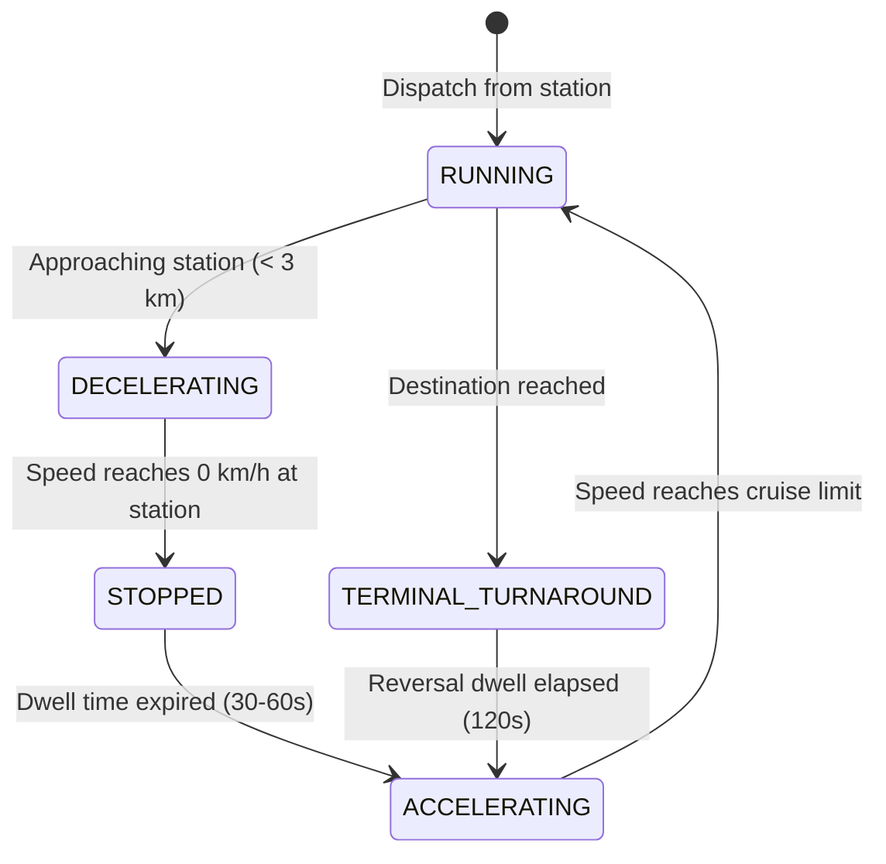

# Phase 2 Implementation Plan: Rail Network Topology & Offline Mock Simulator

Detailed engineering specification, data schemas, mathematical kinematics models, and test procedures for **Phase 2** of the Hellenic Railways (`railway.gov.gr`) Console TUI Map.

---

## 1. Overview & Objectives

Phase 2 supplies the structural rail network data and offline synthetic simulation capabilities for the TUI map dashboard. It provides the static geospatial infrastructure (station nodes and vector track polylines) along with a deterministic, physics-based telemetry simulation engine capable of producing continuous `TrainPosition` streams when offline, during development, or during off-peak network hours.

### 1.1 Primary Deliverables
1. **`tui/data/stations.json`**:
   - Comprehensive metadata for primary Greek railway stations across all major corridors (PATHE mainline, Athens Suburban / Proastiakos, Northern Greece, Thessaly, and Macedonia branch lines).
   - Structured station records containing station codes, bilingual names (Greek and Latin/English transliteration), WGS84 coordinates, corridor identifiers, and hub classifications.
2. **`tui/data/tracks.json`**:
   - Curated vector track polylines representing the operational Hellenic railway corridors.
   - Ordered WGS84 coordinate sequences (`[[lat, lng], ...]`) formatted for Bresenham line rasterization onto the `BrailleCanvas` developed in [Phase 1](./phase-1-geospatial-projection-braille-canvas.md).
3. **`tui/mock_engine.py`**:
   - Topology loading and validation utilities (`load_stations`, `load_tracks`).
   - Geodesic math helpers (Haversine distance calculation, initial bearing/azimuth calculation, and polyline distance interpolation).
   - `MockTelemetryEngine` simulating realistic multi-train operations:
     - Kinematics: acceleration, cruising speed, deceleration, station dwell times, and terminal turnaround.
     - Track snapping: positions precisely mapped along track polylines.
     - HEPOS-compliant telemetry generation: dynamic speeds, course headings, chainage distances, progress ratios, and stochastic delay fluctuations.
     - Drop-in generator interface matching [`RailwayGovClient.stream_train_positions`](../../../train_tracker.py#L131-L158).
4. **`tests/test_mock_engine.py`**:
   - Automated unit test suite validating topology JSON schema integrity, geographic bounding limits, geodesic math accuracy, kinematic state transitions, and generator compliance.

### 1.2 Upstream & Downstream Dependencies
- **Upstream:**
  - Consumes [`GeoPoint`](./phase-1-geospatial-projection-braille-canvas.md#L130-L134) and bounding box presets from [`tui/geo.py`](../../../tui/geo.py#L25-L105).
  - Implements domain models defined in [`train_tracker.py`](../../../train_tracker.py#L23-L80) (`TrainPosition`).
- **Downstream:**
  - `tui/data/stations.json` and `tracks.json` feed directly into Phase 4 Curses canvas renderer (`tui/renderer.py`) for static track and station drawing.
  - `MockTelemetryEngine` provides the offline data source consumed by Phase 3 `StreamWorker` (`tui/stream_worker.py`) when the `--demo` flag is active or upstream SSE connections are unavailable.

---

## 2. Rail Network Topology & Data Schemas

### 2.1 Station Schema (`tui/data/stations.json`)

The station database is serialized as a JSON object containing a version header and an array of station entities:

```json
{
  "version": "1.0",
  "stations": [
    {
      "id": "ATH",
      "code": "1001",
      "name_el": "Αθήνα (Σ.Σ. Λαρίσης)",
      "name_en": "Athens (Larissa Station)",
      "lat": 37.9922,
      "lng": 23.7208,
      "corridor": "PATHE",
      "is_hub": true,
      "altitude_m": 45.0
    }
  ]
}
```

#### Field Specifications:
| Field | Type | Description |
|---|---|---|
| `id` | `str` | Unique 3-4 letter uppercase station identifier (e.g. `"ATH"`, `"SKG"`, `"SKA"`). |
| `code` | `str` | OSE official numerical station code. |
| `name_el` | `str` | Full Greek name with diacritics. |
| `name_en` | `str` | Standard Latin transliteration for compact display or ASCII fallback. |
| `lat` | `float` | WGS84 Latitude ($37.5^\circ \le \phi \le 41.5^\circ$). |
| `lng` | `float` | WGS84 Longitude ($21.4^\circ \le \lambda \le 26.7^\circ$). |
| `corridor` | `str` | Primary railway corridor identifier (`"PATHE"`, `"PROASTIAKOS_ATH"`, `"NORTHERN"`, `"THESSALY"`, `"MACEDONIA"`). |
| `is_hub` | `bool` | `true` for major junctions or terminal stations where label priority is elevated. |
| `altitude_m` | `float` (optional) | Altitude in meters above sea level. |

#### Station Network Coverage:
1. **PATHE Mainline Trunk:**
   - Piraeus (PIR), Athens Central / Larissa Station (ATH), SKA / Acharnes Railway Center (SKA), Inoi (INO), Thiva (THI), Levadia (LEV), Tithorea (TIT), Lianokladi (LIA), Domokos (DOM), Paleofarsalos (PAL), Larissa (LAR), Rapsani (RAP), Katerini (KAT), Platy (PLA), Thessaloniki New Railway Station (SKG).
2. **Athens Suburban / Proastiakos Network:**
   - Athens International Airport (AIA), Koropi (KOR), Paiania-Kantza (KAN), Pallini (PAL_SUB), Doukissis Plakentias (DPL), Kifisias (KIF), Neratziotissa (NER), Irakleio (IRA), SKA (SKA), Ano Liosia (ALI), Aspropyrgos (ASP), Magoula (MAG), Megara (MEG), Agioi Theodoroi (ATH_TH), Korinthos (COR), Kiato (KIA).
3. **Chalkida Branch:**
   - Inoi (INO), Avlona (AVL), Chalkida (CHAL).
4. **Thessaly Branch Lines:**
   - Paleofarsalos (PAL) $\to$ Karditsa (KARD) $\to$ Trikala (TRIK) $\to$ Kalambaka (KAL).
   - Larissa (LAR) $\to$ Volos (VOL).
5. **Northern Greece & Trans-Balkan Corridors:**
   - Thessaloniki (SKG) $\to$ Kilkis (KIL) $\to$ Idomeni (IDO) [Border to North Macedonia].
   - Thessaloniki (SKG) $\to$ Strymonas (STR) $\to$ Serres (SER) $\to$ Drama (DRA) $\to$ Xanthi (XAN) $\to$ Komotini (KOM) $\to$ Alexandroupoli (AXD) $\to$ Pythio (PYT) $\to$ Dikea (DIK).
6. **Western Macedonia Branch:**
   - Platy (PLA) $\to$ Alexandria (ALE) $\to$ Veria (VER) $\to$ Edessa (EDE) $\to$ Amyntaio (AMY) $\to$ Florina (FLO).

---

### 2.2 Track Polylines Schema (`tui/data/tracks.json`)

Track network polylines are represented as an array of vector segments, each comprising an ordered list of coordinate pairs:

```json
{
  "version": "1.0",
  "corridors": [
    {
      "id": "pathe-mainline",
      "name": "PATHE Mainline (Athens - Thessaloniki)",
      "type": "mainline",
      "electrified": true,
      "double_track": true,
      "segments": [
        [
          [37.9482, 23.6425],
          [37.9922, 23.7208],
          [38.0742, 23.7383],
          [38.3194, 23.6067],
          [38.3242, 23.3186],
          [38.4528, 22.8753],
          [38.7411, 22.5694],
          [38.8872, 22.3986],
          [39.1278, 22.3167],
          [39.3083, 22.2583],
          [39.6389, 22.4167],
          [39.9056, 22.6139],
          [40.2708, 22.5083],
          [40.5417, 22.5333],
          [40.6444, 22.9292]
        ]
      ]
    }
  ]
}
```

#### Vector Segments Included:
1. `pathe-mainline`: Piraeus $\to$ Athens $\to$ SKA $\to$ Thiva $\to$ Lianokladi $\to$ Domokos $\to$ Larissa $\to$ Katerini $\to$ Platy $\to$ Thessaloniki.
2. `proastiakos-airport-kiato`: Airport $\to$ Doukissis Plakentias $\to$ SKA $\to$ Ano Liosia $\to$ Megara $\to$ Korinthos $\to$ Kiato.
3. `proastiakos-chalkida`: SKA $\to$ Inoi $\to$ Avlona $\to$ Chalkida.
4. `thessaloniki-idomeni`: Thessaloniki $\to$ Polikastro $\to$ Idomeni.
5. `northern-corridor`: Thessaloniki $\to$ Strymonas $\to$ Serres $\to$ Drama $\to$ Xanthi $\to$ Komotini $\to$ Alexandroupoli.
6. `thessaly-kalambaka`: Paleofarsalos $\to$ Karditsa $\to$ Trikala $\to$ Kalambaka.
7. `thessaly-volos`: Larissa $\to$ Velestino $\to$ Volos.
8. `western-macedonia`: Platy $\to$ Veria $\to$ Edessa $\to$ Florina.

---

## 3. Mathematical Specifications & Kinematics Engine

### 3.1 Geodesic Calculations

#### Haversine Great-Circle Distance
Given two coordinates $P_1 = (\phi_1, \lambda_1)$ and $P_2 = (\phi_2, \lambda_2)$ in radians:

$$\Delta \phi = \phi_2 - \phi_1, \quad \Delta \lambda = \lambda_2 - \lambda_1$$

$$a = \sin^2\left(\frac{\Delta \phi}{2}\right) + \cos(\phi_1)\cos(\phi_2)\sin^2\left(\frac{\Delta \lambda}{2}\right)$$

$$c = 2 \cdot \text{atan2}\left(\sqrt{a}, \sqrt{1 - a}\right)$$

$$d = R_{\text{earth}} \cdot c$$

where $R_{\text{earth}} = 6,371,000\text{ meters}$.

#### Geodesic Forward Azimuth / Heading
The directional angle $\theta \in [0^\circ, 360^\circ)$ clockwise from true North:

$$y = \sin(\Delta \lambda) \cdot \cos(\phi_2)$$

$$x = \cos(\phi_1) \cdot \sin(\phi_2) - \sin(\phi_1) \cdot \cos(\phi_2) \cdot \cos(\Delta \lambda)$$

$$\theta = \left(\text{atan2}(y, x) \cdot \frac{180}{\pi} + 360\right) \pmod{360}$$

---

### 3.2 Polyline Cumulative Distance & Parametric Interpolation

A track segment consists of an ordered sequence of points $[P_0, P_1, \dots, P_n]$.

1. **Cumulative Distance Array:**
   $$D_0 = 0$$
   $$D_i = D_{i-1} + \text{haversine}(P_{i-1}, P_i) \quad \text{for } i \in [1, n]$$
   Total corridor length $L = D_n$.

2. **Distance-to-Point Interpolation:**
   Given a target chainage distance $s \in [0, L]$:
   - Locate segment index $k$ such that $D_k \le s \le D_{k+1}$.
   - Compute segment fraction:
     $$\alpha = \frac{s - D_k}{D_{k+1} - D_k} \quad (\alpha \in [0, 1])$$
   - Interpolate geographic coordinates:
     $$\phi(s) = \phi_k + \alpha \cdot (\phi_{k+1} - \phi_k)$$
     $$\lambda(s) = \lambda_k + \alpha \cdot (\lambda_{k+1} - \lambda_k)$$
   - Compute tangent heading:
     $$\text{heading}(s) = \text{bearing}(P_k, P_{k+1})$$

---

### 3.3 Kinematic State Machine & Train Motion Model

Each simulated train executes a finite state machine modeling realistic railway physics:



#### Kinematic Parameters by Service Class:
| Service Class | Examples | Max Cruise Speed | Acceleration ($a$) | Deceleration ($d$) | Platform Dwell |
|---|---|---|---|---|---|
| **InterCity (IC)** | IC 50, 51, 52, 53 | $140 - 160\text{ km/h}$ | $+0.45\text{ m/s}^2$ | $-0.60\text{ m/s}^2$ | $60\text{ s}$ |
| **Proastiakos (Suburban)** | 1597, 2232, 1314 | $90 - 120\text{ km/h}$ | $+0.65\text{ m/s}^2$ | $-0.75\text{ m/s}^2$ | $35\text{ s}$ |
| **Regional (REG)** | 1731, 884 | $75 - 90\text{ km/h}$ | $+0.40\text{ m/s}^2$ | $-0.50\text{ m/s}^2$ | $45\text{ s}$ |
| **Freight (FRG)** | 80512 | $60 - 80\text{ km/h}$ | $+0.20\text{ m/s}^2$ | $-0.35\text{ m/s}^2$ | $0\text{ s}$ (through) |

#### Delay Drift Model:
Real trains experience random operational delays (signaling holds, level crossing clearances). Delays are simulated as a bounded stochastic walk:

$$\text{delay}_{t + \Delta t} = \min\left(45, \;\max\left(0, \;\text{delay}_t + \Delta \text{delay}\right)\right)$$

where $\Delta \text{delay} \in \{-1, 0, 0, 0, +1\}$ evaluated on station departure or every 120 seconds of running time.

---

## 4. Class Design & API Contract (`tui/mock_engine.py`)

### 4.1 Topology Data Models

```python
from dataclasses import dataclass
from typing import List, Dict, Optional, Tuple, Generator
from enum import Enum
from tui.geo import GeoPoint
from train_tracker import TrainPosition


@dataclass(frozen=True)
class StationNode:
    """Represents a physical railway station node."""
    id: str
    code: str
    name_el: str
    name_en: str
    point: GeoPoint
    corridor: str
    is_hub: bool
    altitude_m: Optional[float] = None


@dataclass
class TrackPolyline:
    """Represents a continuous track polyline with precomputed cumulative distances."""
    corridor_id: str
    name: str
    points: List[GeoPoint]
    cumulative_distances_m: List[float]
    total_length_m: float

    @classmethod
    def from_coordinates(cls, corridor_id: str, name: str, coords: List[Tuple[float, float]]) -> "TrackPolyline":
        ...

    def interpolate_at_distance(self, distance_m: float) -> Tuple[GeoPoint, float]:
        """Returns (GeoPoint, heading_degrees) at the given distance along the polyline."""
        ...
```

### 4.2 Simulated Train Configuration & State

```python
class TrainMotionState(Enum):
    RUNNING = "RUNNING"
    DECELERATING = "DECELERATING"
    STOPPED = "STOPPED"
    ACCELERATING = "ACCELERATING"
    TERMINAL_DWELL = "TERMINAL_DWELL"


@dataclass
class SimulatedTrain:
    """Configuration and dynamic kinematic state for a simulated train."""
    id: str
    train_number: str
    locomotive_number: str
    train_type: str  # "IC", "Proastiakos", "Regional", "Freight"
    service_type: str
    origin: str
    destination: str
    corridor: str
    track: TrackPolyline
    cruise_speed_kmh: float
    acceleration_mps2: float
    deceleration_mps2: float
    dwell_duration_sec: float

    # Dynamic mutable state
    current_distance_m: float = 0.0
    current_speed_kmh: float = 0.0
    direction: int = 1  # 1: forward along track, -1: reverse
    motion_state: TrainMotionState = TrainMotionState.RUNNING
    dwell_timer_sec: float = 0.0
    delay_minutes: int = 0
    next_station_name: str = ""

    def step(self, dt_sec: float) -> TrainPosition:
        """Advance train kinematics by dt_sec and return a domain TrainPosition."""
        ...
```

### 4.3 MockTelemetryEngine Interface

```python
class MockTelemetryEngine:
    """Offline telemetry engine generating realistic synthetic Greek railway movements."""

    def __init__(
        self,
        stations_path: Optional[str] = None,
        tracks_path: Optional[str] = None,
        time_scale: float = 1.0,
    ):
        """Initialize engine, load topology datasets, and spawn standard train roster."""
        self.stations: Dict[str, StationNode] = load_stations(stations_path)
        self.tracks: Dict[str, TrackPolyline] = load_tracks(tracks_path)
        self.time_scale = time_scale
        self.trains: List[SimulatedTrain] = self._init_train_roster()

    def _init_train_roster(self) -> List[SimulatedTrain]:
        """Instantiate preconfigured train roster across main corridors."""
        ...

    def step(self, dt_sec: float) -> List[TrainPosition]:
        """Step simulation by dt_sec wall-clock seconds scaled by time_scale."""
        ...

    def stream_positions(
        self,
        interval_sec: float = 1.0,
    ) -> Generator[List[TrainPosition], None, None]:
        """Generator yielding updated TrainPosition batches matching RailwayGovClient interface."""
        ...

    def reset(self) -> None:
        """Reset all trains to their initial schedule origins."""
        ...
```

---

## 5. Curated Active Train Roster Specification

The offline mock engine instantiates a realistic baseline fleet operating on Greek rail corridors:

| Train ID | Train No | Type | Origin | Destination | Corridor | Cruise Spd | Initial Delay | Description |
|---|---|---|---|---|---|---|---|---|
| `mock-ic-50` | **IC 50** | InterCity | Athens | Thessaloniki | PATHE | $145\text{ km/h}$ | $+2\text{ min}$ | Northbound daytime flagship InterCity |
| `mock-ic-51` | **IC 51** | InterCity | Thessaloniki | Athens | PATHE | $150\text{ km/h}$ | $+0\text{ min}$ | Southbound express passing Mount Olympus |
| `mock-ic-52` | **IC 52** | InterCity | Athens | Thessaloniki | PATHE | $140\text{ km/h}$ | $+7\text{ min}$ | Northbound approaching Lianokladi pass |
| `mock-ic-53` | **IC 53** | InterCity | Thessaloniki | Athens | PATHE | $145\text{ km/h}$ | $+12\text{ min}$ | Southbound with delay warning |
| `mock-pro-1597` | **1597** | Suburban | Piraeus | Kiato | Proastiakos | $105\text{ km/h}$ | $+0\text{ min}$ | Westbound suburban traversing Kakia Skala |
| `mock-pro-2232` | **2232** | Suburban | Airport | Kiato | Proastiakos | $110\text{ km/h}$ | $+3\text{ min}$ | Airport express passing SKA junction |
| `mock-pro-1314` | **1314** | Suburban | Athens | Chalkida | Proastiakos | $95\text{ km/h}$ | $+1\text{ min}$ | Commuter service through Tanagra & Avlona |
| `mock-reg-1731` | **1731** | Regional | Larissa | Volos | Thessaly | $85\text{ km/h}$ | $+0\text{ min}$ | Agricultural plain branch service |
| `mock-reg-884` | **884** | Regional | Paleofarsalos | Kalambaka | Thessaly | $80\text{ km/h}$ | $+4\text{ min}$ | Meteora tourist branch connector |
| `mock-frg-80512` | **80512** | Freight | Thiva | Thessaloniki | PATHE | $75\text{ km/h}$ | $+0\text{ min}$ | Heavy freight hauling north |
| `mock-int-361` | **361** | International | Thessaloniki | Idomeni | Trans-Balkan | $90\text{ km/h}$ | $+0\text{ min}$ | Freight/passenger cross-border link |

---

## 6. Detailed Test Plan (`tests/test_mock_engine.py`)

All tests follow [`.agents/rules/testing.md`](../../../.agents/rules/testing.md) using standard `python3 -m unittest`.

| Test Category | Test Method | Verification Target |
|---|---|---|
| **Station Schema Validation** | `test_stations_schema_and_keys` | Validate all stations in `stations.json` contain non-empty `id`, `name_el`, `name_en`, valid coordinates, and recognized `corridor`. |
| **Geographic Station Bounds** | `test_station_coordinates_within_greece` | Confirm every station coordinate falls within `GREECE_PRESET` limits ($37.5^\circ \le \phi \le 41.35^\circ$, $21.45^\circ \le \lambda \le 26.65^\circ$). |
| **Track Segment Continuity** | `test_track_segments_validity` | Verify every corridor in `tracks.json` has at least 2 points, strictly positive cumulative length, and valid WGS84 coordinates. |
| **Haversine Math Accuracy** | `test_haversine_distance_calculation` | Test distance between Athens ($37.9922, 23.7208$) and Larissa ($39.6389, 22.4167$); must match known geodesic distance ($213\text{ km} \pm 2\text{ km}$). |
| **Bearing Calculation** | `test_bearing_azimuth_cardinal_directions` | Test cardinal bearings: North ($0^\circ$), East ($90^\circ$), South ($180^\circ$), West ($270^\circ$) within $\pm 0.5^\circ$. |
| **Polyline Distance Interpolation** | `test_polyline_interpolation_endpoints` | Interpolation at $s=0$ matches $P_0$; at $s=L$ matches $P_n$; at $s=L/2$ yields expected midpoint. |
| **Train Kinematic Progression** | `test_train_kinematic_movement` | Calling `train.step(10.0)` increases distance monotonically, calculates speed $> 0$, and updates chainage. |
| **Station Dwell & Status** | `test_train_station_dwell_state` | Train approaching station decelerates to $0\text{ km/h}$, sets `status="Στάση"`, pauses for dwell time, and resumes acceleration. |
| **Terminal Turnaround** | `test_train_terminal_turnaround` | Train reaching the final track coordinate reverses direction ($direction = -1$) and navigates backward toward the origin. |
| **Stream Generator Contract** | `test_stream_positions_generator` | `engine.stream_positions()` yields non-empty lists of valid `TrainPosition` instances with all required dataclass attributes. |
| **Determinism & Reset** | `test_engine_reset_determinism` | Calling `engine.reset()` restores all simulated trains to initial distances and states. |

---

## 7. Implementation Step-by-Step Checklist

- [x] **Step 1: Data Package & Directory Structure**
  - Create package data directory `tui/data/` with `__init__.py`.
  - Ensure data files are bundled and discoverable relative to the package location.
- [x] **Step 2: Curated Stations Dataset (`tui/data/stations.json`)**
  - Compile accurate GPS coordinates and metadata for all major Greek railway stations across the 5 primary corridors.
  - Verify Greek spelling and English transliterations.
- [x] **Step 3: Vector Track Polylines (`tui/data/tracks.json`)**
  - Author high-resolution track polylines for PATHE, Proastiakos, Chalkida, Thessaly, and Northern corridors.
  - Validate segment connectivity and geographic consistency with station coordinates.
- [x] **Step 4: Geodesic Math & Topology Loader (`tui/mock_engine.py`)**
  - Implement Haversine distance, forward bearing, and `TrackPolyline.interpolate_at_distance`.
  - Implement robust JSON loaders with error handling and fallback paths.
- [x] **Step 5: Kinematic Simulation Engine (`tui/mock_engine.py`)**
  - Implement `SimulatedTrain` state machine (running, braking, stopped, accelerating, turnaround).
  - Implement `MockTelemetryEngine` with default roster and generator streaming.
- [x] **Step 6: Unit Test Suite (`tests/test_mock_engine.py`)**
  - Write test cases covering schemas, geodesic calculations, kinematic transitions, and streaming generator output.
- [x] **Step 7: Verification & Quality Assurance**
  - Run `python3 -m unittest discover tests` to ensure 100% green test execution.
  - Audit all relative links using `markdown-relative-paths` rules.
