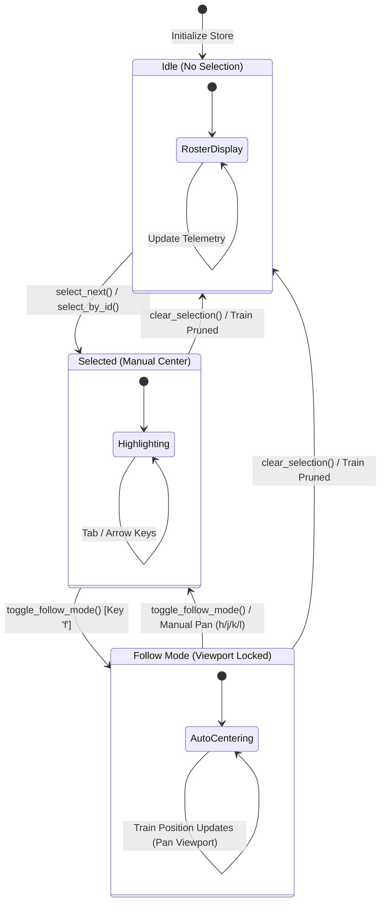

# Phase 3 Implementation Plan: Thread-Safe State Store & SSE Worker

Detailed architectural design, concurrency models, state machine specifications, API contracts, and test procedures for **Phase 3** of the Hellenic Railways (`railway.gov.gr`) Console TUI Map.

---

## 1. Overview & Objectives

Phase 3 implements the reactive data backbone connecting asynchronous data ingestion pipelines to the synchronous, double-buffered Curses rendering loop. It bridges the gap between external network I/O (live Server-Sent Events or offline physics simulation) and high-frequency terminal drawing (15–20 FPS) without lock contention, thread starvation, or UI flicker.

```text
+-----------------------------------------------------------------------------------+
|                        Phase 3 Telemetry Pipeline Flow                            |
+-----------------------------------------------------------------------------------+

   [Live Upstream SSE Broker]              [Offline Mock Simulator]
   (railway.gov.gr/api/train-stream)       (tui.mock_engine.MockTelemetryEngine)
                 \                                    /
                  \                                  /
                   v                                v
            +----------------------------------------------+
            |        StreamWorker (Background Thread)      |
            | - Daemon thread with threading.Event stop    |
            | - Reconnection & exponential backoff         |
            | - Ingestion rate tracking & health telemetry |
            +----------------------------------------------+
                                   |
                                   | updates via RLock
                                   v
            +----------------------------------------------+
            |               TrainStateStore                |
            | - Train records & coordinate ring buffers    |
            | - Selection index & follow-mode focus        |
            | - Substring & corridor filter predicates     |
            | - Stale train detection & garbage collection |
            | - Atomic StateSnapshot generator             |
            +----------------------------------------------+
                                   |
                                   | atomic get_snapshot()
                                   v
            +----------------------------------------------+
            |         Curses UI Loop (Main Thread)         |
            | - Zero-lock screen rendering at 20 FPS       |
            | - User input handler (selection, zoom, pan)  |
            +----------------------------------------------+
```

### 1.1 Primary Deliverables

1. **`tui/state.py`**:
   - `ConnectionStatus` enum (`DISCONNECTED`, `CONNECTING`, `CONNECTED`, `RECONNECTING`, `PAUSED`, `ERROR`).
   - `HistoricalBreadcrumb` and `TrainRecord` models preserving decaying GPS coordinate histories (ring buffers of up to 15 points) for motion vectors and trails.
   - `StateSnapshot` immutable dataclass providing zero-contention, consistent view state for the Curses UI thread.
   - `TrainStateStore` re-entrant mutex-protected repository managing active train positions, selection cursor, follow-mode tracking, search filters, corridor presets, and stale train eviction.
2. **`tui/stream_worker.py`**:
   - `StreamWorker` background daemon thread managing connection lifecycles for both live SSE streams ([`RailwayGovClient.stream_train_positions`](../../../train_tracker.py#L131-L182)) and offline simulation ([`MockTelemetryEngine.stream_positions`](./phase-2-rail-network-topology-mock-simulator.md#L338-L344)).
   - Exponential backoff reconnect engine with randomized jitter for transient network failures.
   - Non-blocking thread control (`start()`, `stop()`, `pause()`, `resume()`) with clean teardown.
3. **`tests/test_tui_state.py`**:
   - Automated unit and integration test suite validating thread synchronization, ring buffer bounding, filter evaluation, cursor movement, concurrent read/write stress, and worker reconnect lifecycles.

### 1.2 Upstream & Downstream Dependencies

- **Upstream:**
  - Consumes [`TrainPosition`](../../../train_tracker.py#L23-L80) domain entities from [`RailwayGovClient`](../../../train_tracker.py#L82-L182).
  - Consumes synthetic telemetry batches from [`MockTelemetryEngine`](../../../tui/mock_engine.py#L315-L348) developed in [Phase 2](./phase-2-rail-network-topology-mock-simulator.md).
- **Downstream:**
  - Feeds atomic `StateSnapshot` instances directly into the Phase 4 Curses renderer (`tui/renderer.py`) and application loop (`tui/app.py`).
  - Provides cursor navigation and filter mutation hooks for Phase 5 keyboard interactive controls.

---

## 2. Concurrency Model & Thread Synchronization

### 2.1 Decoupling Rendering from Network I/O

Terminal user interfaces driven by Curses must service keyboard events and redraw screens at high frequencies (typically every 50ms, i.e., 20 FPS). Performing blocking HTTP calls, waiting on chunked SSE sockets, or parsing large JSON payloads inside the main event loop causes unacceptable UI freeze and sluggish navigation.

Phase 3 establishes an asynchronous producer-consumer architecture:
- **Producer Thread (`StreamWorker`):** Runs as a background daemon thread. It consumes network or generator streams, parses position batches, and acquires the state store lock only for the brief duration required to update train records.
- **Consumer Thread (Main Curses Loop):** Runs the UI drawing loop. At the start of each frame, it invokes `store.get_snapshot()`, which acquires the lock, extracts shallow copies of active records, and releases the lock immediately (sub-millisecond lock hold time). The frame is then drawn entirely from the immutable snapshot.

```text
Producer (Worker Thread)                    Consumer (UI Thread, 20 FPS)
------------------------                    ----------------------------
Read SSE batch [T0...Tn]
Acquire store._lock                         
  Update TrainRecords                       
  Append breadcrumbs                        
  Increment version                         
Release store._lock                         
Sleep / Wait for next chunk                 
                                            Acquire store._lock
                                              Create StateSnapshot
                                            Release store._lock
                                            Render Braille Canvas
                                            Render Roster & Detail Pane
                                            Process getch() keyboard input
```

### 2.2 Re-entrant Locking (`threading.RLock`)

The state store employs a re-entrant lock (`threading.RLock`) rather than a simple `threading.Lock`. This allows compound operations (such as `select_next()` calling internal filter queries or `update_positions()` calling `prune_stale_trains()`) to execute safely without self-deadlock within the same thread.

### 2.3 Snapshot Immutability Pattern

To prevent `RuntimeError: dictionary changed size during iteration` when the background thread inserts a new train while the UI thread is looping over the roster, the UI thread never accesses internal store dictionaries directly.

`StateSnapshot` holds:
- A frozen dictionary mapping `train_id -> TrainRecord`.
- A pre-sorted, pre-filtered tuple of `TrainRecord` instances ready for roster display.
- References to the currently selected `TrainRecord` (or `None`).
- Immutable view metadata (connection status, filter string, active corridor, update counter).

---

## 3. Data Structures & State Schema

### 3.1 Connection Status & Enums

```python
from enum import Enum, auto

class ConnectionStatus(Enum):
    """Network connection state of the telemetry stream."""
    DISCONNECTED = auto()   # Stream is stopped or uninitialized
    CONNECTING = auto()     # Opening socket / establishing handshake
    CONNECTED = auto()      # Actively receiving valid position events
    RECONNECTING = auto()   # Connection dropped; waiting on backoff timer
    PAUSED = auto()         # Stream paused by user or backgrounding
    ERROR = auto()          # Terminal unrecoverable error
```

### 3.2 Historical Breadcrumb & Train Record

To draw directional velocity vectors and fading historical paths on the `BrailleCanvas`, each train maintains a bounded FIFO queue of past geographic coordinates.

```python
from collections import deque
from dataclasses import dataclass, field
from typing import Deque, Optional, Tuple
import time

from train_tracker import TrainPosition

@dataclass(frozen=True)
class HistoricalBreadcrumb:
    """A historical geographic point recorded during train movement."""
    lat: float
    lng: float
    timestamp: float
    speed: float

@dataclass
class TrainRecord:
    """Stateful wrapper around TrainPosition maintaining motion history."""
    position: TrainPosition
    trail: Deque[HistoricalBreadcrumb] = field(default_factory=lambda: deque(maxlen=15))
    first_seen: float = field(default_factory=time.time)
    last_updated: float = field(default_factory=time.time)
    update_count: int = 1

    def append_breadcrumb(self, pos: TrainPosition) -> None:
        """Record a historical coordinate if position has shifted significantly."""
        if not self.trail or (abs(self.trail[-1].lat - pos.lat) > 1e-5 or 
                              abs(self.trail[-1].lng - pos.lng) > 1e-5):
            self.trail.append(HistoricalBreadcrumb(
                lat=pos.lat,
                lng=pos.lng,
                timestamp=time.time(),
                speed=pos.speed,
            ))
        self.position = pos
        self.last_updated = time.time()
        self.update_count += 1

    def is_stale(self, threshold_sec: float = 120.0) -> bool:
        """Check if train has stopped receiving updates beyond threshold."""
        return (time.time() - self.last_updated) > threshold_sec
```

### 3.3 State Snapshot Dataclass

```python
@dataclass(frozen=True)
class StateSnapshot:
    """Immutable point-in-time snapshot consumed by the Curses renderer."""
    trains: Dict[str, TrainRecord]
    filtered_trains: Tuple[TrainRecord, ...]
    selected_train: Optional[TrainRecord]
    selected_index: int
    connection_status: ConnectionStatus
    status_message: str
    total_messages_received: int
    last_stream_update: float
    follow_mode: bool
    filter_query: str
    corridor_filter: Optional[str]
    version: int
```

---

## 4. Class Design & API Contracts

### 4.1 `TrainStateStore` (`tui/state.py`)

The state store is the centralized thread-safe repository managing all dynamic application state.

```python
import threading
from typing import Dict, List, Optional, Tuple

class TrainStateStore:
    """Thread-safe state repository for live train positions and UI view state."""

    def __init__(self, stale_timeout_sec: float = 120.0, max_trail_len: int = 15):
        self._lock = threading.RLock()
        self._stale_timeout_sec = stale_timeout_sec
        self._max_trail_len = max_trail_len

        # Telemetry data
        self._trains: Dict[str, TrainRecord] = {}
        self._total_messages: int = 0
        self._last_update_ts: float = 0.0
        self._version: int = 0

        # UI & View state
        self._selected_id: Optional[str] = None
        self._follow_mode: bool = False
        self._filter_query: str = ""
        self._corridor_filter: Optional[str] = None
        self._connection_status: ConnectionStatus = ConnectionStatus.DISCONNECTED
        self._status_message: str = "Ready"

    # ------------------------------------------------------------------
    # Telemetry Ingestion (Called by StreamWorker Thread)
    # ------------------------------------------------------------------

    def update_positions(self, positions: List[TrainPosition]) -> None:
        """
        Ingest a batch of train positions with mutex protection.
        Updates existing records, creates new records, appends breadcrumbs,
        and increments the store version counter.
        """
        with self._lock:
            now = time.time()
            for pos in positions:
                if not pos.id:
                    continue
                if pos.id in self._trains:
                    self._trains[pos.id].append_breadcrumb(pos)
                else:
                    record = TrainRecord(
                        position=pos,
                        trail=deque(maxlen=self._max_trail_len),
                        first_seen=now,
                        last_updated=now,
                        update_count=1,
                    )
                    record.trail.append(HistoricalBreadcrumb(pos.lat, pos.lng, now, pos.speed))
                    self._trains[pos.id] = record

            self._total_messages += 1
            self._last_update_ts = now
            self._version += 1

    def prune_stale_trains(self, max_age_sec: Optional[float] = None) -> int:
        """
        Remove trains that have not received telemetry updates within max_age_sec.
        Returns the number of pruned trains.
        """
        cutoff = max_age_sec or self._stale_timeout_sec
        with self._lock:
            now = time.time()
            stale_ids = [
                tid for tid, rec in self._trains.items()
                if (now - rec.last_updated) > cutoff
            ]
            for tid in stale_ids:
                del self._trains[tid]
                if self._selected_id == tid:
                    self._selected_id = None

            if stale_ids:
                self._version += 1
            return len(stale_ids)

    def set_connection_status(self, status: ConnectionStatus, message: str = "") -> None:
        """Update stream connectivity status and descriptive status message."""
        with self._lock:
            self._connection_status = status
            if message:
                self._status_message = message
            self._version += 1

    # ------------------------------------------------------------------
    # UI State & Cursor Navigation (Called by UI Thread)
    # ------------------------------------------------------------------

    def get_snapshot(self) -> StateSnapshot:
        """
        Produce a frozen, consistent point-in-time snapshot for UI rendering.
        Operates with minimal lock hold duration.
        """
        with self._lock:
            # Build shallow copy of trains dict
            trains_copy = dict(self._trains)
            filtered = self._compute_filtered_list(trains_copy)

            # Determine selected index within the filtered list
            sel_idx = -1
            selected_record = None
            if self._selected_id and self._selected_id in trains_copy:
                selected_record = trains_copy[self._selected_id]
                for idx, rec in enumerate(filtered):
                    if rec.position.id == self._selected_id:
                        sel_idx = idx
                        break

            return StateSnapshot(
                trains=trains_copy,
                filtered_trains=tuple(filtered),
                selected_train=selected_record,
                selected_index=sel_idx,
                connection_status=self._connection_status,
                status_message=self._status_message,
                total_messages_received=self._total_messages,
                last_stream_update=self._last_update_ts,
                follow_mode=self._follow_mode,
                filter_query=self._filter_query,
                corridor_filter=self._corridor_filter,
                version=self._version,
            )

    def select_next(self) -> Optional[str]:
        """Move cursor selection to next train in filtered roster (with wrap-around)."""
        with self._lock:
            filtered = self._compute_filtered_list(self._trains)
            if not filtered:
                self._selected_id = None
                return None

            curr_idx = self._get_current_index(filtered)
            next_idx = (curr_idx + 1) % len(filtered)
            self._selected_id = filtered[next_idx].position.id
            self._version += 1
            return self._selected_id

    def select_prev(self) -> Optional[str]:
        """Move cursor selection to previous train in filtered roster (with wrap-around)."""
        with self._lock:
            filtered = self._compute_filtered_list(self._trains)
            if not filtered:
                self._selected_id = None
                return None

            curr_idx = self._get_current_index(filtered)
            prev_idx = (curr_idx - 1 + len(filtered)) % len(filtered)
            self._selected_id = filtered[prev_idx].position.id
            self._version += 1
            return self._selected_id

    def select_by_id(self, train_id: str) -> bool:
        """Explicitly select a train by its identifier."""
        with self._lock:
            if train_id in self._trains:
                self._selected_id = train_id
                self._version += 1
                return True
            return False

    def clear_selection(self) -> None:
        """Deselect currently active train."""
        with self._lock:
            self._selected_id = None
            self._follow_mode = False
            self._version += 1

    def toggle_follow_mode(self) -> bool:
        """Toggle follow-mode lock for currently selected train."""
        with self._lock:
            if self._selected_id:
                self._follow_mode = not self._follow_mode
            else:
                self._follow_mode = False
            self._version += 1
            return self._follow_mode

    def set_filter_query(self, query: str) -> None:
        """Update active search filter query."""
        with self._lock:
            self._filter_query = query.strip()
            self._version += 1

    def set_corridor_filter(self, corridor: Optional[str]) -> None:
        """Filter trains by railway corridor ('PATHE', 'PROASTIAKOS', etc.)."""
        with self._lock:
            self._corridor_filter = corridor
            self._version += 1

    def clear(self) -> None:
        """Reset state store completely."""
        with self._lock:
            self._trains.clear()
            self._selected_id = None
            self._follow_mode = False
            self._total_messages = 0
            self._last_update_ts = 0.0
            self._version += 1

    # ------------------------------------------------------------------
    # Internal Filter & Sorting Logic
    # ------------------------------------------------------------------

    def _compute_filtered_list(self, trains: Dict[str, TrainRecord]) -> List[TrainRecord]:
        """Filter and sort active trains by commercial train number and corridor."""
        results = []
        q = self._filter_query.lower()

        for rec in trains.values():
            p = rec.position

            # 1. Corridor check
            if self._corridor_filter and (not p.corridor or self._corridor_filter.upper() not in p.corridor.upper()):
                continue

            # 2. Text query matching (train number, origin, destination, service type)
            if q:
                searchable = f"{p.train_number} {p.origin or ''} {p.destination or ''} {p.service_type or ''}".lower()
                if q not in searchable:
                    continue

            results.append(rec)

        # Natural sort by train number / ID
        results.sort(key=lambda r: r.position.train_number or r.position.id)
        return results

    def _get_current_index(self, filtered: List[TrainRecord]) -> int:
        if not self._selected_id:
            return -1
        for idx, rec in enumerate(filtered):
            if rec.position.id == self._selected_id:
                return idx
        return -1
```

---

### 4.2 `StreamWorker` (`tui/stream_worker.py`)

`StreamWorker` encapsulates the background ingestion thread. It abstracts the data source so that both live HTTP Server-Sent Events and offline synthetic physics streams feed into the state store identically.

```python
import logging
import random
import threading
import time
from typing import Callable, Generator, List, Optional, Union

from train_tracker import RailwayGovClient, TrainPosition
from tui.mock_engine import MockTelemetryEngine
from tui.state import ConnectionStatus, TrainStateStore

logger = logging.getLogger(__name__)

class StreamWorker:
    """
    Background worker thread managing telemetry stream ingestion and reconnection.
    Supports live SSE network stream and offline mock generator sources.
    """

    def __init__(
        self,
        store: TrainStateStore,
        client: Optional[RailwayGovClient] = None,
        mock_engine: Optional[MockTelemetryEngine] = None,
        custom_stream: Optional[Generator[List[TrainPosition], None, None]] = None,
        base_backoff_sec: float = 1.0,
        max_backoff_sec: float = 30.0,
    ):
        self.store = store
        self.client = client
        self.mock_engine = mock_engine
        self.custom_stream = custom_stream

        self.base_backoff_sec = base_backoff_sec
        self.max_backoff_sec = max_backoff_sec

        self._thread: Optional[threading.Thread] = None
        self._stop_event = threading.Event()
        self._pause_event = threading.Event()
        self._pause_event.set()  # Not paused by default

    @property
    def is_running(self) -> bool:
        """Check if worker thread is currently active."""
        return self._thread is not None and self._thread.is_alive()

    def start(self) -> None:
        """Start background daemon worker thread."""
        if self.is_running:
            return
        self._stop_event.clear()
        self._pause_event.set()
        self._thread = threading.Thread(
            target=self._run_loop,
            name="StreamWorkerThread",
            daemon=True,
        )
        self._thread.start()

    def stop(self, timeout_sec: float = 2.0) -> None:
        """Signal thread to stop and wait for clean termination."""
        self._stop_event.set()
        self._pause_event.set()  # Unblock if paused
        if self._thread and self._thread.is_alive():
            self._thread.join(timeout=timeout_sec)
        self.store.set_connection_status(ConnectionStatus.DISCONNECTED, "Stream stopped")

    def pause(self) -> None:
        """Temporarily pause stream ingestion."""
        self._pause_event.clear()
        self.store.set_connection_status(ConnectionStatus.PAUSED, "Stream paused")

    def resume(self) -> None:
        """Resume stream ingestion from paused state."""
        self._pause_event.set()
        self.store.set_connection_status(ConnectionStatus.CONNECTED, "Stream active")

    def _run_loop(self) -> None:
        """Main worker execution loop with exponential backoff and error recovery."""
        backoff = self.base_backoff_sec

        while not self._stop_event.is_set():
            # Honor pause signal
            self._pause_event.wait()
            if self._stop_event.is_set():
                break

            self.store.set_connection_status(ConnectionStatus.CONNECTING, "Connecting to stream...")

            try:
                stream = self._get_stream_generator()

                for batch in stream:
                    if self._stop_event.is_set():
                        break

                    # Wait if paused mid-stream
                    self._pause_event.wait()
                    if self._stop_event.is_set():
                        break

                    if self.store.get_snapshot().connection_status != ConnectionStatus.CONNECTED:
                        self.store.set_connection_status(ConnectionStatus.CONNECTED, "Live stream active")
                    backoff = self.base_backoff_sec  # Reset backoff upon successful data frame

                    if batch:
                        self.store.update_positions(batch)

                # If generator finishes cleanly without error (e.g. offline finite stream)
                if self._stop_event.is_set():
                    break

            except Exception as exc:
                if self._stop_event.is_set():
                    break

                # Apply exponential backoff with jitter
                jitter = random.uniform(0.8, 1.2)
                sleep_time = min(backoff * jitter, self.max_backoff_sec)
                msg = f"Connection error: {exc}. Reconnecting in {sleep_time:.1f}s..."
                logger.warning(msg)
                self.store.set_connection_status(ConnectionStatus.RECONNECTING, msg)

                # Interruptible sleep
                if self._stop_event.wait(timeout=sleep_time):
                    break

                backoff = min(backoff * 2.0, self.max_backoff_sec)

        self.store.set_connection_status(ConnectionStatus.DISCONNECTED, "Stream disconnected")

    def _get_stream_generator(self) -> Generator[List[TrainPosition], None, None]:
        """Instantiate appropriate telemetry stream source."""
        if self.custom_stream is not None:
            return self.custom_stream
        elif self.mock_engine is not None:
            return self.mock_engine.stream_positions(interval_sec=1.0)
        elif self.client is not None:
            return self.client.stream_train_positions(
                reconnect_delay=0.0,
                stop_event=self._stop_event,
            )
        else:
            raise ValueError("No valid telemetry source provided to StreamWorker")
```

---

## 5. Filtering, Selection & Follow-Mode State Machine

The interaction between user selection, list filtering, and map auto-follow requires strict state invariant enforcement:



### 5.1 State Invariants

1. **Selection Validity:**
   - If `selected_id` is set, `selected_train` in `StateSnapshot` will resolve to the matching `TrainRecord` if it exists in the active dictionary.
   - If the selected train is removed (e.g. via `prune_stale_trains()`), `selected_id` resets to `None` and `follow_mode` resets to `False`.
2. **Follow-Mode Constraint:**
   - `follow_mode` can only be `True` if `selected_id` is not `None`.
   - If the user manually pans the map (`h/j/k/l` or arrow keys in Phase 5), `follow_mode` immediately disengages to allow free map exploration.
3. **Filter Stability:**
   - Updating `filter_query` or `corridor_filter` preserves the current `selected_id` if the selected train matches the new criteria.
   - If the selected train does not match the active filter, it remains selected internally, but `selected_index` in `StateSnapshot` indicates `-1` (unlisted in the current filtered view).

---

## 6. Detailed Test Plan (`tests/test_tui_state.py`)

All tests will run with standard `python3 -m unittest` in compliance with [`.agents/rules/testing.md`](../../../.agents/rules/testing.md).

| Test Category | Test Method | Verification Target |
|---|---|---|
| **Basic Ingestion & Versioning** | `test_update_positions_single_and_batch` | Ingesting batches updates `_trains`, sets initial coordinates, and increments `version` monotonically. |
| **Breadcrumb Ring Buffer** | `test_breadcrumb_history_and_maxlen` | Repeated position updates accumulate coordinates in `record.trail`; verify trail length never exceeds `max_trail_len=15`. |
| **Stationary Jitter Suppression** | `test_breadcrumb_stationary_filtering` | Feeding identical coordinates does not duplicate entries in the breadcrumb trail. |
| **Stale Train Pruning** | `test_prune_stale_trains` | Trains older than cutoff timestamp are evicted; active trains are preserved; selected train resets if pruned. |
| **Cursor Selection Navigation** | `test_cursor_navigation_next_prev_wrap` | `select_next()` and `select_prev()` cycle correctly through sorted roster with wrap-around from last to first. |
| **Text Search Filtering** | `test_filter_query_matching` | Query matches train numbers (`"IC 50"`), origin/destination (`"Athens"`), and service types case-insensitively. |
| **Corridor Preset Filtering** | `test_corridor_filtering` | Setting corridor filter (`"PATHE"`, `"PROASTIAKOS"`) includes only trains operating on that network segment. |
| **Follow-Mode Toggle Invariants** | `test_follow_mode_toggle` | Follow-mode cannot be enabled without a selected train; toggles on/off when a train is selected. |
| **Snapshot Immutability** | `test_snapshot_thread_isolation` | Mutating `TrainStateStore` after calling `get_snapshot()` does not alter the already returned `StateSnapshot` dictionaries. |
| **Concurrent Access Stress** | `test_concurrent_multithreaded_stress` | Launch 4 writer threads updating positions at 100 Hz and 2 reader threads taking snapshots at 60 Hz for 1 second; zero deadlocks, race conditions, or unhandled exceptions. |
| **StreamWorker Lifecycle** | `test_stream_worker_start_stop` | `StreamWorker` starts daemon thread, processes generator batches into store, and stops cleanly on `worker.stop()`. |
| **StreamWorker Pause/Resume** | `test_stream_worker_pause_resume` | Pausing halts ingestion; resuming continues without dropping thread state or leaking sockets. |
| **StreamWorker Exponential Backoff** | `test_stream_worker_reconnection_backoff` | Inject simulated failing generator; verify worker catches exceptions, transitions to `RECONNECTING`, and backs off before retrying. |
| **Mock Engine Ingestion** | `test_stream_worker_mock_engine_integration` | Wire `MockTelemetryEngine` directly to `StreamWorker`; confirm store receives live simulated Greek train telemetry. |

---

## 7. Implementation Step-by-Step Checklist

- [x] **Step 1: State Models & Enums (`tui/state.py`)**
  - Implement `ConnectionStatus`, `HistoricalBreadcrumb`, `TrainRecord`, and `StateSnapshot`.
  - Add breadcrumb appending logic with coordinate delta threshold to prevent stationary bloating.
- [x] **Step 2: Thread-Safe State Store (`tui/state.py`)**
  - Implement `TrainStateStore` with `threading.RLock`.
  - Implement `update_positions`, `prune_stale_trains`, `set_connection_status`, and `get_snapshot`.
  - Implement cursor navigation (`select_next`, `select_prev`, `select_by_id`, `clear_selection`).
  - Implement filtering (`set_filter_query`, `set_corridor_filter`, `_compute_filtered_list`).
  - Implement follow-mode toggling (`toggle_follow_mode`).
- [x] **Step 3: Background Stream Worker (`tui/stream_worker.py`)**
  - Implement `StreamWorker` daemon thread with `threading.Event` stop and pause controls.
  - Implement stream source dispatching (`RailwayGovClient`, `MockTelemetryEngine`, custom generators).
  - Implement exponential backoff with randomized jitter on connection failures.
- [x] **Step 4: Unit & Concurrency Test Suite (`tests/test_tui_state.py`)**
  - Write test cases for state mutations, ring buffers, filtering, cursor navigation, and snapshots.
  - Write high-concurrency stress test validating lock safety under heavy multi-threaded contention.
  - Write `StreamWorker` lifecycle, pause/resume, and mocked failure reconnection tests.
- [x] **Step 5: Verification & Link Auditing**
  - Run `python3 -m unittest discover tests` to ensure all tests pass with 100% green status.
  - Run markdown path verification per `markdown-relative-paths` skill.
  - Update `docs/tui-map-implementation-plan.md` to link to this Phase 3 plan.
