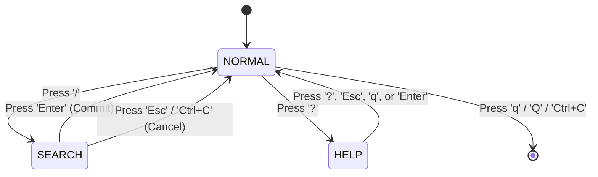
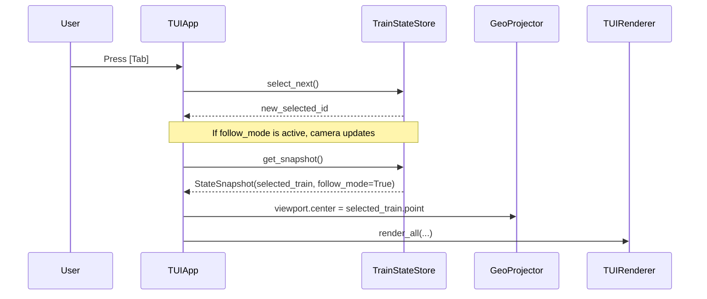

# Phase 5 Implementation Plan: Interactive Controls, Following & Filtering

Detailed engineering specification, modal input dispatch architecture, scale-aware geospatial camera kinematics, train selection & auto-follow tracking engine, incremental search filtering, and automated test specifications for **Phase 5** of the Hellenic Railways (`railway.gov.gr`) Console TUI Map.

---

## 1. Overview & Objectives

Phase 5 transforms the passive multi-pane Curses presentation engine built in [Phase 4](./phase-4-curses-tui-layout-multi-pane-rendering.md) into a fully interactive, reactive exploration dashboard. It connects keyboard inputs to viewport transformations ([`GeoProjector`](../../../tui/geo.py)), train selection cursors, real-time camera tracking, and incremental roster query filtering in [`TrainStateStore`](../../../tui/state.py).

```text
+---------------------------------------------------------------------------------------------------+
|                        Phase 5 Interactive Control & Event Dispatch Pipeline                      |
+---------------------------------------------------------------------------------------------------+

                          [User Keyboard Input (stdscr.getch())]
                                            |
                                            v
                         +--------------------------------------+
                         |     InputMode State Machine          |
                         |  - NORMAL: Navigation & Shortcuts    |
                         |  - SEARCH: Live Filter Query Entry   |
                         |  - HELP:   Modal Keybinding Overlay  |
                         +--------------------------------------+
                                  /            |             \
          [Normal Mode / Shortcuts]   [Search Mode]     [Help Toggle]
                   /                           |               \
                  v                            v                v
     +-------------------------+   +-------------------+  +------------------+
     | Viewport & Camera Kinem.|   | Live Query Buffer |  | Help Modal Window|
     | - Panning (h/j/k/l/arr) |   | - Char insertion  |  | - Full shortcuts |
     | - Zooming (+/-)         |   | - Backspace / Esc |  | - Corridor specs |
     | - Presets (0..3)        |   | - Enter (commit)  |  | - Status legend  |
     | - Follow Mode Lock (f)  |   +-------------------+  +------------------+
     +-------------------------+               |
            |            |                     v
            v            v         +----------------------+
    [GeoProjector]  [TrainStateStore] <--- | Instant Filter Query |
    - center coord  - selected_id          +----------------------+
    - zoom factor   - follow_mode
                    - corridor_filter
```

### 1.1 Primary Deliverables

1. **`tui/app.py` Enhancements**:
   - `InputMode` enumeration: `NORMAL`, `SEARCH`, `HELP`.
   - Scale-aware geographic panning kinematics compensating for current zoom magnification and latitude cosine distortion.
   - Smooth zoom scaling with logarithmic clamping between $0.2\times$ and $25.0\times$.
   - Pre-configured Greek rail corridor presets (`0` Greece, `1` Suburban Athens, `2` PATHE Mainline, `3` Northern Greece).
   - Dynamic selection cycling (`Tab`, `Shift-Tab`, `Up`, `Down`) with circular wrap-around.
   - Real-time auto-follow camera lock (`f`) centering the map viewport on the selected train while breaking on manual pan.
   - Incremental interactive search query editor (`/`) with live filtering, backspacing, commit (`Enter`), and cancellation (`Esc`).
   - Modal interactive help dialog (`?`) overlaying keybindings, symbols, and status indicators.
2. **`tui/renderer.py` Enhancements**:
   - Status bar transformation for interactive search input prompting (`Search filter: <query>█`).
   - Modal dialog rendering engine for the help overlay window.
3. **`tests/test_tui_controls.py`**:
   - Comprehensive automated test suite simulating keyboard input events, panning mathematics, zoom boundary enforcement, selection cycling, follow-mode tracking and break mechanics, and incremental search mode transitions without requiring an interactive TTY.

### 1.2 Upstream & Downstream Dependencies

- **Upstream Dependencies:**
  - Uses [`GeoProjector`](../../../tui/geo.py) for coordinate projection, bounding box fitting, and canvas viewport bounds.
  - Interacts directly with [`TrainStateStore`](../../../tui/state.py) selection, follow-mode, and filter query methods.
  - Builds on the curses layout and subwindows from [`PaneGeometry`](../../../tui/renderer.py#L80-L168) and [`TUIRenderer`](../../../tui/renderer.py#L410-L920).
- **Downstream Dependencies:**
  - Provides the complete interactive user interface required for Phase 6 CLI integration (`--tui` and `--demo` flags in [`train_tracker.py`](../../../train_tracker.py)).

---

## 2. Input Modes & Event Dispatch State Machine

The application controller operates a three-state modal event dispatch loop.



### 2.1 Comprehensive Keybinding Specification

| Key(s) | Curses Code / Char | Mode | Target Action | Description |
| :--- | :--- | :--- | :--- | :--- |
| `q`, `Q` | `ord('q')`, `ord('Q')` | NORMAL | **Quit** | Terminate event loop, restore terminal screen. |
| `h`, `KEY_LEFT` | `ord('h')`, `260` | NORMAL | **Pan West** | Shift viewport center West by $\Delta\text{lng}$. Disengages follow mode. |
| `l`, `KEY_RIGHT` | `ord('l')`, `261` | NORMAL | **Pan East** | Shift viewport center East by $\Delta\text{lng}$. Disengages follow mode. |
| `k`, `KEY_UP` | `ord('k')`, `259` | NORMAL | **Pan North** | Shift viewport center North by $\Delta\text{lat}$. Disengages follow mode. |
| `j`, `KEY_DOWN` | `ord('j')`, `258` | NORMAL | **Pan South** | Shift viewport center South by $\Delta\text{lat}$. Disengages follow mode. |
| `+`, `=` | `ord('+')`, `ord('=')` | NORMAL | **Zoom In** | Multiply zoom scale by $1.25\times$ (clamped to $25.0\times$). |
| `-`, `_` | `ord('-')`, `ord('_')` | NORMAL | **Zoom Out** | Divide zoom scale by $1.25\times$ (clamped to $0.2\times$). |
| `0` | `ord('0')` | NORMAL | **Preset: All Greece** | Fit viewport to `GREECE_PRESET` and clear corridor filter. |
| `1` | `ord('1')` | NORMAL | **Preset: Proastiakos** | Fit viewport to `PROASTIAKOS_PRESET` and filter to Suburban corridor. |
| `2` | `ord('2')` | NORMAL | **Preset: PATHE** | Fit viewport to `PATHE_PRESET` and filter to PATHE Mainline corridor. |
| `3` | `ord('3')` | NORMAL | **Preset: North Greece** | Fit viewport to `NORTHERN_GREECE_PRESET` and filter to Northern corridor. |
| `Tab` | `ord('\t')`, `9` | NORMAL | **Select Next Train** | Advance cursor selection down in active train roster (circular). |
| `KEY_BTAB`, `p` | `curses.KEY_BTAB`, `353`, `ord('p')` | NORMAL | **Select Prev Train** | Move cursor selection up in active train roster (circular). |
| `f`, `F` | `ord('f')`, `ord('F')` | NORMAL | **Toggle Auto-Follow** | Lock/unlock map viewport center to selected train coordinates. |
| `c`, `C` | `ord('c')`, `ord('C')` | NORMAL | **Clear Filters/Sel** | Reset text search query, corridor filter, and train selection. |
| `/` | `ord('/')` | NORMAL | **Open Search** | Enter `SEARCH` mode with active input cursor in status bar. |
| `?` | `ord('?')` | NORMAL | **Toggle Help Modal** | Open/close fullscreen keybinding reference dialog. |
| `Space` | `ord(' ')` | NORMAL | **Toggle Pause** | Pause or resume telemetry ingestion / demo simulator. |
| `KEY_RESIZE` | `curses.KEY_RESIZE`, `410` | ALL | **Terminal Resize** | Recompute `PaneGeometry`, resize subwindows, repaint screen. |
| Any Printable | `32 <= key <= 126`, Unicode | SEARCH | **Append Character** | Add character to search buffer and immediately trigger live filter. |
| `KEY_BACKSPACE`, `\b` | `curses.KEY_BACKSPACE`, `127`, `8` | SEARCH | **Delete Character** | Remove trailing character from search buffer and update filter. |
| `Enter`, `\n` | `10`, `13`, `curses.KEY_ENTER` | SEARCH | **Commit Search** | Commit current query and return to `NORMAL` mode. |
| `Esc`, `Ctrl+C` | `27`, `3` | SEARCH | **Cancel Search** | Revert search buffer to pre-search state and return to `NORMAL` mode. |

---

## 3. Viewport Navigation & Camera Kinematics

Geographic panning in terminal space requires translating discrete character cell displacements into continuous WGS84 degree shifts, taking into account current magnification ($Z$), standard parallel cosine correction ($\cos\phi_0$), and character cell aspect ratio ($R$).

### 3.1 Scale-Aware Geographic Panning Kinematics

When the user requests a pan step of $\Delta x_{\text{cells}}$ columns and $\Delta y_{\text{cells}}$ rows on the terminal canvas:

1. **Sub-pixel Conversion:**
   $$\Delta px = \Delta x_{\text{cells}} \cdot 2$$
   $$\Delta py = \Delta y_{\text{cells}} \cdot 4$$

2. **Horizontal Scale ($S_x$):**
   $$S_x = \left(\frac{W_{\text{sub}}}{\Delta\text{lng}_{\text{base}}}\right) \cdot Z$$
   where $W_{\text{sub}} = 2 \cdot W_{\text{cells}}$, $\Delta\text{lng}_{\text{base}} = 5.2^\circ$ (Greek rail longitudinal span), and $Z$ is the current viewport zoom multiplier.

3. **Vertical Scale ($S_y$):**
   $$S_y = \frac{S_x}{R}$$
   where $R \approx 2.0$ is the font cell aspect ratio (height / width).

4. **Coordinate Shifts ($\Delta\text{lng}, \Delta\text{lat}$):**
   $$\Delta\text{lng} = \frac{\Delta px}{S_x \cdot \cos(\phi_0)} = \frac{2 \cdot \Delta x_{\text{cells}} \cdot \Delta\text{lng}_{\text{base}}}{2 \cdot W_{\text{cells}} \cdot Z \cdot \cos(\phi_0)} = \frac{\Delta x_{\text{cells}} \cdot \Delta\text{lng}_{\text{base}}}{W_{\text{cells}} \cdot Z \cdot \cos(\phi_0)}$$

   $$\Delta\text{lat} = -\frac{\Delta py}{S_y} = -\frac{4 \cdot \Delta y_{\text{cells}} \cdot R \cdot \Delta\text{lng}_{\text{base}}}{2 \cdot W_{\text{cells}} \cdot Z} = -\frac{2 \cdot \Delta y_{\text{cells}} \cdot R \cdot \Delta\text{lng}_{\text{base}}}{W_{\text{cells}} \cdot Z}$$

*(Note: Screen $Y$ increases downwards, so a North pan corresponds to $\Delta y_{\text{cells}} < 0$, which yields $\Delta\text{lat} > 0$).*

### 3.2 Pan Step Sizing & Boundary Clamping

To ensure crisp and responsive panning:
- **Horizontal Pan Step:** $\Delta x_{\text{cells}} = \max(2, \lfloor W_{\text{cells}} \cdot 0.08 \rfloor)$ columns.
- **Vertical Pan Step:** $\Delta y_{\text{cells}} = \max(1, \lfloor H_{\text{cells}} \cdot 0.08 \rfloor)$ rows.
- **Geographic Clamping Limits:**
  - Latitude: $34.0^\circ\text{N} \le \text{lat} \le 43.0^\circ\text{N}$ (encompassing all Greek territories and border interchanges).
  - Longitude: $19.0^\circ\text{E} \le \text{lng} \le 29.0^\circ\text{E}$ (encompassing Ionian islands to Eastern Thrace).

```python
def pan(self, dx_cells: int, dy_cells: int) -> None:
    """Pan viewport by character cell offsets with scale compensation."""
    viewport = self.projector.viewport
    cos_phi0 = self.projector._cos_phi0
    w_cells = max(10, viewport.width_cells)
    base_span_lng = GREECE_PRESET.span_lng

    d_lng = (dx_cells * base_span_lng) / (w_cells * viewport.zoom * cos_phi0)
    d_lat = -(dy_cells * 2.0 * viewport.aspect_ratio * base_span_lng) / (w_cells * viewport.zoom)

    new_lat = max(34.0, min(43.0, viewport.center.lat + d_lat))
    new_lng = max(19.0, min(29.0, viewport.center.lng + d_lng))

    viewport.center = GeoPoint(lat=new_lat, lng=new_lng)
    # Manual camera panning immediately disengages auto-follow mode
    self.store.set_follow_mode(False)
```

### 3.3 Exponential Zoom Scaling

Zoom operations adjust magnification multiplicatively to preserve consistent perceptual velocity across scales:

$$Z_{\text{new}} = \begin{cases}
\min(Z_{\max}, Z \cdot 1.25) & \text{on Zoom In } ('+', '=') \\
\max(Z_{\min}, Z / 1.25) & \text{on Zoom Out } ('-', '_')
\end{cases}$$

- $Z_{\min} = 0.2\times$ (wide aerial view of southeastern Europe and Mediterranean).
- $Z_{\max} = 25.0\times$ (terminal-level yard and platform focus).

### 3.4 Corridor Preset Shortcuts

Pressing numeric keys jumps the viewport to curated corridors and optionally sets the corridor filter:

```python
PRESET_CONFIGS = {
    ord("0"): (GREECE_PRESET, None, "National Network"),
    ord("1"): (PROASTIAKOS_PRESET, "PROASTIAKOS", "Proastiakos"),
    ord("2"): (PATHE_PRESET, "PATHE", "PATHE Mainline"),
    ord("3"): (NORTHERN_GREECE_PRESET, "NORTHERN", "Northern Greece"),
}
```

When a preset is activated:
1. `projector.fit_bounding_box(preset_bbox)` frames the bounding box inside the map window.
2. `store.set_corridor_filter(corridor_filter)` narrows the active train roster. Note: In live telemetry, corridor matching incorporates operational aliases (e.g. `PIRAIR`), service type indicators, and geographic bounding box fallback (see [Corridor Presets Filtering Resolution](../../investigations/corridor-presets-filtering-issue.md)).
3. If auto-follow is active and the followed train is outside the new bounding box, auto-follow mode is safely deactivated.

---

## 4. Train Selection & Real-Time Tracking Engine

### 4.1 Selection Cycling (`Tab` / `Shift-Tab` / `p`)

The user navigates the Active Trains roster using `Tab` (next train) and `Shift-Tab` or `p` (previous train).



1. **Selection Wrap-Around:**
   - Navigating past the last train wraps around to index $0$.
   - Navigating before the first train wraps around to index $N - 1$.
2. **Dynamic Roster Resizing:**
   - If the active filter changes and the selected train is filtered out, `TrainStateStore` automatically clears selection or updates `selected_index` to `-1`.

### 4.2 Auto-Follow Camera Lock (`f`)

Pressing `f` toggles auto-follow tracking mode:
1. **No Train Selected:**
   - If `selected_train` is `None` when `f` is pressed, `TUIApp` calls `store.select_next()` to select the first active train and immediately locks follow mode.
2. **Follow Lock Active:**
   - On every frame tick in `TUIApp.run_loop()`:
     ```python
     if snapshot.follow_mode and snapshot.selected_train:
         pos = snapshot.selected_train.position
         self.projector.viewport.center = GeoPoint(lat=pos.lat, lng=pos.lng)
     ```
3. **Break-on-Pan Semantics:**
   - When follow mode is active, any manual pan command (`h`, `j`, `k`, `l`, or arrow keys) immediately calls `store.set_follow_mode(False)`. This guarantees the user retains tactile camera control without the engine fighting against manual pans.
4. **Stale Train Eviction:**
   - When a followed train stops emitting telemetry beyond the timeout and is pruned by `prune_stale_trains()`, `TrainStateStore` automatically resets `_follow_mode = False` and `_selected_id = None`, preventing null pointer dereferences.

---

## 5. Incremental Search & Multi-Criteria Filtering

### 5.1 Modal Search Editor Mechanics

Pressing `/` opens interactive search filtering mode:

```text
+---------------------------------------------------------------------------------------------------+
| NORMAL MODE STATUS BAR:                                                                           |
|  [q] Quit  [h/j/k/l] Pan  [+/-] Zoom  [Tab] Select  [f] Follow  [/] Filter  [0..3] Presets        |
+---------------------------------------------------------------------------------------------------+
| SEARCH MODE STATUS BAR:                                                                           |
|  Search filter: IC 5█                                                (Enter: Apply, Esc: Cancel)  |
+---------------------------------------------------------------------------------------------------+
```

1. **Activation (`/`):**
   - Saves current filter query to `self._pre_search_query` for rollback support.
   - Transitions `self.input_mode = InputMode.SEARCH`.
   - Clears or initializes `self._search_buffer = snapshot.filter_query`.
2. **Character Typing:**
   - Printable ASCII and Greek Unicode characters are appended to `self._search_buffer`.
   - `store.set_filter_query(self._search_buffer)` is executed immediately on each keystroke, providing **instant reactive roster and map updates**.
3. **Backspace Handling:**
   - Removes the trailing character from `self._search_buffer`.
   - Immediately updates `store.set_filter_query()`.
4. **Commit (`Enter` / `\n`):**
   - Confirms the active filter query in `TrainStateStore`.
   - Transitions `self.input_mode = InputMode.NORMAL`.
5. **Rollback & Cancel (`Esc` / `Ctrl+C`):**
   - Restores `store.set_filter_query(self._pre_search_query)`.
   - Reverts `self._search_buffer` and returns to `NORMAL` mode.
6. **Quick Reset (`c` / `C`):**
   - In `NORMAL` mode, pressing `c` instantly clears text search queries, corridor filters, and train selections.

---

## 6. Component Specifications & Code Modifications

### 6.1 `tui/app.py` Modifications

```python
from enum import Enum, auto

class InputMode(Enum):
    """Input handling modes for application event loop."""
    NORMAL = auto()
    SEARCH = auto()
    HELP = auto()
```

#### Class Attributes to Add to `TUIApp`:
```python
self.input_mode: InputMode = InputMode.NORMAL
self.search_buffer: str = ""
self._pre_search_query: str = ""
self.show_help: bool = False
self.paused: bool = False
```

#### Event Dispatch Method:
```python
def process_input(self, key: int) -> bool:
    """Route keyboard input event based on active InputMode."""
    if key == curses.KEY_RESIZE:
        self.handle_resize()
        return True

    if self.input_mode == InputMode.HELP:
        # Any key closes help modal
        self.input_mode = InputMode.NORMAL
        self.show_help = False
        return True

    if self.input_mode == InputMode.SEARCH:
        return self._handle_search_input(key)

    return self._handle_normal_input(key)
```

#### Method Specifications:
1. `_handle_normal_input(key: int) -> bool`:
   - Handles `q` (exit), `h/j/k/l` & arrows (pan), `+/-` (zoom), `0..3` (presets), `Tab`/`KEY_BTAB`/`p` (selection), `f` (follow), `/` (enter search), `?` (help modal), `c` (clear), `Space` (pause).
2. `_handle_search_input(key: int) -> bool`:
   - Handles `Enter` (commit), `Esc` / `Ctrl+C` (revert), `KEY_BACKSPACE` (delete), printable characters (append & live update).
3. `pan(dx_cells: int, dy_cells: int) -> None`:
   - Calculates scale-aware $\Delta\text{lng}, \Delta\text{lat}$, updates center, and disengages follow mode.
4. `zoom(factor: float) -> None`:
   - Multiplies zoom by factor and clamps to $[0.2, 25.0]$.
5. `apply_preset(key: int) -> None`:
   - Fits bounding box and sets corridor filter.

### 6.2 `tui/renderer.py` Modifications

1. **Status Bar Search Prompt Rendering (`render_status_bar`):**
   - Accepts `input_mode: InputMode` and `search_buffer: str`.
   - When `input_mode == InputMode.SEARCH`, renders high-contrast input bar:
     ` Search filter: <search_buffer>█                         (Enter: Apply, Esc: Cancel)`
2. **Help Modal Dialog Overlay (`render_help_modal`):**
   - Renders a centered $64 \times 18$ box containing:
     - Navigation shortcuts (`h/j/k/l`, `+/-`, `0..3`)
     - Selection & tracking shortcuts (`Tab`, `f`, `c`)
     - Search shortcuts (`/`, `Esc`)
     - Color legend (Green: On-time, Yellow: Delay, Cyan: Proastiakos, Magenta: Freight)
     - Station & heading glyphs (`◉`, `▲►▼◄`)

---

## 7. Verification & Automated Test Plan

### 7.1 Automated Headless Test Suite (`tests/test_tui_controls.py`)

Per repository testing guidelines ([`.agents/rules/testing.md`](../../../.agents/rules/testing.md)), all control logic will be verified without requiring an interactive TTY via a headless mock harness:

```python
class MockCursesWindow:
    """Mock curses window simulating geometry and getmaxyx."""
    def __init__(self, h: int = 30, w: int = 100):
        self.h = h
        self.w = w

    def getmaxyx(self):
        return self.h, self.w

    def subwin(self, *args):
        return self

    def erase(self): pass
    def box(self): pass
    def addstr(self, *args, **kwargs): pass
    def addch(self, *args, **kwargs): pass
    def noutrefresh(self): pass
```

### 7.2 Test Cases & Acceptance Assertions

| Test ID | Test Method | Target Behavior | Expected Result |
| :--- | :--- | :--- | :--- |
| **TC-CTL-01** | `test_pan_cardinal_directions` | Press `h`, `j`, `k`, `l` and arrow keys. | Viewport center shifts West, South, North, East with correct $\Delta\text{lat}, \Delta\text{lng}$ signs. |
| **TC-CTL-02** | `test_pan_scale_invariance` | Pan at zoom $1.0\times$ vs zoom $4.0\times$. | Shift at $4.0\times$ is exactly $1/4$ the degree displacement of $1.0\times$. |
| **TC-CTL-03** | `test_pan_disengages_follow_mode` | Enable follow mode, then send pan key `h`. | `store.get_snapshot().follow_mode` becomes `False`. |
| **TC-CTL-04** | `test_zoom_scaling_and_clamping` | Send `+` and `-` repeatedly. | Zoom scales multiplicatively; clamps at $0.2\times$ and $25.0\times$. |
| **TC-CTL-05** | `test_preset_shortcuts` | Send `0`, `1`, `2`, `3`. | Viewport bounds match `GREECE_PRESET`, `PROASTIAKOS_PRESET`, etc.; corridor filter updates. |
| **TC-CTL-06** | `test_train_selection_cycling` | Send `Tab` and `KEY_BTAB` across 3 trains. | Selection cycles $0 \to 1 \to 2 \to 0$ and wraps backward on `KEY_BTAB`. |
| **TC-CTL-07** | `test_follow_mode_toggle_and_auto_select` | Press `f` with no train selected. | Selects first train in roster and enables follow mode. |
| **TC-CTL-08** | `test_search_mode_lifecycle` | Send `/`, then type `'1597'`, then `Enter`. | Enters search mode, updates filter incrementally, commits query, returns to normal mode. |
| **TC-CTL-09** | `test_search_backspace_and_revert` | Type `'1597'`, backspace twice, press `Esc`. | Backspace yields `'15'`, `Esc` reverts to original query before search. |
| **TC-CTL-10** | `test_help_modal_toggle` | Press `?`, then press any key. | `show_help` toggles `True`, then returns to `False`. |
| **TC-CTL-11** | `test_clear_filters_and_selection` | Set filter and selection, press `c`. | Resets text filter, corridor filter, and selected train. |

---

## 8. Implementation Step-by-Step Checklist

- [x] **Step 1: InputMode & State Variables in `tui/app.py`**
  - Add `InputMode` enum (`NORMAL`, `SEARCH`, `HELP`).
  - Initialize `input_mode`, `search_buffer`, `_pre_search_query`, `show_help`, and `paused` in `TUIApp.__init__`.
- [x] **Step 2: Viewport Camera Kinematics**
  - Implement `TUIApp.pan(dx_cells, dy_cells)` with scale-aware $\Delta\text{lng}, \Delta\text{lat}$ math and boundary clamping.
  - Implement `TUIApp.zoom(factor)` with limits $[0.2, 25.0]$.
  - Implement `TUIApp.apply_preset(key)` for presets `0`, `1`, `2`, `3`.
- [x] **Step 3: Train Selection & Follow-Mode Integration**
  - Implement roster cycling on `Tab` and `KEY_BTAB` / `p`.
  - Implement auto-follow toggle on `f` / `F` with auto-selection fallback.
  - Ensure manual panning disengages follow mode.
- [x] **Step 4: Interactive Search Query Dispatch**
  - Implement `/` mode switch and `self._pre_search_query` snapshot.
  - Handle character appending, `KEY_BACKSPACE`, `Enter` commit, and `Esc` cancel.
  - Trigger live reactive filter updates via `store.set_filter_query()`.
- [x] **Step 5: Visual Indicators & Renderer Enhancements**
  - Update `TUIRenderer.render_status_bar` to display search prompt when in search mode.
  - Implement `TUIRenderer.render_help_modal` to draw centered keybindings guide overlay.
  - Pass search state and help state through `render_all()`.
- [x] **Step 6: Comprehensive Automated Tests**
  - Create `tests/test_tui_controls.py` covering all test cases in Section 7.2.
  - Execute test suite and verify 100% test pass rate without regressions.
- [x] **Step 7: Verification & Documentation**
  - Audit all relative links using `markdown-relative-paths` skill.
  - Update main implementation plan roadmap link in [`docs/tui-map-implementation-plan.md`](./tui-map-implementation-plan.md).