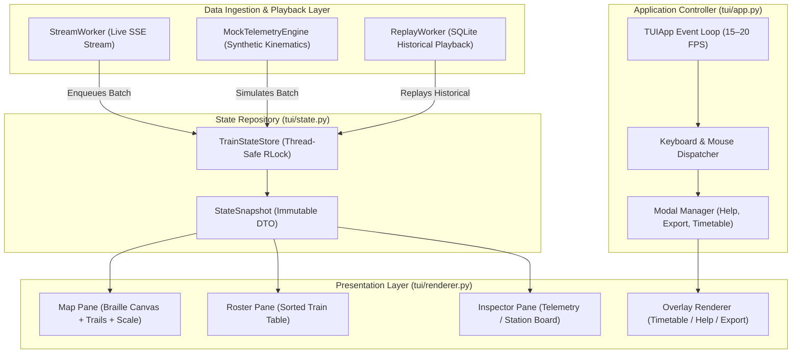
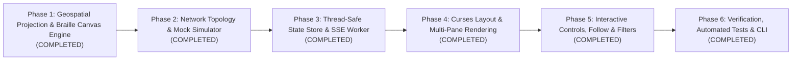
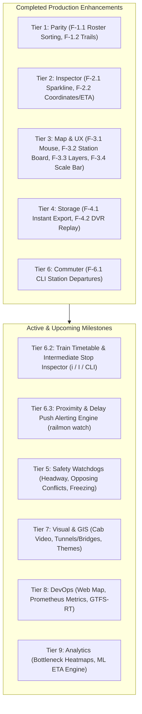

# Hellenic Railways Live Console TUI Map: Implementation Plan

> **Reference:** [`docs/architecture/architecture.md`](../../architecture/architecture.md), [`docs/architecture/tui-feature-enhancements.md`](../../architecture/tui-feature-enhancements.md)  
> **Target Modules:** [`../../../train_tracker.py`](../../../train_tracker.py), [`../../../tui/`](../../../tui/), [`../../../storage/`](../../../storage/)  
> **Relevant Rules & Skills:** [`../../../.agents/skills/diagrams-and-documentation/SKILL.md`](../../../.agents/skills/diagrams-and-documentation/SKILL.md), [`../../../.agents/skills/markdown-relative-paths/SKILL.md`](../../../.agents/skills/markdown-relative-paths/SKILL.md), [`../../../.agents/skills/ci-quality-gate/SKILL.md`](../../../.agents/skills/ci-quality-gate/SKILL.md), [`../../../.agents/skills/static-safety-analyzer/SKILL.md`](../../../.agents/skills/static-safety-analyzer/SKILL.md)

Detailed engineering specification, geospatial projection pipeline, multi-pane terminal architecture, completed foundational milestones, and phased feature enhancement roadmap for the Hellenic Railways (`railway.gov.gr`) real-time terminal map dashboard.

---

## 1. Executive Summary & Terminal Visual Mockup

The primary objective of `railmon` is to provide a zero-dependency, interactive, real-time terminal map displaying the Hellenic railway network, station nodes, and live train positions (derived from the HEPOS GNSS positioning system and track-snapping engine) directly within standard terminal emulators.

Following the completion of the core engine (Phases 1–6), the platform has expanded through a multi-tier roadmap encompassing dynamic roster sorting, historical breadcrumbs, live speed sparklines, distance/ETA estimators, station proximity boards ([`F-3.2`](../features/f-3-2-station-departure-board-proximity-inspector-plan.md)), instant trajectory exports ([`F-4.1`](../features/f-4-1-instant-in-tui-trajectory-export-plan.md)), SQLite historical DVR playback ([`F-4.2`](../features/f-4-2-sqlite-historical-dvr-playback-plan.md)), CLI station boards ([`F-6.1`](../features/f-6-1-cli-station-departure-and-arrival-boards-plan.md)), and train timetable inspection ([`F-6.2`](../features/f-6-2-train-timetable-and-intermediate-stop-inspector-plan.md)).

### 1.1 Console Dashboard Layout (Current Multi-Pane Architecture)

```text
+---------------------------------------------------------------------------------------------------+
| RAILMON | HELLENIC RAILWAYS (railway.gov.gr) | View: PATHE Mainline | Active: 14 | Delayed: 3 [●] |
+--------------------------------------------------------------------+------------------------------+
| [Map Viewport: 39.80°N, 22.50°E | Zoom: 1.5x | Trails: ALL]        | [ACTIVE TRAINS (14) | Sort:▼]|
|                                                                    |  #   TRAIN  TYPE  SPD▼  DLY  |
|   Thessaloniki                                                     | > 1  1599   IC    142   +9m  |
|     ◉===========================                                   |   2  1597   IC    118   +4m  |
|       \                        \                                   |   3  2232   PR    114    0m  |
|        \ Platy                  \                                  |   4  1314   PR     92   +1m  |
|         ◉===                     ◉ Kilkis                          |   5  2236   PR     86    0m  |
|          \  \                                                      |   6  1598   IC      0    0m  |
|           \  \ Katerini                                            +------------------------------+
|            \  ◉                                                    | [SELECTED TRAIN TELEMETRY]   |
|             \  \  ·                                                | Train No:     1599 (IC)      |
|              \  \  ·                                               | Locomotive:   120-024        |
|               \  ◉ Larissa                                         | Route:        ΑΘΗΝ -> ΘΕΣΣ   |
|                \  \  ·                                             | Next Station: Λάρισα (14.2km)|
|                 \  \  ▲ ◄ [1599] (142km/h, +9m)                    | Est. Arrival: ~6 min         |
|                  \  \                                              | Speed:        142.0 km/h     |
|                   \  ◉ Domokos                                     | Speed Trend:  ▂▃▅▆▇██▇▇█     |
|                    \  \                                            | Delay:        +9 min (Minor) |
|                     \  ◉ Lianokladi                                | Coords:       39.4821N,22.34E|
|                                                                    | Telemetry:    Updated 2s ago |
|  |---- 25 km ----|                                                 | Progress:     [======>--] 68%|
+--------------------------------------------------------------------+------------------------------+
| [q]Quit [h/j/k/l]Pan [+/-]Zoom [s]Sort [b]Trails [e]Export [m]Stations [i]Timetable [f]Follow [?]Help|
+---------------------------------------------------------------------------------------------------+
```

---

## 2. Core Architectural Principles & Layer Boundaries

The TUI implementation adheres strictly to the repository architecture defined in [`../../../.agents/rules/architecture.md`](../../../.agents/rules/architecture.md) and Python idioms in [`../../../.agents/rules/python-idioms.md`](../../../.agents/rules/python-idioms.md):

1. **Layer Separation:**
   - **Presentation Layer (`tui/`):** Manages screen layout, curses windows, double-buffered frame flushing, modal dialog overlays, and spatial viewport transformations. No low-level HTTP socket manipulation.
   - **State Management Layer (`tui/state.py`):** Thread-safe container coordinating incoming `TrainPosition` objects, breadcrumb trails, selection cursors, active filters, and modal input modes.
   - **Storage & Playback Layer (`storage/`):** SQLite WAL persistence, deadband filtering, historical DVR time scrubbing, and CLI formatters.
   - **Client Layer (`train_tracker.py`):** Uses [`RailwayGovClient`](../../../train_tracker.py) for SSE real-time streaming (`/api/train-stream`) and REST API endpoints (`/api/msd/geo`, `/api/public/stations`, `/api/public/train-schedules`).
   - **Domain Model Layer (`train_tracker.py`, `storage/models.py`):** Type-annotated dataclasses (`TrainPosition`, `TrainSchedule`, `ScheduledTripDB`, `ScheduleStopDB`).
2. **Standard Library First:**
   - The primary TUI engine is implemented using Python's standard `curses` library and standard library threading/math modules, ensuring zero required external runtime package dependencies for installation and execution.
3. **Resilience & Offline Simulation:**
   - SSE connection drops trigger automatic background reconnection with exponential backoff without freezing the UI event loop.
   - Dynamic terminal resize (`SIGWINCH` / `curses.KEY_RESIZE`) recalculates projection bounds and canvas dimensions without crashing.
   - Includes an **Offline Mock Engine** (`--demo`) producing synthetic train movements along the Greek railway network for development, verification, and offline demonstrations.

---

## 3. Geospatial & Terminal Projection Engine

### 3.1 Terminal Coordinate Transformation

The Greek railway network spans approximately:
- **Latitude:** $37.5^\circ\text{N}$ (Peloponnese / Southern Attica) to $41.3^\circ\text{N}$ (Northern Borders / Idomeni / Dikea).
- **Longitude:** $21.5^\circ\text{E}$ (Patras) to $26.6^\circ\text{E}$ (Alexandroupoli / Evros).

Terminal character cells are non-square; a single character row is approximately twice as tall as it is wide ($\text{aspect ratio } R \approx 2.0 - 2.2$). Without compensation, geographical maps appear vertically stretched.

#### Equirectangular Projection with Aspect Ratio Compensation

Given a geographic coordinate $(\text{lat}, \text{lng})$ and a viewport centered at $(\text{lat}_0, \text{lng}_0)$ with horizontal zoom scale $S_x$ and aspect ratio correction factor $R$:

$$X = \text{Center}_X + S_x \cdot (\text{lng} - \text{lng}_0) \cdot \cos(\text{lat}_0)$$

$$Y = \text{Center}_Y - \frac{S_x}{R} \cdot (\text{lat} - \text{lat}_0)$$

*(In terminal screen space, $Y$ increases downwards, matching terminal row indexing).*

### 3.2 Braille Sub-Pixel Canvas (`\u2800` – `\u28FF`)

To render crisp railway lines and curves without chunky full-block characters, the map engine implements a **Braille Sub-Pixel Canvas**:
- Each character cell in the terminal corresponds to a $2 \times 4$ dot matrix (2 columns, 4 rows of sub-pixels).
- A $100 \times 40$ character terminal provides an effective drawing resolution of $200 \times 160$ sub-pixels.
- Sub-pixel bitmask mapping:

```text
Braille Dot Layout:
(0,0) dot 1 (0x01)   (1,0) dot 4 (0x08)
(0,1) dot 2 (0x02)   (1,1) dot 5 (0x10)
(0,2) dot 3 (0x04)   (1,2) dot 6 (0x20)
(0,3) dot 7 (0x40)   (1,3) dot 8 (0x80)

Character Code = 0x2800 + sum(bitmasks of active dots)
```

- Railway segments between geographic coordinates are rasterized onto the sub-pixel canvas using Bresenham's line algorithm.

### 3.3 Dynamic Viewport Presets

Users can jump between predefined Greek railway corridor views with single keystrokes:
- **`[0]` All Greece:** Complete national network overview ($\text{lat}_0 = 39.5^\circ, \text{lng}_0 = 23.5^\circ$).
- **`[1]` Proastiakos (Suburban Athens):** Piraeus - Athens - SKA - Airport - Kiato - Chalkida ($\text{lat}_0 = 38.05^\circ, \text{lng}_0 = 23.75^\circ$).
- **`[2]` PATHE Mainline Trunk:** Athens to Thessaloniki corridor ($\text{lat}_0 = 39.6^\circ, \text{lng}_0 = 22.6^\circ$).
- **`[3]` Northern Greece:** Thessaloniki - Platy - Edessa / Florina & Drama - Alexandroupoli ($\text{lat}_0 = 40.8^\circ, \text{lng}_0 = 23.8^\circ$).

---

## 4. Component Architecture & Data Flow

### 4.1 System Data Flow (Mermaid)



### 4.2 Directional Train Glyphs

Based on the train's HEPOS-derived `track_heading` or `course` ($0^\circ - 360^\circ$ clockwise from North):

$$\text{heading\_glyph} = \begin{cases}
\text{"▲"} & 337.5^\circ \le \theta < 22.5^\circ \text{ (North)} \\
\text{"◥"} & 22.5^\circ \le \theta < 67.5^\circ \text{ (NE)} \\
\text{"►"} & 67.5^\circ \le \theta < 112.5^\circ \text{ (East)} \\
\text{"◢"} & 112.5^\circ \le \theta < 157.5^\circ \text{ (SE)} \\
\text{"▼"} & 157.5^\circ \le \theta < 202.5^\circ \text{ (South)} \\
\text{"◣"} & 202.5^\circ \le \theta < 247.5^\circ \text{ (SW)} \\
\text{"◄"} & 247.5^\circ \le \theta < 292.5^\circ \text{ (West)} \\
\text{"◤"} & 292.5^\circ \le \theta < 337.5^\circ \text{ (NW)}
\end{cases}$$

### 4.3 Color Palette & Status Mapping

Matching the official web platform's design language:
- **Intercity / Passenger (`Επιβατικά`):** Green (`COLOR_GREEN`)
- **Suburban / Proastiakos (`Προαστιακός`):** Cyan (`COLOR_CYAN`)
- **Freight (`Εμπορικά`):** Blue (`COLOR_BLUE`)
- **Stationary / Shunting (`Στάση`):** Dim white / Slate
- **Delay Badges:**
  - On-time ($\le 3$ min): Dim green / Normal text
  - Minor delay ($4 - 10$ min): Yellow (`COLOR_YELLOW`)
  - Major delay ($> 10$ min): Bold Red (`COLOR_RED`)

---

## 5. Directory Structure & Repository Layout

The current repository layout encompasses the core TUI, storage engine, feature plans, and automated verification suites:

```text
railmon/
├── train_tracker.py             # CLI dispatcher, client & domain models
├── storage/                     # SQLite WAL persistence & query engine
│   ├── __init__.py              # Storage package export
│   ├── cli_formatters.py        # Tabular CLI formatters (trips, stats, departures, timetable)
│   ├── db.py                    # Database connection manager & PRAGMA setup
│   ├── filter.py                # Telemetry deadband suppression engine
│   ├── models.py                # Storage dataclasses (TripSummary, ScheduleStopDB)
│   ├── recorder.py              # Asynchronous SQLite background telemetry writer
│   ├── repository.py            # Analytical query repository & historical retrieval
│   └── schema.py                # DDL migrations, tables & indexes
├── tui/                         # Interactive terminal map & presentation layer
│   ├── __init__.py              # TUI package entry point
│   ├── app.py                   # Curses lifecycle, input dispatch & modal management
│   ├── geo.py                   # WGS84 projections, aspect ratio, Braille canvas & scale bar
│   ├── mock_engine.py           # Offline demo simulator & timetable synthesis
│   ├── renderer.py              # Multi-pane layout, Braille drawing & modal overlays
│   ├── state.py                 # Thread-safe TrainStateStore, DTOs & filter settings
│   ├── stream_worker.py         # Live SSE & DVR historical background workers
│   └── data/
│       ├── stations.json        # 48 Greek railway station coordinates, names & aliases
│       └── tracks.json          # Curated Greek rail vector network segments
├── tests/                       # Automated test suites (450+ tests)
│   ├── test_cli_departures.py   # CLI departures & arrival board tests (F-6.1)
│   ├── test_cli_schedule.py     # CLI schedule & timetable tests (F-6.2)
│   ├── test_tui_timetable.py    # In-TUI timetable modal tests (F-6.2)
│   ├── test_tracker.py          # API client & SSE stream tests
│   ├── test_tui_geo.py          # Projection & Braille canvas math tests
│   ├── test_tui_state.py        # Thread-safe state store & filter tests
│   └── test_mock_engine.py      # Simulator motion & route progress tests
└── docs/
    ├── architecture/            # Architectural specifications
    │   ├── architecture.md      # Core system architecture & network specs
    │   └── tui-feature-enhancements.md # Multi-tier feature roadmap (Tiers 1–9)
    └── plans/                   # Implementation plans
        ├── core/                # Foundational TUI phases (Phases 1–6)
        │   ├── phase-1-geospatial-projection-braille-canvas.md
        │   ├── phase-2-rail-network-topology-mock-simulator.md
        │   ├── phase-3-thread-safe-state-store-sse-worker.md
        │   ├── phase-4-curses-tui-layout-multi-pane-rendering.md
        │   ├── phase-5-interactive-controls-following-filtering.md
        │   ├── phase-6-verification-automated-tests-cli-integration.md
        │   └── tui-map-implementation-plan.md # This document
        ├── features/            # Feature enhancement plans (Tiers 1–6)
        │   ├── f-1-1-roster-sorting-plan.md
        │   ├── f-1-2-breadcrumb-trail-toggle-plan.md
        │   ├── f-2-1-speed-sparkline-telemetry-age-plan.md
        │   ├── f-2-2-coordinates-distance-eta-plan.md
        │   ├── f-3-1-terminal-mouse-interaction-plan.md
        │   ├── f-3-2-station-departure-board-proximity-inspector-plan.md
        │   ├── f-3-3-map-layer-toggles-plan.md
        │   ├── f-3-4-dynamic-conformal-map-scale-bar-plan.md
        │   ├── f-4-1-instant-in-tui-trajectory-export-plan.md
        │   ├── f-4-2-sqlite-historical-dvr-playback-plan.md
        │   ├── f-6-1-cli-station-departure-and-arrival-boards-plan.md
        │   └── f-6-2-train-timetable-and-intermediate-stop-inspector-plan.md
        ├── fixes/               # P0, P1, and P2 safety & resilience fixes
        └── storage/             # SQLite storage architecture plans
```

---

## 6. Implementation Milestones & Extended Roadmap

### 6.1 Foundational Milestones (Phases 1–6) — *Completed*



1. **Phase 1: Geospatial Projection & Braille Canvas Engine (`[COMPLETED]`)**  
   *Specification:* [Phase 1 Implementation Plan](./phase-1-geospatial-projection-braille-canvas.md)  
   Implemented equirectangular projection, aspect-ratio correction, and `BrailleCanvas` sub-pixel rasterization in [`../../../tui/geo.py`](../../../tui/geo.py).

2. **Phase 2: Rail Network Topology & Offline Mock Simulator (`[COMPLETED]`)**  
   *Specification:* [Phase 2 Implementation Plan](./phase-2-rail-network-topology-mock-simulator.md)  
   Curated 48 national railway stations and track polylines; implemented `MockTelemetryEngine` in [`../../../tui/mock_engine.py`](../../../tui/mock_engine.py).

3. **Phase 3: Thread-Safe State Store & SSE Worker (`[COMPLETED]`)**  
   *Specification:* [Phase 3 Implementation Plan](./phase-3-thread-safe-state-store-sse-worker.md)  
   Implemented `TrainStateStore` with mutex protection, historical trail queues, and background `StreamWorker` in [`../../../tui/state.py`](../../../tui/state.py) and [`../../../tui/stream_worker.py`](../../../tui/stream_worker.py).

4. **Phase 4: Curses TUI Layout & Multi-Pane Rendering (`[COMPLETED]`)**  
   *Specification:* [Phase 4 Implementation Plan](./phase-4-curses-tui-layout-multi-pane-rendering.md)  
   Built 4-pane curses layout (Map, Roster, Inspector, Status Bar) with double-buffering in [`../../../tui/renderer.py`](../../../tui/renderer.py).

5. **Phase 5: Interactive Controls, Following & Filtering (`[COMPLETED]`)**  
   *Specification:* [Phase 5 Implementation Plan](./phase-5-interactive-controls-following-filtering.md)  
   Implemented panning/zooming, corridor presets (`0`–`3`), camera lock follow (`f`), and search filtering (`/`) in [`../../../tui/app.py`](../../../tui/app.py).

6. **Phase 6: Verification, Automated Tests & CLI Integration (`[COMPLETED]`)**  
   *Specification:* [Phase 6 Implementation Plan](./phase-6-verification-automated-tests-cli-integration.md)  
   Added `--tui` and `--demo` execution flags to `train_tracker.py` and authored baseline test suites.

---

### 6.2 Extended Feature Enhancements Roadmap (Tiers 1–6)

Building upon the completed foundation, interactive and analytical capabilities are implemented across structured tiers (detailed in [`docs/architecture/tui-feature-enhancements.md`](../../architecture/tui-feature-enhancements.md)):



#### Feature Milestones Summary:
- **Tier 1 (Parity) — `[COMPLETED]`:**
  - [`F-1.1: Dynamic Roster Sorting`](../features/f-1-1-roster-sorting-plan.md) (`s` / `S`): Sort by Train ID, Speed, or Delay.
  - [`F-1.2: Historical Breadcrumbs`](../features/f-1-2-breadcrumb-trail-toggle-plan.md) (`b` / `B`): Toggle between All, Selected, and Off.
- **Tier 2 (Inspector) — `[COMPLETED]`:**
  - [`F-2.1: Live Speed Sparkline & Telemetry Age`](../features/f-2-1-speed-sparkline-telemetry-age-plan.md): Unicode sparkline trend visualization.
  - [`F-2.2: WGS84 Readout, Distance & ETA`](../features/f-2-2-coordinates-distance-eta-plan.md): Geodesic distance and dynamic ETA calculations.
- **Tier 3 (Map & UX) — `[COMPLETED]`:**
  - [`F-3.1: Terminal Mouse Interaction`](../features/f-3-1-terminal-mouse-interaction-plan.md): Click-to-select and scroll-wheel zooming.
  - [`F-3.2: Station Departure Board`](../features/f-3-2-station-departure-board-proximity-inspector-plan.md) (`m` / `M`): Proximity station inspector.
  - [`F-3.3: Map Layer Toggles`](../features/f-3-3-map-layer-toggles-plan.md) (`v` / `t`): Toggle station labels and corridor colors.
  - [`F-3.4: Dynamic Scale Bar`](../features/f-3-4-dynamic-conformal-map-scale-bar-plan.md): Conformal real-world distance reference overlay.
- **Tier 4 (Storage) — `[COMPLETED]`:**
  - [`F-4.1: Instant Trajectory Export`](../features/f-4-1-instant-in-tui-trajectory-export-plan.md) (`e` / `E`): Export GeoJSON and CSV snapshots.
  - [`F-4.2: SQLite Historical DVR Playback`](../features/f-4-2-sqlite-historical-dvr-playback-plan.md) (`--replay`): Scrub and step timeline history.
- **Tier 6 (Commuter Services):**
  - [`F-6.1: CLI Station Boards`](../features/f-6-1-cli-station-departure-and-arrival-boards-plan.md) (`railmon departures`): `[COMPLETED]`.
  - [`F-6.2: Train Timetable & Intermediate Stop Inspector`](../features/f-6-2-train-timetable-and-intermediate-stop-inspector-plan.md) (`i` / `I` / `railmon schedule`): **Active Milestone** (detailed implementation plan established).
  - `F-6.3: Proximity & Delay Push Alerting Engine` (`railmon watch`): Planned background watchdog daemon.

---

## 7. Verification & Quality Assurance Strategy

1. **Unit & Mathematical Testing:**
   - Coordinate projection invariance: $(\text{lat}, \text{lng}) \to (x, y) \to (\text{lat}', \text{lng}')$ round-trip within precision limits.
   - Braille canvas pixel rasterization boundaries and sub-pixel index computations.
2. **Static Code Safety & MISRA / AUTOSAR Gate:**
   - Evaluated by [`static-safety-analyzer`](../../../.agents/skills/static-safety-analyzer/SKILL.md) verifying zero safety violations across MISRA C++, AUTOSAR C++14, and NASA JPL Power-of-10 rules.
   - Strict cyclomatic complexity limits ($< 25$) across all renderers and formatters.
3. **Automated Continuous Integration Gate:**
   - Enforced by [`ci-quality-gate`](../../../.agents/skills/ci-quality-gate/SKILL.md) running the full test suite (`python -m unittest discover tests`).
4. **Terminal Compatibility:**
   - Tested by [`tui-compatibility-tester`](../../../.agents/skills/tui-compatibility-tester/SKILL.md) across standard (80x24), compact (40x10), and ultra-wide (200x60) geometries.
   - Clean terminal restoration: always restore cursor visibility and exit alternate screen buffer (`curses.endwin()`) using context managers or `try...finally` guards.
