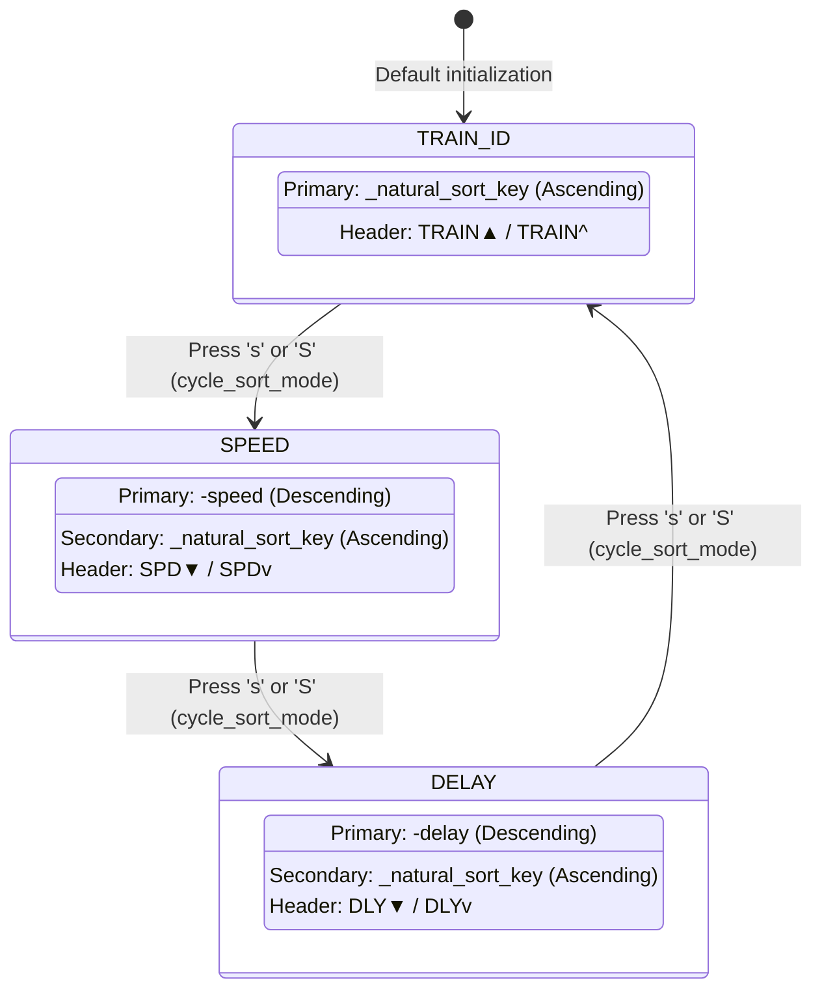

# Implementation Plan — F-1.1: Dynamic Train Roster Sorting (`s` / `S`)

> **Reference:** [TUI Feature Enhancements & Expansion Specification (`F-1.1`)](../../architecture/tui-feature-enhancements.md#f-11-dynamic-train-roster-sorting-s--s), [`README.md` Controls Reference](../../../README.md#L177)  
> **Target Modules:** [`../../../tui/state.py`](../../../tui/state.py), [`../../../tui/app.py`](../../../tui/app.py), [`../../../tui/renderer.py`](../../../tui/renderer.py)  
> **Test Suites:** [`../../../tests/test_tui_state.py`](../../../tests/test_tui_state.py), [`../../../tests/test_tui_controls.py`](../../../tests/test_tui_controls.py), [`../../../tests/test_tui_renderer.py`](../../../tests/test_tui_renderer.py)  
> **Relevant Rules & Skills:** [`../../../.agents/skills/diagrams-and-documentation/SKILL.md`](../../../.agents/skills/diagrams-and-documentation/SKILL.md), [`../../../.agents/skills/markdown-relative-paths/SKILL.md`](../../../.agents/skills/markdown-relative-paths/SKILL.md), [`../../../.agents/skills/ci-quality-gate/SKILL.md`](../../../.agents/skills/ci-quality-gate/SKILL.md)

---

## 1. Executive Summary & Objective

The Controls Reference table in [`../../../README.md`](../../../README.md#L177) documents the `s` shortcut as:
> `s` — *Cycle train roster sorting (Train ID, Speed, Delay)*

Currently, [`TrainStateStore._compute_filtered_list`](../../../tui/state.py#L465-L492) sorts all active trains solely by natural alphanumeric train number (`_natural_sort_key`), and [`TUIApp._handle_normal_input`](../../../tui/app.py#L384-L449) has no handler for `ord("s")` or `ord("S")`.

This implementation plan specifies the end-to-end design to add **Dynamic Train Roster Sorting (`F-1.1`)** across the state store, controller event loop, and multi-pane Curses renderer while ensuring:
1. **Selection Preservation:** Cycling the sort order preserves the currently selected train (`_selected_id`) and automatically recalculates `selected_index` and scroll offset so the cursor follows the selected train to its new row.
2. **Deterministic Tie-Breaking:** `SPEED` (descending) and `DELAY` (descending) sort modes use `_natural_sort_key` as a secondary sort key so trains with identical speed or delay values never jitter between frames.
3. **Visual Feedback & ASCII Fallback:** The **Active Trains Roster** title and column header display the active sort criterion with directional glyphs (`▲`/`▼` in UTF-8 mode, `^`/`v` in `--ascii` mode), and the `?` Help Modal documents `s / S`.

---

## 2. Architecture & State Machine Diagrams

### 2.1 Sort Mode State Machine

#### Mermaid State Diagram



#### ASCII State & Data Flow Diagram

```text
+-----------------------------------------------------------------------------------+
|                        ROSTER SORTING STATE & RENDER PIPELINE                     |
+-----------------------------------------------------------------------------------+

  User Keypress ('s' / 'S')
             |
             v
+---------------------------+     cycle_sort_mode()     +---------------------------+
|          TUIApp           | ------------------------> |      TrainStateStore      |
|  _handle_normal_input()   |                           |  _sort_mode:              |
|  clear_all() -> TRAIN_ID  |                           |    TRAIN_ID -> SPEED      |
+---------------------------+                           |    SPEED    -> DELAY      |
                                                        |    DELAY    -> TRAIN_ID   |
                                                        |  _version += 1            |
                                                        +---------------------------+
                                                                      |
                                                                      | get_snapshot()
                                                                      v
+---------------------------+     render_roster()       +---------------------------+
|        TUIRenderer        | <------------------------ |       StateSnapshot       |
|  Title: Sort:ID/SPD/DLY   |                           |  filtered_trains: Tuple   |
|  Cols:  TRAIN▲/SPD▼/DLY▼  |                           |  selected_index: int      |
|  Scroll: follows selected |                           |  sort_mode: RosterSortMode|
+---------------------------+                           +---------------------------+
```

---

## 3. Detailed Component Specifications

### 3.1 State Layer: [`../../../tui/state.py`](../../../tui/state.py)

#### A. `RosterSortMode` Enum Definition
Add `RosterSortMode` alongside `ConnectionStatus` and `InputMode` in [`../../../tui/state.py`](../../../tui/state.py#L21-L38):

```python
class RosterSortMode(Enum):
    """Ordering criteria for the active train roster table."""

    TRAIN_ID = auto()  # Ascending natural alphanumeric train number (e.g. 50 before 1597)
    SPEED = auto()     # Descending speed in km/h (fastest first), tie-broken by TRAIN_ID
    DELAY = auto()     # Descending delay in minutes (most delayed first), tie-broken by TRAIN_ID
```

#### B. Deterministic Sort Key Functions
Below [`_natural_sort_key`](../../../tui/state.py#L207-L214), define deterministic composite key helpers that safely handle `None` values in `TrainPosition.speed` and `TrainPosition.delay`:

```python
def _speed_sort_key(rec: TrainRecord) -> Tuple[float, Tuple[int, str]]:
    """Sort trains by descending speed, with natural train number as tie-breaker."""
    spd = float(rec.position.speed) if rec.position.speed is not None else 0.0
    return (-spd, _natural_sort_key(rec))


def _delay_sort_key(rec: TrainRecord) -> Tuple[float, Tuple[int, str]]:
    """Sort trains by descending delay, with natural train number as tie-breaker."""
    dly = float(rec.position.delay) if rec.position.delay is not None else 0.0
    return (-dly, _natural_sort_key(rec))
```

#### C. `StateSnapshot` Extension
Add `sort_mode` with a backward-compatible default value to [`StateSnapshot`](../../../tui/state.py#L95-L112):

```python
@dataclass(frozen=True)
class StateSnapshot:
    ...
    version: int
    is_recording: bool = False
    recording_db: Optional[str] = None
    sort_mode: RosterSortMode = RosterSortMode.TRAIN_ID
```

*(Defaulting `sort_mode: RosterSortMode = RosterSortMode.TRAIN_ID` ensures any existing unit test instantiating `StateSnapshot(...)` positionally or by keyword continues to pass without modification).*

#### D. `TrainStateStore` Attributes & Methods
1. In [`TrainStateStore.__init__`](../../../tui/state.py#L219-L241), initialize:
   ```python
   self._sort_mode: RosterSortMode = RosterSortMode.TRAIN_ID
   ```
2. In [`TrainStateStore.get_snapshot`](../../../tui/state.py#L324-L357), include `sort_mode=self._sort_mode` in the returned `StateSnapshot`.
3. Add `sort_mode` getter, `set_sort_mode`, and `cycle_sort_mode` methods under `self._lock`:
   ```python
   def set_sort_mode(self, mode: RosterSortMode) -> None:
       """Explicitly set the active roster sort ordering mode."""
       if not isinstance(mode, RosterSortMode):
           raise TypeError(f"Expected RosterSortMode, got {type(mode).__name__}")
       with self._lock:
           if self._sort_mode != mode:
               self._sort_mode = mode
               self._version += 1

   def cycle_sort_mode(self) -> RosterSortMode:
       """Cycle active roster sort mode: TRAIN_ID -> SPEED -> DELAY -> TRAIN_ID."""
       cycle_order = (
           RosterSortMode.TRAIN_ID,
           RosterSortMode.SPEED,
           RosterSortMode.DELAY,
       )
       with self._lock:
           curr_idx = cycle_order.index(self._sort_mode)
           self._sort_mode = cycle_order[(curr_idx + 1) % len(cycle_order)]
           self._version += 1
           return self._sort_mode
   ```
4. Update [`TrainStateStore._compute_filtered_list`](../../../tui/state.py#L465-L492) to dispatch on `self._sort_mode`:
   ```python
   if self._sort_mode == RosterSortMode.SPEED:
       results.sort(key=_speed_sort_key)
   elif self._sort_mode == RosterSortMode.DELAY:
       results.sort(key=_delay_sort_key)
   else:
       results.sort(key=_natural_sort_key)
   ```

---

### 3.2 Controller Layer: [`../../../tui/app.py`](../../../tui/app.py)

1. **Imports:** Import `RosterSortMode` from `tui.state`.
2. **Action Method `TUIApp.cycle_sort`:**
   ```python
   def cycle_sort(self) -> RosterSortMode:
       """Cycle active train roster sorting criterion (Train ID -> Speed -> Delay)."""
       return self.store.cycle_sort_mode()
   ```
3. **Reset Behavior in [`TUIApp.clear_all`](../../../tui/app.py#L362-L369):**
   - Keep `clear_all()` focused on clearing filters and selection, or keep sort mode independent so users don't lose their preferred sort column when clearing a search filter.
4. **Keybinding Dispatch in [`TUIApp._handle_normal_input`](../../../tui/app.py#L384-L449):**
   ```python
   # Cycle train roster sorting (Train ID, Speed, Delay)
   elif key in (ord("s"), ord("S")):
       self.cycle_sort()
   ```

---

### 3.3 Presentation Layer: [`../../../tui/renderer.py`](../../../tui/renderer.py)

#### A. Glyph Extensions in [`RenderGlyphs`](../../../tui/renderer.py#L68-L122)
Add sort direction indicator glyphs to `RenderGlyphs` for UTF-8 and 7-bit ASCII modes:
- `GLYPHS_UTF8`: `sort_asc="▲"`, `sort_desc="▼"`
- `GLYPHS_ASCII`: `sort_asc="^"`, `sort_desc="v"`

#### B. Roster Title & Column Header Formatting in [`TUIRenderer.render_roster`](../../../tui/renderer.py#L817-L855)
1. **Pane Title Badge:**
   - When `snapshot.sort_mode` is `SPEED` or `DELAY` (or always), display a compact sort badge in the roster border title if space permits, or reflect the active sort directly in the column header row.
2. **Column Header Alignment:**
   Current header at [`../../../tui/renderer.py`](../../../tui/renderer.py#L851-L853) is:
   ```python
   # Layout: [Cursor:2][#:3][TRAIN:6][TYPE:5][SPD:5][DLY:5][ST:4]
   table_hdr = " #   TRAIN  TYPE  SPD   DLY  ST"
   ```
   Notice that each column in `table_hdr` has trailing spaces that can accommodate a 1-cell sort indicator without shifting any column offsets:
   - `RosterSortMode.TRAIN_ID`:
     - UTF-8: `" #   TRAIN▲ TYPE  SPD   DLY  ST"`
     - ASCII: `" #   TRAIN^ TYPE  SPD   DLY  ST"`
   - `RosterSortMode.SPEED`:
     - UTF-8: `" #   TRAIN  TYPE  SPD▼  DLY  ST"`
     - ASCII: `" #   TRAIN  TYPE  SPDv  DLY  ST"`
   - `RosterSortMode.DELAY`:
     - UTF-8: `" #   TRAIN  TYPE  SPD   DLY▼ ST"`
     - ASCII: `" #   TRAIN  TYPE  SPD   DLYv ST"`

   Because `▲`/`▼` and `^`/`v` are single-column width characters (`get_string_display_width(ch) == 1`) that replace one space immediately following the column name (`"TRAIN "` -> `"TRAIN▲"`, `"SPD  "` -> `"SPD▼ "`, `"DLY "` -> `"DLY▼"`), the exact character column alignment (`31` cells total) is 100% preserved across every row in the table.

#### C. Status Bar & Help Modal Updates
1. **Status Bar Cheat Sheet ([`TUIRenderer.render_status_bar`](../../../tui/renderer.py#L1050-L1052)):**
   Update shortcuts string to include `[s] Sort`:
   ```python
   shortcuts = f" [q] Quit  [h/j/k/l] Pan  [+/-] Zoom  [Tab] Select  [s] Sort  {follow_str}  [/] Filter  [?] Help  [0..3] Presets"
   ```
2. **Help Modal Overlay ([`TUIRenderer.render_help_modal`](../../../tui/renderer.py#L1123-L1127)):**
   Add `("s / S", "Cycle train roster sorting (Train ID, Speed, Delay)")` under the `TRAIN SELECTION & TRACKING` section (adjusting `box_h = min(23, max(17, height - 2))` so all lines fit cleanly).

---

## 4. Edge Cases & Invariants

| Scenario | Expected Behavior |
| :--- | :--- |
| **Selected train when sort mode changes** | `self._selected_id` remains unchanged. On the next `get_snapshot()`, `selected_index` resolves to the train's new position in `filtered_trains`, and `calculate_scroll_offset()` keeps the selected train centered in the roster window. |
| **`select_next()` / `select_prev()` after sort change** | [`select_next()`](../../../tui/state.py#L371) and [`select_prev()`](../../../tui/state.py#L386) call `self._compute_filtered_list(self._trains)`, so `Tab` / `n` / `p` step through the roster in the newly sorted order. |
| **Trains with `speed=None` or `delay=None`** | Treated as `0.0` in `_speed_sort_key` and `_delay_sort_key` so `None` never raises a `TypeError` during comparison. |
| **Negative delays (early trains, e.g. `-2.0 min`)** | Sorted after `0.0 min` delays in `RosterSortMode.DELAY` because `-(-2.0) = +2.0 > 0.0`. |
| **Equal speeds or delays (e.g. multiple halted trains at `0 km/h`)** | Tie-broken deterministically by `_natural_sort_key(rec)` so row order never flickers across SSE updates. |
| **Dirty-frame skip optimization in `TUIApp.run_loop`** | `cycle_sort_mode()` increments `self._version` in `TrainStateStore`, which invalidates `self._last_rendered_version` in [`TUIApp.run_loop`](../../../tui/app.py#L582) and triggers an immediate redraw. |

---

## 5. Verification & Test Plan

### 5.1 Automated Unit Tests

1. **State Store Sorting Tests ([`../../../tests/test_tui_state.py`](../../../tests/test_tui_state.py)):**
   - `test_sort_mode_default_is_train_id`: Verify initial `snapshot.sort_mode == RosterSortMode.TRAIN_ID` and natural ordering (`IC 50`, `IC 52`, `1597`).
   - `test_cycle_sort_mode_transitions_and_version_bump`: Verify `TRAIN_ID -> SPEED -> DELAY -> TRAIN_ID` increments `snapshot.version` on each transition.
   - `test_sort_by_speed_descending_with_natural_tie_breaker`: Insert trains with speeds `[80.0, 140.0, 80.0, 0.0]` and verify descending order with natural ID tie-breaking for the two `80.0 km/h` trains.
   - `test_sort_by_delay_descending_with_negative_and_zero_delays`: Insert trains with delays `[-1.0, 12.0, 0.0, 4.0]` and verify order `[12.0, 4.0, 0.0, -1.0]`.
   - `test_selection_and_cursor_navigation_follow_active_sort_mode`: Select a train in `TRAIN_ID` mode, switch to `SPEED` mode, verify `selected_train.position.id` is preserved, `selected_index` updates to the new index, and `select_next()` advances according to the speed-sorted list.

2. **Controller Input Tests ([`../../../tests/test_tui_controls.py`](../../../tests/test_tui_controls.py)):**
   - `test_key_s_cycles_roster_sort_mode`: Send `ord("s")` and `ord("S")` via `app.process_input()` in `InputMode.NORMAL` and verify `store.get_snapshot().sort_mode` cycles through `SPEED`, `DELAY`, and `TRAIN_ID`.
   - `test_key_s_in_search_mode_appends_character_without_sorting`: Send `ord("s")` while in `InputMode.SEARCH` and verify it appends `"s"` to `app.search_buffer` rather than cycling the sort mode.

3. **Renderer Header & ASCII Fallback Tests ([`../../../tests/test_tui_renderer.py`](../../../tests/test_tui_renderer.py)):**
   - `test_render_roster_displays_utf8_sort_indicators`: Verify `"TRAIN▲"`, `"SPD▼"`, and `"DLY▼"` appear at row `1` of the roster window for each `RosterSortMode`.
   - `test_render_roster_displays_ascii_sort_indicators`: Verify `"TRAIN^"`, `"SPDv"`, and `"DLYv"` appear when `TUIRenderer(ascii_mode=True)` is used.

### 5.2 Quality Gate Execution
Run the repository quality gate ([`../../../.agents/skills/ci-quality-gate/SKILL.md`](../../../.agents/skills/ci-quality-gate/SKILL.md)):
```bash
python -m unittest discover -s tests -v
python -m mypy train_tracker.py tui storage tests
python -m flake8 train_tracker.py tui storage tests
```
