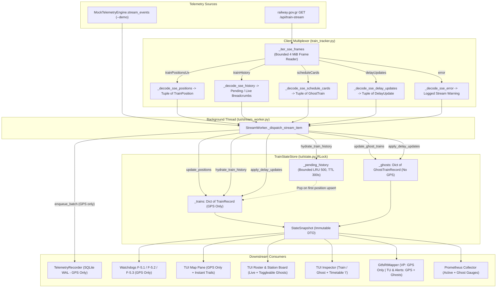

# Implementation Plan — F-10.1: Multiplexed SSE Ingestion (`trainHistory`, `scheduleCards` Ghosts & `delayUpdates`)

> **Reference:** [TUI Feature Enhancements & Expansion Specification (`F-10.1`)](../../architecture/tui-feature-enhancements.md#f-101-multiplexed-sse-ingestion-trainhistory-schedulecards-ghosts--delayupdates--implemented), [`railway-gov-gr-api-reference.md`](../../architecture/railway-gov-gr-api-reference.md#7-real-time-telemetry-stream-apitrain-stream--sse), [`architecture.md`](../../architecture/architecture.md)  
> **Target Modules:** [`../../../train_tracker.py`](../../../train_tracker.py), [`../../../tui/stream_worker.py`](../../../tui/stream_worker.py), [`../../../tui/state.py`](../../../tui/state.py), [`../../../tui/mock_engine.py`](../../../tui/mock_engine.py), [`../../../tui/app.py`](../../../tui/app.py), [`../../../tui/renderer.py`](../../../tui/renderer.py), [`../../../gtfs_rt/mapper.py`](../../../gtfs_rt/mapper.py), [`../../../exporter/collector.py`](../../../exporter/collector.py)  
> **Test Suites:** [`../../../tests/test_multiplexed_sse.py`](../../../tests/test_multiplexed_sse.py), [`../../../tests/test_tracker.py`](../../../tests/test_tracker.py), [`../../../tests/test_tui_integration.py`](../../../tests/test_tui_integration.py), [`../../../tests/test_tui_state.py`](../../../tests/test_tui_state.py), [`../../../tests/test_tui_controls.py`](../../../tests/test_tui_controls.py), [`../../../tests/test_tui_renderer.py`](../../../tests/test_tui_renderer.py), [`../../../tests/test_gtfs_mapper.py`](../../../tests/test_gtfs_mapper.py), [`../../../tests/test_exporter_collector.py`](../../../tests/test_exporter_collector.py)  
> **Relevant Skills & Guidelines:** [`../../../.agents/skills/diagrams-and-documentation/SKILL.md`](../../../.agents/skills/diagrams-and-documentation/SKILL.md), [`../../../.agents/skills/markdown-relative-paths/SKILL.md`](../../../.agents/skills/markdown-relative-paths/SKILL.md), [`../../../.agents/skills/static-safety-analyzer/SKILL.md`](../../../.agents/skills/static-safety-analyzer/SKILL.md), [`../../../.agents/skills/stream-resilience-tester/SKILL.md`](../../../.agents/skills/stream-resilience-tester/SKILL.md), [`../../../.agents/skills/tui-compatibility-tester/SKILL.md`](../../../.agents/skills/tui-compatibility-tester/SKILL.md), [`../../../.agents/skills/ci-quality-gate/SKILL.md`](../../../.agents/skills/ci-quality-gate/SKILL.md)

---

## 1. Executive Summary & Problem Statement

### 1.1 Current Single-Channel SSE Bottleneck
The official Hellenic Railways telemetry endpoint (`GET https://railway.gov.gr/api/train-stream`) multiplexes **six distinct Server-Sent Events (SSE) channels** over a single persistent HTTP connection (verified against live payloads and upstream client code in [`../../../reference/chunks/47794.19386b2538c55881.js`](../../../reference/chunks/47794.19386b2538c55881.js)):

| Upstream SSE Event | Payload Envelope | Current `railmon` Behavior | Operational Cost of Ignoring |
| :--- | :--- | :--- | :--- |
| `trainPositionsUx` | `{"positions": [...]}` | **Consumed** | Primary 1 Hz smoothed GPS feed |
| `trainPositions` | `{"positions": [...]}` | Optional via `event_filter` | Pre-UX raw sensor fallback |
| `trainHistory` | `{"history": {"<id>": [...]}}` | **Dropped** | Breadcrumb trails and F-2.1 speed sparklines start empty on launch and take 15–20s to populate |
| `scheduleCards` | `{"ghosts": [...]}` | **Dropped** | Active scheduled trains lacking a live GPS transponder vanish completely from the TUI roster, Station Boards, and GTFS-RT `TripUpdates` |
| `delayUpdates` | `{"delays": [...]}` | **Dropped** | Incremental schedule delay updates between position frames are lost until the next full position tick |
| `error` | Stream warning payload | **Dropped** | Upstream stream warnings are invisible in logs and diagnostics |

### 1.2 Goals & Architectural Principles
**Feature F-10.1** upgrades `railmon`'s ingestion, state, presentation, and export pipeline to consume all multiplexed SSE channels with **zero third-party runtime dependencies** and **zero regression** across existing subsystems:

1. **100% Backward Compatibility:** Keep [`RailwayGovClient.stream_train_positions()`](../../../train_tracker.py#L1048-L1110) and [`MockTelemetryEngine.stream_positions()`](../../../tui/mock_engine.py#L1465-L1480) unchanged in signature and return type (`Generator[List[TrainPosition], None, None]`). Introduce a new strongly-typed multiplexed API (`stream_events()`) yielding immutable `SSEFrame` objects.
2. **Strict GPS vs. Ghost Isolation:** Never insert coordinate-less ghost trains (`lat=None, lng=None`) into `TrainStateStore._trains` (`Dict[str, TrainRecord]`). Store them in a dedicated `TrainStateStore._ghosts` map so geospatial watchdogs (F-5.1 conflicts, F-5.2 sensor health, F-5.3 speed limits), map projection (`render_map`), SQLite recording (`TelemetryRecorder`), web map markers (`server/handler.py`), and GTFS-RT `VehiclePositions` remain 100% protected from `(0.0, 0.0)` Null Island artifacts and false alerts.
3. **Out-of-Order `trainHistory` Staging:** Upstream emits `event: trainHistory` **immediately on connect, before the first `event: trainPositionsUx` batch**. Stage unseen train IDs in a bounded, TTL-expiring pending-history cache so the very first `trainPositionsUx` batch immediately hydrates full trailing breadcrumb trails and speed sparklines.
4. **Live GPS Supersession & Selection Promotion:** Whenever a live GPS train appears with a `schedule_id` (or active `train_number`) matching a ghost run, automatically suppress the redundant ghost and smoothly promote an active TUI ghost selection to the live train record.
5. **Coupled Consist Aware `delayUpdates`:** Unlike the upstream web app's `.find()` (which only patches the first consist), apply `delayUpdates` to **all** live consists (*Διπλή Έλξη*) and matching ghost runs sharing the same `trainNumber` (using immutable `dataclasses.replace()` without artificially resetting GPS `last_updated` freshness).
6. **Full Offline `--demo` Parity:** Extend [`MockTelemetryEngine`](../../../tui/mock_engine.py) with `stream_events()` emitting synthetic startup `trainHistory`, periodic `scheduleCards` ghosts, and periodic `delayUpdates` so every workflow is testable offline.

---

## 2. Architecture & Data Flow

### 2.1 Multiplexed SSE Ingestion & Isolation Pipeline (Mermaid)



### 2.2 Startup Hydration & Live Supersession Sequence (Mermaid + ASCII)

```mermaid
sequenceDiagram
    autonumber
    participant SSE as Upstream /api/train-stream
    participant SW as StreamWorker (tui/stream_worker.py)
    participant Store as TrainStateStore (tui/state.py)
    participant UI as TUIRenderer (tui/renderer.py)

    SSE-->>SW: event: trainHistory (20 pts for trainId=A)
    SW->>Store: hydrate_train_history({A: [20 pts]})
    Note over Store: Train A not yet in _trains -> stage in _pending_history[A]

    SSE-->>SW: event: scheduleCards (ghosts=[schedule:S1, schedule:S2])
    SW->>Store: update_ghost_trains([S1, S2])
    Store-->>UI: Roster renders 0 live + 2 [GHOST] runs

    SSE-->>SW: event: trainPositionsUx (positions=[Train A, scheduleId=S1])
    SW->>Store: update_positions([Train A])
    Note over Store: Pop _pending_history[A] -> trail hydrated immediately (21 pts)
    Note over Store: S1 superseded by live Train A -> suppress ghost & promote selection
    Store-->>UI: Map shows full trail + sparkline; Roster shows Train A + ghost S2

    SSE-->>SW: event: delayUpdates (delays=[{trainNumber: 1237, delay: 6}])
    SW->>Store: apply_delay_updates([{trainNumber: 1237, delay: 6}])
    Note over Store: Patch live consists & ghost S2 via replace() without altering GPS last_updated
    Store-->>UI: Delay badge immediately updates to +6m
```

```text
+----------------------------------------------------------------------------------+
|                  TrainStateStore Dual-Collection Memory Model                    |
+----------------------------------------------------------------------------------+
|                                                                                  |
|  _pending_history: OrderedDict[train_id, (staged_at, Tuple[Breadcrumb, ...])]    |
|    |-- Cap: 500 trains x 25 points  |  TTL: 300s  |  Popped on first live fix    |
|                                                                                  |
|  _trains: Dict[train_id, TrainRecord]               (Strictly valid WGS84 GPS)   |
|    |-- Consumed by: Map Canvas, F-5.1 Conflicts, F-5.2 Sensor Health,            |
|    |                F-5.3 Speed Limits, TelemetryRecorder, Web /api/trains,      |
|    |                GTFS-RT VehiclePositions + TripUpdates                       |
|                                                                                  |
|  _ghosts: Dict[ghost_id, GhostTrainRecord]          (No GPS; time-est progress)  |
|    |-- Keyed by "schedule:<scheduleId>"  |  Superseded when live match arrives   |
|    |-- Consumed by: TUI Roster (if GhostVisibilityMode.SHOW), Ghost Inspector,   |
|    |                Station Departure Board, Timetable Modal ('i'),              |
|    |                GTFS-RT TripUpdates & Delay Alerts (NEVER VehiclePositions)  |
|                                                                                  |
+----------------------------------------------------------------------------------+
```

---

## 3. Data Structures & Domain Models

All newly introduced models follow **PY-MISRA-05** (`@dataclass(frozen=True)`, immutable tuples rather than mutable containers), **PY-MISRA-06** (complete type annotations, `Enum` policies instead of bare booleans), and **PY-MISRA-07** (`math.isfinite()` and coordinate/numeric range guards).

### 3.1 Multiplexed SSE DTOs in [`train_tracker.py`](../../../train_tracker.py)

Add immediately after `CabStreamInfo` in [`../../../train_tracker.py`](../../../train_tracker.py):

```python
MAX_SSE_FRAME_BYTES: int = 4 * 1024 * 1024  # 4 MiB hard cap per SSE frame (PY-MISRA-02)
MAX_HISTORY_TRAINS_PER_FRAME: int = 500
MAX_HISTORY_POINTS_PER_TRAIN: int = 50
MAX_GHOSTS_PER_FRAME: int = 500
MAX_DELAY_UPDATES_PER_FRAME: int = 500
MIN_VALID_DELAY_MIN: int = -120
MAX_VALID_DELAY_MIN: int = 1440


class SSEEventType(Enum):
    """Supported multiplexed SSE event channels from /api/train-stream."""

    TRAIN_POSITIONS_UX = "trainPositionsUx"
    TRAIN_POSITIONS = "trainPositions"
    TRAIN_HISTORY = "trainHistory"
    SCHEDULE_CARDS = "scheduleCards"
    DELAY_UPDATES = "delayUpdates"
    ERROR = "error"


@dataclass(frozen=True)
class TrainHistoryPoint:
    """Single historical breadcrumb point delivered by SSE event: trainHistory."""

    lat: float
    lng: float
    timestamp_epoch: float
    speed: float = 0.0
    course: Optional[float] = None
    track_heading: Optional[float] = None
    iso_timestamp: Optional[str] = None

    @classmethod
    def from_dict(
        cls,
        data: Dict[str, Any],
        fallback_epoch: float,
    ) -> "TrainHistoryPoint":
        """Defensively parse and validate a trainHistory point dictionary."""
        # Validates finite WGS84 lat/lng, rejects (0.0, 0.0), parses ts/receivedAt UTC ISO
        ...


@dataclass(frozen=True)
class GhostTrain:
    """In-progress scheduled run lacking live GPS telemetry (SSE event: scheduleCards)."""

    id: str
    train_number: str
    schedule_id: Optional[str]
    schedule_number: Optional[str]
    name: Optional[str]
    service_type: Optional[str]
    category: Optional[str]
    origin: Optional[str]
    destination: Optional[str]
    corridor: Optional[str]
    scheduled_departure: Optional[str]
    scheduled_arrival: Optional[str]
    delay: int
    progress: Optional[float]  # Clamped to [0.0, 1.0]
    schedule_status: str = "in_progress"
    gps_status: str = "none"
    signal_status: str = "none"
    timestamp: Optional[str] = None

    @classmethod
    def from_dict(cls, data: Dict[str, Any]) -> "GhostTrain":
        """Defensively parse a scheduleCards ghost object."""
        ...


@dataclass(frozen=True)
class DelayUpdate:
    """Incremental train delay delta delivered by SSE event: delayUpdates."""

    train_number: str
    delay: int
    train_id: Optional[str] = None
    schedule_id: Optional[str] = None

    @classmethod
    def from_dict(cls, data: Dict[str, Any]) -> "DelayUpdate":
        """Defensively parse a delayUpdates delta item with finite range bounds."""
        ...


@dataclass(frozen=True)
class SSEFrame:
    """Immutable multiplexed frame decoded from /api/train-stream."""

    event_type: SSEEventType
    positions: Tuple[TrainPosition, ...] = ()
    history: Tuple[Tuple[str, Tuple[TrainHistoryPoint, ...]], ...] = ()
    ghosts: Tuple[GhostTrain, ...] = ()
    delays: Tuple[DelayUpdate, ...] = ()
    error_message: Optional[str] = None
    received_at: float = 0.0
```

> **Design Note — Deep Immutability:** `SSEFrame.history` uses `Tuple[Tuple[str, Tuple[TrainHistoryPoint, ...]], ...]` rather than a mutable `Dict[str, List[...]]`, guaranteeing complete thread-isolation across the worker-to-store boundary.

### 3.2 State Layer Models in [`tui/state.py`](../../../tui/state.py)

Add to [`../../../tui/state.py`](../../../tui/state.py):

```python
DEFAULT_MAX_TRAIL_LEN: int = 25          # Fits full ~20-pt upstream trainHistory burst + live tip
DEFAULT_GHOST_STALE_TIMEOUT_SEC: float = 300.0
MAX_PENDING_HISTORY_TRAINS: int = 500
PENDING_HISTORY_TTL_SEC: float = 300.0


class GhostVisibilityMode(Enum):
    """Visibility policy for untracked scheduled ghost runs in TUI roster and boards."""

    SHOW = auto()  # Default: display active non-superseded ghost runs
    HIDE = auto()  # Hide ghost runs from TUI roster and Station Departure Board


@dataclass
class GhostTrainRecord:
    """Stateful wrapper around a GhostTrain maintaining observation metadata."""

    ghost: GhostTrain
    first_seen: float = field(default_factory=time.time)
    last_updated: float = field(default_factory=time.time)
    update_count: int = 1

    def clone(self) -> "GhostTrainRecord":
        """Create a thread-isolated copy for StateSnapshot."""
        return GhostTrainRecord(
            ghost=self.ghost,
            first_seen=self.first_seen,
            last_updated=self.last_updated,
            update_count=self.update_count,
        )
```

Extend [`StateSnapshot`](../../../tui/state.py#L248-L297) with backward-compatible defaulted fields:

```python
    ghost_trains: Dict[str, GhostTrainRecord] = field(default_factory=dict)
    filtered_ghosts: Tuple[GhostTrainRecord, ...] = ()
    selected_ghost: Optional[GhostTrainRecord] = None
    ghost_visibility_mode: GhostVisibilityMode = GhostVisibilityMode.SHOW
    ghost_count: int = 0
    history_hydrated_trains: int = 0
    delay_updates_applied: int = 0
    stream_event_counts: Tuple[Tuple[str, int], ...] = ()
```

> **Backward Compatibility Invariant:** All existing `StateSnapshot(...)` call sites in tests construct snapshots without passing the new fields; default values preserve 100% existing test compatibility.

---

## 4. Detailed Component Designs

### 4.1 Multiplexed SSE Parser & Client ([`train_tracker.py`](../../../train_tracker.py))

1. **ISO UTC Parsing Helper (`_parse_iso_utc_epoch`):**
   - Lightweight stdlib helper using `datetime.fromisoformat(raw.replace("Z", "+00:00"))` (avoiding circular imports from `storage.repository`), returning `Optional[float]` guarded by `math.isfinite()`.
2. **Modular Per-Event Decoders** (each function kept small with McCabe complexity $\le 10$ per PY-MISRA-08):
   - `_decode_sse_positions(raw_json: str) -> Optional[List[TrainPosition]]` *(existing, retained)*.
   - `_decode_sse_history(raw_json: str, now: float) -> Optional[Tuple[Tuple[str, Tuple[TrainHistoryPoint, ...]], ...]]`:
     - Parses `payload.get("history")`; verifies it is a `dict`.
     - Iterates at most `MAX_HISTORY_TRAINS_PER_FRAME` entries.
     - For each `(train_id, raw_points)`, parses up to `MAX_HISTORY_POINTS_PER_TRAIN` trailing points (`raw_points[-MAX_HISTORY_POINTS_PER_TRAIN:]`), skips malformed points, sorts chronologically by `timestamp_epoch`, and drops empty sequences.
   - `_decode_sse_schedule_cards(raw_json: str) -> Optional[Tuple[GhostTrain, ...]]`:
     - Parses `payload.get("ghosts")`; verifies it is a `list` (an empty list `[]` returns `()`, **not** `None`, so full-snapshot clearing works!).
     - Caps at `MAX_GHOSTS_PER_FRAME`, skips malformed dicts via `GhostTrain.from_dict()`.
   - `_decode_sse_delay_updates(raw_json: str) -> Optional[Tuple[DelayUpdate, ...]]`:
     - Parses `payload.get("delays")`; verifies it is a `list`, caps at `MAX_DELAY_UPDATES_PER_FRAME`, validates finite delay in `[MIN_VALID_DELAY_MIN, MAX_VALID_DELAY_MIN]`.
   - `_decode_sse_error(raw_json: str) -> str`:
     - Extracts `"error"` / `"message"` from JSON dict or falls back to truncated raw text ($\le 256$ chars).
3. **W3C-Compliant Frame Iterator (`_iter_sse_frames`):**
   - Ignores comment/keep-alive lines starting with `":"`.
   - Accumulates `data:` lines while tracking `buffered_bytes`; if `buffered_bytes > MAX_SSE_FRAME_BYTES`, logs a `WARNING`, drops the oversized frame, and resets buffers.
   - On blank separator line, dispatches by `current_event`:
     - `trainPositionsUx` (and `trainPositions` only when `include_raw_positions=True` or explicitly filtered) -> `SSEFrame(SSEEventType.TRAIN_POSITIONS_UX, positions=...)`
     - `trainHistory` -> `SSEFrame(SSEEventType.TRAIN_HISTORY, history=...)`
     - `scheduleCards` -> `SSEFrame(SSEEventType.SCHEDULE_CARDS, ghosts=...)`
     - `delayUpdates` -> `SSEFrame(SSEEventType.DELAY_UPDATES, delays=...)`
     - `error` -> `SSEFrame(SSEEventType.ERROR, error_message=...)`
     - Unknown event names -> debug-logged and silently ignored (zero-crash forward tolerance).
4. **Public Client Methods:**
   - **`stream_events(...) -> Generator[SSEFrame, None, None]`**: Reuses the exact TLS, `Retry-After` (HTTP 429), exponential backoff + jitter (5xx / socket drop), and `stop_event` interruption logic from `stream_train_positions()`.
   - **`stream_train_positions(...) -> Generator[List[TrainPosition], None, None]`**: Preserved verbatim in public signature; internally consumes `_iter_sse_frames()` filtering strictly for `event_filter` (`"trainPositionsUx"` by default) so existing callers (`cmd_stream`, `cmd_record`, `tests/test_tracker.py`, `tests/test_tui_integration.py`) see zero behavioral change.

---

### 4.2 Background Worker Integration ([`tui/stream_worker.py`](../../../tui/stream_worker.py))

Update [`StreamWorker`](../../../tui/stream_worker.py#L24-L222):

1. **Stream Source Selection (`_get_stream_generator`):**
   - If `self.custom_stream` is supplied: yield items as-is (supports both legacy `List[TrainPosition]` test fixtures and new `SSEFrame` test fixtures!).
   - If `self.mock_engine` is supplied: call `self.mock_engine.stream_events(interval_sec=1.0, stop_event=self._stop_event)` if available (fallback to `stream_positions()` for custom test doubles lacking `stream_events`).
   - If `self.client` is supplied: call `self.client.stream_events(reconnect_delay=0.0, stop_event=self._stop_event)` if available (fallback to `stream_train_positions()` for mocks lacking `stream_events`).
2. **Typed Dispatch Helper (`_dispatch_stream_item`):**
   - If `isinstance(item, SSEFrame)`:
     - `TRAIN_POSITIONS_UX` / `TRAIN_POSITIONS`:
       - Call `self.store.record_stream_event(item.event_type.value)`.
       - If `item.positions`: call `self.store.update_positions(list(item.positions))` and forward `list(item.positions)` to `self.recorder.enqueue_batch(...)` when recording is active.
     - `TRAIN_HISTORY`:
       - Call `self.store.record_stream_event(item.event_type.value)`.
       - If `item.history`: call `self.store.hydrate_train_history(item.history)`.
     - `SCHEDULE_CARDS`:
       - Call `self.store.record_stream_event(item.event_type.value)`.
       - Always call `self.store.update_ghost_trains(list(item.ghosts))` (including empty snapshots `()` to clear expired ghosts).
     - `DELAY_UPDATES`:
       - Call `self.store.record_stream_event(item.event_type.value)`.
       - If `item.delays`: call `self.store.apply_delay_updates(list(item.delays))`.
     - `ERROR`:
       - Call `self.store.record_stream_event(item.event_type.value)`.
       - Log `logger.warning("Upstream SSE error frame: %s", item.error_message)` without disconnecting or resetting state.
   - Else (legacy `List[TrainPosition]` from custom/mock stream):
     - Existing behavior: `if item: self.store.update_positions(item)` + recorder enqueue.

---

### 4.3 State Store Semantics ([`tui/state.py`](../../../tui/state.py))

Implement four focused, mutex-protected ingestion/control methods in [`TrainStateStore`](../../../tui/state.py#L463):

1. **`hydrate_train_history(self, history: Sequence[Tuple[str, Sequence[TrainHistoryPoint]]], now: Optional[float] = None) -> int`:**
   - Converts `TrainHistoryPoint` entries to `HistoricalBreadcrumb(lat, lng, timestamp=pt.timestamp_epoch, speed=pt.speed)`.
   - **Case A (`tid` already in `self._trains`):**
     - Merges existing `rec.trail` with incoming history breadcrumbs, sorted ascending by `timestamp`.
     - Deduplicates consecutive breadcrumbs where `abs(lat1 - lat2) <= 1e-5`, `abs(lng1 - lng2) <= 1e-5`, and `abs(t1 - t2) < 0.5`.
     - Keeps the most recent `self._max_trail_len` points in `rec.trail` without overwriting newer live tip coordinates or altering `rec.last_updated`.
   - **Case B (`tid` not yet in `self._trains`):**
     - Stages bounded tuple of deduplicated breadcrumbs into `self._pending_history[tid] = (ref_now, crumbs)`.
     - Evicts oldest entry if `len(self._pending_history) > MAX_PENDING_HISTORY_TRAINS`.
   - In `_upsert_train_position(pos, ts)` when inserting a **new** `TrainRecord`:
     - Pops `staged = self._pending_history.pop(pos.id, None)`.
     - If `staged` exists and `(ts - staged[0]) <= PENDING_HISTORY_TTL_SEC`, seeds `record.trail` with `staged[1]` BEFORE appending the current live point (respecting `threshold_deg` deduplication and `maxlen`).
   - Increments `self._history_hydrated_trains` and `self._version` whenever at least one train is hydrated or staged.

2. **`update_ghost_trains(self, ghosts: Sequence[GhostTrain], now: Optional[float] = None) -> int`:**
   - Treats `scheduleCards` as an authoritative full snapshot of current non-GPS runs:
     - Builds `new_ghosts: Dict[str, GhostTrainRecord] = {}`.
     - Preserves `first_seen` and increments `update_count` for continuing ghost IDs.
     - Replaces `self._ghosts = new_ghosts`.
   - Checks selection continuity:
     - If `self._selected_id` pointed to a ghost ID that vanished from `self._ghosts`, attempts to promote `self._selected_id` to any live train in `self._trains` matching the ghost's `schedule_id` (or normalized `train_number`); otherwise clears `self._selected_id = None` and `self._follow_mode = False`.
   - Increments `self._version` and `self._total_messages`.

3. **Live Supersession & Promotion Rule:**
   - Helper `_active_live_identifiers() -> Tuple[FrozenSet[str], FrozenSet[str]]` returns `(live_schedule_ids, live_train_numbers)` from `self._trains.values()`.
   - A ghost in `self._ghosts` is **superseded** if:
     - `ghost.schedule_id` (stripped) is in `live_schedule_ids`, **OR**
     - `ghost.train_number.strip().upper()` is in `live_train_numbers`.
   - During `_upsert_train_position(pos, ts)`, if `self._selected_id` currently references a ghost in `self._ghosts` whose `schedule_id` or `train_number` matches the newly arriving live `pos`, automatically promote `self._selected_id = pos.id`!
   - Non-superseded ghosts populate `snapshot.ghost_trains` and `snapshot.ghost_count`.

4. **`apply_delay_updates(self, updates: Sequence[DelayUpdate], now: Optional[float] = None) -> int`:**
   - For each `upd` in `updates`:
     - Matches live records in `self._trains`:
       - Exact `upd.train_id` match if provided, else `upd.schedule_id` match if provided, else case-insensitive `train_number` match across **all** consists.
       - Replaces `rec.position = dataclasses.replace(rec.position, delay=upd.delay)` ONLY when `rec.position.delay != upd.delay`.
       - **Crucial invariant:** Does **NOT** mutate `rec.last_updated` (preserves F-5.2 GPS freshness watchdog accuracy!).
     - Matches ghost records in `self._ghosts` via `schedule_id` or case-insensitive `train_number`, replacing `grec.ghost = dataclasses.replace(grec.ghost, delay=upd.delay)`.
   - Returns total count of modified records; increments `self._delay_updates_applied` and `self._version` if `modified > 0`.

5. **Ghost Visibility Toggle & Unified Selection (`u` / `U`):**
   - `set_ghost_visibility_mode(mode: GhostVisibilityMode) -> None` (validates `isinstance(mode, GhostVisibilityMode)`).
   - `toggle_ghost_visibility() -> GhostVisibilityMode` (`SHOW <-> HIDE`; if switching to `HIDE` while a ghost is selected, clears `self._selected_id = None`).
   - `_compute_filtered_ghosts(ghosts) -> List[GhostTrainRecord]`:
     - Returns `[]` when `self._ghost_visibility_mode == GhostVisibilityMode.HIDE`.
     - Filters by `self._corridor_filter` (reusing `_matches_explicit_corridor_tag` + station/service-type inference without requiring GPS coordinates!) and `self._filter_query` (`train_number`, `name`, `origin`, `destination`, `corridor`, `service_type`, `category`, `"ghost"`).
     - Sorts according to `self._sort_mode` (`TRAIN_ID` natural sort, `DELAY` descending delay, or natural tie-break when `SPEED` mode is active since ghosts have no speed).
   - Unified roster navigation (`select_next`, `select_prev`, `select_by_id`):
     - Combined navigable sequence is `[r.position.id for r in filtered_trains] + [g.ghost.id for g in filtered_ghosts]`.
     - `StateSnapshot.selected_index` reflects the zero-based cursor row inside the combined roster (`0..len(filtered_trains)-1` for live trains; `len(filtered_trains) + idx` for ghosts).
     - `StateSnapshot.selected_train` is set if selected ID is in `trains_copy`; `StateSnapshot.selected_ghost` is set if selected ID is in `ghost_trains_copy` (strictly mutually exclusive).
   - `toggle_follow_mode()` / `set_follow_mode(True)`:
     - Only engages `_follow_mode = True` when `self._selected_id in self._trains` (never allows follow-lock on coordinate-less ghosts).

6. **Stale Pruning (`prune_stale_trains`):**
   - Evicts entries in `self._pending_history` older than `PENDING_HISTORY_TTL_SEC` (`300s`).
   - Evicts entries in `self._ghosts` older than `self._ghost_stale_timeout_sec` (`300s`), clearing orphaned selection if needed.

---

### 4.4 Offline Mock Simulation Parity ([`tui/mock_engine.py`](../../../tui/mock_engine.py))

Add `stream_events(self, interval_sec: float = 1.0, stop_event: Optional[threading.Event] = None) -> Generator[SSEFrame, None, None]` to [`MockTelemetryEngine`](../../../tui/mock_engine.py#L1465):
- **Tick 0 (Startup Burst):**
  1. Generates `SSEFrame(SSEEventType.TRAIN_HISTORY, history=...)` with 15 synthetic backward-projected points per simulated train along its track segment (demonstrating immediate startup trail and sparkline hydration in `--tui --demo`).
  2. Generates `SSEFrame(SSEEventType.SCHEDULE_CARDS, ghosts=...)` with 2 synthetic ghost runs:
     - `schedule:mock-ghost-1237`: Train `1237` (`Suburban`, `PIRAIR`, `Αεροδρόμιο -> Πειραιάς`, `delay=2`, `progress=0.42`)
     - `schedule:mock-ghost-1520`: Train `1520` (`Regional`, `THESSALY`, `Λάρισα -> Βόλος`, `delay=0`, `progress=0.25`)
  3. Yields `SSEFrame(SSEEventType.TRAIN_POSITIONS_UX, positions=tuple(self.step(interval_sec)))`.
- **Subsequent Ticks:**
  - Every tick: yields `TRAIN_POSITIONS_UX`.
  - Every 10 ticks: advances synthetic ghost `progress` smoothly (wrapping around when reaching `0.98`) and emits `SCHEDULE_CARDS`.
  - Every 15 ticks: emits a `DELAY_UPDATES` frame applying a realistic ±1–2 min delta to one live train and one ghost train.

---

### 4.5 TUI Controller & Presentation Layer ([`tui/app.py`](../../../tui/app.py) & [`tui/renderer.py`](../../../tui/renderer.py))

#### A. Controller Bindings ([`tui/app.py`](../../../tui/app.py))
1. **Key `u` / `U` (`InputMode.NORMAL`):**
   - Calls `self.toggle_ghost_trains()`, toggling `GhostVisibilityMode.SHOW <-> HIDE` and showing transient status toast: `"[Ghosts: SHOW (N active)]"` or `"[Ghosts: HIDDEN]"`.
   - Leaves `InputMode.SEARCH` unaffected so typing `u` in search queries appends normally.
2. **Ghost-Aware Guard Rails on Selected-Train Actions:**
   - **`f` / `F` (`toggle_follow`):** If `snapshot.selected_ghost is not None`, display toast `"[Ghost run has no live GPS coordinates to follow]"` and keep follow mode off.
   - **`e` / `E` (`export_selected_train_snapshot`):** If `snapshot.selected_ghost is not None`, display error toast `"[Cannot export trajectory: ghost run has no GPS telemetry]"`.
   - **`w` / `W` (`launch_cab_stream_for_selected_train`):** If `snapshot.selected_ghost is not None`, display toast `"[Cab video unavailable for untracked ghost run]"`.
   - **`i` / `I` (`toggle_timetable_modal`):** **Supported for both live trains and ghosts!** Passes `ghost.train_number` and `ghost.schedule_id` to fetch/render the complete intermediate calling-point itinerary.
   - **Mouse Click on Roster Pane:** Maps `item_idx < len(snapshot.filtered_trains)` to live train ID and `len(snapshot.filtered_trains) <= item_idx < total_rows` to `snapshot.filtered_ghosts[item_idx - len(snapshot.filtered_trains)].ghost.id`; double-clicking a ghost selects it without engaging follow mode.

#### B. Renderer Enhancements ([`tui/renderer.py`](../../../tui/renderer.py))

1. **Roster Pane (`render_roster`):**
   - Title updates dynamically:
     - With visible ghosts: `[ ACTIVE TRAINS (14 | +2 GHOST) ]`
     - With hidden ghosts (`u` toggled off) and `ghost_count > 0`: `[ ACTIVE TRAINS (14 | GHOST OFF) ]`
     - With zero ghosts: `[ ACTIVE TRAINS (14) ]` *(unchanged)*
   - Renders `snapshot.filtered_trains` followed by `snapshot.filtered_ghosts`:
     - Ghost row format preserves exact column alignment:
       ```text
       +------------------------------+
       | [ACTIVE TRAINS (14|+2 GHOST)]|
       |  #  TRAIN▲   TY  SPD  DLY  ST|
       | > 1 IC52     IC  142  +4m OK |
       |   2 1597     PR  118   0m OK |
       |  15 1237     PR  ---  +2m GHT|
       |  16 1520     RG  ---   0m GHT|
       +------------------------------+
       ```
     - Styled with dimmed attribute (`PAIR_STATION_DIM | curses.A_DIM`, or `select_attr` when highlighted) and `GHT` status code (`100%` 7-bit ASCII clean).

2. **Ghost Telemetry Inspector (`_render_ghost_inspector`, invoked from `render_inspector`):**
   - When `snapshot.selected_train is None and snapshot.selected_ghost is not None`:
     ```text
     +------------------------------+
     | [ SELECTED GHOST RUN ]       |
     | Train No:    1237 [GHOST]    |
     | Service:     Suburban (PR)   |
     | Corridor:    PIRAIR          |
     | Route:       Αεροδρ -> Πειρ  |
     | Sched Dep:   22:32 EET       |
     | Sched Arr:   23:37 EET       |
     | Delay:       +2 min (Minor)  |
     | Est. Prog:   [=====>---] 59% |
     | GPS Signal:  NONE (No Fix)   |
     | Timetable:   Press [i]       |
     +------------------------------+
     ```
   - Converts `scheduled_departure` / `scheduled_arrival` UTC ISO timestamps to **`Europe/Athens`** local time (`HH:MM EET/EEST`).

3. **Station Departure Board (`compute_station_board_entries` & `render_station_inspector`):**
   - Accepts optional `ghosts: Sequence[GhostTrainRecord] = ()` (defaulting to `()` for full backward compatibility).
   - Includes any ghost whose `origin` or `destination` resolves to the inspected `StationNode` (matching via `resolve_station_fn` or diacritic-normalized key).
   - Displays `DIR="GHT"`, `DIST="N/A"`, `ETA="SCHED"` (or local scheduled departure/arrival time adjusted by `ghost.delay`), and `DLY`, sorted after live GPS-tracked trains.

4. **Status Bar & Help Modal (`render_status_bar`, `render_help_modal`):**
   - Add `[u] Ghosts` hint to wide status bar legend and document `u / U   Toggle untracked scheduled ghost runs (scheduleCards)` inside `?` Help modal.

---

### 4.6 GTFS-Realtime v2.0 & Prometheus Integration

#### A. GTFS-RT Mapper ([`gtfs_rt/mapper.py`](../../../gtfs_rt/mapper.py))
- Update `GtfsRtMapper._collect_entities()` to accept optional `ghost_records: Sequence[GhostTrainRecord] = ()` (wired automatically by `build_feed(snapshot, ...)` from `list(snapshot.ghost_trains.values())`).
- **Strict Feed Partitioning:**
  - **`FeedKind.VEHICLES` (`VehiclePositions`):** Strictly live GPS `records` ONLY — ghosts have no coordinates and MUST NEVER produce `VehiclePosition` entities.
  - **`FeedKind.TRIPS` (`TripUpdates`):** Emit `TripUpdate` (`id=f"tu:{trip_id}"`) for every eligible non-superseded ghost whose `trip_id` is not already emitted by a live train:
    - Populates `TripDescriptor` (`trip_id = ghost.schedule_id or f"{ghost.train_number}-{service_date}"`, `route_id` via corridor/service classification, `start_time` in `Europe/Athens` from `ghost.scheduled_departure`, `start_date` in `Europe/Athens`, `schedule_relationship=ScheduleRel.SCHEDULED`).
    - Populates `delay = ghost.delay * 60` seconds (negative int32 early delays supported cleanly by existing two's-complement wire codec!).
    - When `config.enrich_schedules` is enabled, resolves full `StopTimeUpdate` sequence from `ScheduleCache` using `ghost.schedule_id`.
  - **`FeedKind.ALERTS` (`Service Alerts`):** Synthesizes bilingual `el`/`en` delay alert (`id=f"al:delay:{trip_id}"`) when `ghost.delay >= config.alert_delay_threshold_min`.
- Add optional `GtfsRtConfig.include_ghosts: bool = True` flag so operators can disable ghost `TripUpdates` if desired (`--no-ghosts` optional CLI toggle).

#### B. Prometheus / OpenMetrics Exporter ([`exporter/collector.py`](../../../exporter/collector.py))
- Extend `TrainTelemetryCollector` / `StreamHealthCollector` with two non-breaking metrics:
  - `railmon_ghost_trains` (`GAUGE`, unit `trains`, labels `corridor`): Count of active non-superseded scheduled ghost runs lacking live GPS.
  - `railmon_stream_events_total` (`COUNTER`, unit `events`, labels `event_type`): Cumulative multiplexed SSE frames received per channel (`trainPositionsUx`, `trainHistory`, `scheduleCards`, `delayUpdates`, `error`).

---

## 5. Phased Implementation Plan

### Phase 1: Client Multiplexed SSE Protocol & DTOs (`train_tracker.py`)
- Add `SSEEventType`, `TrainHistoryPoint`, `GhostTrain`, `DelayUpdate`, and `SSEFrame` frozen dataclasses with finite/bounds validation and ISO UTC epoch parsing.
- Implement bounded `_iter_sse_frames()` (4 MiB cap, comment line skipping, multi-line `data:` joining) and per-event decoders (`_decode_sse_history`, `_decode_sse_schedule_cards`, `_decode_sse_delay_updates`, `_decode_sse_error`).
- Implement `RailwayGovClient.stream_events()` and refactor `stream_train_positions()` onto the shared frame reader with zero behavioral regression.
- **Verification:** New unit tests for all 6 SSE event types, malformed payloads, oversized frame rejection, multi-line JSON frames, comment keep-alives, HTTP 429/5xx reconnects, and backward compatibility of `stream_train_positions()`.

### Phase 2: State Store Hydration, Ghosts, Delay Patching & Mock Engine (`tui/state.py`, `tui/stream_worker.py`, `tui/mock_engine.py`)
- Raise default `TrainStateStore._max_trail_len` to `25` and add `_pending_history` bounded LRU/TTL staging buffer, `_ghosts` registry, `GhostVisibilityMode`, and `GhostTrainRecord`.
- Implement `hydrate_train_history()`, `update_ghost_trains()`, `apply_delay_updates()`, live supersession & selection promotion, `toggle_ghost_visibility()`, unified selection traversal, and stale pruning for pending history and ghosts.
- Update `StreamWorker` to consume `stream_events()` and dispatch all `SSEFrame` channels (keeping legacy `List[TrainPosition]` stream support intact and ensuring only GPS `TrainPosition`s flow to `TelemetryRecorder`).
- Implement `MockTelemetryEngine.stream_events()` emitting synthetic startup history, periodic ghost runs, and periodic delay deltas.
- **Verification:** State store concurrency tests, out-of-order `trainHistory -> trainPositionsUx` hydration tests, coupled-consist `delayUpdates` tests (verifying `last_updated` invariance), ghost supersession & selection promotion tests, and zero-interference tests for F-5.1/F-5.2/F-5.3 watchdogs.

### Phase 3: TUI Controller & Presentation Integration (`tui/app.py`, `tui/renderer.py`)
- Wire `u` / `U` keybinding (`toggle_ghost_trains()`) in `TUIApp._handle_normal_input()`, ghost-aware guards for `f`/`e`/`w`, ghost timetable support for `i`, and unified roster mouse click handling.
- Update `TUIRenderer.render_roster()` (header badge + `GHT` rows), add `_render_ghost_inspector()` (Athens timezone schedules + progress bar), extend `compute_station_board_entries()` / `render_station_inspector()` for matched ghosts, and update `render_status_bar()` & `render_help_modal()`.
- **Verification:** Curses mock-window tests across `80x24`, `200x60`, UTF-8, and `--ascii` modes; keybinding tests in `NORMAL` vs `SEARCH` modes; mouse click selection tests on ghost rows; timetable modal invocation on selected ghost.

### Phase 4: GTFS-RT v2.0 & Prometheus Integration (`gtfs_rt/mapper.py`, `exporter/collector.py`)
- Extend `GtfsRtMapper` so non-superseded ghosts generate `TripUpdate` and bilingual delay `Alert` entities while strictly excluding ghosts from `VehiclePosition` feeds.
- Add `railmon_ghost_trains` and `railmon_stream_events_total` metrics to [`exporter/collector.py`](../../../exporter/collector.py).
- **Verification:** Binary Protobuf roundtrip tests confirming `VehiclePositions` excludes ghosts while `TripUpdates` and `Alerts` include non-superseded ghosts and deduplicate live-superseded ghosts; Prometheus 0.0.4 and OpenMetrics 1.0.0 serialization tests.

### Phase 5: Quality Gates, Safety Audit & Documentation Sync
- Run full automated test suite (`python -m pytest` / `python -m unittest discover tests`).
- Run `mypy`, `flake8`, `black --check`, and `python .agents/skills/static-safety-analyzer/scripts/safety_ast_audit.py --strict`.
- Validate stream resilience (`stream-resilience-tester`) and TUI layout compatibility (`tui-compatibility-tester`).
- Update [`../../architecture/tui-feature-enhancements.md`](../../architecture/tui-feature-enhancements.md) (mark **F-10.1** *Implemented*) and [`../../../README.md`](../../../README.md) (`u` / `U` keybinding and multiplexed SSE highlights).

---

## 6. Verification & Acceptance Criteria

| Category | Acceptance Criterion | Verification Suite |
| :--- | :--- | :--- |
| **Instant Trail Hydration** | `trainHistory` received *before* `trainPositionsUx` populates `TrainRecord.trail` (up to 25 pts) and F-2.1 speed sparkline on the very first live position frame. | `tests/test_multiplexed_sse.py`, `tests/test_tui_state.py` |
| **Ghost Isolation** | Ghost trains (`lat=None, lng=None`) never enter `TrainStateStore._trains`, never trigger F-5.1/F-5.2/F-5.3 alerts, never write rows to SQLite `telemetry_history`, and never emit GTFS-RT `VehiclePositions`. | `tests/test_multiplexed_sse.py`, `tests/test_gtfs_mapper.py`, `tests/test_storage_integration.py` |
| **Live Supersession** | When a live GPS train arrives with matching `schedule_id` or `train_number`, the duplicate ghost disappears from the roster and GTFS-RT, and active ghost selection promotes cleanly to the live train. | `tests/test_tui_state.py` |
| **Delay Patching Accuracy** | `delayUpdates` patches all coupled consists sharing `trainNumber` AND matching ghosts immediately without modifying GPS `last_updated` (preserving F-5.2 stale/drop detection). | `tests/test_multiplexed_sse.py`, `tests/test_tui_state.py` |
| **TUI & ASCII Ergonomics** | `u`/`U` toggles ghost visibility; ghost rows, Ghost Inspector, and Station Board render cleanly in `80x24` and `--ascii` mode; `i` opens ghost timetable; `f`/`e`/`w` show clear non-crashing toasts. | `tests/test_tui_controls.py`, `tests/test_tui_renderer.py` |
| **Resilience & Memory Bounds** | Oversized SSE frames (`> 4 MiB`), malformed JSON, unknown event types, `event: error`, and out-of-range coordinates never crash ingestion; `_pending_history` respects 500-train cap & 300s TTL. | `tests/test_tracker.py`, `tests/test_multiplexed_sse.py` |
| **Safety & Quality Gates** | 0 violations from `safety_ast_audit.py --strict`, 0 `mypy`/`flake8` issues, 100% pass across all existing + new tests. | CI Quality Gate + Static Safety Analyzer |
