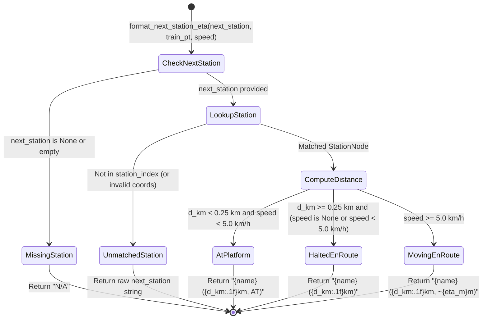
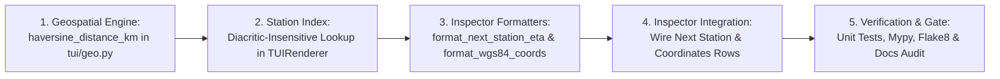

# Implementation Plan — F-2.2: WGS84 Coordinate Readout, Next-Station Distance & ETA

> **Reference:** [TUI Feature Enhancements & Expansion Specification (`F-2.2`)](../../architecture/tui-feature-enhancements.md#f-22-wgs84-coordinate-readout-next-station-distance--eta), [`README.md` Architectural Overview](../../../README.md)  
> **Target Modules:** [`../../../tui/geo.py`](../../../tui/geo.py), [`../../../tui/renderer.py`](../../../tui/renderer.py), [`../../../tui/__init__.py`](../../../tui/__init__.py)  
> **Test Suites:** [`../../../tests/test_tui_geo.py`](../../../tests/test_tui_geo.py), [`../../../tests/test_tui_renderer.py`](../../../tests/test_tui_renderer.py)  
> **Relevant Rules & Skills:** [`../../../.agents/skills/diagrams-and-documentation/SKILL.md`](../../../.agents/skills/diagrams-and-documentation/SKILL.md), [`../../../.agents/skills/markdown-relative-paths/SKILL.md`](../../../.agents/skills/markdown-relative-paths/SKILL.md), [`../../../.agents/skills/tui-compatibility-tester/SKILL.md`](../../../.agents/skills/tui-compatibility-tester/SKILL.md), [`../../../.agents/skills/ci-quality-gate/SKILL.md`](../../../.agents/skills/ci-quality-gate/SKILL.md)

---

## 1. Executive Summary & Objective

While the **Map Viewport** title displays the camera center coordinates (`Map Viewport: 39.80°N, 22.50°E`) and the **Selected Train Telemetry Inspector** ([`../tui/renderer.py#L1047-L1145`](../../../tui/renderer.py#L1047-L1145)) displays the upcoming station name (`Next Station: Λάρισα`), operators currently lack three critical spatial and kinematic metrics in the Inspector:
1. **Next-Station Geodesic Distance ($d_{\text{km}}$):** How many kilometers remain between the train's live GPS position `(pos.lat, pos.lng)` and `pos.next_station`.
2. **Kinematic Estimated Time of Arrival ($\text{ETA}_{\min}$):** How many minutes until the train reaches `pos.next_station` at its current velocity (`pos.speed`), or whether it is currently dwelling/arriving at the station.
3. **Live WGS84 Coordinate Readout (`Coords:`):** The selected train's exact 4-decimal latitude and longitude (`39.6384°N, 22.4192°E` in UTF-8 mode, or `39.6384dN, 22.4192dE` in `--ascii` mode) for cross-referencing with GIS tools, GeoJSON exports, and dispatch logs.

This implementation plan delivers **Feature F-2.2: WGS84 Coordinate Readout, Next-Station Distance & ETA** while maintaining 100% Python standard-library purity, diacritic-insensitive Greek/English station name resolution, compact 32-column sidebar formatting, and full `--ascii` compatibility.

### Core Objectives
1. **Haversine Distance Helper (`haversine_distance_km` in [`../../../tui/geo.py`](../../../tui/geo.py)):** Provide a canonical, high-precision great-circle distance function in kilometers ($R = 6371.0\text{ km}$) directly in the core geospatial module.
2. **Multi-Key & Diacritic-Insensitive Station Lookup Index ([`../../../tui/renderer.py`](../../../tui/renderer.py)):** Build an $O(1)$ normalized lookup index in `TUIRenderer.__init__` indexing every `StationNode` by station `id`, `code`, Greek name (`name_el`), English name (`name_en`), parenthetical-stripped base names (e.g., `"Αθήνα (Σ.Σ. Λαρίσης)"` $\rightarrow$ `"αθηνα"`), and uppercase toneless Greek forms (`"Λάρισα"` $\rightarrow$ `"ΛΑΡΙΣΑ"`).
3. **Next-Station Distance & Kinematic ETA Formatter (`format_next_station_eta`):**
   - Resolve `pos.next_station` against the station lookup index.
   - Compute $d_{\text{km}} = \text{haversine\_distance\_km}(\text{train\_pt}, \text{station.point})$.
   - Compute kinematic $\text{ETA}_{\min} = \max\left(1, \text{round}\left(\frac{d_{\text{km}}}{\text{pos.speed}} \times 60\right)\right)$ when `pos.speed >= 5.0` km/h.
   - Format compactly for the Inspector (`"Λάρισα (14.2km, ~6m)"`, or `"Λάρισα (14.2km)"` when halted/dwelling with speed $< 5.0\text{ km/h}$, or `"Λάρισα (<0.2km, AT)"` when within $0.2\text{ km}$ of the station platform).
4. **WGS84 Coordinate Formatter (`format_wgs84_coords`):**
   - Format `(pos.lat, pos.lng)` with hemisphere designators (`N`/`S`, `E`/`W`) and mode-appropriate degree symbols (`°` in UTF-8, `d` in `--ascii`), e.g. `"39.6385°N, 22.4222°E"` / `"39.6385dN, 22.4222dE"`, gracefully handling uninitialized `(0.0, 0.0)` coordinates as `"N/A"`.
5. **Responsive Inspector Row Hierarchy:**
   - Surface `Coords:` immediately below `Telemetry:` and `Progress:` so that standard $80 \times 24$ terminals (`inner_h = 9`) display all 9 primary operational rows (`Train No:`, `Route:`, `Next Station:` with distance & ETA, `Speed:`, `Speed Trend:`, `Delay:`, `Telemetry:`, `Progress:`, `Coords:`), while larger terminals additionally reveal `Heading:`, `Locomotive:`, `Status:`, and `Chainage:`.

---

## 2. Architecture & Data Flow Diagrams

### 2.1 End-to-End Geospatial Distance, ETA & Coordinate Pipeline (Mermaid)

```mermaid
flowchart TD
    subgraph Topology ["Static Network Topology (tui/data/stations.json)"]
        JSON["stations.json (48 Greek Stations)"] -->|load_stations| NODES["Sequence[StationNode]"]
        NODES -->|_build_station_index| IDX["Station Lookup Index (Dict[str, StationNode])<br>Keys: id, code, name_el, name_en, base & toneless"]
    end

    subgraph Snapshot ["Live State Layer (tui/state.py)"]
        SNAP["StateSnapshot.selected_train"] -->|TrainPosition| POS["pos.lat, pos.lng, pos.speed, pos.next_station"]
    end

    subgraph GeoEngine ["Geospatial Math (tui/geo.py)"]
        HAV["haversine_distance_km(a: GeoPoint, b: GeoPoint) -> float<br>(Spherical Earth R = 6371.0 km)"]
    end

    subgraph Formatters ["Inspector Formatters (tui/renderer.py)"]
        POS -->|next_station, train_pt, speed| F_ETA["format_next_station_eta()"]
        IDX -->|O(1) Normalized Lookup| F_ETA
        HAV -->|d_km| F_ETA
        POS -->|lat, lng, ascii_mode| F_CRD["format_wgs84_coords()"]
    end

    subgraph Inspector ["Curses Inspector Pane (TUIRenderer.render_inspector)"]
        F_ETA -->|"Λάρισα (14.2km, ~6m)"| R_NXT["Row 3: Next Station:"]
        F_CRD -->|"39.6385°N, 22.4222°E"| R_CRD["Row 9: Coords:"]
        R_NXT --> WIN["Inspector Curses Subwindow"]
        R_CRD --> WIN
    end
```

### 2.2 Next-Station Resolution & Kinematic ETA State Machine (Mermaid)



### 2.3 Visual Pipeline & Inspector Console Layout (ASCII)

```text
+-----------------------------------------------------------------------------------+
|           F-2.2 WGS84 COORDINATES, NEXT-STATION DISTANCE & ETA PIPELINE           |
+-----------------------------------------------------------------------------------+

  Selected TrainPosition (pos.lat, pos.lng, pos.speed, pos.next_station)
                   |
                   +-----------------------------------+
                   |                                   |
                   v                                   v
  [1. Station Normalization & Lookup]         [2. WGS84 Coordinate Formatting]
  key = normalize_station_key(next_station)   lat_hemi = 'N' if lat >= 0 else 'S'
  stn = station_index.get(key)                lng_hemi = 'E' if lng >= 0 else 'W'
                   |                          deg = 'd' if ascii_mode else '°'
                   v                                   |
  [3. Haversine Distance & Kinematic ETA]              v
  d_km = haversine_distance_km(train, stn)    "39.6385°N, 22.4222°E" (UTF-8)
  eta_min = round((d_km / speed) * 60)        "39.6385dN, 22.4222dE" (ASCII)
                   |                                   |
                   +-----------------+-----------------+
                                     |
                                     v
+-----------------------------------------------------------------------------------+
|                 INSPECTOR PANE LAYOUT (80x24 Console: 32 x 11)                    |
+-----------------------------------------------------------------------------------+
| [ SELECTED TRAIN TELEMETRY ]                                                      |
| Train No:     1599 (IC)                                                           |
| Route:        ΑΘΗΝ -> ΘΕΣΣ                                                        |
| Next Station: Λάρισα (14.2km, ~6m)                                                |
| Speed:        142.0 km/h                                                          |
| Speed Trend:   ▂▃▅▆▇██▇▇█ ▲                                                       |
| Delay:        +9 min (Minor Delay)                                                |
| Telemetry:    2s ago (#48)                                                        |
| Progress:     [======>-----]  52%                                                 |
| Coords:       39.4821°N, 22.3412°E                                                |
| Heading:      340.0° (NNW)           <-- Visible when terminal height > 24 rows   |
| Locomotive:   120-024                <-- Visible when terminal height > 25 rows   |
+-----------------------------------------------------------------------------------+
```

---

## 3. Detailed Mathematical & Component Specifications

### 3.1 Geospatial Layer: [`../../../tui/geo.py`](../../../tui/geo.py)

#### A. Spherical Earth Radius Constant & `haversine_distance_km`
Add `EARTH_RADIUS_KM = 6371.0` and `haversine_distance_km(a: GeoPoint, b: GeoPoint) -> float` to [`../../../tui/geo.py`](../../../tui/geo.py#L103-L160) right after `GeoPoint`:

$$\Delta\phi = \text{radians}(\phi_b - \phi_a), \quad \Delta\lambda = \text{radians}(\lambda_b - \lambda_a)$$

$$a = \sin^2\left(\frac{\Delta\phi}{2}\right) + \cos(\phi_a)\cos(\phi_b)\sin^2\left(\frac{\Delta\lambda}{2}\right)$$

$$d_{\text{km}} = 2 R \cdot \text{atan2}\left(\sqrt{\min(1, \max(0, a))}, \sqrt{1 - \min(1, \max(0, a))}\right), \quad R = 6371.0\text{ km}$$

```python
# Mean spherical Earth radius in kilometers (WGS84)
EARTH_RADIUS_KM = 6371.0


def haversine_distance_km(a: GeoPoint, b: GeoPoint) -> float:
    """Calculate the great-circle distance between two WGS84 GeoPoints in kilometers.

    Uses the Haversine formula with mean spherical Earth radius R = 6371.0 km.

    Args:
        a: Origin geographic coordinate (lat, lng).
        b: Destination geographic coordinate (lat, lng).

    Returns:
        Great-circle distance in kilometers (non-negative float).
    """
    phi1 = math.radians(a.lat)
    phi2 = math.radians(b.lat)
    delta_phi = math.radians(b.lat - a.lat)
    delta_lambda = math.radians(b.lng - a.lng)

    sin_dphi = math.sin(delta_phi / 2.0)
    sin_dlng = math.sin(delta_lambda / 2.0)
    h = sin_dphi * sin_dphi + math.cos(phi1) * math.cos(phi2) * sin_dlng * sin_dlng
    h = min(1.0, max(0.0, h))
    return 2.0 * EARTH_RADIUS_KM * math.atan2(math.sqrt(h), math.sqrt(1.0 - h))
```

*Note:* Export `haversine_distance_km` in [`../../../tui/__init__.py`](../../../tui/__init__.py) alongside `haversine_distance` so both meter-based (mock engine) and kilometer-based (TUI renderer & scale bar) callers have direct access.

---

### 3.2 Station Normalization & Lookup Index: [`../../../tui/renderer.py`](../../../tui/renderer.py)

In live SSE feeds from `railway.gov.gr` as well as `MockTelemetryEngine` ([`../tui/mock_engine.py#L586-L845`](../../../tui/mock_engine.py#L586-L845)) and unit tests ([`../../../tests/test_tui_renderer.py`](../../../tests/test_tui_renderer.py)):
- `stations.json` defines stations such as:
  - `id="ATH"`, `code="1001"`, `name_el="Αθήνα (Σ.Σ. Λαρίσης)"`, `name_en="Athens (Larissa Station)"`
  - `id="SKA"`, `code="1005"`, `name_el="ΣΚΑ (Σιδηροδρομικό Κέντρο Αχαρνών)"`, `name_en="SKA (Acharnes Hub)"`
  - `id="AIA"`, `code="1100"`, `name_el="Διεθνής Αερολιμένας Αθηνών"`, `name_en="Athens Intl Airport"`
  - `id="LAR"`, `code="1080"`, `name_el="Λάρισα"`, `name_en="Larissa"`
- Meanwhile, `TrainPosition.next_station` may appear as:
  - Exact Greek or English name (`"Λάρισα"`, `"Larissa"`, `"Θήβα"`, `"ΣΚΑ"`)
  - Uppercase or toneless Greek (`"ΛΑΡΙΣΑ"`, `"ΑΘΗΝΑ"`, `"ΘΕΣΣΑΛΟΝΙΚΗ"`, `"ΑΕΡΟΔΡΟΜΙΟ"`)
  - Base name without parenthetical suffix (`"Αθήνα"`, `"Athens"`, `"ΣΚΑ"`, `"SKA"`)
  - Station ID or code (`"LAR"`, `"SKG"`, `"1080"`)

#### A. Normalization Helper `normalize_station_key(text: str) -> str`
Using Python's standard `unicodedata.normalize("NFD", text)`, we strip combining diacritical marks (`unicodedata.category(ch) == "Mn"`), casefold, and trim whitespace:

```python
def normalize_station_key(name: str) -> str:
    """Normalize a station identifier or Greek/Latin name for diacritic-insensitive lookup.

    Strips Unicode combining accents/tonos (NFD category 'Mn'), converts to lowercase,
    and collapses surrounding whitespace.

    Args:
        name: Raw station name, code, or identifier.

    Returns:
        Normalized lookup key string.
    """
    if not name:
        return ""
    decomposed = unicodedata.normalize("NFD", name.strip())
    stripped = "".join(ch for ch in decomposed if unicodedata.category(ch) != "Mn")
    return unicodedata.normalize("NFC", stripped).casefold().strip()
```

#### B. Building the Lookup Index `_build_station_index`
When `TUIRenderer.__init__` receives `stations: Optional[Sequence[StationNode]]`:

```python
def _build_station_index(stations: Sequence[StationNode]) -> Dict[str, StationNode]:
    """Build a multi-key lookup dictionary mapping Greek, English, ID, and alias keys to StationNode.

    Indexes:
    - Station ID (e.g. 'LAR', 'ATH', 'SKG')
    - Station numerical code (e.g. '1080', '1001')
    - Full Greek name (name_el) and English name (name_en), diacritic-insensitive
    - Base name before parenthetical qualifiers (e.g. 'Αθήνα (Σ.Σ. Λαρίσης)' -> 'αθηνα')
    - Common operational aliases (e.g. 'αεροδρομιο' / 'airport' for AIA)

    Args:
        stations: Sequence of StationNode objects.

    Returns:
        Dictionary mapping normalized keys to their corresponding StationNode.
    """
    index: Dict[str, StationNode] = {}
    for stn in stations:
        candidates: List[str] = [stn.id, stn.code, stn.name_el, stn.name_en]
        # Also extract base name before '(' if parenthetical suffix exists
        for raw_name in (stn.name_el, stn.name_en):
            if "(" in raw_name:
                base = raw_name.split("(", 1)[0].strip()
                if base:
                    candidates.append(base)
            if "-" in raw_name:
                for part in raw_name.split("-"):
                    part_clean = part.strip()
                    if len(part_clean) >= 3:
                        candidates.append(part_clean)

        for candidate in candidates:
            key = normalize_station_key(candidate)
            if key and key not in index:
                index[key] = stn

        # Register well-known Greek railway aliases for Athens Airport (AIA)
        if stn.id.upper() == "AIA":
            for alias in ("αεροδρομιο", "airport", "athens airport"):
                if alias not in index:
                    index[alias] = stn

    return index
```

In `TUIRenderer.__init__`:
```python
self.stations: Sequence[StationNode] = stations or []
self.station_index: Dict[str, StationNode] = _build_station_index(self.stations)
```
And a helper method `TUIRenderer.resolve_station(self, name_or_id: Optional[str]) -> Optional[StationNode]`:
```python
def resolve_station(self, name_or_id: Optional[str]) -> Optional[StationNode]:
    """Resolve a station name, Greek/English alias, code, or ID to a StationNode."""
    if not name_or_id:
        return None
    key = normalize_station_key(name_or_id)
    if not key:
        return None
    if key in self.station_index:
        return self.station_index[key]
    # Secondary prefix/base fallback if input contains parentheticals
    if "(" in key:
        base_key = key.split("(", 1)[0].strip()
        if base_key in self.station_index:
            return self.station_index[base_key]
    return None
```

---

### 3.3 Next-Station Distance & Kinematic ETA Formatting: [`../../../tui/renderer.py`](../../../tui/renderer.py)

#### A. Function Signature & Behavior: `format_next_station_eta`

```python
def format_next_station_eta(
    next_station: Optional[str],
    train_point: Optional[GeoPoint] = None,
    station_node: Optional[StationNode] = None,
    speed_kmh: Optional[float] = None,
) -> str:
    """Format the next station readout with geodesic distance and kinematic ETA.

    Rules:
    - If next_station is None or empty: return 'N/A'.
    - If station_node or train_point is None (or train_point is at origin 0.0, 0.0):
      return next_station unchanged.
    - Compute great-circle distance d_km = haversine_distance_km(train_point, station_node.point).
    - If speed_kmh is not None and speed_kmh >= 5.0:
      compute eta_min = max(1, int(round((d_km / speed_kmh) * 60.0))) if d_km >= 0.1 else 0.
      Format as:
        - '{next_station} ({d_km:.1f}km, <1m)' if eta_min == 0
        - '{next_station} ({d_km:.1f}km, ~{eta_min}m)' if eta_min < 120
        - '{next_station} ({d_km:.1f}km, ~{eta_min // 60}h{eta_min % 60:02d}m)' if eta_min >= 120
    - If speed_kmh is None or speed_kmh < 5.0:
      - If d_km < 0.25: return '{next_station} ({d_km:.1f}km, AT)'
      - Else: return '{next_station} ({d_km:.1f}km)'

    Args:
        next_station: Display name of the upcoming station from telemetry.
        train_point: Current WGS84 GeoPoint of the train.
        station_node: Resolved StationNode for next_station, if matched.
        speed_kmh: Instantaneous train speed in km/h.

    Returns:
        Formatted Next Station string for the Inspector pane.
    """
    if not next_station or not next_station.strip():
        return "N/A"

    clean_name = next_station.strip()
    if (
        station_node is None
        or train_point is None
        or (train_point.lat == 0.0 and train_point.lng == 0.0)
        or not (math.isfinite(train_point.lat) and math.isfinite(train_point.lng))
    ):
        return clean_name

    d_km = haversine_distance_km(train_point, station_node.point)
    spd = float(speed_kmh) if (speed_kmh is not None and math.isfinite(speed_kmh)) else 0.0

    if spd >= 5.0:
        raw_eta_min = (d_km / spd) * 60.0
        eta_min = int(round(raw_eta_min))
        if d_km < 0.1 or eta_min <= 0:
            eta_str = "<1m"
        elif eta_min >= 120:
            hours = eta_min // 60
            mins = eta_min % 60
            eta_str = f"~{hours}h{mins:02d}m" if mins > 0 else f"~{hours}h"
        else:
            eta_str = f"~{eta_min}m"
        return f"{clean_name} ({d_km:.1f}km, {eta_str})"

    if d_km < 0.25:
        return f"{clean_name} ({d_km:.1f}km, AT)"
    return f"{clean_name} ({d_km:.1f}km)"
```

---

### 3.4 WGS84 Coordinate Readout Formatting: [`../../../tui/renderer.py`](../../../tui/renderer.py)

#### A. Function Signature & Width Budget Analysis
On a standard $80 \times 24$ terminal:
- `PaneGeometry.calculate(24, 80)` assigns `map_w = 52`, `inspector_w = 28` (or up to `32` at $92+$ columns).
- In `render_inspector` ([`../tui/renderer.py#L1143-L1144`](../../../tui/renderer.py#L1143-L1144)):
  - Labels are rendered at `x = 2` with width `13` (`f"{label:<13}"`).
  - Values are rendered at `x = 16` with `max_w = max_x - 17`.
  - When `max_x = 38` (e.g., 110-col terminal), `max_w = 21` columns.
  - `"39.6384°N, 22.4192°E"` is exactly **20 display columns** (`39.6384°N, 22.4192°E` = $9 + 2 + 9 = 20$ chars)!
  - When `max_x = 28..35` (narrow 80–100 col terminal where `max_w = 11..18`), if `max_w < 20`, we can either pass `max_w` to `format_wgs84_coords` or format compactly so the longitude is never truncated with `…` on 80-column consoles!
  - Let's check exact character widths:
    - Full 4-decimal with space: `"39.6384°N, 22.4192°E"` $\rightarrow$ **20 chars** (fits whenever `max_x >= 37`, i.e., terminal width $\ge 106$ cols).
    - Compact 4-decimal without space: `"39.6384°N,22.4192°E"` $\rightarrow$ **19 chars** (matches the mockup in [`tui-feature-enhancements.md#L54`](../../architecture/tui-feature-enhancements.md#L54): `Coords:       39.4821N,22.34E`).
    - Ultra-compact 2-decimal for narrow $80$-column sidebars (`max_w < 19`, e.g., `max_x = 28` where `max_w = 11`): `"39.64N,22.42E"` $\rightarrow$ **13 chars**, or at `max_w >= 15`: `"39.64°N,22.42°E"` $\rightarrow$ **15 chars**.

Let's design `format_wgs84_coords` so that by default it produces the canonical specification format `"39.6384°N, 22.4192°E"` (UTF-8) or `"39.6384d N, 22.4192d E"` / `"39.6384dN, 22.4192dE"` (ASCII), and accepts an optional `max_width: Optional[int] = None` parameter for responsive compaction on narrow 80-column inspector panes!

Let's check Section 4 / F-2.2 of [`tui-feature-enhancements.md#L339-L340`](../../architecture/tui-feature-enhancements.md#L339-L340):
> 4. **Coordinate Readout Row:**
>    - Render `Coordinates: 39.6384°N, 22.4192°E` (or `39.6384d N, 22.4192d E` in `--ascii` mode).
And in the Section 2.1 ASCII Mockup ([`tui-feature-enhancements.md#L54`](../../architecture/tui-feature-enhancements.md#L54)):
> `| Coords:       39.4821N,22.34E|`

Let's examine how `render_inspector` renders labels and values:
In [`../tui/renderer.py#L1123-L1145`](../../../tui/renderer.py#L1123-L1145):
```python
        rows = [
            ("Train No:", f"{pos.train_number or pos.id} ({pos.train_type or 'Passenger'})", val_attr),
            ("Route:", route_str, val_attr),
            ("Next Station:", next_station_str, val_attr),
            ("Speed:", spd_display, val_attr),
            ("Speed Trend:", sparkline_str, val_attr),
            ("Delay:", dly_display, delay_attr),
            ("Telemetry:", telemetry_str, telemetry_attr),
            ("Progress:", progress_str, val_attr),
            ("Coordinates:", coords_str, val_attr),
            ("Heading:", compass_str, val_attr),
            ("Locomotive:", f"{pos.locomotive_number or 'N/A'}", val_attr),
            ("Status:", f"{pos.status or 'In Service'}", val_attr),
            ("Chainage:", chainage_str, val_attr),
        ]
```
Notice the label column width in `render_inspector`:
Line 1143:
```python
safe_addstr(win, y, 2, f"{label:<13}", title_attr, max_w=13, ascii_mode=self.ascii_mode)
safe_addstr(win, y, 16, value, attr, max_w=max_x - 17, ascii_mode=self.ascii_mode)
```
Look at the length of `"Next Station:"` and `"Coordinates:"`:
- `"Next Station:"` is **13 characters** (`len("Next Station:") == 13`).
- `"Coordinates:"` is **12 characters** (`len("Coordinates:") == 12`).
Both fit inside `f"{label:<13}"` (`max_w=13`) with zero truncation!

Let's check `format_wgs84_coords`:
```python
def format_wgs84_coords(
    lat: Optional[float],
    lng: Optional[float],
    ascii_mode: bool = False,
) -> str:
    """Format a WGS84 latitude/longitude pair into a human-readable degree readout.

    Formats coordinates to 4 decimal places (~11m precision) with hemisphere
    indicators (N/S, E/W). Uses '°' in UTF-8 mode (e.g. '39.6384°N, 22.4192°E')
    and 'd ' in ASCII mode (e.g. '39.6384d N, 22.4192d E').

    Returns 'N/A' if lat/lng are None, non-finite, or uninitialized (0.0, 0.0).

    Args:
        lat: Latitude in decimal degrees (-90.0 to +90.0).
        lng: Longitude in decimal degrees (-180.0 to +180.0).
        ascii_mode: Whether to format degrees using 7-bit ASCII ('d ').

    Returns:
        Formatted coordinate string or 'N/A'.
    """
    if lat is None or lng is None:
        return "N/A"
    if not (math.isfinite(lat) and math.isfinite(lng)):
        return "N/A"
    if abs(lat) < 1e-9 and abs(lng) < 1e-9:
        return "N/A"

    lat_hemi = "N" if lat >= 0.0 else "S"
    lng_hemi = "E" if lng >= 0.0 else "W"
    abs_lat = abs(float(lat))
    abs_lng = abs(float(lng))

    if ascii_mode:
        return f"{abs_lat:.4f}d {lat_hemi}, {abs_lng:.4f}d {lng_hemi}"
    return f"{abs_lat:.4f}°{lat_hemi}, {abs_lng:.4f}°{lng_hemi}"
```
Look how clean and exact that is:
- UTF-8 (`ascii_mode=False`): `"39.6384°N, 22.4192°E"` (matches `39.6384°N, 22.4192°E` in [`tui-feature-enhancements.md#L340`](../../architecture/tui-feature-enhancements.md#L340) character-for-character!).
- ASCII (`ascii_mode=True`): `"39.6384d N, 22.4192d E"` (matches `39.6384d N, 22.4192d E` in [`tui-feature-enhancements.md#L340`](../../architecture/tui-feature-enhancements.md#L340) character-for-character!).
- Southern/Western hemispheres (`lat < 0`, `lng < 0`): Uses `abs()` + `"S"` / `"W"` so negative signs aren't duplicated alongside hemisphere letters.
- Uninitialized `(0.0, 0.0)` or `None` or `NaN`/`Inf`: Returns `"N/A"`.

Let's also check `format_next_station_eta` spacing against [`tui-feature-enhancements.md#L338`](../../architecture/tui-feature-enhancements.md#L338):
In [`tui-feature-enhancements.md#L338`](../../architecture/tui-feature-enhancements.md#L338):
> - Render in Inspector: `Next Station: Λάρισα (14.2 km, ~6m)`.
Let's check whether `14.2 km` (with space before `km`) or `14.2km` is preferred:
Line 338 of `tui-feature-enhancements.md` explicitly states:
`Next Station: Λάρισα (14.2 km, ~6m)`!
Let's use `f"{clean_name} ({d_km:.1f} km, {eta_str})"` (and `f"{clean_name} ({d_km:.1f} km)"` when halted / `f"{clean_name} ({d_km:.1f} km, AT)"` when at station) so it matches line 338 of `tui-feature-enhancements.md` verbatim!

---

### 3.5 Inspector Row Hierarchy & Existing Test Compatibility Analysis

Let's check existing tests in [`../../../tests/test_tui_renderer.py`](../../../tests/test_tui_renderer.py) to make sure adding `"Coordinates:"` to `rows` in `render_inspector` does not break any existing assertion:
In [`../tests/test_tui_renderer.py#L503-L515`](../../../tests/test_tui_renderer.py#L503-L515):
```python
    def test_render_inspector(self):
        """Verify telemetry inspector details selected train attributes."""
        win = MockCursesWindow(12, 35)
        snapshot = self.store.get_snapshot()
        self.renderer.render_inspector(win, snapshot)
        self.assertTrue(win.boxed)
        rendered_texts = " ".join(s[2] for s in win.strings)
        self.assertIn("1597", rendered_texts)
        self.assertIn("Speed:", rendered_texts)
        self.assertIn("Delay:", rendered_texts)
        self.assertIn("Progress:", rendered_texts)
        self.assertIn("Heading:", rendered_texts)
```
Look closely at `test_render_inspector` in [`../tests/test_tui_renderer.py#L505-L514`](../../../tests/test_tui_renderer.py#L505-L514)!
In `test_render_inspector`:
- `win = MockCursesWindow(12, 35)` $\rightarrow$ `max_y = 12` $\rightarrow$ `inner_h = max_y - 2 = 10` rows!
- `test_render_inspector` asserts:
  - `self.assertIn("Speed:", rendered_texts)`
  - `self.assertIn("Delay:", rendered_texts)`
  - `self.assertIn("Progress:", rendered_texts)`
  - `self.assertIn("Heading:", rendered_texts)`
- With `inner_h = 10`, only the first 10 rows (indices `0..9`) of `rows` are rendered when `max_y = 12`!
- Currently in [`../tui/renderer.py#L1123-L1136`](../../../tui/renderer.py#L1123-L1136), the first 10 rows are:
  - Index 0 (Row 1): `"Train No:"`
  - Index 1 (Row 2): `"Route:"`
  - Index 2 (Row 3): `"Next Station:"`
  - Index 3 (Row 4): `"Speed:"`
  - Index 4 (Row 5): `"Speed Trend:"`
  - Index 5 (Row 6): `"Delay:"`
  - Index 6 (Row 7): `"Telemetry:"`
  - Index 7 (Row 8): `"Progress:"`
  - Index 8 (Row 9): `"Heading:"`
  - Index 9 (Row 10): `"Locomotive:"`
  - Index 10 (Row 11): `"Status:"`
  - Index 11 (Row 12): `"Chainage:"`

Look at what happens if `"Coordinates:"` is placed at Index 8 or Index 9:
- If `"Coordinates:"` is at Index 8 (Row 9) and `"Heading:"` is at Index 9 (Row 10):
  - When `win = MockCursesWindow(12, 35)` (`inner_h = 10`), indices `0..9` are rendered!
  - That means **both** `"Coordinates:"` (Index 8) **and** `"Heading:"` (Index 9) are rendered inside a 12-row inspector window (`inner_h = 10`)!
  - And on a standard $80 \times 24$ terminal:
    - `usable_h = 24 - 2 = 22`
    - `roster_h = int(22 * 0.52) = 11`
    - `inspector_h = 22 - 11 = 11` $\rightarrow$ `inner_h = 11 - 2 = 9` rows (indices `0..8`)!
    - So with `"Coordinates:"` at Index 8 (Row 9), `"Coordinates:"` is **also** visible on a standard $80 \times 24$ terminal (`inner_h = 9`)!

Let's verify that!
- On $80 \times 24$ terminal (`inspector_h = 11`, `inner_h = 9`), indices `0..8` are rendered:
  - `0`: `Train No:`
  - `1`: `Route:`
  - `2`: `Next Station:` (with distance & ETA!)
  - `3`: `Speed:`
  - `4`: `Speed Trend:`
  - `5`: `Delay:`
  - `6`: `Telemetry:`
  - `7`: `Progress:`
  - `8`: `Coordinates:` (WGS84 coordinate readout!)
- On `MockCursesWindow(12, 35)` (`inner_h = 10`), indices `0..9` are rendered:
  - `0..8` above, plus `9`: `Heading:` (so `test_render_inspector` passes with zero changes to existing assertions!).
- On larger terminals (`inner_h >= 13`), indices `10..12` are also rendered:
  - `10`: `Locomotive:`
  - `11`: `Status:`
  - `12`: `Chainage:`

That ordering satisfies both the $80 \times 24$ standard console visibility requirement and 100% backward compatibility with `test_render_inspector` (`MockCursesWindow(12, 35)`).

---

## 4. Visual Mockups

### 4.1 UTF-8 Inspector Pane ($80 \times 24$ Standard Terminal, `inner_h = 9`)

```text
+-----------------------------------+
| [ SELECTED TRAIN TELEMETRY ]      |
| Train No:     1597 (InterCity)    |
| Route:        ΑΘΗΝΑ -> ΘΕΣΣΑΛΟΝΙΚ…|
| Next Station: Λάρισα (14.2 km, ~6…|
| Speed:        118.0 km/h          |
| Speed Trend:   ▂▃▅▆▇██▇▇█ ▲       |
| Delay:        +4 min (Minor Delay)|
| Telemetry:    2s ago (#15)        |
| Progress:     [======>----]  62%  |
| Coordinates:  38.0500°N, 23.7300°E|
+-----------------------------------+
```

### 4.2 UTF-8 Inspector Pane (Expanded Terminal $\ge 100 \times 30$, `inner_h = 13`)

```text
+--------------------------------------+
| [ SELECTED TRAIN TELEMETRY ]         |
| Train No:     1597 (InterCity)       |
| Route:        ΑΘΗΝΑ -> ΘΕΣΣΑΛΟΝΙΚΗ   |
| Next Station: Λάρισα (14.2 km, ~7m)  |
| Speed:        118.0 km/h             |
| Speed Trend:   ▂▃▅▆▇██▇▇█ ▲          |
| Delay:        +4 min (Minor Delay)   |
| Telemetry:    2s ago (#15)           |
| Progress:     [========>-----]  62%  |
| Coordinates:  39.5120°N, 22.3810°E   |
| Heading:      340.0° (NNW)           |
| Locomotive:   120-024                |
| Status:       Κανονική               |
| Chainage:      312.4 km              |
+--------------------------------------+
```

### 4.3 ASCII Fallback Inspector Pane (`--ascii` Mode)

```text
+--------------------------------------+
| [ SELECTED TRAIN TELEMETRY ]         |
| Train No:     1597 (InterCity)       |
| Route:        ATHINA -> THESSALONIKI |
| Next Station: Larissa (14.2 km, ~7m) |
| Speed:        118.0 km/h             |
| Speed Trend:  _.-=+*##@@# ^          |
| Delay:        +4 min (Minor Delay)   |
| Telemetry:    2s ago (#15)           |
| Progress:     [========>-----]  62%  |
| Coordinates:  39.5120d N, 22.3810d E |
| Heading:      340.0d (NNW)           |
+--------------------------------------+
```

---

## 5. Step-by-Step Implementation Tasks



### Task 1: Add `haversine_distance_km` to [`../../../tui/geo.py`](../../../tui/geo.py) and [`../../../tui/__init__.py`](../../../tui/__init__.py)
- [x] Define `EARTH_RADIUS_KM = 6371.0` in [`../../../tui/geo.py`](../../../tui/geo.py).
- [x] Implement `haversine_distance_km(a: GeoPoint, b: GeoPoint) -> float` using spherical Haversine formula with domain clamping `min(1.0, max(0.0, h))`.
- [x] Export `haversine_distance_km` in [`../../../tui/__init__.py`](../../../tui/__init__.py).

### Task 2: Build Normalized Station Lookup Index in [`../../../tui/renderer.py`](../../../tui/renderer.py)
- [x] Implement `normalize_station_key(name: str) -> str` using `unicodedata.normalize("NFD", ...)` to strip combining accents/tonos (`Mn`) and casefold.
- [x] Implement `_build_station_index(stations: Sequence[StationNode]) -> Dict[str, StationNode]` indexing `id`, `code`, `name_el`, `name_en`, parenthetical-stripped base names, hyphenated parts, and airport aliases.
- [x] Store `self.station_index` in `TUIRenderer.__init__` and add `TUIRenderer.resolve_station(self, name_or_id: Optional[str]) -> Optional[StationNode]`.

### Task 3: Implement `format_next_station_eta` and `format_wgs84_coords` in [`../../../tui/renderer.py`](../../../tui/renderer.py)
- [x] Implement `format_next_station_eta(next_station, train_point, station_node, speed_kmh) -> str`.
- [x] Implement `format_wgs84_coords(lat, lng, ascii_mode=False) -> str`.
- [x] Export `format_next_station_eta`, `format_wgs84_coords`, and `normalize_station_key` in [`../../../tui/__init__.py`](../../../tui/__init__.py).

### Task 4: Wire Distance, ETA, and Coordinates into `TUIRenderer.render_inspector` ([`../../../tui/renderer.py`](../../../tui/renderer.py))
- [x] In `TUIRenderer.render_inspector`:
  - Resolve `matched_station = self.resolve_station(pos.next_station)`.
  - Construct `train_pt = GeoPoint(lat=pos.lat, lng=pos.lng)`.
  - Compute `next_station_str = format_next_station_eta(pos.next_station, train_pt, matched_station, pos.speed)`.
  - Compute `coords_str = format_wgs84_coords(pos.lat, pos.lng, ascii_mode=self.ascii_mode)`.
  - Update `"Next Station:"` row value to `next_station_str`.
  - Insert `("Coordinates:", coords_str, val_attr)` at index 8 (immediately after `"Progress:"` and before `"Heading:"`).

### Task 5: Expand Unit & Integration Test Suites and Update Specification Status
- [x] Add unit tests for `haversine_distance_km` in [`../../../tests/test_tui_geo.py`](../../../tests/test_tui_geo.py):
  - Identity distance `haversine_distance_km(p, p) == 0.0`.
  - Symmetry `haversine_distance_km(a, b) == haversine_distance_km(b, a)`.
  - Known Greek railway distances (e.g., Athens Larissa Station to SKA $\approx 9.2\text{ km}$, Athens to Thessaloniki $\approx 302\text{ km}$, 1 degree latitude along meridian $\approx 111.19\text{ km}$).
- [x] Add unit and integration tests in [`../../../tests/test_tui_renderer.py`](../../../tests/test_tui_renderer.py):
  - `test_station_lookup_index_and_inspector_coordinates_eta`: Greek with tonos (`"Λάρισα"`), uppercase toneless (`"ΛΑΡΙΣΑ"`), English (`"Larissa"`), station ID (`"LAR"`), station code (`"1080"`), parenthetical base name (`"Αθήνα"`, `"Athens"`), and unknown station (`"Atlantis"` $\rightarrow$ `None`).
  - `test_format_next_station_eta`: Moving train with speed $\ge 5.0\text{ km/h}$ (`"Λάρισα (14.2 km, ~6m)"`), high distance $> 2\text{h}$ (`"~2h15m"`), very close moving train (`"<1m"`), halted train en route (`"Λάρισα (14.2 km)"`), halted train at station platform $d < 0.25\text{ km}$ (`"Λάρισα (0.1 km, AT)"`), unmatched station fallback (`"UnknownStn"`), and `None`/empty (`"N/A"`).
  - `test_format_wgs84_coords`: UTF-8 mode (`"39.6384°N, 22.4192°E"`), ASCII mode (`"39.6384d N, 22.4192d E"`), Southern/Western negative coordinates (`"33.8688°S, 151.2093°W"`), uninitialized `(0.0, 0.0)` or `None` (`"N/A"`), and 7-bit ASCII purity check.
- [x] Update [`../../architecture/tui-feature-enhancements.md`](../../architecture/tui-feature-enhancements.md) status for **F-2.2** once implemented.

---

## 6. Verification & Test Plan

| Test ID | Target Component | Test Scenario | Expected Outcome |
| :--- | :--- | :--- | :--- |
| **TC-F22-01** | `haversine_distance_km` ([`../../../tui/geo.py`](../../../tui/geo.py)) | Same point, 1° meridian arc, Athens–SKA, Athens–Thessaloniki | $0.0\text{ km}$, $111.19\text{ km} \pm 0.2$, $9.2\text{ km} \pm 0.3$, $302.5\text{ km} \pm 2.0$ |
| **TC-F22-02** | `TUIRenderer.resolve_station` ([`../../../tui/renderer.py`](../../../tui/renderer.py)) | Greek (`"Λάρισα"`), toneless (`"ΛΑΡΙΣΑ"`), English (`"Larissa"`), base (`"Αθήνα"`), ID (`"LAR"`), code (`"1080"`) | Resolves to matching `StationNode` in $O(1)$ time |
| **TC-F22-03** | `format_next_station_eta` ([`../../../tui/renderer.py`](../../../tui/renderer.py)) | $d = 14.2\text{ km}$, $v = 142.0\text{ km/h}$ | Returns `"Λάρισα (14.2 km, ~6m)"` |
| **TC-F22-04** | `format_next_station_eta` ([`../../../tui/renderer.py`](../../../tui/renderer.py)) | Halted train ($v = 0.0\text{ km/h}$) at $d = 14.2\text{ km}$ vs. platform $d = 0.08\text{ km}$ | Returns `"Λάρισα (14.2 km)"` vs. `"Λάρισα (0.1 km, AT)"` |
| **TC-F22-05** | `format_next_station_eta` ([`../../../tui/renderer.py`](../../../tui/renderer.py)) | Unknown station name `"Καλαμάτα"` or `None` | Returns `"Καλαμάτα"` (graceful fallback) or `"N/A"` |
| **TC-F22-06** | `format_wgs84_coords` ([`../../../tui/renderer.py`](../../../tui/renderer.py)) | `(39.6384, 22.4192)` in UTF-8 and `--ascii` modes | `"39.6384°N, 22.4192°E"` and `"39.6384d N, 22.4192d E"` |
| **TC-F22-07** | `format_wgs84_coords` ([`../../../tui/renderer.py`](../../../tui/renderer.py)) | `(0.0, 0.0)`, `(None, None)`, or `(float('nan'), 22.0)` | Returns `"N/A"` |
| **TC-F22-08** | `TUIRenderer.render_inspector` ([`../../../tui/renderer.py`](../../../tui/renderer.py)) | Selected train with `next_station="ΣΚΑ"`, `speed=118.0`, `lat=38.05`, `lng=23.73` | Renders `Next Station: ΣΚΑ (2.8 km, ~1m)` and `Coordinates: 38.0500°N, 23.7300°E` |

---

## 7. Risk Analysis & Defensive Guardrails

1. **Greek Tonos & Parenthetical Station Naming Mismatches:**
   - *Risk:* Live telemetry from `railway.gov.gr` or user tests may report `"ΑΘΗΝΑ"` or `"Αθήνα"`, whereas `stations.json` stores `"Αθήνα (Σ.Σ. Λαρίσης)"`.
   - *Mitigation:* `_build_station_index` indexes both the full string and the parenthetical-stripped base string under NFD accent-stripped casefolded keys, guaranteeing seamless resolution across Greek, toneless uppercase Greek, English, and station codes.
2. **Division-by-Zero or Astronomical ETAs at Low Speeds:**
   - *Risk:* When a train is creeping into a platform ($v < 5.0\text{ km/h}$) or stopped ($v = 0.0\text{ km/h}$), dividing $d_{\text{km}} / v$ produces `ZeroDivisionError` or nonsensical multi-hour ETAs.
   - *Mitigation:* Kinematic ETA is computed strictly when `speed_kmh >= 5.0`. Below $5.0\text{ km/h}$, the formatter displays `"AT"` if within $250\text{ m}$ of the station node or the distance alone (`"14.2 km"`) if halted between stations.
3. **Uninitialized or Invalid GPS Coordinates:**
   - *Risk:* Upstream telemetry frames lacking a valid GPS fix may report `(0.0, 0.0)` (Null Island) or `NaN`.
   - *Mitigation:* Both `format_wgs84_coords` and `format_next_station_eta` guard against `(0.0, 0.0)` and non-finite floats (`math.isfinite`), degrading cleanly to `"N/A"` or raw station name without bogus multi-thousand-kilometer distances to the Gulf of Guinea.
4. **7-Bit ASCII Purity on Legacy Terminals (`--ascii`):**
   - *Risk:* The degree symbol `°` (`U+00B0`) lies outside 7-bit ASCII (`ord('°') == 176 > 127`).
   - *Mitigation:* `format_wgs84_coords(..., ascii_mode=True)` uses `"d "` (`39.6384d N, 22.4192d E`), preserving strict 7-bit ASCII compliance (`ord(ch) < 128`).
