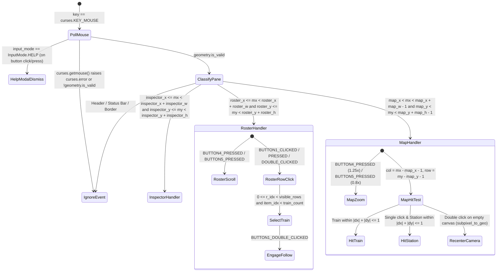
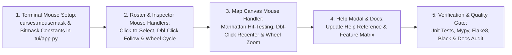

# Implementation Plan — F-3.1: Terminal Mouse Interaction (Click-to-Select & Scroll Zoom)

> **Reference:** [TUI Feature Enhancements & Expansion Specification (`F-3.1`)](../../architecture/tui-feature-enhancements.md#f-31-terminal-mouse-interaction-click-to-select--scroll-zoom), [`README.md` Architectural Overview](../../../README.md)  
> **Target Modules:** [`../../../tui/app.py`](../../../tui/app.py), [`../../../tui/renderer.py`](../../../tui/renderer.py), [`../../../tui/__init__.py`](../../../tui/__init__.py)  
> **Test Suites:** [`../../../tests/test_tui_controls.py`](../../../tests/test_tui_controls.py), [`../../../tests/test_tui_renderer.py`](../../../tests/test_tui_renderer.py)  
> **Relevant Rules & Skills:** [`../../../.agents/skills/diagrams-and-documentation/SKILL.md`](../../../.agents/skills/diagrams-and-documentation/SKILL.md), [`../../../.agents/skills/markdown-relative-paths/SKILL.md`](../../../.agents/skills/markdown-relative-paths/SKILL.md), [`../../../.agents/skills/tui-compatibility-tester/SKILL.md`](../../../.agents/skills/tui-compatibility-tester/SKILL.md), [`../../../.agents/skills/ci-quality-gate/SKILL.md`](../../../.agents/skills/ci-quality-gate/SKILL.md)

---

## 1. Executive Summary & Objective

Modern terminal emulators across Linux, macOS, and Windows (GNOME Terminal, Kitty, Alacritty, xterm, iTerm2, and Windows Terminal with `windows-curses`) emit xterm SGR / X10 mouse click and scroll-wheel events via `curses.KEY_MOUSE` and `curses.getmouse()`. Currently, the `railmon` TUI relies exclusively on keyboard navigation (`Tab`/`n`/`p` to cycle trains, `m`/`M` to cycle station boards, `+`/`-` to zoom, and `h`/`j`/`k`/`l` to pan). When 15–30 live trains are active across the Greek network, cycling sequentially through the roster to inspect a specific train on the map or a specific hub station takes multiple keystrokes.

This implementation plan delivers **Feature F-3.1: Terminal Mouse Interaction (Click-to-Select & Scroll Zoom)** across the Curses application controller ([`../../../tui/app.py`](../../../tui/app.py)) and presentation layer ([`../../../tui/renderer.py`](../../../tui/renderer.py)) while preserving 100% keyboard parity, zero-dependency Python standard-library purity, and graceful no-op degradation on terminals without mouse support.

### Core Objectives
1. **Resilient Terminal Mouse Initialization (`TUIApp.setup_terminal` in [`../../../tui/app.py`](../../../tui/app.py)):**
   - Enable mouse event reporting during Curses initialization via `curses.mousemask(curses.ALL_MOUSE_EVENTS | getattr(curses, "REPORT_MOUSE_POSITION", 0))` wrapped in a `try ... except curses.error` block so headless, dumb, or mouse-incapable terminals degrade silently without error.
2. **Platform-Safe Bitmask Constants (`MOUSE_LEFT_*`, `MOUSE_SCROLL_*` in [`../../../tui/app.py`](../../../tui/app.py)):**
   - Resolve `BUTTON1_CLICKED`, `BUTTON1_PRESSED`, `BUTTON1_DOUBLE_CLICKED`, `BUTTON4_PRESSED` (Scroll Wheel Up), and `BUTTON5_PRESSED` (Scroll Wheel Down, with `0x200000` SGR fallback when `curses.BUTTON5_PRESSED` is absent on older ncurses builds) using `getattr(curses, ..., 0)`.
3. **Region-Aware Mouse Event Dispatch (`TUIApp._handle_mouse_input` in [`../../../tui/app.py`](../../../tui/app.py)):**
   - **Region 1: Roster Pane (`geometry.roster_x <= mx < roster_x + roster_w` and `roster_y <= my < roster_y + roster_h`):**
     - **Left Click (`BUTTON1_CLICKED | BUTTON1_PRESSED`):** Map clicked table row `r_idx = my - (geometry.roster_y + 2)` plus active `calculate_scroll_offset(snapshot.selected_index, len(snapshot.filtered_trains), visible_rows)` to `snapshot.filtered_trains[item_idx]` and select it (`self.store.select_by_id(...)`).
     - **Double Click (`BUTTON1_DOUBLE_CLICKED`):** Select the clicked train row and engage auto-follow camera tracking (`self.store.set_follow_mode(True)`).
     - **Scroll Wheel Up / Down (`BUTTON4_PRESSED` / `BUTTON5_PRESSED`):** Cycle train selection backward (`CycleDirection.BACKWARD`) / forward (`CycleDirection.FORWARD`).
   - **Region 2: Map Viewport Inner Canvas (`geometry.map_x < mx < map_x + map_w - 1` and `map_y < my < map_y + map_h - 1`):**
     - **Left Click (`BUTTON1_CLICKED | BUTTON1_PRESSED`):** Convert terminal coordinates to inner map cell `(col = mx - map_x - 1, row = my - map_y - 1)` and perform spatial hit-testing:
       1. **Train Hit-Test (Priority 1):** Test against projected active train cells (`snap_to_track_network` + `projector.resolve_track_cell`) within a Manhattan radius $d_{\text{M}} = |c - \text{col}| + |r - \text{row}| \le 1$ cell (choosing the closest train by Manhattan distance, tie-broken by sub-pixel Euclidean distance). If hit, select the train (`self.store.select_by_id`).
       2. **Station Node Hit-Test (Priority 2, F-3.2 Integration):** If no train is within $d_{\text{M}} \le 1$, test against projected `StationNode` markers (`d_M == 0`, or `d_M <= 1` when no train is hit). Clicking a station marker `◉` / `#` switches the Inspector pane to `InspectorMode.STATION` for that station (`self.store.set_selected_station(stn.id)`).
     - **Double Click (`BUTTON1_DOUBLE_CLICKED`):**
       - If a train is hit ($d_{\text{M}} \le 1$), select the train and engage auto-follow mode (`self.store.set_follow_mode(True)`).
       - Otherwise (double-click on empty map canvas), disengage auto-follow mode and recenter the viewport on the clicked geographic coordinate via `projector.subpixel_to_geo(col * 2 + 1, row * 4 + 2)` (clamped to Greece bounds $34.0^\circ\text{--}43.0^\circ\text{N}$, $19.0^\circ\text{--}29.0^\circ\text{E}$).
     - **Scroll Wheel Up / Down (`BUTTON4_PRESSED` / `BUTTON5_PRESSED`):** Zoom in (`self.zoom(1.25)`) / Zoom out (`self.zoom(0.8)`).
   - **Region 3: Inspector Pane in Station Board Mode (`geometry.inspector_x <= mx < inspector_x + inspector_w` and `inspector_y <= my < inspector_y + inspector_h`):**
     - When `snapshot.inspector_mode == InspectorMode.STATION`, clicking an approaching train row in the Station Departure Board selects that train in the roster (`self.store.select_by_id(entry.train_id)`), and double-clicking it engages follow mode and returns to `InspectorMode.TRAIN`.

---

## 2. Architecture & Event Routing Diagrams

### 2.1 End-to-End Mouse Event Dispatch Pipeline (Mermaid)

```mermaid
flowchart TD
    subgraph Terminal ["Curses Input Layer (tui/app.py)"]
        GETCH["stdscr.getch() == curses.KEY_MOUSE"] -->|curses.getmouse| EVT["Mouse Event Tuple<br>(id, mx, my, mz, bstate)"]
    end

    subgraph ModalGate ["Modal Input Gate (TUIApp.process_input)"]
        EVT --> HELP_CHK{"input_mode == HELP?"}
        HELP_CHK -->|Yes: Click/Press| CLOSE_HELP["Close Help Modal<br>input_mode = NORMAL"]
        HELP_CHK -->|No| REGION_CHK{"Classify (mx, my)<br>against PaneGeometry"}
    end

    subgraph RosterRegion ["Region 1: Roster Pane (tui/app.py)"]
        REGION_CHK -->|Inside Roster Pane| R_BTN{"Inspect bstate"}
        R_BTN -->|Wheel Up / Down| R_WHEEL["cycle_selection(BACKWARD / FORWARD)"]
        R_BTN -->|Left Click| R_CLICK["Map (my - roster_y - 2) + scroll_offset<br>store.select_by_id(train_id)"]
        R_BTN -->|Double Click| R_DBL["store.select_by_id(train_id)<br>store.set_follow_mode(True)"]
    end

    subgraph MapRegion ["Region 2: Map Viewport Inner Canvas (tui/app.py)"]
        REGION_CHK -->|Inside Map Inner Canvas| M_BTN{"Inspect bstate"}
        M_BTN -->|Wheel Up / Down| M_WHEEL["zoom(1.25) / zoom(0.8)"]
        M_BTN -->|Left Click| M_HIT{"Hit-Test (col, row)<br>Manhattan Radius <= 1"}
        M_HIT -->|Train Hit (Priority 1)| M_SEL["store.select_by_id(train_id)"]
        M_HIT -->|Station Node Hit (Priority 2)| M_STN["store.set_selected_station(station_id)<br>(InspectorMode.STATION)"]
        M_BTN -->|Double Click| M_DBL_HIT{"Train Hit (d_M <= 1)?"}
        M_DBL_HIT -->|Yes| M_FOLLOW["store.select_by_id(train_id)<br>store.set_follow_mode(True)"]
        M_DBL_HIT -->|No (Empty Canvas)| M_RECENTER["projector.subpixel_to_geo(col*2+1, row*4+2)<br>Recenter Viewport & set_follow_mode(False)"]
    end

    subgraph InspectorRegion ["Region 3: Station Board Inspector (tui/app.py)"]
        REGION_CHK -->|Inside Inspector (STATION mode)| I_CLICK["Click Approaching Train Row -> store.select_by_id(train_id)"]
    end
```

### 2.2 Spatial Hit-Testing & Region Classification State Machine (Mermaid)



### 2.3 Console Coordinate Mapping & Hit-Testing Geometry (ASCII)

```text
+---------------------------------------------------------------------------------------------------+
| y=0: HEADER PANE (header_y=0, header_h=1)                                                         |
+--------------------------------------------------------------------+------------------------------+
| y=1..map_h: MAP PANE (map_x=0, map_y=1, map_w, map_h)              | ROSTER PANE                  |
|   Inner Canvas:                                                    | (roster_x=map_w, roster_y=1) |
|     col = mx - map_x - 1   (0 <= col < map_w - 2)                  |   y=1: Top Border / Title    |
|     row = my - map_y - 1   (0 <= row < map_h - 2)                  |   y=2: Table Column Header   |
|                                                                    |   y=3..: Train Rows          |
|         (col, row-1)                                               |     r_idx = my - (roster_y+2)|
|              ^                                                     |     item_idx = offset + r_idx|
|              |                                                     +------------------------------+
| (col-1,row) <+> (col+1,row)   Manhattan Hit Neighborhood (d_M<=1)  | INSPECTOR PANE               |
|              |                - Priority 1: Active Filtered Trains | (inspector_x=map_w,          |
|              v                - Priority 2: Station Nodes (◉ / #)  |  inspector_y=1+roster_h)     |
|         (col, row+1)          - Double-Click Empty:                |   Station Board Train Rows:  |
|                                 subpixel_to_geo(col*2+1, row*4+2)  |     Click -> select_by_id    |
+--------------------------------------------------------------------+------------------------------+
| y=H-1: STATUS BAR PANE (status_y=H-1, status_h=1)                                                 |
+---------------------------------------------------------------------------------------------------+
```

---

## 3. Coordinate Transformation & Hit-Testing Mathematics

### 3.1 Roster Table Row Index Resolution
In [`TUIRenderer.render_roster`](../../../tui/renderer.py#L1516-L1606), the Roster subwindow has origin `(geometry.roster_x, geometry.roster_y)` and dimensions `(geometry.roster_w, geometry.roster_h)`:
- Row `y_rel = 0` (`my == geometry.roster_y`): Top border and `[ ACTIVE TRAINS (N) ]` title.
- Row `y_rel = 1` (`my == geometry.roster_y + 1`): Column header (`#   TRAIN▲ TYPE  SPD   DLY  ST`).
- Rows `y_rel = 2 .. roster_h - 2` (`r_idx = my - (geometry.roster_y + 2)`): Visible train rows, where:
  $$\text{inner\_h} = \text{roster\_h} - 2, \quad \text{visible\_rows} = \max(0, \text{inner\_h} - 1)$$
  $$\text{offset} = \text{calculate\_scroll\_offset}(\text{snapshot.selected\_index}, \text{len}(\text{snapshot.filtered\_trains}), \text{visible\_rows})$$
  $$\text{item\_idx} = \text{offset} + \text{r\_idx}$$
- When `0 <= r_idx < visible_rows` and `0 <= item_idx < len(snapshot.filtered_trains)`:
  - Target train ID is `train_id = snapshot.filtered_trains[item_idx].position.id`.
  - **Left Click (`BUTTON1_CLICKED | BUTTON1_PRESSED`):** Calls `self.store.select_by_id(train_id)`.
  - **Double Click (`BUTTON1_DOUBLE_CLICKED`):** Calls `self.store.select_by_id(train_id)` and `self.store.set_follow_mode(True)`.

### 3.2 Map Canvas Projection & Manhattan Neighborhood Hit-Testing
In [`TUIRenderer.render_map`](../../../tui/renderer.py#L1209-L1515), the Map subwindow has origin `(geometry.map_x, geometry.map_y)` and dimensions `(geometry.map_w, geometry.map_h)`. The 1-cell box border occupies `mx == map_x`, `mx == map_x + map_w - 1`, `my == map_y`, and `my == map_y + map_h - 1`.
- Any mouse event strictly inside the map border satisfies:
  $$\text{map\_x} < \text{mx} < \text{map\_x} + \text{map\_w} - 1 \quad \text{and} \quad \text{map\_y} < \text{my} < \text{map\_y} + \text{map\_h} - 1$$
- The 0-based inner canvas cell coordinates are:
  $$\text{col} = \text{mx} - \text{map\_x} - 1, \quad \text{row} = \text{my} - \text{map\_y} - 1$$
  where $0 \le \text{col} < \text{inner\_w} = \text{map\_w} - 2$ and $0 \le \text{row} < \text{inner\_h} = \text{map\_h} - 2$.
- **Sub-Pixel Center of Clicked Cell `(col, row)`:**
  Each terminal character cell covers sub-pixels $px \in [2 \cdot \text{col}, 2 \cdot \text{col} + 1]$ horizontally and $py \in [4 \cdot \text{row}, 4 \cdot \text{row} + 3]$ vertically. The center sub-pixel of cell `(col, row)` is:
  $$px_{\text{click}} = 2 \cdot \text{col} + 1, \quad py_{\text{click}} = 4 \cdot \text{row} + 2$$
- **Train Cell Hit-Testing (Manhattan Radius $d_{\text{M}} \le 1$):**
  During `render_map()`, each active train in `snapshot.filtered_trains` is snapped to the track network via `snapped_pt = snap_to_track_network(GeoPoint(pos.lat, pos.lng), self.tracks, corridor_hint=pos.corridor)` and projected to cell `(t_col, t_row) = projector.resolve_track_cell(snapped_pt, canvas)` (or `projector.geo_to_cell(snapped_pt)`).
  - For each train in `snapshot.filtered_trains`:
    1. Compute `snapped_pt = snap_to_track_network(GeoPoint(pos.lat, pos.lng), self.tracks, corridor_hint=pos.corridor)`.
    2. Compute `(t_col, t_row) = self.projector.resolve_track_cell(snapped_pt, canvas)` (using an on-demand or cached track `BrailleCanvas` matching the inner dimensions `(inner_w, inner_h)`).
    3. Verify `0 <= t_col < inner_w` and `0 <= t_row < inner_h`.
    4. Compute Manhattan distance in character cells:
       $$d_{\text{M}} = |\text{t\_col} - \text{col}| + |\text{t\_row} - \text{row}|$$
    5. If $d_{\text{M}} \le 1$, compute sub-pixel squared Euclidean distance $d_{\text{sub}}^2 = (t_{px} - px_{\text{click}})^2 + (t_{py} - py_{\text{click}})^2$ as a tie-breaker when multiple trains cluster near a junction.
    6. Select the candidate minimizing `(d_M, d_sub_sq, natural_train_id)`.
- **Station Node Hit-Testing (F-3.2 Integration when no train is hit):**
  - If no active train is within $d_{\text{M}} \le 1$ on a single left-click, evaluate `self.stations`:
    - Project each `stn.point` via `(s_col, s_row) = self.projector.resolve_track_cell(stn.point, canvas)`.
    - If $d_{\text{M}} = |\text{s\_col} - \text{col}| + |\text{s\_row} - \text{row}| \le 1$ (prioritizing exact cell hit $d_{\text{M}} = 0$ and `stn.is_hub == True`), call `self.store.set_selected_station(stn.id)` to open the **Station Departure Board & Proximity Inspector** (`F-3.2`) for that station.
- **Double-Click Empty Canvas Recentering:**
  - When `bstate & BUTTON1_DOUBLE_CLICKED` occurs on the map canvas and no train is hit ($d_{\text{M}} > 1$):
    - Convert the clicked cell center sub-pixel $(2 \cdot \text{col} + 1, 4 \cdot \text{row} + 2)$ to WGS84 coordinates:
      $$\text{target\_pt} = \text{self.projector.subpixel\_to\_geo}(\text{col} \times 2 + 1, \text{row} \times 4 + 2)$$
    - Clamp latitude to $[34.0, 43.0]$ and longitude to $[19.0, 29.0]$ (consistent with `TUIApp.pan` boundary guardrails):
      $$\text{new\_lat} = \max(34.0, \min(43.0, \text{target\_pt.lat})), \quad \text{new\_lng} = \max(19.0, \min(29.0, \text{target\_pt.lng}))$$
    - Update `self.projector.viewport.center = GeoPoint(lat=new_lat, lng=new_lng)` and disengage auto-follow mode (`self.store.set_follow_mode(False)`).

---

## 4. Detailed Component Specifications

### 4.1 Controller Layer: [`../../../tui/app.py`](../../../tui/app.py)

#### A. Platform-Safe Curses Mouse Bitmask Constants
Define portable mouse button bitmask constants at module level in [`../../../tui/app.py`](../../../tui/app.py) right after `NUMPAD_CHAR_MAP`:

```python
# Platform-safe curses mouse event bitmasks
MOUSE_LEFT_CLICK_MASK: int = (
    getattr(curses, "BUTTON1_CLICKED", 0)
    | getattr(curses, "BUTTON1_PRESSED", 0)
)
MOUSE_LEFT_DOUBLE_CLICK_MASK: int = getattr(curses, "BUTTON1_DOUBLE_CLICKED", 0)
MOUSE_SCROLL_UP_MASK: int = getattr(curses, "BUTTON4_PRESSED", 0) | getattr(
    curses, "BUTTON4_CLICKED", 0
)
# Note: Some older ncurses Python builds omit BUTTON5_PRESSED; 0x200000 (2097152) is standard ncurses NCURSES_BUTTON_PRESSED(5)
MOUSE_SCROLL_DOWN_MASK: int = (
    getattr(curses, "BUTTON5_PRESSED", 0x200000)
    | getattr(curses, "BUTTON5_CLICKED", 0)
)
```

#### B. Mouse Initialization in `TUIApp.setup_terminal`
In [`TUIApp.setup_terminal`](../../../tui/app.py#L210-L218), enable mouse reporting with graceful fallback:

```python
    def setup_terminal(self) -> None:
        """Configure curses terminal modes for responsive, non-blocking UI."""
        curses.curs_set(0)  # Hide hardware cursor
        curses.cbreak()  # Pass raw keypresses immediately
        curses.noecho()  # Do not echo key inputs
        self.stdscr.keypad(True)  # Enable arrow & function keys
        self.stdscr.nodelay(True)  # Non-blocking getch()
        try:
            mouse_mask = getattr(curses, "ALL_MOUSE_EVENTS", 0) | getattr(
                curses, "REPORT_MOUSE_POSITION", 0
            )
            curses.mousemask(mouse_mask)
        except curses.error:
            pass  # Gracefully degrade on terminals without mouse support
        self.renderer.init_colors()
```

#### C. Spatial Hit-Testing & Region Handlers on `TUIApp`
Add clean, modular helper methods to [`TUIApp`](../../../tui/app.py):

1. **`_build_hit_test_canvas(self, inner_w: int, inner_h: int) -> BrailleCanvas`:**
   - Constructs a lightweight `BrailleCanvas(width_cells=inner_w, height_cells=inner_h, ascii_mode=self.ascii_mode)` and rasterizes `self.tracks` so `self.projector.resolve_track_cell(pt, canvas)` produces the exact same `(col, row)` cell coordinates as `TUIRenderer.render_map()`.
2. **`_hit_test_map_train(self, snapshot: StateSnapshot, col: int, row: int, inner_w: int, inner_h: int, canvas: BrailleCanvas) -> Optional[str]`:**
   - Evaluates all `record` in `snapshot.filtered_trains`.
   - Projects `snapped_pt = snap_to_track_network(GeoPoint(pos.lat, pos.lng), self.tracks, corridor_hint=pos.corridor)` via `t_col, t_row = self.projector.resolve_track_cell(snapped_pt, canvas)`.
   - Filters for `0 <= t_col < inner_w and 0 <= t_row < inner_h` and Manhattan distance `d_m = abs(t_col - col) + abs(t_row - row) <= 1`.
   - Tie-breaks multiple candidates within `d_m <= 1` by `(d_m, subpixel_dist_sq, idx_in_filtered_trains)`, returning `record.position.id` (or `None` if no train is within radius 1).
3. **`_hit_test_map_station(self, col: int, row: int, inner_w: int, inner_h: int, canvas: BrailleCanvas) -> Optional[str]`:**
   - Evaluates `self.stations`.
   - Projects each `stn.point` via `s_col, s_row = self.projector.resolve_track_cell(stn.point, canvas)`.
   - Filters for `0 <= s_col < inner_w and 0 <= s_row < inner_h` and `d_m = abs(s_col - col) + abs(s_row - row) <= 1`.
   - Tie-breaks by `(d_m, not stn.is_hub, subpixel_dist_sq)`, returning `stn.id` (or `None`).
4. **`_handle_roster_mouse(self, my: int, bstate: int, snapshot: StateSnapshot) -> None`:**
   - Handles wheel up (`MOUSE_SCROLL_UP_MASK` $\rightarrow$ `self.cycle_selection(CycleDirection.BACKWARD)`), wheel down (`MOUSE_SCROLL_DOWN_MASK` $\rightarrow$ `self.cycle_selection(CycleDirection.FORWARD)`), single left-click (`MOUSE_LEFT_CLICK_MASK`), and double left-click (`MOUSE_LEFT_DOUBLE_CLICK_MASK`).
   - Maps `r_idx = my - (self.geometry.roster_y + 2)` and `offset = calculate_scroll_offset(snapshot.selected_index, len(snapshot.filtered_trains), visible_rows)` to `item_idx = offset + r_idx`.
   - When `0 <= r_idx < visible_rows` and `0 <= item_idx < len(snapshot.filtered_trains)`:
     - Calls `self.store.select_by_id(snapshot.filtered_trains[item_idx].position.id)`.
     - If `bstate & MOUSE_LEFT_DOUBLE_CLICK_MASK`, also calls `self.store.set_follow_mode(True)`.
5. **`_handle_map_mouse(self, mx: int, my: int, bstate: int, snapshot: StateSnapshot) -> None`:**
   - Handles wheel up (`MOUSE_SCROLL_UP_MASK` $\rightarrow$ `self.zoom(1.25)`), wheel down (`MOUSE_SCROLL_DOWN_MASK` $\rightarrow$ `self.zoom(0.8)`).
   - For left-click or double-click inside the inner map canvas (`col = mx - self.geometry.map_x - 1`, `row = my - self.geometry.map_y - 1`):
     - Hit-tests trains via `_hit_test_map_train(...)`.
     - If `bstate & MOUSE_LEFT_DOUBLE_CLICK_MASK`:
       - If a train is hit, selects it (`self.store.select_by_id(hit_train_id)`) and engages auto-follow (`self.store.set_follow_mode(True)`).
       - Otherwise, converts `(col * 2 + 1, row * 4 + 2)` via `self.projector.subpixel_to_geo(col * 2 + 1, row * 4 + 2)`, clamps to `lat in [34.0, 43.0]`, `lng in [19.0, 29.0]`, updates `self.projector.viewport.center`, and disengages follow mode (`self.store.set_follow_mode(False)`).
     - Else if `bstate & MOUSE_LEFT_CLICK_MASK`:
       - If a train is hit, selects it (`self.store.select_by_id(hit_train_id)`).
       - Else if a station node is hit via `_hit_test_map_station(...)`, selects that station in the Station Departure Board (`self.store.set_selected_station(hit_station_id)`).
6. **`_handle_inspector_mouse(self, my: int, bstate: int, snapshot: StateSnapshot) -> None`:**
   - If `snapshot.inspector_mode == InspectorMode.STATION` and `snapshot.selected_station_id`:
     - On wheel up/down: cycles through candidate stations (`self.cycle_station_inspector(exit_if_active=False)`).
     - On left-click or double-click on an approaching train row: selects that train in `self.store.select_by_id(entry.train_id)` (and on double-click engages follow mode and switches to `InspectorMode.TRAIN`).
7. **`_handle_mouse_input(self) -> bool`:**
   - Calls `_, mx, my, _, bstate = curses.getmouse()` inside a `try ... except (curses.error, ValueError, TypeError)` block.
   - If `not self.geometry.is_valid`, returns `True`.
   - Routes `(mx, my, bstate)` to `_handle_roster_mouse`, `_handle_map_mouse`, or `_handle_inspector_mouse`.

#### D. Modal Dispatch Integration in `TUIApp.process_input`
In [`TUIApp.process_input`](../../../tui/app.py#L623-L648):
- Check `if key == curses.KEY_MOUSE:`:
  - If `self.input_mode == InputMode.HELP`:
    - Call `curses.getmouse()` to drain the mouse queue; if `bstate & (MOUSE_LEFT_CLICK_MASK | MOUSE_LEFT_DOUBLE_CLICK_MASK)`, close the help overlay (`self.show_help = False; self.input_mode = InputMode.NORMAL`). Return `True`.
  - If `self.input_mode == InputMode.SEARCH`:
    - Allow mouse clicks and scrolling on the Map or Roster panes to work seamlessly (or drain and route to `self._handle_mouse_input()`) without inserting garbage key codes into `self.search_buffer`.
  - If `self.input_mode == InputMode.NORMAL`:
    - Return `self._handle_mouse_input()`.

---

### 4.2 Presentation Layer: [`../../../tui/renderer.py`](../../../tui/renderer.py)

#### A. Inspector Empty-State Hint & Help Modal Documentation
1. In [`TUIRenderer.render_help_modal`](../../../tui/renderer.py#L1935-L2020):
   - Document mouse interactions concisely inside the existing 19-row help layout so it remains 100% visible without vertical clipping on $80 \times 24$ terminals:
     - Under `NAVIGATION & VIEWPORT`:
       `("+ / =, - / _, Wheel", "Zoom In / Zoom Out (0.2x to 25.0x)")`
     - Under `TRAIN SELECTION & TRACKING`:
       `("Tab, n / p, Click", "Select train in roster or map (Dbl-Click: Follow)")`
     - Let's verify compatibility with existing tests in [`../../../tests/test_tui_controls.py`](../../../tests/test_tui_controls.py) and [`../../../tests/test_tui_renderer.py`](../../../tests/test_tui_renderer.py):
       - In `test_tui_controls.py` (`test_render_help_modal_overlay`), assertions check `"KEYBOARD CONTROLS & SYSTEM REFERENCE"`, `"NAVIGATION & VIEWPORT"`, `"TRAIN SELECTION & TRACKING"`, and `"Press ? or any key to close"`.
       - In `test_tui_renderer.py`, let's check if any test asserts exact key strings in `render_help_modal`.

---

## 5. Step-by-Step Implementation Tasks



### Task 1: Configure Terminal Mouse Mask & Bitmask Constants in [`../../../tui/app.py`](../../../tui/app.py)
- [x] Define `MOUSE_LEFT_CLICK_MASK`, `MOUSE_LEFT_DOUBLE_CLICK_MASK`, `MOUSE_SCROLL_UP_MASK`, and `MOUSE_SCROLL_DOWN_MASK` in [`../../../tui/app.py`](../../../tui/app.py).
- [x] Call `curses.mousemask(curses.ALL_MOUSE_EVENTS | curses.REPORT_MOUSE_POSITION)` inside a `try ... except curses.error` block in `TUIApp.setup_terminal()`.

### Task 2: Implement Roster & Inspector Mouse Interaction in [`../../../tui/app.py`](../../../tui/app.py)
- [x] Import `calculate_scroll_offset`, `compute_station_board_entries`, and `snap_to_track_network` in [`../../../tui/app.py`](../../../tui/app.py).
- [x] Implement `TUIApp._handle_roster_mouse(self, my: int, bstate: int, snapshot: StateSnapshot) -> None`:
  - Map `r_idx = my - (self.geometry.roster_y + 2)` + `calculate_scroll_offset(...)` to `snapshot.filtered_trains[item_idx]`.
  - Single left-click (`BUTTON1_CLICKED | BUTTON1_PRESSED`) selects the clicked train via `self.store.select_by_id(...)`.
  - Double left-click (`BUTTON1_DOUBLE_CLICKED`) selects the clicked train and enables follow mode (`self.store.set_follow_mode(True)`).
  - Scroll wheel up/down (`BUTTON4_PRESSED` / `BUTTON5_PRESSED`) cycles selection backward/forward.
- [x] Implement `TUIApp._handle_inspector_mouse(self, my: int, bstate: int, snapshot: StateSnapshot) -> None` to support clicking approaching train rows when in `InspectorMode.STATION`.

### Task 3: Implement Map Canvas Hit-Testing, Scroll Zoom & Double-Click Recenter in [`../../../tui/app.py`](../../../tui/app.py)
- [x] Implement `TUIApp._build_hit_test_canvas(self, inner_w: int, inner_h: int) -> BrailleCanvas`.
- [x] Implement `TUIApp._hit_test_map_train(self, snapshot: StateSnapshot, col: int, row: int, inner_w: int, inner_h: int, canvas: BrailleCanvas) -> Optional[str]` with Manhattan radius $\le 1$ cell and sub-pixel Euclidean tie-breaking.
- [x] Implement `TUIApp._hit_test_map_station(self, col: int, row: int, inner_w: int, inner_h: int, canvas: BrailleCanvas) -> Optional[str]` with Manhattan radius $\le 1$ cell.
- [x] Implement `TUIApp._handle_map_mouse(self, mx: int, my: int, bstate: int, snapshot: StateSnapshot) -> None`:
  - Scroll wheel up (`BUTTON4_PRESSED`) $\rightarrow$ `self.zoom(1.25)`.
  - Scroll wheel down (`BUTTON5_PRESSED`) $\rightarrow$ `self.zoom(0.8)`.
  - Left-click (`BUTTON1_CLICKED | BUTTON1_PRESSED`) $\rightarrow$ select train within Manhattan radius $\le 1$, or if none, select station node to open `InspectorMode.STATION`.
  - Double-click (`BUTTON1_DOUBLE_CLICKED`) $\rightarrow$ if train hit, select and engage follow mode; if empty canvas, recenter viewport via `self.projector.subpixel_to_geo(col * 2 + 1, row * 4 + 2)` (clamped to Greece bounds) and disengage follow mode.
- [x] Route `key == curses.KEY_MOUSE` in `TUIApp.process_input()` to `self._handle_mouse_input()`.

### Task 4: Update Help Modal & Documentation ([`../../../tui/renderer.py`](../../../tui/renderer.py), [`../../architecture/tui-feature-enhancements.md`](../../architecture/tui-feature-enhancements.md))
- [x] Update `TUIRenderer.render_help_modal()` to mention mouse click / double-click / wheel zoom while preserving the 19-row vertical budget for $80 \times 24$ terminals.
- [x] Update [`../../architecture/tui-feature-enhancements.md`](../../architecture/tui-feature-enhancements.md) once implemented to link to `./f-3-1-terminal-mouse-interaction-plan.md` and mark `F-3.1` as **Implemented**.

### Task 5: Expand Automated Test Suites & Run Production Quality Gate
- [x] Add unit and integration tests in [`../../../tests/test_tui_controls.py`](../../../tests/test_tui_controls.py):
  - `test_setup_terminal_enables_mousemask_and_handles_curses_error`: Verifies `setup_terminal()` calls `curses.mousemask(curses.ALL_MOUSE_EVENTS | curses.REPORT_MOUSE_POSITION)` and degrades gracefully if `curses.mousemask` raises `curses.error`.
  - `test_mouse_roster_click_selects_train_with_scroll_offset`: Verifies clicking rows in the Roster pane selects the corresponding train in `snapshot.filtered_trains` (both with `scroll_offset == 0` and with an active scroll offset when `len(trains) > visible_rows`), and ignores clicks on the border/header or below the last train row.
  - `test_mouse_roster_double_click_selects_and_engages_follow_mode`: Verifies `BUTTON1_DOUBLE_CLICKED` on a roster row selects the train and sets `follow_mode = True`.
  - `test_mouse_roster_scroll_wheel_cycles_selection`: Verifies `BUTTON4_PRESSED` and `BUTTON5_PRESSED` inside the Roster pane cycle train selection backward and forward.
  - `test_mouse_map_click_hit_tests_train_within_manhattan_radius_1`: Verifies clicking directly on a train's projected cell ($d_{\text{M}} = 0$) or an orthogonally adjacent cell ($d_{\text{M}} = 1$) selects that train, whereas clicking at $d_{\text{M}} \ge 2$ does not falsely hit it.
  - `test_mouse_map_click_on_station_opens_station_departure_board_and_clicks_entry`: Verifies clicking a station marker on the map when no train is at that cell switches `inspector_mode` to `InspectorMode.STATION` with `selected_station_id == stn.id`.
  - `test_mouse_map_double_click_empty_canvas_recenters_viewport_and_disengages_follow`: Verifies double-clicking empty map canvas calls `projector.subpixel_to_geo(col * 2 + 1, row * 4 + 2)`, updates `projector.viewport.center`, and sets `follow_mode = False`, whereas double-clicking a train selects and follows it.
  - `test_mouse_map_scroll_wheel_zooms_in_and_out`: Verifies `BUTTON4_PRESSED` on the map zooms in by `1.25x` and `BUTTON5_PRESSED` zooms out by `0.8x`.
  - `test_mouse_events_in_help_and_search_modes_handled_safely`: Verifies clicking while in `InputMode.HELP` dismisses the help modal, and `KEY_MOUSE` during `InputMode.SEARCH` does not corrupt `search_buffer`.

---

## 6. Verification & Test Matrix

| Test ID | Target Component | Test Scenario | Expected Outcome |
| :--- | :--- | :--- | :--- |
| **TC-F31-01** | `TUIApp.setup_terminal` ([`../../../tui/app.py`](../../../tui/app.py)) | Initialize terminal with and without `curses.mousemask` support | Calls `curses.mousemask(ALL_MOUSE_EVENTS \| REPORT_MOUSE_POSITION)`; catches `curses.error` cleanly |
| **TC-F31-02** | `TUIApp._handle_roster_mouse` ([`../../../tui/app.py`](../../../tui/app.py)) | Left-click row `r_idx` in Roster pane (with & without `scroll_offset`) | Resolves `item_idx = offset + r_idx` and calls `store.select_by_id(filtered_trains[item_idx].position.id)` |
| **TC-F31-03** | `TUIApp._handle_roster_mouse` ([`../../../tui/app.py`](../../../tui/app.py)) | Double-click (`BUTTON1_DOUBLE_CLICKED`) row in Roster pane | Selects clicked train and enables `snapshot.follow_mode == True` |
| **TC-F31-04** | `TUIApp._handle_roster_mouse` ([`../../../tui/app.py`](../../../tui/app.py)) | Scroll wheel up (`BUTTON4_PRESSED`) / down (`BUTTON5_PRESSED`) in Roster pane | Cycles active train selection backward (`select_prev`) / forward (`select_next`) |
| **TC-F31-05** | `TUIApp._handle_map_mouse` ([`../../../tui/app.py`](../../../tui/app.py)) | Left-click on map within Manhattan radius $d_{\text{M}} = |\Delta \text{col}| + |\Delta \text{row}| \le 1$ of a train | Selects the closest projected train (`store.select_by_id`) |
| **TC-F31-06** | `TUIApp._handle_map_mouse` ([`../../../tui/app.py`](../../../tui/app.py)) | Left-click on map over a `StationNode` when no train is within $d_{\text{M}} \le 1$ | Switches Inspector to `InspectorMode.STATION` for that station (`store.set_selected_station`) |
| **TC-F31-07** | `TUIApp._handle_map_mouse` ([`../../../tui/app.py`](../../../tui/app.py)) | Double-click on empty map canvas at `(mx, my)` | Recenters `projector.viewport.center` to `projector.subpixel_to_geo(col * 2 + 1, row * 4 + 2)` and disengages `follow_mode` |
| **TC-F31-08** | `TUIApp._handle_map_mouse` ([`../../../tui/app.py`](../../../tui/app.py)) | Scroll wheel up (`BUTTON4_PRESSED`) / down (`BUTTON5_PRESSED`) inside Map pane | Scales `projector.viewport.zoom` by `1.25x` (zoom in) and `0.8x` (zoom out) |
| **TC-F31-09** | `TUIApp.process_input` ([`../../../tui/app.py`](../../../tui/app.py)) | `KEY_MOUSE` received while in `InputMode.HELP` or `InputMode.SEARCH` | Dismisses help modal on click in `HELP`; never appends `KEY_MOUSE` code to `search_buffer` in `SEARCH` |

---

## 7. Risk Analysis & Defensive Guardrails

1. **Missing `BUTTON5_PRESSED` on Legacy Python / ncurses Builds:**
   - *Risk:* While Python 3.10+ defines `curses.BUTTON5_PRESSED` (`0x200000`), older Python 3.8/3.9 builds compiled against NCURSES ABI 5 sometimes omit `BUTTON5_PRESSED` from the `curses` module namespace even though `getmouse()` still sets bit `0x200000` on wheel-down events.
   - *Mitigation:* Define `MOUSE_SCROLL_DOWN_MASK = getattr(curses, "BUTTON5_PRESSED", 0x200000) | getattr(curses, "BUTTON5_CLICKED", 0)` so scroll-wheel zoom-out and roster scrolling work across all Python and ncurses versions.
2. **Spurious `curses.getmouse()` Exceptions or Empty Queue:**
   - *Risk:* If `process_input(curses.KEY_MOUSE)` is called when the mouse event queue is empty or on a terminal where `getmouse()` fails, `curses.getmouse()` raises `curses.error`.
   - *Mitigation:* Wrap `curses.getmouse()` in `try ... except (curses.error, ValueError, TypeError)` and return `True` without modifying application state.
3. **Track Snapping Offset Between Rendered Train Glyph and Raw GPS Coordinates:**
   - *Risk:* `TUIRenderer.render_map()` renders each train at `snapped_pt = snap_to_track_network(raw_pt, self.tracks, corridor_hint=pos.corridor)` and `col, row = projector.resolve_track_cell(snapped_pt, canvas)`. If mouse hit-testing projected raw `(pos.lat, pos.lng)` without track snapping, the hit box could be offset by 1–2 cells from the rendered glyph on screen.
   - *Mitigation:* `TUIApp._hit_test_map_train()` uses the exact same `snap_to_track_network(...)` and `projector.resolve_track_cell(..., canvas)` pipeline as `TUIRenderer.render_map()`, ensuring 1:1 visual alignment between the drawn train arrow and the clickable cell neighborhood.
4. **Key Code Collision in `InputMode.SEARCH`:**
   - *Risk:* In `TUIApp._handle_search_input()`, key codes `> curses.KEY_MAX` are treated as printable Unicode code points. If `curses.KEY_MOUSE` were passed into `_handle_search_input()` without interception, or if a user clicked while the search prompt was open, `getmouse()` would not be drained.
   - *Mitigation:* Handle `key == curses.KEY_MOUSE` at the top of `TUIApp.process_input()` right after `KEY_RESIZE`, ensuring `curses.getmouse()` is always drained and handled cleanly regardless of active `InputMode`.
