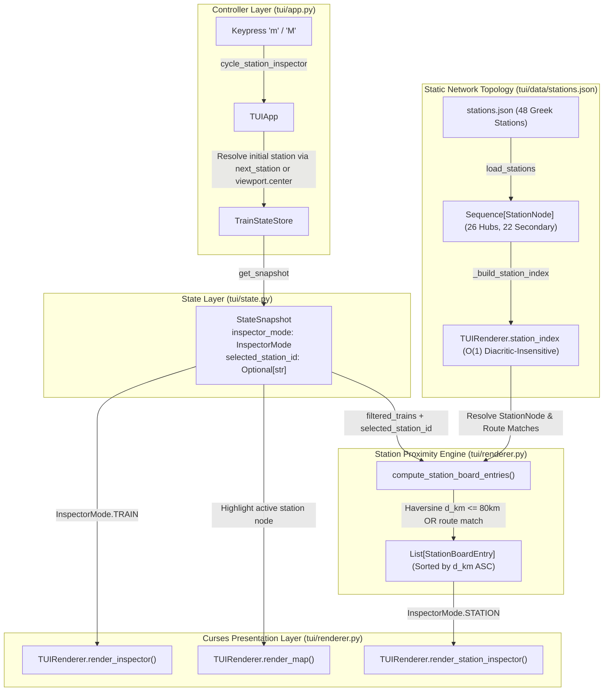
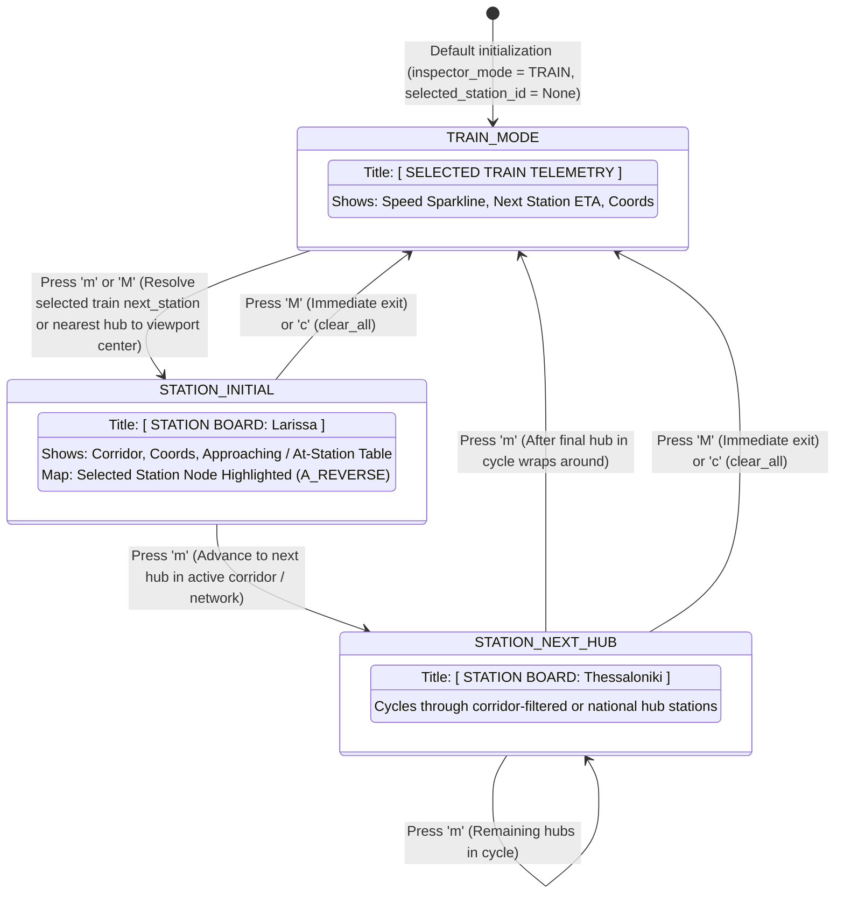
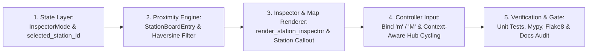

# Implementation Plan — F-3.2: Station Departure Board & Proximity Inspector Mode (`m`)

> **Reference:** [TUI Feature Enhancements & Expansion Specification (`F-3.2`)](../../architecture/tui-feature-enhancements.md#f-32-station-departure-board--proximity-inspector-mode-m), [`README.md` Architectural Overview](../../../README.md)  
> **Target Modules:** [`../../../tui/state.py`](../../../tui/state.py), [`../../../tui/app.py`](../../../tui/app.py), [`../../../tui/renderer.py`](../../../tui/renderer.py), [`../../../tui/__init__.py`](../../../tui/__init__.py)  
> **Test Suites:** [`../../../tests/test_tui_state.py`](../../../tests/test_tui_state.py), [`../../../tests/test_tui_controls.py`](../../../tests/test_tui_controls.py), [`../../../tests/test_tui_renderer.py`](../../../tests/test_tui_renderer.py)  
> **Relevant Rules & Skills:** [`../../../.agents/skills/diagrams-and-documentation/SKILL.md`](../../../.agents/skills/diagrams-and-documentation/SKILL.md), [`../../../.agents/skills/markdown-relative-paths/SKILL.md`](../../../.agents/skills/markdown-relative-paths/SKILL.md), [`../../../.agents/skills/tui-compatibility-tester/SKILL.md`](../../../.agents/skills/tui-compatibility-tester/SKILL.md), [`../../../.agents/skills/ci-quality-gate/SKILL.md`](../../../.agents/skills/ci-quality-gate/SKILL.md)

---

## 1. Executive Summary & Objective

The bottom-right **Inspector Pane** ([`TUIRenderer.render_inspector`](../../../tui/renderer.py#L1201-L1310)) currently operates exclusively in **Train Telemetry Mode**, displaying velocity, speed trend sparklines, delay, next-station ETA, and WGS84 coordinates for a single selected train (`snapshot.selected_train`). However, railway dispatchers and passengers frequently need a **station-centric operational view**: inspecting a major hub station (such as *Athens Larissa Station*, *SKA*, *Larissa*, *Thessaloniki*, *Piraeus*, *Athens Intl Airport*, or *Kiato*) to see all trains currently dwelling at or approaching that station, ordered by geodesic proximity and estimated arrival time.

This implementation plan delivers **Feature F-3.2: Station Departure Board & Proximity Inspector Mode (`m` / `M`)** across the state repository, event controller, and multi-pane Curses renderer while preserving 100% Python standard-library purity, thread-safe snapshot immutability, and 7-bit `--ascii` fallback compatibility.

### Core Objectives
1. **Dual-Mode Inspector State (`InspectorMode` & `selected_station_id` in [`../../../tui/state.py`](../../../tui/state.py)):**
   - Introduce `InspectorMode` (`TRAIN`, `STATION`) and `selected_station_id: Optional[str]` in [`TrainStateStore`](../../../tui/state.py) and [`StateSnapshot`](../../../tui/state.py).
   - Provide thread-safe methods `set_inspector_mode()`, `set_selected_station()`, and `cycle_station_board()` with automatic `self._version` increments for zero-latency dirty-frame redraws.
2. **Context-Aware Station Cycling (`m` / `M` in [`../../../tui/app.py`](../../../tui/app.py)):**
   - Pressing `m` from **Train Telemetry Mode** (`InspectorMode.TRAIN`) switches the Inspector into **Station Proximity Board Mode** (`InspectorMode.STATION`), automatically focusing on:
     1. The currently selected train's `next_station` if it resolves to a known `StationNode`, or
     2. The hub station geographically closest to the current map viewport center (`projector.viewport.center`).
   - Subsequent presses of `m` cycle forward through major hub stations (filtered by the active `corridor_filter` when a corridor preset `1`–`3` is engaged, or all national hubs otherwise), wrapping back to `InspectorMode.TRAIN` after completing the cycle.
   - Pressing `M` (`Shift+M`) from `InspectorMode.STATION` immediately returns to `InspectorMode.TRAIN` (or enters `InspectorMode.STATION` if currently in `TRAIN` mode).
   - Pressing `c` / `C` (`clear_all()`) resets `selected_station_id = None` and returns the Inspector to `InspectorMode.TRAIN`.
3. **Geodesic Proximity & Route-Matched Departure Board Engine ([`../../../tui/renderer.py`](../../../tui/renderer.py)):**
   - Implement `StationBoardEntry` and `compute_station_board_entries()` computing Haversine distance ($d_{\text{km}}$) from the selected `StationNode` to all active trains.
   - Filter for trains within $80.0\text{ km}$ of the station **or** whose `next_station`, `origin`, or `destination` resolves to the station.
   - Sort matching trains by ascending distance `(round(d_km, 3), natural_train_id)` and compute each train's 16-point cardinal heading (`NNW`, `SSE`, or `HLT` when speed $< 1.0\text{ km/h}$), compact distance (`4.2km`), kinematic ETA (`~2m`, `<1m`, `AT`, or `--`), and delay (`+4m`, `0m`).
4. **Map Canvas Active Station Callout & Responsive Inspector Table ([`../../../tui/renderer.py`](../../../tui/renderer.py)):**
   - Highlight the active `selected_station_id` on the Braille map canvas (`PAIR_STATION | curses.A_REVERSE | curses.A_BOLD`) so the operator has direct visual correlation between the map and the station board.
   - Render the **Station Board** inside the Inspector pane with responsive column formatting that fits both standard $80 \times 24$ consoles (`inspector_w = 28`) and wide terminals (`inspector_w >= 32`) in UTF-8 and `--ascii` modes.

---

## 2. Architecture & State Machine Diagrams

### 2.1 Inspector Mode & Station Board Data Flow (Mermaid)



### 2.2 Inspector Mode State Machine (Mermaid)



### 2.3 Visual Pipeline & Console Layout (ASCII)

```text
+-----------------------------------------------------------------------------------+
|            F-3.2 STATION DEPARTURE BOARD & PROXIMITY INSPECTOR PIPELINE           |
+-----------------------------------------------------------------------------------+

  [User Presses 'm']
          |
          v
  +-------------------------------------------------------------------------------+
  | 1. Context-Aware Hub Resolution (TUIApp.cycle_station_inspector)              |
  |    - If in TRAIN mode:                                                        |
  |      (a) Use selected_train.position.next_station if it resolves to a station |
  |      (b) Else pick hub station with min haversine_distance_km to viewport.ctr |
  |    - If in STATION mode:                                                      |
  |      Advance to next hub in corridor-filtered hub list (or wrap to TRAIN)     |
  +-------------------------------------------------------------------------------+
          |
          v
  +-------------------------------------------------------------------------------+
  | 2. Proximity & Route Filtering (compute_station_board_entries)                |
  |    For each train in snapshot.filtered_trains:                                |
  |      d_km = haversine_distance_km(train_pt, station.point)                    |
  |      route_match = station.id in {resolve(next_station), resolve(origin),     |
  |                                   resolve(destination)}                       |
  |      keep if (d_km <= 80.0 km) or route_match                                 |
  |      sort by (round(d_km, 3), natural_sort_key(train_number))                 |
  +-------------------------------------------------------------------------------+
          |
          v
  +--------------------------------------+   +------------------------------------+
  |  WIDE INSPECTOR PANE (32+ Columns)   |   | COMPACT 80x24 INSPECTOR (28 Cols)  |
  +--------------------------------------+   +------------------------------------+
  | [ STATION BOARD: Larissa ]           |   | [ STATION BOARD: Larissa ]         |
  | Corridor: PATHE Mainline             |   | Corridor: PATHE Mainline           |
  | Coords:   39.6385°N, 22.4222°E       |   | Coords:   39.6385°N, 22.4222°E     |
  |                                      |   | APPROACHING / AT STATION:          |
  | APPROACHING / AT STATION:            |   | TRAIN DIR DIST   ETA  DLY          |
  | TRAIN  DIR  DIST   ETA   DLY         |   | 1597  NNW 4.2km  ~2m   +4m         |
  | 1597   NNW  4.2km  ~2m   +4m         |   | 2591  SSE 11.8km ~7m    0m         |
  | 2591   SSE  11.8km ~7m    0m         |   | 1598  HLT 0.1km  AT     0m         |
  | 1598   HLT  0.1km  AT     0m         |   | IC52  NNW 34.5km ~15m  +2m         |
  +--------------------------------------+   +------------------------------------+
```

---

## 3. Detailed Component Specifications

### 3.1 State Layer: [`../../../tui/state.py`](../../../tui/state.py)

#### A. `InspectorMode` Enum Definition
Add `InspectorMode` right after [`BreadcrumbMode`](../../../tui/state.py#L48-L54):

```python
class InspectorMode(Enum):
    """Display mode for the bottom-right Inspector pane."""

    TRAIN = auto()  # Default: Selected Train Telemetry Inspector
    STATION = auto()  # Station Departure Board & Proximity Inspector
```

#### B. `StateSnapshot` Extension
Add `inspector_mode` and `selected_station_id` with backward-compatible default values to [`StateSnapshot`](../../../tui/state.py#L137-L157):

```python
@dataclass(frozen=True)
class StateSnapshot:
    ...
    sort_mode: RosterSortMode = RosterSortMode.TRAIN_ID
    breadcrumb_mode: BreadcrumbMode = BreadcrumbMode.ALL
    inspector_mode: InspectorMode = InspectorMode.TRAIN
    selected_station_id: Optional[str] = None
```

*(Defaulting `inspector_mode = InspectorMode.TRAIN` and `selected_station_id = None` ensures all existing tests constructing `StateSnapshot` continue to work without modification).*

#### C. `TrainStateStore` Attributes & Mutators
1. In [`TrainStateStore.__init__`](../../../tui/state.py#L276-L300), initialize:
   ```python
   self._inspector_mode: InspectorMode = InspectorMode.TRAIN
   self._selected_station_id: Optional[str] = None
   self._station_cycle_anchor_id: Optional[str] = None
   ```
2. In [`TrainStateStore.get_snapshot`](../../../tui/state.py#L383-L419), include:
   ```python
   inspector_mode=self._inspector_mode,
   selected_station_id=self._selected_station_id,
   ```
3. Add thread-safe station board state management methods under `self._lock`:
   ```python
   def set_inspector_mode(self, mode: InspectorMode) -> None:
       """Explicitly set the active Inspector pane display mode."""
       if not isinstance(mode, InspectorMode):
           raise TypeError(f"Expected InspectorMode, got {type(mode).__name__}")
       with self._lock:
           if self._inspector_mode != mode:
               self._inspector_mode = mode
               if mode == InspectorMode.TRAIN:
                   self._selected_station_id = None
                   self._station_cycle_anchor_id = None
               self._version += 1

   def set_selected_station(self, station_id: Optional[str]) -> None:
       """Select a station by ID and engage STATION inspector mode (or return to TRAIN if None)."""
       norm_id = station_id.strip().upper() if (station_id and station_id.strip()) else None
       target_mode = InspectorMode.STATION if norm_id is not None else InspectorMode.TRAIN
       with self._lock:
           if self._selected_station_id != norm_id or self._inspector_mode != target_mode:
               self._selected_station_id = norm_id
               self._inspector_mode = target_mode
               self._station_cycle_anchor_id = norm_id
               self._version += 1

   def cycle_station_board(
       self,
       station_ids: Sequence[str],
       initial_station_id: Optional[str] = None,
   ) -> Optional[str]:
       """Cycle through station IDs in STATION inspector mode, wrapping back to TRAIN mode.

       When entering from InspectorMode.TRAIN:
       - Selects initial_station_id if provided and non-empty (else station_ids[0]),
         records it as the cycle anchor, and switches to InspectorMode.STATION.
       When already in InspectorMode.STATION:
       - Advances to the next station in station_ids.
       - Once the cycle wraps back to the anchor station (having visited all stations in
         station_ids), resets selected_station_id to None and returns to InspectorMode.TRAIN.

       Args:
           station_ids: Ordered sequence of candidate hub station IDs to cycle through.
           initial_station_id: Optional preferred starting station ID when entering from TRAIN mode.

       Returns:
           Newly selected station ID string, or None when returning to InspectorMode.TRAIN.
       """
       cleaned_ids: List[str] = []
       for sid in station_ids:
           norm = sid.strip().upper()
           if norm and norm not in cleaned_ids:
               cleaned_ids.append(norm)

       with self._lock:
           if not cleaned_ids:
               if self._inspector_mode != InspectorMode.TRAIN or self._selected_station_id is not None:
                   self._inspector_mode = InspectorMode.TRAIN
                   self._selected_station_id = None
                   self._station_cycle_anchor_id = None
                   self._version += 1
               return None

           init_norm = (
               initial_station_id.strip().upper()
               if (initial_station_id and initial_station_id.strip())
               else None
           )

           # Transition 1: TRAIN -> STATION
           if self._inspector_mode == InspectorMode.TRAIN or self._selected_station_id is None:
               start_id = init_norm if (init_norm and init_norm in cleaned_ids) else (init_norm or cleaned_ids[0])
               self._selected_station_id = start_id
               self._station_cycle_anchor_id = start_id if start_id in cleaned_ids else cleaned_ids[0]
               self._inspector_mode = InspectorMode.STATION
               self._version += 1
               return self._selected_station_id

           # Transition 2: Already in STATION mode -> advance or wrap back to TRAIN
           if self._selected_station_id not in cleaned_ids:
               next_id = cleaned_ids[0]
               self._selected_station_id = next_id
               self._station_cycle_anchor_id = next_id
               self._version += 1
               return self._selected_station_id

           curr_idx = cleaned_ids.index(self._selected_station_id)
           next_idx = (curr_idx + 1) % len(cleaned_ids)
           next_id = cleaned_ids[next_idx]
           anchor_id = self._station_cycle_anchor_id if self._station_cycle_anchor_id in cleaned_ids else cleaned_ids[0]

           if next_id == anchor_id:
               # Completed full cycle through all candidate hub stations -> return to TRAIN mode
               self._selected_station_id = None
               self._station_cycle_anchor_id = None
               self._inspector_mode = InspectorMode.TRAIN
               self._version += 1
               return None

           self._selected_station_id = next_id
           self._version += 1
           return self._selected_station_id
   ```
4. In [`TrainStateStore.clear`](../../../tui/state.py#L556-L565):
   Reset `self._inspector_mode = InspectorMode.TRAIN`, `self._selected_station_id = None`, and `self._station_cycle_anchor_id = None`.

---

### 3.2 Controller Layer: [`../../../tui/app.py`](../../../tui/app.py)

#### A. Station Candidate & Initial Focus Resolution (`TUIApp.cycle_station_inspector`)
When the operator presses `m` or `M` in `InputMode.NORMAL`:

1. **Candidate Hub List (`_get_cycle_station_ids`):**
   - Filter `self.stations` for hub stations (`stn.is_hub`). If no station has `is_hub=True` (e.g., in a minimal synthetic test fixture), fall back to all stations in `self.stations`.
   - If `snapshot.corridor_filter` is active (e.g., `"PROASTIAKOS"`, `"PATHE"`, `"NORTHERN"`), prioritize hubs belonging to that corridor so pressing `m` while viewing the *Proastiakos* preset cycles through Suburban hubs (*Piraeus*, *Athens*, *SKA*, *Doukissis Plakentias*, *Neratziotissa*, *Ano Liosia*, *Korinthos*, *Kiato*, *Chalkida*, *Athens Intl Airport*).
2. **Initial Station Resolution when entering from `InspectorMode.TRAIN` (`_resolve_initial_station_id`):**
   - **Priority 1 (Selected Train's Upcoming Station):** If `snapshot.selected_train` is not `None` and `self.renderer.resolve_station(snapshot.selected_train.position.next_station)` returns a `StationNode`, use that station's `id` if it is in the candidate list (or if no hubs are closer).Wait: what if the selected train's `next_station` is a secondary station like `"Θήβα"` (`THI`)? Using `matched_stn.id` directly (or including it at the front of the cycle) lets the operator immediately inspect the departure/proximity board for the selected train's next station, or if no train is selected, the hub nearest to `self.projector.viewport.center`!
   - **Priority 2 (Nearest Hub to Viewport Center):** Compute `min(candidate_stations, key=lambda s: haversine_distance_km(self.projector.viewport.center, s.point))` and use its `.id`.
3. **Direct Return via `M` (`Shift+M`):**
   - If `key == ord("M")` and `snapshot.inspector_mode == InspectorMode.STATION`:
     Immediately call `self.store.set_inspector_mode(InspectorMode.TRAIN)` so operators can exit the Station Board back to Train Telemetry with a single keystroke at any point in the cycle.
   - If `key == ord("M")` and `snapshot.inspector_mode == InspectorMode.TRAIN`:
     Behave identically to `m` (enter `InspectorMode.STATION`).
4. **Reset in `TUIApp.clear_all()`:**
   - Call `self.store.set_inspector_mode(InspectorMode.TRAIN)` inside `clear_all()`.

```python
def _get_candidate_stations(self, corridor_filter: Optional[str]) -> List[StationNode]:
    """Return ordered hub stations matching the active corridor filter (or all stations if none are hubs)."""
    if not self.stations:
        return []
    hubs = [s for s in self.stations if s.is_hub]
    base_pool = hubs if hubs else list(self.stations)
    if not corridor_filter:
        return base_pool

    target = corridor_filter.strip().upper()
    filtered: List[StationNode] = []
    for stn in base_pool:
        c = (stn.corridor or "").strip().upper()
        if target in c:
            filtered.append(stn)
        elif target in ("PROASTIAKOS", "SUBURBAN") and ("PROAST" in c or stn.id in ("PIR", "ATH", "SKA", "INO")):
            filtered.append(stn)
        elif target in ("NORTHERN", "NORTHERN_GREECE", "NORTH") and (c in ("NORTHERN", "MACEDONIA") or stn.id == "SKG"):
            filtered.append(stn)
        elif target in ("PATHE", "MAINLINE") and c == "PATHE":
            filtered.append(stn)
    return filtered if filtered else base_pool

def cycle_station_inspector(self, exit_if_active: bool = False) -> Optional[str]:
    """Toggle or cycle the Station Departure Board & Proximity Inspector mode.

    Args:
        exit_if_active: If True and already in STATION mode, immediately return to TRAIN mode.

    Returns:
        Active selected_station_id, or None if in TRAIN mode.
    """
    snapshot = self.store.get_snapshot()
    if exit_if_active and snapshot.inspector_mode == InspectorMode.STATION:
        self.store.set_inspector_mode(InspectorMode.TRAIN)
        return None

    candidates = self._get_candidate_stations(snapshot.corridor_filter)
    if not candidates:
        self.store.set_inspector_mode(InspectorMode.TRAIN)
        return None

    candidate_ids = [s.id for s in candidates]
    initial_id: Optional[str] = None

    if snapshot.inspector_mode == InspectorMode.TRAIN or snapshot.selected_station_id is None:
        # 1. Check if selected train has a resolvable next_station in candidates
        if snapshot.selected_train and snapshot.selected_train.position.next_station:
            resolved = self.renderer.resolve_station(snapshot.selected_train.position.next_station)
            if resolved is not None:
                initial_id = resolved.id
                if initial_id not in candidate_ids:
                    candidate_ids.insert(0, initial_id)
        # 2. Otherwise select the candidate station closest to viewport center
        if initial_id is None:
            center_pt = self.projector.viewport.center
            nearest_stn = min(
                candidates,
                key=lambda s: haversine_distance_km(center_pt, s.point),
            )
            initial_id = nearest_stn.id

    return self.store.cycle_station_board(candidate_ids, initial_station_id=initial_id)
```

5. **Keybinding Dispatch in [`TUIApp._handle_normal_input`](../../../tui/app.py#L455):**
   ```python
   # Toggle / cycle Station Departure Board & Proximity Inspector Mode
   elif key == ord("m"):
       self.cycle_station_inspector(exit_if_active=False)
   elif key == ord("M"):
       self.cycle_station_inspector(exit_if_active=True)
   ```

---

### 3.3 Presentation Layer: [`../../../tui/renderer.py`](../../../tui/renderer.py)

#### A. `StationBoardEntry` Data Structure & `compute_station_board_entries`
Define `StationBoardEntry` and `compute_station_board_entries` in [`../../../tui/renderer.py`](../../../tui/renderer.py):

```python
DEFAULT_STATION_PROXIMITY_KM: float = 80.0


@dataclass(frozen=True)
class StationBoardEntry:
    """Computed proximity and estimated arrival row for a train relative to a StationNode."""

    train_id: str
    train_number: str
    direction: str
    distance_km: float
    dist_str: str
    eta_str: str
    delay_min: int
    delay_str: str
    is_matched_route: bool
    is_selected: bool
    color_pair: int
```

Let's specify the exact calculation logic inside `compute_station_board_entries`:
1. **Coordinate Validation:**
   For each `record` in `trains`:
   - Extract `pos = record.position`.
   - Validate `math.isfinite(pos.lat) and math.isfinite(pos.lng)` and `not (abs(pos.lat) < 1e-9 and abs(pos.lng) < 1e-9)`.
2. **Geodesic Distance ($d_{\text{km}}$):**
   - `train_pt = GeoPoint(lat=pos.lat, lng=pos.lng)`
   - `d_km = haversine_distance_km(train_pt, station.point)`
3. **Route Matching (`is_matched_route`):**
   - Check if any of `(pos.next_station, pos.origin, pos.destination)` resolves via `resolve_station_fn` to a `StationNode` whose `.id == station.id`.
   - Include the train if `d_km <= proximity_radius_km` (default `80.0` km) **or** `is_matched_route` is `True`.
4. **Direction (`DIR` column, 3 chars):**
   - Let `spd = float(pos.speed) if (pos.speed is not None and math.isfinite(pos.speed)) else 0.0`.
   - If `spd < 1.0`:
     `direction = "HLT"`
   - Else:
     `heading_deg = pos.track_heading if pos.track_heading is not None else pos.course`
     If `heading_deg is not None and math.isfinite(heading_deg)`:
       `idx = int((heading_deg + 11.25) % 360 // 22.5)`
       `direction = COMPASS_POINTS_16[idx]`
     Else:
       `bearing_deg = calculate_bearing(train_pt, station.point)`
       `idx = int((bearing_deg + 11.25) % 360 // 22.5)`
       `direction = COMPASS_POINTS_16[idx]`
5. **Distance Formatting (`DIST` column):**
   - If `d_km < 100.0`: `dist_str = f"{d_km:.1f}km"` (e.g. `"4.2km"`, `"11.8km"`, `"0.1km"`)
   - Else: `dist_str = f"{int(round(d_km))}km"` (e.g. `"142km"`)
6. **Kinematic ETA Formatting (`ETA` column):**
   - If `d_km < 0.25` and `spd < 5.0`:
     `eta_str = "AT"`
   - Else if `spd >= 5.0`:
     `eta_min = int(round((d_km / spd) * 60.0))`
     - If `d_km < 0.1 or eta_min <= 0`: `eta_str = "<1m"`
     - Else if `eta_min >= 120`:
       `hours = eta_min // 60; mins = eta_min % 60`
       `eta_str = f"~{hours}h{mins:02d}" if mins > 0 else f"~{hours}h"`
     - Else:
       `eta_str = f"~{eta_min}m"`
   - Else:
     `eta_str = "--"`
7. **Delay Formatting (`DLY` column):**
   - `dly_val = float(pos.delay) if (pos.delay is not None and math.isfinite(pos.delay)) else 0.0`
   - `dly_int = int(round(dly_val))`
   - `delay_str = f"+{dly_int}m" if dly_int > 0 else (f"{dly_int}m" if dly_int < 0 else "0m")`
8. **Deterministic Sorting:**
   - Sort all matching entries by `(round(entry.distance_km, 3), natural_digits_key(entry.train_number, entry.train_id))`.

#### B. Corridor Display Label Formatting (`format_corridor_display_name`)
Map internal corridor identifiers on `StationNode.corridor` to human-readable titles matching the specification mockup:
- `"PATHE"` $\rightarrow$ `"PATHE Mainline"`
- `"PROASTIAKOS_ATH"` / `"PROASTIAKOS"` $\rightarrow$ `"Proastiakos Suburban"`
- `"NORTHERN"` $\rightarrow$ `"Northern Greece"`
- `"MACEDONIA"` $\rightarrow$ `"Macedonia Corridor"`
- `"THESSALY"` $\rightarrow$ `"Thessaly Corridor"`
- Other non-empty strings $\rightarrow$ `corridor.title()`

#### C. Station Inspector Rendering (`TUIRenderer.render_station_inspector` & `TUIRenderer.render_inspector`)
In `TUIRenderer.render_inspector(self, win: Any, snapshot: StateSnapshot)`:
- Check `inspector_mode = getattr(snapshot, "inspector_mode", InspectorMode.TRAIN)` and `selected_station_id = getattr(snapshot, "selected_station_id", None)`.
- If `inspector_mode == InspectorMode.STATION` and `selected_station_id`:
  Delegate to `self.render_station_inspector(win, snapshot)`.
- Inside `render_station_inspector(self, win: Any, snapshot: StateSnapshot)`:
  1. Resolve `station = self.resolve_station(snapshot.selected_station_id)`.
  2. If `station is None`:
     Render box with title `[ STATION BOARD ]` and centered fallback message `"Station not found."`.
  3. Draw border box and title:
     `station_title_name = station.name_en or station.name_el or station.id`
     `title = f" STATION BOARD: {station_title_name} "`
     `safe_addstr(win, 0, 2, f"[{title}]", border_attr | curses.A_BOLD, max_w=max_x - 4, ascii_mode=self.ascii_mode)`
  4. Render station metadata rows:
     - Row 1 (`y = 1`):
       Label `"Corridor:"` (`x = 2`, `title_attr`), Value `format_corridor_display_name(station.corridor)` (`x = 12`, `val_attr`)
     - Row 2 (`y = 2`):
       Label `"Coords:"` (`x = 2`, `title_attr`), Value `format_wgs84_coords(station.point.lat, station.point.lng, ascii_mode=self.ascii_mode)` (`x = 12`, `val_attr`)
  5. Compute proximity entries:
     `selected_tid = snapshot.selected_train.position.id if snapshot.selected_train else None`
     `entries = compute_station_board_entries(station, snapshot.filtered_trains, self.resolve_station, selected_train_id=selected_tid)`
  6. Adaptive vertical spacing for section header & table header:
     - If `inner_h >= 10` (terminal height $\ge 26$ rows): leave Row 3 (`y = 3`) blank as a visual separator (matching the specification mockup), place `"APPROACHING / AT STATION:"` at `y = 4`, table header at `y = 5`, and train rows starting at `y = 6`.
     - If `inner_h < 10` (e.g. standard $80 \times 24$ terminal where `inner_h = 9`): place `"APPROACHING / AT STATION:"` at `y = 3`, table header at `y = 4`, and train rows starting at `y = 5` (giving 5 visible train rows on $80 \times 24$ consoles!).
  7. Responsive horizontal table formatting:
     - On standard/wide sidebars (`max_x >= 32`):
       - Table header at `x = 2`: `"TRAIN  DIR  DIST   ETA   DLY"`
       - Each entry row at `x = 2`: `f"{entry.train_number[:5]:<6} {entry.direction:<3}  {entry.dist_str:<6} {entry.eta_str:<5} {entry.delay_str:>3}"`
     - On compact 80-column sidebars (`max_x < 32`, e.g. `max_x = 28` where `inner_w = 26`):
       - Table header at `x = 1`: `"TRAIN DIR DIST   ETA  DLY"`
       - Each entry row at `x = 1`: `f"{entry.train_number[:5]:<5} {entry.direction:<3} {entry.dist_str:<6} {entry.eta_str:<4} {entry.delay_str:>4}"`
  8. If `entries` is empty:
     Render `"No trains within 80 km."` in `dim_attr` at `start_y`.

#### D. Map Canvas Highlight for Active Selected Station (`TUIRenderer.render_map`)
In [`TUIRenderer.render_map`](../../../tui/renderer.py#L1029-L1072):
- Check if `getattr(snapshot, "inspector_mode", InspectorMode.TRAIN) == InspectorMode.STATION` and `stn.id == getattr(snapshot, "selected_station_id", None)`.
- When `is_selected_station` is `True`:
  - Render the station marker glyph (`◉` or `#`) and station label (`f" [{name}]"`) with `station_attr | curses.A_REVERSE | curses.A_BOLD`, and ensure the selected station's label is prioritized during collision checks so the currently inspected station is clearly highlighted on the map!

#### E. Status Bar & Help Modal Updates (`TUIRenderer.render_status_bar` & `TUIRenderer.render_help_modal`)
1. In [`TUIRenderer.render_status_bar`](../../../tui/renderer.py#L1367-L1370):
   Include `[m] Stations` in the bottom status bar shortcuts:
   ```python
   shortcuts = (
       f" [q] Quit  [h/j/k/l] Pan  [+/-] Zoom  [Tab] Select  [s] Sort  [b] Trails  "
       f"[m] Stations  {follow_str}  [/] Filter  [?] Help  [0..3] Presets"
   )
   ```
2. In [`TUIRenderer.render_help_modal`](../../../tui/renderer.py#L1441-L1447):
   Add `("m / M", "Cycle station departure board / Return to train view")` under `TRAIN SELECTION & TRACKING` (and adjust `box_h = min(25, max(17, height - 2))` so all entries render cleanly).

---

## 4. Visual Mockups

### 4.1 Station Proximity Board Mode — UTF-8 ($100 \times 30$ Console, `inspector_w = 35`)

```text
+-----------------------------------+
| [ STATION BOARD: Larissa ]        |
| Corridor: PATHE Mainline          |
| Coords:   39.6385°N, 22.4222°E    |
|                                   |
| APPROACHING / AT STATION:         |
| TRAIN  DIR  DIST   ETA   DLY      |
| 1598   HLT  0.1km  AT     0m      |
| 1597   NNW  4.2km  ~2m   +4m      |
| 2591   SSE  11.8km ~7m    0m      |
| IC 52  NNW  38.4km ~16m  +9m      |
+-----------------------------------+
```

### 4.2 Station Proximity Board Mode — Compact $80 \times 24$ Console (`inspector_w = 28`, `inner_h = 9`)

```text
+--------------------------+
| [STATION BOARD: Larissa] |
| Corridor: PATHE Mainline |
| Coords:   39.6385°N, 22… |
| APPROACHING / AT STATION:|
| TRAIN DIR DIST   ETA  DLY|
| 1598  HLT 0.1km  AT    0m|
| 1597  NNW 4.2km  ~2m  +4m|
| 2591  SSE 11.8km ~7m   0m|
| IC 52 NNW 38.4km ~16m +9m|
+--------------------------+
```

### 4.3 Station Proximity Board Mode — `--ascii` Fallback Mode

```text
+-----------------------------------+
| [ STATION BOARD: Larissa ]        |
| Corridor: PATHE Mainline          |
| Coords:   39.6385d N, 22.4222d E  |
|                                   |
| APPROACHING / AT STATION:         |
| TRAIN  DIR  DIST   ETA   DLY      |
| 1598   HLT  0.1km  AT     0m      |
| 1597   NNW  4.2km  ~2m   +4m      |
| 2591   SSE  11.8km ~7m    0m      |
+-----------------------------------+
```

---

## 5. Step-by-Step Implementation Tasks



### Task 1: Extend State Layer ([`../../../tui/state.py`](../../../tui/state.py) & [`../../../tui/__init__.py`](../../../tui/__init__.py))
- [x] Add `InspectorMode` enum (`TRAIN`, `STATION`) to [`../../../tui/state.py`](../../../tui/state.py).
- [x] Extend [`StateSnapshot`](../../../tui/state.py) with `inspector_mode: InspectorMode = InspectorMode.TRAIN` and `selected_station_id: Optional[str] = None`.
- [x] Initialize `self._inspector_mode`, `self._selected_station_id`, and `self._station_cycle_anchor_id` in [`TrainStateStore.__init__`](../../../tui/state.py).
- [x] Implement `set_inspector_mode()`, `set_selected_station()`, and `cycle_station_board()` on [`TrainStateStore`](../../../tui/state.py) with lock protection and `self._version` increments.
- [x] Reset station board state in `TrainStateStore.clear()`.
- [x] Export `InspectorMode` in [`../../../tui/__init__.py`](../../../tui/__init__.py).

### Task 2: Implement Station Proximity & Departure Board Engine ([`../../../tui/renderer.py`](../../../tui/renderer.py))
- [x] Define `DEFAULT_STATION_PROXIMITY_KM = 80.0` and `@dataclass(frozen=True) class StationBoardEntry`.
- [x] Implement `format_corridor_display_name(corridor: Optional[str]) -> str`.
- [x] Implement `compute_station_board_entries(station, trains, resolve_station_fn, selected_train_id=None, proximity_radius_km=80.0) -> List[StationBoardEntry]`.
- [x] Export `StationBoardEntry` and `compute_station_board_entries` in [`../../../tui/__init__.py`](../../../tui/__init__.py).

### Task 3: Render Station Board & Map Highlight ([`../../../tui/renderer.py`](../../../tui/renderer.py))
- [x] Implement `TUIRenderer.render_station_inspector(self, win: Any, snapshot: StateSnapshot) -> None` and dispatch to it from `TUIRenderer.render_inspector` when `snapshot.inspector_mode == InspectorMode.STATION` and `snapshot.selected_station_id` is set.
- [x] Highlight the active station node and label in `TUIRenderer.render_map` when `snapshot.inspector_mode == InspectorMode.STATION`.
- [x] Add `[m] Stations` to `TUIRenderer.render_status_bar` and document `m / M` in `TUIRenderer.render_help_modal`.

### Task 4: Wire Keybindings & Context-Aware Station Resolution ([`../../../tui/app.py`](../../../tui/app.py))
- [x] Implement `TUIApp._get_candidate_stations(corridor_filter)` and `TUIApp.cycle_station_inspector(exit_if_active=False)`.
- [x] Bind `ord("m")` and `ord("M")` in `TUIApp._handle_normal_input` (leaving `InputMode.SEARCH` untouched so typing `m` in search queries appends to `search_buffer`).
- [x] Reset `self.store.set_inspector_mode(InspectorMode.TRAIN)` in `TUIApp.clear_all()`.

### Task 5: Expand Unit & Integration Test Suites and Run Quality Gate
- [x] Add state store tests in [`../../../tests/test_tui_state.py`](../../../tests/test_tui_state.py):
  - `test_inspector_mode_and_station_board_cycling`: Verifies default `InspectorMode.TRAIN`, entering `STATION` mode with an initial station ID, cycling through hub stations, wrapping back to `InspectorMode.TRAIN`, explicit `set_selected_station()`, `set_inspector_mode()`, and `TypeError` validation.
- [x] Add controller input tests in [`../../../tests/test_tui_controls.py`](../../../tests/test_tui_controls.py):
  - `test_key_m_cycles_station_inspector_and_upper_m_exits`: Verifies `m` enters `InspectorMode.STATION` (selecting the selected train's `next_station` or nearest hub to viewport center), subsequent `m` presses cycle hubs and wrap back to `TRAIN`, `M` exits immediately to `TRAIN`, and `c` (`clear_all`) resets to `TRAIN`.
  - `test_key_m_in_search_mode_appends_character_without_toggling_station_board`: Verifies modal input isolation in `InputMode.SEARCH`.
- [x] Add renderer unit and integration tests in [`../../../tests/test_tui_renderer.py`](../../../tests/test_tui_renderer.py):
  - `test_compute_station_board_entries_and_render_station_inspector`: Verifies $80\text{ km}$ radius filtering, route matching (`next_station`, `origin`, `destination`) beyond $80\text{ km}$, `HLT` vs. cardinal direction `NNW`/`SSE`, kinematic ETA (`~2m`, `AT`, `--`), delay formatting (`+4m`, `0m`), ascending distance ordering, `[ STATION BOARD: Larissa ]`, `Corridor: PATHE Mainline`, `Coords:`, `APPROACHING / AT STATION:`, table headers, train rows, and 7-bit `--ascii` compliance.

---

## 6. Verification & Test Matrix

| Test ID | Target Component | Test Scenario | Expected Outcome |
| :--- | :--- | :--- | :--- |
| **TC-F32-01** | `TrainStateStore.cycle_station_board` ([`../../../tui/state.py`](../../../tui/state.py)) | Cycle `["ATH", "LAR", "SKG"]` starting at `"LAR"` | Transitions `TRAIN(None) -> STATION("LAR") -> STATION("SKG") -> STATION("ATH") -> TRAIN(None)` |
| **TC-F32-02** | `TrainStateStore.set_selected_station` ([`../../../tui/state.py`](../../../tui/state.py)) | `set_selected_station("lar")` then `set_selected_station(None)` | Normalizes to `"LAR"` (`InspectorMode.STATION`), then resets to `None` (`InspectorMode.TRAIN`) |
| **TC-F32-03** | `compute_station_board_entries` ([`../../../tui/renderer.py`](../../../tui/renderer.py)) | 3 trains at $0.1\text{ km}$ (halted), $4.2\text{ km}$ ($126\text{ km/h}$), $120\text{ km}$ (no route match) | Includes first 2 sorted by distance (`0.1km AT`, `4.2km ~2m`); excludes unrelated $120\text{ km}$ train |
| **TC-F32-04** | `compute_station_board_entries` ([`../../../tui/renderer.py`](../../../tui/renderer.py)) | Train at $150\text{ km}$ with `destination="Λάρισα"` | Included via `is_matched_route=True` despite $d > 80\text{ km}$ |
| **TC-F32-05** | `TUIApp.process_input` ([`../../../tui/app.py`](../../../tui/app.py)) | Press `m` in `InputMode.NORMAL` vs. `InputMode.SEARCH` | `NORMAL` engages `InspectorMode.STATION`; `SEARCH` appends `'m'` to `search_buffer` |
| **TC-F32-06** | `TUIApp.process_input` ([`../../../tui/app.py`](../../../tui/app.py)) | Press `M` (`Shift+M`) while in `InspectorMode.STATION` | Immediately exits back to `InspectorMode.TRAIN` (`selected_station_id=None`) |
| **TC-F32-07** | `TUIRenderer.render_inspector` ([`../../../tui/renderer.py`](../../../tui/renderer.py)) | Render Station Board in $80 \times 24$ (`28x11`) and $100 \times 30$ (`35x14`) windows | Renders station header, corridor, coordinates, and approaching train rows without Curses errors |
| **TC-F32-08** | `TUIRenderer.render_inspector` ([`../../../tui/renderer.py`](../../../tui/renderer.py)) | Render Station Board with `ascii_mode=True` | All output characters satisfy `ord(ch) < 128` (`39.6385d N, 22.4222d E`) |

---

## 7. Risk Analysis & Defensive Guardrails

1. **Corridor Preset Alignment When Cycling Stations:**
   - *Risk:* If the operator presses `1` (Proastiakos Suburban preset) and then presses `m`, cycling through distant Northern Greece stations (*Alexandroupoli*, *Dikea*) that are off-screen and have zero visible trains would feel disconnected.
   - *Mitigation:* `TUIApp._get_candidate_stations(snapshot.corridor_filter)` filters the hub rotation to the active corridor when a corridor filter is engaged, and initiates the cycle at the selected train's `next_station` or the hub closest to the current camera center.
2. **Search Mode Key Collision (`m` / `M`):**
   - *Risk:* Typing station or train names containing the letter `m` (e.g., `"Kalambaka"`, `"Komotini"`, `"Domokos"`) in interactive search mode (`/`) must never trigger station board cycling.
   - *Mitigation:* `ord("m")` and `ord("M")` are handled strictly inside `TUIApp._handle_normal_input()`, which is only invoked when `self.input_mode == InputMode.NORMAL`.
3. **Narrow $80 \times 24$ Sidebar Truncation:**
   - *Risk:* On a minimum $80 \times 24$ terminal, `PaneGeometry` allocates `inspector_w = 28` (`inner_w = 26` columns) and `inspector_h = 11` (`inner_h = 9` rows). A wide table layout or extra blank lines would clip the `DLY` column or leave room for only 2 trains.
   - *Mitigation:* `render_station_inspector` adapts both horizontally (using a 26-column row format at `x = 1` when `max_x < 32` and a 28-column row format at `x = 2` when `max_x >= 32`) and vertically (omitting the blank spacer row when `inner_h < 10` so 5 approaching trains fit on an $80 \times 24$ console).
4. **Uninitialized GPS Coordinates (`0.0, 0.0`):**
   - *Risk:* Trains without a valid GPS fix could compute spurious distances.
   - *Mitigation:* `compute_station_board_entries` skips non-finite or `(0.0, 0.0)` coordinates before computing Haversine distances.
