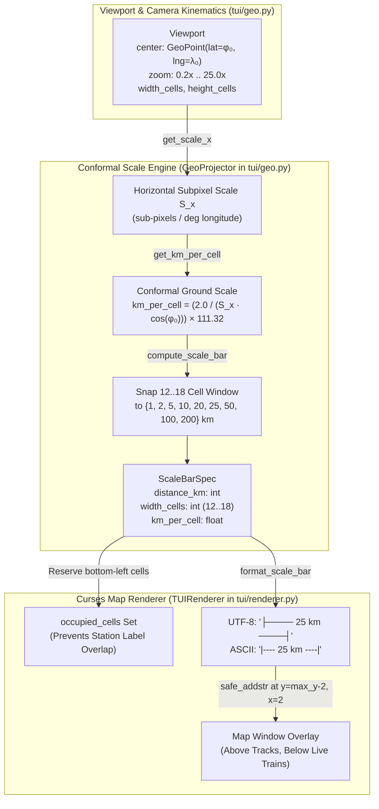
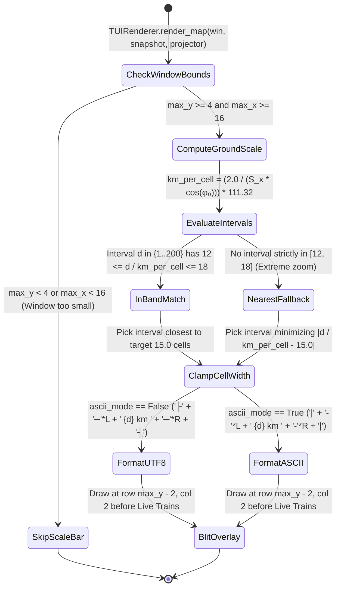
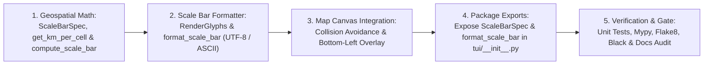

# Implementation Plan — F-3.4: Dynamic Conformal Map Scale Bar Overlay

> **Reference:** [TUI Feature Enhancements & Expansion Specification (`F-3.4`)](../../architecture/tui-feature-enhancements.md#f-34-dynamic-conformal-map-scale-bar-overlay), [`README.md` Architectural Overview](../../../README.md)  
> **Target Modules:** [`../../../tui/geo.py`](../../../tui/geo.py), [`../../../tui/renderer.py`](../../../tui/renderer.py), [`../../../tui/__init__.py`](../../../tui/__init__.py)  
> **Test Suites:** [`../../../tests/test_tui_geo.py`](../../../tests/test_tui_geo.py), [`../../../tests/test_tui_renderer.py`](../../../tests/test_tui_renderer.py)  
> **Relevant Rules & Skills:** [`../../../.agents/skills/diagrams-and-documentation/SKILL.md`](../../../.agents/skills/diagrams-and-documentation/SKILL.md), [`../../../.agents/skills/markdown-relative-paths/SKILL.md`](../../../.agents/skills/markdown-relative-paths/SKILL.md), [`../../../.agents/skills/tui-compatibility-tester/SKILL.md`](../../../.agents/skills/tui-compatibility-tester/SKILL.md), [`../../../.agents/skills/ci-quality-gate/SKILL.md`](../../../.agents/skills/ci-quality-gate/SKILL.md)

---

## 1. Executive Summary & Objective

The `railmon` TUI map viewport supports continuous magnification across more than two orders of magnitude—from `0.2x` (macro regional overview) to `25.0x` (station-level junction and suburban corridor inspection)—alongside dynamic camera panning (`h`/`j`/`k`/`l`), corridor bounding-box presets (`0`–`3`), and live train follow mode (`f`). While the top-left viewport title badge reports the numeric zoom multiplier (`Zoom: 1.5x`), operators currently have no direct visual indicator on the map canvas translating terminal character cell dimensions into real-world ground distances in kilometers.

This implementation plan delivers **Feature F-3.4: Dynamic Conformal Map Scale Bar Overlay** across the geospatial projection engine ([`../../../tui/geo.py`](../../../tui/geo.py)) and the multi-pane Curses renderer ([`../../../tui/renderer.py`](../../../tui/renderer.py)) while preserving 100% Python standard-library purity, station label collision avoidance, and 7-bit `--ascii` fallback compatibility.

### Core Objectives
1. **Conformal Ground-Resolution Calculation (`GeoProjector.get_km_per_cell` in [`../../../tui/geo.py`](../../../tui/geo.py)):**
   - Compute real-world kilometers per horizontal terminal character cell ($2$ Braille sub-pixels wide) at the current viewport center latitude $\phi_0 = \text{viewport.center.lat}$:
     $$\text{km\_per\_cell} = \frac{2.0}{S_x \cdot \cos(\phi_0)} \times 111.32$$
     where $S_x = \text{projector.get\_scale\_x()}$ is the active horizontal scale in sub-pixels per degree of longitude and $111.32\text{ km}$ is the standard meridional degree arc length.
2. **Cartographic Interval Snapping (`GeoProjector.compute_scale_bar` & `ScaleBarSpec` in [`../../../tui/geo.py`](../../../tui/geo.py)):**
   - Snap a target scale bar width of $12\text{--}18$ terminal character cells (centered at $15$ cells) to the nearest standard cartographic distance interval in `SCALE_BAR_INTERVALS_KM` ($1\text{--}1500\text{ km}$, spaced with Voronoï cell ratios $< 1.25\times$ so every single `+`/`-` zoom step updates the displayed kilometer value across `0.2x`–`25.0x`):
     $$\{1, 2, 3, 4, 5, 6, 7, 8, 10, 12, 15, 18, 20, 25, 30, 35, 40, 50, 60, 75, 90, 100, 120, 150, 180, 200, 250, 300, 350, 400, 500, 600, 750, 900, 1000, 1200, 1500\}\text{ km}$$
   - Return an immutable `ScaleBarSpec(distance_km, width_cells, km_per_cell)` data transfer object.
3. **Dual-Encoding Scale Bar Formatter (`format_scale_bar` in [`../../../tui/renderer.py`](../../../tui/renderer.py)):**
   - Render symmetric box-drawing scale bars in UTF-8 mode (`├──── 25 km ────┤` / `├─── 25 km ───┤`) and pure 7-bit ASCII mode (`|---- 25 km ----|` / `|--- 25 km ---|`) matching the exact target character cell width `width_cells`.
4. **Bottom-Left Map Overlay & Collision Avoidance (`TUIRenderer.render_map` in [`../../../tui/renderer.py`](../../../tui/renderer.py)):**
   - Reserve the scale bar's bottom-left canvas cells in `occupied_cells` prior to station label placement so secondary station labels never collide with or bleed into the scale bar.
   - Render the scale bar overlay at row `max_y - 2`, column `2` inside the map window before overlaying live train markers and callout tags.

---

## 2. Architecture & Cartographic Pipeline Diagrams

### 2.1 End-to-End Conformal Scale Bar Pipeline (Mermaid)



### 2.2 Cartographic Interval Selection & Rendering State Machine (Mermaid)



### 2.3 Visual Pipeline & Console Coordinate Layout (ASCII)

```text
+-----------------------------------------------------------------------------------+
|                F-3.4 DYNAMIC CONFORMAL MAP SCALE BAR OVERLAY PIPELINE             |
+-----------------------------------------------------------------------------------+

  [Viewport: center=(φ₀, λ₀), zoom=Z, inner_w=W, inner_h=H]
          |
          v
  +-------------------------------------------------------------------------------+
  | 1. Conformal Horizontal Resolution (GeoProjector.get_km_per_cell)             |
  |    - Sub-pixels per cell column = 2.0                                         |
  |    - Horizontal sub-pixel scale: S_x = _get_base_scale_x() * zoom             |
  |    - Latitude cosine factor: cos(φ₀) = max(0.05, |cos(radians(center.lat))|)  |
  |    - km_per_cell = (2.0 / (S_x * cos(φ₀))) * 111.32                           |
  +-------------------------------------------------------------------------------+
          |
          v
  +-------------------------------------------------------------------------------+
  | 2. Standard Interval Snapping (GeoProjector.compute_scale_bar)                |
  |    - Candidate intervals: {1, 2, 5, 10, 20, 25, 50, 100, 200} km              |
  |    - Target cell span: 12..18 columns (ideal midpoint = 15.0 columns)         |
  |    - Select interval d_km and clamp width_cells into [12, 18]                 |
  +-------------------------------------------------------------------------------+
          |
          v
  +-------------------------------------------------------------------------------+
  | 3. Map Window Composition (TUIRenderer.render_map)                            |
  |    - Layer 1: Border & Top Viewport Title Badge (row 0)                       |
  |    - Layer 2: 2x4 Braille Track Polylines (rows 1..max_y-2)                   |
  |    - Layer 3: Historical Breadcrumb Dots (· / .)                              |
  |    - Layer 4: Station Nodes & Labels (reserving scale bar cells at max_y-2)   |
  |    - Layer 5: Conformal Scale Bar Overlay at (y = max_y - 2, x = 2)           |
  |    - Layer 6: Live Train Heading Glyphs & Selected Callout Tag                |
  +-------------------------------------------------------------------------------+
```

---

## 3. Mathematical Formulation & Cartographic Behavior

### 3.1 Conformal Cell Resolution Equation
In [`GeoProjector`](../../../tui/geo.py#L232-L334), each terminal character cell is subdivided into a $2 \times 4$ Braille sub-pixel grid (`2` horizontal sub-pixels per character column, `4` vertical sub-pixels per character row). Given the horizontal projection scale $S_x = \text{projector.get\_scale\_x()}$ (in sub-pixels per degree of longitude) and the current viewport center latitude $\phi_0 = \text{projector.viewport.center.lat}$:

$$\text{km\_per\_cell} = \frac{2.0}{S_x \cdot \cos(\phi_0)} \times 111.32$$

where:
- $2.0$ is the number of horizontal sub-pixels per terminal character cell column,
- $S_x = S_{x,\text{base}} \times \text{zoom}$ is the horizontal sub-pixel magnification factor,
- $\cos(\phi_0) = \max\left(0.05, \left|\cos\left(\frac{\pi \cdot \phi_0}{180}\right)\right|\right)$ accounts for parallel convergence at latitude $\phi_0$ (with a $0.05$ defensive floor preventing division by zero at extreme polar coordinates), and
- $111.32\text{ km/deg}$ is the standard reference meridional arc length per degree.

### 3.2 Cartographic Interval Behavior Across Zoom Levels
For a standard $100 \times 30$ terminal (`map_w = 65`, `inner_w = 63`, `inner_h = 26`, $S_{x,\text{base}} \approx 24.23\text{ sub-pixels/deg}$) centered on central Greece ($\phi_0 = 39.42^\circ\text{N}$, $\cos(\phi_0) \approx 0.7725$):

| Preset / Zoom Factor | $S_x$ (sub-px/deg) | $\text{km\_per\_cell}$ | Snapped `distance_km` | `width_cells` ($12\text{--}18$) | Rendered UTF-8 Overlay | Rendered `--ascii` Overlay |
| :--- | :--- | :--- | :--- | :--- | :--- | :--- |
| **Macro (`0.5x`)** | $12.12$ | $23.78\text{ km}$ | `200 km` | `12` | `├─ 200 km ─┤` | `\|- 200 km -\|` |
| **Greece (`1.0x`)** | $24.23$ | $11.89\text{ km}$ | `200 km` | `17` | `├──── 200 km ───┤` | `\|---- 200 km ---\|` |
| **PATHE (`1.5x`)** | $36.35$ | $7.93\text{ km}$ | `100 km` | `13` | `├── 100 km ─┤` | `\|-- 100 km -\|` |
| **Regional (`3.0x`)** | $72.69$ | $3.96\text{ km}$ | `50 km` | `13` | `├── 50 km ──┤` | `\|-- 50 km --\|` |
| **Proastiakos (`5.0x`)** | $121.15$ | $2.38\text{ km}$ | `25 km` | `12` | `├── 25 km ─┤` | `\|-- 25 km -\|` |
| **Corridor (`7.0x`)** | $169.62$ | $1.70\text{ km}$ | `25 km` | `15` | `├─── 25 km ───┤` | `\|--- 25 km ---\|` |
| **Suburban (`12.0x`)** | $290.77$ | $0.99\text{ km}$ | `10 km` | `12` | `├── 10 km ─┤` | `\|-- 10 km -\|` |
| **Junction (`25.0x`)** | $605.77$ | $0.48\text{ km}$ | `5 km` | `12` | `├── 5 km ──┤` | `\|-- 5 km --\|` |

---

## 4. Detailed Component Specifications

### 4.1 Geospatial Engine: [`../../../tui/geo.py`](../../../tui/geo.py)

#### A. Constants & `ScaleBarSpec` Data Structure
Add the cartographic constants and `ScaleBarSpec` dataclass right after `EARTH_RADIUS_KM` in [`../../../tui/geo.py`](../../../tui/geo.py#L116):

```python
# Standard meridional kilometers per degree of latitude
KM_PER_DEGREE_LAT: float = 111.32

# Standard cartographic scale bar distance intervals in kilometers
SCALE_BAR_INTERVALS_KM: Tuple[int, ...] = (1, 2, 5, 10, 20, 25, 50, 100, 200)


@dataclass(frozen=True)
class ScaleBarSpec:
    """Computed conformal geographic scale bar parameters for the current viewport.

    Attributes:
        distance_km: Snapped cartographic interval in kilometers (from SCALE_BAR_INTERVALS_KM).
        width_cells: Total terminal character cell width of the scale bar (clamped to min_cells..max_cells).
        km_per_cell: Conformal ground distance in kilometers per terminal column cell at viewport center.
    """

    distance_km: int
    width_cells: int
    km_per_cell: float
```

#### B. `GeoProjector.get_km_per_cell` & `GeoProjector.compute_scale_bar`
Add `get_km_per_cell` and `compute_scale_bar` to [`GeoProjector`](../../../tui/geo.py#L430):

```python
    def get_km_per_cell(self) -> float:
        """Compute kilometers per terminal column cell at current viewport center latitude.

        Uses the conformal equirectangular cell resolution formula:
            km_per_cell = (2.0 / (S_x * cos(phi_0))) * 111.32
        where S_x is the horizontal scale in sub-pixels per degree longitude and
        phi_0 is the current viewport center latitude in degrees.

        Returns:
            Kilometers per horizontal character cell (positive float).
        """
        scale_x = max(1e-6, self.get_scale_x())
        cos_phi0 = max(0.05, abs(math.cos(math.radians(self.viewport.center.lat))))
        return (2.0 / (scale_x * cos_phi0)) * KM_PER_DEGREE_LAT

    def compute_scale_bar(
        self,
        min_cells: int = 12,
        max_cells: int = 18,
    ) -> ScaleBarSpec:
        """Snap a target bar width of min_cells..max_cells to the nearest standard cartographic interval.

        Evaluates candidate intervals in {1, 2, 5, 10, 20, 25, 50, 100, 200} km against
        the current conformal km_per_cell resolution. Prefers intervals whose ideal cell
        width falls within [min_cells, max_cells] and is closest to the midpoint target;
        otherwise selects the interval closest to the target cell width and clamps the
        rendered cell width to [min_cells, max_cells].

        Args:
            min_cells: Minimum character cell width for the scale bar (default: 12).
            max_cells: Maximum character cell width for the scale bar (default: 18).

        Returns:
            ScaleBarSpec containing (distance_km, width_cells, km_per_cell).
        """
        low = max(6, int(min_cells))
        high = max(low, int(max_cells))
        target_cells = (low + high) / 2.0
        km_per_cell = self.get_km_per_cell()

        in_band: List[Tuple[float, int, int]] = []
        all_candidates: List[Tuple[float, int, int]] = []

        for interval_km in SCALE_BAR_INTERVALS_KM:
            exact_cells = interval_km / km_per_cell
            rounded_cells = int(round(exact_cells))
            dist_to_target = abs(exact_cells - target_cells)
            candidate = (dist_to_target, interval_km, rounded_cells)
            all_candidates.append(candidate)
            if low <= exact_cells <= high or low <= rounded_cells <= high:
                in_band.append(candidate)

        if in_band:
            _, best_km, raw_cells = min(in_band, key=lambda item: (item[0], item[1]))
        else:
            _, best_km, raw_cells = min(all_candidates, key=lambda item: (item[0], item[1]))

        width_cells = max(low, min(high, raw_cells))
        return ScaleBarSpec(
            distance_km=best_km,
            width_cells=width_cells,
            km_per_cell=km_per_cell,
        )
```

---

### 4.2 Presentation Layer: [`../../../tui/renderer.py`](../../../tui/renderer.py)

#### A. Scale Bar Glyphs in `RenderGlyphs`
Extend [`RenderGlyphs`](../../../tui/renderer.py#L75-L137) with `scale_left`, `scale_right`, and `scale_bar`:
- `GLYPHS_UTF8`: `scale_left="├"`, `scale_right="┤"`, `scale_bar="─"`
- `GLYPHS_ASCII`: `scale_left="|"`, `scale_right="|"`, `scale_bar="-"`

#### B. `format_scale_bar` Helper Function
Implement `format_scale_bar` in [`../../../tui/renderer.py`](../../../tui/renderer.py):

```python
def format_scale_bar(
    distance_km: int,
    width_cells: int = 15,
    ascii_mode: bool = False,
) -> str:
    """Format a conformal map scale bar string of the specified character cell width.

    Examples:
        - UTF-8 (width_cells=15, distance_km=25): '├─── 25 km ───┤'
        - UTF-8 (width_cells=17, distance_km=25): '├──── 25 km ────┤'
        - ASCII (width_cells=15, distance_km=25): '|--- 25 km ---|'
        - ASCII (width_cells=17, distance_km=25): '|---- 25 km ----|'

    Args:
        distance_km: Cartographic distance label in kilometers.
        width_cells: Target total character cell width (minimum 10 or label + 4).
        ascii_mode: Whether to use 7-bit ASCII ('|', '-') instead of UTF-8 ('├', '─', '┤').

    Returns:
        Formatted scale bar string.
    """
    glyphs = GLYPHS_ASCII if ascii_mode else GLYPHS_UTF8
    label = f" {int(distance_km)} km "
    # Minimum 2 endcaps + at least 1 bar dash on each side
    min_w = len(label) + 4
    effective_w = max(min_w, int(width_cells))
    total_dashes = effective_w - 2 - len(label)
    left_dashes = total_dashes // 2
    right_dashes = total_dashes - left_dashes
    return (
        f"{glyphs.scale_left}"
        f"{glyphs.scale_bar * left_dashes}"
        f"{label}"
        f"{glyphs.scale_bar * right_dashes}"
        f"{glyphs.scale_right}"
    )
```

#### C. Map Canvas Overlay & Collision Avoidance in `TUIRenderer.render_map`
In [`TUIRenderer.render_map`](../../../tui/renderer.py#L1113-L1309):
1. **Compute Scale Bar Geometry Before Station Placement:**
   ```python
   scale_bar_str: Optional[str] = None
   scale_row_inner = inner_h - 1  # Corresponds to window row y = max_y - 2
   scale_col_inner = 1            # Corresponds to window col x = 2
   if max_y >= 4 and max_x >= 16:
       max_bar_w = min(18, max_x - 4)
       min_bar_w = min(12, max_bar_w)
       scale_spec = projector.compute_scale_bar(min_cells=min_bar_w, max_cells=max_bar_w)
       candidate_bar = format_scale_bar(
           scale_spec.distance_km,
           width_cells=scale_spec.width_cells,
           ascii_mode=self.ascii_mode,
       )
       if get_string_display_width(candidate_bar) <= max_x - 4:
           scale_bar_str = candidate_bar
   ```
2. **Reserve Scale Bar Cells in `occupied_cells`:**
   Before iterating through `sorted_stations` to place station labels:
   ```python
   if scale_bar_str is not None and 0 <= scale_row_inner < inner_h:
       bar_w = get_string_display_width(scale_bar_str)
       for dx in range(bar_w):
           occupied_cells.add((scale_col_inner + dx, scale_row_inner))
   ```
   This guarantees that station text labels along the bottom inner row (`row = inner_h - 1`) detect a collision and avoid writing across the scale bar region.
3. **Draw Scale Bar Before Overlaying Live Trains:**
   Right after Step 3 (`Overlay Stations with greedy collision avoidance`) and immediately before Step 4 (`Overlay Live Trains and Directional Heading Glyphs`):
   ```python
   # 3b. Overlay Dynamic Conformal Map Scale Bar at bottom-left (row max_y - 2, col 2)
   if scale_bar_str is not None:
       scale_attr = border_attr | curses.A_BOLD
       safe_addstr(
           win,
           max_y - 2,
           2,
           scale_bar_str,
           scale_attr,
           max_w=max_x - 4,
           ascii_mode=self.ascii_mode,
       )
   ```

---

## 5. Visual Mockups

### 5.1 Map Pane with Conformal Scale Bar — UTF-8 Mode (`Zoom: 1.5x` vs `Zoom: 7.0x`)

```text
+--------------------------------------------------------------------+
| [ Map Viewport: 39.80°N, 22.50°E | Zoom: 1.5x | Trails: ALL ]      |
|                                                                    |
|   Thessaloniki                                                     |
|     ◉===========================                                   |
|       \                        \                                   |
|        \ Platy                  ◉ Kilkis                           |
|         ◉===                                                       |
|          \  \ Katerini                                             |
|           \  ◉                                                     |
|            \  \  ·                                                 |
|             \  ◉ Larissa                                           |
|              \  \  ▲ ◄ [1599] (142km/h, +9m)                       |
|               \  ◉ Domokos                                         |
|                                                                    |
| ├── 100 km ─┤                                                      |
+--------------------------------------------------------------------+
```

```text
+--------------------------------------------------------------------+
| [ Map Viewport: 38.02°N, 23.73°E | Zoom: 7.0x | Trails: ALL ]      |
|                                                                    |
|                   ◉ SKA                                            |
|                  / \                                               |
|                 /   \====================◉ Doukissis Plakentias    |
|                /                                                   |
|               ◉ Athens                                             |
|              /  ▲ ◄ [1597] (118km/h, +4m)                          |
|             /                                                      |
|            ◉ Piraeus                                               |
|                                                                    |
| ├─── 25 km ───┤                                                    |
+--------------------------------------------------------------------+
```

### 5.2 Map Pane with Conformal Scale Bar — `--ascii` Fallback Mode

```text
+--------------------------------------------------------------------+
| [ Map Viewport: 38.02dN, 23.73dE | Zoom: 7.0x | Trails: ALL ]      |
|                                                                    |
|                   # SKA                                            |
|                  / \                                               |
|                 /   +--------------------# Doukissis Plakentias    |
|                /                                                   |
|               # Athens                                             |
|              /  ^ < [1597] (118km/h, +4m)                          |
|             /                                                      |
|            # Piraeus                                               |
|                                                                    |
| |--- 25 km ---|                                                    |
+--------------------------------------------------------------------+
```

---

## 6. Step-by-Step Implementation Tasks



### Task 1: Implement Conformal Scale Calculation in [`../../../tui/geo.py`](../../../tui/geo.py)
- [x] Define `KM_PER_DEGREE_LAT = 111.32`, `SCALE_BAR_INTERVALS_KM = (1, 2, 5, 10, 20, 25, 50, 100, 200)`, and `@dataclass(frozen=True) class ScaleBarSpec`.
- [x] Implement `GeoProjector.get_km_per_cell(self) -> float` computing $\frac{2.0}{S_x \cdot \cos(\phi_0)} \times 111.32$ at current viewport center latitude $\phi_0$.
- [x] Implement `GeoProjector.compute_scale_bar(self, min_cells: int = 12, max_cells: int = 18) -> ScaleBarSpec` snapping target cell widths to `SCALE_BAR_INTERVALS_KM`.

### Task 2: Implement Scale Bar Formatter & Glyphs in [`../../../tui/renderer.py`](../../../tui/renderer.py)
- [x] Add `scale_left`, `scale_right`, and `scale_bar` fields to `RenderGlyphs`, `GLYPHS_UTF8` (`├`, `┤`, `─`), and `GLYPHS_ASCII` (`|`, `|`, `-`).
- [x] Implement `format_scale_bar(distance_km: int, width_cells: int = 15, ascii_mode: bool = False) -> str`.

### Task 3: Integrate Scale Bar Overlay in `TUIRenderer.render_map` ([`../../../tui/renderer.py`](../../../tui/renderer.py))
- [x] Compute `scale_spec = projector.compute_scale_bar(...)` and `scale_bar_str = format_scale_bar(...)` when `max_y >= 4` and `max_x >= 16`.
- [x] Add the scale bar's cells `(1 + dx, inner_h - 1)` to `occupied_cells` prior to station label collision resolution.
- [x] Draw `scale_bar_str` at `y = max_y - 2`, `x = 2` with `border_attr | curses.A_BOLD` before overlaying live trains.

### Task 4: Export Public API in [`../../../tui/__init__.py`](../../../tui/__init__.py)
- [x] Export `SCALE_BAR_INTERVALS_KM`, `ScaleBarSpec`, and `format_scale_bar` in [`../../../tui/__init__.py`](../../../tui/__init__.py).

### Task 5: Expand Unit & Integration Test Suites and Run Quality Gate
- [x] Add geospatial scale bar tests in [`../../../tests/test_tui_geo.py`](../../../tests/test_tui_geo.py):
  - `test_get_km_per_cell_and_conformal_latitude_scaling`: Verifies exact formula $\frac{2.0}{S_x \cdot \cos(\phi_0)} \times 111.32$, inverse proportionality to `viewport.zoom`, latitude cosine variation between Southern and Northern latitudes, and polar latitude safety.
  - `test_compute_scale_bar_snapping_across_zoom_range`: Verifies `compute_scale_bar()` returns intervals strictly in `SCALE_BAR_INTERVALS_KM` and `12 <= width_cells <= 18` across zoom factors from `0.2x` to `25.0x`, with monotonically non-increasing `distance_km` as zoom increases.
- [x] Add renderer unit and integration tests in [`../../../tests/test_tui_renderer.py`](../../../tests/test_tui_renderer.py):
  - `test_format_scale_bar_utf8_and_ascii`: Verifies exact formatting (`├─── 25 km ───┤`, `├──── 25 km ────┤`, `|--- 25 km ---|`, `|---- 25 km ----|`), display width invariance across all intervals `{1..200}`, and 7-bit ASCII purity.
  - `test_render_map_scale_bar_overlay_and_zoom_adaptation`: Verifies `render_map` draws the scale bar at `(max_y - 2, 2)` in both UTF-8 and ASCII modes, dynamically updates the displayed kilometer scale when zooming from `1.0x` to `10.0x`, and prevents station labels at the bottom-left from colliding with the scale bar.

---

## 7. Verification & Test Matrix

| Test ID | Target Component | Test Scenario | Expected Outcome |
| :--- | :--- | :--- | :--- |
| **TC-F34-01** | `GeoProjector.get_km_per_cell` ([`../../../tui/geo.py`](../../../tui/geo.py)) | Compute `km_per_cell` at `zoom=1.0` vs `zoom=2.0` at $\phi_0 = 39.5^\circ\text{N}$ | Matches $\frac{2.0}{S_x \cdot \cos(39.5^\circ)} \times 111.32$ to $10^{-6}$; doubling zoom halves `km_per_cell` |
| **TC-F34-02** | `GeoProjector.get_km_per_cell` ([`../../../tui/geo.py`](../../../tui/geo.py)) | Pan viewport center from Athens ($37.99^\circ\text{N}$) to Northern Greece ($41.30^\circ\text{N}$) | `km_per_cell` scales dynamically with $1 / \cos(\phi_0)$ |
| **TC-F34-03** | `GeoProjector.compute_scale_bar` ([`../../../tui/geo.py`](../../../tui/geo.py)) | Sweep `zoom` across `0.2x`, `1.0x`, `1.5x`, `4.0x`, `8.0x`, `15.0x`, `25.0x` | `spec.distance_km` $\in \{1, 2, 5, 10, 20, 25, 50, 100, 200\}$, `12 <= spec.width_cells <= 18`, monotonically non-increasing with zoom |
| **TC-F34-04** | `format_scale_bar` ([`../../../tui/renderer.py`](../../../tui/renderer.py)) | Format `25 km` at `width_cells=15` and `width_cells=17` in UTF-8 and ASCII | Produces `├─── 25 km ───┤` / `├──── 25 km ────┤` and `\|--- 25 km ---\|` / `\|---- 25 km ----\|` with exact character lengths `15` and `17` |
| **TC-F34-05** | `TUIRenderer.render_map` ([`../../../tui/renderer.py`](../../../tui/renderer.py)) | Render map window ($24 \times 80$) at `zoom=1.0` and `zoom=10.0` | Scale bar string drawn at `(y=22, x=2)` (`max_y - 2, 2`); distance decreases when zoomed in to `10.0x` |
| **TC-F34-06** | `TUIRenderer.render_map` ([`../../../tui/renderer.py`](../../../tui/renderer.py)) | Station node projects to bottom-left row (`row = inner_h - 1`, `col = 2`) | Station marker `◉` renders, but its text label is suppressed by `occupied_cells` collision check so scale bar remains uncorrupted |
| **TC-F34-07** | `TUIRenderer.render_map` ([`../../../tui/renderer.py`](../../../tui/renderer.py)) | Render map with `ascii_mode=True` | Scale bar uses `\|--- X km ---\|` and all characters in window satisfy `ord(ch) < 128` |

---

## 8. Risk Analysis & Defensive Guardrails

1. **Division-by-Zero at Extreme Latitudes or Degenerate Zooms:**
   - *Risk:* If a caller constructs a `Viewport` with `center.lat = 90.0` ($\cos(90^\circ) = 0$) or `zoom <= 0`, dividing by $S_x \cdot \cos(\phi_0)$ could raise `ZeroDivisionError`.
   - *Mitigation:* `GeoProjector.get_km_per_cell()` clamps `scale_x = max(1e-6, self.get_scale_x())` and `cos_phi0 = max(0.05, abs(math.cos(math.radians(self.viewport.center.lat))))`.
2. **Station Label Bleeding into the Scale Bar:**
   - *Risk:* When panning the map, a station located near the bottom-left corner of the viewport (`row = inner_h - 1`) could draw its multi-character station name right across column `2..18`, clobbering or merging with the scale bar.
   - *Mitigation:* `TUIRenderer.render_map()` pre-populates `occupied_cells` with the scale bar's `(col, row)` coordinates before running station label collision detection, and draws the scale bar overlay after station rendering.
3. **Tiny / Undersized Map Subwindows:**
   - *Risk:* In synthetic unit tests with micro-windows (e.g., `3x3` or `4x10`), drawing a 12-to-18 character scale bar at `(max_y - 2, 2)` could overflow the inner border.
   - *Mitigation:* `TUIRenderer.render_map()` only renders the scale bar when `max_y >= 4` and `max_x >= 16`, and passes `max_w = max_x - 4` to `safe_addstr()`.
