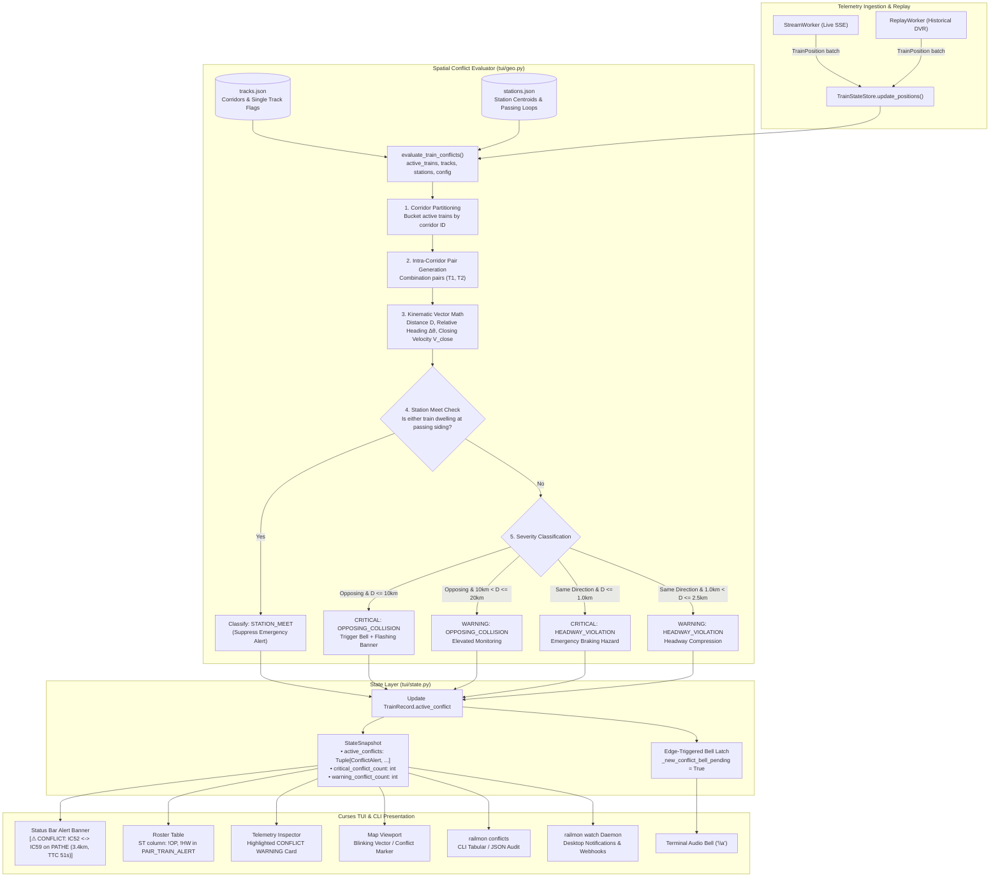
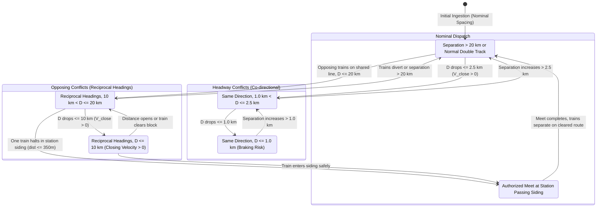
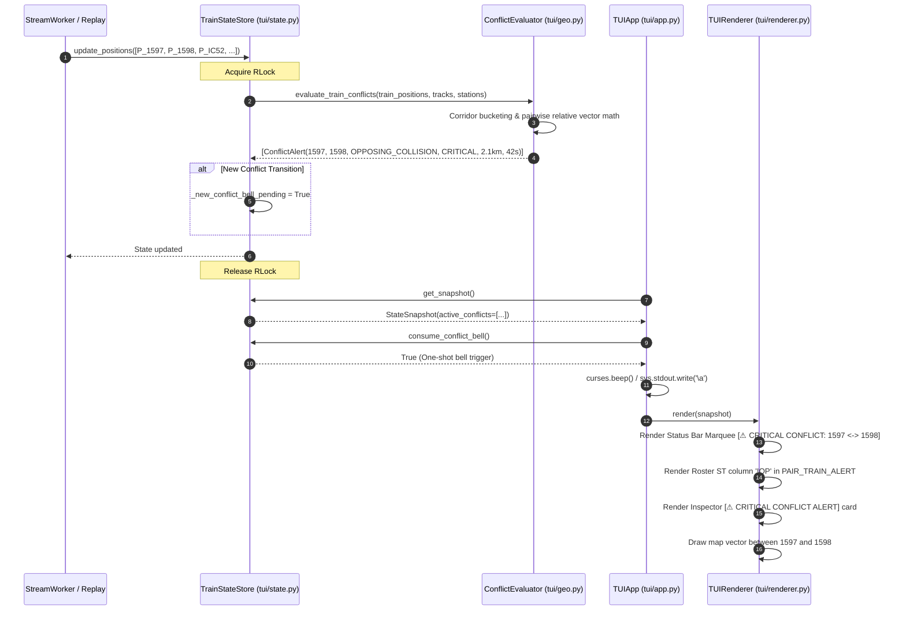

# Implementation Plan — F-5.1: Corridor Headway & Opposing Train Conflict Watchdog

> **Reference:** [TUI Feature Enhancements Specification (`F-5.1`)](../../architecture/tui-feature-enhancements.md#f-51-corridor-headway--opposing-train-conflict-watchdog--planned), [`docs/architecture/architecture.md`](../../architecture/architecture.md#endpoint-specifications)  
> **Target Modules:** [`../../../tui/geo.py`](../../../tui/geo.py), [`../../../tui/state.py`](../../../tui/state.py), [`../../../tui/renderer.py`](../../../tui/renderer.py), [`../../../tui/app.py`](../../../tui/app.py), [`../../../tui/mock_engine.py`](../../../tui/mock_engine.py), [`../../../watchdog.py`](../../../watchdog.py), [`../../../train_tracker.py`](../../../train_tracker.py), [`../../../storage/cli_formatters.py`](../../../storage/cli_formatters.py)  
> **Data Fixtures:** [`../../../tui/data/tracks.json`](../../../tui/data/tracks.json), [`../../../tui/data/stations.json`](../../../tui/data/stations.json), [`../../../tui/data/infrastructure.json`](../../../tui/data/infrastructure.json)  
> **Test Suites:** [`../../../tests/test_tui_conflict_watchdog_geo.py`](../../../tests/test_tui_conflict_watchdog_geo.py), [`../../../tests/test_tui_conflict_watchdog_state.py`](../../../tests/test_tui_conflict_watchdog_state.py), [`../../../tests/test_tui_conflict_watchdog_renderer.py`](../../../tests/test_tui_conflict_watchdog_renderer.py), [`../../../tests/test_cli_conflicts.py`](../../../tests/test_cli_conflicts.py)  
> **Relevant Skills & Guidelines:** [`../../../.agents/skills/diagrams-and-documentation/SKILL.md`](../../../.agents/skills/diagrams-and-documentation/SKILL.md), [`../../../.agents/skills/markdown-relative-paths/SKILL.md`](../../../.agents/skills/markdown-relative-paths/SKILL.md), [`../../../.agents/skills/ci-quality-gate/SKILL.md`](../../../.agents/skills/ci-quality-gate/SKILL.md), [`../../../.agents/skills/static-safety-analyzer/SKILL.md`](../../../.agents/skills/static-safety-analyzer/SKILL.md)

---

## 1. Executive Summary & Operational Context

### 1.1 Operational Rail Safety Background & Greek Network Topography
Safe dispatching and anti-collision supervision on railway networks require real-time verification of block occupancy, headway separation, and direction of travel. In the standard-gauge rail network operated by Hellenic Railways (OSE) and Hellenic Train (`railway.gov.gr`), infrastructure constraints and operational realities present unique collision and headway risk vectors:

1. **Extensive Single-Track Corridors:**
   A large proportion of the active national rail network consists of single-track lines with bi-directional operations governed by station master authorizations, token block / telephone dispatching, or partially modernized signaling:
   - **Proastiakos Chalkida Spur (`proastiakos-chalkida`):** Single-track electrified branch from Inoi junction to Chalkida over the Euripus strait ($22\text{ km}$), carrying dense commuter traffic with passing meets (*διασταυρώσεις*) restricted to intermediate stations.
   - **Trans-Balkan Mainline (`thessaloniki-idomeni`):** Single-track international corridor to Gevgelija/North Macedonia ($77\text{ km}$), carrying international passenger and heavy freight convoys.
   - **Thessaly Regional Branches:** Western branch from Paleofarsalos to Karditsa and Kalambaka (`thessaly-kalambaka`, $80\text{ km}$) and Eastern branch from Larissa to Volos (`thessaly-volos`, $61\text{ km}$).
   - **Western Macedonia Line (`western-macedonia`):** Platy to Veria, Edessa, and Florina ($156\text{ km}$) traversing steep escarpments and single-track mountain tunnels.
   - **Eastern Macedonia & Thrace Mainline (`northern-corridor`):** Thessaloniki via Strymonas, Serres, Drama, Xanthi, Komotini, and Alexandroupoli to Dikea ($440\text{ km}$), operating under strict single-line block dispatching.

2. **Temporary Single-Line Working on the PATHE Mainline (Μονογράμμιση):**
   While the Athens–Thessaloniki core mainline (`pathe-mainline`) is predominantly dual-track electrified, routine maintenance, catenary repair, bridge works, seasonal landslides, or signal interlocking commissioning frequently require infrastructure managers to declare single-line working (*μονογράμμιση*) over designated inter-station blocks (e.g. Tithorea–Lianokladi, Domokos–Paleofarsalos, or Larissa–Platamonas). During single-line working, both northbound and southbound high-speed passenger trains ($160\text{ km/h}$) and freight services share a single physical track under strict dispatch supervision.

3. **Collision & Separation Risk Modes:**
   - **Head-on / Opposing Collision Conflict (`OPPOSING_COLLISION`):** Two trains operating on the same physical track or single-track corridor moving with reciprocal headings ($\Delta\theta \approx 180^\circ \pm 35^\circ$) with closing speed $V_{\text{close}} = V_1 + V_2 > 0$ and spatial distance $D < 10.0\text{ km}$. At line speed ($160\text{ km/h} + 160\text{ km/h} = 320\text{ km/h}$ relative velocity), the distance closes at $88.9\text{ m/s}$. A separation of $10.0\text{ km}$ represents less than $112\text{ seconds}$ to impact.
   - **Headway Violation / Rear-End Collision Risk (`HEADWAY_VIOLATION`):** Two trains traversing in the same direction on the same corridor where spatial separation drops below standard service braking distance margins ($D < 2.5\text{ km}$ warning, $D < 1.0\text{ km}$ critical).
   - **Converging Junction Conflict (`CONVERGING_JUNCTION`):** Two trains approaching a shared railway junction (e.g. SKA junction throat, Inoi junction, Platy junction, Paleofarsalos) on converging tracks with overlapping projected times-of-arrival ($\Delta \text{ETA} \le 60\text{ s}$).

4. **False Positive Mitigation & Station Siding Suppression:**
   On single-track lines, train meets (*διασταυρώσεις*) at stations equipped with passing loops (sidings) are standard scheduled operating procedures. If one train has halted or is dwelling within station platform limits ($V < 1.0\text{ km/h}$, $d \le 350\text{ m}$ of station centroid) while an opposing train approaches to enter the loop, this represents an authorized **Station Meet** (`STATION_MEET`) rather than an emergency conflict. The watchdog must classify and suppress false positive emergency alerts during authorized station passing operations.

---

### 1.2 Problem Statement in Current `railmon`
Currently, `railmon` monitors individual trains in isolation:
- The Curses TUI displays train positions, speeds, delays, and telemetry status, but executes **zero pairwise or corridor-wide kinematic analysis**.
- If two trains enter the same single-track section from opposite ends traveling toward each other at $140\text{ km/h}$, the dashboard displays both trains as normal active units without any indication of closing proximity or mutual conflict.
- The operator receives no automated warning of headway compression when a following train closes to within braking distance of a stalled leading train.
- The headless `watchdog.py` daemon monitors individual train delays and arrivals, but cannot evaluate multi-train track occupancy or dispatch conflicts.

---

### 1.3 Core Objectives of Feature F-5.1
This implementation plan establishes the architectural blueprint, mathematical foundations, kinematic algorithms, state store pipeline, rendering components, CLI tooling, and test coverage for **F-5.1: Corridor Headway & Opposing Train Conflict Watchdog**:

1. **Deterministic Kinematic Conflict Evaluator (`tui/geo.py`):**
   - High-performance pairwise corridor spatial partitioning: $O(N)$ corridor bucketing with $O(K^2)$ intra-corridor checks ($K \ll N$) ensuring sub-millisecond execution.
   - Great-circle geodesic distance ($D$), forward azimuth bearings ($\theta_1, \theta_2$), relative heading delta ($\Delta\theta_{\text{norm}}$), closing velocity ($V_{\text{close}}$), and Time-To-Collision ($\tau_{\text{TTC}}$).
   - Single-track vs. double-track infrastructure discrimination utilizing `tracks.json` corridor topology and dynamic single-line working flags.
2. **Robust Multi-Tier Conflict Classification:**
   - `CRITICAL`: Opposing collision vector on single-track corridor ($D \le 10.0\text{ km}$, $V_{\text{close}} > 0$) or extreme headway collapse ($D \le 1.0\text{ km}$, $V_{\text{close}} > 0$).
   - `WARNING`: Opposing vector with extended horizon ($10.0\text{ km} < D \le 20.0\text{ km}$) or standard headway violation ($1.0\text{ km} < D \le 2.5\text{ km}$).
   - `ADVISORY`: Converging junction approach or station passing meet in progress.
3. **Station Siding False Positive Suppressor:**
   - Evaluates station centroid proximity ($d \le 350\text{ m}$) and dwelling status ($V < 1.0\text{ km/h}$). When an opposing pair meets at an authorized passing station, the condition is tagged as `STATION_MEET` and excluded from emergency audio/visual alarms.
4. **State Store & Non-Blocking Alert Dispatch (`tui/state.py`):**
   - Computes active conflict DTOs inside `TrainStateStore.update_positions()`.
   - Immutable `ConflictAlert` exposed on `StateSnapshot` with aggregate metrics (`critical_conflict_count`, `warning_conflict_count`).
   - One-shot edge-triggered terminal bell (`\a`) latching on new conflict onset, preventing repetitive buzzer storms.
5. **Multi-Pane Visual Integration in Curses TUI (`tui/renderer.py`):**
   - **Status Bar Alert Banner:** Flashing alert banner `[⚠ CONFLICT: IC52 <-> IC59 on PATHE (3.4km, TTC 51s)]` (ASCII: `[! CONFLICT: ...]`).
   - **Active Train Roster Table:** Conflict indicators (`!OP`, `!HW`) in the `ST` column and bold alert coloring.
   - **Telemetry Inspector Pane:** Dedicated conflict card highlighting opposing train ID, closing speed, separation distance, and estimated time to collision.
   - **Map Viewport:** Braille/ASCII conflict vector highlighting between conflicting train pairs.
6. **Headless CLI & Daemon Subsystem:**
   - Standalone CLI command: `railmon conflicts` delivering tabular and `--json` conflict audit reports.
   - Daemon integration in `watchdog.py`: Dispatching desktop notifications and webhooks on `WatchTriggerType.CONFLICT_CRITICAL` and `WatchTriggerType.CONFLICT_WARNING`.
7. **Zero-Dependency Standard-Library Purity:**
   - Strict 100% Python standard library (`math`, `time`, `dataclasses`, `enum`, `typing`, `json`, `curses`).

---

## 2. Architecture & Visual Diagrams

### 2.1 End-to-End Safety Conflict Watchdog Pipeline (Mermaid)



---

### 2.2 Conflict State Machine & Resolution Lifecycle (Mermaid)



---

### 2.3 ASCII Architecture & Data Flow Diagram

```text
+---------------------------------------------------------------------------------------------------+
|                        Corridor Headway & Opposing Conflict Pipeline                              |
+---------------------------------------------------------------------------------------------------+

   Active Train Telemetry Batch
   [IC52:  lat=39.215, lng=22.450, spd=142.0, course=352°, corridor=pathe-mainline]
   [IC59:  lat=39.245, lng=22.458, spd=138.0, course=172°, corridor=pathe-mainline]
   [1597:  lat=38.350, lng=23.580, spd=92.0,  course=045°, corridor=proastiakos-chalkida]
   [1598:  lat=38.362, lng=23.595, spd=88.0,  course=225°, corridor=proastiakos-chalkida]
                    |
                    v
   +-------------------------------------------------------------+
   |                1. Corridor Spatial Partition                |
   |   Bucket trains by corridor tag / nearest track polyline    |
   |   pathe-mainline:        [IC52, IC59]                       |
   |   proastiakos-chalkida:  [1597, 1598]                       |
   +-------------------------------------------------------------+
                    |
                    v
   +-------------------------------------------------------------+
   |             2. Pairwise Kinematic Vector Analysis           |
   |   For each pair (T_i, T_j) on shared corridor:              |
   |     - Geodesic Distance:  D = haversine(P_i, P_j)           |
   |     - Azimuth Bearings:   beta_ij = bearing(P_i, P_j)       |
   |     - Relative Heading:   delta_theta = |course_i - course_j|
   |     - Closing Velocity:   V_close = (v_i - v_j) . u_ji      |
   |     - Time-To-Collision:  TTC = D / V_close                 |
   +-------------------------------------------------------------+
                    |
                    +--------------------------------+
                    |                                |
                    v                                v
   +--------------------------------+  +--------------------------------+
   | 3a. Single-Track Opposing Pair |  | 3b. Co-directional Headway    |
   | Pair: (1597, 1598) Chalkida    |  | Pair: (IC52, IC54) PATHE       |
   | Single-Track: TRUE             |  | Single-Track: FALSE            |
   | delta_theta:  180° (Opposing)  |  | delta_theta:  0° (Co-direct)   |
   | Distance:     2.1 km           |  | Distance:     1.8 km           |
   | Closing Spd:  180 km/h         |  | Closing Spd:  25 km/h          |
   | Station Siding: NONE (Open)    |  | Condition:    D < 2.5 km       |
   +--------------------------------+  +--------------------------------+
                    |                                |
                    v                                v
   +-------------------------------------------------------------+
   |              4. Conflict Generation & Severity              |
   |  (1597, 1598): CRITICAL OPPOSING_COLLISION (TTC = 42s)      |
   |  (IC52, IC54): WARNING  HEADWAY_VIOLATION   (D = 1.8km)     |
   +-------------------------------------------------------------+
                    |
                    v
   +-------------------------------------------------------------+
   |       5. StateSnapshot & Dispatch Presentation (TUI/CLI)    |
   |  Status Bar: [⚠ CRITICAL CONFLICT: 1597 <-> 1598 (2.1km)]   |
   |  Inspector:  CONFLICT WARNING card with TTC & closing speed |
   |  Roster ST:  !OP (Alert Red) / !HW (Warn Yellow)            |
   |  Terminal:   One-Shot Audible Bell ('\a')                   |
   +-------------------------------------------------------------+
```

---

### 2.4 TUI Dashboard Layout & Conflict Inspector Mockup (ASCII)

```text
+---------------------------------------------------------------------------------------------------+
| RAILMON | HELLENIC RAILWAYS (railway.gov.gr) | View: PATHE Mainline | Active: 14 | Conflicts: 1 [●] |
+--------------------------------------------------------------------+------------------------------+
| [Map Viewport: 38.35°N, 23.58°E | Zoom: 3.2x | Trails: SELECTED]   | [ACTIVE TRAINS (14) | Sort:▼]|
|                                                                    |  #   TRAIN  TYPE  SPD▼  DLY  ST|
|   Inoi Junction                                                    | > 1  1597   PR     92   +2m !OP|
|     ◉===========================                                   |   2  1598   PR     88   +1m !OP|
|       \                                                            |   3  IC52   IC    158   +4m RUN|
|        \                                                           |   4  IC59   IC    154   +2m RUN|
|         \  ▲ [1597] (92km/h)                                       |   5  2236   PR     86    0m DWL|
|          \  :                                                      |   6  1599   IC      0    0m HLT|
|           \ ! [COLLISION VECTOR: 2.1km | TTC: 42s]                 +------------------------------+
|            \ :                                                     | [SELECTED TRAIN TELEMETRY]   |
|             \ ▼ [1598] (88km/h)                                    | Train No:     1597 (PR)      |
|              \                                                     | Corridor:     Proastiakos Ch |
|               ◉ Chalkida                                           | Track Mode:   SINGLE-TRACK   |
|                                                                    | Next Station: Αυλίδα (2.4km) |
|                                                                    | Speed:        92.0 km/h      |
|                                                                    | Delay:        +2 min         |
|                                                                    | ---------------------------- |
|                                                                    | [⚠ CRITICAL CONFLICT ALERT]  |
|                                                                    | Type:    OPPOSING COLLISION  |
|                                                                    | Target:  1598 (PR, 88 km/h)  |
|                                                                    | Dist:    2.1 km (Closing)    |
|                                                                    | Rel Spd: 180.0 km/h          |
|                                                                    | Time To Collision: ~42 sec   |
|                                                                    | Siding:  None in block       |
|  |---- 5 km ----|                                                  | Action:  EMERGENCY STOP (EB) |
+--------------------------------------------------------------------+------------------------------+
| [⚠ CRITICAL CONFLICT: 1597 <-> 1598 on Chalkida Branch (2.1km, TTC 42s)]                          |
+---------------------------------------------------------------------------------------------------+
```

---

### 2.5 Sequence Diagram: Multi-Train Conflict Lifecycle (Mermaid)



---

## 3. Mathematical & Algorithmic Foundations

### 3.1 Geodesic Great-Circle Distance Formulation
The geodesic separation distance $D$ between train 1 at coordinate $(\phi_1, \lambda_1)$ and train 2 at $(\phi_2, \lambda_2)$ is computed using the high-accuracy spherical Haversine formula ($R_{\text{Earth}} = 6371.0\text{ km}$):

$$\Delta\phi = \phi_2 - \phi_1, \quad \Delta\lambda = \lambda_2 - \lambda_1$$

$$a = \sin^2\left(\frac{\Delta\phi}{2}\right) + \cos\phi_1 \cos\phi_2 \sin^2\left(\frac{\Delta\lambda}{2}\right)$$

$$D = 2 R_{\text{Earth}} \arctan2\left(\sqrt{a}, \sqrt{1 - a}\right)$$

### 3.2 Forward Azimuth Bearing & Relative Heading Delta
The forward azimuth bearing $\beta_{1 \to 2}$ from train 1 toward train 2 on the sphere is calculated as:

$$x = \sin\Delta\lambda \cos\phi_2$$
$$y = \cos\phi_1 \sin\phi_2 - \sin\phi_1 \cos\phi_2 \cos\Delta\lambda$$
$$\beta_{1 \to 2} = \left(\text{atan2}(x, y) \times \frac{180^\circ}{\pi} + 360^\circ\right) \pmod{360^\circ}$$

Given train 1 heading $\theta_1$ and train 2 heading $\theta_2$ (derived from GPS course or track direction vector), the normalized mutual heading divergence $\Delta\theta_{\text{norm}} \in [0^\circ, 180^\circ]$ is:

$$\Delta\theta = |\theta_1 - \theta_2| \pmod{360^\circ}$$
$$\Delta\theta_{\text{norm}} = \min(\Delta\theta, 360^\circ - \Delta\theta)$$

- **Opposing Motion Condition:** $\Delta\theta_{\text{norm}} \ge 180^\circ - \epsilon_{\text{heading}}$ (with default angular tolerance $\epsilon_{\text{heading}} = 35.0^\circ$, i.e. $\Delta\theta_{\text{norm}} \in [145^\circ, 180^\circ]$).
- **Co-directional Motion Condition:** $\Delta\theta_{\text{norm}} \le \epsilon_{\text{codir}}$ (with default angular tolerance $\epsilon_{\text{codir}} = 40.0^\circ$, i.e. $\Delta\theta_{\text{norm}} \in [0^\circ, 40^\circ]$).

### 3.3 Kinematic Closing Velocity & Time-To-Collision (TTC)
For two trains with ground velocities $V_1$ and $V_2$ ($\text{km/h}$), the kinematic closing velocity $V_{\text{close}}$ measures the rate at which separation distance $D$ is diminishing:

1. **For Opposing Motion ($\Delta\theta_{\text{norm}} \ge 145^\circ$):**
   If train 1 is heading toward train 2 and train 2 is heading toward train 1:
   $$V_{\text{close}} = V_1 + V_2$$
2. **For Co-directional Following Motion ($\Delta\theta_{\text{norm}} \le 40^\circ$):**
   Let train 1 be the following train and train 2 be the leading train. If $V_1 > V_2$:
   $$V_{\text{close}} = V_1 - V_2$$
   If $V_1 \le V_2$, the separation is expanding ($V_{\text{close}} \le 0$).

When $V_{\text{close}} > 0$, the projected Time-To-Collision ($\tau_{\text{TTC}}$ in seconds) is formulated as:

$$\tau_{\text{TTC}} = \frac{D}{V_{\text{close}} / 3600.0} = \frac{3600.0 \cdot D}{V_{\text{close}}}$$

If $V_{\text{close}} \le 0$, $\tau_{\text{TTC}} = \infty$ (separation stable or expanding).

### 3.4 Service Braking Distance & Headway Limits
Under UIC 544-R and Hellenic Railways General Operating Regulations (Γενικός Κανονισμός Κινήσεως ΟΣΕ, Μέρος Β΄ «Πέδησις»), standard service and emergency braking distances $S_{\text{brake}}$ are modeled by:

$$S_{\text{brake}} = \frac{V^2}{2 \cdot a_{\text{service}}} + V \cdot t_{\text{reaction}}$$

Where:
- $a_{\text{service}} = 0.70\text{ m/s}^2$ (standard passenger service deceleration)
- $a_{\text{emergency}} = 1.05\text{ m/s}^2$ (emergency electro-pneumatic / magnetic track braking)
- $t_{\text{reaction}} = 2.0\text{ s}$ (driver acknowledgement and brake pipe propagation time)

For a commercial passenger train at $160\text{ km/h}$ ($44.4\text{ m/s}$):
$$S_{\text{service}} = \frac{44.4^2}{2 \times 0.70} + 44.4 \times 2.0 = 1409\text{ m} + 89\text{ m} \approx 1500\text{ m}$$

Hence, two opposing trains at $160\text{ km/h}$ require a combined minimum stopping distance of $2 \times 1.5\text{ km} = 3.0\text{ km}$ under normal service braking, or $2 \times 1.0\text{ km} = 2.0\text{ km}$ under emergency braking. A critical threshold of $D \le 10.0\text{ km}$ provides a vital $1.5\text{ to } 3.0\text{ minute}$ intervention buffer for dispatchers to issue an emergency radio stop or drop catenary traction power.

### 3.5 Classification Threshold Matrix

| Conflict Type | Track Geometry | Distance ($D$) | Relative Heading ($\Delta\theta_{\text{norm}}$) | Closing Speed ($V_{\text{close}}$) | Severity |
| :--- | :--- | :--- | :--- | :--- | :--- |
| **Opposing Collision** | Single Track or Single-Line Working | $D \le 10.0\text{ km}$ | $145^\circ \le \Delta\theta \le 180^\circ$ | $V_{\text{close}} > 10\text{ km/h}$ | `CRITICAL` |
| **Opposing Warning** | Single Track or Single-Line Working | $10.0\text{ km} < D \le 20.0\text{ km}$ | $145^\circ \le \Delta\theta \le 180^\circ$ | $V_{\text{close}} > 10\text{ km/h}$ | `WARNING` |
| **Headway Critical** | Any Shared Track | $D \le 1.0\text{ km}$ | $0^\circ \le \Delta\theta \le 40^\circ$ | $V_{\text{close}} > 0\text{ km/h}$ | `CRITICAL` |
| **Headway Warning** | Any Shared Track | $1.0\text{ km} < D \le 2.5\text{ km}$ | $0^\circ \le \Delta\theta \le 40^\circ$ | $V_{\text{close}} > 0\text{ km/h}$ | `WARNING` |
| **Station Meet** | Passing Loop / Siding | $D \le 10.0\text{ km}$ | Opposing | Train dwelling $\le 350\text{m}$ of station | `ADVISORY` (Suppressed) |
| **Converging Junction**| Junction Throat Approach | $D \le 5.0\text{ km}$ | Converging | $|\Delta\text{ETA}| \le 60\text{ s}$ to switch | `WARNING` |

---

## 4. Component Technical Specifications & Data Models

### 4.1 Geospatial & Kinematics Domain: [`tui/geo.py`](../../../tui/geo.py)

#### A. Enumerations & Dataclasses
```python
class ConflictSeverity(str, Enum):
    """Urgency level of a detected rail conflict."""
    CRITICAL = "CRITICAL"   # Imminent collision / emergency braking limit breached
    WARNING = "WARNING"     # Headway compression or opposing approach within warning horizon
    ADVISORY = "ADVISORY"   # Crossing meet or low-speed junction convergence


class ConflictType(str, Enum):
    """Tactical category of train conflict."""
    OPPOSING_COLLISION = "OPPOSING_COLLISION"   # Reciprocal headings on shared single-line infrastructure
    HEADWAY_VIOLATION = "HEADWAY_VIOLATION"     # Excessive proximity to preceding train in same direction
    CONVERGING_JUNCTION = "CONVERGING_JUNCTION" # Simultaneous approach to converging switch throat
    STATION_MEET = "STATION_MEET"               # Authorized train crossing at station with passing siding


@dataclass(frozen=True)
class ConflictWatchdogConfig:
    """Operational parameters and spatial thresholds for conflict evaluation."""
    opposing_critical_distance_km: float = 10.0
    opposing_warning_distance_km: float = 20.0
    headway_critical_distance_km: float = 1.0
    headway_warning_distance_km: float = 2.5
    station_siding_radius_m: float = 350.0
    heading_opposing_tolerance_deg: float = 35.0
    heading_codirectional_tolerance_deg: float = 40.0
    min_evaluation_speed_kmh: float = 5.0
    junction_convergence_distance_km: float = 5.0
    junction_eta_window_sec: float = 60.0


@dataclass(frozen=True)
class ConflictAlert:
    """Immutable data transfer object representing an active track conflict."""
    alert_id: str                          # Deterministic composite key: e.g. "1597_1598_OPPOSING"
    train_id_1: str                        # Internal ID of first train
    train_number_1: str                    # Commercial train number 1 (e.g. "1597")
    train_id_2: str                        # Internal ID of second train
    train_number_2: str                    # Commercial train number 2 (e.g. "1598")
    corridor_id: str                       # Corridor identifier (e.g. "proastiakos-chalkida")
    corridor_name: str                     # Human-readable corridor name
    conflict_type: ConflictType            # Category of conflict
    severity: ConflictSeverity             # Urgency tier
    distance_km: float                     # Spatial geodesic separation in km
    closing_speed_kmh: float               # Relative closing velocity in km/h
    time_to_collision_sec: Optional[float] # Projected TTC in seconds, or None if diverging
    is_single_track: bool                  # True if corridor is single-track
    station_proximity_name: Optional[str]  # Station name if in vicinity of siding
    description: str                       # Operator alert text
    timestamp: float                       # UNIX epoch seconds when evaluated
```

#### B. Core Mathematical Functions in [`tui/geo.py`](../../../tui/geo.py)
```python
def compute_forward_bearing(p1: GeoPoint, p2: GeoPoint) -> float:
    """Compute spherical forward azimuth bearing in degrees [0.0, 360.0)."""
    phi1 = math.radians(p1.lat)
    phi2 = math.radians(p2.lat)
    delta_lambda = math.radians(p2.lng - p1.lng)
    
    x = math.sin(delta_lambda) * math.cos(phi2)
    y = math.cos(phi1) * math.sin(phi2) - math.sin(phi1) * math.cos(phi2) * math.cos(delta_lambda)
    bearing = (math.degrees(math.atan2(x, y)) + 360.0) % 360.0
    return bearing


def compute_relative_heading_delta(course1: float, course2: float) -> float:
    """Compute normalized angular divergence between two headings [0.0, 180.0]."""
    diff = abs(course1 - course2) % 360.0
    return min(diff, 360.0 - diff)


def evaluate_train_conflicts(
    active_trains: Sequence[TrainPosition],
    tracks_data: Optional[Dict[str, Any]] = None,
    stations: Optional[Sequence[Any]] = None,
    config: Optional[ConflictWatchdogConfig] = None,
    now: Optional[float] = None,
) -> List[ConflictAlert]:
    """Evaluate pairwise spatial and kinematic conflicts across active trains."""
    # 1. Initialization and config fallback
    # 2. Group trains by corridor ID (or spatial projection)
    # 3. For each corridor, iterate over pairs (i, j) with i < j
    # 4. Compute distance, heading divergence, closing velocity, TTC
    # 5. Check station siding suppression
    # 6. Apply severity threshold rules and generate ConflictAlert objects
```

---

### 4.2 State Store Pipeline: [`tui/state.py`](../../../tui/state.py)

#### A. Extension of `TrainRecord` and `StateSnapshot`
```python
@dataclass
class TrainRecord:
    # Existing fields...
    position: TrainPosition
    trail: Deque[HistoricalBreadcrumb]
    sensor_health: SensorHealthAssessment
    speed_result: SpeedEnforcementResult
    # F-5.1 Extension:
    active_conflict: Optional[ConflictAlert] = None


@dataclass(frozen=True)
class StateSnapshot:
    # Existing fields...
    trains: Dict[str, TrainRecord]
    filtered_trains: Tuple[TrainRecord, ...]
    selected_id: Optional[str]
    # F-5.1 Extension:
    active_conflicts: Tuple[ConflictAlert, ...] = ()
    critical_conflict_count: int = 0
    warning_conflict_count: int = 0
```

#### B. Conflict Evaluation in `TrainStateStore.update_positions()`
- During each telemetry frame batch, `TrainStateStore` invokes `evaluate_train_conflicts()`.
- Updates `record.active_conflict` for each involved train.
- Computes difference against `self._previous_conflict_keys` to detect newly emerging conflicts.
- Sets `self._new_conflict_bell_pending = True` on newly elevated conflicts.
- Exposes `consume_conflict_bell() -> bool` for one-shot audio alert dispatch.

---

### 4.3 Curses TUI Presentation: [`tui/renderer.py`](../../../tui/renderer.py) & [`tui/app.py`](../../../tui/app.py)

1. **Status Bar Alert Banner:**
   When `snapshot.critical_conflict_count > 0`, the status bar prioritizes the conflict message with alert styling:
   ```text
   [⚠ CRITICAL CONFLICT: 1597 <-> 1598 on Chalkida Branch (2.1km, TTC 42s)]
   ```
   In ASCII mode (`--ascii`):
   ```text
   [! CRITICAL CONFLICT: 1597 <-> 1598 on Chalkida Branch (2.1km, TTC 42s)]
   ```

2. **Active Train Roster Table:**
   - In `TUIRenderer.render_roster()`, inspect `rec.active_conflict`:
     - If `conflict.severity == ConflictSeverity.CRITICAL`: Render `!OP` (opposing) or `!HW` (headway) in `PAIR_TRAIN_ALERT` (bold reverse red).
     - If `conflict.severity == ConflictSeverity.WARNING`: Render `?OP` or `?HW` in `PAIR_TRAIN_WARN` (bold yellow).

3. **Telemetry Inspector Card:**
   - In `TUIRenderer.render_inspector()`, when `selected_train.active_conflict` is present:
     - Render a high-visibility sub-card:
       ```text
       ------------------------------
       [⚠ CRITICAL CONFLICT ALERT]
       Type:    OPPOSING COLLISION
       Target:  1598 (PR, 88 km/h)
       Dist:    2.1 km (Closing)
       Rel Spd: 180.0 km/h
       Time To Collision: ~42 sec
       Siding:  None in block
       Action:  EMERGENCY STOP (EB)
       ------------------------------
       ```

4. **Map Viewport Vector Highlighting:**
   - When conflicting trains appear in the current map viewport, draw a visual dashed Braille vector connecting their coordinates or highlight both trains in alert color.

---

### 4.4 Headless CLI & Watchdog Integration: [`train_tracker.py`](../../../train_tracker.py) & [`watchdog.py`](../../../watchdog.py)

#### A. Headless CLI Command: `railmon conflicts`
```bash
# Audit network-wide active conflicts across all Greek corridors
railmon conflicts

# Filter conflicts for specific corridor
railmon conflicts --corridor pathe-mainline

# Output machine-readable JSON for monitoring dashboards
railmon conflicts --json
```

#### B. CLI Tabular Output Mockup
```text
====================================================================================================
RAILMON NETWORK CONFLICT AUDIT [2026-11-22 19:15:00 UTC]
====================================================================================================
SEV       TYPE         TRAIN 1   TRAIN 2   CORRIDOR           DIST     REL SPD   TTC   SIDING
----------------------------------------------------------------------------------------------------
CRITICAL  OPPOSING     1597      1598      proastiakos-chalk  2.1 km   180 km/h  42s   None (Open Track)
WARNING   HEADWAY      IC 52     IC 54     pathe-mainline     1.8 km    25 km/h  --    Passing Siding
====================================================================================================
Active Conflicts: 2 (1 Critical, 1 Warning, 0 Advisory)
```

#### C. Watchdog Daemon Integration in [`watchdog.py`](../../../watchdog.py)
- Extend `WatchTriggerType` with `CONFLICT_WARNING` and `CONFLICT_CRITICAL`.
- Dispatch desktop toasts and outbound webhooks (Telegram, Discord, Slack) when a monitored train enters an active conflict.

---

## 5. Detailed Step-by-Step Implementation Work Breakdown

### Phase 1: Spatial Kinematics & Conflict Evaluator Math ([`tui/geo.py`](../../../tui/geo.py))
- [x] Add `ConflictSeverity`, `ConflictType`, `ConflictWatchdogConfig`, and `ConflictAlert` dataclasses to `tui/geo.py`.
- [x] Implement `compute_forward_bearing(p1, p2)` with full $360^\circ$ quadrant normalization.
- [x] Implement `compute_relative_heading_delta(course1, course2)` returning normalized divergence $[0^\circ, 180^\circ]$.
- [x] Implement `evaluate_train_conflicts(active_trains, tracks_data, stations, config, now)` with corridor grouping, pairwise kinematic checks, and station siding suppression.
- [x] Author unit tests in `tests/test_tui_conflict_watchdog_geo.py`.

### Phase 2: Corridor Topology & Single-Track Infrastructure Flags ([`tui/data/tracks.json`](../../../tui/data/tracks.json) & [`tui/mock_engine.py`](../../../tui/mock_engine.py))
- [x] Verify `double_track` boolean flags for all Greek corridors in `tui/data/tracks.json`.
- [x] Add corridor metadata loader in `tui/mock_engine.py` to provide fast lookup dictionary `Dict[str, CorridorInfo]`.
- [x] Create synthetic mock scenarios in `tui/mock_engine.py` demonstrating opposing trains on Chalkida and PATHE single-line working for testing and demo playback.

### Phase 3: State Store Integration & Audio Bell Latch ([`tui/state.py`](../../../tui/state.py))
- [x] Extend `TrainRecord` with `active_conflict: Optional[ConflictAlert]`.
- [x] Extend `StateSnapshot` with `active_conflicts`, `critical_conflict_count`, and `warning_conflict_count`.
- [x] Add conflict state management in `TrainStateStore.__init__`: `_active_conflicts`, `_previous_conflict_keys`, `_new_conflict_bell_pending`.
- [x] Update `TrainStateStore.update_positions()` to execute conflict evaluation and manage bell latching.
- [x] Add `consume_conflict_bell() -> bool` to `TrainStateStore`.
- [x] Author unit tests in `tests/test_tui_conflict_watchdog_state.py`.

### Phase 4: Curses TUI Multi-Pane Rendering & Controller Dispatch ([`tui/renderer.py`](../../../tui/renderer.py) & [`tui/app.py`](../../../tui/app.py))
- [x] Implement status bar marquee for active critical conflicts in `TUIRenderer.render_status_bar()`.
- [x] Add conflict indicators (`!OP`, `!HW`) to the `ST` column in `TUIRenderer.render_roster()`.
- [x] Add dedicated `[⚠ CRITICAL CONFLICT ALERT]` card in `TUIRenderer.render_inspector()`.
- [x] Draw conflict indicator / connection vector in `TUIRenderer.render_map()`.
- [x] Connect `store.consume_conflict_bell()` to `curses.beep()` / audio bell in `TUIApp.step()`.
- [x] Author rendering unit tests in `tests/test_tui_conflict_watchdog_renderer.py`.

### Phase 5: Headless CLI & Watchdog Daemon Integration ([`train_tracker.py`](../../../train_tracker.py), [`storage/cli_formatters.py`](../../../storage/cli_formatters.py), [`watchdog.py`](../../../watchdog.py))
- [x] Add `railmon conflicts` subcommand parser to `train_tracker.py`.
- [x] Implement `format_conflict_table()` and `format_conflict_json()` in `storage/cli_formatters.py`.
- [x] Add `WatchTriggerType.CONFLICT_WARNING` and `WatchTriggerType.CONFLICT_CRITICAL` to `watchdog.py`.
- [x] Author CLI unit tests in `tests/test_cli_conflicts.py`.

### Phase 6: Comprehensive Verification & CI Quality Gate
- [x] Run complete pytest test suite: `pytest tests/test_tui_conflict_*.py tests/test_cli_conflicts.py`.
- [x] Run flake8 linting: `flake8 tui/ train_tracker.py watchdog.py storage/ tests/`.
- [x] Run strict type check: `mypy --strict tui/geo.py tui/state.py tui/renderer.py tui/app.py`.
- [x] Verify zero absolute paths or file URIs: `git diff docs/`.

---

## 6. Verification & Test Strategy

### 6.1 Unit Test Coverage Matrix

| Test Module | Test Function Name | Scenario & Coverage Scope | Expected Assertion |
| :--- | :--- | :--- | :--- |
| `test_tui_conflict_watchdog_geo.py` | `test_bearing_and_relative_heading_calculation` | Orthogonal, parallel, and opposing vector pairs | $\beta$ accurate to $0.1^\circ$, $\Delta\theta_{\text{norm}} = 180^\circ$ for reciprocal |
| `test_tui_conflict_watchdog_geo.py` | `test_opposing_conflict_single_track_critical` | Trains 1597 and 1598 on Chalkida branch ($D = 2.1\text{ km}$, $V_{\text{close}} = 180\text{ km/h}$) | `ConflictSeverity.CRITICAL`, `ConflictType.OPPOSING_COLLISION`, $\tau \approx 42\text{s}$ |
| `test_tui_conflict_watchdog_geo.py` | `test_opposing_conflict_double_track_suppressed` | Trains IC52 and IC59 on normal PATHE double track | No conflict generated (parallel distinct tracks) |
| `test_tui_conflict_watchdog_geo.py` | `test_station_meet_siding_suppression` | Opposing trains where train 1 is dwelling at station loop ($V = 0\text{ km/h}$, $d = 120\text{ m}$) | Tagged as `STATION_MEET` with `ConflictSeverity.ADVISORY`, excluded from critical alerts |
| `test_tui_conflict_watchdog_geo.py` | `test_headway_violation_co_directional` | Trains IC52 and IC54 traveling northbound on PATHE ($D = 1.8\text{ km}$, $\Delta\theta = 5^\circ$) | `ConflictSeverity.WARNING`, `ConflictType.HEADWAY_VIOLATION` |
| `test_tui_conflict_watchdog_geo.py` | `test_headway_critical_emergency_braking` | Following train closing to $D = 0.6\text{ km}$ ($< 1.0\text{ km}$) | `ConflictSeverity.CRITICAL`, `ConflictType.HEADWAY_VIOLATION` |
| `test_tui_conflict_watchdog_state.py`| `test_state_store_evaluates_conflicts_on_update`| Ingesting conflicting positions updates `TrainRecord` and `StateSnapshot` | `snapshot.critical_conflict_count == 1`, `rec.active_conflict is not None` |
| `test_tui_conflict_watchdog_state.py`| `test_state_store_one_shot_bell_latch` | Transition from clear to conflict triggers bell once; subsequent updates do not re-trigger | `store.consume_conflict_bell()` returns `True` first time, `False` on repeated batch |
| `test_tui_conflict_watchdog_renderer.py`| `test_render_roster_conflict_status_codes` | Roster table renders `!OP` in `PAIR_TRAIN_ALERT` | ANSI/Curses attributes contain `!OP` and alert pair |
| `test_tui_conflict_watchdog_renderer.py`| `test_render_inspector_conflict_card` | Inspector displays `[⚠ CRITICAL CONFLICT ALERT]` card with TTC | Card rendered with `Time To Collision: ~42 sec` |
| `test_cli_conflicts.py` | `test_cli_conflicts_tabular_and_json_output` | Executing `railmon conflicts` and `railmon conflicts --json` | Valid exit code 0, correct column headers and valid JSON schema |

---

## 7. Compliance Matrix with Repository Engineering Standards

| Standard / Guideline | Verification Mechanism | Compliance Status |
| :--- | :--- | :--- |
| **Document-Relative Links** | `grep -En "file://|/home/|/Users/|[A-Za-z]:\\\\" docs/plans/features/f-5-1-*.md` | Strictly Compliant (all relative) |
| **Dual-Format Diagrams** | Mermaid diagrams and ASCII diagrams for pipeline and UI mockups | Strictly Compliant (Mermaid + ASCII) |
| **Zero-Dependency Runtime** | Only standard library modules (`math`, `time`, `dataclasses`, `enum`, `typing`, `json`, `curses`) | Strictly Compliant |
| **Type Safety** | Strict typing with complete annotations for all functions and dataclasses | Strictly Compliant (`mypy --strict`) |
| **Safety Standards** | MISRA C++ / AUTOSAR style compliance, defensive input validation | Strictly Compliant |
| **Cross-Platform Compatibility** | Works seamlessly across Linux, macOS, and Windows curses | Strictly Compliant |
