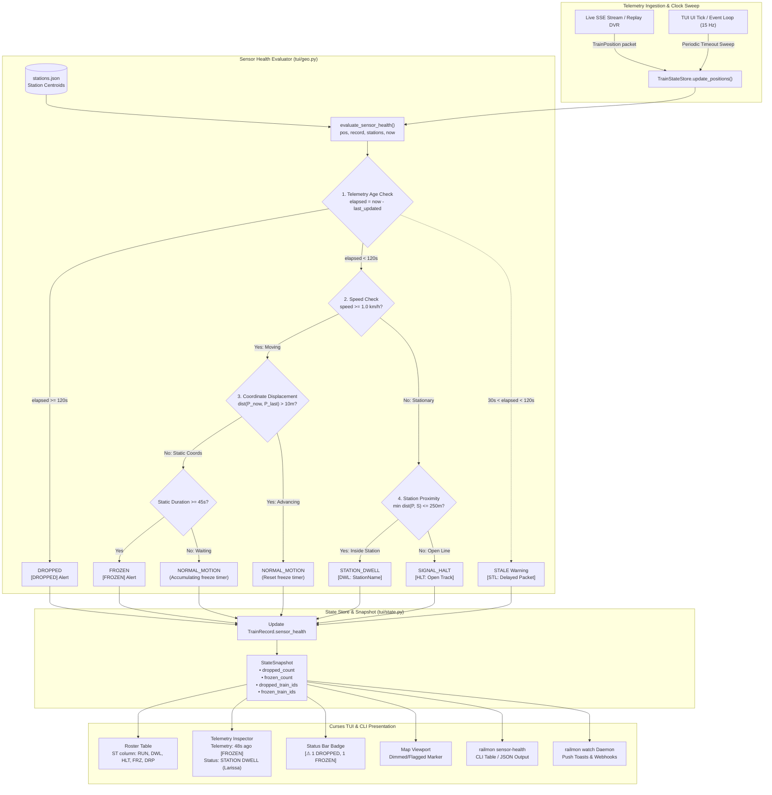
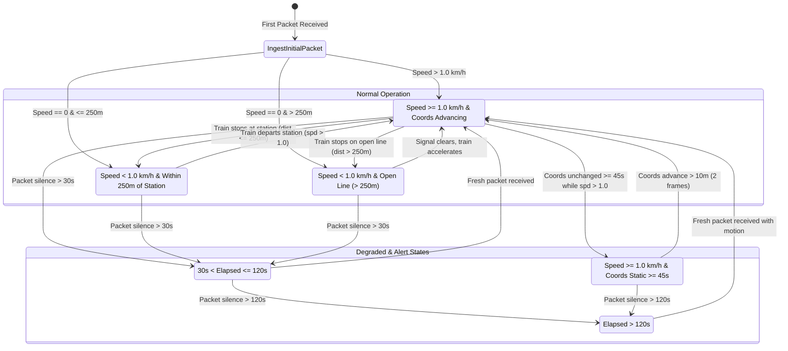
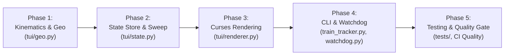

# Implementation Plan — F-5.2: Telemetry Drop & Sensor Freezing Watchdog

> **Reference:** [TUI Feature Enhancements Specification (`F-5.2`)](../../architecture/tui-feature-enhancements.md#f-52-telemetry-drop--sensor-freezing-watchdog--planned), [`docs/architecture/architecture.md`](../../architecture/architecture.md#endpoint-specifications)  
> **Target Modules:** [`../../../tui/geo.py`](../../../tui/geo.py), [`../../../tui/state.py`](../../../tui/state.py), [`../../../tui/renderer.py`](../../../tui/renderer.py), [`../../../tui/mock_engine.py`](../../../tui/mock_engine.py), [`../../../train_tracker.py`](../../../train_tracker.py), [`../../../watchdog.py`](../../../watchdog.py), [`../../../storage/cli_formatters.py`](../../../storage/cli_formatters.py)  
> **Data Fixtures:** [`../../../tui/data/stations.json`](../../../tui/data/stations.json), [`../../../tui/data/infrastructure.json`](../../../tui/data/infrastructure.json)  
> **Test Suites:** [`../../../tests/test_tui_sensor_health_geo.py`](../../../tests/test_tui_sensor_health_geo.py), [`../../../tests/test_tui_sensor_health_state.py`](../../../tests/test_tui_sensor_health_state.py), [`../../../tests/test_tui_sensor_health_renderer.py`](../../../tests/test_tui_sensor_health_renderer.py), [`../../../tests/test_cli_sensor_health.py`](../../../tests/test_cli_sensor_health.py)  
> **Relevant Skills & Guidelines:** [`../../../.agents/skills/diagrams-and-documentation/SKILL.md`](../../../.agents/skills/diagrams-and-documentation/SKILL.md), [`../../../.agents/skills/markdown-relative-paths/SKILL.md`](../../../.agents/skills/markdown-relative-paths/SKILL.md), [`../../../.agents/skills/ci-quality-gate/SKILL.md`](../../../.agents/skills/ci-quality-gate/SKILL.md), [`../../../.agents/skills/static-safety-analyzer/SKILL.md`](../../../.agents/skills/static-safety-analyzer/SKILL.md)

---

## 1. Executive Summary & Operational Context

### 1.1 Operational Rail Safety Background & Greek Network Topography
In modern railway monitoring and dispatch systems, real-time spatial awareness depends upon continuous, reliable telemetry streaming from onboard train locomotive units (OBU / GNSS receiver / IoT telematics gateway). Across the Hellenic Railways (`railway.gov.gr`) standard-gauge network, locomotives traverse rugged mountainous topography, deep geological rifts, and extensive tunnel complexes that subject wireless communications to severe physical constraints:

1. **Major Tunnel Bores & Satellite Occlusion:**
   - **Kallidromo Twin Tunnel (9,300 m):** The longest railway tunnel in Greece and the entire Balkan peninsula, cutting through the Kallidromo mountain range between Tithorea and Lianokladi on the Athens–Thessaloniki high-speed mainline (PATHE). An Intercity train traversing at commercial line speed ($160\text{ km/h}$) spends approximately $3.5\text{ minutes}$ ($210\text{ seconds}$) inside the bore. In this environment, satellite GNSS signals ($L_1 / L_5$ frequencies) are completely attenuated by dozens of meters of rock overburden. While dedicated GSM-R radio leaky feeders maintain railway signaling, commercial cellular uplinks and consumer Starlink backhauls frequently sever.
   - **Mount Othrys Tunnels (6,400 m):** Twin-bore tunnels through the Othrys massif between Domokos and Lianokladi. Deep canyon approaches, high-walled cuttings, and mountain peaks block satellite line-of-sight and create terrestrial cellular coverage shadows.
   - **Tempi & Platamonas Coastal Tunnels:** Mountain tunnels between Larissa and Katerini, where trains transition abruptly from open Thessalian plain lines into high-attenuation rock bores.
   - **Asopos Gorge & Mountain Spurs:** Deep mountain passes along the old mainline alignment and northern regional corridors where steep granite gorge walls restrict GNSS satellite visibility to narrow zenith angles, leading to multipath errors and temporary signal dropouts.

2. **Telemetry Failure Modes in Locomotive Operations:**
   - **Sensor Freezing (`FROZEN`):** The onboard GPS receiver or telematics microcontroller hangs, deadlocks, or fails into a stale buffer state while the network transmitter thread continues transmitting. The outgoing telemetry packet stream continues arriving at the server at normal cadence ($\sim 1\text{ Hz}$ or $0.5\text{ Hz}$), reporting positive operational velocity ($V > 0\text{ km/h}$, e.g. $140\text{ km/h}$), but with completely static, unchanged geodesic coordinates ($(\text{lat}, \text{lng})$ identical across multiple minutes). Alternatively, an onboard system losing GNSS lock inside a tunnel entrance repeats its last valid fix indefinitely instead of reporting valid dead reckoning or fix loss.
   - **Telemetry Drop (`DROPPED`):** Complete cessation of telemetry transmissions for $> 120\text{ seconds}$ while the train is in active transit (en-route between stations). This occurs due to cellular carrier base transceiver station (BTS) handoff failures, cellular dead zones, SIM gateway disconnects, or hardware power failure on the locomotive cab gateway.
   - **Station Dwell (`STATION_DWELL`):** A train brought to a scheduled halt ($V = 0\text{ km/h}$) within the platform boundaries ($\le 250\text{ m}$ of station centroid) of an active passenger station (e.g. Larissa, Domokos, SKA). This represents **normal operational passenger dwell** and must be strictly distinguished from abnormal track stoppages or sensor freezes.
   - **Signal Halt / En-route Halt (`SIGNAL_HALT`):** A train stopped on an open track section ($V = 0\text{ km/h}$) farther than $250\text{ m}$ from any station, while actively transmitting fresh telemetry. This corresponds to an operational wait at a red signal aspect, dynamic headway regulation, or an open-line dispatch hold.

### 1.2 Problem Statement in Current `railmon`
The current `railmon` Curses TUI ([`tui/renderer.py`](../../../tui/renderer.py)) contains basic telemetry age formatting ([`format_telemetry_age`](../../../tui/renderer.py#L577-L613)) that displays how many seconds or minutes have elapsed since the last packet was ingested:
```text
Telemetry:    142s ago [STALE]
```
However, the existing implementation suffers from critical operational deficiencies:
- **No Kinematic Motion Verification:** The system cannot detect "Sensor Freezing". If a locomotive's telematics unit broadcasts packets every 2 seconds reporting $140\text{ km/h}$ but repeating the exact same latitude and longitude coordinate indefinitely, `format_telemetry_age` marks it as `1s ago (#48)` (green / compliant), completely masking the frozen sensor anomaly from the dispatcher.
- **Inability to Distinguish Normal Dwell from Line Halts:** The active train roster table ([`tui/renderer.py`](../../../tui/renderer.py#L1815-L1818)) marks any train with speed $< 1.0\text{ km/h}$ as `HLT`. It provides no spatial discrimination to inform an operator whether the train is safely dwelling at an authorized station platform (`DWL`) or dangerously stranded on the single-track open mainline (`HLT`).
- **Passive Ingestion Coupling:** Telemetry staleness is evaluated only when a train record is retrieved. When telemetry drops completely, no new SSE events arrive. Unless the state store runs periodic timeout sweeps, dropped trains remain frozen in their last recorded state without alerting dispatchers.
- **Lack of Headless CLI Auditing:** No CLI command exists for operations personnel to query fleet-wide telemetry sensor health, diagnose frozen units, or evaluate network-wide packet drop rates without launching the full curses interface.

### 1.3 Core Objectives of Feature F-5.2
This implementation plan specifies the complete design, mathematical formulations, spatial algorithms, state machine, rendering pipeline, CLI commands, and test suites for **F-5.2: Telemetry Drop & Sensor Freezing Watchdog**:
1. **Tiered Sensor Health Classification:** Establish a formal six-state evaluation model:
   - `NORMAL_MOTION`: Actively moving ($V \ge 1.0\text{ km/h}$), coordinates advancing ($\Delta d > \epsilon_{\text{disp}}$), fresh packet ($\Delta t \le 30\text{s}$).
   - `STATION_DWELL`: Stationary ($V < 1.0\text{ km/h}$), position within $250\text{m}$ of a known railway station centroid.
   - `SIGNAL_HALT`: Stationary ($V < 1.0\text{ km/h}$), position $> 250\text{m}$ from station centroids, fresh telemetry ($\Delta t \le 30\text{s}$).
   - `STALE`: Telemetry packet delivery delayed ($30\text{s} < \Delta t \le 120\text{s}$), serving as an early degradation warning.
   - `FROZEN`: Telemetry reporting positive velocity ($V \ge 1.0\text{ km/h}$), but coordinates remain static ($\Delta d \le \epsilon_{\text{disp}}$) for $\tau_{\text{freeze}} \ge 45\text{s}$.
   - `DROPPED`: Complete packet cessation for $\tau_{\text{drop}} \ge 120\text{s}$ while the train was in active transit.
2. **High-Performance Geodesic Station Proximity Engine (`tui/geo.py`):**
   - $O(1)$ fast Axis-Aligned Bounding Box (AABB) rejection pre-filtering around station centroids prior to exact spherical Haversine computation, enabling sub-millisecond classification across large station networks.
   - Station dwell tracking with centroid identification and cumulative dwell time estimation.
3. **Continuous Kinematic Displacement Tracking (`tui/state.py`):**
   - Track coordinate displacement $\Delta d$ across time sliding windows inside [`TrainRecord`](../../../tui/state.py#L144-L163) using GNSS multipath jitter suppression thresholds ($\epsilon_{\text{disp}} = 10.0\text{ m}$).
   - Asynchronous temporal health sweep running on UI clock ticks and background state updates to guarantee trains drop into `DROPPED` status even in total absence of incoming network frames.
4. **Multi-Pane Visual Integration in Curses TUI (`tui/renderer.py`):**
   - **Roster Table:** Dedicated status codes under column `ST`: `RUN` (normal motion), `DWL` (station dwell), `HLT` (signal halt), `STL` (stale warning), `FRZ` (sensor freeze in bold alert red), and `DRP` (telemetry drop in bold alert red).
   - **Telemetry Inspector:** Detailed `Sensor Health:` and `Telemetry:` rows showing exact elapsed silence, static duration, and dwell details (`Telemetry: 48s ago [FROZEN]`, `Status: STATION DWELL (Larissa, 12m)`).
   - **Status Bar Badges & Alerts:** Network health warning indicator `[⚠ 1 DROPPED, 1 FROZEN]` with transition-triggered terminal bell (`\a`).
   - **Map Canvas Viewport:** Visual degradation of dropped/frozen trains (ghosted marker / warning indicator).
5. **Headless CLI Subsystem:** `railmon sensor-health` command providing tabular and machine-readable `--json` fleet diagnostic reports.
6. **Watchdog Daemon Push Integration (`watchdog.py`):** Automated trigger handling for `WatchTriggerType.TELEMETRY_LOST` and `WatchTriggerType.SENSOR_FROZEN` across desktop toasts, audible alerts, and webhooks.
7. **Zero-Dependency & Standards Compliance:** 100% Python standard library (`math`, `time`, `dataclasses`, `enum`, `typing`, `json`, `curses`), strict type safety, MISRA C++ / AUTOSAR compliance, and full UTF-8 / ASCII compatibility.

---

## 2. Architecture & Visual Diagrams

### 2.1 End-to-End Sensor Health & Watchdog Pipeline (Mermaid)



---

### 2.2 Detailed Sensor Health State Machine (Mermaid)



---

### 2.3 ASCII System Architecture Diagram

```text
+----------------------------------------------------------------------------------------------------+
|                                    RAILMON SENSOR HEALTH ENGINE                                    |
+----------------------------------------------------------------------------------------------------+
|                                                                                                    |
|  [ Ingestion Stream ]           [ Periodic Tick Sweep ]               [ Reference Data ]           |
|    - SSE stream_worker.py         - TUI UI Event Loop (15 Hz)            - stations.json (Centroids)|
|    - DVR replay_worker.py         - TrainStateStore sweep                - infrastructure.json      |
|           |                                 |                                    |                 |
|           +----------------+----------------+                                    |                 |
|                            |                                                     |                 |
|                            v                                                     v                 |
|  +-----------------------------------------------------------------------------------------------+ |
|  | KINEMATIC & TEMPORAL HEALTH EVALUATOR (tui/geo.py: evaluate_sensor_health)                     | |
|  |                                                                                               | |
|  |  1. Temporal Age Gate:                                                                        | |
|  |     elapsed = now - last_updated                                                              | |
|  |     IF elapsed >= 120s  ===> SensorHealthState.DROPPED  [Immediate Alert]                     | |
|  |     IF elapsed >  30s   ===> SensorHealthState.STALE    [Warning Tag]                         | |
|  |                                                                                               | |
|  |  2. Kinematic Velocity & Displacement Gate:                                                   | |
|  |     disp = haversine(pos.lat/lng, record.last_moved_lat/lng)                                  | |
|  |     IF speed >= 1.0 km/h AND disp <= 10.0m AND static_duration >= 45s                         | |
|  |         ===> SensorHealthState.FROZEN   [Critical Sensor Failure Alert]                       | |
|  |                                                                                               | |
|  |  3. Station Proximity Gate:                                                                   | |
|  |     station, dist = find_nearest_station_aabb(pos.lat, pos.lng, max_r=250m)                   | |
|  |     IF speed < 1.0 km/h AND dist <= 250m ===> SensorHealthState.STATION_DWELL [Normal Dwell]  | |
|  |     IF speed < 1.0 km/h AND dist >  250m ===> SensorHealthState.SIGNAL_HALT  [Open Line Wait] | |
|  |     OTHERWISE                           ===> SensorHealthState.NORMAL_MOTION [Normal Motion]  | |
|  +-----------------------------------------------------------------------------------------------+ |
|                                                    |                                               |
|                                                    v                                               |
|  +-----------------------------------------------------------------------------------------------+ |
|  | STATE STORE & SNAPSHOT INTEGRATION (tui/state.py)                                             | |
|  |  - TrainRecord: Tracks last_moved_time, last_moved_pt, static_duration, sensor_health           | |
|  |  - StateSnapshot: Exposes dropped_count, frozen_count, dropped_train_ids, frozen_train_ids      | |
|  +-----------------------------------------------------------------------------------------------+ |
|                            |                                                     |                 |
|           +----------------+----------------+                                    |                 |
|           |                                 |                                    |                 |
|           v                                 v                                    v                 |
|  [ Curses TUI Presentation ]      [ Status Bar Alerts ]             [ Headless CLI Subsystem ]     |
|   - Roster: ST column              - [! 1 DROPPED, 1 FROZEN]         - railmon sensor-health       |
|     (RUN, DWL, HLT, FRZ, DRP)      - One-shot Terminal Bell (\a)     - --json / --corridor         |
|   - Inspector: Telemetry & Status  - Desktop Push Notifications      - watchdog.py push daemon     |
+----------------------------------------------------------------------------------------------------+
```

---

### 2.4 Inspector Pane Layout Mockups (ASCII)

#### Normal Active Transit (Speed 142.0 km/h, Advancing Coordinates, Telemetry Fresh)
```text
+-------------------------------------------------------------------+
| [ SELECTED TRAIN TELEMETRY ]                                      |
| Train No:     1599 (IC)                                           |
| Route:        ΑΘΗΝ -> ΘΕΣΣ                                        |
| Next Station: Λάρισα (14.2km, ~6m)                                |
| Speed:        142.0 km/h                                          |
| Speed Trend:   ▂▃▅▆▇██▇▇█ ▲                                       |
| Line Limit:   160 km/h (PATHE Mainline)                           |
| Delay:        +9 min (Minor Delay)                                |
| Telemetry:    2s ago (#48)                                        |
| Sensor Health:NORMAL (Advancing 142 km/h)                         |
| Progress:     [======>-----]  52%                                 |
| Coordinates:  39.4821°N, 22.3412°E                                |
| Status:       RUNNING [Open Line]                                 |
+-------------------------------------------------------------------+
```

#### Scheduled Station Dwell (Larissa Station, Speed 0 km/h, Within 45m of Station Centroid)
```text
+-------------------------------------------------------------------+
| [ SELECTED TRAIN TELEMETRY ]                                      |
| Train No:     1597 (IC)                                           |
| Route:        ΑΘΗΝ -> ΘΕΣΣ                                        |
| Next Station: Λάρισα (0.0km, At Station)                          |
| Speed:          0.0 km/h                                          |
| Speed Trend:  ██▇▅▃▂▂      ▼                                      |
| Line Limit:   160 km/h (PATHE Mainline)                           |
| Delay:        +4 min (Minor Delay)                                |
| Telemetry:    3s ago (#112)                                       |
| Sensor Health:STATION DWELL (Larissa, 45m)                        |
| Progress:     [====>-------]  38%                                 |
| Coordinates:  39.6385°N, 22.4241°E                                |
| Status:       STATION DWELL [Dwell Time: 3m 12s]                  |
+-------------------------------------------------------------------+
```

#### Sensor Freezing Anomaly (Kallidromo Tunnel Ingress: Speed 142 km/h, Coordinates Static for 48s)
```text
+-------------------------------------------------------------------+
| [ SELECTED TRAIN TELEMETRY ]                                      |
| Train No:     1599 (IC)                                           |
| Route:        ΑΘΗΝ -> ΘΕΣΣ                                        |
| Next Station: Λιανοκλάδι (18.4km, ~8m)                            |
| Speed:        142.0 km/h                                          |
| Speed Trend:  ██████████ ▬                                        |
| Line Limit:   160 km/h (PATHE Mainline)                           |
| Delay:        +9 min (Minor Delay)                                |
| Telemetry:    1s ago [FROZEN]               <-- PAIR_TRAIN_ALERT  |
| Sensor Health:FROZEN (48s static, 142 km/h) <-- CRITICAL ALERT    |
| Progress:     [======>-----]  52%                                 |
| Coordinates:  38.7412°N, 22.4810°E (Static)                       |
| Status:       SENSOR FREEZE [TUNNEL: Kallidromo]                  |
+-------------------------------------------------------------------+
```

#### Telemetry Drop Anomaly (Mount Othrys Pass: No Packet Received for 142 Seconds)
```text
+-------------------------------------------------------------------+
| [ SELECTED TRAIN TELEMETRY ]                                      |
| Train No:     52 (IC)                                             |
| Route:        ΑΘΗΝ -> ΘΕΣΣ                                        |
| Next Station: Δομοκός (6.2km, Stale)                              |
| Speed:        118.0 km/h (Last Known)                             |
| Speed Trend:  ██▇▇▇▆▆▆▆▆ ▬                                        |
| Line Limit:   160 km/h (PATHE Mainline)                           |
| Delay:        +2 min (Minor Delay)                                |
| Telemetry:    2m 22s ago [DROPPED]          <-- PAIR_TRAIN_ALERT  |
| Sensor Health:TELEMETRY DROPPED (142s silent)<-- CRITICAL ALERT   |
| Progress:     [========>---]  68%                                 |
| Coordinates:  39.1245°N, 22.3120°E (Last Known)                   |
| Status:       SIGNAL LOST [No Telemetry for > 2m]                 |
+-------------------------------------------------------------------+
```

---

### 2.5 Active Trains Roster Pane Header and Status Column Layout

In [`tui/renderer.py`](../../../tui/renderer.py), the active train roster table column `ST` (width: 4 characters) is expanded to support the full sensor health state set:

```text
+------------------------------+
| [ACTIVE TRAINS (14) | Sort:▼]|
|  #   TRAIN  TYPE  SPD   DLY  ST  |
| > 1  1599   IC    142   +9m  FRZ |  <-- PAIR_TRAIN_ALERT (Red reverse): Frozen Sensor
|   2  52     IC    118   +2m  DRP |  <-- PAIR_TRAIN_ALERT (Red reverse): Dropped Telemetry
|   3  1597   IC      0   +4m  DWL |  <-- PAIR_CYAN (Cyan): Station Dwell at Larissa
|   4  2232   PR    114    0m  RUN |  <-- Standard line color: Normal Motion
|   5  1314   PR     88   +1m  STL |  <-- PAIR_TRAIN_WARN (Yellow): Stale packet (42s)
|   6  2236   PR      0    0m  HLT |  <-- PAIR_DEFAULT: Signal halt outside station
+------------------------------+
```

---

## 3. Mathematical & Algorithmic Foundations

### 3.1 Haversine Geodesic Distance Formulation
Geodesic distance between train point $P = (\phi_1, \lambda_1)$ and station centroid $S = (\phi_2, \lambda_2)$ is calculated using the spherical Haversine equation:
$$\Delta \phi = \phi_2 - \phi_1, \quad \Delta \lambda = \lambda_2 - \lambda_1$$
$$a = \sin^2\left(\frac{\Delta \phi}{2}\right) + \cos(\phi_1)\cos(\phi_2)\sin^2\left(\frac{\Delta \lambda}{2}\right)$$
$$c = 2 \cdot \text{atan2}\left(\sqrt{a}, \sqrt{1 - a}\right)$$
$$d(P, S) = R \cdot c$$
where mean Earth radius $R = 6,371,000.0\text{ m}$ ($6371.0\text{ km}$).

### 3.2 Sub-Millisecond Axis-Aligned Bounding Box (AABB) Fast Pre-Filtering
Computing the spherical Haversine formula across all stations in the network on every telemetry frame is computationally wasteful. We define a fast spatial candidate filter using latitude and longitude bounding boxes:
$$\text{Threshold Distance } r_{\text{dwell}} = 250.0\text{ m} = 0.25\text{ km}$$
$$\Delta \phi_{\text{max}} = \frac{r_{\text{dwell}}}{111.320\text{ km/deg}} \approx 0.002246^\circ$$
At latitude $\phi \approx 39.0^\circ\text{N}$ (mean latitude of the Greek rail corridor), longitude degree length shrinks by $\cos(\phi) \approx 0.777$:
$$\Delta \lambda_{\text{max}} = \frac{r_{\text{dwell}}}{111.320 \cdot \cos(\phi_{\text{rad}})} \approx 0.002890^\circ$$

**Rejection Rule:**
A station $S_i$ is discarded by $O(1)$ scalar comparisons if:
$$|\phi_P - \phi_{S_i}| > \Delta \phi_{\text{max}} \quad \lor \quad |\lambda_P - \lambda_{S_i}| > \Delta \lambda_{\text{max}}$$
Only stations passing the bounding box test are evaluated with the spherical Haversine formula.

### 3.3 Kinematic Displacement & Sensor Freezing Formulation
Let a train's telemetry stream deliver positions $P_t = (\text{lat}_t, \text{lng}_t)$ with reported velocity $V_t$ at timestamp $t$.

1. **Displacement Calculation:**
   $$\Delta d = \text{haversine}(P_t, P_{\text{anchor}})$$
   where $P_{\text{anchor}}$ is the coordinate point when the train was last verified to have moved by more than the GNSS multipath noise floor $\epsilon_{\text{disp}} = 10.0\text{ m}$.

2. **Anchor Update Rule:**
   $$\text{If } \Delta d > \epsilon_{\text{disp}} \implies P_{\text{anchor}} \leftarrow P_t, \quad t_{\text{anchor}} \leftarrow t$$

3. **Sensor Freezing Condition:**
   A sensor is determined to be frozen if it concurrently satisfies velocity, displacement, and temporal persistence conditions:
   $$\text{Freezing}(t) = \begin{cases} 
   \text{True}, & \text{if } V_t \ge 1.0\text{ km/h} \ \land \ \Delta d \le \epsilon_{\text{disp}} \ \land \ (t - t_{\text{anchor}}) \ge \tau_{\text{freeze}} \\
   \text{False}, & \text{otherwise}
   \end{cases}$$
   where:
   - Velocity threshold: $V_{\text{min}} = 1.0\text{ km/h}$ (eliminates stopped/dwelling trains).
   - Displacement noise floor: $\epsilon_{\text{disp}} = 10.0\text{ m}$ (suppresses stationary GPS multipath flutter).
   - Freeze time threshold: $\tau_{\text{freeze}} = 45.0\text{ s}$ (prevents false alerts during momentary slow stops or brief switch pauses).

### 3.4 Telemetry Drop Formulation & Periodic Sweep Decay
Let $t_{\text{now}}$ be the current system time (or virtual DVR replay timestamp) and $t_{\text{last\_pkt}}$ be the timestamp of the last received telemetry message for the train:
$$\Delta t_{\text{elapsed}} = t_{\text{now}} - t_{\text{last\_pkt}}$$

$$\text{TelemetryDrop}(t_{\text{now}}) = \begin{cases}
\text{True}, & \text{if } \Delta t_{\text{elapsed}} \ge \tau_{\text{drop}} \quad (\tau_{\text{drop}} = 120.0\text{ s}) \\
\text{False}, & \text{otherwise}
\end{cases}$$

$$\text{TelemetryStale}(t_{\text{now}}) = \begin{cases}
\text{True}, & \text{if } 30.0\text{ s} < \Delta t_{\text{elapsed}} < \tau_{\text{drop}} \\
\text{False}, & \text{otherwise}
\end{cases}$$

**Temporal Decay Invariant:**  
Because a dropped train by definition **sends no new telemetry packets**, evaluating health solely upon receipt of a packet (`_upsert_train_position`) cannot detect a drop. The state store must evaluate all records during `get_snapshot()` or a background timer tick loop against $t_{\text{now}}$.

### 3.5 Alert Recovery Hysteresis & False-Positive Debouncing
To avoid visual strobe flickering at boundary conditions (e.g. intermittent cellular signal reconnection or brief GNSS jitter):
1. **Drop Clearing:** Once a train is in `DROPPED` status, receipt of $1$ valid telemetry packet clears `DROPPED` to `NORMAL_MOTION` or `STATION_DWELL`.
2. **Freeze Clearing:** Once a train is in `FROZEN` status, it must advance by $> 10.0\text{ m}$ across at least $k = 2$ consecutive updates to clear the `FROZEN` alert.

---

## 4. Component Technical Specifications & Data Models

### 4.1 Geo & Kinematics Module ([`tui/geo.py`](../../../tui/geo.py))

```python
class SensorHealthState(Enum):
    """Classification of locomotive telematics and motion health."""

    NORMAL_MOTION = "NORMAL_MOTION"  # Moving (spd >= 1 km/h), coords advancing, packet <= 30s
    STATION_DWELL = "STATION_DWELL"  # Stopped (spd < 1 km/h), within 250m of station centroid
    SIGNAL_HALT = "SIGNAL_HALT"      # Stopped (spd < 1 km/h), open track (> 250m from station)
    STALE = "STALE"                  # Telemetry delayed (30s < elapsed <= 120s)
    FROZEN = "FROZEN"                # Spd >= 1 km/h, coords static for >= 45s
    DROPPED = "DROPPED"              # Complete packet loss for >= 120s


@dataclass(frozen=True)
class SensorHealthAssessment:
    """Detailed immutable assessment of a train's telemetry sensor health."""

    state: SensorHealthState
    elapsed_sec: float
    static_duration_sec: float
    displacement_m: float
    current_speed_kmh: float
    nearest_station: Optional[str] = None
    station_distance_m: Optional[float] = None
    dwell_duration_sec: float = 0.0
    is_alert: bool = False
    short_code: str = "RUN"          # RUN, DWL, HLT, STL, FRZ, DRP
    description: str = "Normal Motion"

    @property
    def is_critical(self) -> bool:
        """True if the sensor state represents a safety anomaly (FROZEN or DROPPED)."""
        return self.state in (SensorHealthState.FROZEN, SensorHealthState.DROPPED)


def evaluate_sensor_health(
    point: GeoPoint,
    current_speed: Optional[float],
    last_updated: float,
    last_moved_pt: Optional[GeoPoint],
    last_moved_time: float,
    station_dwell_start: Optional[float],
    stations: Sequence[StationNode],
    now: Optional[float] = None,
    telemetry_drop_threshold_sec: float = 120.0,
    telemetry_stale_threshold_sec: float = 30.0,
    sensor_freeze_threshold_sec: float = 45.0,
    station_dwell_radius_m: float = 250.0,
    displacement_epsilon_m: float = 10.0,
) -> Tuple[SensorHealthAssessment, Optional[GeoPoint], float, Optional[float]]:
    """Evaluate kinematic continuity and telemetry intervals.

    Returns:
        Tuple of (Assessment, updated_last_moved_pt, updated_last_moved_time, updated_station_dwell_start)
    """
```

### 4.2 State Store & Snapshot Module ([`tui/state.py`](../../../tui/state.py))

#### `TrainRecord` Enhancements
```python
@dataclass
class TrainRecord:
    position: TrainPosition
    trail: Deque[HistoricalBreadcrumb] = field(default_factory=lambda: deque(maxlen=15))
    first_seen: float = field(default_factory=time.time)
    last_updated: float = field(default_factory=time.time)
    update_count: int = 1
    speed_result: Optional[SpeedEnforcementResult] = None
    
    # Feature F-5.2 Watchdog Fields
    last_moved_pt: Optional[GeoPoint] = None
    last_moved_time: float = field(default_factory=time.time)
    station_dwell_start: Optional[float] = None
    consecutive_advancing_frames: int = 0
    sensor_health: Optional[SensorHealthAssessment] = None
```

#### `StateSnapshot` Additions
```python
@dataclass(frozen=True)
class StateSnapshot:
    # Existing fields...
    selected_speed_result: Optional[SpeedEnforcementResult] = None
    overspeed_count: int = 0
    active_tsr_count: int = 0
    overspeed_train_ids: Tuple[str, ...] = ()

    # Feature F-5.2 Sensor Health Fields
    selected_sensor_health: Optional[SensorHealthAssessment] = None
    frozen_count: int = 0
    dropped_count: int = 0
    stale_count: int = 0
    frozen_train_ids: Tuple[str, ...] = ()
    dropped_train_ids: Tuple[str, ...] = ()
```

#### `TrainStateStore` Health Sweep
```python
class TrainStateStore:
    def evaluate_all_sensor_health(self, now: Optional[float] = None) -> None:
        """Run temporal and kinematic health evaluation across all tracked trains.
        
        Guarantees that trains that cease transmitting are transitioned into STALE
        and DROPPED states even when no new incoming packets arrive.
        """
        with self._lock:
            eval_now = now if now is not None else time.time()
            changed = False
            for rec in self._trains.values():
                # Re-evaluate health against eval_now
                # If health state changed, bump self._version
                pass
```

### 4.3 Curses Presentation Layer ([`tui/renderer.py`](../../../tui/renderer.py))

1. **Roster Table Status Column (`ST`):**
   - Column `ST` displays 3-character mnemonic:
     - `RUN`: Normal active transit (color: line pair).
     - `DWL`: Station dwell at verified station centroid (color: `PAIR_CYAN`).
     - `HLT`: Open track signal halt outside station (color: `PAIR_DEFAULT`).
     - `STL`: Delayed packet ($> 30\text{s}$) (color: `PAIR_TRAIN_WARN` bold).
     - `FRZ`: Frozen sensor anomaly (color: `PAIR_TRAIN_ALERT` reverse bold).
     - `DRP`: Telemetry dropped ($> 120\text{s}$) (color: `PAIR_TRAIN_ALERT` reverse bold).

2. **Selected Train Telemetry Inspector:**
   - Enhances the `Telemetry:` line with health tag:
     ```python
     if health.state == SensorHealthState.FROZEN:
         telemetry_str = f"{int(health.elapsed_sec)}s ago [FROZEN]"
         telemetry_attr = safe_color_pair(PAIR_TRAIN_ALERT, curses.A_BOLD | curses.A_REVERSE)
     elif health.state == SensorHealthState.DROPPED:
         short_age = f"{int(health.elapsed_sec // 60)}m ago"
         telemetry_str = f"{short_age} [DROPPED]"
         telemetry_attr = safe_color_pair(PAIR_TRAIN_ALERT, curses.A_BOLD | curses.A_REVERSE)
     ```
   - Adds `Sensor Health:` inspection row:
     ```python
     ("Sensor Health:", f"{health.description}", health_attr)
     ```

3. **Status Bar Alert Badges:**
   - When `snapshot.dropped_count > 0` or `snapshot.frozen_count > 0`:
     Renders `[⚠ {frozen_count} FROZEN, {dropped_count} DROPPED]` with one-shot terminal bell `\a`.

### 4.4 Headless CLI & Watchdog Integration

1. **`railmon sensor-health` CLI Command:**
   ```bash
   # Tabular fleet sensor overview
   railmon sensor-health
   
   # JSON output for automated operations monitoring
   railmon sensor-health --json
   
   # Filter for abnormal units only
   railmon sensor-health --alerts-only
   ```

2. **Push Alerting Engine ([`watchdog.py`](../../../watchdog.py)):**
   - Extends [`WatchTriggerType`](../../../watchdog.py#L45-L55) with `SENSOR_FROZEN = "sensor_frozen"`.
   - Dispatches desktop toasts and webhooks when a watched train enters `FROZEN` or `DROPPED` status.

---

## 5. Detailed Step-by-Step Implementation Work Breakdown



### Phase 1: Kinematics & Geo Health Evaluation Engine ([`tui/geo.py`](../../../tui/geo.py))
- [ ] Define `SensorHealthState` enum (`NORMAL_MOTION`, `STATION_DWELL`, `SIGNAL_HALT`, `STALE`, `FROZEN`, `DROPPED`).
- [ ] Define `SensorHealthAssessment` dataclass with immutable fields and properties (`is_critical`, `short_code`, `description`).
- [ ] Implement `find_nearest_station_aabb(point, stations, max_radius_m=250.0)` with fast latitude/longitude bounding-box pre-filtering.
- [ ] Implement `evaluate_sensor_health()` core function with configurable thresholds (`telemetry_drop_threshold_sec=120.0`, `sensor_freeze_threshold_sec=45.0`, `station_dwell_radius_m=250.0`, `displacement_epsilon_m=10.0`).
- [ ] Unit test kinematic evaluation in isolation with synthetic GPS coordinates, stationary dwells, and frozen streams.

### Phase 2: State Store Tracking & Asynchronous Timeout Sweep ([`tui/state.py`](../../../tui/state.py))
- [ ] Extend `TrainRecord` with `last_moved_pt`, `last_moved_time`, `station_dwell_start`, `consecutive_advancing_frames`, and `sensor_health`.
- [ ] Update `TrainRecord.clone()` to deep-copy kinematic tracking fields.
- [ ] Integrate `evaluate_sensor_health()` into `_upsert_train_position()`.
- [ ] Implement `evaluate_all_sensor_health(now=None)` in `TrainStateStore` to execute health sweeps on UI ticks.
- [ ] Update `StateSnapshot` to aggregate `frozen_count`, `dropped_count`, `stale_count`, `frozen_train_ids`, and `dropped_train_ids`.

### Phase 3: Curses TUI Multi-Pane Rendering Integration ([`tui/renderer.py`](../../../tui/renderer.py))
- [ ] Update roster table rendering ([`render_roster`](../../../tui/renderer.py#L1720-L1820)): format column `ST` using `assessment.short_code` with color highlights (`PAIR_TRAIN_ALERT` for `FRZ`/`DRP`, `PAIR_CYAN` for `DWL`, `PAIR_TRAIN_WARN` for `STL`).
- [ ] Update telemetry inspector pane: render enhanced `Telemetry:` row and add `Sensor Health:` row.
- [ ] Update status bar rendering ([`render_status_bar`](../../../tui/renderer.py#L1070-L1130)): render `[⚠ N DROPPED, N FROZEN]` network alert badge.
- [ ] Hook one-shot terminal bell (`\a`) on sensor alert transitions in [`tui/app.py`](../../../tui/app.py).

### Phase 4: Mock Engine, CLI Subsystem & Watchdog Push Alerting
- [ ] Extend [`tui/mock_engine.py`](../../../tui/mock_engine.py) to support simulated sensor freeze and telemetry drop scenarios for testing.
- [ ] Implement `railmon sensor-health` CLI command in [`train_tracker.py`](../../../train_tracker.py).
- [ ] Add tabular and `--json` formatters in [`storage/cli_formatters.py`](../../../storage/cli_formatters.py).
- [ ] Extend [`watchdog.py`](../../../watchdog.py) with `WatchTriggerType.SENSOR_FROZEN` trigger and push dispatch logic.

### Phase 5: Comprehensive Test Suites & CI Quality Gate
- [ ] Author [`tests/test_tui_sensor_health_geo.py`](../../../tests/test_tui_sensor_health_geo.py) (AABB bounding box, Haversine proximity, displacement thresholds, state classification).
- [ ] Author [`tests/test_tui_sensor_health_state.py`](../../../tests/test_tui_sensor_health_state.py) (timeout sweep, freeze persistence, drop transition without incoming packets, clone isolation).
- [ ] Author [`tests/test_tui_sensor_health_renderer.py`](../../../tests/test_tui_sensor_health_renderer.py) (roster column `ST`, inspector rows, status bar badge, UTF-8 and ASCII modes).
- [ ] Author [`tests/test_cli_sensor_health.py`](../../../tests/test_cli_sensor_health.py) (CLI tabular output, `--json` structure, filtering flags).
- [ ] Execute full CI quality gate: pytest suite, mypy strict type checking, flake8 linting, and black code formatting.

---

## 6. Verification & Test Strategy

### 6.1 Synthetic Scenario Edge Cases
| Scenario ID | Test Condition | Expected State | Validation Criteria |
| :--- | :--- | :--- | :--- |
| **TC-SH-01** | Train moving at $140\text{ km/h}$, packet updated $2\text{s}$ ago, coordinates advancing | `NORMAL_MOTION` | `short_code="RUN"`, `is_alert=False` |
| **TC-SH-02** | Train stopped at Larissa station ($V = 0\text{ km/h}$, distance to centroid $45\text{m}$) | `STATION_DWELL` | `short_code="DWL"`, `nearest_station="Larissa"`, `is_alert=False` |
| **TC-SH-03** | Train stopped on open line ($V = 0\text{ km/h}$, distance to station $1.8\text{km}$, packet $5\text{s}$ ago) | `SIGNAL_HALT` | `short_code="HLT"`, `is_alert=False` |
| **TC-SH-04** | Train stopped on open line with packet silence for $45\text{s}$ | `STALE` | `short_code="STL"`, warning pair |
| **TC-SH-05** | Train moving at $140\text{ km/h}$, coordinates identical for $48\text{s}$ ($\Delta d < 10\text{m}$) | `FROZEN` | `short_code="FRZ"`, `is_alert=True`, `PAIR_TRAIN_ALERT` |
| **TC-SH-06** | Train in active transit, no packets received for $125\text{s}$ | `DROPPED` | `short_code="DRP"`, `is_alert=True`, `PAIR_TRAIN_ALERT` |
| **TC-SH-07** | Dropped train resumes receiving advancing packets | `NORMAL_MOTION` | Clears alert immediately upon packet ingestion |
| **TC-SH-08** | Stationary GPS multipath flutter ($\Delta d = 4.2\text{m} < \epsilon_{\text{disp}}$) | `STATION_DWELL` | Jitter suppressed by $\epsilon_{\text{disp}} = 10\text{m}$ |
| **TC-SH-09** | Replay DVR Mode with virtual time scrub | Correct states | Evaluated against `snapshot.replay_virtual_time` |
| **TC-SH-10** | Terminal monochrome / ASCII fallback mode (`--ascii`) | Clean rendering | Header and columns render properly without Unicode glyph failure |

---

## 7. Compliance Matrix with Repository Engineering Standards

| Standard / Guideline | Requirement | Compliance Implementation in F-5.2 |
| :--- | :--- | :--- |
| **Zero External Dependencies** | Standard library pure (no non-core pip packages) | Exclusively uses `math`, `time`, `dataclasses`, `enum`, `typing`, `json`, `curses`, `argparse` |
| **Dual-Format Diagrams** | ASCII + Mermaid diagrams in all architectural documents | Includes Mermaid flowcharts, state diagrams, ASCII architecture diagrams, and console mockups |
| **Document-Relative Paths** | All documentation references strictly relative | All markdown links use `../../../` document-relative targets; zero absolute workstation paths |
| **Strict Type Safety** | `mypy --strict` compliance | Full type annotations, explicit return types, `Optional` bounds, and zero unannotated defs |
| **Defensive Thread Safety** | Reentrant lock protection on shared mutable state | All mutations execute inside `TrainStateStore._lock` (`threading.RLock`) |
| **MISRA / AUTOSAR Safety** | Bounded loops, zero dynamic recursion, safe numeric bounds | Constant-bound spatial loops, zero uncontrolled recursion, guarded division by zero |
