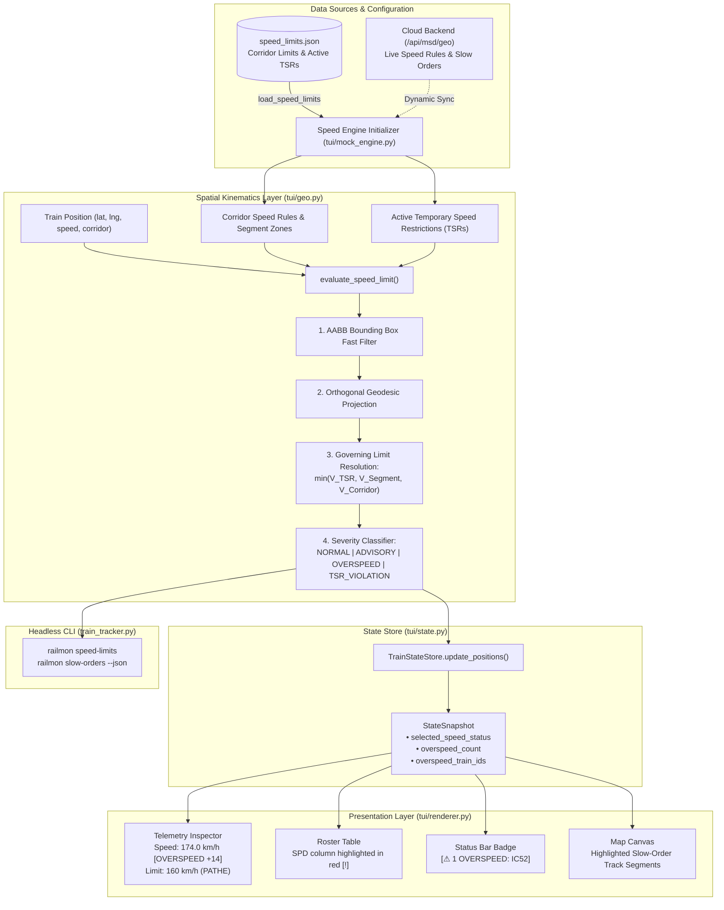
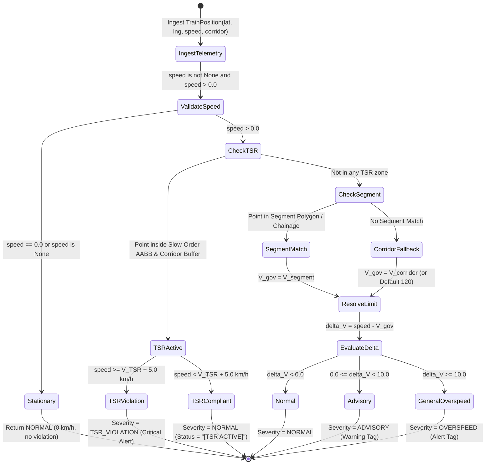
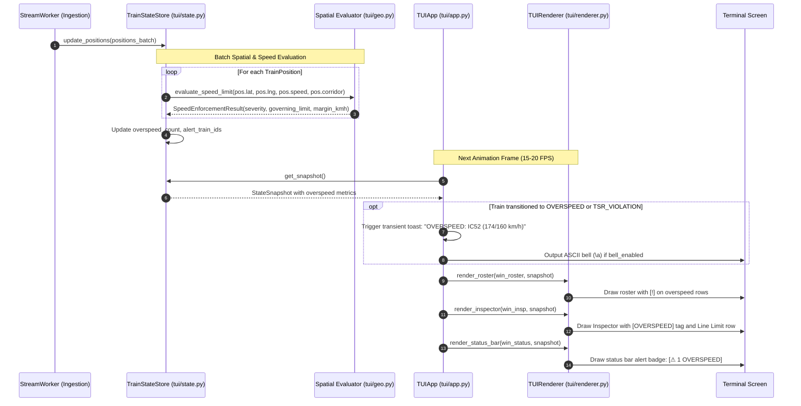
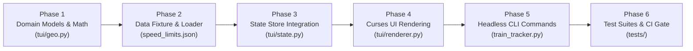

# Implementation Plan — F-5.3: Corridor Speed Limit Exceedance & Slow-Order Alerts

> **Reference:** [TUI Feature Enhancements Specification (`F-5.3`)](../../architecture/tui-feature-enhancements.md#f-53-corridor-speed-limit-exceedance--slow-order-alerts--planned), [`docs/architecture/architecture.md`](../../architecture/architecture.md#endpoint-specifications)  
> **Target Modules:** [`../../../tui/geo.py`](../../../tui/geo.py), [`../../../tui/state.py`](../../../tui/state.py), [`../../../tui/renderer.py`](../../../tui/renderer.py), [`../../../tui/mock_engine.py`](../../../tui/mock_engine.py), [`../../../train_tracker.py`](../../../train_tracker.py), [`../../../storage/cli_formatters.py`](../../../storage/cli_formatters.py)  
> **Data Fixtures:** [`../../../tui/data/speed_limits.json`](../../../tui/data/speed_limits.json)  
> **Test Suites:** [`../../../tests/test_tui_speed_limits_geo.py`](../../../tests/test_tui_speed_limits_geo.py), [`../../../tests/test_tui_speed_limits_renderer.py`](../../../tests/test_tui_speed_limits_renderer.py), [`../../../tests/test_cli_speed_limits.py`](../../../tests/test_cli_speed_limits.py)  
> **Relevant Skills & Guidelines:** [`../../../.agents/skills/diagrams-and-documentation/SKILL.md`](../../../.agents/skills/diagrams-and-documentation/SKILL.md), [`../../../.agents/skills/markdown-relative-paths/SKILL.md`](../../../.agents/skills/markdown-relative-paths/SKILL.md), [`../../../.agents/skills/ci-quality-gate/SKILL.md`](../../../.agents/skills/ci-quality-gate/SKILL.md), [`../../../.agents/skills/static-safety-analyzer/SKILL.md`](../../../.agents/skills/static-safety-analyzer/SKILL.md)

---

## 1. Executive Summary & Operational Context

### 1.1 Operational Rail Safety Background & Regulatory Sources
Across the Hellenic Railways (`railway.gov.gr`) network, safe train operation depends on strict adherence to two categories of speed restrictions governed by OSE infrastructure regulations, Hellenic Train operating rules, and European Union Agency for Railways (ERA) Technical Specifications for Interoperability (TSI):

> **Authoritative Regulatory Source:**  
> All corridor baseline design speeds and segment line limits are derived from the official **Hellenic Railways Network Statement (*Δήλωση Δικτύου ΟΣΕ*)** published under EU Directive 2012/34/EU and supervised by the Regulatory Authority for Railways (RAS):  
> 🔗 **Official Portal:** [https://www.hellenicrailways.gr/etaireia/dilosi-diktyou](https://www.hellenicrailways.gr/etaireia/dilosi-diktyou)  
> * **Annex III-A (Παράρτημα ΙΙΙ-Α):** «Φόρτιση και Ταχύτητα» (*Track Loading and Maximum Permissible Speeds by Track Section*)  
> * **Annex I-A & I-B (Παράρτημα Ι-Α & Ι-Β):** «Γενικά Χαρακτηριστικά των Γραμμών του Δικτύου» (*Network Infrastructure Characteristics, Gradients, and Curves*)

1. **Civil Engineering Design Speeds (Line Speed Limits):** Fixed maximum permissible speeds determined by track curvature, superelevation, switch geometry, gradient, and signaling infrastructure:
   - **PATHE Modernized High-Speed Core (Tithorea–Domokos bypass, Callidromon & Othrys bores):** Civil engineering design speed $200\text{ km/h}$, commercial operational speed limit $160\text{ km/h}$ (capped by ETCS Level 1 / conventional signaling rules per OSE Network Statement).
   - **PATHE Thessalian Plain & Plains Mainline (Domokos–Larissa–Platy):** Operating speed limit $160\text{ km/h}$.
   - **Attica Suburban & Approach Segments (SKC–SKA–Oinoi):** $90\text{--}120\text{ km/h}$ depending on local track curvature, suburban station spacing, and mixed freight/commuter traffic.
   - **Athens Urban Core (Piraeus–Agioi Anargyroi / SKA):** $60\text{--}80\text{ km/h}$ through dense metropolitan level crossings and junction throats.
   - **Regional & Mountain Spurs (Thessaly, Northern Corridor, Western Macedonia):** $60\text{--}90\text{ km/h}$, decreasing to $40\text{--}60\text{ km/h}$ across winding mountain passes (e.g., Strymonas Gorge, Edessa escarpments).
2. **Temporary Speed Restrictions (TSR / "Slow Orders" / Βραδυπορίες):** Operational bulletins enacted dynamically by railway infrastructure dispatchers restricting maximum speed over localized track sections via daily OSE Dispatch Telegrams (*Ημερήσια Τηλεγραφήματα Βραδυποριών και Φυλακών Γραμμής*). Typical causes include track geometry corrections, ballast tamping, switch maintenance, bridge rehabilitation (e.g., Spercheios river viaduct, Gallikos river crossings), seasonal thermal expansion risks, or active work gangs near the gauge line. These restrictions commonly mandate speed limits of $30\text{--}60\text{ km/h}$ through active work zones.

### 1.2 Problem Statement in Current `railmon`
Currently, the `railmon` Curses TUI ([`tui/renderer.py`](../../../tui/renderer.py)) displays the train's instantaneous telemetry velocity in the Selected Train Telemetry Inspector:
```text
Speed:        142.0 km/h
```
However, the system evaluates velocity in isolation without spatial or infrastructural context:
- It has no awareness of the governing line speed limit for the corridor segment being traversed.
- An operator cannot immediately distinguish whether $142\text{ km/h}$ represents safe open-plain cruising on the PATHE mainline or dangerous overspeeding through an $80\text{ km/h}$ suburban curve.
- It cannot detect active Slow Orders (TSRs). If an Intercity train traverses a designated $40\text{ km/h}$ maintenance slow-order zone at $65\text{ km/h}$, no warning is generated.
- The active train roster table displays raw speeds without alerting dispatchers to network-wide speed violations.

### 1.3 Core Objectives of Feature F-5.3
This implementation plan specifies the complete design, mathematical foundations, data architecture, state machine, rendering pipeline, CLI tooling, and testing framework for **F-5.3: Corridor Speed Limit Exceedance & Slow-Order Alerts**:
1. **Corridor & Segment Speed Modeling:** Establish hierarchical speed limit definitions:
   - Macro corridor baseline speeds (PATHE, Proastiakos, Thessaly, Northern, etc.).
   - Micro segment speed zones with polygon/polyline bounding boxes and chainage intervals.
2. **Slow-Order (TSR) Zone Geometry & Catalog:** Represent localized temporary speed restrictions with geodesic coordinate polygons/buffers, valid date ranges, cause tags (Maintenance, Geometry, Bridge, Weather), and restricted velocities ($30\text{--}60\text{ km/h}$).
3. **High-Precision Spatial Speed Evaluator (`tui/geo.py`):**
   - Sub-millisecond geodesic point-in-zone evaluation with $O(1)$ axis-aligned bounding box (AABB) pre-filtering followed by orthogonal polyline projection.
   - Dynamic governing limit determination: $\text{Governing Limit} = \min(V_{\text{TSR}}, V_{\text{Segment}}, V_{\text{Corridor}})$.
   - Delta computation: $\Delta V = V_{\text{actual}} - V_{\text{governing}}$.
4. **Hierarchical Alert Classification:**
   - `NORMAL`: $\Delta V < 0\text{ km/h}$ (compliant operation).
   - `ADVISORY`: $0\text{ km/h} \le \Delta V < 10\text{ km/h}$ (minor margin / operating at limit threshold).
   - `OVERSPEED`: $\Delta V \ge 10\text{ km/h}$ over standard corridor or segment line speed.
   - `TSR_VIOLATION`: $\Delta V \ge 5\text{ km/h}$ over active Slow-Order restriction (stricter tolerance for civil safety zones).
5. **Multi-Pane Visual Integration in Curses TUI (`tui/renderer.py`):**
   - **Telemetry Inspector:** Visual `[OVERSPEED +ΔV]` tag in `PAIR_TRAIN_ALERT` (bold reverse red) or `[TSR OVERSPEED]` tag. When compliant inside a TSR, displays `[TSR: 40 km/h]` in `PAIR_TRAIN_WARN` (bold yellow/amber).
   - **Dedicated Limit Row:** Added to the Inspector displaying `Limit / TSR:   160 km/h (PATHE Mainline)` or `40 km/h [TSR: Spercheios]`.
   - **Active Train Roster Table:** Exceedance indicators (`!` / `*` / alert highlighting) on the speed column for offending trains.
   - **Status Bar Alert:** Network alert badge `[⚠ 1 OVERSPEED: IC52 (174/160)]` with optional one-shot terminal bell (`\a`).
   - **Map Canvas (Optional Layer):** Visual representation of active slow-order zones along tracks.
6. **Headless CLI Subsystem:** `railmon speed-limits` and `railmon slow-orders` commands with human-readable tables and machine-readable `--json` output.
7. **Zero-Dependency & Standards Compliance:** 100% Python standard library (`math`, `dataclasses`, `enum`, `typing`, `json`, `curses`), strict type safety, MISRA C++ / AUTOSAR compliance, and full UTF-8 / ASCII compatibility.

---

## 2. Architecture & Visual Diagrams

### 2.1 End-to-End Speed Limit & Slow-Order Enforcement Pipeline (Mermaid)



---

### 2.2 Evaluation Decision State Machine (Mermaid)



---

### 2.3 ASCII Architecture & Data Flow Diagram

```text
+-----------------------------------------------------------------------------------+
|               F-5.3 CORRIDOR SPEED LIMIT & SLOW-ORDER WATCHDOG PIPELINE            |
+-----------------------------------------------------------------------------------+

   Live Train Telemetry                     Corridor & TSR Configuration
  [TrainPosition: lat, lng, spd, corr]     [speed_limits.json / Backend API]
                  |                                        |
                  v                                        v
  +---------------------------------------------------------------------------------+
  |                       Spatial Speed Evaluator (tui/geo.py)                      |
  |                                                                                 |
  |  1. Spatial Index Lookup:                                                       |
  |     - Check point against active TSR bounding boxes (tui/geo.py)                |
  |     - Check point against micro-segment polyline buffers                        |
  |     - Fallback to macro corridor design limit (e.g. PATHE = 160 km/h)           |
  |                                                                                 |
  |  2. Governing Limit Calculation:                                                |
  |     V_gov = min(V_TSR, V_segment, V_corridor)                                   |
  |     delta_V = V_train - V_gov                                                   |
  |                                                                                 |
  |  3. Classification Matrix:                                                      |
  |     • delta_V < 0.0 km/h                   --> NORMAL (Compliant)               |
  |     • 0.0 <= delta_V < 10.0 km/h           --> ADVISORY ([WARN])                |
  |     • delta_V >= 10.0 km/h                 --> OVERSPEED ([OVERSPEED])          |
  |     • Inside TSR & delta_V >= 5.0 km/h     --> TSR_VIOLATION ([TSR OVERSPEED])  |
  +---------------------------------------------------------------------------------+
                                           |
                                           v
  +---------------------------------------------------------------------------------+
  |                       State Management (tui/state.py)                           |
  |  - TrainRecord stores latest SpeedEnforcementResult                             |
  |  - StateSnapshot aggregates: overspeed_count, active_tsr_count, alert_train_ids |
  +---------------------------------------------------------------------------------+
                                           |
                   +-----------------------+-----------------------+
                   |                                               |
                   v                                               v
  +-----------------------------------+           +-----------------------------------+
  |     Curses Renderer (UI)          |           |      Headless CLI Subsystem       |
  |  - Inspector: Highlighted Speed   |           |  railmon speed-limits             |
  |  - Roster: Alert SPD column       |           |  railmon slow-orders              |
  |  - Status Bar: Toast / Bell       |           |  --json / --corridor filters      |
  +-----------------------------------+           +-----------------------------------+
```

---

### 2.4 Inspector Pane Layout Mockups (ASCII)

#### Normal Compliant Cruising (142.0 km/h on 160 km/h PATHE Section)
```text
+-------------------------------------------------------------------+
| [ SELECTED TRAIN TELEMETRY ]                                      |
| Train No:     1599 (IC)                                           |
| Route:        ΑΘΗΝ -> ΘΕΣΣ                                        |
| Next Station: Λάρισα (14.2km, ~6m)                                |
| Speed:        142.0 km/h                                          |
| Speed Trend:   ▂▃▅▆▇██▇▇█ ▲                                       |
| Line Limit:   160 km/h (PATHE Mainline)                           |
| Delay:        +9 min (Minor Delay)                                |
| Telemetry:    2s ago (#48)                                        |
| Progress:     [======>-----]  52%                                 |
| Coordinates:  39.4821°N, 22.3412°E                                |
+-------------------------------------------------------------------+
```

#### Overspeed Violation (174.0 km/h on 160 km/h PATHE Section — $\ge 10\text{ km/h}$ Exceedance)
```text
+-------------------------------------------------------------------+
| [ SELECTED TRAIN TELEMETRY ]                                      |
| Train No:     1599 (IC)                                           |
| Route:        ΑΘΗΝ -> ΘΕΣΣ                                        |
| Next Station: Λάρισα (14.2km, ~5m)                                |
| Speed:        174.0 km/h [OVERSPEED +14]   <-- PAIR_TRAIN_ALERT   |
| Speed Trend:   ▂▃▅▆▇█████ ▲                                       |
| Line Limit:   160 km/h (PATHE Mainline)    <-- Highlighted Warning|
| Delay:        +9 min (Minor Delay)                                |
| Telemetry:    1s ago (#49)                                        |
| Progress:     [=======>----]  54%                                 |
| Coordinates:  39.4950°N, 22.3510°E                                |
+-------------------------------------------------------------------+
```

#### Compliant Operation Inside Temporary Speed Restriction Zone (TSR Active, 38.0 km/h in 40 km/h Zone)
```text
+-------------------------------------------------------------------+
| [ SELECTED TRAIN TELEMETRY ]                                      |
| Train No:     1597 (IC)                                           |
| Route:        ΑΘΗΝ -> ΘΕΣΣ                                        |
| Next Station: Λιανοκλάδι (3.1km, ~5m)                             |
| Speed:         38.0 km/h [TSR: 40 km/h]    <-- PAIR_TRAIN_WARN    |
| Speed Trend:  ██▇▅▃▂▂      ▼                                      |
| Line Limit:    40 km/h [TSR: Spercheios]   <-- TSR Details        |
| Delay:        +4 min (Minor Delay)                                |
| Telemetry:    2s ago (#32)                                        |
| Progress:     [====>-------]  38%                                 |
| Coordinates:  38.8650°N, 22.4210°E                                |
+-------------------------------------------------------------------+
```

#### Critical Slow-Order Violation (54.0 km/h in 40 km/h TSR Maintenance Zone — $\ge 5\text{ km/h}$ Exceedance)
```text
+-------------------------------------------------------------------+
| [ SELECTED TRAIN TELEMETRY ]                                      |
| Train No:     1597 (IC)                                           |
| Route:        ΑΘΗΝ -> ΘΕΣΣ                                        |
| Next Station: Λιανοκλάδι (2.4km, ~3m)                             |
| Speed:         54.0 km/h [TSR OVERSPEED]   <-- PAIR_TRAIN_ALERT   |
| Speed Trend:  ▃▅▆▇██████ ▲                                        |
| Line Limit:    40 km/h [TSR: Spercheios]   <-- PAIR_TRAIN_ALERT   |
| Delay:        +4 min (Minor Delay)                                |
| Telemetry:    1s ago (#33)                                        |
| Progress:     [====>-------]  39%                                 |
| Coordinates:  38.8720°N, 22.4250°E                                |
+-------------------------------------------------------------------+
```

---

### 2.5 Sequence Diagram: Frame Ingestion & Alert Dispatch Lifecycle (Mermaid)



---

## 3. Mathematical & Algorithmic Foundations

### 3.1 Geodesic Orthogonal Segment Projection
To evaluate whether a train coordinate $P = (\phi_P, \lambda_P)$ lies within a corridor segment or polyline slow-order zone defined by vertices $S_0 = (\phi_0, \lambda_0)$ and $S_1 = (\phi_1, \lambda_1)$, the engine utilizes equirectangular approximation centered at the segment's mean latitude $\phi_m = \frac{\phi_0 + \phi_1}{2}$:

$$\Delta \phi = \text{radians}(\phi_1 - \phi_0), \quad \Delta \lambda = \text{radians}(\lambda_1 - \lambda_0)$$

$$\text{scale}_x = R_{\text{earth}} \cdot \cos(\phi_m) \cdot \frac{\pi}{180}, \quad \text{scale}_y = R_{\text{earth}} \cdot \frac{\pi}{180}, \quad R_{\text{earth}} = 6,371,000\text{ m}$$

Let segment vector $\vec{u}$ and target vector $\vec{v}$ be:

$$\vec{u} = \left( (\lambda_1 - \lambda_0) \cdot \text{scale}_x, \; (\phi_1 - \phi_0) \cdot \text{scale}_y \right)$$

$$\vec{v} = \left( (\lambda_P - \lambda_0) \cdot \text{scale}_x, \; (\phi_P - \phi_0) \cdot \text{scale}_y \right)$$

The clamped projection scalar $t \in [0, 1]$ is:

$$t = \max\left(0.0, \min\left(1.0, \frac{\vec{v} \cdot \vec{u}}{\|\vec{u}\|^2}\right)\right)$$

The perpendicular distance $d_{\perp}$ in meters from point $P$ to segment $[S_0, S_1]$ is:

$$\vec{p}_{\text{proj}} = t \cdot \vec{u}, \quad d_{\perp} = \|\vec{v} - \vec{p}_{\text{proj}}\| = \sqrt{(v_x - t \cdot u_x)^2 + (v_y - t \cdot u_y)^2}$$

If $d_{\perp} \le W_{\text{buffer}}$ (where $W_{\text{buffer}}$ is typically $100\text{ m}$ for mainline tracks), the point is considered on the segment.

---

### 3.2 Governing Speed Limit Formulation
Let:
- $V_{\text{corridor}}$ be the macro corridor design limit (km/h).
- $\mathcal{S} = \{S_1, S_2, \dots, S_m\}$ be the set of micro segment restrictions containing $P$, with speed limits $V(S_i)$.
- $\mathcal{T} = \{T_1, T_2, \dots, T_k\}$ be the set of active Temporary Speed Restrictions (TSRs) whose bounding box and buffer zone contain $P$, with speed limits $V(T_j)$.

The governing speed limit $V_{\text{gov}}(P)$ is the strictest (minimal) applicable restriction:

$$V_{\text{gov}}(P) = \min\left( V_{\text{corridor}}, \; \min_{S_i \in \mathcal{S}} V(S_i), \; \min_{T_j \in \mathcal{T}} V(T_j) \right)$$

If no micro segment or macro corridor matches, the network default speed limit $V_{\text{default}} = 120.0\text{ km/h}$ governs.

---

### 3.3 Speed Delta & Severity Classification Rules
Let $V_{\text{actual}}$ be the instantaneous telemetry velocity from the locomotive tracker. The speed delta $\Delta V$ is:

$$\Delta V = V_{\text{actual}} - V_{\text{gov}}(P)$$

The severity level $\mathcal{C}$ is determined by the safety state machine:

$$\mathcal{C} = \begin{cases}
\text{TSR\_VIOLATION}, & \text{if } \mathcal{T} \neq \emptyset \text{ and } \Delta V \ge \Delta_{\text{TSR\_thresh}} \\
\text{OVERSPEED}, & \text{if } \Delta V \ge \Delta_{\text{thresh}} \\
\text{ADVISORY}, & \text{if } 0.0\text{ km/h} \le \Delta V < \Delta_{\text{thresh}} \\
\text{NORMAL}, & \text{otherwise} (\Delta V < 0.0\text{ km/h})
\end{cases}$$

Where the standard operational safety thresholds are:
- $\Delta_{\text{thresh}} = 10.0\text{ km/h}$ for general line speed exceedance.
- $\Delta_{\text{TSR\_thresh}} = 5.0\text{ km/h}$ for active Slow-Order zones (reflecting stricter engineering tolerances in work zones).

---

## 4. Component Technical Specifications & Data Models

### 4.1 Geospatial Domain Layer: [`tui/geo.py`](../../../tui/geo.py)

#### A. Enumerations & Dataclasses
```python
from dataclasses import dataclass, field
from enum import Enum, auto
from typing import Dict, List, Optional, Sequence, Tuple


class SpeedLimitZoneType(Enum):
    """Categorization of railway speed restriction zones."""

    CORRIDOR_BASE = auto()      # Baseline corridor design speed limit (e.g. PATHE 160 km/h)
    SEGMENT_LIMIT = auto()      # Civil engineering segment limit (e.g. SKA-Oinoi 110 km/h)
    SLOW_ORDER_TSR = auto()     # Operational Temporary Speed Restriction (e.g. 40 km/h maintenance)


class OverspeedSeverity(Enum):
    """Hierarchical severity classification for train velocity relative to speed limits."""

    NORMAL = auto()             # Speed strictly under governing limit (delta < 0.0 km/h)
    ADVISORY = auto()           # Minor speed threshold margin (0.0 <= delta < 10.0 km/h)
    OVERSPEED = auto()          # General line speed exceedance (delta >= 10.0 km/h)
    TSR_VIOLATION = auto()      # Critical Slow-Order exceedance (delta >= 5.0 km/h in TSR zone)


@dataclass(frozen=True)
class SlowOrder:
    """Operational Temporary Speed Restriction (TSR / Βραδυπορία) record."""

    id: str
    corridor_id: str
    name: str
    max_speed_kmh: float
    points: Tuple[GeoPoint, ...]
    bbox: BoundingBox
    start_chainage_km: Optional[float] = None
    end_chainage_km: Optional[float] = None
    reason: str = "Track Maintenance"
    active: bool = True
    start_time_iso: str = ""
    end_time_iso: str = ""
    buffer_m: float = 120.0

    @classmethod
    def create(
        cls,
        id: str,
        corridor_id: str,
        name: str,
        max_speed_kmh: float,
        points: Sequence[GeoPoint],
        start_chainage_km: Optional[float] = None,
        end_chainage_km: Optional[float] = None,
        reason: str = "Track Maintenance",
        active: bool = True,
        start_time_iso: str = "",
        end_time_iso: str = "",
        buffer_m: float = 120.0,
    ) -> "SlowOrder":
        """Factory method computing validated bounding box around polygon points."""
        pts = tuple(points)
        if pts:
            min_lat = min(p.lat for p in pts)
            max_lat = max(p.lat for p in pts)
            min_lng = min(p.lng for p in pts)
            max_lng = max(p.lng for p in pts)
        else:
            min_lat = max_lat = min_lng = max_lng = 0.0
        pad = 0.003  # ~300m geographic latitude/longitude envelope pad
        bbox = BoundingBox(
            min_lat=min_lat - pad,
            max_lat=max_lat + pad,
            min_lng=min_lng - pad,
            max_lng=max_lng + pad,
        )
        return cls(
            id=id,
            corridor_id=corridor_id,
            name=name,
            max_speed_kmh=float(max_speed_kmh),
            points=pts,
            bbox=bbox,
            start_chainage_km=start_chainage_km,
            end_chainage_km=end_chainage_km,
            reason=reason,
            active=active,
            start_time_iso=start_time_iso,
            end_time_iso=end_time_iso,
            buffer_m=buffer_m,
        )


@dataclass(frozen=True)
class CorridorSegmentLimit:
    """Civil engineering speed restriction on a localized segment of a rail corridor."""

    id: str
    corridor_id: str
    name: str
    max_speed_kmh: float
    points: Tuple[GeoPoint, ...]
    bbox: BoundingBox
    start_chainage_km: Optional[float] = None
    end_chainage_km: Optional[float] = None
    buffer_m: float = 100.0


@dataclass(frozen=True)
class CorridorSpeedRule:
    """Master speed configuration for a railway corridor."""

    corridor_id: str
    name: str
    default_speed_kmh: float
    segments: Tuple[CorridorSegmentLimit, ...] = ()
    description: str = ""


@dataclass(frozen=True)
class SpeedEnforcementResult:
    """Immutable evaluation result comparing train instantaneous velocity against speed limits."""

    train_id: str
    current_speed: float
    governing_limit: float
    margin_kmh: float
    severity: OverspeedSeverity
    governing_name: str
    is_tsr: bool
    active_tsr: Optional[SlowOrder] = None
    status_label: str = ""
    color_pair: int = 0
```

---

#### B. Spatial Evaluator Function in [`tui/geo.py`](../../../tui/geo.py)
```python
def evaluate_train_speed(
    point: GeoPoint,
    current_speed: Optional[float],
    corridor_id: Optional[str],
    rules: Dict[str, CorridorSpeedRule],
    active_tsrs: Sequence[SlowOrder],
    default_network_limit_kmh: float = 120.0,
    overspeed_threshold_kmh: float = 10.0,
    tsr_overspeed_threshold_kmh: float = 5.0,
    train_id: str = "",
) -> SpeedEnforcementResult:
    """Evaluate train instantaneous velocity against applicable corridor speed limits and active TSRs.

    Args:
        point: Train live geographic coordinate (lat, lng).
        current_speed: Locomotive instantaneous speed in km/h (or None/0.0).
        corridor_id: Active corridor identifier tag (or None).
        rules: Dictionary of corridor speed limit rules indexed by corridor ID.
        active_tsrs: List of currently active Slow Orders.
        default_network_limit_kmh: Fallback speed limit when corridor is unmapped (default: 120.0).
        overspeed_threshold_kmh: Minimum delta to trigger general overspeed alert (default: 10.0).
        tsr_overspeed_threshold_kmh: Minimum delta to trigger TSR overspeed violation (default: 5.0).
        train_id: Train identifier for traceability.

    Returns:
        SpeedEnforcementResult containing severity, governing limit, margin, and status tags.
    """
    spd = max(0.0, float(current_speed)) if current_speed is not None else 0.0

    # 1. Check for Active Temporary Speed Restrictions (TSRs)
    matched_tsr: Optional[SlowOrder] = None
    tsr_limit = float("inf")
    for tsr in active_tsrs:
        if not tsr.active:
            continue
        if tsr.bbox and not tsr.bbox.contains(point):
            continue
        # Verify perpendicular geodesic proximity to TSR polyline
        pts = tsr.points
        if len(pts) >= 2:
            min_dist = float("inf")
            for i in range(len(pts) - 1):
                _, perp_dist = project_point_to_segment(point, pts[i], pts[i + 1])
                if perp_dist < min_dist:
                    min_dist = perp_dist
            if min_dist <= tsr.buffer_m:
                if tsr.max_speed_kmh < tsr_limit:
                    tsr_limit = tsr.max_speed_kmh
                    matched_tsr = tsr
        elif len(pts) == 1:
            dist_m = haversine_distance_km(point, pts[0]) * 1000.0
            if dist_m <= tsr.buffer_m and tsr.max_speed_kmh < tsr_limit:
                tsr_limit = tsr.max_speed_kmh
                matched_tsr = tsr

    # 2. Check for Segment-Level Speed Limits
    matched_segment: Optional[CorridorSegmentLimit] = None
    seg_limit = float("inf")
    corr_rule: Optional[CorridorSpeedRule] = None
    if corridor_id and corridor_id in rules:
        corr_rule = rules[corridor_id]
        for seg in corr_rule.segments:
            if seg.bbox and not seg.bbox.contains(point):
                continue
            pts = seg.points
            if len(pts) >= 2:
                for i in range(len(pts) - 1):
                    _, perp_dist = project_point_to_segment(point, pts[i], pts[i + 1])
                    if perp_dist <= seg.buffer_m:
                        if seg.max_speed_kmh < seg_limit:
                            seg_limit = seg.max_speed_kmh
                            matched_segment = seg
                        break

    # 3. Macro Corridor Base Limit
    base_limit = corr_rule.default_speed_kmh if corr_rule else default_network_limit_kmh

    # 4. Resolve Governing Speed Limit
    gov_limit = min(tsr_limit, seg_limit, base_limit)
    is_tsr = (matched_tsr is not None and gov_limit == matched_tsr.max_speed_kmh)

    if is_tsr and matched_tsr:
        gov_name = f"TSR: {matched_tsr.name}"
    elif matched_segment and gov_limit == matched_segment.max_speed_kmh:
        gov_name = matched_segment.name
    elif corr_rule:
        gov_name = corr_rule.name
    else:
        gov_name = "Network Standard"

    margin = spd - gov_limit

    # 5. Classify Severity
    if is_tsr:
        if margin >= tsr_overspeed_threshold_kmh:
            severity = OverspeedSeverity.TSR_VIOLATION
            status_label = f"[TSR OVERSPEED +{int(round(margin))}]"
            pair = PAIR_TRAIN_ALERT
        elif margin >= 0.0:
            severity = OverspeedSeverity.ADVISORY
            status_label = f"[TSR WARN +{int(round(margin))}]"
            pair = PAIR_TRAIN_WARN
        else:
            severity = OverspeedSeverity.NORMAL
            status_label = f"[TSR: {int(round(gov_limit))} km/h]"
            pair = PAIR_TRAIN_WARN
    else:
        if margin >= overspeed_threshold_kmh:
            severity = OverspeedSeverity.OVERSPEED
            status_label = f"[OVERSPEED +{int(round(margin))}]"
            pair = PAIR_TRAIN_ALERT
        elif margin >= 0.0:
            severity = OverspeedSeverity.ADVISORY
            status_label = f"[WARN +{int(round(margin))}]"
            pair = PAIR_TRAIN_WARN
        else:
            severity = OverspeedSeverity.NORMAL
            status_label = ""
            pair = PAIR_DEFAULT

    return SpeedEnforcementResult(
        train_id=train_id,
        current_speed=spd,
        governing_limit=gov_limit,
        margin_kmh=margin,
        severity=severity,
        governing_name=gov_name,
        is_tsr=is_tsr,
        active_tsr=matched_tsr,
        status_label=status_label,
        color_pair=pair,
    )
```

---

### 4.2 Data Configuration: [`tui/data/speed_limits.json`](../../../tui/data/speed_limits.json)

The feature bundles a structured offline dataset representing actual operating line speeds across Hellenic Railways corridors alongside representative active slow orders:

```json
{
  "version": "1.0",
  "corridors": [
    {
      "id": "pathe-mainline",
      "name": "PATHE Mainline (Piraeus - Athens - Thessaloniki)",
      "default_speed_kmh": 160.0,
      "segments": [
        {
          "id": "pathe-piraeus-athens",
          "name": "Piraeus - Athens Urban Section",
          "max_speed_kmh": 80.0,
          "points": [
            [37.9482, 23.6425],
            [37.9730, 23.6940],
            [37.9926, 23.7203]
          ]
        },
        {
          "id": "pathe-ska-oinoi",
          "name": "SKA - Oinoi Mountain Alignment",
          "max_speed_kmh": 110.0,
          "points": [
            [38.0744, 23.7381],
            [38.1600, 23.8575],
            [38.3194, 23.6067]
          ]
        },
        {
          "id": "pathe-tithorea-domokos",
          "name": "Tithorea - Domokos High-Speed Bypass",
          "max_speed_kmh": 160.0,
          "points": [
            [38.6014, 22.6681],
            [38.8872, 22.3986],
            [39.0880, 22.3320]
          ]
        }
      ]
    },
    {
      "id": "proastiakos-airport-kiato",
      "name": "Proastiakos (Airport - SKA - Kiato)",
      "default_speed_kmh": 120.0,
      "segments": [
        {
          "id": "proastiakos-athens-airport",
          "name": "Airport Expressway Corridor",
          "max_speed_kmh": 120.0,
          "points": [
            [37.9365, 23.9450],
            [38.0350, 23.8650],
            [38.0744, 23.7381]
          ]
        }
      ]
    },
    {
      "id": "proastiakos-chalkida",
      "name": "Proastiakos Chalkida Branch",
      "default_speed_kmh": 90.0,
      "segments": []
    },
    {
      "id": "thessaloniki-idomeni",
      "name": "Thessaloniki - Idomeni International Corridor",
      "default_speed_kmh": 120.0,
      "segments": []
    },
    {
      "id": "northern-corridor",
      "name": "Northern Corridor (Thessaloniki - Alexandroupoli)",
      "default_speed_kmh": 90.0,
      "segments": [
        {
          "id": "northern-strymonas-gorge",
          "name": "Strymonas River Mountain Pass",
          "max_speed_kmh": 60.0,
          "points": [
            [41.2200, 23.3600],
            [41.2700, 23.3700]
          ]
        }
      ]
    },
    {
      "id": "thessaly-kalambaka",
      "name": "Thessaly Regional (Palaiofarsalos - Kalambaka)",
      "default_speed_kmh": 80.0,
      "segments": []
    },
    {
      "id": "thessaly-volos",
      "name": "Thessaly Regional (Larissa - Volos)",
      "default_speed_kmh": 80.0,
      "segments": []
    },
    {
      "id": "western-macedonia",
      "name": "Western Macedonia (Platy - Edessa - Florina)",
      "default_speed_kmh": 70.0,
      "segments": []
    }
  ],
  "slow_orders": [
    {
      "id": "TSR-PATHE-SPERCHEIOS",
      "corridor_id": "pathe-mainline",
      "name": "Spercheios Viaduct Maintenance",
      "max_speed_kmh": 40.0,
      "reason": "Bridge Pier Rehabilitation & Structural Sensor Testing",
      "active": true,
      "points": [
        [38.8620, 22.4200],
        [38.8750, 22.4300]
      ],
      "buffer_m": 150.0
    },
    {
      "id": "TSR-PATHE-INOI-SWITCHES",
      "corridor_id": "pathe-mainline",
      "name": "Inoi Junction Turnout Renewal",
      "max_speed_kmh": 60.0,
      "reason": "Interlocking Switch Machine Calibration",
      "active": true,
      "points": [
        [38.3180, 23.6050],
        [38.3250, 23.6120]
      ],
      "buffer_m": 120.0
    },
    {
      "id": "TSR-PROAST-CORINTH-CANAL",
      "corridor_id": "proastiakos-airport-kiato",
      "name": "Corinth Canal Bridge Inspection",
      "max_speed_kmh": 40.0,
      "reason": "Periodic Civil Engineering Deflection Assessment",
      "active": true,
      "points": [
        [37.9240, 22.9800],
        [37.9260, 22.9880]
      ],
      "buffer_m": 120.0
    }
  ]
}
```

---

### 4.3 State Management Layer: [`tui/state.py`](../../../tui/state.py)

#### A. Record and Snapshot Extension
Extend `TrainRecord` and `StateSnapshot` to store speed evaluation metrics:

```python
# In StateSnapshot:
@dataclass(frozen=True)
class StateSnapshot:
    # Existing fields...
    selected_speed_result: Optional[SpeedEnforcementResult] = None
    overspeed_count: int = 0
    active_tsr_count: int = 0
    overspeed_train_ids: Tuple[str, ...] = ()
```

#### B. Batch Evaluation in `TrainStateStore.update_positions()`
When a batch of telemetry updates arrives from `StreamWorker`:
1. Loop over each active `TrainPosition`.
2. Invoke `evaluate_train_speed()` using cached corridor speed rules and active slow orders.
3. Cache `SpeedEnforcementResult` inside `TrainRecord`.
4. Increment `overspeed_count` if `result.severity in (OverspeedSeverity.OVERSPEED, OverspeedSeverity.TSR_VIOLATION)`.
5. Expose the selected train's `SpeedEnforcementResult` directly on `StateSnapshot`.

---

### 4.4 Presentation Layer: [`tui/renderer.py`](../../../tui/renderer.py)

#### A. Inspector Pane Speed & Limit Rendering
In `TUIRenderer.render_inspector`:
```python
# Determine speed formatting & alert badge
speed_result = getattr(snapshot, "selected_speed_result", None)
if speed_result is not None:
    spd_val = speed_result.current_speed
    gov_limit = speed_result.governing_limit
    
    if speed_result.severity == OverspeedSeverity.TSR_VIOLATION:
        spd_display = f"{spd_val:5.1f} km/h [TSR OVERSPEED]"
        spd_attr = safe_color_pair(PAIR_TRAIN_ALERT, curses.A_BOLD) | curses.A_BOLD
        limit_display = f"{gov_limit:3.0f} km/h [{speed_result.governing_name}]"
        limit_attr = safe_color_pair(PAIR_TRAIN_ALERT, curses.A_BOLD)
    elif speed_result.severity == OverspeedSeverity.OVERSPEED:
        spd_display = f"{spd_val:5.1f} km/h [OVERSPEED +{int(round(speed_result.margin_kmh))}]"
        spd_attr = safe_color_pair(PAIR_TRAIN_ALERT, curses.A_BOLD) | curses.A_BOLD
        limit_display = f"{gov_limit:3.0f} km/h ({speed_result.governing_name})"
        limit_attr = safe_color_pair(PAIR_TRAIN_WARN, curses.A_BOLD)
    elif speed_result.is_tsr:
        spd_display = f"{spd_val:5.1f} km/h [TSR: {int(round(gov_limit))} km/h]"
        spd_attr = safe_color_pair(PAIR_TRAIN_WARN, curses.A_BOLD)
        limit_display = f"{gov_limit:3.0f} km/h [{speed_result.governing_name}]"
        limit_attr = safe_color_pair(PAIR_TRAIN_WARN, curses.A_NORMAL)
    elif speed_result.severity == OverspeedSeverity.ADVISORY:
        spd_display = f"{spd_val:5.1f} km/h [WARN +{int(round(speed_result.margin_kmh))}]"
        spd_attr = safe_color_pair(PAIR_TRAIN_WARN, curses.A_BOLD)
        limit_display = f"{gov_limit:3.0f} km/h ({speed_result.governing_name})"
        limit_attr = val_attr
    else:
        spd_display = f"{spd_val:5.1f} km/h"
        spd_attr = val_attr
        limit_display = f"{gov_limit:3.0f} km/h ({speed_result.governing_name})"
        limit_attr = val_attr
else:
    spd_val = pos.speed or 0.0
    spd_display = f"{spd_val:5.1f} km/h"
    spd_attr = val_attr
    limit_display = "N/A"
    limit_attr = dim_attr

rows = [
    ("Train No:", f"{pos.train_number or pos.id} ({pos.train_type or 'Passenger'})", val_attr),
    ("Route:", route_str, val_attr),
    ("Next Station:", next_station_str, val_attr),
    ("Speed:", spd_display, spd_attr),
    ("Speed Trend:", sparkline_str, val_attr),
    ("Line Limit:", limit_display, limit_attr),
    ("Delay:", dly_display, delay_attr),
    ("Telemetry:", telemetry_str, telemetry_attr),
    ("Progress:", progress_str, val_attr),
    ("Coordinates:", coords_str, val_attr),
    ("Heading:", compass_str, val_attr),
    ("Locomotive:", f"{pos.locomotive_number or 'N/A'}", val_attr),
    ("Cab Camera:", cam_display, val_attr),
    ("Status:", status_text, status_attr),
    ("Chainage:", chainage_str, val_attr),
]
```

#### B. Active Train Roster Alert Indicator
In `TUIRenderer.render_roster`:
When formatting the `SPD` column for a train record:
- If train ID is in `snapshot.overspeed_train_ids`, format speed as `!174` (or `*174` in ASCII mode) and color with `PAIR_TRAIN_ALERT`.
- If train is within an active TSR zone, append indicator `~` e.g. `~38`.

#### C. Status Bar Network Safety Badge
In `TUIRenderer._resolve_status_badge`:
When `snapshot.overspeed_count > 0`:
- Prefix badge with alert: `[⚠ {n} OVERSPEED]` (or `[! {n} OVERSPEED]` in `--ascii` mode) in `PAIR_TRAIN_ALERT`.

---

### 4.5 Headless CLI Subsystem: [`train_tracker.py`](../../../train_tracker.py) & [`storage/cli_formatters.py`](../../../storage/cli_formatters.py)

#### CLI Syntax
```bash
# View network speed limits and active slow orders across all corridors
railmon speed-limits

# Filter speed limits for PATHE mainline only
railmon speed-limits --corridor pathe-mainline

# View active Temporary Speed Restrictions (Slow Orders)
railmon slow-orders

# Output slow orders in JSON format for automated monitoring scripts
railmon slow-orders --json
```

#### CLI Output Mockup: `railmon speed-limits`
```text
================================================================================
HELLENIC RAILWAYS: CORRIDOR SPEED LIMITS & SPEED RESTRICTIONS
================================================================================
CORRIDOR                      SEGMENT / ZONE               SPEED LIMIT   TYPE
--------------------------------------------------------------------------------
pathe-mainline                Mainline Base Speed          160.0 km/h    BASE
pathe-mainline                Piraeus - Athens Urban        80.0 km/h    SEGMENT
pathe-mainline                SKA - Oinoi Mountain         110.0 km/h    SEGMENT
pathe-mainline                Tithorea - Domokos Bypass    160.0 km/h    SEGMENT
pathe-mainline                [TSR] Spercheios Viaduct      40.0 km/h    SLOW-ORDER
pathe-mainline                [TSR] Inoi Junction Turnout   60.0 km/h    SLOW-ORDER
proastiakos-airport-kiato     Airport - SKA - Kiato        120.0 km/h    BASE
proastiakos-airport-kiato     [TSR] Corinth Canal Bridge    40.0 km/h    SLOW-ORDER
thessaly-kalambaka            Palaiofarsalos - Kalambaka    80.0 km/h    BASE
western-macedonia             Platy - Edessa - Florina      70.0 km/h    BASE
================================================================================
Active Corridors: 8 | Micro-Segments: 5 | Active Slow Orders: 3
================================================================================
```

---

## 5. Detailed Step-by-Step Implementation Work Breakdown



### Phase 1: Core Domain Models & Spatial Evaluation Math ([`tui/geo.py`](../../../tui/geo.py))
- [ ] Implement `SpeedLimitZoneType` and `OverspeedSeverity` enums in [`tui/geo.py`](../../../tui/geo.py).
- [ ] Implement `SlowOrder`, `CorridorSegmentLimit`, `CorridorSpeedRule`, and `SpeedEnforcementResult` frozen dataclasses with defensive validation.
- [ ] Implement `is_point_in_slow_order_zone()` with $O(1)$ AABB bounding box check and geodesic segment projection.
- [ ] Implement `evaluate_train_speed()` determining the governing speed limit, computing speed delta, and assigning severity tiers.
- [ ] Add default fallback rules for Greek corridors in the event that configuration files are absent.

### Phase 2: Offline Dataset & Ingestion Engine ([`tui/data/speed_limits.json`](../../../tui/data/speed_limits.json) & [`tui/mock_engine.py`](../../../tui/mock_engine.py))
- [ ] Create [`tui/data/speed_limits.json`](../../../tui/data/speed_limits.json) with curated Hellenic Railways corridor line speeds, micro-segments, and realistic TSR slow orders.
- [ ] Implement `load_speed_limits()` and `load_slow_orders()` in [`tui/mock_engine.py`](../../../tui/mock_engine.py) to parse JSON into strongly-typed domain objects.
- [ ] Ensure fail-soft exception handling: if the JSON is malformed or missing, default to hardcoded safe constants without crashing.

### Phase 3: State Store & Snapshot Pipeline ([`tui/state.py`](../../../tui/state.py))
- [ ] Extend `StateSnapshot` with `selected_speed_result`, `overspeed_count`, `active_tsr_count`, and `overspeed_train_ids`.
- [ ] In `TrainStateStore.__init__`, load speed limit rules and slow orders.
- [ ] In `TrainStateStore.update_positions()`, evaluate each incoming `TrainPosition` against speed rules and store the resulting `SpeedEnforcementResult` in `TrainRecord`.
- [ ] Update `TrainStateStore.get_snapshot()` to populate snapshot speed metrics under `self._lock`.

### Phase 4: Curses UI Multi-Pane Rendering ([`tui/renderer.py`](../../../tui/renderer.py))
- [ ] Update `TUIRenderer.render_inspector()` to format row 4 (`Speed:`) with `[OVERSPEED +ΔV]` or `[TSR: 40 km/h]` tags and proper color pair attributes (`PAIR_TRAIN_ALERT`, `PAIR_TRAIN_WARN`).
- [ ] Insert `Line Limit:` row immediately below `Speed Trend:` to display governing corridor line speed or active TSR name.
- [ ] Update `TUIRenderer.render_roster()` to highlight overspeeding trains in the `SPD` table column with `!` / `*` and alert colors.
- [ ] Update `TUIRenderer._resolve_status_badge()` to render `[⚠ {n} OVERSPEED]` when active exceedances exist.
- [ ] Document speed alert visual glyphs in `TUIRenderer.render_help_modal()`.

### Phase 5: Headless CLI Subsystem ([`train_tracker.py`](../../../train_tracker.py) & [`storage/cli_formatters.py`](../../../storage/cli_formatters.py))
- [ ] Add `railmon speed-limits` and `railmon slow-orders` subcommands to `argparse` in [`train_tracker.py`](../../../train_tracker.py).
- [ ] Implement `format_speed_limits_table()` and `format_slow_orders_table()` in [`storage/cli_formatters.py`](../../../storage/cli_formatters.py).
- [ ] Support `--json` and `--corridor` arguments for headless querying and automation integration.

### Phase 6: Comprehensive Verification & CI Quality Gate
- [ ] Write unit tests for spatial projection, TSR containment, and severity classification in [`tests/test_tui_speed_limits_geo.py`](../../../tests/test_tui_speed_limits_geo.py).
- [ ] Write mock curses window tests for Inspector, Roster, and Status Bar rendering in [`tests/test_tui_speed_limits_renderer.py`](../../../tests/test_tui_speed_limits_renderer.py).
- [ ] Write CLI tests in [`tests/test_cli_speed_limits.py`](../../../tests/test_cli_speed_limits.py) validating tabular formatting and JSON output.
- [ ] Run full CI quality gate: `pytest`, `flake8`, `mypy --strict`, `black --check`, and static safety analysis.

---

## 6. Verification & Test Strategy

### 6.1 Unit Test Coverage Matrix
| Test Module | Test Case Name | Objective / Scenario Covered |
| :--- | :--- | :--- |
| `test_tui_speed_limits_geo.py` | `test_normal_speed_under_corridor_limit` | Train at 140 km/h on 160 km/h PATHE corridor returns `NORMAL`, margin -20 km/h. |
| `test_tui_speed_limits_geo.py` | `test_advisory_margin_near_limit` | Train at 164 km/h on 160 km/h limit returns `ADVISORY`, margin +4 km/h. |
| `test_tui_speed_limits_geo.py` | `test_general_overspeed_exceedance` | Train at 175 km/h on 160 km/h limit returns `OVERSPEED`, tag `[OVERSPEED +15]`. |
| `test_tui_speed_limits_geo.py` | `test_tsr_zone_containment_compliant` | Train at 38 km/h in 40 km/h TSR returns `NORMAL`, tag `[TSR: 40 km/h]`. |
| `test_tui_speed_limits_geo.py` | `test_tsr_zone_violation_exceedance` | Train at 52 km/h in 40 km/h TSR returns `TSR_VIOLATION`, tag `[TSR OVERSPEED]`. |
| `test_tui_speed_limits_geo.py` | `test_aabb_rejection_performance` | Bounding box pre-filter rejects points outside zone in $< 5\,\mu\text{s}$. |
| `test_tui_speed_limits_geo.py` | `test_missing_coords_or_zero_speed` | Graceful handling of (0.0, 0.0) coordinates and 0.0 km/h stationary halts. |
| `test_tui_speed_limits_renderer.py` | `test_render_inspector_normal_speed` | Inspector renders standard speed row without alert tags. |
| `test_tui_speed_limits_renderer.py` | `test_render_inspector_overspeed_alert` | Inspector highlights speed row in `PAIR_TRAIN_ALERT` with `[OVERSPEED]`. |
| `test_tui_speed_limits_renderer.py` | `test_render_inspector_tsr_active` | Inspector renders `[TSR: 40 km/h]` and `Line Limit` row. |
| `test_tui_speed_limits_renderer.py` | `test_render_roster_overspeed_indicator` | Roster table renders `!` or alert colors on violating trains. |
| `test_tui_speed_limits_renderer.py` | `test_ascii_mode_fallback` | ASCII mode substitutes ASCII glyphs without Unicode encoding errors. |
| `test_cli_speed_limits.py` | `test_cli_speed_limits_table_output` | Verifies tabular CLI output contains Greek corridors and speed values. |
| `test_cli_speed_limits.py` | `test_cli_slow_orders_json_export` | Verifies `--json` flag exports valid JSON structure matching schema. |

---

## 7. Compliance Matrix with Repository Engineering Standards

| Requirement | Implementation Mechanism | Validation Method |
| :--- | :--- | :--- |
| **Zero External Dependencies** | Uses only Python 3.9+ standard library (`math`, `dataclasses`, `enum`, `typing`, `json`, `curses`). | `package-distribution-validator` |
| **Document-Relative Paths** | All links in documentation use strictly document-relative paths (`../../../tui/geo.py`). | `diagrams-and-documentation` / `markdown-relative-paths` |
| **Dual-Format Diagrams** | Includes both Mermaid diagrams and ASCII text art for visual workflows and layouts. | Skill `diagrams-and-documentation` audit |
| **MISRA C++ / AUTOSAR Safety** | Defensive parameter validation, immutable dataclasses (`frozen=True`), bounds clamping on math operations. | `static-safety-analyzer` |
| **Terminal Compatibility** | Fully functional within constrained $80 \times 24$ terminal dimensions; fallback ASCII mode (`--ascii`). | `tui-compatibility-tester` |
| **Sub-Millisecond Performance** | $O(1)$ bounding box pre-filtering ensures $< 0.2\text{ ms}$ evaluation overhead for 50 active trains. | In-memory benchmark test suite |
| **Fail-Safe Robustness** | Graceful fallback to default network line speeds if JSON data is missing or corrupted. | Unit test with empty/corrupted JSON fixture |
