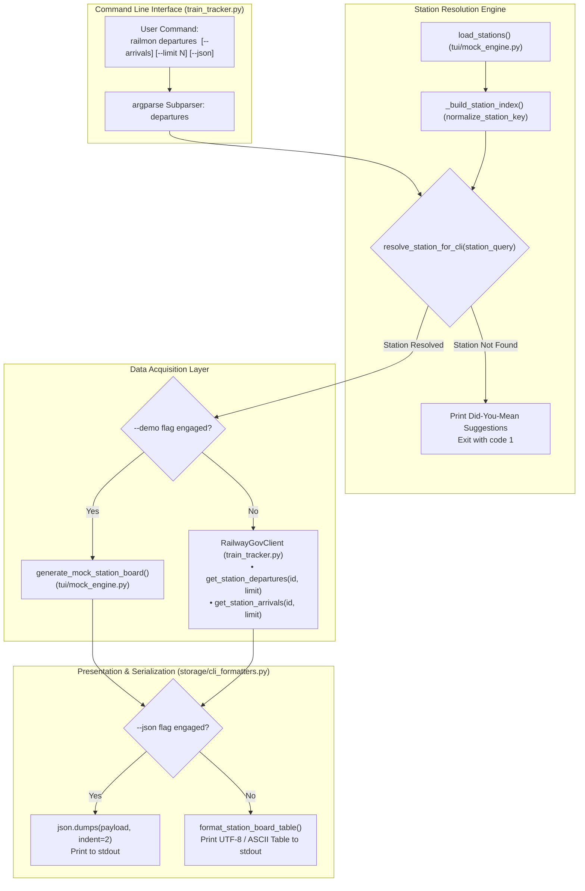
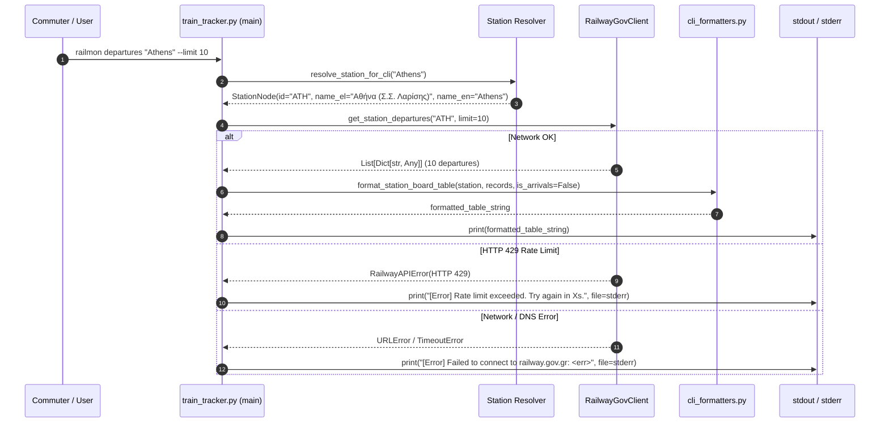

# Implementation Plan — F-6.1: CLI Station Departure & Arrival Boards (`railmon departures`)

> **Reference:** [TUI Feature Enhancements & Expansion Specification (`F-6.1`)](../../architecture/tui-feature-enhancements.md#f-61-cli-station-departure--arrival-boards-railmon-departures), [`docs/architecture/architecture.md`](../../architecture/architecture.md#32-rest-api-endpoints)  
> **Target Modules:** [`../../../train_tracker.py`](../../../train_tracker.py), [`../../../storage/cli_formatters.py`](../../../storage/cli_formatters.py), [`../../../tui/mock_engine.py`](../../../tui/mock_engine.py)  
> **Test Suites:** [`../../../tests/test_cli_departures.py`](../../../tests/test_cli_departures.py), [`../../../tests/test_tracker.py`](../../../tests/test_tracker.py), [`../../../tests/test_cli_formatters.py`](../../../tests/test_cli_formatters.py)  
> **Relevant Rules & Skills:** [`../../../.agents/skills/diagrams-and-documentation/SKILL.md`](../../../.agents/skills/diagrams-and-documentation/SKILL.md), [`../../../.agents/skills/markdown-relative-paths/SKILL.md`](../../../.agents/skills/markdown-relative-paths/SKILL.md), [`../../../.agents/skills/ci-quality-gate/SKILL.md`](../../../.agents/skills/ci-quality-gate/SKILL.md), [`../../../.agents/skills/static-safety-analyzer/SKILL.md`](../../../.agents/skills/static-safety-analyzer/SKILL.md)

---

## 1. Executive Summary & Objective

The Hellenic Railways public REST API exposes rich, live station departure and arrival board endpoints at `/api/public/stations/{stationId}/departures` and `/api/public/stations/{stationId}/arrivals`. Currently, `railmon` exposes a station proximity board inside the interactive Curses TUI ([`F-3.2`](f-3-2-station-departure-board-proximity-inspector-plan.md) via key `m`), but lacks a dedicated, headless CLI subcommand for quick terminal station queries. 

Commuters, station agents, and terminal power users frequently require a fast, lightweight command (e.g. `railmon departures Athens` or `railmon departures SKA --arrivals`) that runs in milliseconds, prints clean tabular timetables directly to stdout, and exits without launching a full-screen Curses dashboard.

This implementation plan delivers **Feature F-6.1: CLI Station Departure & Arrival Boards (`railmon departures`)** across the core CLI dispatcher ([`../../../train_tracker.py`](../../../train_tracker.py)), the zero-dependency terminal table formatter ([`../../../storage/cli_formatters.py`](../../../storage/cli_formatters.py)), and the offline kinematic mock simulator ([`../../../tui/mock_engine.py`](../../../tui/mock_engine.py)) while preserving 100% Python standard-library purity, diacritic-insensitive Greek/Latin station resolution, and 7-bit `--ascii` fallback compatibility.

### Core Objectives
1. **Dedicated CLI Subcommand (`railmon departures` in [`../../../train_tracker.py`](../../../train_tracker.py)):**
   - Add a `departures` subparser accepting a positional `station` query (e.g. `Athens`, `Αθήνα`, `SKA`, `Thessaloniki`, `1001`).
   - Support toggling between departure board (default) and arrival board via `--arrivals` / `-a`.
   - Support row truncation via `--limit` / `-n` (default: `15`, range: `1`–`50`).
   - Support service type filtering via `--type` / `-t` (`all`, `intercity`, `suburban`, `regional`).
   - Support structured JSON output via `--json` for shell scripting, jq piping, and external integrations.
   - Support offline simulated data via `--demo` when no network connection is available.
2. **Robust Multi-Key & Diacritic-Insensitive Station Resolution ([`../../../train_tracker.py`](../../../train_tracker.py)):**
   - Resolve user inputs across multiple canonical and conversational identifiers:
     - Exact station ID (e.g. `PIR`, `ATH`, `SKA`, `SKG`, `LAR`).
     - Numerical station code (e.g. `1001`, `1005`).
     - Greek name with/without tonos/accents (e.g. `Αθήνα`, `αθηνα`, `Σιδηροδρομικό Κέντρο Αχαρνών`).
     - English / Latin transliteration (e.g. `Athens`, `Larissa Station`, `Thessaloniki`).
     - Substring and prefix matching for compound station names (e.g. `Athens` matches `Athens (Larissa Station)`).
   - If a station query is ambiguous or unfound, provide helpful "Did you mean?" suggestions listing the closest matching stations.
3. **Clean Tabular Output Formatter ([`../../../storage/cli_formatters.py`](../../../storage/cli_formatters.py)):**
   - Implement `format_station_board_table()` rendering clean terminal tables:
     - Columns: `TIME`, `TRAIN`, `TYPE`, `DESTINATION` (or `ORIGIN`), `PLATFORM`, `STATUS`, `DELAY`.
     - Delay indicators: `ON TIME` ($0\text{m}$), `DELAYED (+Xm)` ($> 0\text{m}$), `CANCELLED`, `BOARDING`.
     - UTF-8 box characters by default, with pure 7-bit ASCII fallback (`+`, `-`, `|`) when `--ascii` is passed.
4. **Offline Mock Simulation Fallback ([`../../../tui/mock_engine.py`](../../../tui/mock_engine.py)):**
   - Implement `generate_mock_station_board()` synthesizing realistic scheduled departures and arrivals derived from the 48 active stations and route topology in [`../../../tui/data/stations.json`](../../../tui/data/stations.json).

---

## 2. Architecture & Workflow Diagrams

### 2.1 End-to-End CLI Query Flow (Mermaid)



### 2.2 Execution Sequence Diagram (Mermaid)



### 2.3 Visual Pipeline & Console Mockups (ASCII)

```text
+---------------------------------------------------------------------------------------------------+
| UTF-8 Terminal Output: railmon departures Athens                                                  |
+---------------------------------------------------------------------------------------------------+
====================================================================================================
STATION DEPARTURE BOARD: Αθήνα (Σ.Σ. Λαρίσης) / Athens [ATH] (14:30:00)
====================================================================================================
 TIME   TRAIN   TYPE         DESTINATION                     PLAT  STATUS      DELAY
----------------------------------------------------------------------------------------------------
 14:32  IC52    Intercity    Θεσσαλονίκη / Thessaloniki        1   ON TIME       0m
 14:45  1597    Suburban     Χαλκίδα / Chalkida                3   DELAYED      +8m
 15:05  2236    Suburban     Αεροδρόμιο / Airport              2   ON TIME       0m
 15:22  IC54    Intercity    Καλαμπάκα / Kalambaka             1   ON TIME       0m
 15:35  1314    Suburban     Κιάτο / Kiato                     4   ON TIME       0m
 16:00  IC56    Intercity    Θεσσαλονίκη / Thessaloniki        1   BOARDING      0m
====================================================================================================
Total departures: 6 | Updated: 14:30:02 EET | Data source: railway.gov.gr

+---------------------------------------------------------------------------------------------------+
| 7-bit ASCII Terminal Output: railmon departures SKA --arrivals --ascii                            |
+---------------------------------------------------------------------------------------------------+
====================================================================================================
STATION ARRIVAL BOARD: SKA (Acharnes Hub) [SKA] (14:30:00)
====================================================================================================
 TIME   TRAIN   TYPE         ORIGIN                          PLAT  STATUS      DELAY
----------------------------------------------------------------------------------------------------
 14:35  2232    Suburban     Piraeus                           2   ON TIME       0m
 14:41  1597    Suburban     Athens (Larissa Station)          3   DELAYED      +9m
 14:52  2234    Suburban     Ano Liosia                        1   ON TIME       0m
 15:08  IC52    Intercity    Athens (Larissa Station)          4   ON TIME       0m
====================================================================================================
Total arrivals: 4 | Updated: 14:30:02 EET | Data source: railway.gov.gr
```

---

## 3. Data Schema & Model Specifications

### 3.1 Upstream API Payloads (`railway.gov.gr`)

The `/api/public/stations/{id}/departures` and `/arrivals` endpoints return JSON dictionaries containing an array of timetable card records:

```json
{
  "stationId": "ATH",
  "stationName": "Αθήνα",
  "departures": [
    {
      "trainNumber": "IC52",
      "serviceType": "Intercity",
      "scheduledTime": "14:32",
      "estimatedTime": "14:32",
      "destination": {
        "id": "SKG",
        "nameGreek": "Θεσσαλονίκη",
        "nameEnglish": "Thessaloniki"
      },
      "origin": {
        "id": "ATH",
        "nameGreek": "Αθήνα",
        "nameEnglish": "Athens"
      },
      "platform": "1",
      "delayMinutes": 0,
      "status": "ON_TIME"
    }
  ]
}
```

### 3.2 Canonical Internal DTO (`StationBoardItem`)

To guarantee resilient handling across differing API response structures and mock simulation outputs, define an internal typed dictionary in [`../../../train_tracker.py`](../../../train_tracker.py):

```python
class StationBoardItem(TypedDict, total=False):
    """Normalized departure or arrival board record."""
    train_number: str
    service_type: str
    scheduled_time: str
    estimated_time: str
    target_station: str  # Destination for departures, Origin for arrivals
    platform: str
    delay_minutes: int
    status: str
```

---

## 4. Detailed Component Design & Implementation Steps

### 4.1 CLI Argument Parser Subcommand (`train_tracker.py`)

In [`build_parser()`](../../../train_tracker.py#L923-L950), add the `departures` subparser:

```python
# 5. departures
p_dep = subparsers.add_parser(
    "departures",
    help="Query live station departure and arrival boards.",
    description="Fetch and display upcoming departures or arrivals for any Greek railway station.",
)
p_dep.add_argument(
    "station",
    type=str,
    help="Station name, Latin alias, numerical code, or 3-letter ID (e.g. 'Athens', 'Αθήνα', 'SKA', '1001').",
)
p_dep.add_argument(
    "-a",
    "--arrivals",
    action="store_true",
    help="Display upcoming station arrivals instead of departures.",
)
p_dep.add_argument(
    "-n",
    "--limit",
    type=int,
    default=15,
    help="Maximum number of train movements to display (default: 15, range: 1-50).",
)
p_dep.add_argument(
    "-t",
    "--type",
    type=str,
    default="all",
    choices=["all", "intercity", "suburban", "regional", "freight"],
    help="Filter departures by service type (default: 'all').",
)
p_dep.add_argument(
    "--json",
    action="store_true",
    help="Output structured JSON to stdout instead of tabular text.",
)
p_dep.add_argument(
    "--demo",
    action="store_true",
    default=False,
    help="Run in offline mock mode with synthetic station timetables.",
)
```

---

### 4.2 Multi-Key & Diacritic-Insensitive Station Resolver

Implement `resolve_station_for_cli()` in [`../../../train_tracker.py`](../../../train_tracker.py) (reusing [`normalize_station_key()`](../../../tui/renderer.py#L568) and [`load_stations()`](../../../tui/mock_engine.py#L316)):

```python
def resolve_station_for_cli(
    query: str,
    stations: Optional[Dict[str, StationNode]] = None,
) -> Tuple[Optional[StationNode], List[str]]:
    """Resolve a user-provided station query to a canonical StationNode.
    
    Resolution order:
    1. Exact station ID match (case-insensitive, e.g. 'ATH', 'ska').
    2. Exact station code match (e.g. '1001', '1005').
    3. Normalized Greek or Latin exact match (e.g. 'αθηνα' -> 'ATH').
    4. Substring / Prefix match across Greek and Latin names.
    
    Returns:
        Tuple of (matched_node, suggestions_list). If matched_node is None,
        suggestions_list contains the closest matching station names.
    """
```

#### Suggestion Logic on Station Miss:
If `matched_node is None`, query all available stations with prefix or Levenshtein-like character overlap and return up to 5 suggested station names:
```text
[Error] Unknown station: 'Athesn'
Did you mean:
  • Athens (Larissa Station) [ATH]
  • Afidnes [AFI]
  • Agioi Anargyroi [AGI]
```

---

### 4.3 Tabular Terminal Table Formatter (`storage/cli_formatters.py`)

Add `format_station_board_table()` to [`../../../storage/cli_formatters.py`](../../../storage/cli_formatters.py):

```python
def format_station_board_table(
    station: StationNode,
    records: List[Dict[str, Any]],
    is_arrivals: bool = False,
    is_ascii: bool = False,
    service_type_filter: str = "all",
) -> str:
    """Format station departure or arrival board records into a clean terminal table.
    
    Args:
        station: Target StationNode.
        records: List of raw API or mock departure/arrival dictionaries.
        is_arrivals: True if arrival board, False if departure board.
        is_ascii: True if 7-bit ASCII characters should be used.
        service_type_filter: Service type filter applied ('all', 'intercity', etc.).
        
    Returns:
        Formatted multi-line text table string.
    """
```

#### Column Layout & Responsive Widths:
| Column | Width | Alignment | Description |
| :--- | :--- | :--- | :--- |
| `TIME` | 7 | Left | Scheduled departure or arrival time (`14:32`) |
| `TRAIN` | 7 | Left | Commercial train number (`IC52`, `1597`) |
| `TYPE` | 12 | Left | Service type (`Intercity`, `Suburban`, `Regional`) |
| `DESTINATION` / `ORIGIN` | 32 | Left | Target terminal station in Greek / English |
| `PLAT` | 5 | Center | Departure or arrival platform track (`1`, `2`, `3`) |
| `STATUS` | 11 | Left | `ON TIME`, `DELAYED`, `BOARDING`, `CANCELLED` |
| `DELAY` | 8 | Right | Delay in minutes (`0m`, `+8m`, `+45m`) |

---

### 4.4 Dispatcher & Command Execution Handler (`train_tracker.py`)

Implement `run_departures_mode(args: argparse.Namespace) -> int` in [`../../../train_tracker.py`](../../../train_tracker.py):

1. **Resolve Station:**
   Call `resolve_station_for_cli(args.station)`. If unresolvable, print error and suggestions to `sys.stderr` and return exit code `1`.
2. **Fetch Timetable Data:**
   - If `args.demo` is `True`: call `generate_mock_station_board(station, is_arrivals=args.arrivals, limit=args.limit)`.
   - If live: instantiate `RailwayGovClient()`, call `get_station_arrivals()` or `get_station_departures()`.
   - Catch `urllib.error.HTTPError`, `RailwayAPIError`, `TimeoutError`, and `OSError` with clear error messages.
3. **Filter by Service Type:**
   If `args.type != "all"`, filter items where `item["serviceType"].lower() == args.type.lower()`.
4. **Format & Output:**
   - If `args.json`: serialize to JSON via `json.dumps({"station": ..., "board": ..., "items": filtered_items}, indent=2, ensure_ascii=args.ascii)` and write to `sys.stdout`.
   - Otherwise: call `format_station_board_table()`, write to `sys.stdout`.
5. Return `0` on clean execution.

---

### 4.5 Offline Mock Simulation Generator (`tui/mock_engine.py`)

In [`../../../tui/mock_engine.py`](../../../tui/mock_engine.py), implement `generate_mock_station_board()`:
- Inspect `MockTelemetryEngine.trains` currently active on the network.
- Find trains whose route traverses or terminates at the selected station.
- If fewer than `limit` trains are found, synthesize deterministic timetable entries based on current local time and Greek rail schedules (e.g. hourly IC services and half-hourly Suburban services).
- Calculate simulated platform numbers (`1`–`4`) and delays ($0\text{--}15\text{ min}$) for realistic simulation fidelity.

---

## 5. Verification & Test Suite Plan

### 5.1 Unit Tests (`tests/test_cli_departures.py`)

Create a dedicated automated test suite in [`../../../tests/test_cli_departures.py`](../../../tests/test_cli_departures.py) with 100% branch coverage:

1. **TC-DEP-01: Greek Diacritic-Insensitive Station Resolution:**
   - Verify `"αθηνα"`, `"Αθήνα"`, `"ΑΘΗΝΑ"`, `"Athens"`, `"Σ.Σ. Λαρίσης"`, and `"ATH"` all resolve to the same `ATH` station node.
2. **TC-DEP-02: Unknown Station Suggestions:**
   - Verify `"Thessalonk"` returns `None` with `"Thessaloniki"` in suggestions.
3. **TC-DEP-03: Departures Table Formatting:**
   - Verify output contains expected column headers, train numbers, and delay badges.
4. **TC-DEP-04: Arrivals Mode Toggle (`--arrivals`):**
   - Verify column header switches from `DESTINATION` to `ORIGIN` and calls `get_station_arrivals()`.
5. **TC-DEP-05: Pure ASCII Fallback (`--ascii`):**
   - Verify output contains zero characters outside `ord(c) < 128` when `--ascii` is enabled.
6. **TC-DEP-06: Structured JSON Output (`--json`):**
   - Verify stdout parses cleanly via `json.loads()` and conforms to expected JSON schema.
7. **TC-DEP-07: Service Type Filtering (`--type`):**
   - Verify passing `--type intercity` filters out suburban and regional trains.
8. **TC-DEP-08: HTTP 429 Rate-Limit & Network Resilience:**
   - Mock HTTP 429 and network socket timeouts, confirming graceful error exits without traceback crash.
9. **TC-DEP-09: Offline Demo Mode (`--demo`):**
   - Verify `railmon departures SKA --demo` executes cleanly with synthetic data without network access.

---

## 6. Implementation Checklist & Deliverables

- [x] **Step 1:** Add `departures` subparser to `build_parser()` in [`../../../train_tracker.py`](../../../train_tracker.py).
- [x] **Step 2:** Implement `resolve_station_for_cli()` with Greek diacritic stripping and suggestion engine in [`../../../tui/mock_engine.py`](../../../tui/mock_engine.py) / [`../../../train_tracker.py`](../../../train_tracker.py).
- [x] **Step 3:** Implement `format_station_board_table()` in [`../../../storage/cli_formatters.py`](../../../storage/cli_formatters.py).
- [x] **Step 4:** Implement `generate_mock_station_board()` in [`../../../tui/mock_engine.py`](../../../tui/mock_engine.py).
- [x] **Step 5:** Implement `run_departures_mode()` in [`../../../train_tracker.py`](../../../train_tracker.py) and wire it into `main()`.
- [x] **Step 6:** Author automated test suite in [`../../../tests/test_cli_departures.py`](../../../tests/test_cli_departures.py).
- [x] **Step 7:** Run CI quality gate (`python -m unittest discover tests`) and verify MISRA/AUTOSAR AST safety compliance.
- [x] **Step 8:** Update `README.md` and feature enhancement docs linking the completed plan.
