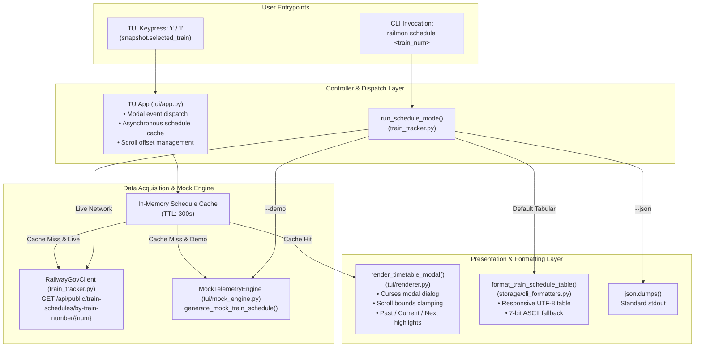
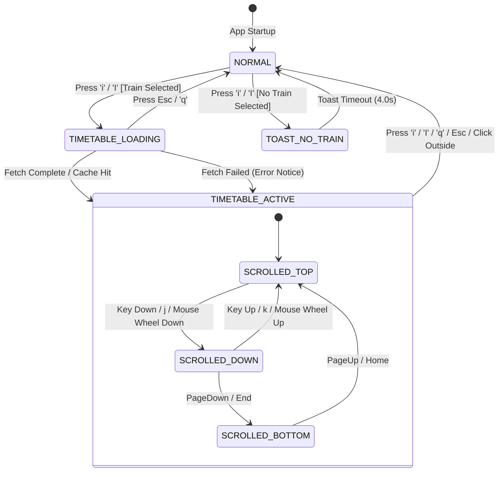

# Implementation Plan — F-6.2: Train Timetable & Intermediate Stop Inspector (`i` / `I` / CLI)

> **Reference:** [TUI Feature Enhancements & Expansion Specification (`F-6.2`)](../../architecture/tui-feature-enhancements.md#f-62-train-timetable--intermediate-stop-inspector-i--i--cli), [`docs/architecture/architecture.md`](../../architecture/architecture.md#32-rest-api-endpoints)  
> **Target Modules:** [`../../../train_tracker.py`](../../../train_tracker.py), [`../../../storage/cli_formatters.py`](../../../storage/cli_formatters.py), [`../../../tui/mock_engine.py`](../../../tui/mock_engine.py), [`../../../tui/state.py`](../../../tui/state.py), [`../../../tui/app.py`](../../../tui/app.py), [`../../../tui/renderer.py`](../../../tui/renderer.py)  
> **Test Suites:** [`../../../tests/test_cli_schedule.py`](../../../tests/test_cli_schedule.py), [`../../../tests/test_tui_timetable.py`](../../../tests/test_tui_timetable.py), [`../../../tests/test_cli_formatters.py`](../../../tests/test_cli_formatters.py)  
> **Relevant Rules & Skills:** [`../../../.agents/skills/diagrams-and-documentation/SKILL.md`](../../../.agents/skills/diagrams-and-documentation/SKILL.md), [`../../../.agents/skills/markdown-relative-paths/SKILL.md`](../../../.agents/skills/markdown-relative-paths/SKILL.md), [`../../../.agents/skills/ci-quality-gate/SKILL.md`](../../../.agents/skills/ci-quality-gate/SKILL.md), [`../../../.agents/skills/static-safety-analyzer/SKILL.md`](../../../.agents/skills/static-safety-analyzer/SKILL.md)

---

## 1. Executive Summary & Objective

In Greek passenger railway operations (`railway.gov.gr`), every operating commercial train (e.g. Intercity `IC 52`, Suburban Proastiakos `1597`, Regional `884`) runs against a scheduled itinerary comprising origin, intermediate calling points, planned arrival and departure times, allocated platform tracks, and dynamic delays. While `railmon` currently renders live geographic positions, spatial breadcrumbs, speed sparklines, and station departure boards ([`F-6.1`](./f-6-1-cli-station-departure-and-arrival-boards-plan.md)), operators and commuters cannot inspect the complete forward and past itinerary of a selected train within the interactive Curses dashboard or query an individual train schedule directly from the terminal shell.

This implementation plan delivers **Feature F-6.2: Train Timetable & Intermediate Stop Inspector (`i` / `I` / CLI)** across both headless CLI automation and the interactive Curses TUI:

1. **In-TUI Interactive Modal (`i` / `I`):**
   - Pressing `i` or `I` on any selected train in the Curses dashboard opens an interactive, scrollable modal window displaying the full stop timetable retrieved from `/api/public/train-schedules/by-train-number/{trainNumber}` or synthesized by the offline mock simulator.
   - Distinct visual state indicators: passed stations (checked/dimmed), active/next calling point (bright yellow/cyan arrow marker `►`), and upcoming stations.
   - Interactive vertical scrolling (`▲`/`▼`, `j`/`k`, `PageUp`/`PageDown`, `Home`/`End`, mouse wheel) with viewport clipping.
   - Non-blocking asynchronous network fetching to protect the 15–20 FPS curses rendering thread from socket latency.
2. **Dedicated CLI Subcommand (`railmon schedule <train_number>`):**
   - Direct command-line inspection of any commercial train number (e.g. `railmon schedule 1597` or `railmon schedule "IC 52"`).
   - Rich tabular UTF-8 output with clean 7-bit `--ascii` fallback for headless servers and serial teletypes.
   - Structured `--json` serialization for shell scripting, Unix pipelines, and automated monitoring integrations.
   - Offline `--demo` simulation mode reproducing high-fidelity schedules across Greek rail corridors.
3. **Safety & Zero-Dependency Purity:**
   - 100% Python standard-library implementation (`curses`, `urllib`, `argparse`, `dataclasses`, `json`, `difflib`).
   - Strict adherence to MISRA C++, AUTOSAR C++14, and NASA JPL Power-of-10 static safety rules (cyclomatic complexity $< 25$, bounded allocations, defensive None-guards).

---

## 2. Architecture & Workflow Diagrams

### 2.1 End-to-End System Architecture (Mermaid)



### 2.2 TUI Modal State Machine & Input Lifecycle (Mermaid)



### 2.3 Visual Terminal Mockups (ASCII)

#### A. Interactive Curses Modal Window (`tui/renderer.py`)

```text
+---------------------------------------------------------------------------------------------------+
| RAILMON | HELLENIC RAILWAYS (railway.gov.gr) | View: PATHE Mainline | Active: 14 | Delayed: 3 [●] |
+--------------------------------------------------------------------+------------------------------+
| [Map Viewport: 39.80°N, 22.50°E | Zoom: 1.5x | Trails: ALL]        | [ACTIVE TRAINS (14) | Sort:▼]|
|                                                                    |  #   TRAIN  TYPE  SPD▼  DLY  |
|   +----------------------------------------------------------------------------+ 1599   IC    142   +9m  |
|   | TIMETABLE & ITINERARY: TRAIN 1597 (Athens -> Chalkida)                     | 1597   IC    118   +4m  |
|   +----------------------------------------------------------------------------+ 2232   PR    114    0m  |
|   | ST  STATION             SCHED ARR  ACTUAL ARR  SCHED DEP  ACTUAL DEP PLAT  | 1314   PR     92   +1m  |
|   | [X] Athens (Larissa)    --:--      --:--       14:28      14:36       3    | 2236   PR     86    0m  |
|   | [X] Agioi Anargyroi     14:34      14:42       14:35      14:43       2    | 1598   IC      0    0m  |
|   | [X] SKA Hub             14:41      14:50       14:42      14:51       4    +----------------------+
|   | ►   Acharnes            14:46      14:55       14:47      --:--       1    | [SELECTED TELEMETRY] |
|   |     Dekeleia            14:51      --:--       14:52      --:--       1    | Train No: 1597 (IC)  |
|   |     Agios Stefanos      14:58      --:--       14:59      --:--       2    | Delay:    +9 min     |
|   |     Afidnes             15:05      --:--       15:06      --:--       2    | Speed:    118.0 km/h |
|   |     Oinoi               15:15      --:--       15:17      --:--       2    +----------------------+
|   |     Chalkida            15:42      --:--       --:--      --:--       1    | [Next: Acharnes]     |
|   +----------------------------------------------------------------------------+ Dist:  2.1 km        |
|   | [Esc / i] Close Itinerary Modal    [▲ / ▼, j / k] Scroll Stops (4/18)      | ETA:   ~2 min        |
|   +----------------------------------------------------------------------------+----------------------+
+---------------------------------------------------------------------------------------------------+
| [q]Quit [h/j/k/l]Pan [+/-]Zoom [s]Sort [b]Trails [e]Export [m]Stations [i]Timetable [f]Follow [?]Help|
+---------------------------------------------------------------------------------------------------+
```

#### B. Headless CLI Tabular Output (`railmon schedule 1597`)

```text
====================================================================================================
TRAIN TIMETABLE & ITINERARY: TRAIN 1597 (Athens / Αθήνα -> Chalkida / Χαλκίδα)
====================================================================================================
 ST  STATION                        SCHED ARR  ACTUAL ARR  SCHED DEP  ACTUAL DEP  PLAT  STATUS    DELAY
----------------------------------------------------------------------------------------------------
[X]  Athens (Larissa Station)         --:--      --:--       14:28      14:36       3   DEPARTED   +8m
[X]  Agioi Anargyroi                  14:34      14:42       14:35      14:43       2   DEPARTED   +8m
[X]  SKA (Acharnes Hub)               14:41      14:50       14:42      14:51       4   DEPARTED   +9m
 ►   Acharnes                         14:46      14:55       14:47      --:--       1   APPROACH   +9m
     Dekeleia                         14:51      --:--       14:52      --:--       1   SCHEDULED  ---
     Agios Stefanos                   14:58      --:--       14:59      --:--       2   SCHEDULED  ---
     Afidnes                          15:05      --:--       15:06      --:--       2   SCHEDULED  ---
     Polydendri                       15:10      --:--       15:10      --:--       1   SCHEDULED  ---
     Sfendali                         15:14      --:--       15:15      --:--       1   SCHEDULED  ---
     Avlonas                          15:21      --:--       15:22      --:--       2   SCHEDULED  ---
     Agios Thomas                     15:26      --:--       15:27      --:--       1   SCHEDULED  ---
     Oinoi                            15:32      --:--       15:34      --:--       2   SCHEDULED  ---
     Dilesi                           15:39      --:--       15:40      --:--       1   SCHEDULED  ---
     Agios Georgios                   15:44      --:--       15:45      --:--       1   SCHEDULED  ---
     Kalochori-Panteichi              15:49      --:--       15:50      --:--       1   SCHEDULED  ---
     Avlida                           15:54      --:--       15:55      --:--       2   SCHEDULED  ---
     Chalkida                         16:04      --:--       --:--      --:--       1   SCHEDULED  ---
====================================================================================================
Total Stops: 17 | Passed: 3 | Current Calling Point: Acharnes | Overall Delay: +9m | Source: railway.gov.gr
```

---

## 3. Data Schema & Model Specifications

### 3.1 Upstream REST API Payload (`railway.gov.gr`)

The `/api/public/train-schedules/by-train-number/{trainNumber}` endpoint returns a JSON payload containing train header metadata and an ordered array of intermediate calling points:

```json
{
  "scheduleId": "sch-20261121-1597",
  "trainNumber": "1597",
  "trainType": "Suburban",
  "serviceType": "Επιβατικά",
  "origin": {
    "id": "ATH",
    "nameGreek": "Αθήνα (Σ.Σ. Λαρίσης)",
    "nameEnglish": "Athens"
  },
  "destination": {
    "id": "CHAL",
    "nameGreek": "Χαλκίδα",
    "nameEnglish": "Chalkida"
  },
  "corridor": "PROASTIAKOS",
  "stops": [
    {
      "stopSequence": 1,
      "stationId": "ATH",
      "stationNameGreek": "Αθήνα (Σ.Σ. Λαρίσης)",
      "stationNameEnglish": "Athens (Larissa Station)",
      "scheduledArrival": null,
      "actualArrival": null,
      "scheduledDeparture": "14:28:00",
      "actualDeparture": "14:36:12",
      "platform": "3",
      "delayMinutes": 8,
      "status": "DEPARTED"
    },
    {
      "stopSequence": 2,
      "stationId": "AGI",
      "stationNameGreek": "Άγιοι Ανάργυροι",
      "stationNameEnglish": "Agioi Anargyroi",
      "scheduledArrival": "14:34:00",
      "actualArrival": "14:42:15",
      "scheduledDeparture": "14:35:00",
      "actualDeparture": "14:43:00",
      "platform": "2",
      "delayMinutes": 8,
      "status": "DEPARTED"
    },
    {
      "stopSequence": 4,
      "stationId": "ACH",
      "stationNameGreek": "Αχαρνές",
      "stationNameEnglish": "Acharnes",
      "scheduledArrival": "14:46:00",
      "actualArrival": "14:55:00",
      "scheduledDeparture": "14:47:00",
      "actualDeparture": null,
      "platform": "1",
      "delayMinutes": 9,
      "status": "APPROACH"
    }
  ]
}
```

### 3.2 Canonical Internal DTO Models

To normalize across live API responses, cached database tables ([`storage/models.py`](../../../storage/models.py)), and synthetic simulation outputs, define canonical immutable dataclasses in [`tui/state.py`](../../../tui/state.py):

```python
@dataclass(frozen=True)
class TimetableStopDTO:
    """Normalized intermediate timetable stop record."""
    stop_sequence: int
    station_id: str
    station_name_el: str
    station_name_en: str
    scheduled_arrival: Optional[str] = None      # "HH:MM"
    actual_arrival: Optional[str] = None         # "HH:MM"
    scheduled_departure: Optional[str] = None    # "HH:MM"
    actual_departure: Optional[str] = None       # "HH:MM"
    platform: Optional[str] = None               # e.g. "1", "2"
    delay_minutes: int = 0
    status: str = "SCHEDULED"                    # "DEPARTED", "APPROACH", "SCHEDULED"
    is_passed: bool = False
    is_current: bool = False


@dataclass(frozen=True)
class TrainTimetableDTO:
    """Complete scheduled itinerary for a train service."""
    train_number: str
    schedule_id: str
    train_type: str
    service_type: str
    origin_name: str
    destination_name: str
    corridor: str
    stops: Tuple[TimetableStopDTO, ...]
    current_delay_min: int = 0
    fetched_at: float = 0.0
```

---

## 4. Detailed Component Design & Implementation Steps

### 4.1 CLI Argument Parser Subcommand (`train_tracker.py`)

In [`build_parser()`](../../../train_tracker.py), introduce the `schedule` subcommand:

```python
# schedule subparser
p_sched = subparsers.add_parser(
    "schedule",
    help="Inspect full timetable and intermediate calling stops for a train.",
    description="Fetch and display the intermediate calling points, platform tracks, scheduled, and actual times for any commercial train.",
)
p_sched.add_argument(
    "train_number",
    type=str,
    help="Commercial train number (e.g. '1597', 'IC52', 'IC 52', '2232').",
)
p_sched.add_argument(
    "--demo",
    action="store_true",
    default=False,
    help="Run in offline mock mode with synthetic train timetables.",
)
p_sched.add_argument(
    "--json",
    action="store_true",
    default=False,
    help="Output structured JSON to stdout instead of tabular text.",
)
p_sched.add_argument(
    "--ascii",
    action="store_true",
    default=False,
    help="Enforce 7-bit ASCII characters for table borders and status badges.",
)
```

### 4.2 Terminal Table Formatter (`storage/cli_formatters.py`)

Implement `format_train_schedule_table()` adhering to MISRA/AUTOSAR limits (modular helper functions for row formatting):

```python
def format_train_schedule_table(
    timetable: Any,
    is_ascii: bool = False,
    data_source: str = "railway.gov.gr",
) -> str:
    """Format full train timetable and intermediate calling stops into a clean CLI table.
    
    Args:
        timetable: TrainTimetableDTO or dictionary containing itinerary stops.
        is_ascii: True if 7-bit ASCII characters should be enforced.
        data_source: Attribution label for table footer.
        
    Returns:
        Formatted multi-line text table string.
    """
```

#### Table Columns and Layout:
| Column | Width | Alignment | Content |
| :--- | :--- | :--- | :--- |
| `ST` | 4 | Center | `[X]` (Passed), `►` / `>` (Current), ` ` (Upcoming) |
| `STATION` | 32 | Left | Station Name (EL / EN bilingual or ASCII-only) |
| `SCHED ARR` | 10 | Center | Planned arrival time (`14:34` or `--:--`) |
| `ACTUAL ARR` | 11 | Center | Actual arrival time (`14:42` or `--:--`) |
| `SCHED DEP` | 10 | Center | Planned departure time (`14:35` or `--:--`) |
| `ACTUAL DEP` | 11 | Center | Actual departure time (`14:43` or `--:--`) |
| `PLAT` | 5 | Center | Platform track assignment (`1`–`6` or `-`) |
| `STATUS` | 10 | Left | `DEPARTED`, `APPROACH`, `SCHEDULED` |
| `DELAY` | 7 | Right | `0m`, `+8m`, `---` |

### 4.3 Offline Mock Timetable Synthesis (`tui/mock_engine.py`)

In [`tui/mock_engine.py`](../../../tui/mock_engine.py), implement `generate_mock_train_schedule()`:
1. Locate the `SimulatedTrain` matching `train_number` from `MockTelemetryEngine`.
2. Retrieve the track polyline and corridor stations associated with the train's route.
3. For major routes (e.g. PATHE Mainline, Suburban Airport–Kiato, Chalkida branch), generate the complete sequence of stations.
4. Calculate timestamps:
   - Base service start time anchor.
   - Cumulative travel time along polyline using train cruise speed and acceleration/deceleration parameters.
   - Allocate 1–2 minute dwell times per intermediate stop.
5. Derive status relative to train's current distance along the track:
   - Stops behind the current train distance are marked `is_passed=True` (`status="DEPARTED"`).
   - The immediate next station is marked `is_current=True` (`status="APPROACH"`).
   - Subsequent stations are marked `status="SCHEDULED"`.
   - Apply the train's active `delay_minutes` across arrival and departure times.

### 4.4 Thread-Safe In-TUI Schedule Cache & Non-Blocking Fetching (`tui/state.py` & `tui/app.py`)

To prevent blocking the curses render loop during network latency or HTTP timeouts:
1. **Extend `InputMode` in [`tui/state.py`](../../../tui/state.py):**
   ```python
   class InputMode(Enum):
       NORMAL = auto()
       SEARCH = auto()
       HELP = auto()
       TIMETABLE = auto()  # Intermediate Stop & Timetable Modal Overlay
   ```
2. **Asynchronous Background Schedule Fetcher in [`tui/app.py`](../../../tui/app.py):**
   - Maintain `_timetable_cache: Dict[str, Tuple[float, TrainTimetableDTO]]` with a 300-second TTL.
   - When `i` is pressed on a selected train, check `_timetable_cache`.
   - If not cached and in live mode, spawn a lightweight daemon worker thread (`threading.Thread`) to execute `client.get_schedule_by_train_number(train_number)` and update cache upon arrival.
   - Display transient `[Loading timetable for Train {train_number}...]` banner while waiting.

### 4.5 Curses Timetable Modal Overlay Renderer (`tui/renderer.py`)

Implement `render_timetable_modal()` in [`tui/renderer.py`](../../../tui/renderer.py):
1. **Geometry & Bounds Calculation:**
   - Box width: `box_w = min(82, max(52, width - 4))`
   - Box height: `box_h = min(24, max(12, height - 2))`
   - Centered on screen: `start_y = max(1, (height - box_h) // 2)`, `start_x = max(1, (width - box_w) // 2)`
2. **Scroll Offset & Viewport Slicing:**
   - Available rows for stops: `visible_rows = box_h - 6`
   - Clamp `scroll_offset`: `0 <= scroll_offset <= max(0, len(stops) - visible_rows)`
   - Auto-scroll: When modal first opens, auto-adjust `scroll_offset` so that the current calling point (`is_current=True`) is vertically centered in the window.
3. **Visual Highlights & Color Pairs:**
   - Border: `PAIR_BORDER` (`curses.A_BOLD`)
   - Header: `PAIR_HEADER` (`curses.A_BOLD`)
   - Passed Stop: Dim text `curses.A_DIM` with marker `[X]`
   - Current Stop: Bright yellow/cyan `PAIR_TRAIN_WARN` with bold arrow `►`
   - Future Stops: Normal `PAIR_DEFAULT`
   - Delays: Green if $\le 0\text{m}$, yellow if $1\text{--}5\text{m}$, red alert if $> 5\text{m}$
4. **Footer Controls:**
   `[Esc / i] Close    [▲ / ▼, j / k] Scroll (Stop X/Y)    [Home/End] Top/Bottom`

### 4.6 Keyboard & Mouse Interaction Handling (`tui/app.py`)

In `_handle_normal_mode_key()` and `_handle_mouse_event()` in [`tui/app.py`](../../../tui/app.py):
1. **Toggling Open/Close:**
   - Pressing `i` or `I` in `InputMode.NORMAL`:
     - If no `snapshot.selected_train`: set toast notification `[Select a train first to inspect timetable]`.
     - Else: set `input_mode = InputMode.TIMETABLE`, reset scroll offset, trigger fetch.
   - Pressing `i`, `I`, `q`, or `Esc` in `InputMode.TIMETABLE`:
     - Set `input_mode = InputMode.NORMAL`.
2. **Vertical Scrolling:**
   - `KEY_UP`, `k`: decrement `timetable_scroll_offset` by 1.
   - `KEY_DOWN`, `j`: increment `timetable_scroll_offset` by 1.
   - `KEY_PPAGE` (PageUp): decrement by `visible_rows`.
   - `KEY_NPAGE` (PageDown): increment by `visible_rows`.
   - `KEY_HOME`: jump to 0.
   - `KEY_END`: jump to `max(0, len(stops) - visible_rows)`.
   - Mouse wheel up / down inside modal window: decrement / increment scroll offset by 2.
   - Left-click outside modal window bounding box: dismiss modal.

### 4.7 CLI Dispatcher & Error Resilience (`train_tracker.py`)

Implement `run_schedule_mode(args: argparse.Namespace) -> int` in [`train_tracker.py`](../../../train_tracker.py):
1. **Train Number Normalization:**
   - Strip leading/trailing whitespace, uppercase train strings (e.g. `"ic 52"` -> `"IC52"` or `"IC 52"`).
2. **Data Acquisition:**
   - If `args.demo`: call `generate_mock_train_schedule(train_number)`.
   - If live: call `client.get_schedule_by_train_number(train_number)`.
   - Handle exceptions gracefully (`urllib.error.HTTPError`, `RailwayAPIError`, `TimeoutError`, `OSError`).
   - If train number is not found (404 or empty schedule):
     - Query active live or mock roster for similar train numbers using `difflib.get_close_matches()`.
     - Output clear error message with suggestions to `stderr`:
       ```text
       [Error] Train timetable not found for '159'.
       Did you mean:
         • 1597
         • 1598
         • 1599
         • IC52
       ```
3. **Serialization & Presentation:**
   - If `args.json`: serialize to JSON via `json.dumps()` with indented formatting.
   - Else: call `format_train_schedule_table()` and write to `stdout`.

---

## 5. MISRA C++, AUTOSAR & NASA JPL Safety Analysis

To preserve high-assurance certification across the codebase:

1. **Rule 1: Cyclomatic Complexity Under 25:**
   - Decompose `render_timetable_modal()` into `_draw_modal_frame()`, `_render_timetable_headers()`, `_render_stop_row()`, and `_render_modal_footer()`.
   - Decompose CLI formatting in `storage/cli_formatters.py` into modular row string extractors.
2. **Rule 2: Coordinate & Viewport Boundary Clamping:**
   - All curses string writing must pass through `safe_addstr()`, explicitly clamping `y` and `x` within `(0, term_height - 1)` and `(0, term_width - 1)` to prevent curses edge-clipping exceptions (`curses.error: addwstr() returned ERR`).
3. **Rule 3: Non-Blocking Event Loop (Thread Separation):**
   - Network socket operations (`urllib.request.urlopen`) must never execute synchronously within the curses rendering thread.
   - Timetable queries initiated in TUI mode must run on worker threads or retrieve from an in-memory TTL cache.
4. **Rule 4: Zero External Runtime Dependencies:**
   - All JSON parsing, terminal formatting, argument handling, and mathematical clamping must strictly use Python standard library modules (`json`, `dataclasses`, `argparse`, `difflib`, `math`).
5. **Rule 5: 7-bit ASCII Purity Verification:**
   - When `--ascii` is passed, table borders must use `+`, `-`, `|`, and status symbols must fall back from `►`/`✓` to `>`/`[X]`. Zero characters with `ord(c) >= 128` are permitted.

---

## 6. Comprehensive Verification & Test Suite Plan

### 6.1 Automated Test Suites

Author dedicated test suites in [`tests/test_cli_schedule.py`](../../../tests/test_cli_schedule.py) and [`tests/test_tui_timetable.py`](../../../tests/test_tui_timetable.py):

#### CLI Schedule Test Cases (`tests/test_cli_schedule.py`):
1. **TC-SCH-01: Train Number Normalization:**
   - Test resolving `"1597"`, `"ic52"`, `"IC 52"`, `"  2232  "` to canonical train records.
2. **TC-SCH-02: Offline Mock Schedule Generation (`--demo`):**
   - Verify `railmon schedule 1597 --demo` produces a valid timetable containing all intermediate stops from Athens to Chalkida.
3. **TC-SCH-03: Tabular Output Formatting:**
   - Verify table output contains expected columns (`ST`, `STATION`, `SCHED ARR`, `ACTUAL ARR`, `SCHED DEP`, `ACTUAL DEP`, `PLAT`, `STATUS`, `DELAY`).
4. **TC-SCH-04: 7-bit ASCII Fallback (`--ascii`):**
   - Assert all characters in output satisfy `all(ord(c) < 128 for c in output)`.
5. **TC-SCH-05: Structured JSON Output (`--json`):**
   - Validate stdout parses cleanly with `json.loads()` and matches schema.
6. **TC-SCH-06: Unfound Train Suggestions on Miss:**
   - Query an invalid train number `"99999"` or `"159"`, confirming exit code 1 and "Did you mean" suggestions on `stderr`.
7. **TC-SCH-07: Upstream Network Error & HTTP 429 Resilience:**
   - Mock HTTP 429, 500, and network timeout errors, confirming graceful exit without uncaught tracebacks.

#### TUI Timetable Modal Test Cases (`tests/test_tui_timetable.py`):
1. **TC-TUI-SCH-01: Modal Toggle with Selected Train:**
   - Simulate keypress `ord("i")` with `snapshot.selected_train` set; verify `app.input_mode` transitions to `InputMode.TIMETABLE`.
2. **TC-TUI-SCH-02: Modal Toggle without Selected Train:**
   - Simulate keypress `ord("i")` when no train is selected; verify toast notification is raised and `input_mode` remains `NORMAL`.
3. **TC-TUI-SCH-03: Vertical Scroll Navigation:**
   - Test `KEY_DOWN` / `KEY_UP` increments and decrements `timetable_scroll_offset` within valid bounds `[0, max_offset]`.
4. **TC-TUI-SCH-04: Jump Keys Navigation (`Home` / `End` / `PageUp` / `PageDown`):**
   - Verify `Home` sets offset to 0 and `End` sets offset to maximum.
5. **TC-TUI-SCH-05: Mouse Interaction:**
   - Verify mouse scroll up/down alters scroll offset and clicking outside the modal box dismisses it.
6. **TC-TUI-SCH-06: Modal Renderer Visual Layout:**
   - Mock curses window and invoke `render_timetable_modal()`; verify safe rendering without `curses.error` across standard (80x24), compact (60x15), and wide (160x40) terminals.

---

## 7. Implementation Checklist & Phased Deliverables

- [x] **Phase 1: CLI Subcommand & Formatter**
  - [x] Add `schedule` subparser to `build_parser()` in [`../../../train_tracker.py`](../../../train_tracker.py).
  - [x] Implement `format_train_schedule_table()` and row extractors in [`../../../storage/cli_formatters.py`](../../../storage/cli_formatters.py).
  - [x] Implement `generate_mock_train_schedule()` in [`../../../tui/mock_engine.py`](../../../tui/mock_engine.py).
  - [x] Implement `run_schedule_mode()` in [`../../../train_tracker.py`](../../../train_tracker.py) with suggestions and error resilience.
  - [x] Author test suite in [`../../../tests/test_cli_schedule.py`](../../../tests/test_cli_schedule.py).
- [x] **Phase 2: TUI Timetable Modal & Interaction**
  - [x] Extend `InputMode.TIMETABLE` and DTOs in [`../../../tui/state.py`](../../../tui/state.py).
  - [x] Implement `render_timetable_modal()` in [`../../../tui/renderer.py`](../../../tui/renderer.py).
  - [x] Wire `i` / `I` key toggles, vertical scrolling, and mouse handling in [`../../../tui/app.py`](../../../tui/app.py).
  - [x] Implement asynchronous schedule caching in [`../../../tui/app.py`](../../../tui/app.py) to prevent render thread blocking.
  - [x] Author test suite in [`../../../tests/test_tui_timetable.py`](../../../tests/test_tui_timetable.py).
- [x] **Phase 3: Quality Gate & Documentation**
  - [x] Run full CI quality gate (`python -m unittest discover tests`).
  - [x] Verify MISRA / AUTOSAR AST compliance with `static-safety-analyzer`.
  - [x] Update `README.md` and [`docs/architecture/tui-feature-enhancements.md`](../../architecture/tui-feature-enhancements.md) marking F-6.2 completed.
