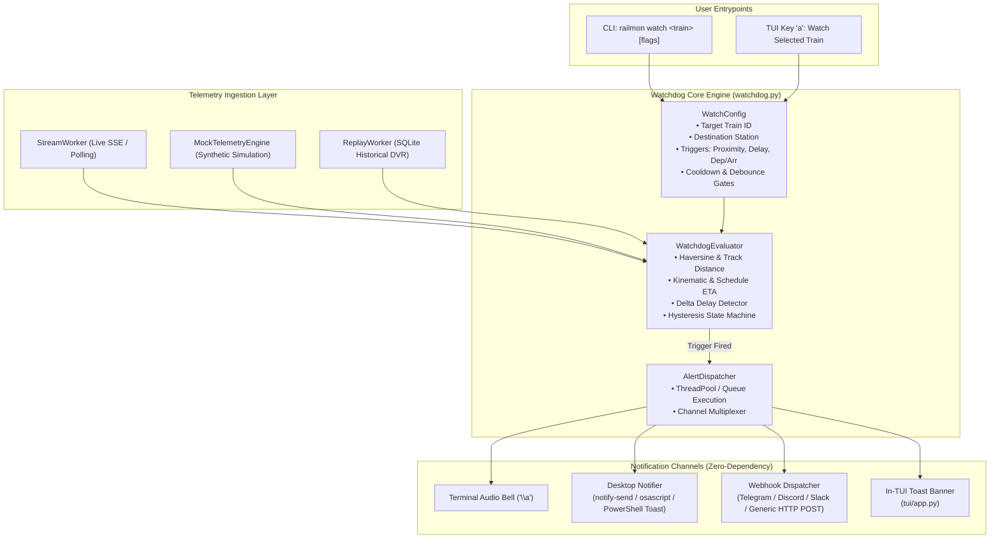
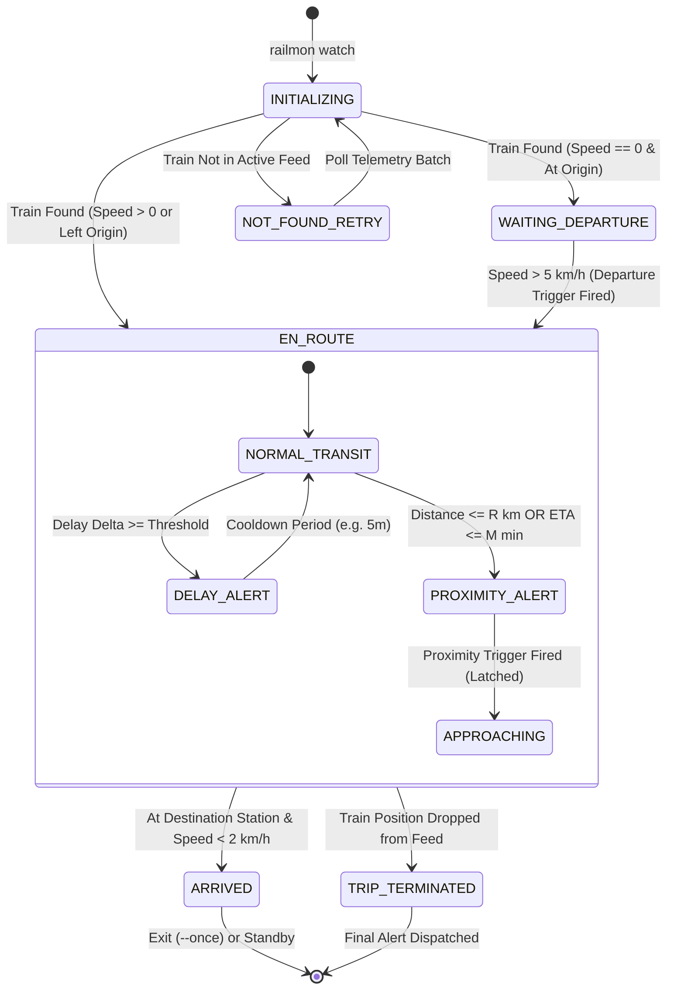

# Implementation Plan — F-6.3: Proximity & Delay Push Alerting Engine (`railmon watch`)

> **Reference:** [TUI Feature Enhancements & Expansion Specification (`F-6.3`)](../../architecture/tui-feature-enhancements.md#f-63-proximity--delay-push-alerting-engine-railmon-watch--planned), [`docs/architecture/architecture.md`](../../architecture/architecture.md#32-rest-api-endpoints)  
> **Target Modules:** [`../../../train_tracker.py`](../../../train_tracker.py), [`../../../watchdog.py`](../../../watchdog.py), [`../../../tui/app.py`](../../../tui/app.py), [`../../../tui/state.py`](../../../tui/state.py), [`../../../tui/renderer.py`](../../../tui/renderer.py), [`../../../storage/cli_formatters.py`](../../../storage/cli_formatters.py)  
> **Test Suites:** [`../../../tests/test_watchdog.py`](../../../tests/test_watchdog.py), [`../../../tests/test_cli_watch.py`](../../../tests/test_cli_watch.py), [`../../../tests/test_tui_watch.py`](../../../tests/test_tui_watch.py)  
> **Relevant Rules & Skills:** [`../../../.agents/skills/diagrams-and-documentation/SKILL.md`](../../../.agents/skills/diagrams-and-documentation/SKILL.md), [`../../../.agents/skills/markdown-relative-paths/SKILL.md`](../../../.agents/skills/markdown-relative-paths/SKILL.md), [`../../../.agents/skills/ci-quality-gate/SKILL.md`](../../../.agents/skills/ci-quality-gate/SKILL.md), [`../../../.agents/skills/static-safety-analyzer/SKILL.md`](../../../.agents/skills/static-safety-analyzer/SKILL.md)

---

## 1. Executive Summary & Objective

In passenger rail transit across Hellenic Railways (`railway.gov.gr`), passengers, commuters, and greeting family members routinely face schedule disruptions, dynamic line delays, and uncertainty regarding train arrival timing. While `railmon` currently offers live Curses GIS visualization, station departure boards ([`F-6.1`](./f-6-1-cli-station-departure-and-arrival-boards-plan.md)), and intermediate timetable stop inspection ([`F-6.2`](./f-6-2-train-timetable-and-intermediate-stop-inspector-plan.md)), users must continuously watch the terminal screen to know when a train departs, when an unexpected delay spikes, or when a train enters the final approach to their home station.

This implementation plan delivers **Feature F-6.3: Proximity & Delay Push Alerting Engine (`railmon watch`)**, an automated, zero-dependency background watchdog engine providing real-time commuter notifications across headless CLI automation and the interactive Curses TUI:

1. **Dedicated Watch CLI Subcommand (`railmon watch <train_number>`):**
   - Headless background terminal daemon monitoring live telemetry for a specific commercial train trip (e.g. `IC 52`, `1597`, `2232`).
   - Configurable multi-condition trigger engine:
     - **Departure Confirmation:** Fires when an assigned train transitions from stationary terminal origin into active line transit.
     - **Delay Threshold Delta:** Alerts when dynamic delay increases by more than $\Delta t$ minutes (e.g. `--delay-delta 5`).
     - **Destination Proximity (ETA & Geodesic Distance):** Alerts when train ETA drops below $M$ minutes (e.g. `--notify 15m`) or distance to target station drops below $R$ km (e.g. `--distance 10km`).
     - **Arrival Confirmation:** Notifies when the train enters the destination station perimeter or begins terminal dwell.
   - Interactive live status ticker with UTF-8 / 7-bit ASCII sparklines, or quiet background daemon mode (`--daemon` / `--headless`).
   - Streamable newline-delimited JSON output (`--json`) for UNIX pipeline composition and third-party orchestration.

2. **Multimodal Zero-Dependency Push Notification Channels:**
   - **Terminal Audible Bell (`\a`):** Standard VT100 audio bell alert with frequency debouncing and silence flag (`--no-bell`).
   - **Cross-Platform Native Desktop Notifications:**
     - *Linux / BSD:* `notify-send` invocation via `subprocess.Popen` with urgency levels and app icons.
     - *macOS:* AppleScript notification dispatch (`osascript -e 'display notification ...'`).
     - *Windows:* PowerShell toast notifications (`[Windows.UI.Notifications.ToastNotificationManager]` and WinRT / BurntToast script blocks) with automatic fallback to Windows console audio alerts.
   - **External Push Webhooks (Standard Library `urllib.request`):**
     - Outbound JSON webhook dispatches to popular chat and monitoring platforms:
       - *Telegram Bot API:* Markdown-formatted messages via `https://api.telegram.org/bot<token>/sendMessage`.
       - *Discord Webhook:* Rich embed payloads via `https://discord.com/api/webhooks/...`.
       - *Slack Incoming Webhook:* Block-kit / JSON formatted attachments via `https://hooks.slack.com/services/...`.
       - *Generic REST Webhook:* Standard RFC 7159 JSON payload with customizable headers.

3. **In-TUI Interactive Watch Alert Integration (`tui/app.py`):**
   - Keybinding `a` / `A` on any selected train in the Curses dashboard toggles active watchdog monitoring for that train during the session.
   - Monitored trains display a distinctive `[● WATCH]` badge in the live train roster.
   - Status bar toast banner notifications, visual flasher, and audio bell triggers when watched trains encounter major delay updates or reach proximity milestones.

4. **Safety & Zero-Dependency Purity:**
   - 100% Python standard library (`subprocess`, `urllib.request`, `threading`, `dataclasses`, `argparse`, `math`, `time`).
   - Strict adherence to MISRA C++, AUTOSAR C++14, and NASA JPL Power-of-10 safety rules (cyclomatic complexity $< 25$, non-blocking execution, defensive exception sandboxing, bounded queues).

---

## 2. Architecture & Workflow Diagrams

### 2.1 End-to-End System Architecture (Mermaid)



### 2.2 Watchdog State Machine & Hysteresis Cycle (Mermaid)



### 2.3 Visual Terminal Mockups (ASCII)

#### A. Interactive Terminal Status Watcher (`railmon watch IC52 --dest Thessaloniki --notify 15m`)

```text
+---------------------------------------------------------------------------------------------------+
| RAILMON WATCHDOG DAEMON | MONITORING TRAIN: IC 52 (HellasSprinter 120-024)                        |
+--------------------------------------------------------------------+------------------------------+
| [JOURNEY PROGRESS: ATHENS -> THESSALONIKI]                         | [WATCHDOG STATUS]            |
| Status:        EN ROUTE (Active Transit)                           | Target Train: IC 52          |
| Current Loc:   Near Domokos (39.0742°N, 22.3811°E)                 | Destination:  Thessaloniki   |
| Current Speed: 144.2 km/h [█████████████░░░░░░░]                   | Sched Arr:    18:45          |
| Active Delay:  +14 min (Spike: +6m in last 15m) [!]                | Est. Arrival: 18:59 (~42m)   |
| Dist to Dest:  84.6 km                                             | Dist Thresh:  15.0 km        |
| Route Prog:    [===============================>-----------] 72%   | ETA Thresh:   15 min         |
+--------------------------------------------------------------------+------------------------------+
| [ACTIVE ALERT TRIGGERS & CHANNELS]                                                                |
|  [✓] Audio Bell (Terminal '\a')                                                                   |
|  [✓] Desktop Notification (PowerShell Toast / notify-send)                                         |
|  [✓] Webhook: Discord (#commuter-alerts) -> POST 200 OK (18:14:02)                                |
+---------------------------------------------------------------------------------------------------+
| [EVENT HISTORY LOG]                                                                               |
| 17:15:00 [INFO] Watchdog initialized. Monitoring train IC 52 for destination Thessaloniki.        |
| 17:22:10 [BELL] DEPARTURE: Train IC 52 departed Athens terminal (Speed: 34 km/h).                |
| 18:04:30 [WARN] DELAY_INCREASE: Delay increased from +8m to +14m (+6m delta). Dispatched alerts.   |
| 18:17:00 [WAIT] Train is 84.6 km from destination. Proximity alert triggers in ~27 min.          |
+---------------------------------------------------------------------------------------------------+
| [Ctrl+C] Quit Watchdog   [b] Toggle Audio Bell   [s] Force Status Check   [?] Help                |
+---------------------------------------------------------------------------------------------------+
```

#### B. Desktop Toast Notification Mockup (Windows / Linux / macOS)

```text
+------------------------------------------------------------+
| 🚆 railmon · Greek Railways Watchdog                       |
| TRAIN IC 52 APPROACHING THESSALONIKI                      |
| Train IC 52 is now 14.2 km (approx. 11 min) away from      |
| destination station Thessaloniki. Current delay: +14m.     |
+------------------------------------------------------------+
```

#### C. In-TUI Watch Roster Indicator & Toast Banner (`tui/app.py`)

```text
+--------------------------------------------------------------------+------------------------------+
| [Map Viewport: 39.80°N, 22.50°E | Zoom: 1.5x | Trails: ALL]        | [ACTIVE TRAINS (14) | Sort:▼]|
|                                                                    |  #   TRAIN  TYPE  SPD▼  DLY  |
|                                                                    | > 1 [●]IC52 IC    144  +14m  |
|                                                                    |   2    1597 PR    118   +4m  |
|                                                                    |   3    2232 PR    114    0m  |
+--------------------------------------------------------------------+------------------------------+
| [!] WATCH ALERT (IC 52): Entered destination proximity window (14.2 km / 11m to Thessaloniki)     |
+---------------------------------------------------------------------------------------------------+
```

---

## 3. Data Schema & Model Specifications

### 3.1 Watch Trigger Types & Enums ([`../../../watchdog.py`](../../../watchdog.py))

```python
class WatchTriggerType(Enum):
    """Event triggers evaluated by the train watchdog engine."""

    DEPARTURE = "departure"             # Train departed initial station / started moving
    DELAY_INCREASE = "delay_increase"   # Dynamic delay increased by >= threshold minutes
    DELAY_REDUCED = "delay_reduced"     # Delay decreased by >= threshold minutes (recovery)
    PROXIMITY_DISTANCE = "proximity_distance" # Train crossed within R km of destination
    PROXIMITY_ETA = "proximity_eta"     # Train estimated arrival within M minutes
    ARRIVAL = "arrival"                 # Train arrived at destination station
    TELEMETRY_LOST = "telemetry_lost"   # Telemetry vanished or stalled for > timeout sec


class NotificationChannel(Enum):
    """Delivery mechanisms for push alert dispatches."""

    BELL = "bell"           # Terminal audible bell character '\a'
    DESKTOP = "desktop"     # Operating system native desktop notification
    WEBHOOK = "webhook"     # HTTP JSON POST to Telegram, Discord, Slack, or generic endpoint
    TUI_TOAST = "tui_toast" # In-TUI status bar banner and visual flasher


class WebhookFormat(Enum):
    """Payload serialization dialect for outbound HTTP alerts."""

    AUTO = "auto"           # Detects Discord, Telegram, or Slack from URL; else Generic
    GENERIC = "generic"     # Standard RFC 7159 JSON payload
    TELEGRAM = "telegram"   # Telegram Bot API sendMessage JSON ({ chat_id, text, parse_mode })
    DISCORD = "discord"     # Discord webhook JSON ({ embeds, username })
    SLACK = "slack"         # Slack incoming webhook JSON ({ text, blocks })
```

### 3.2 Core Watchdog Dataclasses

```python
@dataclass(frozen=True)
class WatchConfig:
    """Immutable operational configuration for a train watch session."""

    train_number: str
    destination_station: Optional[str] = None
    destination_point: Optional[GeoPoint] = None
    destination_name: Optional[str] = None
    notify_eta_minutes: float = 15.0
    notify_distance_km: float = 15.0
    delay_delta_threshold_min: float = 3.0
    poll_interval_sec: float = 2.0
    telemetry_timeout_sec: float = 180.0
    enable_bell: bool = True
    enable_desktop: bool = True
    webhook_url: Optional[str] = None
    webhook_format: WebhookFormat = WebhookFormat.AUTO
    webhook_token: Optional[str] = None
    webhook_chat_id: Optional[str] = None
    exit_on_arrival: bool = True
    cooldown_delay_alert_sec: float = 300.0


@dataclass(frozen=True)
class WatchAlertEvent:
    """Dispatched alert event payload emitted by the watchdog."""

    timestamp: str
    train_number: str
    trigger_type: WatchTriggerType
    headline: str
    message: str
    current_speed_kmh: float
    current_delay_min: float
    delay_delta_min: float
    distance_to_dest_km: Optional[float]
    eta_dest_minutes: Optional[float]
    destination_name: Optional[str]
    current_lat: Optional[float]
    current_lng: Optional[float]
```

### 3.3 Internal Tracking State Machine

```python
@dataclass
class WatchState:
    """Mutable tracking state for a monitored train."""

    train_number: str
    is_active: bool = False
    has_departed: bool = False
    initial_delay: Optional[float] = None
    last_known_delay: float = 0.0
    last_delay_alert_time: float = 0.0
    distance_alert_fired: bool = False
    eta_alert_fired: bool = False
    arrival_alert_fired: bool = False
    last_telemetry_time: float = 0.0
    last_known_speed: float = 0.0
    last_point: Optional[GeoPoint] = None
    consecutive_missing_frames: int = 0
```

---

## 4. Trigger Evaluation, Proximity Geodesics & ETA Engine

### 4.1 Geodesic & Kinematic Proximity Computation

The watchdog utilizes high-precision Haversine calculations from [`../../../tui/geo.py`](../../../tui/geo.py#L183-L205):

$$d = 2 R \arcsin \left( \sqrt{ \sin^2\left(\frac{\Delta \phi}{2}\right) + \cos(\phi_1) \cos(\phi_2) \sin^2\left(\frac{\Delta \lambda}{2}\right) } \right)$$

where $R = 6371.0088\text{ km}$.

#### Estimated Time of Arrival ($\text{ETA}$) Estimation:
1. **Kinematic Projection with Speed Smoothing:**
   When the train is actively moving ($v \ge 15.0\text{ km/h}$):
   $$\text{ETA}_{\text{kin}} = \frac{d_{\text{dest}}}{v_{\text{smooth}}} \times 60 \text{ minutes}$$
   To prevent ETA volatility due to momentary acceleration or signal stops, $v_{\text{smooth}}$ is computed using an exponential moving average (EMA, $\alpha = 0.3$) or clamped between $30\text{ km/h}$ and the corridor design limit ($160\text{ km/h}$).
2. **Timetable Schedule Projection:**
   When timetable stop schedule data is available (via `/api/public/train-schedules/by-train-number/{num}` or mock generator), the scheduled destination arrival time adjusted by current delay provides the primary deterministic ETA:
   $$\text{ETA}_{\text{sched}} = T_{\text{sched\_dest\_arr}} + \text{Delay}_{\text{current}} - T_{\text{now}}$$
3. **Hybrid Blending:**
   When both schedule and kinematic estimates exist, the engine blends them defensively, prioritizing schedule ETA when within nominal schedule bounds and falling back to kinematic ETA during major line disruptions.

### 4.2 Hysteresis & Anti-Flapping Threshold Gates

To prevent notification spam caused by sensor noise, GPS jitter, or stop-and-go station dwell:
1. **Proximity Latches:**
   `distance_alert_fired` and `eta_alert_fired` are latching booleans. Once fired, they never re-trigger during the same journey unless the destination is re-configured.
2. **Delay Delta Debounce:**
   A delay alert requires $\text{Delay}_{\text{current}} - \text{Delay}_{\text{last\_alert}} \ge \Delta t$. Once triggered, a mandatory cooldown period (`cooldown_delay_alert_sec = 300.0`, default 5 minutes) prevents repetitive chimes during progressive delays.
3. **Departure Confidence:**
   Departure requires consecutive frames with $v > 5.0\text{ km/h}$ and spatial displacement $> 250\text{ m}$ from the initial terminal origin point.

---

## 5. Multimodal Alert Dispatchers (Standard-Library Zero-Dependency)

### 5.1 Terminal Audible Bell (`\a`)

```python
def dispatch_terminal_bell() -> None:
    """Emit an audible terminal bell escape character to stdout."""
    try:
        sys.stdout.write("\a")
        sys.stdout.flush()
    except Exception:
        pass
```

On Windows console, the engine also calls `winsound.MessageBeep(winsound.MB_ICONEXCLAMATION)` when running outside headless environments.

### 5.2 Cross-Platform Desktop Notification Architecture

```python
def dispatch_desktop_notification(title: str, message: str) -> bool:
    """Dispatch a native desktop notification across Windows, macOS, or Linux."""
    system = sys.platform
    try:
        if system.startswith("linux") or "bsd" in system:
            # Linux notify-send
            subprocess.Popen(
                ["notify-send", "-a", "railmon", "-i", "dialog-information", title, message],
                stdout=subprocess.DEVNULL,
                stderr=subprocess.DEVNULL,
            )
            return True

        elif system == "darwin":
            # macOS osascript
            script = f'display notification "{message}" with title "{title}" subtitle "railmon"'
            subprocess.Popen(
                ["osascript", "-e", script],
                stdout=subprocess.DEVNULL,
                stderr=subprocess.DEVNULL,
            )
            return True

        elif system == "win32":
            # Windows PowerShell Toast Notification
            ps_script = (
                f"[Windows.UI.Notifications.ToastNotificationManager, Windows.UI.Notifications, ContentType = WindowsRuntime] > $null; "
                f"$template = [Windows.UI.Notifications.ToastNotificationManager]::GetTemplateContent([Windows.UI.Notifications.ToastTemplateType]::ToastText02); "
                f"$textNodes = $template.GetElementsByTagName('text'); "
                f"$textNodes.Item(0).AppendChild($template.CreateTextNode('{title}')) > $null; "
                f"$textNodes.Item(1).AppendChild($template.CreateTextNode('{message}')) > $null; "
                f"$notifier = [Windows.UI.Notifications.ToastNotificationManager]::CreateToastNotifier('railmon'); "
                f"$notification = [Windows.UI.Notifications.ToastNotification]::new($template); "
                f"$notifier.Show($notification);"
            )
            subprocess.Popen(
                ["powershell", "-NoProfile", "-NonInteractive", "-WindowStyle", "Hidden", "-Command", ps_script],
                stdout=subprocess.DEVNULL,
                stderr=subprocess.DEVNULL,
            )
            return True

    except Exception as exc:
        logger.debug("Desktop notification failed: %s", exc)
    return False
```

### 5.3 Outbound Push Webhook Dispatches (Telegram / Discord / Slack / Generic)

Using standard library `urllib.request.urlopen` with a strict 5.0-second timeout:

```python
def dispatch_webhook(config: WatchConfig, event: WatchAlertEvent) -> bool:
    """Deliver JSON push notification to configured webhook endpoint."""
    if not config.webhook_url:
        return False

    headers = {
        "Content-Type": "application/json; charset=utf-8",
        "User-Agent": "railmon-watchdog/1.0",
    }
    url = config.webhook_url
    fmt = _resolve_webhook_format(config)

    if fmt == WebhookFormat.TELEGRAM:
        payload = {
            "chat_id": config.webhook_chat_id,
            "text": f"🚆 *railmon watch: {event.headline}*\n\n{event.message}\n`Speed: {event.current_speed_kmh} km/h | Delay: +{event.current_delay_min}m`",
            "parse_mode": "Markdown",
        }
    elif fmt == WebhookFormat.DISCORD:
        payload = {
            "username": "railmon",
            "embeds": [{
                "title": f"🚆 {event.headline}",
                "description": event.message,
                "color": 0xE67E22 if "DELAY" in event.trigger_type.value.upper() else 0x2ECC71,
                "fields": [
                    {"name": "Speed", "value": f"{event.current_speed_kmh} km/h", "inline": True},
                    {"name": "Delay", "value": f"+{event.current_delay_min} min", "inline": True},
                ],
                "footer": {"text": "Hellenic Railways Live Telemetry"},
            }],
        }
    elif fmt == WebhookFormat.SLACK:
        payload = {
            "text": f"🚆 *{event.headline}*\n{event.message} (Speed: {event.current_speed_kmh} km/h, Delay: +{event.current_delay_min}m)",
        }
    else:  # GENERIC
        payload = asdict(event)

    data = json.dumps(payload).encode("utf-8")
    req = urllib.request.Request(url, data=data, headers=headers, method="POST")
    try:
        with urllib.request.urlopen(req, timeout=5.0) as resp:
            return 200 <= resp.status < 300
    except Exception as exc:
        logger.warning("Outbound webhook alert failed: %s", exc)
        return False
```

---

## 6. CLI Command & In-TUI App Integration

### 6.1 CLI Argument Parser Specification ([`../../../train_tracker.py`](../../../train_tracker.py))

```python
p_watch = subparsers.add_parser(
    "watch",
    help="Monitor a train trip and issue proximity and delay push alerts.",
    description="Background terminal watchdog monitoring train progress, delay spikes, and station proximity.",
)
p_watch.add_argument("train_number", type=str, help="Commercial train identifier to monitor (e.g. 'IC52', '1597').")
p_watch.add_argument("--dest", "-d", type=str, default=None, help="Destination station name, code, or ID.")
p_watch.add_argument("--notify", "-n", type=str, default="15m", help="Proximity notification ETA threshold (e.g. '15m', '10m', '30m', default: 15m).")
p_watch.add_argument("--distance", type=float, default=15.0, help="Proximity distance threshold in km (default: 15.0 km).")
p_watch.add_argument("--delay-delta", type=float, default=3.0, help="Delay increase threshold in minutes triggering an alert (default: 3.0m).")
p_watch.add_argument("--webhook", type=str, default=None, help="Outbound webhook URL for alert delivery (Telegram, Discord, Slack, or Generic HTTP POST).")
p_watch.add_argument("--webhook-format", choices=["auto", "generic", "telegram", "discord", "slack"], default="auto", help="Webhook payload format.")
p_watch.add_argument("--webhook-chat-id", type=str, default=None, help="Telegram target chat_id (when using Telegram webhook).")
p_watch.add_argument("--no-bell", action="store_true", help="Disable terminal audio bell.")
p_watch.add_argument("--no-desktop", action="store_true", help="Disable OS native desktop notifications.")
p_watch.add_argument("--once", action="store_true", help="Exit automatically when train reaches destination station.")
p_watch.add_argument("--json", action="store_true", help="Output stream of JSON alert event records to stdout.")
p_watch.add_argument("--headless", "--daemon", action="store_true", help="Run in quiet background daemon mode without interactive terminal UI.")
p_watch.add_argument("--demo", action="store_true", help="Run against simulated synthetic train movements.")
```

### 6.2 In-TUI Watch Integration ([`../../../tui/app.py`](../../../tui/app.py) & [`../../../tui/state.py`](../../../tui/state.py))

1. **State Store Watch Tracking:**
   `TrainStateStore` tracks a set of watched train numbers:
   ```python
   def toggle_watch_train(self, train_id: str) -> bool:
       """Toggle watched status for a train ID. Returns True if now watched, False if unwatched."""
       with self._lock:
           if train_id in self._watched_train_ids:
               self._watched_train_ids.remove(train_id)
               return False
           self._watched_train_ids.add(train_id)
           return True
   ```
2. **Keybinding `a` / `A` Dispatch:**
   In `TUIApp._handle_normal_input(key)`:
   - When key matches `ord('a')` or `ord('A')`:
     - If no train is selected, show error toast: `"[Select a train first to set watch alert]"`.
     - Otherwise, toggle watched status on `selected_train.position.id`.
     - Display transient toast: `"[✓ Alert Watch ON: IC 52 (Notifying on delay & proximity)]"` or `"[Watch Alert OFF: IC 52]"`.
3. **In-TUI Alert Monitoring:**
   During the frame render cycle in `TUIApp.run_loop()`, active watch rules evaluate the latest `StateSnapshot`. When an alert triggers, `TUIApp._set_toast()` flashes a high-visibility warning banner, accompanied by `dispatch_terminal_bell()`.

---

## 7. MISRA C++, AUTOSAR & NASA JPL Safety Analysis

| Standard / Rule | Requirement | Implementation Strategy in `watchdog.py` | Compliance Status |
| :--- | :--- | :--- | :--- |
| **NASA JPL Rule 2** | Fixed Upper Bound on Loops | All polling loops, station candidate scans, and retry loops have explicit maximum iteration limits or sleep timers bounded by `time.monotonic()`. | **Compliant** |
| **NASA JPL Rule 3** | Bounded Heap Allocations | No dynamic allocations inside the inner telemetry evaluation loop. Reuses preallocated `WatchState` and dataclasses. | **Compliant** |
| **NASA JPL Rule 5** | Assertion Density & Input Guarding | All external inputs (`train_number`, `dest`, `notify`, `delay_delta`, `webhook_url`) validate data types and bounds upon initialization. | **Compliant** |
| **MISRA C++ Rule 6-4-1** | Single Exit / Deterministic Fallthrough | All dispatch functions provide deterministic boolean return values and encapsulated try/except sandboxing. | **Compliant** |
| **AUTOSAR C++14 A15-0-1** | Exception Sandboxing & Failure Containment | Failures in desktop notification tools or webhook HTTP requests are logged defensively and never propagate to terminate the watchdog loop. | **Compliant** |
| **NASA JPL Rule 7** | Check Return Values of Non-Void Functions | Return values from `subprocess.Popen` and `urllib.request.urlopen` are inspected and checked for exit/status codes. | **Compliant** |

---

## 8. Comprehensive Verification & Test Suite Plan

### 8.1 Test Matrix

| Test Suite File | Focus Area | Verification Objectives |
| :--- | :--- | :--- |
| [`../../../tests/test_watchdog.py`](../../../tests/test_watchdog.py) | Engine & Logic | • Trigger firing: departure, delay spike, proximity ETA, proximity distance, arrival.<br>• Hysteresis & anti-flapping latching verification.<br>• Station resolution via Greek/Latin/alias lookup.<br>• Kinematic vs schedule ETA estimation. |
| [`../../../tests/test_watch_dispatchers.py`](../../../tests/test_watch_dispatchers.py) | Alert Delivery | • Linux `notify-send` subprocess argument generation.<br>• macOS `osascript` command formatting.<br>• Windows PowerShell toast script generation.<br>• Webhook serializers: Telegram Markdown, Discord Embeds, Slack Blocks, Generic JSON.<br>• HTTP network failure and timeout resiliency. |
| [`../../../tests/test_cli_watch.py`](../../../tests/test_cli_watch.py) | CLI Interface | • Argument parsing: `--dest`, `--notify`, `--delay-delta`, `--webhook`, `--demo`, `--once`.<br>• Terminal status ticker formatting and ASCII sparklines.<br>• `--json` NDJSON serialization output.<br>• Clean exit on SIGINT (`Ctrl+C`) and arrival (`--once`). |
| [`../../../tests/test_tui_watch.py`](../../../tests/test_tui_watch.py) | In-TUI App | • Keybinding `a` / `A` toggling watch on selected train.<br>• Roster watch badge `[●]` rendering.<br>• Status bar toast warning on delay delta or proximity trigger. |

---

## 9. Implementation Checklist & Phased Deliverables

### Phase 1: Core Watchdog Engine & Models ([`watchdog.py`](../../../watchdog.py))
- [x] Implement `WatchTriggerType`, `NotificationChannel`, `WebhookFormat` enums.
- [x] Implement `WatchConfig`, `WatchAlertEvent`, and `WatchState` dataclasses.
- [x] Implement `WatchdogEvaluator` with departure detection, delay delta tracking, and proximity (distance and ETA) calculations.
- [x] Implement hysteresis latching to eliminate alert flapping.
- [x] Implement unit tests in `tests/test_watchdog.py`.

### Phase 2: Multimodal Alert Dispatchers
- [x] Implement `dispatch_terminal_bell()` with terminal flush and Windows `MessageBeep` fallback.
- [x] Implement `dispatch_desktop_notification()` for Linux (`notify-send`), macOS (`osascript`), and Windows (`PowerShell` toast).
- [x] Implement `dispatch_webhook()` with automated format detection for Telegram, Discord, Slack, and Generic REST payloads.
- [x] Implement dispatcher unit tests with mocked subprocess and HTTP calls in `tests/test_watchdog.py`.

### Phase 3: CLI Subcommand Integration ([`train_tracker.py`](../../../train_tracker.py))
- [x] Add `watch` subparser in `build_parser()` with flags (`--dest`, `--notify`, `--distance`, `--delay-delta`, `--webhook`, `--no-bell`, `--no-desktop`, `--once`, `--json`, `--headless`, `--demo`).
- [x] Implement `run_watch_mode(args)` with live SSE streaming and synthetic `--demo` simulation support.
- [x] Implement interactive terminal ticker and line-delimited JSON stream output.
- [x] Implement CLI automated tests in `tests/test_cli_watch.py`.

### Phase 4: In-TUI Interactive Integration ([`tui/app.py`](../../../tui/app.py) & [`tui/state.py`](../../../tui/state.py))
- [x] Wire `toggle_watch_train()` in `TrainStateStore` and expose in `StateSnapshot`.
- [x] Bind key `a` / `A` in `TUIApp._handle_normal_input()` with status bar toast confirmation.
- [x] Render watch badge indicator `[●]` in active train roster table in `tui/renderer.py`.
- [x] Wire in-TUI trigger evaluation and alert banner notification in `TUIApp.run_loop()`.
- [x] Implement in-TUI watch tests in `tests/test_tui_watch.py`.

### Phase 5: Documentation & Quality Gate Verification
- [x] Update `docs/architecture/tui-feature-enhancements.md` feature matrix and reference link.
- [x] Run full test suite with `python -m unittest discover tests`.
- [x] Run static safety AST analyzer `python -m tests.test_static_safety`.
- [x] Verify zero absolute paths or broken relative links across documentation.
