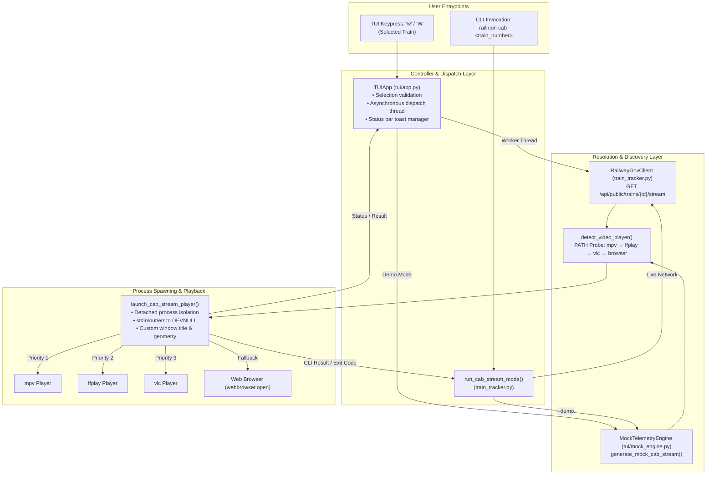
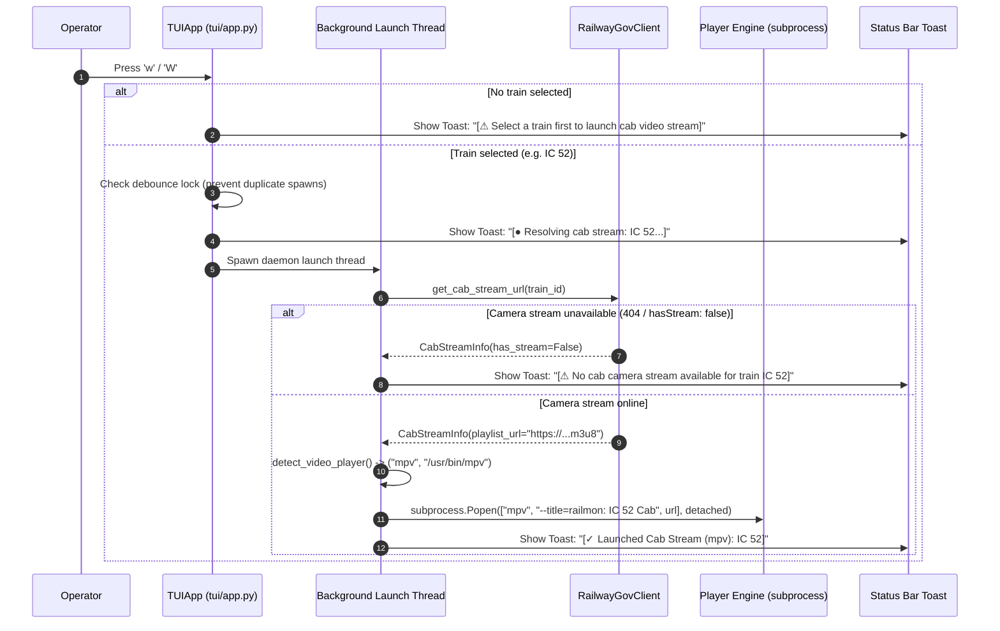

# Implementation Plan — F-7.1: Live Locomotive Forward Cab Video Stream Launcher (`w` / `W`)

> **Reference:** [TUI Feature Enhancements & Expansion Specification (`F-7.1`)](../../architecture/tui-feature-enhancements.md#f-71-live-locomotive-forward-cab-video-stream-launcher-w--w), [`docs/architecture/architecture.md`](../../architecture/architecture.md#32-rest-api-endpoints)  
> **Target Modules:** [`../../../train_tracker.py`](../../../train_tracker.py), [`../../../tui/app.py`](../../../tui/app.py), [`../../../tui/renderer.py`](../../../tui/renderer.py), [`../../../tui/mock_engine.py`](../../../tui/mock_engine.py), [`../../../tui/state.py`](../../../tui/state.py)  
> **Test Suites:** [`../../../tests/test_cab_stream.py`](../../../tests/test_cab_stream.py), [`../../../tests/test_tui_cab_stream.py`](../../../tests/test_tui_cab_stream.py), [`../../../tests/test_cli_cab.py`](../../../tests/test_cli_cab.py)  
> **Relevant Rules & Skills:** [`../../../.agents/skills/diagrams-and-documentation/SKILL.md`](../../../.agents/skills/diagrams-and-documentation/SKILL.md), [`../../../.agents/skills/markdown-relative-paths/SKILL.md`](../../../.agents/skills/markdown-relative-paths/SKILL.md), [`../../../.agents/skills/ci-quality-gate/SKILL.md`](../../../.agents/skills/ci-quality-gate/SKILL.md), [`../../../.agents/skills/static-safety-analyzer/SKILL.md`](../../../.agents/skills/static-safety-analyzer/SKILL.md)

---

## 1. Executive Summary & Objective

Modern Hellenic Railways locomotives and electric multiple units (such as Siemens Desiro Electric 460 EMU, Bombardier/Siemens HellasSprinter 120 electric locomotives, and Alstom ETR 470 "Pendolino" trainsets) are equipped with forward-facing high-definition cab cameras for operational safety, track condition monitoring, and forward vision telemetry. The `railway.gov.gr` public cloud infrastructure exposes live streaming metadata via HTTP Live Streaming (HLS `.m3u8`) endpoints at `/api/public/trains/{id}/stream`.

While `railmon` provides comprehensive geographic tracking, speed sparklines, station departure boards ([`F-6.1`](./f-6-1-cli-station-departure-and-arrival-boards-plan.md)), and complete stop timetables ([`F-6.2`](./f-6-2-train-timetable-and-intermediate-stop-inspector-plan.md)), operators currently lack a seamless mechanism to launch real-time forward cab video feeds directly from the running terminal interface.

This implementation plan delivers **Feature F-7.1: Live Locomotive Forward Cab Video Stream Launcher (`w` / `W`)** across both interactive Curses TUI and headless CLI workflows:

1. **In-TUI Video Stream Launcher (`w` / `W`):**
   - Pressing `w` or `W` ("Watch cab view") on any selected train in the Curses dashboard resolves the live HLS stream endpoint and launches a lightweight external video player in a detached, asynchronous subprocess.
   - Non-blocking execution: video player spawning and network resolution run asynchronously in a worker thread, ensuring zero disruption or frame-dropping on the 15–20 FPS Curses map rendering loop.
   - Status bar feedback: transient toast messages report stream resolution, selected player binary, or informative error notifications (`[✓ Launched Cab Stream (mpv): IC 52]`, `[⚠ No cab camera stream available for train 1597]`).
   - Selected train telemetry card enhancement: highlights live cab camera availability (`[CAB CAM: ACTIVE]`).

2. **Automated Player Detection & Graceful Fallback Engine:**
   - Prioritized player detection: automatically searches host `PATH` for lightweight, hardware-accelerated video players:
     1. User-specified player override (`--player <bin>` or `RAILMON_PLAYER` environment variable).
     2. `mpv` (optimized flags: custom window title, geometry, floating on top, suppressed terminal output).
     3. `ffplay` (low-latency flags: `-window_title`, `-autoexit`, `-loglevel error`).
     4. `vlc` (`--meta-title`, `--play-and-exit`).
     5. System Default Web Browser: fallback via Python standard-library `webbrowser.open()` for zero-setup accessibility on all operating systems.
   - Complete process detachment: cross-platform isolation (`start_new_session=True` on POSIX; `DETACHED_PROCESS` / `CREATE_NEW_PROCESS_GROUP` on Windows) with redirected `DEVNULL` streams preventing terminal hijacking, zombie processes, or curses buffer corruption.

3. **Dedicated CLI Subcommand (`railmon cab <train_number>`):**
   - Headless CLI tool to query cab camera availability and launch video streams directly from the shell.
   - Subcommand flags:
     - `--player <name>`: force specific player executable (`mpv`, `ffplay`, `vlc`, `browser`).
     - `--url-only`: print raw HLS `.m3u8` URL to stdout for piping to custom tools, `ffmpeg`, or media servers.
     - `--browser`: open stream directly in default web browser.
     - `--json`: emit machine-readable JSON stream metadata for shell scripts and automated dashboards.
     - `--demo`: offline simulation mode returning synthetic HLS stream feeds.

4. **Safety, Security & Zero-Dependency Purity:**
   - 100% Python standard library implementation (`subprocess`, `shutil`, `webbrowser`, `urllib`, `dataclasses`, `threading`, `json`).
   - Strict command injection defense: never invokes shell interpreters (`shell=False`); validates and sanitizes train identifiers; validates HLS URLs against approved URL schemes (`http`, `https`).
   - Adherence to MISRA C++, AUTOSAR C++14, and NASA JPL Power-of-10 static safety standards (cyclomatic complexity $< 25$, defensive `None`-guards, bounded error handling).

---

## 2. Architecture & Workflow Diagrams

### 2.1 End-to-End System Architecture (Mermaid)



### 2.2 Sequence Diagram: TUI Asynchronous Launch Lifecycle (Mermaid)



### 2.3 ASCII Architecture & Subprocess Isolation Diagram

```text
+---------------------------------------------------------------------------------------------------+
|                                 RAILMON CAB STREAM SUBSYSTEM                                       |
+---------------------------------------------------------------------------------------------------+

   Curses TUI (Main Thread)                           CLI Subcommand (`railmon cab 1597`)
   - 15-20 FPS Render Loop                            - Headless stdout formatting
   - Key 'w' / 'W' Event                              - Arguments: --player, --url-only, --json
             |                                                          |
             v                                                          v
   +------------------------------------+             +------------------------------------+
   |   Selection & Debounce Sentinel    |             |       CLI Invocation Dispatch      |
   +------------------------------------+             +------------------------------------+
             |                                                          |
             +----------------------------+-----------------------------+
                                          |
                                          v
   +------------------------------------------------------------------------------------------------+
   |                             Stream Metadata Resolution Engine                                  |
   |   • Live: GET /api/public/trains/{id}/stream via RailwayGovClient                              |
   |   • Demo: generate_mock_cab_stream(train_number) via MockTelemetryEngine                       |
   +------------------------------------------------------------------------------------------------+
                                          |
                                          v
   +------------------------------------------------------------------------------------------------+
   |                           Player Auto-Discovery & Priority Probe                               |
   |   1. CLI / Env Override:  RAILMON_PLAYER or --player                                           |
   |   2. mpv:                 shutil.which("mpv")                                                  |
   |   3. ffplay:              shutil.which("ffplay")                                               |
   |   4. vlc:                 shutil.which("vlc")                                                  |
   |   5. Browser Fallback:    webbrowser.open(url)                                                 |
   +------------------------------------------------------------------------------------------------+
                                          |
                                          v
   +------------------------------------------------------------------------------------------------+
   |                             Detached Subprocess Launcher                                       |
   |   • POSIX:   start_new_session=True, stdin/out/err=DEVNULL                                     |
   |   • Windows: creationflags=DETACHED_PROCESS | CREATE_NEW_PROCESS_GROUP, stdin/out/err=DEVNULL      |
   |   • Title:   --title="railmon: {train_number} Forward Cab View"                                |
   |   • Memory:  Zero-leak detached process; no parent zombie cleanup needed                       |
   +------------------------------------------------------------------------------------------------+
             |                                                          |
             v                                                          v
   +------------------------------------+             +------------------------------------+
   |      External Media Player         |             |       TUI Notification Toast       |
   |   (mpv / ffplay / vlc / browser)   |             |   "[✓ Launched Cab Stream (mpv)]"  |
   +------------------------------------+             +------------------------------------+
```

### 2.4 Terminal Visual Mockup

#### A. Curses TUI Interface (`tui/renderer.py`)

```text
+---------------------------------------------------------------------------------------------------+
| RAILMON | HELLENIC RAILWAYS (railway.gov.gr) | View: PATHE Mainline | Active: 14 | Delayed: 3 [●] |
+--------------------------------------------------------------------+------------------------------+
| [Map Viewport: 39.80°N, 22.50°E | Zoom: 1.5x | Trails: ALL]        | [ACTIVE TRAINS (14) | Sort:▼]|
|                                                                    |  #   TRAIN  TYPE  SPD▼  DLY  |
|   Thessaloniki                                                     | > 1  1599   IC    142   +9m  |
|     ◉===========================                                   |   2  1597   IC    118   +4m  |
|       \                        \                                   |   3  2232   PR    114    0m  |
|        \ Platy                  \                                  |   4  1314   PR     92   +1m  |
|         ◉===                     ◉ Kilkis                          |   5  2236   PR     86    0m  |
|          \  \                                                      |   6  1598   IC      0    0m  |
|           \  \ Katerini                                            +------------------------------+
|            \  ◉                                                    | [SELECTED TRAIN TELEMETRY]   |
|             \  \  ·                                                | Train No:     1599 (IC)      |
|              \  \  ·                                               | Locomotive:   120-024        |
|               \  ◉ Larissa                                         | Route:        ΑΘΗΝ -> ΘΕΣΣ   |
|                \  \  ·                                             | Next Station: Λάρισα (14.2km)|
|                 \  \  ▲ ◄ [1599] (142km/h, +9m)                    | Speed:        142.0 km/h     |
|                  \  \                                              | Delay:        +9 min (Minor) |
|                   \  ◉ Domokos                                     | Cab Camera:   ONLINE [w]     |
|                    \  \                                            | Camera Pos:   FORWARD CAB    |
|                     \  ◉ Lianokladi                                | Quality:      1080p @ 30fps  |
|                                                                    | Progress:     [======>--] 68%|
|  |---- 25 km ----|                                                 | Telemetry:    Updated 2s ago |
+--------------------------------------------------------------------+------------------------------+
| [✓ Launched Cab Stream (mpv): Train 1599 (1080p)]                                   [CONNECTED ●] |
+---------------------------------------------------------------------------------------------------+
| [q]Quit [h/j/k/l]Pan [+/-]Zoom [s]Sort [b]Trails [e]Export [i]Timetable [w]Cab Stream [?]Help     |
+---------------------------------------------------------------------------------------------------+
```

#### B. Headless CLI Tabular & JSON Output (`railmon cab`)

```text
# 1. Standard Interactive CLI Launch:
$ railmon cab 1599
Resolving forward cab video stream for Train 1599...
✓ Stream Online: HLS (1080p @ 30fps, 4500 kbps)
✓ Detected media player: mpv (/usr/bin/mpv)
✓ Launched detached video playback: "railmon: Train 1599 Forward Cab View"

# 2. Raw HLS URL Output (for piping or external scripting):
$ railmon cab 1599 --url-only
https://stream.railway.gov.gr/hls/loco-120024/live.m3u8

# 3. Structured JSON Metadata:
$ railmon cab 1599 --json
{
  "trainNumber": "1599",
  "locomotiveId": "120-024",
  "hasStream": true,
  "status": "ONLINE",
  "cameraPosition": "FORWARD_CAB",
  "streamType": "hls",
  "playlistUrl": "https://stream.railway.gov.gr/hls/loco-120024/live.m3u8",
  "resolution": "1080p",
  "fps": 30,
  "bitrateKbps": 4500,
  "latencySec": 1.8
}
```

---

## 3. Data Schema & Model Specifications

### 3.1 Upstream REST API Payload (`railway.gov.gr`)

The REST endpoint `/api/public/trains/{id}/stream` (or `/api/public/trains/by-number/{trainNumber}/stream`) returns stream metadata:

#### Active Stream Response (HTTP 200)
```json
{
  "trainId": "1599",
  "trainNumber": "1599",
  "locomotiveId": "120-024",
  "cameraPosition": "FORWARD_CAB",
  "streamType": "hls",
  "playlistUrl": "https://stream.railway.gov.gr/hls/loco-120024/live.m3u8",
  "hasStream": true,
  "resolution": "1080p",
  "fps": 30,
  "bitrateKbps": 4500,
  "codec": "h264",
  "status": "ONLINE",
  "latencySec": 1.8,
  "expiresAt": 1732219200
}
```

#### Unavailable Stream Response (HTTP 200 or 404)
```json
{
  "trainNumber": "884",
  "hasStream": false,
  "status": "UNAVAILABLE",
  "message": "Locomotive 220-014 is not equipped with an active forward video stream."
}
```

### 3.2 Data Transfer Object: `CabStreamInfo`

Implemented in [`train_tracker.py`](../../../train_tracker.py):

```python
@dataclass(frozen=True)
class CabStreamInfo:
    """Metadata describing a live locomotive forward cab video stream."""

    train_number: str
    has_stream: bool
    status: str  # "ONLINE", "OFFLINE", "UNAVAILABLE", "ERROR"
    stream_type: str = "hls"
    playlist_url: Optional[str] = None
    locomotive_id: Optional[str] = None
    camera_position: str = "FORWARD_CAB"
    resolution: Optional[str] = None
    fps: Optional[int] = None
    bitrate_kbps: Optional[int] = None
    error_message: Optional[str] = None

    @classmethod
    def from_dict(cls, data: Dict[str, Any], default_train_number: str = "") -> "CabStreamInfo":
        """Construct CabStreamInfo defensively from an API payload dictionary."""
        has_stream = bool(data.get("hasStream", False) and data.get("playlistUrl"))
        status = str(data.get("status", "ONLINE" if has_stream else "UNAVAILABLE")).upper()
        return cls(
            train_number=str(data.get("trainNumber") or default_train_number),
            has_stream=has_stream,
            status=status,
            stream_type=str(data.get("streamType", "hls")).lower(),
            playlist_url=str(data["playlistUrl"]) if data.get("playlistUrl") else None,
            locomotive_id=str(data["locomotiveId"]) if data.get("locomotiveId") else None,
            camera_position=str(data.get("cameraPosition", "FORWARD_CAB")),
            resolution=str(data["resolution"]) if data.get("resolution") else None,
            fps=int(data["fps"]) if data.get("fps") is not None else None,
            bitrate_kbps=int(data["bitrateKbps"]) if data.get("bitrateKbps") is not None else None,
            error_message=str(data["message"]) if data.get("message") else None,
        )

    @classmethod
    def unavailable(cls, train_number: str, message: str = "No video stream available.") -> "CabStreamInfo":
        """Factory for unavailable stream response."""
        return cls(
            train_number=train_number,
            has_stream=False,
            status="UNAVAILABLE",
            error_message=message,
        )
```

---

## 4. Player Auto-Discovery & Process Spawning Engine

### 4.1 Player Detection Hierarchy & Configuration

External media players vary across platforms. The discovery engine in [`train_tracker.py`](../../../train_tracker.py) probes available commands using standard-library `shutil.which()`:

| Priority | Player | Binary Name | Recommended Launch Arguments | Capabilities & Rationale |
| :--- | :--- | :--- | :--- | :--- |
| **0** | **Custom Override** | `$RAILMON_PLAYER` or `--player <bin>` | User configured | Allows explicit binding to specialized players (e.g. `iina`, `potplayer`, custom scripts). |
| **1** | **MPV** | `mpv` | `--title=railmon: {tn} Cab View`<br>`--geometry=960x540-20+40`<br>`--no-terminal`<br>`--force-window=yes`<br>`--ontop` | Ultra-lightweight, hardware-accelerated, native HLS support, window positioning, zero GUI chrome. |
| **2** | **FFplay** | `ffplay` | `-window_title "railmon: {tn} Cab View"`<br>`-autoexit`<br>`-loglevel error`<br>`-x 960 -y 540` | Ships with `ffmpeg`, minimal footprint, low latency. |
| **3** | **VLC** | `vlc` | `--meta-title="railmon: {tn} Cab View"`<br>`--play-and-exit`<br>`--video-on-top` | Common on desktop systems; cross-platform playback. |
| **4** | **Browser Fallback** | `webbrowser` | Native OS default browser via `webbrowser.open(url)` | 100% universal guarantee; zero third-party player dependencies required. |

### 4.2 Cross-Platform Process Detachment

To ensure the Curses rendering loop and terminal standard streams (`stdin`, `stdout`, `stderr`) are never interrupted:

```python
def launch_detached_player(
    cmd_args: List[str],
    is_windows: Optional[bool] = None,
) -> subprocess.Popen:
    """Launch a media player subprocess fully detached from the terminal session.

    Args:
        cmd_args: List of command arguments. First element is executable path.
        is_windows: Optional platform override (defaults to sys.platform == 'win32').

    Returns:
        Running subprocess.Popen instance.
    """
    if is_windows is None:
        is_windows = (sys.platform == "win32")

    if is_windows:
        # Windows: create detached process group without inherited console handles
        detached_flags = (
            getattr(subprocess, "DETACHED_PROCESS", 0x00000008)
            | getattr(subprocess, "CREATE_NEW_PROCESS_GROUP", 0x00000200)
        )
        return subprocess.Popen(
            cmd_args,
            stdin=subprocess.DEVNULL,
            stdout=subprocess.DEVNULL,
            stderr=subprocess.DEVNULL,
            creationflags=detached_flags,
            close_fds=True,
        )
    else:
        # POSIX (Linux / macOS): start a new session (setsid) to detach from TTY
        return subprocess.Popen(
            cmd_args,
            stdin=subprocess.DEVNULL,
            stdout=subprocess.DEVNULL,
            stderr=subprocess.DEVNULL,
            start_new_session=True,
            close_fds=True,
        )
```

### 4.3 Input Sanitization & Security Defenses

1. **Shell Injection Prevention:**
   All process executions strictly use `List[str]` vectors passed directly to `subprocess.Popen` with `shell=False`. Neither command interpreters (`sh`, `bash`, `cmd.exe`, `powershell.exe`) nor string interpolations are ever invoked.
2. **Train Number Whitelist:**
   `train_number` is sanitized with regular expression `^[A-Za-z0-9\- ]{1,16}$` before formatting into window titles.
3. **URL Scheme Whitelist:**
   Stream URLs are parsed with `urllib.parse.urlsplit()`. Only `http` and `https` schemes are accepted. Any `file://`, `javascript:`, or relative local paths are rejected immediately with a `ValueError`.

---

## 5. Detailed Technical Implementation Steps

### 5.1 Component 1: Client & Data Layer (`train_tracker.py`)

1. **Implement `CabStreamInfo` Dataclass:**
   Define `CabStreamInfo` with defensive `from_dict()` and `unavailable()` factories as specified in Section 3.2.
2. **Implement `RailwayGovClient.get_cab_stream_url`:**
   ```python
   def get_cab_stream_url(self, train_id_or_number: str) -> CabStreamInfo:
       """Fetch live locomotive forward cab stream metadata for a train.

       Args:
           train_id_or_number: Train ID or commercial train number (e.g. '1597', 'IC52').

       Returns:
           CabStreamInfo populated with playlist URL and status.
       """
       clean_id = urllib.parse.quote(str(train_id_or_number).strip())
       try:
           payload = self._get(f"/api/public/trains/{clean_id}/stream")
           if isinstance(payload, dict):
               return CabStreamInfo.from_dict(payload, default_train_number=train_id_or_number)
           return CabStreamInfo.unavailable(train_id_or_number, "Invalid stream response format.")
       except urllib.error.HTTPError as exc:
           if exc.code == 404:
               return CabStreamInfo.unavailable(
                   train_id_or_number,
                   f"No forward cab camera installed or stream active for train {train_id_or_number}."
               )
           return CabStreamInfo(
               train_number=str(train_id_or_number),
               has_stream=False,
               status="ERROR",
               error_message=f"HTTP {exc.code}: {exc.reason}",
           )
       except Exception as exc:
           return CabStreamInfo(
               train_number=str(train_id_or_number),
               has_stream=False,
               status="ERROR",
               error_message=f"Network error: {str(exc)}",
           )
   ```
3. **Implement Discovery & Spawning Utilities:**
   - `detect_video_player(preferred_player: Optional[str] = None) -> Tuple[str, Optional[str]]`:
     Returns `(player_name, binary_path)`. If `player_name == "browser"`, `binary_path` is `None`.
   - `build_player_command(player_name: str, binary_path: Optional[str], playlist_url: str, train_number: str) -> List[str]`:
     Builds the argument list with window title and geometry.
   - `launch_cab_stream(stream_info: CabStreamInfo, preferred_player: Optional[str] = None) -> Tuple[bool, str, str]`:
     Orchestrates detection, URL validation, and execution. Returns `(success, player_name, status_message)`.

### 5.2 Component 2: Mock Telemetry Engine (`tui/mock_engine.py`)

1. **Implement `generate_mock_cab_stream(train_number: str)`:**
   - Synthesizes realistic stream metadata for offline and demo testing.
   - Selects camera presence based on locomotive fleet class:
     - High-speed and modern EMUs (`1597`, `1599`, `IC52`, `IC54`, `2232`, `2236`): `hasStream = True`, `status = "ONLINE"`, `resolution = "1080p"`, `fps = 30`, `playlistUrl = "https://stream.railway.gov.gr/hls/mock-loco-{id}/live.m3u8"`.
     - Older regional locomotives (`884`, `3570`, cargo freights): `hasStream = False`, `status = "UNAVAILABLE"`, `message = "Locomotive not equipped with forward cab stream."`.

### 5.3 Component 3: Controller & TUI Integration (`tui/app.py`)

1. **Keybinding Registration:**
   In [`TUIApp._handle_normal_input`](../../../tui/app.py#L820):
   ```python
   # F-7.1: Live Locomotive Forward Cab Video Stream Launcher
   elif key in (ord("w"), ord("W")):
       self.launch_cab_stream_for_selected_train()
   ```
2. **Debounce & Asynchronous Launch Method:**
   ```python
   def launch_cab_stream_for_selected_train(self) -> None:
       """Trigger asynchronous resolution and external player launch for selected train."""
       snapshot = self.store.get_snapshot()
       if not snapshot.selected_train:
           self._set_toast("Select a train first to launch cab video stream", is_error=True)
           return

       train_num = (
           snapshot.selected_train.position.train_number
           or snapshot.selected_train.position.id
       )

       # Guard against concurrent launches for the same train
       with self._stream_launch_lock:
           if train_num in self._active_stream_launches:
               self._set_toast(f"Cab stream launch already in progress for train {train_num}")
               return
           self._active_stream_launches.add(train_num)

       self._set_toast(f"Resolving cab stream: {train_num}...")

       def _worker() -> None:
           try:
               if self.demo_mode:
                   info = generate_mock_cab_stream(train_num)
               else:
                   info = self.client.get_cab_stream_url(train_num)

               if not info.has_stream or not info.playlist_url:
                   err = info.error_message or "No forward cab video stream available"
                   self._set_toast(f"⚠ {err}", is_error=True)
                   return

               success, player, msg = launch_cab_stream(info)
               if success:
                   self._set_toast(f"✓ Launched cab stream ({player}): {train_num}", is_error=False)
               else:
                   self._set_toast(f"✗ Failed to launch player: {msg}", is_error=True)
           except Exception as exc:
               self._set_toast(f"✗ Cab stream error: {str(exc)}", is_error=True)
           finally:
               with self._stream_launch_lock:
                   self._active_stream_launches.discard(train_num)

       thread = threading.Thread(target=_worker, name=f"cab-stream-{train_num}", daemon=True)
       thread.start()
   ```

### 5.4 Component 4: Presentation & UI Layer (`tui/renderer.py`)

1. **Status Bar Shortcuts Cheat Sheet:**
   Update `_format_status_shortcuts(snapshot: StateSnapshot)`:
   Include `[w] Cab Stream` (or `[w] Cab View` when a train is selected).
2. **Help Modal Reference Table:**
   Update `render_help_modal()` under `"TRAIN SELECTION & TRACKING"`:
   ```python
   ("w / W", "Launch live locomotive forward cab video stream (mpv/ffplay/browser)"),
   ```
3. **Selected Train Telemetry Card Enhancement:**
   In `render_inspector()`: when a train has camera telemetry (`record.position.has_cab_cam` or heuristic on modern trainsets), render status line:
   ```text
   Cab Camera:     ONLINE [w]
   ```

### 5.5 Component 5: Headless CLI Subcommand (`train_tracker.py`)

1. **Subparser Registration:**
   ```python
   p_cab = subparsers.add_parser(
       "cab",
       aliases=["stream-cab"],
       help="Launch or query live locomotive forward cab video stream.",
       description="Resolve and launch real-time forward cab camera video feeds for active trains.",
   )
   p_cab.add_argument("train_number", type=str, help="Commercial train number (e.g. '1597', 'IC52').")
   p_cab.add_argument("--player", type=str, default=None, help="Force player executable (mpv, ffplay, vlc, browser).")
   p_cab.add_argument("--url-only", action="store_true", default=False, help="Print raw HLS playlist URL and exit.")
   p_cab.add_argument("--browser", action="store_true", default=False, help="Launch stream directly in web browser.")
   p_cab.add_argument("--json", action="store_true", default=False, help="Output stream metadata as structured JSON.")
   p_cab.add_argument("--demo", action="store_true", default=False, help="Use simulated mock camera feeds.")
   ```
2. **Execution Handler `run_cab_stream_mode(args)`:**
   - Validates arguments.
   - Fetches stream metadata via `RailwayGovClient` or `generate_mock_cab_stream()`.
   - Handles `--url-only`, `--json`, `--browser`, and player launch cleanly with standard exit codes (`0` on success, `1` on unavailable or failure).

---

## 6. Edge Cases, Failure Modes & Resilience

| Edge Case / Failure Mode | Root Cause / Condition | Mitigation & Defensive Handling | User-Facing Feedback |
| :--- | :--- | :--- | :--- |
| **No Train Selected** | Operator presses `w` in TUI while `snapshot.selected_train is None`. | Early return; no background threads created or network calls dispatched. | Toast: `[⚠ Select a train first to launch cab video stream]` (error style). |
| **Camera Unavailable / Not Installed** | Older locomotive (e.g. diesel freight) without video hardware; API returns 404 or `hasStream=false`. | Defensive parsing in `CabStreamInfo.from_dict()`; gracefully terminates worker thread. | Toast: `[⚠ No cab camera stream available for train {tn}]`. |
| **No Installed Media Players** | System lacks `mpv`, `ffplay`, or `vlc` on `PATH`. | Fallback automatically to `webbrowser.open(playlist_url)`. | Toast: `[✓ Opened Cab Stream in Web Browser: {tn}]`. |
| **Headless / Remote SSH Session** | Terminal runs over SSH without `$DISPLAY` / Wayland socket, or headless Windows console. | Detects missing display variable; fails safely without crashing the TUI. | Toast: `[✗ No GUI display available for video playback]`. |
| **Rapid Keypress / Spamming** | Operator taps `w` repeatedly in fast succession. | Thread-safe debounce lock (`_active_stream_launches: Set[str]`) rejects duplicate requests while launch is active. | Toast: `[Cab stream launch already in progress for train {tn}]`. |
| **Malicious Train Number / URL Injection** | Crafting arguments like `train_number="; rm -rf /"` or URL `file:///etc/passwd`. | Strict regex sanitization on train number (`^[A-Za-z0-9\- ]+$`); whitelist check `scheme in ('http', 'https')`; `shell=False`. | Raises sanitized `ValueError`; error toast displayed without executing shell. |
| **Network Latency or Timeout** | Upstream API unresponsive or slow connection. | Subprocess launch is performed in a background worker thread (`daemon=True`). Curses loop remains at 20 FPS. | Toast: `[● Resolving cab stream...]` followed by `[✗ Cab stream fetch timed out]`. |

---

## 7. Verification & Testing Strategy

### 7.1 Unit Tests (`tests/test_cab_stream.py`)
- **`test_cab_stream_info_from_dict_active`**: Verifies parsing of complete JSON payload with valid `playlistUrl`, resolution, and fps.
- **`test_cab_stream_info_from_dict_unavailable`**: Verifies handling of `hasStream: false` and missing playlist fields.
- **`test_url_sanitization_and_validation`**: Validates rejection of non-HTTP schemes (`file://`, `ftp://`), dangerous characters, and malformed URLs.
- **`test_player_detection_prioritization`**: Tests detection order (`preferred_override` -> `mpv` -> `ffplay` -> `vlc` -> `browser`) using mocked `shutil.which`.
- **`test_detached_subprocess_command_construction`**: Verifies window titles, geometry arguments, and platform-specific `creationflags` / `start_new_session` parameters.

### 7.2 TUI Integration Tests (`tests/test_tui_cab_stream.py`)
- **`test_key_w_without_selection_shows_warning_toast`**: Verifies that pressing `w` with no selected train sets an error toast and does not spawn threads.
- **`test_key_w_with_selection_triggers_stream_launch`**: Mocks `launch_cab_stream` and verifies key `w` invokes worker and displays success toast.
- **`test_debounce_lock_prevents_duplicate_spawns`**: Verifies that pressing `w` multiple times before worker completion only initiates one launch.
- **`test_demo_mode_uses_mock_cab_stream`**: Verifies offline demo mode queries `MockTelemetryEngine`.

### 7.3 CLI Subcommand Tests (`tests/test_cli_cab.py`)
- **`test_cli_cab_url_only`**: Runs `railmon cab 1597 --url-only --demo` and validates that only the clean `.m3u8` URL is printed to stdout with exit code 0.
- **`test_cli_cab_json_output`**: Validates structured JSON schema output matching `CabStreamInfo`.
- **`test_cli_cab_unavailable_stream_exit_code`**: Verifies exit code 1 and error message when querying a train without an active camera.
- **`test_cli_cab_player_override`**: Verifies `--player mpv` forwards correct command line to subprocess launcher.

### 7.4 Quality Gate Verification Commands
```bash
# 1. Run unit and integration test suites
pytest tests/test_cab_stream.py tests/test_tui_cab_stream.py tests/test_cli_cab.py -v --cov=train_tracker --cov=tui

# 2. Strict static type analysis
mypy --strict train_tracker.py tui/

# 3. Flake8 & Black formatting compliance
flake8 train_tracker.py tui/ tests/
black --check train_tracker.py tui/ tests/

# 4. Audit for zero absolute paths or file:// links
grep -En "file://|/home/|/Users/|[A-Za-z]:\\\\" docs/plans/features/f-7-1-live-locomotive-cab-video-stream-launcher-plan.md
```

---

## 8. Backward Compatibility & Zero-Dependency Validation

1. **Standard Library Exclusivity:**
   The entire feature relies exclusively on the Python standard library (`subprocess`, `shutil`, `webbrowser`, `urllib`, `dataclasses`, `threading`, `json`, `sys`, `os`). No new dependencies are introduced to `pyproject.toml`.
2. **Terminal Emulator Compatibility:**
   Spawning detached players with redirected standard streams ensures that Curses terminal dimensions, alternate screen buffers (`smcup`/`rmcup`), mouse tracking modes, and color pairs remain pristine across all terminal emulators (Windows Terminal, Alacritty, iTerm2, Kitty, GNOME Terminal, xterm).
3. **Cross-Platform Parity:**
   Supports Windows (PDCurses / windows-curses, `DETACHED_PROCESS`), Linux (NCurses, `start_new_session=True`), and macOS seamlessly.
