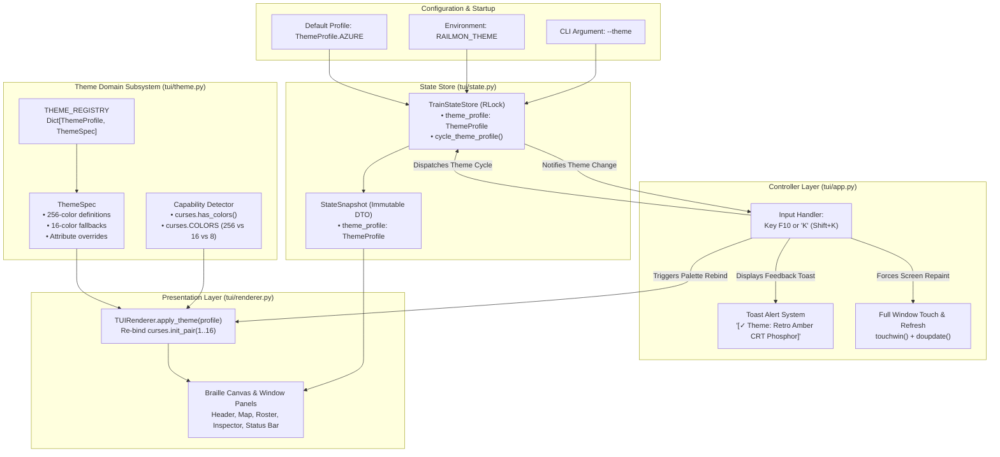
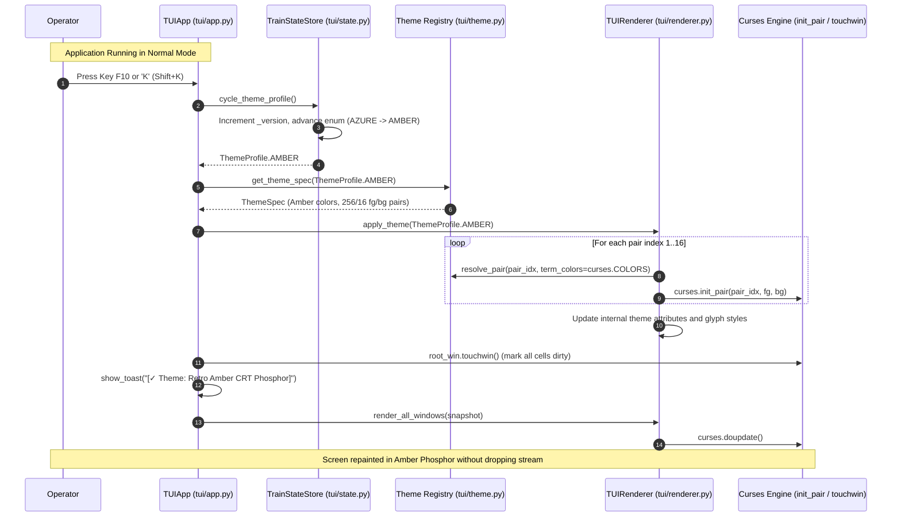
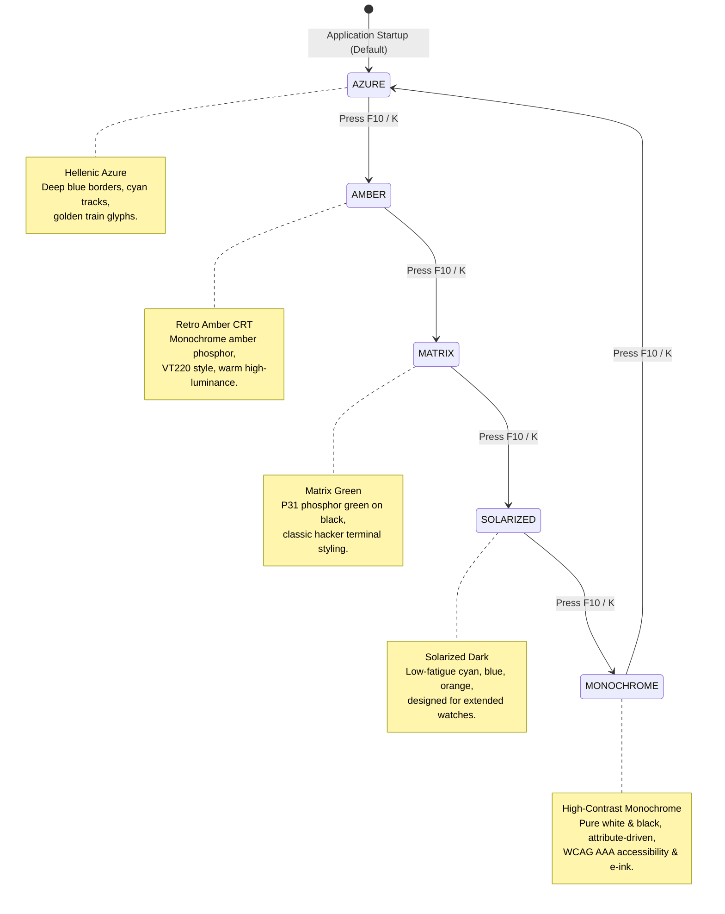
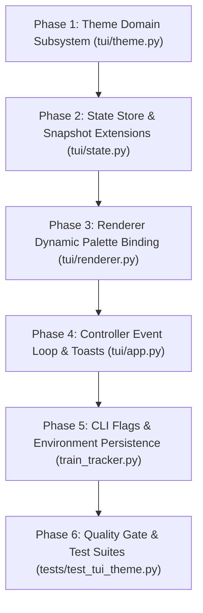

# Implementation Plan — F-7.3: Custom Terminal Color Theme Profiles (`F10` / `K`)

> **Reference:** [TUI Feature Enhancements Specification (`F-7.3`)](../../architecture/tui-feature-enhancements.md#f-73-custom-terminal-color-theme-profiles-f10--k--planned), [`docs/architecture/architecture.md`](../../architecture/architecture.md)  
> **Target Modules:** [`../../../tui/theme.py`](../../../tui/theme.py), [`../../../tui/state.py`](../../../tui/state.py), [`../../../tui/renderer.py`](../../../tui/renderer.py), [`../../../tui/app.py`](../../../tui/app.py), [`../../../train_tracker.py`](../../../train_tracker.py)  
> **Test Suites:** [`../../../tests/test_tui_theme.py`](../../../tests/test_tui_theme.py), [`../../../tests/test_tui_renderer.py`](../../../tests/test_tui_renderer.py), [`../../../tests/test_tui_controls.py`](../../../tests/test_tui_controls.py), [`../../../tests/test_tui_state.py`](../../../tests/test_tui_state.py)  
> **Relevant Skills & Guidelines:** [`../../../.agents/skills/diagrams-and-documentation/SKILL.md`](../../../.agents/skills/diagrams-and-documentation/SKILL.md), [`../../../.agents/skills/markdown-relative-paths/SKILL.md`](../../../.agents/skills/markdown-relative-paths/SKILL.md), [`../../../.agents/skills/ci-quality-gate/SKILL.md`](../../../.agents/skills/ci-quality-gate/SKILL.md), [`../../../.agents/skills/static-safety-analyzer/SKILL.md`](../../../.agents/skills/static-safety-analyzer/SKILL.md), [`../../../.agents/skills/tui-compatibility-tester/SKILL.md`](../../../.agents/skills/tui-compatibility-tester/SKILL.md)

---

## 1. Executive Summary & Objective

The `railmon` interactive terminal map dashboard provides mission-critical situational awareness across the Greek national rail network. Different operators monitor train movements under drastically divergent physical lighting environments and terminal configurations:
1. **Operations Dispatch Centers & Night Shifts:** Low-ambient light workstations require dark, low-fatigue, non-glare palettes to prevent eye strain during 8-hour supervisory watches.
2. **Field Deployments & Ruggedized Laptops:** Trackside maintenance crews operating outdoors in bright ambient sunlight require high-contrast monochrome or high-luminance palettes.
3. **Diverse Terminal Emulators:** Terminals range from modern 24-bit TrueColor/256-color GPU-accelerated emulators (Windows Terminal, iTerm2, Alacritty, Kitty) down to legacy 16-color or 8-color virtual consoles (Linux VT console, PuTTY, minimal serial TTYs).
4. **Accessibility Needs:** Color-vision deficient operators (protanopia, deuteranopia, tritanopia) or operators using monochrome / e-ink displays need functional attribute-based rendering (`A_BOLD`, `A_REVERSE`, `A_UNDERLINE`) where information is never conveyed exclusively through color hues.

Currently, [`tui/renderer.py`](../../../tui/renderer.py#L1048-L1100) hardcodes a single 16-color palette (white, cyan, blue, yellow, green, red, magenta) initialized once at application startup. Operators have no mechanism to switch visual profiles at runtime without quitting the program or modifying source code.

This implementation plan delivers **Feature F-7.3: Custom Terminal Color Theme Profiles (`F10` / `K`)**:
- **Theme Domain Architecture ([`tui/theme.py`](../../../tui/theme.py)):** A modular, zero-dependency theme subsystem defining strongly-typed color pairs, attributes, and 256-color / 16-color / 8-color fallback definitions for five distinct aesthetic and ergonomic profiles:
  1. **Hellenic Azure (Default):** Deep blue branding (`#002B7F` / Navy Blue), bright cyan mainline tracks, golden train glyphs, and high-contrast telemetry.
  2. **Retro Amber CRT Phosphor:** Nostalgic VT220 / P3 phosphor warmth (monochrome amber on deep black) with tiered intensity and standout alert pulsing.
  3. **Matrix Green:** Cyberpunk phosphor green (P31 cathode ray / IBM 3270) featuring electric green tracks and vivid terminal luminescence.
  4. **Solarized Dark:** The standard precision low-fatigue palette engineered by Ethan Schoonover, utilizing selective contrast across cyan, blue, yellow, and violet.
  5. **High-Contrast Monochrome:** Pure black-and-white for minimal serial consoles, e-ink displays, and WCAG AAA accessibility, rendering all operational states via visual attributes (`A_BOLD`, `A_REVERSE`, `A_UNDERLINE`, `A_DIM`).
- **Dynamic Curses Palette Re-binding:** Seamless runtime palette switching via `curses.init_pair()` without screen flicker, widget recreation, or stream disconnection.
- **Interactive Controller (`F10` / `K`):** Keyboard triggers in normal mode with cycling (`F10` or `Shift+K`), transient status bar toast notifications, and integration into the help modal (`?`).
- **CLI & Configuration Support:** Top-level `--theme {azure,amber,matrix,solarized,monochrome}` flag and `RAILMON_THEME` environment variable support for automated launch persistence.
- **Defensive Multi-Tier Fallback:** Automatic capability detection (`curses.has_colors()`, `curses.COLORS`, `curses.can_change_color()`) ensuring zero runtime crashes across all terminal geometries and terminal emulators.

---

## 2. Architecture & Visual Diagrams

### 2.1 System Architecture & Data Flow (Mermaid)



---

### 2.2 Sequence Diagram: Runtime Theme Switching Lifecycle (Mermaid)



---

### 2.3 State Machine: Theme Profile Cycling Sequence (Mermaid)



---

### 2.4 ASCII Architecture & Theme Preview Mockups

#### A. Multi-Profile Visual Rendering Mockup (ASCII)

```text
====================================================================================================
PROFILE 1: HELLENIC AZURE (DEFAULT) — Balanced Rich Chromatic Palette
+--------------------------------------------------------------------+------------------------------+
| RAILMON | HELLENIC RAILWAYS (railway.gov.gr) [Deep Blue Header]    | [ACTIVE TRAINS (14) | Sort:▼]|
| Track Canvas: [Bright Cyan Tracks]  | Train Markers: [Gold Yellow]  | > 1  1599  IC   142km/h  +9m |
| Status Bar:   [Reverse Blue/White]  | Delays: [Green / Yellow / Red]|   2  1597  IC   118km/h  +4m |
+--------------------------------------------------------------------+------------------------------+

PROFILE 2: RETRO AMBER CRT PHOSPHOR — Warm VT220 Monochrome Simulation
+--------------------------------------------------------------------+------------------------------+
| RAILMON | HELLENIC RAILWAYS (railway.gov.gr) [Bright Amber #FFB000]| [ACTIVE TRAINS (14) | Sort:▼]|
| Track Canvas: [Dim Amber #805000]   | Train Markers: [Bold Amber]   | > 1  1599  IC   142km/h  +9m |
| Status Bar:   [Amber Standout Bar]  | Alerts: [Pulsing Bright Amber]|   2  1597  IC   118km/h  +4m |
+--------------------------------------------------------------------+------------------------------+

PROFILE 3: MATRIX GREEN — P31 Cybernetic Terminal Styling
+--------------------------------------------------------------------+------------------------------+
| RAILMON | HELLENIC RAILWAYS (railway.gov.gr) [Phosphor Green #00FF66| [ACTIVE TRAINS (14) | Sort:▼]|
| Track Canvas: [Medium Green #008833]| Train Markers: [Bright Green] | > 1  1599  IC   142km/h  +9m |
| Status Bar:   [Black on Neon Green] | Alerts: [Reverse Bold Green]  |   2  1597  IC   118km/h  +4m |
+--------------------------------------------------------------------+------------------------------+

PROFILE 4: SOLARIZED DARK — Scientific Low-Fatigue Color Geometry
+--------------------------------------------------------------------+------------------------------+
| RAILMON | HELLENIC RAILWAYS (railway.gov.gr) [Base0 Cyan & Blue]   | [ACTIVE TRAINS (14) | Sort:▼]|
| Track Canvas: [Base01 Dark Cyan]    | Train Markers: [Solar Yellow] | > 1  1599  IC   142km/h  +9m |
| Status Bar:   [Base02 / Base1 Bar]  | Delays: [Red #DC322F / Orange]|   2  1597  IC   118km/h  +4m |
+--------------------------------------------------------------------+------------------------------+

PROFILE 5: HIGH-CONTRAST MONOCHROME — WCAG AAA / E-Ink / VT100 Serial
+--------------------------------------------------------------------+------------------------------+
| RAILMON | HELLENIC RAILWAYS (railway.gov.gr) [BOLD WHITE ON BLACK] | [ACTIVE TRAINS (14) | Sort:▼]|
| Track Canvas: [Dim Dots (· / -)]    | Train Markers: [BOLD GLYPHS]  | > 1  1599  IC   142km/h [!]  |
| Status Bar:   [REVERSE VIDEO BAR]   | Alerts: [REVERSE VIDEO BADGE] |   2  1597  IC   118km/h  0m  |
+--------------------------------------------------------------------+------------------------------+
====================================================================================================
```

#### B. Component Layer Topology

```text
+-----------------------------------------------------------------------------------+
|                            TUIApp Event Controller                                |
|  - Listens for curses.KEY_F10 and ord('K') (Shift+K) in InputMode.NORMAL          |
|  - Resolves CLI flag --theme and environment variable RAILMON_THEME               |
+-----------------------------------------------------------------------------------+
                                          |
                                          v
+-----------------------------------------------------------------------------------+
|                        TrainStateStore & StateSnapshot                            |
|  - Holds self._theme_profile: ThemeProfile (Protected by thread-safe RLock)       |
|  - Exposes cycle_theme_profile() -> ThemeProfile (Increments self._version)       |
+-----------------------------------------------------------------------------------+
                                          |
                                          v
+-----------------------------------------------------------------------------------+
|                       Theme Engine (tui/theme.py)                                 |
|  - THEME_REGISTRY: Maps ThemeProfile enum to ThemeSpec configurations             |
|  - Multi-tier color resolution: 256-color -> 16-color -> 8-color fallback         |
+-----------------------------------------------------------------------------------+
                                          |
                                          v
+-----------------------------------------------------------------------------------+
|                      TUIRenderer (tui/renderer.py)                                |
|  - apply_theme(profile): Calls curses.init_pair() for pairs 1 through 16          |
|  - safe_color_pair(): Retrieves active curses attribute safely                    |
|  - Repaints Map, Roster, Inspector, Timetable, Help Modal, and Status Bar         |
+-----------------------------------------------------------------------------------+
```

---

## 3. Technical Specifications & Palette Schemes

### 3.1 Curses Color Pair Mapping Architecture

`railmon` manages 16 standard color pairs defined in [`tui/renderer.py`](../../../tui/renderer.py#L70-L87). Each theme profile re-maps these exact pair indices to ensure 100% backward compatibility with all rendering functions:

| Pair Constant | Default Semantic Role | Hellenic Azure | Retro Amber CRT | Matrix Green | Solarized Dark | Monochrome (Attr) |
| :--- | :--- | :--- | :--- | :--- | :--- | :--- |
| `PAIR_DEFAULT` (1) | Normal text / baseline | White on Default | Amber (214) on Black | Green (46) on Black | Base0 (244) on Base03 | White on Black (`NORMAL`) |
| `PAIR_HEADER` (2) | Panel titles / headers | Cyan on Default | Amber (220) on Black | Green (82) on Black | Cyan (37) on Base03 | White on Black (`BOLD`) |
| `PAIR_BORDER` (3) | Box borders / dividers | Blue on Default | Dark Amber (130) | Dark Green (22) | Base01 (240) on Base03 | White on Black (`DIM`) |
| `PAIR_TRACK` (4) | Track polylines / rails | Cyan / White | Amber (178) on Black | Green (34) on Black | Blue (33) on Base03 | White on Black (`NORMAL`) |
| `PAIR_STATION` (5) | Major station hubs (◉) | Yellow on Default | Bright Amber (220) | Bright Green (46) | Yellow (136) on Base03 | White on Black (`BOLD`) |
| `PAIR_STATION_DIM` (6) | Minor / regional stops | Dim Yellow | Dim Amber (130) | Dim Green (28) | Base01 (240) on Base03 | White on Black (`DIM`) |
| `PAIR_TRAIN_ON_TIME` (7) | Train running $\le$ 3m delay | Green on Default | Pale Amber (215) | Bright Green (46) | Green (64) on Base03 | White on Black (`NORMAL`) |
| `PAIR_TRAIN_WARN` (8) | Train delay 4–10m | Yellow on Default | Amber (208) on Black | Pale Green (118) | Orange (166) on Base03 | White on Black (`UNDERLINE`) |
| `PAIR_TRAIN_ALERT` (9) | Train delay $>$ 10m / Error | Red on Default | Bright Red-Amber (196) | Reverse Green (46/0) | Red (160) on Base03 | Black on White (`REVERSE`) |
| `PAIR_TRAIN_PROAST` (10) | Proastiakos suburban train | Cyan on Default | Warm Amber (214) | Mint Green (48) | Violet (61) on Base03 | White on Black (`NORMAL`) |
| `PAIR_TRAIN_FREIGHT` (11) | Commercial freight cargo | Magenta on Default | Deep Amber (172) | Sage Green (65) | Magenta (125) on Base03 | White on Black (`DIM`) |
| `PAIR_TRAIN_HALTED` (12) | Stopped / 0 km/h train | White on Default | Dim Amber (130) | Dim Green (22) | Base01 (240) on Base03 | White on Black (`DIM`) |
| `PAIR_ROSTER_SELECT` (13) | Selected cursor row | Black on Cyan | Black on Amber (214) | Black on Green (46) | Base03 on Base0 (244) | Black on White (`REVERSE`) |
| `PAIR_TRAIL` (14) | Breadcrumb history dots | Green on Default | Dim Amber (130) | Dim Green (28) | Base01 (240) on Base03 | White on Black (`DIM`) |
| `PAIR_STATUS_BAR` (15) | Bottom command bar | Black on White | Black on Amber (214) | Black on Green (46) | Base03 on Base0 (244) | Black on White (`REVERSE`) |
| `PAIR_CONNECTED` (16) | SSE live link indicator | Green on Default | Bright Amber (220) | Bright Green (46) | Green (64) on Base03 | White on Black (`BOLD`) |

---

### 3.2 256-Color and 16-Color Specification Tables

#### 1. Hellenic Azure (Default Profile)
Designed to represent official Greek rail livery (cyan/navy/gold).
- **256-Color Mapping:**
  - `PAIR_DEFAULT`: FG `255` (White), BG `-1` (Transparent/Default)
  - `PAIR_HEADER`: FG `39` (Deep Sky Blue / Azure), BG `-1`
  - `PAIR_BORDER`: FG `32` (Deep Mediterranean Blue), BG `-1`
  - `PAIR_TRACK`: FG `45` (Bright Cyan / Turquoise), BG `-1`
  - `PAIR_STATION`: FG `220` (Bright Gold / Yellow), BG `-1`
  - `PAIR_STATION_DIM`: FG `178` (Dark Gold), BG `-1`
  - `PAIR_TRAIN_ON_TIME`: FG `42` (Emerald Green), BG `-1`
  - `PAIR_TRAIN_WARN`: FG `214` (Amber / Warning), BG `-1`
  - `PAIR_TRAIN_ALERT`: FG `196` (Electric Red), BG `-1`
  - `PAIR_TRAIN_PROAST`: FG `51` (Bright Cyan), BG `-1`
  - `PAIR_TRAIN_FREIGHT`: FG `177` (Medium Orchid / Violet), BG `-1`
  - `PAIR_TRAIN_HALTED`: FG `245` (Neutral Gray), BG `-1`
  - `PAIR_ROSTER_SELECT`: FG `16` (Obsidian Black), BG `39` (Deep Sky Blue)
  - `PAIR_TRAIL`: FG `38` (Light Sea Green), BG `-1`
  - `PAIR_STATUS_BAR`: FG `234` (Near Black), BG `252` (Off White)
  - `PAIR_CONNECTED`: FG `42` (Spring Green), BG `-1`
- **16-Color Fallback:** Standard ANSI `COLOR_WHITE`, `COLOR_CYAN`, `COLOR_BLUE`, `COLOR_YELLOW`, `COLOR_GREEN`, `COLOR_RED`, `COLOR_MAGENTA`.

#### 2. Retro Amber CRT Phosphor
Simulates classic VT220 / DEC terminal warm amber phosphor.
- **256-Color Mapping:**
  - Background: `232` (Obsidian Black) or `-1` (if default terminal background is preferred)
  - `PAIR_DEFAULT`: FG `214` (Classic Amber #FFB000), BG `232`
  - `PAIR_HEADER`: FG `220` (Bright Gold Amber), BG `232`
  - `PAIR_BORDER`: FG `130` (Dim Amber Phosphor), BG `232`
  - `PAIR_TRACK`: FG `178` (Medium Amber), BG `232`
  - `PAIR_STATION`: FG `220` (Luminous Amber), BG `232`
  - `PAIR_STATION_DIM`: FG `94` (Dark Amber), BG `232`
  - `PAIR_TRAIN_ON_TIME`: FG `214` (Normal Amber), BG `232`
  - `PAIR_TRAIN_WARN`: FG `208` (Deep Orange-Amber), BG `232`
  - `PAIR_TRAIN_ALERT`: FG `196` (Red-Shifted Intense Amber), BG `232`
  - `PAIR_TRAIN_PROAST`: FG `215` (Light Peach-Amber), BG `232`
  - `PAIR_TRAIN_FREIGHT`: FG `172` (Ochre Amber), BG `232`
  - `PAIR_TRAIN_HALTED`: FG `130` (Dim Amber), BG `232`
  - `PAIR_ROSTER_SELECT`: FG `232` (Black), BG `214` (Bright Amber)
  - `PAIR_TRAIL`: FG `94` (Faint Phosphor Trail), BG `232`
  - `PAIR_STATUS_BAR`: FG `232` (Black), BG `214` (Solid Amber)
  - `PAIR_CONNECTED`: FG `220` (Bright Amber), BG `232`
- **16-Color Fallback:** `COLOR_YELLOW` with `A_BOLD` for bright foreground, `A_DIM` for borders and trails, and `A_REVERSE` for selections.

#### 3. Matrix Green
High-contrast cyberpunk P31 phosphor green terminal.
- **256-Color Mapping:**
  - Background: `232` (Deep Black) or `-1`
  - `PAIR_DEFAULT`: FG `46` (Electric Lime Green #00FF66), BG `232`
  - `PAIR_HEADER`: FG `82` (Luminous Mint Green), BG `232`
  - `PAIR_BORDER`: FG `22` (Deep Forest Green), BG `232`
  - `PAIR_TRACK`: FG `34` (Medium High Green), BG `232`
  - `PAIR_STATION`: FG `46` (Bright Phosphor Green), BG `232`
  - `PAIR_STATION_DIM`: FG `28` (Dark Green), BG `232`
  - `PAIR_TRAIN_ON_TIME`: FG `46` (Bright Green), BG `232`
  - `PAIR_TRAIN_WARN`: FG `118` (Yellow-Green Phosphor), BG `232`
  - `PAIR_TRAIN_ALERT`: FG `232` (Black), BG `46` (Reverse Bright Green Badge)
  - `PAIR_TRAIN_PROAST`: FG `48` (Seafoam Matrix Green), BG `232`
  - `PAIR_TRAIN_FREIGHT`: FG `65` (Dark Sage Green), BG `232`
  - `PAIR_TRAIN_HALTED`: FG `22` (Dim Green), BG `232`
  - `PAIR_ROSTER_SELECT`: FG `232` (Black), BG `46` (Bright Phosphor)
  - `PAIR_TRAIL`: FG `28` (Fading Phosphor Green), BG `232`
  - `PAIR_STATUS_BAR`: FG `232` (Black), BG `46` (Neon Green Bar)
  - `PAIR_CONNECTED`: FG `82` (Bright Green), BG `232`
- **16-Color Fallback:** `COLOR_GREEN` with `A_BOLD`, `A_DIM`, and `A_REVERSE`.

#### 4. Solarized Dark
Engineered 16-color palette based on CIELAB color space uniformity.
- **256-Color Mapping:**
  - Base03 (Background): `234` (`#002b36`)
  - Base01 (Borders/Comments): `240` (`#586e75`)
  - Base0 (Body Text): `244` (`#839496`)
  - Base1 (Headers/Emphasized): `245` (`#93a1a1`)
  - `PAIR_DEFAULT`: FG `244` (Base0), BG `234` (Base03)
  - `PAIR_HEADER`: FG `37` (Solarized Cyan), BG `234`
  - `PAIR_BORDER`: FG `240` (Base01), BG `234`
  - `PAIR_TRACK`: FG `33` (Solarized Blue), BG `234`
  - `PAIR_STATION`: FG `136` (Solarized Yellow), BG `234`
  - `PAIR_STATION_DIM`: FG `240` (Base01), BG `234`
  - `PAIR_TRAIN_ON_TIME`: FG `64` (Solarized Green), BG `234`
  - `PAIR_TRAIN_WARN`: FG `166` (Solarized Orange), BG `234`
  - `PAIR_TRAIN_ALERT`: FG `160` (Solarized Red), BG `234`
  - `PAIR_TRAIN_PROAST`: FG `61` (Solarized Violet), BG `234`
  - `PAIR_TRAIN_FREIGHT`: FG `125` (Solarized Magenta), BG `234`
  - `PAIR_TRAIN_HALTED`: FG `240` (Base01), BG `234`
  - `PAIR_ROSTER_SELECT`: FG `234` (Base03), BG `244` (Base0)
  - `PAIR_TRAIL`: FG `240` (Base01), BG `234`
  - `PAIR_STATUS_BAR`: FG `234` (Base03), BG `245` (Base1)
  - `PAIR_CONNECTED`: FG `64` (Solarized Green), BG `234`
- **16-Color Fallback:** Maps cleanly to standard 16 ANSI colors with base background.

#### 5. High-Contrast Monochrome
Minimalist and high-accessibility profile adhering strictly to WCAG AAA contrast ratio ($\ge 7:1$).
- **Color Pairs:** Pure white (`COLOR_WHITE`) on black (`COLOR_BLACK`) or default (`-1`) across all pairs.
- **Attribute Encoding Matrix:**
  - `PAIR_DEFAULT`: `curses.A_NORMAL`
  - `PAIR_HEADER`: `curses.A_BOLD`
  - `PAIR_BORDER`: `curses.A_DIM` or `curses.A_NORMAL`
  - `PAIR_TRACK`: `curses.A_NORMAL`
  - `PAIR_STATION`: `curses.A_BOLD`
  - `PAIR_STATION_DIM`: `curses.A_DIM`
  - `PAIR_TRAIN_ON_TIME`: `curses.A_NORMAL`
  - `PAIR_TRAIN_WARN`: `curses.A_UNDERLINE | curses.A_BOLD`
  - `PAIR_TRAIN_ALERT`: `curses.A_REVERSE | curses.A_BOLD`
  - `PAIR_TRAIN_PROAST`: `curses.A_NORMAL`
  - `PAIR_TRAIN_FREIGHT`: `curses.A_DIM`
  - `PAIR_TRAIN_HALTED`: `curses.A_DIM`
  - `PAIR_ROSTER_SELECT`: `curses.A_REVERSE | curses.A_BOLD`
  - `PAIR_TRAIL`: `curses.A_DIM`
  - `PAIR_STATUS_BAR`: `curses.A_REVERSE`
  - `PAIR_CONNECTED`: `curses.A_BOLD`

---

## 4. Module-by-Module Technical Design

### 4.1 New Domain Module: `tui/theme.py`

This dedicated, zero-dependency module encapsulates all theme models, lookup tables, and color calculations.

```python
"""Terminal color theme profiles and palette management for railmon TUI."""

from dataclasses import dataclass
from enum import Enum, unique
from typing import Dict, List, Optional, Tuple
import curses


@unique
class ThemeProfile(Enum):
    """Available visual color theme profiles."""

    AZURE = "azure"              # Hellenic Azure (Default Greek rail livery)
    AMBER = "amber"              # Retro Amber CRT Phosphor (VT220 style)
    MATRIX = "matrix"            # Cyberpunk phosphor green (P31 cathode ray)
    SOLARIZED = "solarized"      # Solarized Dark precision low-fatigue palette
    MONOCHROME = "monochrome"    # High-contrast black & white (WCAG AAA / e-ink)


@dataclass(frozen=True)
class ColorPairDef:
    """Specification for a single curses color pair."""

    pair_id: int
    fg_256: int
    bg_256: int
    fg_16: int
    bg_16: int
    attr_override: Optional[int] = None


@dataclass(frozen=True)
class ThemeSpec:
    """Complete specification of a terminal theme profile."""

    profile: ThemeProfile
    display_name: str
    description: str
    pairs: Dict[int, ColorPairDef]
    has_custom_bg: bool = False
    bg_color_256: int = -1
    bg_color_16: int = -1


def build_azure_theme() -> ThemeSpec:
    """Construct Hellenic Azure default theme."""
    ...


def build_amber_theme() -> ThemeSpec:
    """Construct Retro Amber CRT phosphor theme."""
    ...


def build_matrix_theme() -> ThemeSpec:
    """Construct Matrix phosphor green theme."""
    ...


def build_solarized_theme() -> ThemeSpec:
    """Construct Solarized Dark low-fatigue theme."""
    ...


def build_monochrome_theme() -> ThemeSpec:
    """Construct High-Contrast Monochrome theme."""
    ...


THEME_ORDER: Tuple[ThemeProfile, ...] = (
    ThemeProfile.AZURE,
    ThemeProfile.AMBER,
    ThemeProfile.MATRIX,
    ThemeProfile.SOLARIZED,
    ThemeProfile.MONOCHROME,
)

THEME_REGISTRY: Dict[ThemeProfile, ThemeSpec] = {
    ThemeProfile.AZURE: build_azure_theme(),
    ThemeProfile.AMBER: build_amber_theme(),
    ThemeProfile.MATRIX: build_matrix_theme(),
    ThemeProfile.SOLARIZED: build_solarized_theme(),
    ThemeProfile.MONOCHROME: build_monochrome_theme(),
}


def get_theme_spec(profile: ThemeProfile) -> ThemeSpec:
    """Retrieve theme specification by profile enum."""
    if not isinstance(profile, ThemeProfile):
        raise TypeError(f"Expected ThemeProfile enum, got {type(profile).__name__}: {profile}")
    return THEME_REGISTRY[profile]


def get_next_theme(current: ThemeProfile) -> ThemeProfile:
    """Return next sequential theme profile in cycle order."""
    if not isinstance(current, ThemeProfile):
        raise TypeError(f"Expected ThemeProfile enum, got {type(current).__name__}: {current}")
    idx = THEME_ORDER.index(current)
    return THEME_ORDER[(idx + 1) % len(THEME_ORDER)]


def parse_theme_name(name: Optional[str]) -> Optional[ThemeProfile]:
    """Parse a string theme identifier (case-insensitive) into a ThemeProfile."""
    if not name or not name.strip():
        return None
    cleaned = name.strip().lower().replace("-", "_")
    for profile in ThemeProfile:
        if profile.value == cleaned:
            return profile
    # Common aliases
    aliases = {
        "hellenic": ThemeProfile.AZURE,
        "default": ThemeProfile.AZURE,
        "blue": ThemeProfile.AZURE,
        "crt": ThemeProfile.AMBER,
        "vt220": ThemeProfile.AMBER,
        "green": ThemeProfile.MATRIX,
        "solarized_dark": ThemeProfile.SOLARIZED,
        "mono": ThemeProfile.MONOCHROME,
        "bw": ThemeProfile.MONOCHROME,
    }
    return aliases.get(cleaned)
```

---

### 4.2 State Layer Extensions: `tui/state.py`

1. **State Store Initialization & Methods:**
   - Add `self._theme_profile: ThemeProfile = ThemeProfile.AZURE` to [`TrainStateStore.__init__`](../../../tui/state.py).
   - Implement `set_theme_profile(profile: ThemeProfile) -> None`: Validates enum type, updates state, and increments `self._version` if modified.
   - Implement `cycle_theme_profile() -> ThemeProfile`: Cycles through `THEME_ORDER` atomically under `self._lock` and returns the newly active profile.
2. **State Snapshot Immutability:**
   - Expose `theme_profile: ThemeProfile = ThemeProfile.AZURE` on [`StateSnapshot`](../../../tui/state.py).
   - In [`TrainStateStore.get_snapshot`](../../../tui/state.py), populate `theme_profile=self._theme_profile`.

---

### 4.3 Rendering Engine Integration: `tui/renderer.py`

1. **Renderer State:**
   - Add `self.active_theme: ThemeProfile = ThemeProfile.AZURE` in `TUIRenderer.__init__`.
   - Store active attribute overrides mapping: `self._attr_overrides: Dict[int, int] = {}`.
2. **Dynamic Palette Application:**
   ```python
   def apply_theme(self, profile: ThemeProfile) -> bool:
       """Re-initialize curses color pairs for the designated theme profile.

       Args:
           profile: Target ThemeProfile enum.

       Returns:
           True if colors were successfully initialized/re-bound, False if curses has no colors.
       """
       if not isinstance(profile, ThemeProfile):
           raise TypeError(f"Expected ThemeProfile, got {type(profile).__name__}: {profile}")

       self.active_theme = profile
       spec = get_theme_spec(profile)
       self._attr_overrides = {
           pair_id: p_def.attr_override
           for pair_id, p_def in spec.pairs.items()
           if p_def.attr_override is not None
       }

       if not curses.has_colors():
           return False

       num_colors = getattr(curses, "COLORS", 8)
       use_256 = num_colors >= 256
       max_pairs = getattr(curses, "COLOR_PAIRS", 64)

       global _INITIALIZED_COLOR_PAIRS
       _INITIALIZED_COLOR_PAIRS.clear()

       for pair_id, p_def in spec.pairs.items():
           if pair_id >= max_pairs:
               continue
           fg = p_def.fg_256 if use_256 else p_def.fg_16
           bg = p_def.bg_256 if use_256 else p_def.bg_16
           try:
               curses.init_pair(pair_id, fg, bg)
               _INITIALIZED_COLOR_PAIRS.add(pair_id)
           except curses.error:
               pass
       return True
   ```
3. **Safe Attribute Resolution (`safe_color_pair`):**
   - Enhance `safe_color_pair(pair_idx: int, fallback_attr: int = curses.A_NORMAL) -> int` to automatically blend `self._attr_overrides.get(pair_idx)` when monochrome mode or specific theme attribute overrides are active.
4. **Header Indicator & Status Bar:**
   - Update [`TUIRenderer.render_header`](../../../tui/renderer.py) and [`TUIRenderer.render_status_bar`](../../../tui/renderer.py) to display current theme abbreviation when non-default (e.g., `[Theme: AMBER]`).
   - Add `[F10/K] Theme` to the status bar key shortcut list.
   - Document `F10` and `K` in [`TUIRenderer.render_help_modal`](../../../tui/renderer.py).

---

### 4.4 Controller Layer Integration: `tui/app.py`

1. **Input Dispatcher:**
   - In [`TUIApp._handle_normal_input`](../../../tui/app.py):
     ```python
     # Cycle Terminal Color Theme Profile (F-7.3)
     elif key in (getattr(curses, "KEY_F10", 274), ord("K")):
         self.cycle_theme()
     ```
   - In `InputMode.SEARCH`, typing `K` continues to append `'K'` to `search_buffer` without triggering theme cycling.
2. **Cycle Method Implementation:**
   ```python
   def cycle_theme(self) -> ThemeProfile:
       """Cycle to next terminal color theme and rebind curses palette."""
       new_theme = self.store.cycle_theme_profile()
       self.renderer.apply_theme(new_theme)
       spec = get_theme_spec(new_theme)
       self.show_toast(f"[✓ Theme: {spec.display_name}]")
       if self.root_win:
           try:
               self.root_win.touchwin()
           except curses.error:
               pass
       self.is_dirty = True
       return new_theme
   ```

---

### 4.5 Top-Level CLI & Environment Persistence: `train_tracker.py`

1. **CLI Flag Declaration:**
   ```python
   parser.add_argument(
       "--theme",
       type=str,
       default=None,
       choices=["azure", "amber", "matrix", "solarized", "monochrome"],
       help="Initial terminal color theme profile for TUI dashboard (default: azure or $RAILMON_THEME).",
   )
   ```
2. **Environment Variable Fallback:**
   - Read `os.environ.get("RAILMON_THEME")` if `--theme` is not supplied.
   - Pass resolved initial theme profile to `TUIApp(..., initial_theme=...)` or `TrainStateStore(..., initial_theme=...)`.

---

## 5. UI / UX Design & Operator Interaction

### 5.1 Keybinding Specifications
- **Primary Function Key:** `F10` (`curses.KEY_F10` = 274)
- **Ergonomic Letter Key:** `K` (`ord("K")`, Shift+K)
  - *Note:* Lowercase `k` remains bound to **Pan Up** (`ord("k")` / `curses.KEY_UP`). Shift+K (`K`) is specifically selected because it matches existing uppercase/lowercase paradigms (`v`/`V`, `t`/`T`, `s`/`S`, `b`/`B`, `m`/`M`).

### 5.2 Status Bar Toast Notifications
When cycling, a 2.5-second transient toast alert is displayed on the bottom status bar:
- `[✓ Theme: Hellenic Azure (Default)]`
- `[✓ Theme: Retro Amber CRT Phosphor]`
- `[✓ Theme: Matrix Green Phosphor]`
- `[✓ Theme: Solarized Dark Low-Fatigue]`
- `[✓ Theme: High-Contrast Monochrome (WCAG AAA)]`

### 5.3 Help Modal Documentation (`?`)
Update the `VIEWPORT & DISPLAY CONTROLS` category in [`TUIRenderer.render_help_modal`](../../../tui/renderer.py):
```text
  F10 / K             Cycle Color Themes (Azure, Amber, Matrix, Solarized, Mono)
```

---

## 6. Step-by-Step Implementation Roadmap



### Phase 1: Theme Domain Subsystem (`tui/theme.py`)
- Define `ThemeProfile` enum (`AZURE`, `AMBER`, `MATRIX`, `SOLARIZED`, `MONOCHROME`).
- Implement `ColorPairDef` and `ThemeSpec` dataclasses.
- Build color specification dictionaries with both 256-color and 16-color mappings for all 16 `PAIR_*` indices.
- Implement `get_theme_spec()`, `get_next_theme()`, and `parse_theme_name()` with strict validation.
- Export new types in [`tui/__init__.py`](../../../tui/__init__.py).

### Phase 2: State Store & Snapshot Extensions (`tui/state.py`)
- Add `_theme_profile` to `TrainStateStore` with default `ThemeProfile.AZURE`.
- Implement thread-safe `set_theme_profile()` and `cycle_theme_profile()`.
- Extend `StateSnapshot` with immutable `theme_profile` field.
- Verify state immutability and version increments.

### Phase 3: Dynamic Palette Application in Renderer (`tui/renderer.py`)
- Implement `TUIRenderer.apply_theme(profile: ThemeProfile) -> bool`.
- Update `safe_color_pair()` to blend theme attribute overrides.
- Update `init_colors()` to invoke `apply_theme(self.active_theme)`.
- Update help modal and bottom status bar shortcuts to include `F10 / K`.

### Phase 4: Controller Event Handling (`tui/app.py`)
- Bind `curses.KEY_F10` and `ord("K")` in `_handle_normal_input`.
- Implement `TUIApp.cycle_theme()`.
- Add window dirty marking and screen invalidation via `root_win.touchwin()`.
- Show transient feedback toast.

### Phase 5: CLI & Environment Support (`train_tracker.py`)
- Add `--theme` option to `argparse` with choices `["azure", "amber", "matrix", "solarized", "monochrome"]`.
- Support `RAILMON_THEME` environment variable fallback.
- Wire `--theme` into `run_tui(...)` and `TUIApp.__init__`.

### Phase 6: Automated Testing & Quality Gate
- Author comprehensive unit tests in [`tests/test_tui_theme.py`](../../../tests/test_tui_theme.py).
- Extend renderer tests in [`tests/test_tui_renderer.py`](../../../tests/test_tui_renderer.py).
- Extend controls tests in [`tests/test_tui_controls.py`](../../../tests/test_tui_controls.py).
- Extend state tests in [`tests/test_tui_state.py`](../../../tests/test_tui_state.py).
- Run full CI quality gate: pytest with coverage, flake8 linting, mypy strict type checking, and black formatting verification.

---

## 7. Test Strategy & Verification Plan

### 7.1 Unit Testing Matrix (`tests/test_tui_theme.py`)
1. **Enum & Registry Completeness:**
   - Assert all 5 theme profiles exist and have registered `ThemeSpec` instances.
   - Assert all 16 `PAIR_*` indices (1 through 16) are defined in every theme specification.
2. **Cycling Sequence & Idempotency:**
   - Assert cycling through `get_next_theme()` traverses:
     $\text{AZURE} \rightarrow \text{AMBER} \rightarrow \text{MATRIX} \rightarrow \text{SOLARIZED} \rightarrow \text{MONOCHROME} \rightarrow \text{AZURE}$.
3. **Defensive Name Parsing:**
   - Assert `parse_theme_name()` resolves valid names, lowercase, uppercase, and aliases (`crt` $\rightarrow$ `AMBER`, `mono` $\rightarrow$ `MONOCHROME`, `blue` $\rightarrow$ `AZURE`).
   - Assert `parse_theme_name()` returns `None` for invalid or empty strings without raising unhandled exceptions.
4. **Color Capability Degradation:**
   - Test `apply_theme()` under mock `curses.COLORS = 256` (verifying 256-color codes passed to `init_pair`).
   - Test `apply_theme()` under mock `curses.COLORS = 8` (verifying 16/8-color codes passed to `init_pair`).
   - Test `apply_theme()` under mock `curses.has_colors() == False` (verifying graceful degradation, returning `False` without exception).

### 7.2 Controller & State Integration Tests (`tests/test_tui_controls.py` & `test_tui_state.py`)
1. **Key Dispatching:**
   - Assert `curses.KEY_F10` triggers `cycle_theme()` in `NORMAL` mode.
   - Assert `ord("K")` triggers `cycle_theme()` in `NORMAL` mode.
   - Assert `ord("k")` triggers `pan(d_lat=+...)` (upward pan) without changing theme.
   - Assert `ord("K")` in `SEARCH` mode appends `"K"` to search query without changing theme.
2. **State Concurrency & Snapshots:**
   - Assert `cycle_theme_profile()` updates snapshot and increments version under thread contention.
   - Assert `TypeError` raised if invalid type passed to `set_theme_profile()`.

### 7.3 CI Quality Gate Commands
```bash
# 1. Run unit test suite
python -m unittest tests/test_tui_theme.py tests/test_tui_controls.py tests/test_tui_renderer.py tests/test_tui_state.py -v

# 2. Strict type checking
mypy --strict tui/theme.py tui/state.py tui/renderer.py tui/app.py train_tracker.py

# 3. Flake8 style audit
flake8 tui/ tests/ train_tracker.py --max-line-length=120

# 4. Black code formatting verification
black --check tui/ tests/ train_tracker.py
```

---

## 8. Rollout, Backward Compatibility & Degradation Modes

1. **Zero Breaking Changes:**
   - Default theme profile remains `ThemeProfile.AZURE` (`PAIR_*` indices remain identical to existing baseline).
   - All renderer functions continue using standard `safe_color_pair(PAIR_*)` calls.
2. **Standard Library Purity:**
   - Implemented strictly with Python's standard library `curses`, `enum`, `dataclasses`, and `typing`. Zero external package dependencies introduced.
3. **Monochrome / Serial Terminal Graceful Degradation:**
   - If a user runs `railmon` on a terminal without color support (`TERM=vt100` or `TERM=dumb`), `curses.has_colors()` evaluates to `False`. The renderer automatically preserves visibility through curses attributes (`A_BOLD`, `A_REVERSE`, `A_DIM`) as defined in the Monochrome profile.
4. **Safe Re-entrance:**
   - Re-calling `curses.init_pair()` for existing color pairs is safe and fully defined in Curses/ncurses specification; ncurses automatically invalidates internal cell color buffers and repaints characters with updated RGB values on the next window refresh.
