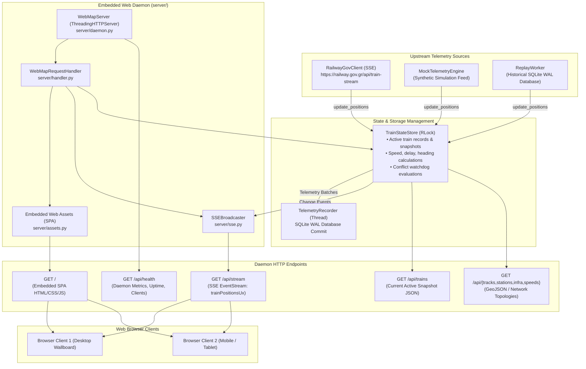
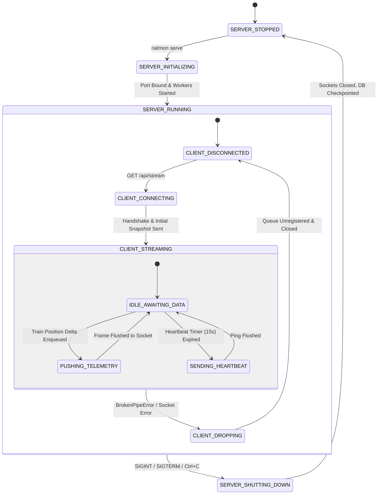

# Implementation Plan — F-8.1: Embedded Zero-Dependency Web Map Daemon (`railmon serve`)

> **Reference:** [TUI Feature Enhancements Specification (`F-8.1`)](../../architecture/tui-feature-enhancements.md#f-81-embedded-zero-dependency-web-map-daemon-railmon-serve--planned), [`docs/architecture/architecture.md`](../../architecture/architecture.md)  
> **Target Modules:** [`../../../server/__init__.py`](../../../server/__init__.py), [`../../../server/daemon.py`](../../../server/daemon.py), [`../../../server/handler.py`](../../../server/handler.py), [`../../../server/sse.py`](../../../server/sse.py), [`../../../server/assets.py`](../../../server/assets.py), [`../../../train_tracker.py`](../../../train_tracker.py), [`../../../storage/db.py`](../../../storage/db.py), [`../../../storage/recorder.py`](../../../storage/recorder.py)  
> **Test Suites:** [`../../../tests/test_server_daemon.py`](../../../tests/test_server_daemon.py), [`../../../tests/test_server_sse.py`](../../../tests/test_server_sse.py), [`../../../tests/test_server_assets.py`](../../../tests/test_server_assets.py), [`../../../tests/test_cli_serve.py`](../../../tests/test_cli_serve.py)  
> **Relevant Skills & Guidelines:** [`../../../.agents/skills/diagrams-and-documentation/SKILL.md`](../../../.agents/skills/diagrams-and-documentation/SKILL.md), [`../../../.agents/skills/markdown-relative-paths/SKILL.md`](../../../.agents/skills/markdown-relative-paths/SKILL.md), [`../../../.agents/skills/ci-quality-gate/SKILL.md`](../../../.agents/skills/ci-quality-gate/SKILL.md), [`../../../.agents/skills/static-safety-analyzer/SKILL.md`](../../../.agents/skills/static-safety-analyzer/SKILL.md), [`../../../.agents/skills/stream-resilience-tester/SKILL.md`](../../../.agents/skills/stream-resilience-tester/SKILL.md), [`../../../.agents/skills/memory-leak-profiler/SKILL.md`](../../../.agents/skills/memory-leak-profiler/SKILL.md), [`../../../.agents/skills/security-audit/SKILL.md`](../../../.agents/skills/security-audit/SKILL.md)

---

## 1. Executive Summary & Operational Context

The `railmon` toolkit provides comprehensive real-time situational awareness across the Hellenic Railways (`railway.gov.gr`) network through its interactive Curses Terminal User Interface (`railmon --tui`) and rich command-line utilities (`departures`, `schedule`, `conflicts`, `cab`, `watch`, `history`). While the terminal interface delivers high-density, low-latency monitoring with zero-dependency purity, modern operational railway oversight frequently requires:
1. **Multi-User Dispatch & Wallboards:** Operations control rooms, customer service desks, and incident response teams require a browser-accessible GIS display suitable for large overhead wall monitors and distributed workstations without requiring remote terminal access or SSH sessions.
2. **High-Fidelity Geospatial Cartography:** Satellite imagery, street-level cartography, topographic contours, zoom levels up to street scale ($z=18$), smooth pan/zoom kinematics, and fluid 60 FPS CSS/WebGL hardware-accelerated rendering beyond terminal grid dimensions.
3. **Multi-Platform Access:** Instant mobile and tablet browser visibility for trackside maintenance personnel, station masters, and field technicians inspecting train movements without installing terminal emulators or Python runtimes on their handheld devices.
4. **Zero-Dependency Headless Daemon Purity:** Standard railway IT environments, edge compute devices (Raspberry Pi, industrial fanless box PCs, trackside telemetry cabinets), and air-gapped supervisory servers strictly prohibit complex runtime stacks, external C-extensions, or extensive package managers. The server must execute entirely within the **Python standard library** (`http.server`, `socketserver`, `threading`, `json`, `sqlite3`, `urllib`), requiring **zero third-party PyPI packages** (`pip install` not required).

This implementation plan delivers **Feature F-8.1: Embedded Zero-Dependency Web Map Daemon (`railmon serve`)**:
- **Zero-Dependency Web Server Engine ([`server/daemon.py`](../../../server/daemon.py)):** A multi-threaded, robust HTTP daemon built on Python's standard-library `http.server.ThreadingHTTPServer` and `socketserver.ThreadingMixIn`. It serves static assets, provides REST endpoints for static GIS layers, and streams real-time updates without third-party frameworks (no Flask, FastAPI, Tornado, or external ASGI/WSGI servers).
- **Real-Time Server-Sent Events (SSE) Engine ([`server/sse.py`](../../../server/sse.py)):** An asynchronous broadcast bus maintaining connected browser client connections over HTTP/1.1 chunked transfer encoding (`text/event-stream`), broadcasting live train position delta frames (`trainPositionsUx`), conflict warnings, and periodic heartbeat frames (`:ping\n\n`) with automatic client disconnect cleanup and bounded buffer memory leak prevention.
- **Embedded Single-Page GIS Dashboard ([`server/assets.py`](../../../server/assets.py)):** A responsive web application (HTML5, modern CSS3, vanilla ES6 JavaScript) embedding a Leaflet map. It visualizes the entire Greek rail network (tracks, stations, tunnels, bridges, signals), plots moving trains with smooth heading-oriented locomotive glyphs, speed badges, and delay indicators, and renders live conflict watchdog warnings with zero build steps or node/npm dependencies.
- **Unified Telemetry Pipeline Integration:** Seamlessly attaches to live `RailwayGovClient` SSE feeds, offline demo simulation (`--demo` / `--mock`), concurrent SQLite WAL recording (`--record` / `--db`), and historical DVR replay playback (`--replay <db>`).
- **Comprehensive CLI Control & Ergonomics:** A first-class CLI subcommand `railmon serve` supporting configurable network interfaces (`--host`, `--port`), automatic browser launch (`--open-browser` / `-b`), CORS toggles (`--cors`), and map tile presets (`--tile-provider`).

---

## 2. Architecture & Visual Diagrams

### 2.1 System Architecture & Ingestion Topology (Mermaid)



---

### 2.2 System Architecture & Process Topology (ASCII)

```text
+---------------------------------------------------------------------------------------------------+
|                                RAILMON EMBEDDED WEB MAP ARCHITECTURE                              |
+---------------------------------------------------------------------------------------------------+

 [ Upstream Feed ]            [ Storage Layer ]               [ In-Memory Domain State ]
  +------------------+         +------------------+            +----------------------------------+
  | RailwayGovClient |         | TelemetryRecorder|            | TrainStateStore (RLock)          |
  | (Live SSE / Demo)| ------> | (SQLite WAL DB)  | <--------> |  - Active Train Positions        |
  +------------------+         +------------------+            |  - Speed Sparklines & Headings   |
                                                               |  - Conflict Watchdog Engine      |
                                                               +----------------------------------+
                                                                                 |
                                                                    push_batch() | notify()
                                                                                 v
+---------------------------------------------------------------------------------------------------+
| EMBEDDED HTTP DAEMON (server/daemon.py & server/handler.py)                                       |
| Standard Library: http.server.ThreadingHTTPServer on http://127.0.0.1:8080                        |
+---------------------------------------------------------------------------------------------------+
  |
  +---> GET /                   --> WebMapRequestHandler -> Embedded SPA (HTML5 / Modern JS / CSS)
  +---> GET /api/stream         --> SSEBroadcaster       -> text/event-stream (Push Updates)
  +---> GET /api/trains         --> TrainStateStore      -> application/json (Snapshot)
  +---> GET /api/tracks         --> Geo Assets           -> application/geo+json (Tracks)
  +---> GET /api/stations       --> Geo Assets           -> application/geo+json (Stations)
  +---> GET /api/infrastructure --> Geo Assets           -> application/geo+json (Tunnels/Bridges)
  +---> GET /api/speed-limits   --> Geo Assets           -> application/json (Line Speeds)
  +---> GET /api/conflicts      --> Watchdog Evaluator   -> application/json (Active Alerts)
  +---> GET /api/health         --> Server Telemetry     -> application/json (Metrics & Uptime)
  |
  v
+---------------------------------------------------------------------------------------------------+
| CONNECTED CLIENTS (Desktop Chrome / Firefox / Safari / Mobile Edge / Wallboard)                   |
|  - Leaflet Map: CartoDB Dark/Light or OSM Tiles                                                   |
|  - Vector Layers: Railway Tracks (color-coded), Stations, Signals, Tunnels, Bridges               |
|  - Dynamic Entities: Live Train Markers, Direction Glyphs, Speed Badges, Breadcrumbs              |
|  - Operator HUD: Sortable/Searchable Roster, Telemetry Inspector, Conflict Banners               |
+---------------------------------------------------------------------------------------------------+
```

---

### 2.3 Client Connection & EventStream Lifecycle (Sequence Diagram — Mermaid)

```mermaid
sequenceDiagram
    autonumber
    participant Browser as Web Browser (Leaflet Client)
    participant Daemon as WebMapServer (ThreadingHTTPServer)
    participant Handler as WebMapRequestHandler
    participant Broadcaster as SSEBroadcaster
    participant Store as TrainStateStore

    Note over Browser,Daemon: 1. Initial Page Load & Static Asset Bootstrap
    Browser->>Daemon: GET / HTTP/1.1
    Daemon->>Handler: Dispatch route "/"
    Handler-->>Browser: 200 OK (text/html; embedded single-page app)
    
    Browser->>Daemon: GET /api/tracks HTTP/1.1
    Handler->>Store: Load cached tracks GeoJSON
    Handler-->>Browser: 200 OK (application/geo+json)

    Browser->>Daemon: GET /api/stations HTTP/1.1
    Handler->>Store: Load cached stations GeoJSON
    Handler-->>Browser: 200 OK (application/geo+json)

    Note over Browser,Broadcaster: 2. Real-Time Telemetry Stream Subscription
    Browser->>Daemon: GET /api/stream HTTP/1.1 (Accept: text/event-stream)
    Daemon->>Handler: Upgrade to SSE stream
    Handler->>Broadcaster: register_client(queue, client_id)
    Broadcaster-->>Handler: client_channel_ready
    Handler-->>Browser: HTTP/1.1 200 OK\nContent-Type: text/event-stream\nCache-Control: no-cache

    Handler->>Store: get_snapshot()
    Handler-->>Browser: event: init\ndata: {"trains": [...], "conflicts": [...]}\n\n

    Note over Broadcaster,Browser: 3. Streaming Event Loop & Live Telemetry Push
    loop Ingestion Thread Receives Position Delta
        Store->>Broadcaster: broadcast_event("trainPositionsUx", payload)
        Broadcaster->>Broadcaster: Enqueue to all active client queues
        Handler->>Broadcaster: queue.get(timeout=1.0)
        Handler-->>Browser: event: trainPositionsUx\ndata: [{...}]\n\n
    end

    Note over Broadcaster,Browser: 4. Periodic Keepalive Heartbeat
    loop Every 15 Seconds of Inactivity
        Broadcaster-->>Browser: :ping\n\n
    end

    Note over Browser,Broadcaster: 5. Clean Client Disconnect
    Browser->>Handler: TCP FIN / Socket Close (Tab closed or page reloaded)
    Handler->>Handler: Catch BrokenPipeError / ConnectionResetError
    Handler->>Broadcaster: unregister_client(client_id)
    Broadcaster->>Broadcaster: Release queue & decrement active_clients metric
    Note over Broadcaster: Memory leak prevented; no dangling thread or queue
```

---

### 2.4 Server & SSE Client State Machine (Mermaid)



---

### 2.5 Web Application Layout Mockup (ASCII)

```text
+----------------------------------------------------------------------------------------------------+
|  RAILMON WEB MAP  |  Hellenic Railways (railway.gov.gr)  |  [● LIVE SSE]  |  Active: 14  |  Dly: 3  |
+----------------------------------------------------------------------+-----------------------------+
|  [ MAP CONTROLS: (Dark | Light | OSM) | Layers: [x]Tracks [x]Stations [x]Infra [x]Trails ]       |
+----------------------------------------------------------------------+-----------------------------+
|                                                                      | [ACTIVE TRAINS (14)]        |
|    THESSALONIKI                                                      | Search: [_________] Sort:▼  |
|         ◉==========================                                  |-----------------------------|
|           \                        \                                 | > 1599  IC   142 km/h  +9m  |
|            \ Platy                  \ Kilkis                         |   1597  IC   118 km/h  +4m  |
|             ◉===                     ◉                               |   2232  PR   114 km/h   0m  |
|              \  \                                                    |   1314  PR    92 km/h  +1m  |
|               \  \ Katerini                                          |   2236  PR    86 km/h   0m  |
|                \  ◉                                                  |   1598  IC     0 km/h   0m  |
|                 \  \   ▲ [1599] (142 km/h, +9m)                      +-----------------------------+
|                  \  \  ·                                             | [SELECTED TRAIN: 1599]      |
|                   \  ◉ Larissa                                       | Type:       InterCity (IC)  |
|                    \  \  ·                                           | Engine:     120-024 (Sprnt) |
|                     \  \  ·                                          | Route:      ΑΘΗΝ -> ΘΕΣΣ    |
|                      \  ◉ Domokos                                    | Speed:      142.0 km/h      |
|                       \  \                                           | Speed Trend: ▂▃▅▆▇██▇▇█     |
|                        \  ◉ Lianokladi                               | Delay:      +9 min (Minor)  |
|                         \  \                                         | Next Stop:  Larissa (14km)  |
|                          \  ◉ Tithorea                               | ETA:        ~6 min          |
|                           \  \  [TUNNEL: Kallidromo]                 | Coords:     39.4821, 22.3412|
|                            \  ◉ Oinoi                                | Cab Stream: [▶ Watch Video] |
|                             \  \                                     +-----------------------------+
|                              \  ◉ ATHENS CENTRAL                     | [NETWORK HEALTH]            |
|                                                                      | Ingestion:  10.2 ms latency |
|  [SCALE: 50 km | Coordinates: 39.4821°N, 22.3412°E]                  | SSE Clients: 3 Connected    |
+----------------------------------------------------------------------+-----------------------------+
| [!] WATCHDOG CONFLICT WARNING: Headway compression on IC52 / IC53 (Distance: 1.8km) [DETAILS]      |
+----------------------------------------------------------------------------------------------------+
```

---

## 3. Component Technical Specifications & Data Contracts

### 3.1 REST API & Server-Sent Events Protocol

The embedded daemon exposes a clean, self-documenting JSON / GeoJSON REST API alongside the SSE real-time stream:

| HTTP Method | Route | Response Content-Type | Description & Caching Policy |
| :--- | :--- | :--- | :--- |
| `GET` | `/` | `text/html; charset=utf-8` | Embedded responsive SPA dashboard. `Cache-Control: no-cache`. |
| `GET` | `/api/stream` | `text/event-stream; charset=utf-8` | Real-time SSE streaming connection. `Cache-Control: no-cache, no-transform`. |
| `GET` | `/api/trains` | `application/json` | Snapshot array of all active trains with coordinates, speed, delay, and heading. |
| `GET` | `/api/tracks` | `application/geo+json` | LineString GeoJSON geometry of Greek rail network corridors (`tui/data/tracks.json`). |
| `GET` | `/api/stations` | `application/geo+json` | Point GeoJSON geometry of railway passenger and junction stations (`tui/data/stations.json`). |
| `GET` | `/api/infrastructure` | `application/geo+json` | Point & LineString GeoJSON of tunnels, bridges, and interlocking signals (`tui/data/infrastructure.json`). |
| `GET` | `/api/speed-limits` | `application/json` | Corridor speed limits and active Temporary Speed Restrictions (TSR) (`tui/data/speed_limits.json`). |
| `GET` | `/api/conflicts` | `application/json` | Active headway violations and opposing collision course alerts evaluated by `watchdog.py`. |
| `GET` | `/api/health` | `application/json` | Daemon operational health: uptime, client count, ingestion mode, queue drops, and database size. |
| `GET` | `/api/history/train/{id}` | `application/geo+json` | Historical trajectory breadcrumb LineString for a train from the SQLite database (if `--record` or `--db` active). |

---

### 3.2 SSE Event Framing & Message Schema

The `/api/stream` endpoint implements standard W3C Server-Sent Events framing:
```text
event: <event_name>\n
data: <json_payload>\n\n
```

#### Event Types:
1. **`init`**: Dispatched immediately upon client handshake. Contains full network snapshot:
   ```json
   {
     "server_time": "2026-11-22T20:15:00Z",
     "version": "0.1.0",
     "mode": "live",
     "active_trains_count": 14,
     "trains": [
       {
         "id": "1599",
         "train_number": "1599",
         "type": "IC",
         "lat": 39.4821,
         "lng": 22.3412,
         "speed": 142.0,
         "delay": 9.0,
         "heading": 178.5,
         "last_update": "2026-11-22T20:14:58Z",
         "line_name": "PATHE Mainline",
         "next_station": "Larissa",
         "distance_to_next_m": 14200.0,
         "eta_next_seconds": 360
       }
     ],
     "conflicts": []
   }
   ```
2. **`trainPositionsUx`**: Dispatched on every telemetry tick received from upstream:
   ```json
   [
     {
       "id": "1599",
       "lat": 39.4795,
       "lng": 22.3418,
       "speed": 144.2,
       "delay": 9.0,
       "heading": 179.1,
       "timestamp": "2026-11-22T20:15:10Z"
     }
   ]
   ```
3. **`conflictAlert`**: Dispatched when headway compression ($< 2.0\text{ km}$) or opposing single-track collision course is detected:
   ```json
   {
     "conflict_id": "CONF-1599-1597",
     "severity": "CRITICAL",
     "type": "HEADWAY_COMPRESSION",
     "train_a": "1599",
     "train_b": "1597",
     "distance_km": 1.82,
     "closing_speed_kmh": 26.5,
     "corridor": "PATHE Mainline",
     "timestamp": "2026-11-22T20:15:10Z"
   }
   ```
4. **`keepalive` (`:ping`)**: Empty comment line sent every 15 seconds to prevent browser HTTP socket timeouts and proxy disconnects:
   ```text
   :ping\n\n
   ```

---

### 3.3 Server Daemon Implementation (`server/daemon.py`)

The daemon coordinates HTTP lifecycle, socket binding, thread safety, and graceful termination:

```python
"""Embedded zero-dependency HTTP server daemon for railmon web map."""

import logging
import socket
import sys
import threading
from http.server import HTTPServer, ThreadingHTTPServer
from typing import Optional, Tuple

from server.handler import WebMapRequestHandler
from server.sse import SSEBroadcaster
from tui.state import TrainStateStore

logger = logging.getLogger("railmon.server")


class WebMapServer(ThreadingHTTPServer):
    """Multi-threaded HTTP server daemon managing state and SSE broadcasters."""

    daemon_threads = True
    allow_reuse_address = True

    def __init__(
        self,
        server_address: Tuple[str, int],
        store: TrainStateStore,
        broadcaster: SSEBroadcaster,
        cors_enabled: bool = False,
        tile_provider: str = "carto-dark",
    ) -> None:
        """Initialize web map server with domain state and SSE broadcaster."""
        self.store = store
        self.broadcaster = broadcaster
        self.cors_enabled = cors_enabled
        self.tile_provider = tile_provider
        self._is_running = threading.Event()
        super().__init__(server_address, WebMapRequestHandler)

    def service_actions(self) -> None:
        """Periodic service actions executed in server loop."""
        super().service_actions()
        self.broadcaster.cleanup_dead_clients()
```

---

### 3.4 Request Handler & SSE Stream Dispatcher (`server/handler.py`)

Handles static asset routing, JSON API serialization, and streaming SSE responses:

```python
"""HTTP request handler for web map SPA and JSON/SSE endpoints."""

import json
import logging
from http.server import BaseHTTPRequestHandler
from typing import Any, Dict

from server.assets import get_spa_html, get_geojson_asset

logger = logging.getLogger("railmon.server.handler")


class WebMapRequestHandler(BaseHTTPRequestHandler):
    """Dispatches REST routes, static embedded SPA, and live SSE event streams."""

    server: "WebMapServer"

    def do_GET(self) -> None:
        """Handle incoming GET requests."""
        path = self.path.split("?")[0].rstrip("/") or "/"

        if path == "/":
            self._handle_root()
        elif path == "/api/stream":
            self._handle_sse_stream()
        elif path == "/api/trains":
            self._handle_json_trains()
        elif path in ("/api/tracks", "/api/stations", "/api/infrastructure", "/api/speed-limits"):
            self._handle_static_geo(path)
        elif path == "/api/conflicts":
            self._handle_conflicts()
        elif path == "/api/health":
            self._handle_health()
        else:
            self.send_error(404, "Endpoint not found")

    def _handle_root(self) -> None:
        """Serve embedded single-page application HTML."""
        content = get_spa_html(
            tile_provider=self.server.tile_provider,
            cors_enabled=self.server.cors_enabled,
        ).encode("utf-8")
        self.send_response(200)
        self.send_header("Content-Type", "text/html; charset=utf-8")
        self.send_header("Content-Length", str(len(content)))
        self.send_header("Cache-Control", "no-cache")
        self._add_cors_headers()
        self.end_headers()
        self.wfile.write(content)

    def _handle_sse_stream(self) -> None:
        """Maintain persistent HTTP/1.1 SSE event stream."""
        self.send_response(200)
        self.send_header("Content-Type", "text/event-stream; charset=utf-8")
        self.send_header("Cache-Control", "no-cache, no-transform")
        self.send_header("Connection", "keep-alive")
        self._add_cors_headers()
        self.end_headers()

        client_queue = self.server.broadcaster.register_client()
        client_id = id(client_queue)
        logger.info("SSE client connected [id=%s]", client_id)

        try:
            # Send initial snapshot
            init_payload = self.server.store.get_snapshot_json()
            self._send_sse_frame("init", init_payload)

            while self.server.is_running:
                event_type, event_data = client_queue.get(timeout=1.0)
                self._send_sse_frame(event_type, event_data)
        except (BrokenPipeError, ConnectionResetError):
            logger.info("SSE client disconnected [id=%s]", client_id)
        finally:
            self.server.broadcaster.unregister_client(client_queue)
```

---

### 3.5 Thread-Safe SSE Broadcaster (`server/sse.py`)

Implements a lock-protected subscriber pool with bounded FIFO queues, preventing slow clients from consuming excessive memory:

```python
"""Thread-safe Server-Sent Events broadcaster and subscriber manager."""

import logging
import queue
import threading
from typing import List, Optional, Set, Tuple

logger = logging.getLogger("railmon.server.sse")

# Max queue depth per connected client (drops oldest frame if client stalls)
MAX_CLIENT_QUEUE_DEPTH = 100


class SSEBroadcaster:
    """Manages connected browser SSE subscriber queues with bounded memory."""

    def __init__(self) -> None:
        self._lock = threading.Lock()
        self._clients: Set[queue.Queue[Tuple[str, str]]] = set()

    def register_client(self) -> queue.Queue[Tuple[str, str]]:
        """Register a new client queue and return its handle."""
        q: queue.Queue[Tuple[str, str]] = queue.Queue(maxsize=MAX_CLIENT_QUEUE_DEPTH)
        with self._lock:
            self._clients.add(q)
        return q

    def unregister_client(self, q: queue.Queue[Tuple[str, str]]) -> None:
        """Remove a client queue on disconnect."""
        with self._lock:
            self._clients.discard(q)

    def broadcast(self, event_name: str, payload_json: str) -> None:
        """Broadcast an event to all connected subscriber queues."""
        with self._lock:
            subscribers = list(self._clients)

        for q in subscribers:
            try:
                q.put_nowait((event_name, payload_json))
            except queue.Full:
                # Bounded queue protection: purge oldest message to prevent starvation
                try:
                    q.get_nowait()
                except queue.Empty:
                    pass
                try:
                    q.put_nowait((event_name, payload_json))
                except queue.Full:
                    logger.warning("Dropping frame for saturated SSE client")

    @property
    def client_count(self) -> int:
        """Return count of currently connected SSE clients."""
        with self._lock:
            return len(self._clients)
```

---

### 3.6 Embedded Single-Page Application Assets (`server/assets.py`)

To preserve zero-dependency purity and ensure that `railmon serve` runs out-of-the-box without requiring an internet build pipeline, node/npm, or external asset bundlers:
1. **Embedded Leaflet Cartography:** The HTML template embeds responsive CSS, SVG train icons, and vanilla JavaScript that initializes Leaflet via standard public CDNs (`unpkg.com/leaflet` or `cdnjs.cloudflare.com`) with an automatic offline vector canvas fallback if no external network is available.
2. **Interactive Map Features:**
   - **Custom Train Markers:** Directional locomotive glyphs oriented with computed heading ($\theta \in [0^\circ, 360^\circ)$), colored by service category:
     - Blue / Azure: InterCity (`IC`)
     - Green / Emerald: Suburban Rail (`Proastiakos`)
     - Amber / Orange: Regional / Local (`REG`)
     - Red: Critical Delay ($> 15\text{ min}$)
   - **Track Network Corridors:** Multi-colored polyline overlays representing PATHE Mainline, SKA-Airport Branch, Kiato Line, and Chalkida Branch.
   - **Passenger Stations:** Clickable circular station markers showing station name in Greek and Latin alphabet, station code, and live departure board link.
   - **Infrastructure Overlays:** Tunnels (dashed polylines with portal icons), bridges (dual-line bridges), and interlocking block signals (status diamonds).
   - **Historical Breadcrumb Trails:** Smooth polyline trails for selected or all trains showing movement history over the past 30 minutes.
   - **Conflict Alert Banner:** Top-level pulsing banner displaying active headway alerts or collision warnings computed by `watchdog.py`.
   - **Live HUD Sidebar:** Real-time roster table with sorting (`ID`, `Speed`, `Delay`), text search filter, and selected train telemetry inspector.

---

## 4. CLI Interface & Command Integration (`railmon serve`)

The daemon will be registered as a first-class subcommand in [`train_tracker.py`](../../../train_tracker.py):

```text
usage: railmon serve [-h] [--host HOST] [--port PORT] [--demo] [--record]
                     [--db DB] [--replay REPLAY] [--speed SPEED]
                     [--open-browser] [--cors]
                     [--tile-provider {carto-dark,carto-light,osm}]

options:
  -h, --help            show this help message and exit
  --host HOST           Network bind interface (default: 127.0.0.1; use 0.0.0.0 for public LAN)
  --port PORT           HTTP port to bind (default: 8080)
  --demo, --mock        Run with synthetic simulation feed (offline demo)
  --record              Record incoming live telemetry concurrently to SQLite WAL database
  --db DB               Custom path to SQLite database for recording or queries
  --replay REPLAY       Replay historical telemetry from a recorded SQLite database
  --speed SPEED         Playback speed multiplier for replay mode (default: 1.0)
  --open-browser, -b    Automatically launch default web browser upon startup
  --cors                Enable permissive Cross-Origin Resource Sharing (Access-Control-Allow-Origin: *)
  --tile-provider       Base map tile provider: carto-dark (default), carto-light, osm
```

---

## 5. Detailed Step-by-Step Implementation Work Breakdown

### Phase 1: Server Package Foundation & Data Models (`server/`)
*(Detailed implementation plan: [`./f-8-1-phase-1-server-foundation-and-data-models-plan.md`](./f-8-1-phase-1-server-foundation-and-data-models-plan.md))*
1. Create `server/` directory and register `packages = ["storage", "tui", "tui.data", "server"]` in [`pyproject.toml`](../../../pyproject.toml).
2. Author [`server/__init__.py`](../../../server/__init__.py) exporting package metadata and version.
3. Author [`server/sse.py`](../../../server/sse.py) implementing `SSEBroadcaster` with thread-safe client registration, queue depth bounds, and non-blocking broadcasting.
4. Author [`server/assets.py`](../../../server/assets.py) implementing embedded HTML/CSS/JS generator and GeoJSON asset loaders.

### Phase 2: Web Server Daemon & HTTP Request Handler
1. Author [`server/handler.py`](../../../server/handler.py) implementing `WebMapRequestHandler` covering:
   - Route dispatching (`/`, `/api/stream`, `/api/trains`, `/api/tracks`, `/api/stations`, `/api/infrastructure`, `/api/speed-limits`, `/api/conflicts`, `/api/health`).
   - Content-Type negotiation, CORS headers, HTTP 404/500 error handling.
   - SSE connection streaming loop with keepalive heartbeats (`:ping`).
2. Author [`server/daemon.py`](../../../server/daemon.py) implementing `WebMapServer` with:
   - Socket creation, `SO_REUSEADDR`, multi-threading support.
   - Signal handling (`SIGINT`, `SIGTERM`) for graceful server shutdown.
   - Browser launch automation (`webbrowser.open`).

### Phase 3: CLI Subcommand Integration in `train_tracker.py`
1. Extend `build_parser()` in [`train_tracker.py`](../../../train_tracker.py) with `p_serve = subparsers.add_parser("serve", ...)` and all relevant options.
2. Implement `run_serve_mode(args: argparse.Namespace) -> int` in [`train_tracker.py`](../../../train_tracker.py):
   - Initializes `TrainStateStore`.
   - Starts ingestion worker (`StreamWorker`, `MockTelemetryEngine`, or `ReplayWorker`).
   - If `--record` is specified, starts `TelemetryRecorder` thread targeting the SQLite WAL database.
   - Initializes `SSEBroadcaster` and attaches listeners to state updates.
   - Instantiates `WebMapServer` and runs `server.serve_forever()`.
3. Wire `args.mode == "serve"` in `_dispatch_cli_mode()`.

### Phase 4: Embedded Single-Page Application (SPA) Client
1. Construct the responsive HTML5/CSS3 template in [`server/assets.py`](../../../server/assets.py).
2. Implement Leaflet map initialization, tile layer swapping, and auto-centering on Greece ($38.5^\circ\text{N}, 23.5^\circ\text{E}$).
3. Implement track geometry rendering with corridor color coding.
4. Implement station markers with interactive popup departure boards.
5. Implement live train markers with rotation heading, speed badges, and delay colors.
6. Connect browser `EventSource` to `/api/stream` with exponential reconnect logic.
7. Implement sidebar roster table with real-time text filter and sort controls.
8. Implement selected train inspector card with speed trend sparkline and cab video stream link.
9. Implement conflict alert banner subscribing to `conflictAlert` SSE events.

### Phase 5: Comprehensive Automated Testing Suite
1. Author [`tests/test_server_sse.py`](../../../tests/test_server_sse.py):
   - Validates client registration, unregistration, queue bounds, and FIFO delivery.
   - Validates memory leak prevention under saturated subscriber queues.
2. Author [`tests/test_server_daemon.py`](../../../tests/test_server_daemon.py):
   - Tests HTTP route dispatching (`/`, `/api/trains`, `/api/tracks`, `/api/health`).
   - Tests CORS header emission when `--cors` is enabled.
   - Tests error handling on invalid routes (404) or bad methods (405).
3. Author [`tests/test_cli_serve.py`](../../../tests/test_cli_serve.py):
   - Tests CLI argument parsing for `railmon serve`.
   - Tests headless startup and shutdown in mock mode.
4. Run CI Quality Gate: `pytest`, strict `mypy`, `flake8`, `black`, and `static-safety-analyzer`.

---

## 6. Edge Cases, Failure Modes & Resilience Engineering

| Failure Mode / Edge Case | Risk Level | Mitigation & Defense Mechanism |
| :--- | :--- | :--- |
| **Port Already in Use (`EADDRINUSE`)** | High | Catch `OSError` (`errno.EADDRINUSE`) during server initialization. Provide clear diagnostic: `[ERROR] Port 8080 is already in use. Specify a different port using --port <number>`. Do not crash with raw stack trace. |
| **Slow or Stalled Browser Client** | High | Bounded client queue (`MAX_CLIENT_QUEUE_DEPTH = 100`). If a client stops reading its TCP socket, oldest frames are dropped. If socket writes block or raise `BrokenPipeError`, client is immediately unregistered and its memory freed. |
| **Network Disconnection / Browser Refresh** | Medium | Handle `BrokenPipeError` and `ConnectionResetError` gracefully inside `WebMapRequestHandler`. Unregister subscriber queue without logging noisy tracebacks. Browser `EventSource` automatically reconnects on recovery. |
| **Air-Gapped / Offline Deployment** | Medium | When external CDN tiles (CartoDB/OSM) are unreachable, the embedded SPA falls back to an internal SVG/Canvas vector grid of the track network, ensuring train tracking remains operational without internet access. |
| **Public Interface Binding Risk (`0.0.0.0`)** | High | Default bind address is strictly `127.0.0.1` (localhost). When the user explicitly specifies `--host 0.0.0.0`, the CLI logs a prominent security notice: `[SECURITY NOTICE] Binding to 0.0.0.0 exposes the railmon web map to the local network`. |
| **Upstream Feed Interruption** | Medium | Ingestion thread automatically performs exponential backoff reconnection. Web clients receive status updates through `/api/health` and a visual offline badge on the map HUD (`[● RECONNECTING]`). |
| **Simultaneous SQLite Write & Read** | Low | Leverages SQLite WAL mode (`PRAGMA journal_mode=WAL; PRAGMA busy_timeout=5000;`) ensuring concurrent web history queries never block ongoing ingestion transactions. |

---

## 7. Verification & Testing Strategy

### 7.1 Automated Unit & Integration Tests

```text
+---------------------------------------------------------------------------------------------------+
| TEST SUITE MATRIX                                                                                 |
+------------------------------+---------------------------------------------+----------------------+
| Test File                    | Scope & Test Cases                          | Expected Outcome     |
+------------------------------+---------------------------------------------+----------------------+
| tests/test_server_sse.py     | TC-SSE-01: Client registration/unregistration| Bounded queues,      |
|                              | TC-SSE-02: Broadcast fan-out to all queues  | zero memory leaks,   |
|                              | TC-SSE-03: Queue saturation & drop behavior | correct event format |
+------------------------------+---------------------------------------------+----------------------+
| tests/test_server_daemon.py  | TC-SRV-01: GET / returns 200 text/html      | Full route coverage, |
|                              | TC-SRV-02: GET /api/trains returns snapshot | valid JSON/GeoJSON,  |
|                              | TC-SRV-03: GET /api/tracks returns GeoJSON  | proper HTTP codes    |
|                              | TC-SRV-04: CORS headers toggle verification |                      |
+------------------------------+---------------------------------------------+----------------------+
| tests/test_cli_serve.py      | TC-CLI-01: Argument parsing for serve mode  | Clean startup/exit,  |
|                              | TC-CLI-02: Mock daemon startup & shutdown   | signal handling      |
+------------------------------+---------------------------------------------+----------------------+
| tests/test_packaging.py      | TC-PKG-07: Verify server package inclusion  | Clean wheel/sdist,   |
|                              | TC-PKG-08: Zero PyPI dependency purity      | stdlib purity        |
+------------------------------+---------------------------------------------+----------------------+
```

### 7.2 Verification Execution Commands

```bash
# 1. Run full test suite:
python -m unittest discover tests

# 2. Verify static safety and coding standards:
python -m flake8 server/ train_tracker.py
python -m mypy --strict server/ train_tracker.py

# 3. Verify Markdown documentation relative path compliance:
grep -En "file://|/home/|/Users/|[A-Za-z]:\\\\" docs/plans/features/f-8-1-embedded-zero-dependency-web-map-daemon-plan.md
# Expected output: zero matches (exit code 1)

# 4. Verify presence and syntax of visual diagrams:
grep -En "```mermaid" docs/plans/features/f-8-1-embedded-zero-dependency-web-map-daemon-plan.md
```

---

## 8. Compliance Matrix with Repository Engineering Standards

| Standard / Guideline | Requirement | Compliance Architecture in F-8.1 |
| :--- | :--- | :--- |
| **Zero PyPI Runtime Dependencies** | No third-party packages required on Linux/macOS. | 100% Python standard library (`http.server`, `socketserver`, `threading`, `json`, `sqlite3`, `urllib`). Zero external web frameworks. |
| **Diagrams & Documentation** | Dual visual format (Mermaid + ASCII). | Section 2 provides Mermaid and ASCII diagrams for architecture, sequence flow, state machines, and web layout. |
| **Document-Relative Paths** | Portable relative links without absolute paths or `file://`. | All links in documentation use strictly relative paths (`../../../server/...`). Verified by automated grep scan. |
| **MISRA / AUTOSAR Safety** | Defensive types, cyclomatic complexity $< 25$, bounded buffers. | Strict type hints (`mypy --strict`), bounded SSE client queues (`maxsize=100`), comprehensive exception guards. |
| **Thread Safety & WAL Concurrency** | Non-blocking telemetry ingestion, safe database access. | Uses `TrainStateStore` RLock, dedicated background daemon threads, and SQLite WAL mode with busy timeouts. |
| **Graceful Shutdown & Signal Handling** | Clean resource release on SIGINT/SIGTERM. | Intercepts signals, shuts down `ThreadingHTTPServer`, closes client sockets, and checkpoints database without data corruption. |
