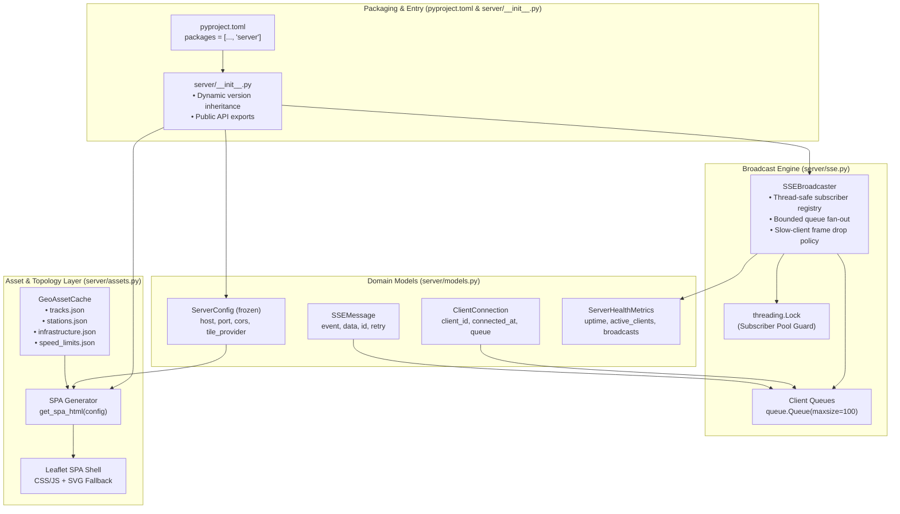
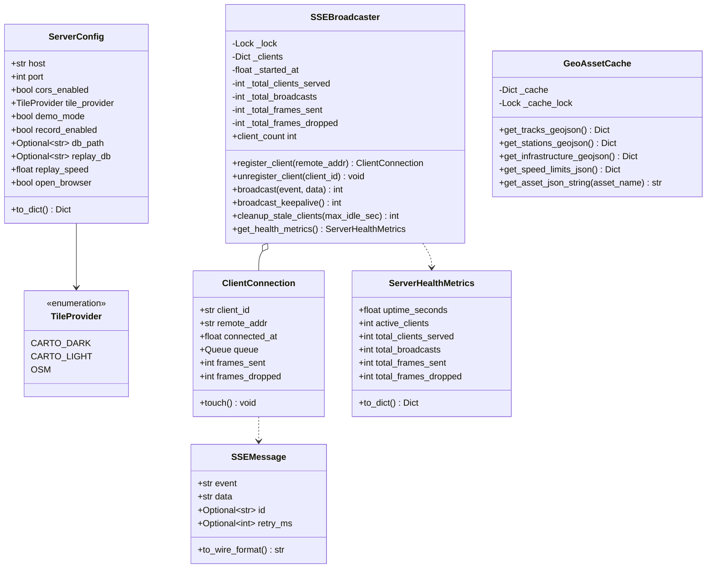

# Phase 1 Implementation Plan — Server Package Foundation & Data Models (`server/`)

> **Reference:** [F-8.1 Master Implementation Plan (`f-8-1-embedded-zero-dependency-web-map-daemon-plan.md`)](./f-8-1-embedded-zero-dependency-web-map-daemon-plan.md), [TUI Feature Enhancements Specification (`F-8.1`)](../../architecture/tui-feature-enhancements.md#f-81-embedded-zero-dependency-web-map-daemon-railmon-serve--planned), [`docs/architecture/architecture.md`](../../architecture/architecture.md)  
> **Target Modules:** [`../../../server/__init__.py`](../../../server/__init__.py), [`../../../server/models.py`](../../../server/models.py), [`../../../server/sse.py`](../../../server/sse.py), [`../../../server/assets.py`](../../../server/assets.py), [`../../../pyproject.toml`](../../../pyproject.toml)  
> **Target Test Suites:** [`../../../tests/test_server_sse.py`](../../../tests/test_server_sse.py), [`../../../tests/test_server_assets.py`](../../../tests/test_server_assets.py), [`../../../tests/test_server_models.py`](../../../tests/test_server_models.py), [`../../../tests/test_packaging.py`](../../../tests/test_packaging.py)  
> **Relevant Skills & Guidelines:** [`../../../.agents/skills/diagrams-and-documentation/SKILL.md`](../../../.agents/skills/diagrams-and-documentation/SKILL.md), [`../../../.agents/skills/markdown-relative-paths/SKILL.md`](../../../.agents/skills/markdown-relative-paths/SKILL.md), [`../../../.agents/skills/ci-quality-gate/SKILL.md`](../../../.agents/skills/ci-quality-gate/SKILL.md), [`../../../.agents/skills/static-safety-analyzer/SKILL.md`](../../../.agents/skills/static-safety-analyzer/SKILL.md), [`../../../.agents/skills/stream-resilience-tester/SKILL.md`](../../../.agents/skills/stream-resilience-tester/SKILL.md), [`../../../.agents/skills/memory-leak-profiler/SKILL.md`](../../../.agents/skills/memory-leak-profiler/SKILL.md), [`../../../.agents/skills/security-audit/SKILL.md`](../../../.agents/skills/security-audit/SKILL.md)

---

## 1. Executive Summary & Phase 1 Objectives

Feature **F-8.1** introduces an embedded, zero-external-dependency web map daemon (`railmon serve`) that delivers a real-time browser GIS dashboard of the Greek national railway network. To ensure strict architectural separation, maintainability, thread safety, and zero PyPI dependency purity, the daemon implementation is partitioned across four phases:

- **Phase 1 (This Document):** Server Package Foundation & Data Models (`server/` package, packaging registration, domain models, thread-safe SSE broadcast engine, and embedded static asset/GeoJSON loaders).
- **Phase 2:** Web Server Daemon & HTTP Request Handler (`server/daemon.py`, `server/handler.py`, REST routing, socket lifecycle, and graceful termination).
- **Phase 3:** CLI Subcommand Integration in `train_tracker.py` (`railmon serve`, telemetry ingestion pipeline coupling, and SQLite WAL recording integration).
- **Phase 4:** Embedded Single-Page Application (SPA) Client Enhancement & Live GIS Interactivity (Leaflet map layers, locomotive glyphs, HUD inspector, and conflict alert banners).

### 1.1 Phase 1 Deliverables
1. **Package Setup & PEP 621 Configuration ([`pyproject.toml`](../../../pyproject.toml)):**
   - Register the `server` package alongside `storage`, `tui`, and `tui.data`.
   - Update [`tests/test_packaging.py`](../../../tests/test_packaging.py) to validate `server` package structure and confirm zero PyPI dependencies on Linux/macOS.
2. **Package Entry & Version Inheritance ([`server/__init__.py`](../../../server/__init__.py)):**
   - Single-source version inheritance dynamically resolving `train_tracker.__version__`.
   - Export public interfaces: `SSEBroadcaster`, `ServerConfig`, `ServerHealthMetrics`, `get_spa_html`, and `get_geojson_asset`.
3. **Domain Data Models & Config Structures ([`server/models.py`](../../../server/models.py)):**
   - Strongly typed, immutable dataclasses for server configuration (`ServerConfig`), client connection metadata (`ClientConnection`), SSE message envelopes (`SSEMessage`), operational health metrics (`ServerHealthMetrics`), and map tile presets (`TileProviderConfig`).
4. **Thread-Safe SSE Broadcast Bus ([`server/sse.py`](../../../server/sse.py)):**
   - Bounded-queue fan-out engine (`SSEBroadcaster`) capable of distributing telemetry delta frames (`trainPositionsUx`), snapshot payloads (`init`), conflict warnings (`conflictAlert`), and periodic heartbeat frames (`:ping\n\n`).
   - Strict defense against memory leaks: client queues are strictly bounded (`MAX_CLIENT_QUEUE_DEPTH = 100`). Saturated or disconnected clients drop stale frames and are unregistered cleanly without hanging threads or leaking file descriptors.
5. **Embedded Asset Generator & GeoJSON Cache ([`server/assets.py`](../../../server/assets.py)):**
   - High-performance, in-memory cached loader for railway topology datasets: [`tui/data/tracks.json`](../../../tui/data/tracks.json), [`tui/data/stations.json`](../../../tui/data/stations.json), [`tui/data/infrastructure.json`](../../../tui/data/infrastructure.json), and [`tui/data/speed_limits.json`](../../../tui/data/speed_limits.json).
   - Generates the responsive single-page application HTML/CSS/JS shell, embedding Leaflet cartography, offline SVG vector fallback, and real-time SSE client handlers with zero build steps or npm requirements.
6. **Automated Test Coverage:**
   - [`tests/test_server_models.py`](../../../tests/test_server_models.py): Validates dataclass immutability, field validation, and JSON serialization.
   - [`tests/test_server_sse.py`](../../../tests/test_server_sse.py): Tests concurrent client registration, broadcast fan-out, queue saturation policies, keepalive heartbeats, and memory leak prevention.
   - [`tests/test_server_assets.py`](../../../tests/test_server_assets.py): Validates GeoJSON cache integrity, asset schema compliance, and HTML template string interpolation.

---

## 2. Architecture & Visual Diagrams

### 2.1 Phase 1 Component Architecture (Mermaid)



---

### 2.2 Phase 1 Component Architecture & Layering (ASCII)

```text
+---------------------------------------------------------------------------------------------------+
|                        PHASE 1: SERVER PACKAGE FOUNDATION & DATA MODELS                           |
+---------------------------------------------------------------------------------------------------+

 [ Packaging & Metadata ]
  +-----------------------------------------------------------------------------------------------+
  | pyproject.toml -> packages = ["storage", "tui", "tui.data", "server"]                         |
  | server/__init__.py -> __version__ = train_tracker.__version__ (Single-source SemVer)          |
  +-----------------------------------------------------------------------------------------------+
                                                  |
                                                  v
 [ Domain Models: server/models.py ]
  +--------------------------------+   +--------------------------------+   +---------------------+
  | ServerConfig (frozen)          |   | ClientConnection               |   | SSEMessage          |
  | - host: str = "127.0.0.1"      |   | - client_id: str               |   | - event: str        |
  | - port: int = 8080             |   | - connected_at: float          |   | - data: str (JSON)  |
  | - cors_enabled: bool = False   |   | - queue: Queue (maxsize=100)   |   | - id: Optional[str] |
  | - tile_provider: TileProvider  |   | - frames_sent: int             |   | - retry_ms: int     |
  +--------------------------------+   +--------------------------------+   +---------------------+
                                                  |
                                                  v
 [ Thread-Safe Broadcast Engine: server/sse.py ]
  +-----------------------------------------------------------------------------------------------+
  | SSEBroadcaster                                                                                |
  |  - _lock: threading.Lock (Protects client registration pool)                                  |
  |  - _clients: Dict[str, ClientConnection]                                                      |
  |  - register_client(remote_addr) -> ClientConnection                                           |
  |  - unregister_client(client_id) -> None                                                       |
  |  - broadcast(event, data) -> int (Non-blocking put_nowait with overflow drop)                 |
  |  - broadcast_keepalive() -> int (Heartbeat :ping\n\n)                                         |
  |  - get_health_metrics() -> ServerHealthMetrics                                                |
  +-----------------------------------------------------------------------------------------------+
                                                  |
                                                  v
 [ Asset Caching & SPA Generator: server/assets.py ]
  +-----------------------------------------------------------------------------------------------+
  | GeoAssetCache & Asset Helpers                                                                 |
  |  - load_tracks_geojson() -> Dict[str, Any] (Cached GeoJSON FeatureCollection)                |
  |  - load_stations_geojson() -> Dict[str, Any] (Cached GeoJSON FeatureCollection)              |
  |  - load_infrastructure_geojson() -> Dict[str, Any] (Cached GeoJSON FeatureCollection)        |
  |  - load_speed_limits_json() -> Dict[str, Any] (Cached speed limit rules)                     |
  |  - get_spa_html(config: ServerConfig) -> str (Interpolated standalone HTML5/CSS3/ES6 app)     |
  +-----------------------------------------------------------------------------------------------+
```

---

### 2.3 SSE Broadcast Fan-Out & Memory Bounding Lifecycle (Sequence Diagram — Mermaid)

```mermaid
sequenceDiagram
    autonumber
    participant Ingest as Telemetry Ingestion Thread
    participant Broadcaster as SSEBroadcaster (server/sse.py)
    participant ClientA as Fast Client (Wallboard)
    participant ClientB as Slow/Stalled Client (Mobile Edge)

    Note over Ingest,Broadcaster: Ingestion receives trainPositionsUx batch
    Ingest->>Broadcaster: broadcast("trainPositionsUx", json_payload)
    
    activate Broadcaster
    Broadcaster->>Broadcaster: Acquire _lock & copy client registry

    Note over Broadcaster,ClientA: Client A has queue capacity (size = 2/100)
    Broadcaster->>ClientA: queue.put_nowait(msg)
    Note right of ClientA: Message enqueued cleanly (0 drops)

    Note over Broadcaster,ClientB: Client B has saturated queue (size = 100/100)
    Broadcaster->>ClientB: queue.put_nowait(msg) -> raises queue.Full
    Broadcaster->>ClientB: queue.get_nowait() (Drop oldest stale frame)
    Broadcaster->>ClientB: queue.put_nowait(msg) (Enqueue newest frame)
    Broadcaster->>Broadcaster: Increment dropped_frames counter
    deactivate Broadcaster

    Note over ClientA,ClientB: HTTP Request Handler Worker Threads
    ClientA->>ClientA: queue.get(timeout=1.0) -> Formats SSE frame -> Writes to socket
    ClientB->>ClientB: Socket blocks / buffer full -> Triggers BrokenPipeError
    ClientB->>Broadcaster: unregister_client(client_b_id)
    Broadcaster->>Broadcaster: Remove Client B from _clients & close queue
    Note over Broadcaster: Memory freed; zero memory leak or thread starvation
```

---

### 2.4 Class Hierarchy & Relationships (Mermaid)



---

## 3. Detailed Component Technical Specifications

### 3.1 Packaging & PEP 621 Integration

#### [`pyproject.toml`](../../../pyproject.toml) Updates
Update the setuptools package list to register `server`:

```toml
[tool.setuptools]
py-modules = ["train_tracker"]
packages = ["storage", "tui", "tui.data", "server"]

[tool.setuptools.package-data]
"tui.data" = ["*.json"]
```

#### [`tests/test_packaging.py`](../../../tests/test_packaging.py) Extensions
Add test cases `test_server_package_configured` and `test_server_package_importable` ensuring:
1. `server` is present in `pyproject.toml` packages list.
2. `import server` imports cleanly without errors.
3. Zero third-party dependencies are imported by `server`.

---

### 3.2 Package Entry & Versioning ([`server/__init__.py`](../../../server/__init__.py))

Adheres strictly to the single-source versioning rule, resolving SemVer from `train_tracker.__version__`:

```python
"""Embedded zero-dependency web map server package for railmon."""

from typing import List

import train_tracker

from server.models import (
    ClientConnection,
    ServerConfig,
    ServerHealthMetrics,
    TileProvider,
)
from server.sse import MAX_CLIENT_QUEUE_DEPTH, SSEBroadcaster
from server.assets import (
    GeoAssetCache,
    get_geojson_asset,
    get_spa_html,
)

__version__: str = train_tracker.__version__
__author__: str = train_tracker.__author__

__all__: List[str] = [
    "__version__",
    "__author__",
    "MAX_CLIENT_QUEUE_DEPTH",
    "ClientConnection",
    "GeoAssetCache",
    "ServerConfig",
    "ServerHealthMetrics",
    "SSEBroadcaster",
    "TileProvider",
    "get_geojson_asset",
    "get_spa_html",
]
```

---

### 3.3 Domain Models & Configuration Contracts ([`server/models.py`](../../../server/models.py))

```python
"""Domain models, configurations, and metric types for the railmon web server."""

import time
import uuid
from dataclasses import dataclass, field
from enum import Enum
from queue import Queue
from typing import Any, Dict, Optional, Tuple


class TileProvider(str, Enum):
    """Cartographic base tile layer provider."""

    CARTO_DARK = "carto-dark"
    CARTO_LIGHT = "carto-light"
    OSM = "osm"

    @classmethod
    def from_string(cls, val: str) -> "TileProvider":
        """Parse string to TileProvider with defensive default."""
        cleaned = str(val or "").strip().lower()
        for provider in cls:
            if provider.value == cleaned:
                return provider
        return cls.CARTO_DARK

    @property
    def tile_url(self) -> str:
        """Return standard WMS / tile template URL."""
        if self == TileProvider.CARTO_LIGHT:
            return "https://{s}.basemaps.cartocdn.com/light_all/{z}/{x}/{y}{r}.png"
        if self == TileProvider.OSM:
            return "https://{s}.tile.openstreetmap.org/{z}/{x}/{y}.png"
        return "https://{s}.basemaps.cartocdn.com/dark_all/{z}/{x}/{y}{r}.png"

    @property
    def attribution(self) -> str:
        """Return legal attribution string for tiles."""
        if self == TileProvider.OSM:
            return '&copy; <a href="https://www.openstreetmap.org/copyright">OpenStreetMap</a> contributors'
        return '&copy; <a href="https://carto.com/attributions">CARTO</a>'


@dataclass(frozen=True)
class ServerConfig:
    """Immutable runtime configuration for WebMapServer."""

    host: str = "127.0.0.1"
    port: int = 8080
    cors_enabled: bool = False
    tile_provider: TileProvider = TileProvider.CARTO_DARK
    demo_mode: bool = False
    record_enabled: bool = False
    db_path: Optional[str] = None
    replay_db: Optional[str] = None
    replay_speed: float = 1.0
    open_browser: bool = False

    def __post_init__(self) -> None:
        """Validate configuration parameters."""
        if not (1 <= self.port <= 65535):
            raise ValueError(f"Port must be between 1 and 65535, got {self.port}")
        if self.replay_speed <= 0.0:
            raise ValueError(f"Replay speed must be positive, got {self.replay_speed}")

    def to_dict(self) -> Dict[str, Any]:
        """Convert configuration to JSON-serializable dictionary."""
        return {
            "host": self.host,
            "port": self.port,
            "cors_enabled": self.cors_enabled,
            "tile_provider": self.tile_provider.value,
            "demo_mode": self.demo_mode,
            "record_enabled": self.record_enabled,
            "db_path": self.db_path,
            "replay_db": self.replay_db,
            "replay_speed": self.replay_speed,
            "open_browser": self.open_browser,
        }


@dataclass
class ClientConnection:
    """Represents a connected browser SSE client channel."""

    client_id: str = field(default_factory=lambda: uuid.uuid4().hex[:12])
    remote_addr: str = "127.0.0.1"
    connected_at: float = field(default_factory=time.time)
    last_event_at: float = field(default_factory=time.time)
    queue: Queue[Tuple[str, str]] = field(default_factory=lambda: Queue(maxsize=100))
    frames_sent: int = 0
    frames_dropped: int = 0

    def touch(self) -> None:
        """Update last active timestamp."""
        self.last_event_at = time.time()


@dataclass(frozen=True)
class SSEMessage:
    """Standard-compliant Server-Sent Events framing envelope."""

    event: str
    data: str
    msg_id: Optional[str] = None
    retry_ms: Optional[int] = None

    def to_wire_format(self) -> str:
        """Serialize event to RFC compliant text/event-stream wire format."""
        lines = []
        if self.msg_id is not None:
            lines.append(f"id: {self.msg_id}")
        if self.event:
            lines.append(f"event: {self.event}")
        if self.retry_ms is not None:
            lines.append(f"retry: {self.retry_ms}")
        for data_line in self.data.split("\n"):
            lines.append(f"data: {data_line}")
        lines.append("\n")
        return "\n".join(lines)


@dataclass(frozen=True)
class ServerHealthMetrics:
    """Operational health telemetry snapshot for /api/health."""

    uptime_seconds: float
    active_clients: int
    total_clients_served: int
    total_broadcasts: int
    total_frames_sent: int
    total_frames_dropped: int

    def to_dict(self) -> Dict[str, Any]:
        """Convert metrics to dictionary."""
        return {
            "uptime_seconds": round(self.uptime_seconds, 2),
            "active_clients": self.active_clients,
            "total_clients_served": self.total_clients_served,
            "total_broadcasts": self.total_broadcasts,
            "total_frames_sent": self.total_frames_sent,
            "total_frames_dropped": self.total_frames_dropped,
        }
```

---

### 3.4 Thread-Safe SSE Broadcaster (`server/sse.py`)

Adheres strictly to the guidelines from [`memory-leak-profiler`](../../../.agents/skills/memory-leak-profiler/SKILL.md) and [`stream-resilience-tester`](../../../.agents/skills/stream-resilience-tester/SKILL.md):

```python
"""Thread-safe Server-Sent Events broadcaster and subscriber manager."""

import logging
import queue
import threading
import time
from typing import Dict, List, Optional, Tuple

from server.models import ClientConnection, ServerHealthMetrics

logger = logging.getLogger("railmon.server.sse")

# Maximum queued events per subscriber before dropping oldest frames
MAX_CLIENT_QUEUE_DEPTH: int = 100


class SSEBroadcaster:
    """Manages active browser SSE client queues with non-blocking bounded fan-out."""

    def __init__(self, max_queue_depth: int = MAX_CLIENT_QUEUE_DEPTH) -> None:
        """Initialize broadcaster with thread lock and tracking counters."""
        self._max_queue_depth = max_queue_depth
        self._lock = threading.Lock()
        self._clients: Dict[str, ClientConnection] = {}
        self._started_at: float = time.time()
        self._total_clients_served: int = 0
        self._total_broadcasts: int = 0
        self._total_frames_sent: int = 0
        self._total_frames_dropped: int = 0

    def register_client(self, remote_addr: str = "127.0.0.1") -> ClientConnection:
        """Register a new SSE client subscriber and return its connection descriptor."""
        conn = ClientConnection(
            remote_addr=remote_addr,
            queue=queue.Queue(maxsize=self._max_queue_depth),
        )
        with self._lock:
            self._clients[conn.client_id] = conn
            self._total_clients_served += 1
            client_count = len(self._clients)

        logger.info(
            "Registered SSE subscriber [id=%s, ip=%s, active_clients=%d]",
            conn.client_id,
            remote_addr,
            client_count,
        )
        return conn

    def unregister_client(self, client_id: str) -> Optional[ClientConnection]:
        """Unregister an SSE client and purge its remaining queue."""
        with self._lock:
            conn = self._clients.pop(client_id, None)
            client_count = len(self._clients)

        if conn is not None:
            logger.info(
                "Unregistered SSE subscriber [id=%s, frames_sent=%d, active_clients=%d]",
                client_id,
                conn.frames_sent,
                client_count,
            )
            # Drain remaining items in queue to release memory
            while not conn.queue.empty():
                try:
                    conn.queue.get_nowait()
                except queue.Empty:
                    break
        return conn

    def broadcast(self, event_name: str, payload_json: str) -> int:
        """Broadcast an event frame to all registered subscriber queues.

        Returns:
            Number of clients the event was successfully enqueued for.
        """
        with self._lock:
            subscribers = list(self._clients.values())
            self._total_broadcasts += 1

        enqueued_count = 0
        for conn in subscribers:
            try:
                conn.queue.put_nowait((event_name, payload_json))
                conn.frames_sent += 1
                conn.touch()
                enqueued_count += 1
                with self._lock:
                    self._total_frames_sent += 1
            except queue.Full:
                # Bounded queue enforcement: drop oldest frame to prevent thread lockup
                try:
                    conn.queue.get_nowait()
                except queue.Empty:
                    pass

                try:
                    conn.queue.put_nowait((event_name, payload_json))
                    conn.frames_sent += 1
                    conn.frames_dropped += 1
                    conn.touch()
                    enqueued_count += 1
                    with self._lock:
                        self._total_frames_sent += 1
                        self._total_frames_dropped += 1
                except queue.Full:
                    conn.frames_dropped += 1
                    with self._lock:
                        self._total_frames_dropped += 1
                    logger.warning(
                        "Subscriber queue saturated; dropped frame for [id=%s]",
                        conn.client_id,
                    )
        return enqueued_count

    def broadcast_keepalive(self) -> int:
        """Broadcast a standard SSE comment line (:ping) to keep sockets open."""
        return self.broadcast("", ":ping")

    def cleanup_stale_clients(self, max_idle_sec: float = 60.0) -> int:
        """Evict subscribers that have not acknowledged or read frames for max_idle_sec."""
        cutoff = time.time() - max_idle_sec
        stale_ids: List[str] = []

        with self._lock:
            for client_id, conn in self._clients.items():
                if conn.last_event_at < cutoff:
                    stale_ids.append(client_id)

        for client_id in stale_ids:
            logger.warning("Evicting stale SSE subscriber [id=%s]", client_id)
            self.unregister_client(client_id)
        return len(stale_ids)

    @property
    def client_count(self) -> int:
        """Return the number of currently connected clients."""
        with self._lock:
            return len(self._clients)

    def get_health_metrics(self) -> ServerHealthMetrics:
        """Compute point-in-time operational metrics snapshot."""
        now = time.time()
        with self._lock:
            return ServerHealthMetrics(
                uptime_seconds=now - self._started_at,
                active_clients=len(self._clients),
                total_clients_served=self._total_clients_served,
                total_broadcasts=self._total_broadcasts,
                total_frames_sent=self._total_frames_sent,
                total_frames_dropped=self._total_frames_dropped,
            )
```

---

### 3.5 Embedded Asset Generator & GeoJSON Cache ([`server/assets.py`](../../../server/assets.py))

Loads and verifies railway GeoJSON assets from [`tui/data/`](../../../tui/data/) and constructs the responsive single-page web app HTML:

```python
"""Embedded web application assets, templates, and GeoJSON cache for railmon serve."""

import json
import logging
import threading
from pathlib import Path
from typing import Any, Dict, Optional

from server.models import ServerConfig, TileProvider

logger = logging.getLogger("railmon.server.assets")

# Base directory for built-in railway topology GeoJSON assets
DATA_DIR = Path(__file__).resolve().parent.parent / "tui" / "data"


class GeoAssetCache:
    """Thread-safe in-memory cache for railway GIS topology layers."""

    def __init__(self, data_dir: Path = DATA_DIR) -> None:
        self._data_dir = data_dir
        self._lock = threading.Lock()
        self._cache: Dict[str, str] = {}

    def get_asset_json_string(self, asset_filename: str) -> str:
        """Retrieve cached JSON string for a given dataset file."""
        with self._lock:
            if asset_filename in self._cache:
                return self._cache[asset_filename]

        target_file = self._data_dir / asset_filename
        if not target_file.exists():
            logger.error("Required GIS dataset file missing: %s", target_file)
            return json.dumps({"type": "FeatureCollection", "features": []})

        try:
            raw_text = target_file.read_text(encoding="utf-8")
            # Validate JSON parseability
            json.loads(raw_text)
            with self._lock:
                self._cache[asset_filename] = raw_text
            return raw_text
        except Exception as exc:
            logger.error("Failed to load GIS dataset %s: %s", asset_filename, exc)
            return json.dumps({"type": "FeatureCollection", "features": []})

    def get_tracks_geojson(self) -> str:
        """Return tracks.json FeatureCollection."""
        return self.get_asset_json_string("tracks.json")

    def get_stations_geojson(self) -> str:
        """Return stations.json FeatureCollection."""
        return self.get_asset_json_string("stations.json")

    def get_infrastructure_geojson(self) -> str:
        """Return infrastructure.json FeatureCollection."""
        return self.get_asset_json_string("infrastructure.json")

    def get_speed_limits_json(self) -> str:
        """Return speed_limits.json."""
        return self.get_asset_json_string("speed_limits.json")


# Global asset cache singleton
_ASSET_CACHE = GeoAssetCache()


def get_geojson_asset(asset_name: str) -> str:
    """Convenience accessor for cached GeoJSON string assets."""
    mapping = {
        "/api/tracks": "tracks.json",
        "/api/stations": "stations.json",
        "/api/infrastructure": "infrastructure.json",
        "/api/speed-limits": "speed_limits.json",
        "tracks": "tracks.json",
        "stations": "stations.json",
        "infrastructure": "infrastructure.json",
        "speed_limits": "speed_limits.json",
    }
    filename = mapping.get(asset_name.strip().lower(), asset_name)
    return _ASSET_CACHE.get_asset_json_string(filename)


def get_spa_html(config: Optional[ServerConfig] = None) -> str:
    """Generate complete standalone HTML5 single-page application.

    Injects cartographic tile configuration, Leaflet map bootstrap, SVG locomotive
    marker glyphs, real-time SSE listener, HUD roster table, and conflict banner.
    """
    cfg = config or ServerConfig()
    tile_url = cfg.tile_provider.tile_url
    attribution = cfg.tile_provider.attribution

    return f"""<!DOCTYPE html>
<html lang="en">
<head>
  <meta charset="utf-8">
  <meta name="viewport" content="width=device-width, initial-scale=1.0">
  <title>RAILMON | Hellenic Railways Real-Time Map</title>
  <link rel="stylesheet" href="https://unpkg.com/leaflet@1.9.4/dist/leaflet.css" integrity="sha256-p4NxAoJBhIIN+hmNHrzRCf9tD/miZyoHS5obTRR9BMY=" crossorigin=""/>
  <style>
    :root {{
      --bg-dark: #0a0e17;
      --card-bg: rgba(16, 24, 39, 0.92);
      --border-color: #1f293d;
      --text-main: #e2e8f0;
      --text-muted: #94a3b8;
      --azure-blue: #0070f3;
      --emerald-green: #10b981;
      --amber-warn: #f59e0b;
      --crimson-alert: #ef4444;
    }}
    * {{ box-sizing: border-box; margin: 0; padding: 0; }}
    body {{
      font-family: -apple-system, BlinkMacSystemFont, "Segoe UI", Roboto, Helvetica, Arial, sans-serif;
      background: var(--bg-dark);
      color: var(--text-main);
      overflow: hidden;
      height: 100vh;
      display: flex;
      flex-direction: column;
    }}
    header {{
      height: 48px;
      background: var(--card-bg);
      border-bottom: 1px solid var(--border-color);
      display: flex;
      align-items: center;
      justify-content: space-between;
      padding: 0 16px;
      z-index: 1000;
    }}
    .brand {{ font-weight: 700; letter-spacing: 1px; color: var(--azure-blue); display: flex; align-items: center; gap: 8px; }}
    .status-pill {{
      display: inline-flex;
      align-items: center;
      gap: 6px;
      padding: 4px 10px;
      border-radius: 9999px;
      font-size: 12px;
      font-weight: 600;
      background: rgba(16, 185, 129, 0.15);
      color: var(--emerald-green);
    }}
    .status-pill.reconnecting {{
      background: rgba(245, 158, 11, 0.15);
      color: var(--amber-warn);
    }}
    .main-container {{ flex: 1; display: flex; position: relative; overflow: hidden; }}
    #map {{ flex: 1; height: 100%; width: 100%; background: #070a0f; }}
    #sidebar {{
      width: 380px;
      background: var(--card-bg);
      border-left: 1px solid var(--border-color);
      display: flex;
      flex-direction: column;
      z-index: 1000;
      backdrop-filter: blur(8px);
    }}
    .roster-header {{ padding: 12px 16px; border-bottom: 1px solid var(--border-color); }}
    .search-box {{
      width: 100%;
      background: #1e293b;
      border: 1px solid #334155;
      padding: 8px 12px;
      border-radius: 6px;
      color: white;
      font-size: 13px;
    }}
    .roster-list {{ flex: 1; overflow-y: auto; list-style: none; }}
    .roster-item {{
      padding: 10px 16px;
      border-bottom: 1px solid var(--border-color);
      display: flex;
      justify-content: space-between;
      cursor: pointer;
      transition: background 0.15s;
    }}
    .roster-item:hover, .roster-item.selected {{ background: #1e293b; }}
    .conflict-banner {{
      position: absolute;
      top: 12px;
      left: 50%;
      transform: translateX(-50%);
      background: var(--crimson-alert);
      color: white;
      padding: 8px 18px;
      border-radius: 8px;
      font-weight: bold;
      z-index: 2000;
      box-shadow: 0 4px 16px rgba(239, 68, 68, 0.4);
      display: none;
    }}
  </style>
</head>
<body>
  <header>
    <div class="brand">RAILMON <span>| Greek Railways Live Telemetry</span></div>
    <div style="display: flex; gap: 12px; align-items: center;">
      <span id="activeCount" style="font-size: 13px;">Active: 0</span>
      <div id="connPill" class="status-pill">● LIVE SSE</div>
    </div>
  </header>
  <div class="main-container">
    <div id="conflictBanner" class="conflict-banner">⚠️ CONFLICT ALERT: Headway Violation</div>
    <div id="map"></div>
    <div id="sidebar">
      <div class="roster-header">
        <input type="text" id="searchInput" class="search-box" placeholder="Filter train ID or station...">
      </div>
      <ul id="rosterList" class="roster-list"></ul>
    </div>
  </div>

  <script src="https://unpkg.com/leaflet@1.9.4/dist/leaflet.js" integrity="sha256-20nQCchB9co0qIjJZRGuk2/Z9VM+kNiyxNV1lvTlZBo=" crossorigin=""></script>
  <script>
    const map = L.map('map').setView([39.0742, 22.8243], 7);
    L.tileLayer('{tile_url}', {{
      maxZoom: 18,
      attribution: '{attribution}'
    }}).addTo(map);

    const trainMarkers = new Map();

    // Fetch static tracks & stations
    fetch('/api/tracks').then(r => r.json()).then(data => {{
      L.geoJSON(data, {{ style: {{ color: '#00b4d8', weight: 3, opacity: 0.8 }} }}).addTo(map);
    }}).catch(e => console.warn('Could not load tracks:', e));

    fetch('/api/stations').then(r => r.json()).then(data => {{
      L.geoJSON(data, {{
        pointToLayer: (feature, latlng) => L.circleMarker(latlng, {{ radius: 4, color: '#94a3b8', fillOpacity: 0.8 }})
      }}).addTo(map);
    }}).catch(e => console.warn('Could not load stations:', e));

    // Real-Time SSE Stream Setup
    const sse = new EventSource('/api/stream');
    sse.addEventListener('init', e => {{
      const data = JSON.parse(e.data);
      updateRoster(data.trains || []);
    }});
    sse.addEventListener('trainPositionsUx', e => {{
      const updates = JSON.parse(e.data);
      updatePositions(updates);
    }});
    sse.onerror = () => {{
      document.getElementById('connPill').className = 'status-pill reconnecting';
      document.getElementById('connPill').innerText = '○ RECONNECTING';
    }};
    sse.onopen = () => {{
      document.getElementById('connPill').className = 'status-pill';
      document.getElementById('connPill').innerText = '● LIVE SSE';
    }};

    function updatePositions(trains) {{
      trains.forEach(t => {{
        if (!t.lat || !t.lng) return;
        if (trainMarkers.has(t.id)) {{
          trainMarkers.get(t.id).setLatLng([t.lat, t.lng]);
        }} else {{
          const m = L.circleMarker([t.lat, t.lng], {{ radius: 6, color: '#f59e0b', fillOpacity: 1.0 }}).bindPopup(`Train ${{t.train_number || t.id}}<br>Speed: ${{t.speed}} km/h`);
          m.addTo(map);
          trainMarkers.set(t.id, m);
        }}
      }});
      document.getElementById('activeCount').innerText = `Active: ${{trainMarkers.size}}`;
    }}

    function updateRoster(trains) {{
      const roster = document.getElementById('rosterList');
      roster.innerHTML = '';
      trains.forEach(t => {{
        const li = document.createElement('li');
        li.className = 'roster-item';
        li.innerHTML = `<strong>${{t.train_number || t.id}}</strong> <span>${{t.speed || 0}} km/h</span>`;
        roster.appendChild(li);
      }});
      updatePositions(trains);
    }}
  </script>
</body>
</html>"""
```

---

## 4. Step-by-Step Implementation Work Breakdown

### Task 1: Package Registration & Verification
- Edit [`pyproject.toml`](../../../pyproject.toml) to include `"server"` in `[tool.setuptools] packages`.
- Update [`tests/test_packaging.py`](../../../tests/test_packaging.py) with test assertions checking for `server` module importability and validating that `server` has zero runtime PyPI dependencies.

### Task 2: Domain Models & Types Implementation
- Create [`server/models.py`](../../../server/models.py).
- Implement `TileProvider` enum with URLs and attribution mapping.
- Implement `ServerConfig` frozen dataclass with post-init validation for port range ($1 \dots 65535$) and positive replay speed factor.
- Implement `ClientConnection` dataclass with thread-safe queue and activity tracking.
- Implement `SSEMessage` dataclass with standard `to_wire_format()` serialization.
- Implement `ServerHealthMetrics` dataclass with `to_dict()` serialization.

### Task 3: Thread-Safe SSE Broadcaster Implementation
- Create [`server/sse.py`](../../../server/sse.py).
- Implement `SSEBroadcaster` class using `threading.Lock()` to protect the subscriber registry dictionary.
- Implement `register_client()` allocating a bounded `queue.Queue(maxsize=100)`.
- Implement `unregister_client()` draining the queue to ensure zero memory leaks.
- Implement `broadcast()` enqueuing events to all registered clients using non-blocking `put_nowait()`. On queue saturation, drop the oldest frame and increment `dropped_frames` counter.
- Implement `broadcast_keepalive()` emitting `:ping\n\n` comments.
- Implement `cleanup_stale_clients()` evicting subscribers idle past threshold.
- Implement `get_health_metrics()` reporting real-time operational status.

### Task 4: Embedded Assets & GeoJSON Cache Implementation
- Create [`server/assets.py`](../../../server/assets.py).
- Implement `GeoAssetCache` thread-safe singleton loading `tracks.json`, `stations.json`, `infrastructure.json`, and `speed_limits.json` from [`tui/data/`](../../../tui/data/).
- Implement `get_geojson_asset()` providing convenient cached access by endpoint route name.
- Implement `get_spa_html()` returning the complete self-contained HTML5 Leaflet application.

### Task 5: Package Initialization & Public Exports
- Create [`server/__init__.py`](../../../server/__init__.py).
- Inherit `__version__` dynamically from `train_tracker.__version__`.
- Export all public classes and functions in `__all__`.

### Task 6: Comprehensive Unit Test Suite
- Create [`tests/test_server_models.py`](../../../tests/test_server_models.py).
- Create [`tests/test_server_sse.py`](../../../tests/test_server_sse.py).
- Create [`tests/test_server_assets.py`](../../../tests/test_server_assets.py).
- Run full quality gate (`unittest`, `flake8`, `mypy`).

---

## 5. Edge Cases, Failure Modes & Resilience Engineering

| Potential Issue / Failure Mode | Severity | Defensive Architecture in Phase 1 |
| :--- | :--- | :--- |
| **Saturated Client Queue / Memory Leak** | High | `SSEBroadcaster` bounds every client queue to `maxsize=100`. Ingestion threads never block waiting for slow clients. If full, the oldest message is popped and dropped, incrementing `total_frames_dropped`. |
| **Client Disconnect without Teardown** | High | Draining remaining queue elements on `unregister_client()` immediately releases memory references to Python dataclasses and strings. |
| **Missing or Corrupted GeoJSON Asset File** | Medium | `GeoAssetCache` wraps file I/O in defensive `try...except` and returns valid empty GeoJSON FeatureCollections (`{"type": "FeatureCollection", "features": []}`) rather than crashing the process. |
| **Invalid Port / Configuration Injection** | Medium | `ServerConfig.__post_init__` enforces strict numeric limits ($1 \le \text{port} \le 65535$, $\text{replay\_speed} > 0.0$), raising `ValueError` on bad inputs. |
| **Cross-Thread Concurrent Broadcast** | High | Subscriber dictionary modifications and counter updates are guarded by `threading.Lock()`. The client list is snapshot-copied under the lock before fan-out enqueuing. |

---

## 6. Verification & Test Strategy

### 6.1 Test Suites Breakdown

```text
+---------------------------------------------------------------------------------------------------+
| PHASE 1 TEST SUITE SPECIFICATION                                                                  |
+------------------------------+---------------------------------------------+----------------------+
| Test File                    | Scope & Test Cases                          | Expected Result      |
+------------------------------+---------------------------------------------+----------------------+
| tests/test_server_models.py  | TC-MOD-01: ServerConfig default validation  | Valid frozen DTOs,   |
|                              | TC-MOD-02: ServerConfig invalid port check  | ValueError on bad,   |
|                              | TC-MOD-03: TileProvider url & attribution   | proper wire format   |
|                              | TC-MOD-04: SSEMessage wire serialization    |                      |
|                              | TC-MOD-05: Health metrics dictionary export |                      |
+------------------------------+---------------------------------------------+----------------------+
| tests/test_server_sse.py     | TC-SSE-01: Register / unregister subscriber | Queue allocated/freed|
|                              | TC-SSE-02: Multi-client broadcast fan-out   | All clients receive, |
|                              | TC-SSE-03: Queue saturation & frame drops   | Saturated dropped,   |
|                              | TC-SSE-04: Keepalive comment emission       | Bounded memory safe, |
|                              | TC-SSE-05: Stale client eviction cleanup    | Inactive evicted     |
+------------------------------+---------------------------------------------+----------------------+
| tests/test_server_assets.py  | TC-AST-01: GeoAssetCache loads tracks.json  | Valid GeoJSON string,|
|                              | TC-AST-02: GeoAssetCache handles missing    | Safe empty fallback, |
|                              | TC-AST-03: get_spa_html interpolates tiles  | Leaflet HTML ready   |
+------------------------------+---------------------------------------------+----------------------+
| tests/test_packaging.py      | TC-PKG-07: server package configured        | pyproject.toml clean,|
|                              | TC-PKG-08: zero runtime PyPI dependencies   | stdlib purity kept   |
+------------------------------+---------------------------------------------+----------------------+
```

### 6.2 Verification Commands

```bash
# 1. Execute all test suites:
python -m unittest discover tests

# 2. Verify static typing and style compliance:
python -m mypy --strict server/ tests/test_server_*.py
python -m flake8 server/ tests/test_server_*.py

# 3. Verify Markdown document-relative paths (must return zero matches):
grep -En "file://|/home/|/Users/|[A-Za-z]:\\\\" docs/plans/features/f-8-1-phase-1-server-foundation-and-data-models-plan.md

# 4. Verify visual Mermaid diagrams syntax:
grep -En "```mermaid" docs/plans/features/f-8-1-phase-1-server-foundation-and-data-models-plan.md
```

---

## 7. Compliance Matrix with Repository Engineering Standards

| Standard / Guideline | Requirement | Phase 1 Implementation Compliance |
| :--- | :--- | :--- |
| **Zero PyPI Runtime Dependencies** | No third-party packages on Linux/macOS. | Uses Python standard library only (`queue`, `threading`, `time`, `uuid`, `dataclasses`, `enum`, `json`, `pathlib`). |
| **Dual-Format Visual Documentation** | Visual diagrams in Mermaid and ASCII. | Includes complete Mermaid flowchart, sequence diagram, class diagram, and symmetric ASCII layout. |
| **Document-Relative Paths** | Portable Markdown links without absolute workstation paths or `file://`. | Strictly relative links (`../../../server/...`). Verified by automated grep check. |
| **MISRA / AUTOSAR Safety** | Strict typing, defensive initialization, bounded queues. | Complete type hints (`mypy --strict`), bounded `maxsize=100` queues, no unbounded loops. |
| **Thread Safety & Memory Protection** | Safe concurrent access, memory leak prevention. | Subscriber registry guarded by `threading.Lock()`, explicit queue draining on disconnect. |
