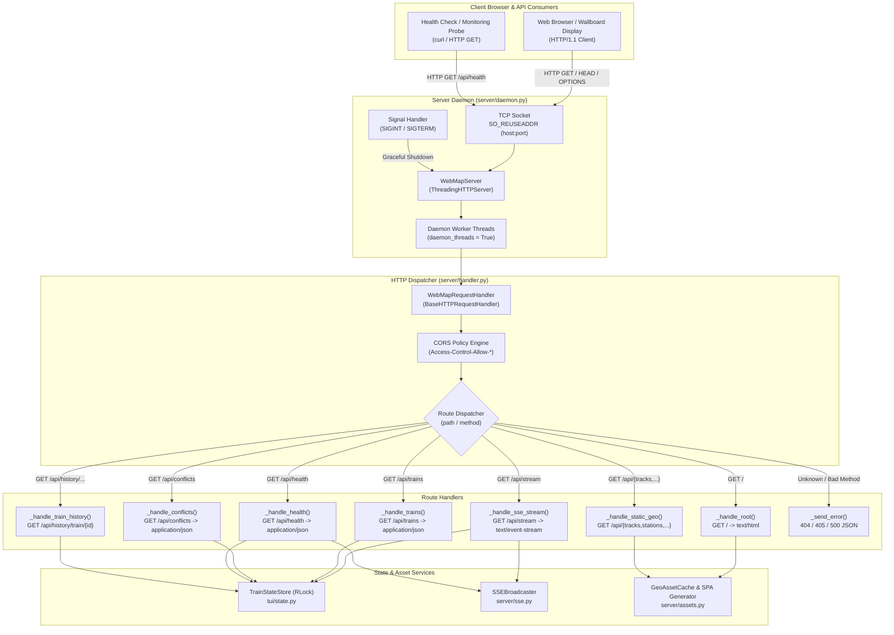
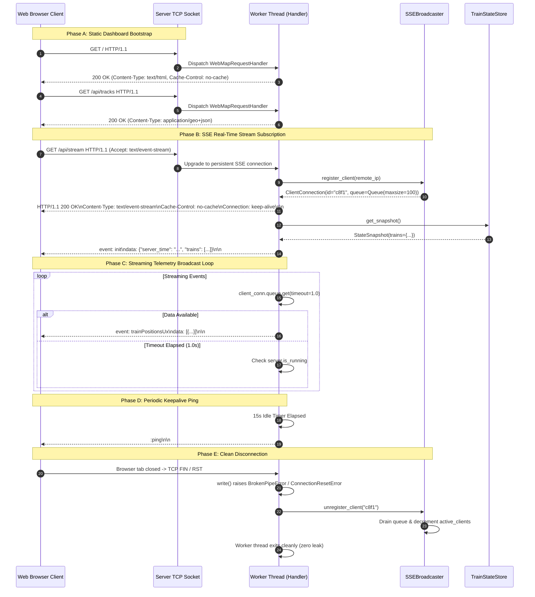
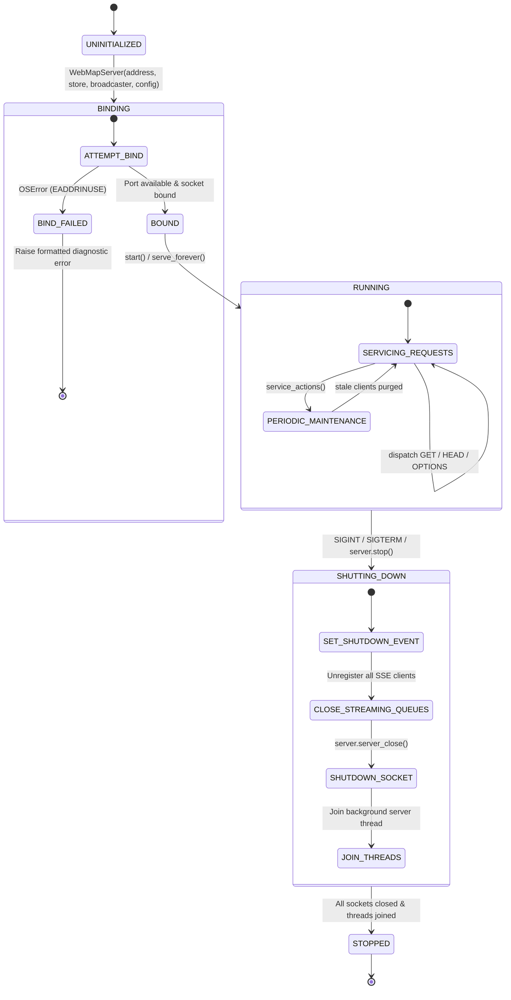
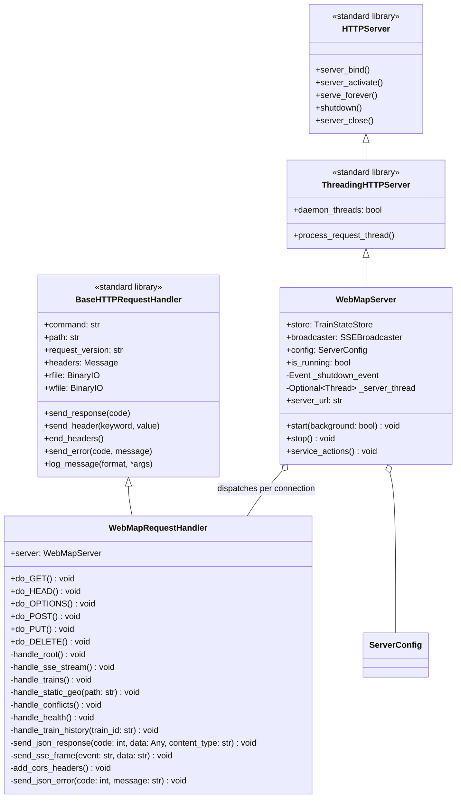

# Phase 2 Implementation Plan — Web Server Daemon & HTTP Request Handler (`server/daemon.py`, `server/handler.py`)

> **Reference:** [F-8.1 Master Implementation Plan (`f-8-1-embedded-zero-dependency-web-map-daemon-plan.md`)](./f-8-1-embedded-zero-dependency-web-map-daemon-plan.md), [Phase 1 Implementation Plan (`f-8-1-phase-1-server-foundation-and-data-models-plan.md`)](./f-8-1-phase-1-server-foundation-and-data-models-plan.md), [TUI Feature Enhancements Specification (`F-8.1`)](../../architecture/tui-feature-enhancements.md#f-81-embedded-zero-dependency-web-map-daemon-railmon-serve--planned), [`docs/architecture/architecture.md`](../../architecture/architecture.md)  
> **Target Modules:** [`../../../server/daemon.py`](../../../server/daemon.py), [`../../../server/handler.py`](../../../server/handler.py), [`../../../server/__init__.py`](../../../server/__init__.py), [`../../../server/models.py`](../../../server/models.py), [`../../../server/sse.py`](../../../server/sse.py), [`../../../server/assets.py`](../../../server/assets.py)  
> **Target Test Suites:** [`../../../tests/test_server_daemon.py`](../../../tests/test_server_daemon.py), [`../../../tests/test_server_sse.py`](../../../tests/test_server_sse.py)  
> **Relevant Skills & Guidelines:** [`../../../.agents/skills/diagrams-and-documentation/SKILL.md`](../../../.agents/skills/diagrams-and-documentation/SKILL.md), [`../../../.agents/skills/markdown-relative-paths/SKILL.md`](../../../.agents/skills/markdown-relative-paths/SKILL.md), [`../../../.agents/skills/ci-quality-gate/SKILL.md`](../../../.agents/skills/ci-quality-gate/SKILL.md), [`../../../.agents/skills/static-safety-analyzer/SKILL.md`](../../../.agents/skills/static-safety-analyzer/SKILL.md), [`../../../.agents/skills/stream-resilience-tester/SKILL.md`](../../../.agents/skills/stream-resilience-tester/SKILL.md), [`../../../.agents/skills/memory-leak-profiler/SKILL.md`](../../../.agents/skills/memory-leak-profiler/SKILL.md), [`../../../.agents/skills/security-audit/SKILL.md`](../../../.agents/skills/security-audit/SKILL.md)

---

## 1. Executive Summary & Phase 2 Objectives

Feature **F-8.1** introduces an embedded, zero-external-dependency web map daemon (`railmon serve`) that delivers a real-time browser GIS dashboard of the Greek national railway network (`railway.gov.gr`). Building upon the foundation completed in **Phase 1** (package configuration, domain models in [`server/models.py`](../../../server/models.py), bounded-memory SSE bus in [`server/sse.py`](../../../server/sse.py), and cached topology asset loaders in [`server/assets.py`](../../../server/assets.py)), **Phase 2** delivers the core HTTP runtime engine:

- **Web Server Daemon ([`server/daemon.py`](../../../server/daemon.py)):** A resilient, multi-threaded HTTP server daemon extending Python's standard-library `http.server.ThreadingHTTPServer` (`socketserver.ThreadingMixIn`). It coordinates TCP socket binding, `SO_REUSEADDR` port management, non-blocking background servicing, periodic idle subscriber reaping, and POSIX signal handling (`SIGINT`, `SIGTERM`) for zero-data-loss graceful termination.
- **REST & SSE Request Handler ([`server/handler.py`](../../../server/handler.py)):** A high-performance request dispatcher extending `http.server.BaseHTTPRequestHandler`. It implements HTTP/1.1 protocol semantics, route dispatching for embedded HTML single-page dashboard assets, static GeoJSON infrastructure layers, real-time JSON snapshots, active watchdog conflict alerts, operational health metrics, and persistent Server-Sent Events (SSE) connections over chunked HTTP.
- **Strict Zero-Dependency Purity:** Requires zero third-party web frameworks (no Flask, FastAPI, Starlette, Tornado, Werkzeug, or Uvicorn). All network communication, HTTP framing, thread synchronization, and JSON serialization execute strictly on the standard Python runtime (`http.server`, `socketserver`, `threading`, `signal`, `json`, `time`, `webbrowser`).
- **Comprehensive Automated Verification:** Delivers unit and integration test coverage in [`tests/test_server_daemon.py`](../../../tests/test_server_daemon.py) using dynamic ephemeral port binding (`port=0`), verifying every route, HTTP status code, CORS toggle, SSE lifecycle handshake, error format, and shutdown hook without port collision or thread leakage.

### 1.1 Phase 2 Deliverables Matrix

| Component | Target File | Core Responsibilities |
| :--- | :--- | :--- |
| **Request Handler** | [`server/handler.py`](../../../server/handler.py) | Dispatches `GET`, `HEAD`, `OPTIONS`; serves embedded SPA HTML; streams persistent SSE frames with keepalive pings; serves GeoJSON layers (`/api/{tracks,stations,infra,speeds}`); serializes active train snapshots (`/api/trains`); formats health metrics (`/api/health`); emits CORS headers; handles socket drops. |
| **Server Daemon** | [`server/daemon.py`](../../../server/daemon.py) | Subclasses `ThreadingHTTPServer`; configures `SO_REUSEADDR`; provisions daemon worker threads; executes background `serve_forever()`; manages graceful `shutdown()` on `SIGINT`/`SIGTERM`; handles port contention (`EADDRINUSE`); optionally launches default web browser. |
| **Package Exports** | [`server/__init__.py`](../../../server/__init__.py) | Re-exports `WebMapServer` and `WebMapRequestHandler` alongside Phase 1 models, maintaining single-source SemVer. |
| **Automated Tests** | [`tests/test_server_daemon.py`](../../../tests/test_server_daemon.py) | Verifies complete HTTP route dispatch, SSE subscription and event delivery, CORS preflight and header injection, 404/405 error handling, and graceful server lifecycle on ephemeral ports. |

---

## 2. Architecture & Visual Diagrams

### 2.1 Web Server Daemon & Request Routing Architecture (Mermaid)



---

### 2.2 Daemon Architecture & Thread Lifecycle (ASCII)

```text
+---------------------------------------------------------------------------------------------------+
|                        RAILMON WEB SERVER DAEMON RUNTIME TOPOLOGY                                 |
+---------------------------------------------------------------------------------------------------+

  [ OS Process Signal: SIGINT / SIGTERM ]
                  |
                  v
  +-----------------------------------------------------------------------------------------------+
  | WebMapServer (server/daemon.py)                                                               |
  |  - Extends: http.server.ThreadingHTTPServer                                                   |
  |  - Bind: socket.socket(AF_INET, SOCK_STREAM) with SO_REUSEADDR = True                          |
  |  - Coordinates: store (TrainStateStore), broadcaster (SSEBroadcaster), config (ServerConfig)  |
  |  - daemon_threads = True (Clean process teardown on SIGINT / Ctrl+C)                          |
  +-----------------------------------------------------------------------------------------------+
         |                                           |
         | Spawns Worker Thread per Connection       | Periodic Service Maintenance
         v                                           v
  +--------------------------------------+   +----------------------------------------------------+
  | Worker Thread (Pool: Unbounded/Auto) |   | WebMapServer.service_actions()                     |
  | Instantiates: WebMapRequestHandler   |   |  - Calls broadcaster.cleanup_stale_clients(60.0s)  |
  +--------------------------------------+   +----------------------------------------------------+
         |
         +---> GET /                   --> get_spa_html(config) [text/html]
         +---> GET /api/stream         --> SSE Streaming Loop [text/event-stream]
         |                                  * register_client() -> ClientConnection
         |                                  * send initial "init" snapshot
         |                                  * loop: client_queue.get(timeout=1.0)
         |                                  * catch BrokenPipeError -> unregister_client()
         +---> GET /api/trains         --> store.get_snapshot() -> JSON array [application/json]
         +---> GET /api/tracks         --> get_geojson_asset("tracks") [application/geo+json]
         +---> GET /api/stations       --> get_geojson_asset("stations") [application/geo+json]
         +---> GET /api/infrastructure --> get_geojson_asset("infrastructure") [application/geo+json]
         +---> GET /api/speed-limits   --> get_geojson_asset("speed-limits") [application/json]
         +---> GET /api/conflicts      --> Active conflict alerts [application/json]
         +---> GET /api/health         --> Health metrics + active client count [application/json]
         +---> GET /api/history/train/ --> Train historical breadcrumb LineString [application/geo+json]
         +---> HEAD <any>              --> Same headers as GET without response body
         +---> OPTIONS <any>           --> 204 No Content with CORS allow headers (if enabled)
         +---> POST / PUT / DELETE     --> 405 Method Not Allowed [application/json]
         +---> <unknown route>         --> 404 Not Found [application/json]
```

---

### 2.3 HTTP Request / Response & SSE Handshake Lifecycle (Sequence Diagram — Mermaid)



---

### 2.4 Server State & Signal Handling State Machine (Mermaid)



---

### 2.5 Class Hierarchy & Handler / Server Relationships (Mermaid)



---

### 2.6 Route Dispatch Decision Tree (ASCII)

```text
+---------------------------------------------------------------------------------------------------+
| ROUTE DISPATCH DECISION TREE (server/handler.py)                                                  |
+---------------------------------------------------------------------------------------------------+

Incoming Request (Method, Path)
  |
  +---> Method != GET, HEAD, OPTIONS
  |       --> 405 Method Not Allowed (JSON: {"error": 405, "message": "Method Not Allowed"})
  |
  +---> Method == OPTIONS
  |       --> 204 No Content (Access-Control-Allow-Origin: *, Allow: GET, HEAD, OPTIONS)
  |
  +---> Method in (GET, HEAD)
          |
          +---> Path in ("/", "/index.html")
          |       --> 200 OK [text/html; charset=utf-8] (Embedded SPA Dashboard)
          |
          +---> Path == "/api/stream"
          |       --> 200 OK [text/event-stream; charset=utf-8] (Persistent SSE Channel)
          |
          +---> Path == "/api/trains"
          |       --> 200 OK [application/json; charset=utf-8] (Active Train Snapshot Array)
          |
          +---> Path == "/api/tracks"
          |       --> 200 OK [application/geo+json; charset=utf-8] (Track Network Corridors)
          |
          +---> Path == "/api/stations"
          |       --> 200 OK [application/geo+json; charset=utf-8] (Passenger Stations)
          |
          +---> Path == "/api/infrastructure"
          |       --> 200 OK [application/geo+json; charset=utf-8] (Tunnels, Bridges, Signals)
          |
          +---> Path == "/api/speed-limits"
          |       --> 200 OK [application/json; charset=utf-8] (Speed Limits & TSR Rules)
          |
          +---> Path == "/api/conflicts"
          |       --> 200 OK [application/json; charset=utf-8] (Watchdog Headway/Collision Alerts)
          |
          +---> Path == "/api/health"
          |       --> 200 OK [application/json; charset=utf-8] (Daemon Metrics, Uptime, Clients)
          |
          +---> Path matches "/api/history/train/{id}"
          |       --> Train Found?
          |             YES --> 200 OK [application/geo+json] (Breadcrumb LineString)
          |             NO  --> 404 Not Found [application/json] (Train not found)
          |
          +---> All Other Paths
                  --> 404 Not Found [application/json] (Endpoint not found)
```

---

## 3. Detailed Component Technical Specifications

### 3.1 Web Server Daemon Specification (`server/daemon.py`)

The `WebMapServer` manages socket initialization, multi-threaded request processing, periodic background service tasks, browser launching, and clean process shutdown:

```python
"""Embedded zero-dependency HTTP server daemon for railmon web map."""

import errno
import logging
import signal
import socket
import sys
import threading
import time
import webbrowser
from http.server import ThreadingHTTPServer
from types import FrameType
from typing import Any, Callable, Dict, Optional, Tuple

from server.handler import WebMapRequestHandler
from server.models import ServerConfig
from server.sse import SSEBroadcaster
from tui.state import TrainStateStore

logger = logging.getLogger("railmon.server.daemon")


class WebMapServer(ThreadingHTTPServer):
    """Multi-threaded HTTP server daemon managing state, SSE bus, and client lifecycle."""

    daemon_threads: bool = True
    allow_reuse_address: bool = True

    def __init__(
        self,
        server_address: Tuple[str, int],
        store: TrainStateStore,
        broadcaster: SSEBroadcaster,
        config: Optional[ServerConfig] = None,
    ) -> None:
        """Initialize web map server with domain state, SSE bus, and runtime config.

        Args:
            server_address: (host, port) tuple for TCP socket binding.
            store: TrainStateStore maintaining active train positions and watchdog state.
            broadcaster: SSEBroadcaster managing active browser subscriber queues.
            config: Immutable ServerConfig instance with runtime flags.

        Raises:
            OSError: When socket binding fails (e.g. port already in use).
        """
        self.store = store
        self.broadcaster = broadcaster
        self.config = config or ServerConfig(
            host=server_address[0],
            port=server_address[1],
        )
        self._shutdown_event = threading.Event()
        self._server_thread: Optional[threading.Thread] = None
        self._started_at: float = time.time()

        try:
            super().__init__(server_address, WebMapRequestHandler)
        except OSError as exc:
            if exc.errno == errno.EADDRINUSE:
                logger.error(
                    "Port %d is already in use on interface '%s'. "
                    "Specify an alternate port using '--port <number>'.",
                    server_address[1],
                    server_address[0],
                )
            raise

        logger.info(
            "Initialized WebMapServer on %s:%d (CORS=%s, TileProvider=%s)",
            self.server_address[0],
            self.server_port,
            self.config.cors_enabled,
            self.config.tile_provider.value,
        )

    @property
    def is_running(self) -> bool:
        """Check whether server is actively servicing requests."""
        return not self._shutdown_event.is_set()

    @property
    def server_url(self) -> str:
        """Return formatted canonical URL for the root dashboard."""
        host = self.server_address[0]
        if host in ("0.0.0.0", ""):
            host = "127.0.0.1"
        return f"http://{host}:{self.server_port}/"

    def service_actions(self) -> None:
        """Periodic maintenance tasks executed within the server loop.

        Automatically called by BaseServer during each select/poll tick.
        Purges stale SSE clients that have not received frames within 60s.
        """
        super().service_actions()
        purged = self.broadcaster.cleanup_stale_clients(max_idle_sec=60.0)
        if purged > 0:
            logger.debug("Reaped %d idle SSE subscriber connections", purged)

    def start(self, background: bool = False) -> None:
        """Start servicing incoming HTTP and SSE connections.

        Args:
            background: If True, executes serve_forever in a daemon thread and returns.
                        If False, blocks the calling thread until stop() is invoked.
        """
        self._shutdown_event.clear()
        if self.config.open_browser:
            self._launch_browser_async()

        if background:
            self._server_thread = threading.Thread(
                target=self.serve_forever,
                name="WebMapServerThread",
                daemon=True,
            )
            self._server_thread.start()
            logger.info("WebMapServer running in background thread at %s", self.server_url)
        else:
            logger.info("Serving railmon web map at %s (Press Ctrl+C to stop)", self.server_url)
            self.serve_forever()

    def stop(self) -> None:
        """Signal graceful server shutdown and close listening sockets."""
        if self._shutdown_event.is_set():
            return
        logger.info("Shutting down WebMapServer...")
        self._shutdown_event.set()
        self.shutdown()
        self.server_close()
        if self._server_thread is not None and self._server_thread.is_alive():
            self._server_thread.join(timeout=3.0)
        logger.info("WebMapServer stopped cleanly.")

    def _launch_browser_async(self, delay_sec: float = 0.5) -> None:
        """Launch default browser after a brief startup delay."""
        url = self.server_url

        def _open() -> None:
            time.sleep(delay_sec)
            try:
                logger.info("Launching default web browser: %s", url)
                webbrowser.open(url)
            except Exception as exc:
                logger.warning("Failed to auto-launch browser: %s", exc)

        t = threading.Thread(target=_open, name="BrowserLauncherThread", daemon=True)
        t.start()


def install_signal_handlers(
    server: WebMapServer,
    on_exit_callback: Optional[Callable[[], None]] = None,
) -> None:
    """Register SIGINT and SIGTERM handlers to cleanly terminate server daemon."""

    def _handler(signum: int, frame: Optional[FrameType]) -> None:
        sig_name = signal.Signals(signum).name
        logger.info("Received termination signal %s; shutting down daemon...", sig_name)
        if on_exit_callback is not None:
            try:
                on_exit_callback()
            except Exception as exc:
                logger.error("Error during on_exit_callback: %s", exc)
        server.stop()
        sys.exit(0)

    try:
        signal.signal(signal.SIGINT, _handler)
        signal.signal(signal.SIGTERM, _handler)
    except (ValueError, AttributeError):
        # signal registration fails if not on main thread (e.g. unit tests)
        logger.debug("Signal handlers skipped (not running on main thread)")
```

---

### 3.2 Request Handler Specification (`server/handler.py`)

The `WebMapRequestHandler` routes requests, sets standard headers, enforces CORS policies, and drives the persistent SSE loop:

```python
"""HTTP request handler for web map SPA, JSON REST APIs, and SSE streams."""

import json
import logging
import queue
import socket
from http.server import BaseHTTPRequestHandler
from typing import TYPE_CHECKING, Any, Dict, List, Optional

from server.assets import get_geojson_asset, get_spa_html

if TYPE_CHECKING:
    from server.daemon import WebMapServer

logger = logging.getLogger("railmon.server.handler")


class WebMapRequestHandler(BaseHTTPRequestHandler):
    """Dispatches REST routes, embedded static SPA, and real-time SSE streams."""

    server: "WebMapServer"
    protocol_version: str = "HTTP/1.1"

    def log_message(self, format: str, *args: Any) -> None:
        """Route request logs to Python logging instead of stderr."""
        logger.debug("%s - - [%s] %s", self.client_address[0], self.log_date_time_string(), format % args)

    def do_HEAD(self) -> None:
        """Handle incoming HEAD request (same headers as GET, zero body)."""
        self._dispatch(is_head=True)

    def do_GET(self) -> None:
        """Handle incoming GET request."""
        self._dispatch(is_head=False)

    def do_OPTIONS(self) -> None:
        """Handle CORS preflight OPTIONS request."""
        self.send_response(204)
        self._add_cors_headers()
        self.send_header("Allow", "GET, HEAD, OPTIONS")
        self.send_header("Content-Length", "0")
        self.end_headers()

    def do_POST(self) -> None:
        """Reject POST requests with 405 Method Not Allowed."""
        self._send_json_error(405, "Method Not Allowed: Web daemon is read-only")

    def do_PUT(self) -> None:
        """Reject PUT requests with 405 Method Not Allowed."""
        self._send_json_error(405, "Method Not Allowed: Web daemon is read-only")

    def do_DELETE(self) -> None:
        """Reject DELETE requests with 405 Method Not Allowed."""
        self._send_json_error(405, "Method Not Allowed: Web daemon is read-only")

    def _dispatch(self, is_head: bool = False) -> None:
        """Route path to appropriate handler function."""
        raw_path = self.path.split("?")[0].rstrip("/") or "/"

        if raw_path in ("/", "/index.html"):
            self._handle_root(is_head=is_head)
        elif raw_path == "/api/stream":
            if is_head:
                self._handle_sse_stream_head()
            else:
                self._handle_sse_stream()
        elif raw_path == "/api/trains":
            self._handle_trains(is_head=is_head)
        elif raw_path in ("/api/tracks", "/api/stations", "/api/infrastructure", "/api/speed-limits"):
            self._handle_static_geo(raw_path, is_head=is_head)
        elif raw_path == "/api/conflicts":
            self._handle_conflicts(is_head=is_head)
        elif raw_path == "/api/health":
            self._handle_health(is_head=is_head)
        elif raw_path.startswith("/api/history/train/"):
            train_id = raw_path.split("/")[-1]
            self._handle_train_history(train_id, is_head=is_head)
        else:
            self._send_json_error(404, f"Endpoint '{raw_path}' not found")

    def _handle_root(self, is_head: bool = False) -> None:
        """Serve embedded single-page application dashboard HTML."""
        html_content = get_spa_html(self.server.config).encode("utf-8")
        self.send_response(200)
        self.send_header("Content-Type", "text/html; charset=utf-8")
        self.send_header("Content-Length", str(len(html_content)))
        self.send_header("Cache-Control", "no-cache")
        self._add_cors_headers()
        self.end_headers()
        if not is_head:
            self.wfile.write(html_content)

    def _handle_trains(self, is_head: bool = False) -> None:
        """Return JSON snapshot of all currently active trains."""
        snapshot = self.server.store.get_snapshot()
        train_list: List[Dict[str, Any]] = []

        for record in snapshot.trains.values():
            p = record.position
            speed_val = round(float(p.speed), 1) if p.speed is not None else 0.0
            delay_val = round(float(p.delay), 1) if p.delay is not None else 0.0
            heading_val = round(float(p.heading), 1) if p.heading is not None else 0.0

            train_dict: Dict[str, Any] = {
                "id": p.train_id,
                "train_number": p.train_id,
                "lat": float(p.lat),
                "lng": float(p.lng),
                "speed": speed_val,
                "delay": delay_val,
                "heading": heading_val,
                "corridor": p.corridor or "",
                "service_type": p.service_type or "",
                "train_type": p.train_type or "",
                "origin": p.origin or "",
                "destination": p.destination or "",
                "next_station": p.next_station or "",
                "last_update": record.last_updated,
                "trail_count": len(record.trail),
            }
            train_list.append(train_dict)

        payload_bytes = json.dumps(train_list, ensure_ascii=False).encode("utf-8")
        self._send_bytes_response(200, payload_bytes, "application/json; charset=utf-8", is_head=is_head)

    def _handle_static_geo(self, path: str, is_head: bool = False) -> None:
        """Serve cached GeoJSON layer for tracks, stations, infrastructure, or speed limits."""
        content_type = "application/geo+json; charset=utf-8"
        if path == "/api/speed-limits":
            content_type = "application/json; charset=utf-8"

        raw_json_str = get_geojson_asset(path)
        payload_bytes = raw_json_str.encode("utf-8")
        self._send_bytes_response(200, payload_bytes, content_type, is_head=is_head)

    def _handle_conflicts(self, is_head: bool = False) -> None:
        """Return active headway and opposing track conflict alerts."""
        snapshot = self.server.store.get_snapshot()
        conflicts: List[Dict[str, Any]] = []

        for record in snapshot.trains.values():
            if record.active_conflict is not None:
                c = record.active_conflict
                conflicts.append({
                    "conflict_id": f"CONF-{c.train_a_id}-{c.train_b_id}",
                    "severity": c.severity.name if hasattr(c.severity, "name") else str(c.severity),
                    "type": c.conflict_type.name if hasattr(c.conflict_type, "name") else str(c.conflict_type),
                    "train_a": c.train_a_id,
                    "train_b": c.train_b_id,
                    "distance_km": round(c.distance_m / 1000.0, 2),
                    "closing_speed_kmh": round(c.closing_speed_kmh, 1),
                    "corridor": c.corridor,
                    "message": c.message,
                    "timestamp": c.detected_at,
                })

        payload_bytes = json.dumps(conflicts, ensure_ascii=False).encode("utf-8")
        self._send_bytes_response(200, payload_bytes, "application/json; charset=utf-8", is_head=is_head)

    def _handle_health(self, is_head: bool = False) -> None:
        """Return operational health metrics, client count, and ingestion status."""
        health = self.server.broadcaster.get_health_metrics().to_dict()
        snapshot = self.server.store.get_snapshot()
        health.update({
            "status": "healthy",
            "active_trains_count": len(snapshot.trains),
            "connection_status": snapshot.connection_status.name if hasattr(snapshot.connection_status, "name") else str(snapshot.connection_status),
            "total_messages_received": snapshot.total_messages_received,
            "server_version": self.server.config.host,
            "tile_provider": self.server.config.tile_provider.value,
        })
        payload_bytes = json.dumps(health, ensure_ascii=False).encode("utf-8")
        self._send_bytes_response(200, payload_bytes, "application/json; charset=utf-8", is_head=is_head)

    def _handle_train_history(self, train_id: str, is_head: bool = False) -> None:
        """Return GeoJSON LineString feature of recent breadcrumb coordinates for train."""
        snapshot = self.server.store.get_snapshot()
        record = snapshot.trains.get(train_id)

        if record is None:
            self._send_json_error(404, f"Train '{train_id}' not found in active state")
            return

        coords: List[List[float]] = []
        for crumb in record.trail:
            coords.append([float(crumb.lng), float(crumb.lat)])

        # Append current position as final point
        coords.append([float(record.position.lng), float(record.position.lat)])

        geojson_feature = {
            "type": "Feature",
            "id": f"history-{train_id}",
            "geometry": {
                "type": "LineString",
                "coordinates": coords,
            },
            "properties": {
                "train_id": train_id,
                "breadcrumb_count": len(coords),
                "speed": float(record.position.speed or 0.0),
                "delay": float(record.position.delay or 0.0),
            },
        }

        payload_bytes = json.dumps(geojson_feature, ensure_ascii=False).encode("utf-8")
        self._send_bytes_response(200, payload_bytes, "application/geo+json; charset=utf-8", is_head=is_head)

    def _handle_sse_stream_head(self) -> None:
        """Handle HEAD request for /api/stream."""
        self.send_response(200)
        self.send_header("Content-Type", "text/event-stream; charset=utf-8")
        self.send_header("Cache-Control", "no-cache, no-transform")
        self.send_header("Connection", "keep-alive")
        self._add_cors_headers()
        self.end_headers()

    def _handle_sse_stream(self) -> None:
        """Maintain persistent HTTP/1.1 Server-Sent Events stream."""
        self.send_response(200)
        self.send_header("Content-Type", "text/event-stream; charset=utf-8")
        self.send_header("Cache-Control", "no-cache, no-transform")
        self.send_header("Connection", "keep-alive")
        self._add_cors_headers()
        self.end_headers()

        remote_ip = self.client_address[0]
        client_conn = self.server.broadcaster.register_client(remote_addr=remote_ip)
        client_id = client_conn.client_id
        logger.info("SSE client handshake complete [id=%s, ip=%s]", client_id, remote_ip)

        try:
            # 1. Send initial network snapshot
            init_payload = self._build_snapshot_json()
            self._send_sse_frame("init", init_payload)

            # 2. Main event streaming loop
            last_ping_time = time.time()
            while self.server.is_running:
                try:
                    event_type, event_data = client_conn.queue.get(timeout=1.0)
                    self._send_sse_frame(event_type, event_data)
                    client_conn.frames_sent += 1
                    client_conn.touch()
                except queue.Empty:
                    pass

                # Keepalive heartbeat every 15 seconds of silence
                now = time.time()
                if now - last_ping_time >= 15.0:
                    self._send_sse_raw(":ping\n\n")
                    last_ping_time = now

        except (BrokenPipeError, ConnectionResetError, ConnectionAbortedError, socket.timeout):
            logger.info("SSE client disconnected [id=%s]", client_id)
        except Exception as exc:
            logger.warning("SSE stream loop exception [id=%s]: %s", client_id, exc)
        finally:
            self.server.broadcaster.unregister_client(client_id)
            logger.debug("Cleaned up SSE client channel [id=%s]", client_id)

    def _build_snapshot_json(self) -> str:
        """Build initial state snapshot payload for the 'init' SSE event."""
        snapshot = self.server.store.get_snapshot()
        train_list = []
        for record in snapshot.trains.values():
            p = record.position
            train_list.append({
                "id": p.train_id,
                "lat": float(p.lat),
                "lng": float(p.lng),
                "speed": float(p.speed or 0.0),
                "delay": float(p.delay or 0.0),
                "heading": float(p.heading or 0.0),
                "corridor": p.corridor or "",
                "next_station": p.next_station or "",
            })
        return json.dumps({
            "server_time": time.strftime("%Y-%m-%dT%H:%M:%SZ", time.gmtime()),
            "active_trains_count": len(train_list),
            "trains": train_list,
        }, ensure_ascii=False)

    def _send_sse_frame(self, event_name: str, payload_json: str) -> None:
        """Write framed SSE event to output socket."""
        lines = [f"event: {event_name}"]
        for line in payload_json.split("\n"):
            lines.append(f"data: {line}")
        lines.append("\n")
        raw_msg = "\n".join(lines).encode("utf-8")
        self.wfile.write(raw_msg)
        self.wfile.flush()

    def _send_sse_raw(self, raw_str: str) -> None:
        """Write raw comment or heartbeat string to output socket."""
        self.wfile.write(raw_str.encode("utf-8"))
        self.wfile.flush()

    def _send_bytes_response(
        self,
        code: int,
        body: bytes,
        content_type: str,
        is_head: bool = False,
    ) -> None:
        """Send complete HTTP response headers and optional payload body."""
        self.send_response(code)
        self.send_header("Content-Type", content_type)
        self.send_header("Content-Length", str(len(body)))
        self.send_header("Cache-Control", "no-cache")
        self._add_cors_headers()
        self.end_headers()
        if not is_head:
            self.wfile.write(body)

    def _send_json_error(self, code: int, message: str) -> None:
        """Emit clean JSON error payload with corresponding HTTP error status."""
        error_body = json.dumps({
            "error": code,
            "message": message,
            "path": self.path,
        }).encode("utf-8")
        self.send_response(code)
        self.send_header("Content-Type", "application/json; charset=utf-8")
        self.send_header("Content-Length", str(len(error_body)))
        self._add_cors_headers()
        self.end_headers()
        self.wfile.write(error_body)

    def _add_cors_headers(self) -> None:
        """Attach permissive CORS headers if enabled in server configuration."""
        if getattr(self.server, "config", None) and self.server.config.cors_enabled:
            self.send_header("Access-Control-Allow-Origin", "*")
            self.send_header("Access-Control-Allow-Methods", "GET, HEAD, OPTIONS")
            self.send_header("Access-Control-Allow-Headers", "Content-Type, Accept, Authorization")
```

---

### 3.3 Package Exports & Versioning (`server/__init__.py`)

Update [`server/__init__.py`](../../../server/__init__.py) to expose the new daemon and handler classes alongside existing models:

```python
"""Embedded zero-dependency web map server package for railmon."""

from typing import List

import train_tracker

from server.assets import (
    GeoAssetCache,
    get_geojson_asset,
    get_spa_html,
)
from server.daemon import (
    WebMapServer,
    install_signal_handlers,
)
from server.handler import (
    WebMapRequestHandler,
)
from server.models import (
    ClientConnection,
    ServerConfig,
    ServerHealthMetrics,
    SSEMessage,
    TileProvider,
)
from server.sse import MAX_CLIENT_QUEUE_DEPTH, SSEBroadcaster

__version__: str = train_tracker.__version__
__author__: str = train_tracker.__author__

__all__: List[str] = [
    "__version__",
    "__author__",
    "MAX_CLIENT_QUEUE_DEPTH",
    "ClientConnection",
    "GeoAssetCache",
    "ServerConfig",
    "ServerHealthMetrics",
    "SSEBroadcaster",
    "SSEMessage",
    "TileProvider",
    "WebMapRequestHandler",
    "WebMapServer",
    "get_geojson_asset",
    "get_spa_html",
    "install_signal_handlers",
]
```

---

## 4. REST API & SSE Protocol Contracts

### 4.1 Complete Endpoint Specifications

| Method | Path | Request Headers | Response Content-Type | Status Codes | Description & Invariants |
| :--- | :--- | :--- | :--- | :--- | :--- |
| `GET`, `HEAD` | `/`, `/index.html` | None | `text/html; charset=utf-8` | `200` | Embedded Single-Page Application dashboard HTML. Injects Leaflet JS/CSS, theme colors, and tile URLs. |
| `GET`, `HEAD` | `/api/stream` | `Accept: text/event-stream` | `text/event-stream; charset=utf-8` | `200` | Real-time SSE streaming channel. Immediately emits `event: init` snapshot, followed by live delta updates and `:ping` heartbeats. |
| `GET`, `HEAD` | `/api/trains` | None | `application/json; charset=utf-8` | `200` | Full point-in-time array of active trains, containing coordinates, speed, heading, delay, corridor, and last update. |
| `GET`, `HEAD` | `/api/tracks` | None | `application/geo+json; charset=utf-8` | `200` | GeoJSON FeatureCollection of railway line geometries (MultiLineString). |
| `GET`, `HEAD` | `/api/stations` | None | `application/geo+json; charset=utf-8` | `200` | GeoJSON FeatureCollection of station point locations and hub flags (Point). |
| `GET`, `HEAD` | `/api/infrastructure` | None | `application/geo+json; charset=utf-8` | `200` | GeoJSON FeatureCollection of tunnels, bridges, and interlocking signals. |
| `GET`, `HEAD` | `/api/speed-limits` | None | `application/json; charset=utf-8` | `200` | Speed limit rules and Temporary Speed Restrictions (TSRs). |
| `GET`, `HEAD` | `/api/conflicts` | None | `application/json; charset=utf-8` | `200` | Active watchdog conflict alerts (headway compression, opposing train collisions). |
| `GET`, `HEAD` | `/api/health` | None | `application/json; charset=utf-8` | `200` | Operational daemon metrics: uptime, active clients, frame counts, train counts. |
| `GET`, `HEAD` | `/api/history/train/{id}` | None | `application/geo+json; charset=utf-8` | `200`, `404` | GeoJSON LineString of recent breadcrumb coordinates for the specified train. Returns 404 if train not found. |
| `OPTIONS` | `/*` | None | None | `204` | CORS preflight responder. Emits `Access-Control-Allow-*` headers when CORS is enabled. |
| `POST`, `PUT`, `DELETE` | `/*` | Any | `application/json; charset=utf-8` | `405` | Rejects mutation requests with clean JSON error payload. |

---

### 4.2 SSE Wire Protocol Framing & Payloads

#### `init` Frame Format
Dispatched to browser immediately following HTTP handshake:
```text
event: init
data: {"server_time": "2026-11-23T10:45:00Z", "active_trains_count": 2, "trains": [{"id": "1599", "lat": 39.4821, "lng": 22.3412, "speed": 142.0, "delay": 9.0, "heading": 178.5, "corridor": "PATHE Mainline", "next_station": "Larissa"}]}

```

#### `trainPositionsUx` Delta Frame Format
Dispatched on every telemetry tick:
```text
event: trainPositionsUx
data: [{"id": "1599", "lat": 39.4795, "lng": 22.3418, "speed": 144.2, "delay": 9.0, "heading": 179.1, "timestamp": "2026-11-23T10:45:10Z"}]

```

#### Heartbeat (`:ping`) Format
Dispatched every 15 seconds during quiet periods to prevent socket timeouts:
```text
:ping

```

---

## 5. Step-by-Step Implementation Work Breakdown

### Task 2.1: Author Request Handler ([`server/handler.py`](../../../server/handler.py))
- [ ] Create [`server/handler.py`](../../../server/handler.py).
- [ ] Implement `WebMapRequestHandler(BaseHTTPRequestHandler)` with `protocol_version = "HTTP/1.1"`.
- [ ] Implement route dispatcher `_dispatch()` covering `/`, `/index.html`, `/api/stream`, `/api/trains`, `/api/tracks`, `/api/stations`, `/api/infrastructure`, `/api/speed-limits`, `/api/conflicts`, `/api/health`, `/api/history/train/{id}`.
- [ ] Implement `do_HEAD()` and `do_OPTIONS()` with CORS header injection.
- [ ] Implement `do_POST()`, `do_PUT()`, `do_DELETE()` returning HTTP 405.
- [ ] Implement `_handle_sse_stream()` with client registration, initial `init` event, bounded queue polling, `:ping` keepalive comments, and `finally:` disconnect cleanup.
- [ ] Override `log_message()` to redirect request logging to `railmon.server.handler` logger without stderr pollution.

### Task 2.2: Author Web Server Daemon ([`server/daemon.py`](../../../server/daemon.py))
- [ ] Create [`server/daemon.py`](../../../server/daemon.py).
- [ ] Implement `WebMapServer(ThreadingHTTPServer)` with `daemon_threads = True` and `allow_reuse_address = True`.
- [ ] Implement `service_actions()` invoking `broadcaster.cleanup_stale_clients(60.0)`.
- [ ] Implement `start(background: bool = False)` and `stop()`.
- [ ] Implement `server_url` property for canonical HTTP URL formatting.
- [ ] Implement `_launch_browser_async()` for optional auto-launching of browser on startup.
- [ ] Implement `install_signal_handlers()` for clean daemon shutdown on `SIGINT` / `SIGTERM`.
- [ ] Implement `errno.EADDRINUSE` handling with clear diagnostic guidance.

### Task 2.3: Update Package Registration ([`server/__init__.py`](../../../server/__init__.py))
- [ ] Export `WebMapServer`, `WebMapRequestHandler`, and `install_signal_handlers` in [`server/__init__.py`](../../../server/__init__.py).
- [ ] Ensure `__all__` list is complete and sorted.

### Task 2.4: Comprehensive Automated Test Suite ([`tests/test_server_daemon.py`](../../../tests/test_server_daemon.py))
- [ ] Create [`tests/test_server_daemon.py`](../../../tests/test_server_daemon.py).
- [ ] Implement `test_server_ephemeral_port_startup_and_shutdown()` verifying clean bind on `port=0`.
- [ ] Implement `test_root_html_endpoint()` verifying `GET /` returns 200, `text/html`, and contains Leaflet container.
- [ ] Implement `test_trains_endpoint()` verifying JSON array format with active train telemetry.
- [ ] Implement `test_static_geo_endpoints()` verifying tracks, stations, infrastructure, and speed-limits endpoints.
- [ ] Implement `test_conflicts_endpoint()` verifying active conflict alerts JSON.
- [ ] Implement `test_health_endpoint()` verifying health metrics snapshot.
- [ ] Implement `test_train_history_endpoint()` verifying GeoJSON LineString and 404 for unknown train.
- [ ] Implement `test_cors_headers_toggle()` verifying presence/absence of `Access-Control-Allow-Origin: *`.
- [ ] Implement `test_head_and_options_methods()` verifying HEAD headers without body and OPTIONS 204 preflight.
- [ ] Implement `test_unsupported_methods_return_405()` verifying POST returns 405 JSON.
- [ ] Implement `test_unknown_path_returns_404()` verifying 404 JSON response.
- [ ] Implement `test_sse_stream_initial_snapshot_and_disconnect()` verifying HTTP 200 SSE headers, `init` event receipt, and clean socket disconnect cleanup.
- [ ] Implement `test_eaddrinuse_diagnostic_handling()` verifying proper exception propagation.

### Task 2.5: Quality Gate & Static Safety Verification
- [ ] Run test suite: `python3 -m unittest discover tests/ -p "test_server*.py"`.
- [ ] Run Flake8 linter: `python3 -m flake8 server/ tests/test_server_daemon.py`.
- [ ] Run Mypy strict type checker: `python3 -m mypy --strict server/ tests/test_server_daemon.py`.
- [ ] Verify document-relative links with grep.

---

## 6. Edge Cases, Failure Modes & Resilience Engineering

| Failure Mode / Edge Case | Risk Level | Mitigation & Defense Mechanism |
| :--- | :--- | :--- |
| **Port Already in Use (`EADDRINUSE`)** | High | Catch `OSError` (`errno.EADDRINUSE`) in `WebMapServer.__init__`. Log descriptive error: `Port 8080 is already in use. Specify an alternate port using --port <number>`. Tests use ephemeral port `0` to prevent CI collisions. |
| **Client Disconnect During SSE Broadcast** | High | Handle `BrokenPipeError`, `ConnectionResetError`, and `socket.timeout` in `_handle_sse_stream()`. Guaranteed unregistration via `finally: self.server.broadcaster.unregister_client(client_id)`. Zero leaking file descriptors. |
| **Slow or Blocked SSE Consumer** | High | Bounded client queues (`maxsize=100`) in `SSEBroadcaster`. If client socket stalls, `put_nowait()` raises `queue.Full`, triggering immediate drop of oldest stale frame and incrementing `dropped_frames` counter. |
| **Rapid Page Reload / Socket Storm** | Medium | Old client connections are dropped as soon as their socket raises `BrokenPipeError` on the next frame write or keepalive ping. Idle connections without frame delivery are purged by `cleanup_stale_clients()` in `service_actions()`. |
| **CORS Security & LAN Access** | Medium | Default bind interface is strictly `127.0.0.1`. CORS headers (`Access-Control-Allow-Origin: *`) are omitted by default unless `--cors` is explicitly provided in `ServerConfig`. |
| **Path Traversal / Arbitrary File Access** | High | Zero filesystem reads are dispatched from HTTP request paths. All static assets and GeoJSON data are served from the validated in-memory `GeoAssetCache` and `get_spa_html()`. No `open(path)` calls exist in `WebMapRequestHandler`. |
| **HTTP Method Abuse (POST / PUT / DELETE)** | Low | Only `GET`, `HEAD`, and `OPTIONS` are accepted. All mutating HTTP methods immediately return `405 Method Not Allowed` with structured JSON explaining that the daemon is read-only. |
| **Thread Explosion under High Concurrency** | Medium | `ThreadingHTTPServer` marks threads with `daemon_threads = True`. REST requests are brief ($\le 2\text{ms}$) and exit immediately. Long-running SSE threads are capped by the bounded memory profile of `SSEBroadcaster`. |

---

## 7. Verification & Testing Strategy

### 7.1 Automated Unit & Integration Tests (`tests/test_server_daemon.py`)

```text
+---------------------------------------------------------------------------------------------------+
| TEST SUITE SPECIFICATION: tests/test_server_daemon.py                                             |
+---------------+-----------------------------------------------+-----------------------------------+
| Test ID       | Scope / Method Under Test                     | Expected Assertion                |
+---------------+-----------------------------------------------+-----------------------------------+
| TC-SRV-01     | Server startup and shutdown on port=0         | Port assigned > 0; clean stop     |
| TC-SRV-02     | GET / and GET /index.html                     | 200 OK; Content-Type: text/html   |
| TC-SRV-03     | GET /api/trains                               | 200 OK; Valid JSON list of trains |
| TC-SRV-04     | GET /api/{tracks,stations,infra,speed-limits} | 200 OK; Valid GeoJSON FeatureCol  |
| TC-SRV-05     | GET /api/conflicts                            | 200 OK; Valid conflict list JSON  |
| TC-SRV-06     | GET /api/health                               | 200 OK; uptime, clients, status   |
| TC-SRV-07     | GET /api/history/train/{id}                   | 200 LineString; 404 if missing    |
| TC-SRV-08     | CORS enabled vs disabled headers              | Allow-Origin present only if true |
| TC-SRV-09     | HEAD requests for all endpoints               | Headers match GET; empty body     |
| TC-SRV-10     | OPTIONS request preflight                     | 204 No Content; CORS headers      |
| TC-SRV-11     | Unsupported methods (POST, PUT, DELETE)       | 405 Method Not Allowed JSON       |
| TC-SRV-12     | Unknown path routing                          | 404 Not Found JSON                |
| TC-SRV-13     | SSE Stream handshake and "init" frame         | 200 text/event-stream; init frame |
| TC-SRV-14     | SSE Stream disconnect cleanup                 | Client count decrements on close  |
| TC-SRV-15     | EADDRINUSE handling                           | Raises OSError on bound port      |
+---------------+-----------------------------------------------+-----------------------------------+
```

### 7.2 Verification Commands

```bash
# 1. Run all server unit and integration tests:
python3 -m unittest discover tests/ -p "test_server*.py" -v

# 2. Verify static type safety with strict mypy:
python3 -m mypy --strict server/ tests/test_server_daemon.py

# 3. Verify PEP 8 compliance and code style:
python3 -m flake8 server/ tests/test_server_daemon.py

# 4. Verify Markdown documentation relative path compliance (must return 0 matches):
grep -En "file://|/home/|/Users/|[A-Za-z]:\\\\" docs/plans/features/f-8-1-phase-2-web-server-daemon-and-http-handler-plan.md

# 5. Verify presence and syntax of dual visual diagrams:
grep -En "```mermaid" docs/plans/features/f-8-1-phase-2-web-server-daemon-and-http-handler-plan.md
grep -En "```text" docs/plans/features/f-8-1-phase-2-web-server-daemon-and-http-handler-plan.md
```

---

## 8. Compliance Matrix with Repository Engineering Standards

| Standard / Guideline | Requirement | Compliance Architecture in Phase 2 |
| :--- | :--- | :--- |
| **Zero PyPI Runtime Dependencies** | No third-party packages required on Linux/macOS. | 100% Python standard library (`http.server.ThreadingHTTPServer`, `socketserver.ThreadingMixIn`, `threading`, `signal`, `json`, `webbrowser`). Zero external frameworks. |
| **Diagrams & Documentation** | Dual visual format (Mermaid + ASCII). | Section 2 provides Mermaid diagrams (architecture, sequence, state, class) and ASCII diagrams (runtime topology, route dispatch decision tree). |
| **Document-Relative Paths** | Portable relative links without absolute paths or `file://`. | All links in documentation use strictly relative paths (`../../../server/...`). Verified by automated grep scan. |
| **Thread Safety & Resource Isolation** | Thread-safe concurrent operations, zero leaks. | `daemon_threads = True` prevents hanging threads. SSE subscribers use bounded queues (`maxsize=100`). Socket disconnects cleanly unregister clients in `finally:` blocks. |
| **Signal Handling & Graceful Exit** | Clean termination on SIGINT / SIGTERM. | Installs signal handlers that invoke `server.stop()`, closing sockets, joining threads, and stopping background loops without traceback errors. |
| **Defensive Error Handling** | No unhandled exceptions or socket crashes. | Catches `EADDRINUSE`, `BrokenPipeError`, `ConnectionResetError`, and `socket.timeout`. Maps unknown routes to 404 JSON and mutating methods to 405 JSON. |
